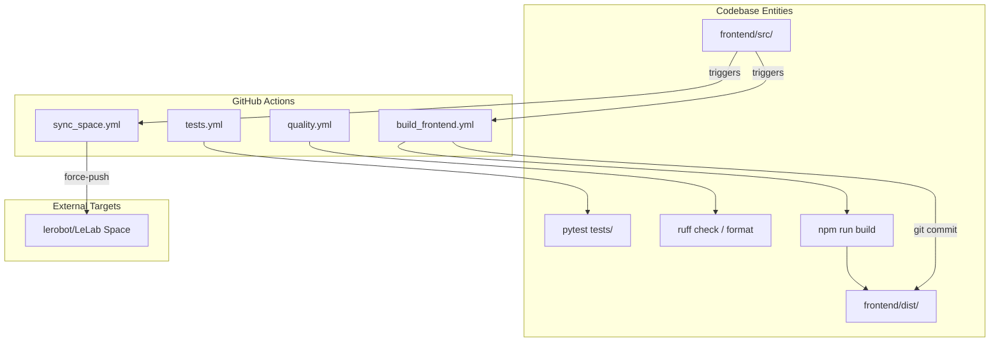
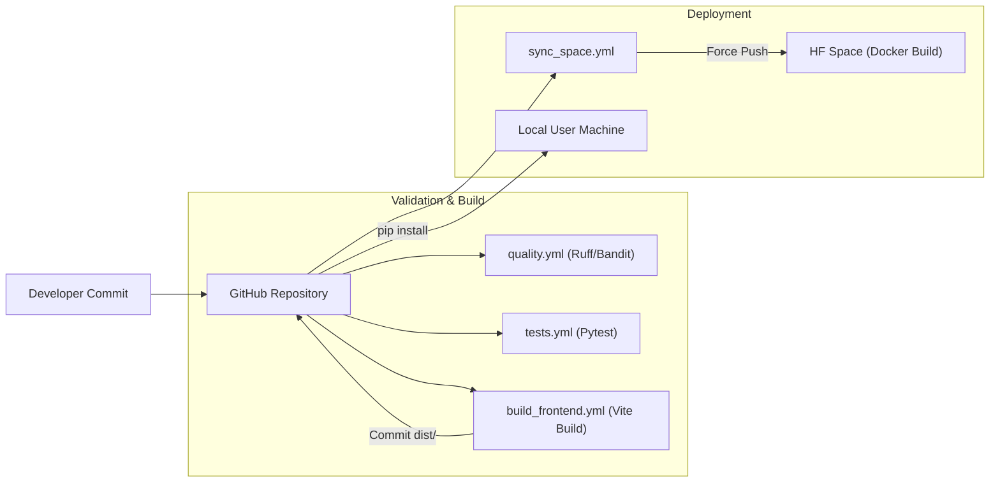

<!-- source: DeepWiki mcp.deepwiki.com · repo huggingface/leLab · page 8.2 CI/CD Pipelines · fetched 2026-10-26 -->

# CI/CD Pipelines

Relevant source files

The following files were used as context for generating this wiki page:

- [.github/workflows/build_frontend.yml](.github/workflows/build_frontend.yml)
- [.github/workflows/quality.yml](.github/workflows/quality.yml)
- [.github/workflows/sync_space.yml](.github/workflows/sync_space.yml)
- [.github/workflows/tests.yml](.github/workflows/tests.yml)
- [.pre-commit-config.yaml](.pre-commit-config.yaml)
- [frontend/README.md](frontend/README.md)

LeLab utilizes GitHub Actions to automate testing, code quality enforcement, frontend distribution management, and synchronization with the Hugging Face Hub. The pipeline ensures that the backend Python logic is verified against the test suite, the frontend bundle is kept in sync with source changes, and the public Hugging Face Space is updated automatically.

## Workflow Overview

The CI/CD architecture consists of four primary workflows and a pre-commit configuration that enforces standards locally and in the cloud.

### CI/CD Component Diagram
This diagram maps the GitHub Action workflows to the specific code entities and external targets they interact with.

**Sources:** [.github/workflows/tests.yml:17-49](), [.github/workflows/quality.yml:16-37](), [.github/workflows/build_frontend.yml:1-18](), [.github/workflows/sync_space.yml:1-13]()

---

## 1. Backend Testing (`tests.yml`)

The `tests.yml` workflow executes the `pytest` suite on every pull request to `main` and every push to `main`. It targets the backend logic located in `lelab/` and verified by `tests/`.

### Implementation Details
- **Environment**: Runs on `ubuntu-latest` using Python 3.12 [.github/workflows/tests.yml:41-50]().
- **Native Dependencies**: Because `lerobot` is a transitive dependency, the workflow installs several native libraries required at import time, including `ffmpeg`, `libusb-1.0-0-dev`, and `portaudio19-dev` [.github/workflows/tests.yml:59-63]().
- **Execution**: Installs the package with `[test]` extras and runs `pytest tests -vv --maxfail=10` [.github/workflows/tests.yml:71-75]().
- **Concurrency**: Automatically cancels older runs if a new commit is pushed to the same PR [.github/workflows/tests.yml:43-45]().

**Sources:** [.github/workflows/tests.yml:1-76]()

---

## 2. Code Quality (`quality.yml`)

The `quality.yml` workflow enforces linting, formatting, and static analysis using `pre-commit`.

### Configured Hooks
The pipeline relies on `.pre-commit-config.yaml` to define the following checks:
- **Ruff**: Handles both formatting (`ruff-format`) and linting (`ruff --fix`) [.pre-commit-config.yaml:41-46]().
- **General Hooks**: Includes `check-added-large-files`, `check-yaml`, `end-of-file-fixer`, and `trailing-whitespace` [.pre-commit-config.yaml:28-39]().
- **Security**: Runs `gitleaks` for secret detection and `bandit` for security-oriented static analysis [.pre-commit-config.yaml:70-85]().
- **Static Analysis**: Configured for `mypy` (excluding tests) and `pyupgrade` to maintain Python 3.12+ syntax [.pre-commit-config.yaml:54-58](), [.pre-commit-config.yaml:89-94]().

**Sources:** [.github/workflows/quality.yml:1-53](), [.pre-commit-config.yaml:1-109]()

---

## 3. Frontend Distribution Management (`build_frontend.yml`)

Since the LeLab FastAPI server serves the frontend as static files from `frontend/dist/`, this workflow ensures the production bundle is always up-to-date with the React source code.

### Build and Commit Logic
1. **Trigger**: Activated by changes in `frontend/**` (excluding `frontend/dist/`) on the `main` branch [.github/workflows/build_frontend.yml:4-10]().
2. **Build Process**: Uses Node.js 18 to run `npm ci` and `npm run build` within the `frontend` directory [.github/workflows/build_frontend.yml:24-34]().
3. **Automated Commit**: If `git status` detects changes in `frontend/dist/`, the workflow commits the new bundle with the message `ci: rebuild frontend/dist [skip ci]` and pushes directly back to the branch [.github/workflows/build_frontend.yml:41-47]().

**Sources:** [.github/workflows/build_frontend.yml:1-48]()

---

## 4. Hugging Face Space Sync (`sync_space.yml`)

The `sync_space.yml` workflow mirrors the frontend source code to the `lerobot/LeLab` Hugging Face Space.

### Sync Strategy
- **Trigger**: Pushes to `main` involving `frontend/` source files [.github/workflows/sync_space.yml:2-8]().
- **Artifact Handling**: The `frontend/dist/` directory is explicitly removed before syncing because the Hugging Face Space uses a Docker-based SDK to build its own bundle. Including pre-built binaries would trigger HF's pre-receive hook rejections [.github/workflows/sync_space.yml:25-28]().
- **Force Push**: The workflow initializes a fresh git repository in the `frontend/` folder and force-pushes to `huggingface.co/spaces/lerobot/LeLab` using a `HF_TOKEN` secret [.github/workflows/sync_space.yml:29-34]().

### Space Configuration
The Hugging Face Space is configured via metadata in `frontend/README.md`:
- **SDK**: `docker` [.frontend/README.md:6]().
- **Port**: `7860` [.frontend/README.md:7]().

**Sources:** [.github/workflows/sync_space.yml:1-35](), [.frontend/README.md:1-10]()

---

## Deployment Data Flow

This diagram illustrates how code moves from the local developer environment through the GitHub CI/CD pipelines to the final deployment targets.

**Sources:** [.github/workflows/build_frontend.yml:35-47](), [.github/workflows/sync_space.yml:21-34](), [.github/workflows/tests.yml:15-17]()

---

