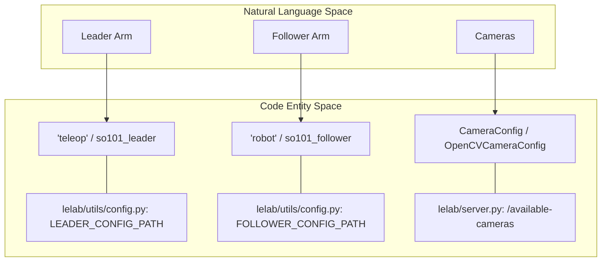
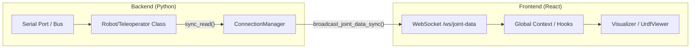

<!-- source: DeepWiki mcp.deepwiki.com · repo huggingface/leLab · page 9 Glossary · fetched 2026-10-26 -->

# Glossary

<details>
<summary>Relevant source files</summary>

The following files were used as context for generating this wiki page:

- [CLAUDE.md](CLAUDE.md)
- [README.md](README.md)
- [frontend/src/components/Footer.tsx](frontend/src/components/Footer.tsx)
- [frontend/src/components/landing/HfAuthBanner.tsx](frontend/src/components/landing/HfAuthBanner.tsx)
- [frontend/src/components/landing/RecordingModal.tsx](frontend/src/components/landing/RecordingModal.tsx)
- [frontend/src/components/training/ConfigurationTab.tsx](frontend/src/components/training/ConfigurationTab.tsx)
- [frontend/src/components/training/TrainingExtraGate.tsx](frontend/src/components/training/TrainingExtraGate.tsx)
- [frontend/src/components/training/config/AdvancedCard.tsx](frontend/src/components/training/config/AdvancedCard.tsx)
- [frontend/src/components/training/config/EssentialsCard.tsx](frontend/src/components/training/config/EssentialsCard.tsx)
- [frontend/src/components/training/config/TargetCard.tsx](frontend/src/components/training/config/TargetCard.tsx)
- [frontend/src/components/training/types.ts](frontend/src/components/training/types.ts)
- [frontend/src/components/ui/command.tsx](frontend/src/components/ui/command.tsx)
- [frontend/src/pages/Landing.tsx](frontend/src/pages/Landing.tsx)
- [frontend/src/pages/Recording.tsx](frontend/src/pages/Recording.tsx)
- [frontend/src/pages/Training.tsx](frontend/src/pages/Training.tsx)
- [frontend/vite.config.ts](frontend/vite.config.ts)
- [lelab/calibrate.py](lelab/calibrate.py)
- [lelab/jobs.py](lelab/jobs.py)
- [lelab/rollout.py](lelab/rollout.py)
- [lelab/runners/hf_cloud.py](lelab/runners/hf_cloud.py)
- [lelab/teleoperate.py](lelab/teleoperate.py)
- [lelab/utils/config.py](lelab/utils/config.py)
- [lelab/utils/hf_auth.py](lelab/utils/hf_auth.py)
- [pyproject.toml](pyproject.toml)
- [tests/test_rollout.py](tests/test_rollout.py)
- [tests/test_runners_hf_cloud.py](tests/test_runners_hf_cloud.py)
- [tests/test_scripts_lelab.py](tests/test_scripts_lelab.py)
- [tests/test_utils_config.py](tests/test_utils_config.py)

</details>


This page defines codebase-specific terms, domain concepts, and technical jargon used throughout the LeLab project. It serves as a reference for onboarding engineers to understand how high-level robotics concepts map to specific implementation details in the code.

## System Components & Architecture

### LeLab
The web-based graphical user interface for the LeRobot framework. It acts as a wrapper around LeRobot's CLI scripts, providing a unified dashboard for robot calibration, teleoperation, dataset recording, and model training [README.md:1-15]().

### SingleTabGuard
A frontend mechanism used to prevent hardware contention. Since serial ports and camera devices can typically only be opened by one process or context at a time, this guard ensures that only one browser tab can actively control or stream from the robot hardware.

### ConnectionManager
A backend class in `lelab/server.py` that manages WebSocket connections. It maintains a `_broadcast_worker` thread that drains a queue and sends joint telemetry data to all connected clients at a consistent frequency (typically 20-30 FPS) [lelab/server.py:104-206]().

### JobRegistry
A singleton service in the backend that manages the lifecycle of long-running asynchronous tasks, primarily training jobs. It handles persistence of job metadata to `job.json`, log streaming, and re-attaching to processes that survive a server restart [lelab/jobs.py:15-18]().

**Hardware Architecture Mapping**


Sources: [lelab/utils/config.py:30-74](), [lelab/server.py:104-206](), [README.md:1-15]()

---

## Domain Concepts

### Leader / Follower
In the SO-101 setup, the **Leader** is the arm manipulated by the human user to provide demonstrations. The **Follower** is the arm that mirrors the leader's movements during teleoperation or executes a trained policy during inference [CLAUDE.md:68-70]().
*   **Leader** is often referred to in code as `teleop` [lelab/calibrate.py:73]().
*   **Follower** is often referred to in code as `robot` [lelab/calibrate.py:73]().

### Calibration
The process of mapping raw motor encoder values (0-4095 for Feetech motors) to a normalized coordinate system. 
*   **Homing Offset**: The position where the arm is in its "zero" pose [lelab/calibrate.py:93]().
*   **Discontinuity**: A state where a motor crosses the encoder wrap-around point, causing a jump in values [lelab/calibrate.py:44-51]().

### Policy
A machine learning model (e.g., ACT, Diffusion Policy) that takes camera observations and joint states as input and outputs the next set of actions for the follower arm [lelab/rollout.py:15-22]().

### Rollout
The execution of a policy on the physical robot. The term "Rollout" is used interchangeably with "Inference" in the UI and backend [lelab/rollout.py:15-22]().

**Workflow State Transitions**

```mermaid
stateDiagram-v2
    [*] --> Idle
    Idle --> "CalibrationManager" : start_calibration()
    "CalibrationManager" --> Idle : completed / error
    
    Idle --> "TeleoperateWorker" : handle_start_teleoperation()
    "TeleoperateWorker" --> Idle : handle_stop_teleoperation()
    
    Idle --> "RecordingWorker" : handle_start_recording()
    "RecordingWorker" --> "UploadPage" : session_ended
    
    Idle --> "RolloutProcess" : handle_start_inference()
    "RolloutProcess" --> Idle : SIGTERM / Completion
```
Sources: [lelab/calibrate.py:79-146](), [lelab/record.py:77-110](), [lelab/rollout.py:149-189]()

---

## Technical Jargon & Abbreviations

| Term | Definition | Code Pointer |
| :--- | :--- | :--- |
| **AMP** | Automatic Mixed Precision. A training optimization that uses both 16-bit and 32-bit floating point types. | [lelab/train.py: TrainingRequest.policy_use_amp]() |
| **CV2 Index** | The integer identifier assigned by OpenCV to a camera device. On macOS, these can be unstable. | [lelab/server.py: _avfoundation_cameras_in_cv2_order]() |
| **Dist** | The directory containing the production-built React frontend. | [frontend/dist/]() |
| **HF Jobs** | Hugging Face's cloud infrastructure for running training on remote GPUs. | [lelab/runners/hf_cloud.py]() |
| **LELAB_TAG** | A specific tag (`lelab`) applied to datasets uploaded to the Hub to filter them in the UI. | [lelab/utils/config.py: LELAB_TAG]() |
| **Sidecar** | A helper process or thread that runs alongside the main task (e.g., the `WRAPPER_SOURCE` uploader). | [lelab/runners/hf_cloud.py:59-154]() |
| **URDF** | Unified Robot Description Format. Used by the `UrdfViewer` component to render the 3D robot. | [frontend/src/contexts/UrdfContext.tsx]() |

---

## Implementation Details

### Mutual Exclusion (Mutex)
Hardware resources (serial ports) are protected by module-level global flags and threading locks. The backend enforces that only one of Teleoperation, Recording, or Inference can be active at any time [lelab/rollout.py:158-179]().

### Dual-Location Pattern
Calibration files are stored in a user-accessible directory but must be copied to the LeRobot cache directory (`~/.cache/huggingface/lerobot/calibration/`) before LeRobot scripts can consume them. This is handled by `setup_calibration_files` [lelab/utils/config.py:30-74]().

### TailingJobRunner
A specialized runner that connects to an already-running training process by reading its `log.jsonl` file. This allows the UI to maintain state even if the FastAPI server restarts [lelab/jobs.py:83-85]().

**Data Flow: From Hardware to UI**


Sources: [lelab/server.py:104-206](), [lelab/calibrate.py:99-146](), [frontend/src/pages/Landing.tsx:157-194]()