# Page: LeLab Overview

# LeLab Overview

<details>
<summary>Relevant source files</summary>

The following files were used as context for generating this wiki page:

- [CLAUDE.md](CLAUDE.md)
- [README.md](README.md)
- [frontend/src/App.tsx](frontend/src/App.tsx)
- [frontend/src/components/SingleTabGuard.tsx](frontend/src/components/SingleTabGuard.tsx)
- [frontend/src/components/replay/DatasetCombobox.tsx](frontend/src/components/replay/DatasetCombobox.tsx)
- [frontend/src/contexts/HfAuthContext.tsx](frontend/src/contexts/HfAuthContext.tsx)
- [pyproject.toml](pyproject.toml)
- [tests/test_rollout.py](tests/test_rollout.py)
- [tests/test_runners_hf_cloud.py](tests/test_runners_hf_cloud.py)
- [tests/test_scripts_lelab.py](tests/test_scripts_lelab.py)

</details>


**LeLab** is a graphical user interface (GUI) wrapper for the [LeRobot](https://github.com/huggingface/lerobot) framework. It provides a web-native "front door" to robotics workflows, enabling users to calibrate, teleoperate, record datasets, train policies, and run inference through a unified browser interface [README.md:1-18]().

By abstracting LeRobot's CLI-driven flows into a single `lelab` process, it reduces the barrier to entry for newcomers to get from "unboxing" a robot to training their first policy [README.md:15-19]().

### Purpose and Scope
LeLab is designed to manage the full lifecycle of robot interaction without requiring manual terminal commands or keyboard prompts during hardware operation [README.md:15-16](). It primarily targets the **SO-101 leader/follower arms** [CLAUDE.md:68-69]().

For installation and local environment configuration, see [Getting Started](#1.1).

### Client-Server Architecture
LeLab employs a client-server architecture where a FastAPI backend orchestrates hardware communication and long-running tasks, while a React-based frontend provides the control interface.

*   **Backend (FastAPI):** Acts as a thin router and process orchestrator. It manages hardware-facing modules (recording, teleoperation, calibration) and shells out to LeRobot CLI scripts for training and inference [CLAUDE.md:34-42]().
*   **Frontend (React + Vite):** A Single Page Application (SPA) that communicates with the backend via REST APIs and WebSockets for real-time telemetry [CLAUDE.md:8-9]().
*   **Unified Serving:** In production, the backend mounts the built frontend bundle and serves both the API and the UI on a single port (default `:8000`) [CLAUDE.md:9-10]().

#### System Entity Mapping: Web-to-Hardware Bridge
The following diagram illustrates how frontend components interact with the backend modules and the underlying hardware via LeRobot.

**Diagram: Hardware Control Flow**
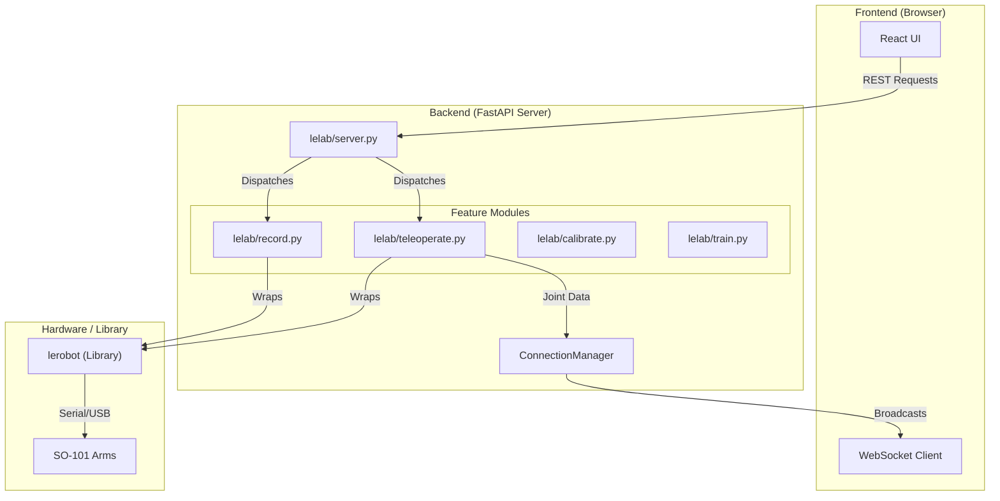
Sources: [lelab/server.py:104-206](), [CLAUDE.md:34-42](), [CLAUDE.md:48-51]()

### Main User Workflows
LeLab organizes robotics tasks into several distinct workflows accessible via the sidebar or landing page.

| Workflow | Backend Entity | Description |
| :--- | :--- | :--- |
| **Calibration** | `lelab/calibrate.py` | Step-by-step guided flow to set motor offsets and range of motion [CLAUDE.md:40-41](). |
| **Teleoperation** | `lelab/teleoperate.py` | Leader arm controls the follower arm with live 3D visualization [CLAUDE.md:39](). |
| **Recording** | `lelab/record.py` | Captures episodes into a `LeRobotDataset` with synchronized camera feeds [CLAUDE.md:38](). |
| **Training** | `lelab/train.py` | Local or Cloud-based policy training with live log streaming [CLAUDE.md:41-42](). |
| **Inference** | `lelab/rollout.py` | Executes a trained policy on the follower arm [CLAUDE.md:19](). |

For details on the UI implementation and global state management of these routes, see [Application Routing and Global Contexts](#1.2).

### Concurrency and State Management
LeLab uses a **mutual exclusion model**. Because hardware resources (serial ports and cameras) are finite, features like teleoperation and recording cannot run simultaneously.

*   **Module-level Globals:** Each backend module owns its state (e.g., `recording_active`, `inference_active`) [CLAUDE.md:46-47]().
*   **SingleTabGuard:** A frontend mechanism that uses `BroadcastChannel` to ensure only one browser tab can control the robot at any given time, preventing conflicting commands [frontend/src/components/SingleTabGuard.tsx:10-35]().
*   **Shared Configs:** Calibration files and port selections are persisted in `~/.cache/huggingface/lerobot/` and shared across modules [CLAUDE.md:52-61]().

**Diagram: State Persistence and Access**
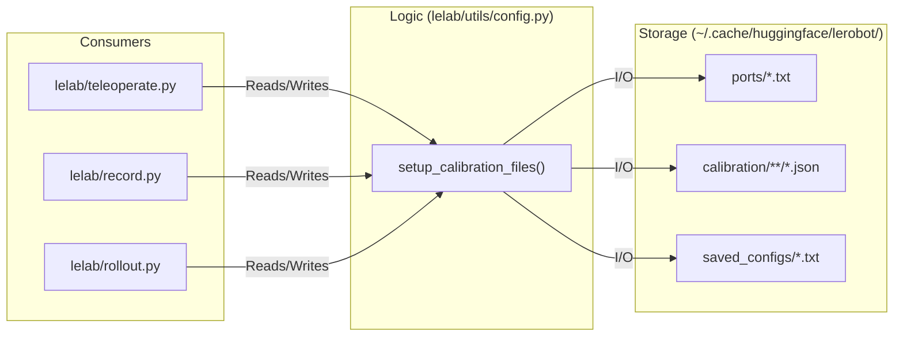
Sources: [lelab/utils/config.py:30-74](), [CLAUDE.md:52-66]()

---

# Page: Getting Started

# Getting Started

<details>
<summary>Relevant source files</summary>

The following files were used as context for generating this wiki page:

- [CLAUDE.md](CLAUDE.md)
- [README.md](README.md)
- [lelab/scripts/__init__.py](lelab/scripts/__init__.py)
- [lelab/scripts/lelab.py](lelab/scripts/lelab.py)
- [lelab/utils/__init__.py](lelab/utils/__init__.py)
- [pyproject.toml](pyproject.toml)
- [tests/test_rollout.py](tests/test_rollout.py)
- [tests/test_runners_hf_cloud.py](tests/test_runners_hf_cloud.py)
- [tests/test_scripts_lelab.py](tests/test_scripts_lelab.py)

</details>


LeLab is designed for rapid deployment, allowing users to transition from unboxing hardware to training robotics policies within minutes [README.md:15-18](). It provides a unified graphical interface for the LeRobot workflow, encompassing calibration, teleoperation, recording, training, and inference [README.md:27-60]().

## Installation and Environment

LeLab requires Python ≥3.12 and depends on several key packages, including FastAPI, Uvicorn, and a specific development version of `lerobot` [pyproject.toml:12-19]().

### Pip Installation
The package can be installed in editable mode for development:
```bash
pip install -e .
```
This command installs the core dependencies and registers the `lelab` CLI entry point [CLAUDE.md:13-16](). Optional dependencies for development and testing are available via `pip install -e ".[dev,test]"` [pyproject.toml:21-31]().

### Frontend Assets
The frontend is built using React and Vite, located in the `frontend/` directory [CLAUDE.md:9-9]().
- **Production:** The built bundle in `frontend/dist/` is shipped as package data within the Python wheel [CLAUDE.md:9-9]().
- **Development:** Requires Node.js to run the Vite dev server with Hot Module Replacement (HMR) [lelab/scripts/lelab.py:187-190]().

## Running LeLab

The `lelab` CLI command is the primary entry point, defined in `lelab.scripts.lelab:main` [pyproject.toml:33-34]().

### Production Mode
By default, running `lelab` starts a single process that serves both the API and the UI [CLAUDE.md:9-9]().
1. **Backend:** Starts a Uvicorn server on port `8000` [lelab/scripts/lelab.py:45-45]().
2. **Frontend:** The server mounts the pre-built `frontend/dist/` as `StaticFiles` at the root path `/` [CLAUDE.md:9-9]().
3. **Automation:** A background thread polls the port and automatically opens the system's web browser once the service is ready [lelab/scripts/lelab.py:61-73]().

### Development Mode
Running `lelab --dev` initiates a dual-server environment [lelab/scripts/lelab.py:98-182]():
- **Vite Dev Server:** Runs on port `8080`, providing HMR for frontend development [lelab/scripts/lelab.py:46-46]().
- **Uvicorn Backend:** Runs on port `8000` with `--reload` enabled to pick up Python code changes [lelab/scripts/lelab.py:121-137]().
- **Orchestration:** The script handles dependency installation (`npm install`) and ensures both processes are terminated gracefully on `SIGINT` [lelab/scripts/lelab.py:104-114, 155-172]().

### Process Lifecycle and Port Assignment
| Mode | Frontend Port | Backend Port | Serving Mechanism |
| :--- | :--- | :--- | :--- |
| **Production** | N/A (Served by Backend) | 8000 | FastAPI `StaticFiles` |
| **Development** | 8080 | 8000 | Vite + Uvicorn `--reload` |

**Sources:** [lelab/scripts/lelab.py:42-46](), [lelab/scripts/lelab.py:75-96](), [lelab/scripts/lelab.py:98-182](), [CLAUDE.md:9-9](), [CLAUDE.md:21-28]().

## System Architecture Overview

LeLab uses a FastAPI backend to orchestrate hardware interactions and serve the React frontend.

### Execution Flow: Production vs Development
The following diagram illustrates how the `lelab` script branches based on the `--dev` flag and manages the underlying server entities.

**Title: LeLab Launcher Data Flow**
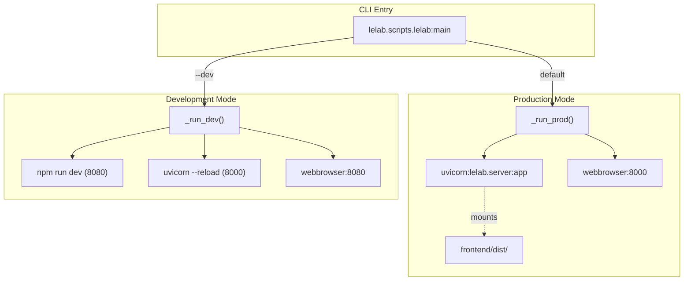
**Sources:** [lelab/scripts/lelab.py:184-200](), [lelab/scripts/lelab.py:75-96](), [lelab/scripts/lelab.py:98-182](), [CLAUDE.md:9-9]().

### Component Mapping: Frontend to Backend
This diagram maps high-level user actions in the browser to specific backend modules and files.

**Title: UI-to-Backend Entity Mapping**
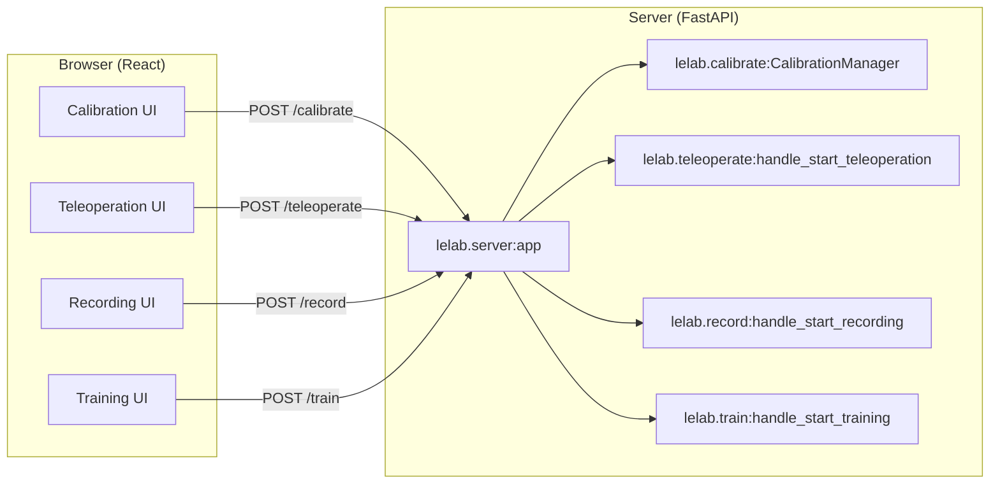
**Sources:** [CLAUDE.md:34-43](), [lelab/scripts/lelab.py:89-89]().

## Hardware and Security Notes

### SO-101 Arms
The system is specifically optimized for SO-101 leader/follower arms. Logic for config construction and hardware discovery frequently references `SO101LeaderConfig` and `SO101FollowerConfig` [CLAUDE.md:68-70]().

### Phone-Camera and HTTPS
Using a mobile device as a camera source requires the browser to operate over a secure context (HTTPS) [CLAUDE.md:71-72]().
- **Default:** `lelab` starts with standard HTTP [CLAUDE.md:73-73]().
- **HTTPS Setup:** For mobile camera support, Uvicorn must be launched manually with SSL certificates (e.g., `certs/key.pem` and `certs/cert.pem`) [CLAUDE.md:73-74]().

**Sources:** [CLAUDE.md:68-74]().

---

# Page: Application Routing and Global Contexts

# Application Routing and Global Contexts

<details>
<summary>Relevant source files</summary>

The following files were used as context for generating this wiki page:

- [frontend/src/App.tsx](frontend/src/App.tsx)
- [frontend/src/components/SingleTabGuard.tsx](frontend/src/components/SingleTabGuard.tsx)
- [frontend/src/components/landing/UsageInstructionsModal.tsx](frontend/src/components/landing/UsageInstructionsModal.tsx)
- [frontend/src/components/replay/DatasetCombobox.tsx](frontend/src/components/replay/DatasetCombobox.tsx)
- [frontend/src/components/ui/dialog.tsx](frontend/src/components/ui/dialog.tsx)
- [frontend/src/contexts/ApiContext.tsx](frontend/src/contexts/ApiContext.tsx)
- [frontend/src/contexts/HfAuthContext.tsx](frontend/src/contexts/HfAuthContext.tsx)
- [frontend/src/hooks/useRobots.ts](frontend/src/hooks/useRobots.ts)
- [frontend/src/lib/isHostedSpace.ts](frontend/src/lib/isHostedSpace.ts)

</details>


This section describes the React application's structure, the global state management via a nested provider hierarchy, and the safety mechanisms ensuring exclusive control of robot hardware.

## Application Route Structure

The frontend application uses `react-router-dom` to manage navigation between different functional modules of the robot workflow [frontend/src/App.tsx:1](). The routes are organized to support the end-to-end lifecycle of robot interaction, from hardware setup to policy inference.

| Path | Element | Purpose |
| :--- | :--- | :--- |
| `/` | `Landing` | Dashboard for robot management, dataset selection, and job monitoring [frontend/src/App.tsx:36](). |
| `/calibration` | `Calibration` | Guided workflow for motor range-of-motion and homing offset configuration [frontend/src/App.tsx:43](). |
| `/teleoperation` | `Teleoperation` | Real-time remote control and 3D visualization of the robot [frontend/src/App.tsx:37](). |
| `/recording` | `Recording` | Episode collection interface with multi-camera preview and metadata tagging [frontend/src/App.tsx:38](). |
| `/upload` | `Upload` | Interface for pushing local datasets to the Hugging Face Hub [frontend/src/App.tsx:39](). |
| `/training` | `Training` | Configuration and monitoring for local or HF Cloud training jobs [frontend/src/App.tsx:40-41](). |
| `/inference` | `Inference` | Deployment and evaluation of trained policies on physical hardware [frontend/src/App.tsx:42](). |
| `/edit-dataset` | `EditDataset` | Tooling for modifying dataset metadata or cleaning recorded episodes [frontend/src/App.tsx:44](). |

**Sources:** [frontend/src/App.tsx:35-48]()

## Provider Hierarchy and Global Contexts

The application state is managed through a series of nested React Context providers. This hierarchy ensures that foundational services (like API connectivity) are available to specialized services (like Hugging Face authentication).

### Hierarchy Diagram: Context Dependency Flow
The following diagram illustrates how global contexts are wrapped and the dependencies between them.

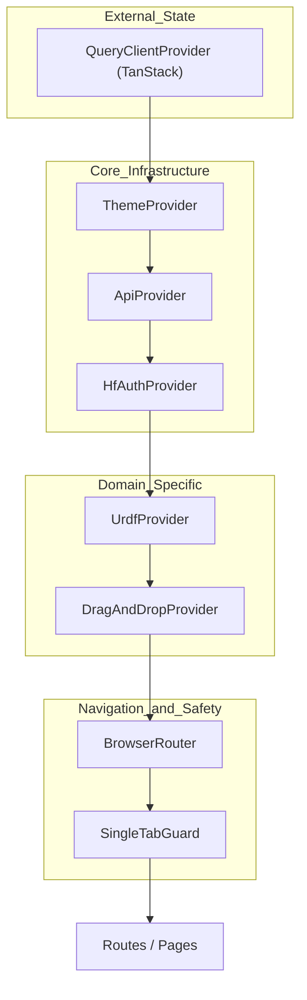
**Sources:** [frontend/src/App.tsx:25-58]()

### Key Providers

*   **`ApiProvider`**: Resolves the backend URL. It prioritizes the `api` query parameter, falling back to `localStorage` or `localhost:8000` [frontend/src/contexts/ApiContext.tsx:16-32](). It provides `baseUrl`, `wsBaseUrl`, and a `fetchWithHeaders` wrapper [frontend/src/contexts/ApiContext.tsx:50-53]().
*   **`HfAuthProvider`**: Monitors the authentication status of the user on the Hugging Face Hub by polling the `/hf-auth-status` endpoint [frontend/src/contexts/HfAuthContext.tsx:30-46](). It provides the `username`, `orgs`, and the `loginCommand` required for CLI authentication [frontend/src/contexts/HfAuthContext.tsx:12-15]().
*   **`UrdfProvider`**: Manages the loading and parsing of Robot URDF files for 3D visualization in the `UrdfViewer` [frontend/src/App.tsx:4]().
*   **`DragAndDropProvider`**: Provides a global context for handling file uploads and UI element reordering [frontend/src/App.tsx:5]().

**Sources:** [frontend/src/contexts/ApiContext.tsx:9-64](), [frontend/src/contexts/HfAuthContext.tsx:24-80](), [frontend/src/App.tsx:1-21]()

## SingleTabGuard Concurrency Mechanism

Because the backend communicates with physical hardware via serial ports and camera drivers, multiple browser tabs attempting to control the same robot would lead to resource contention and state corruption. The `SingleTabGuard` component implements a distributed mutex using the `BroadcastChannel` API.

### Implementation Logic
1.  **Identity**: Each tab generates a unique `myId` and a `myOpenedAt` timestamp [frontend/src/components/SingleTabGuard.tsx:42-43]().
2.  **Heartbeat**: Tabs broadcast a `HEARTBEAT` message every 1000ms [frontend/src/components/SingleTabGuard.tsx:84-87]().
3.  **Election**: The "Primary" tab is the one with the earliest `openedAt` timestamp [frontend/src/components/SingleTabGuard.tsx:26-34]().
4.  **Takeover**: If a user clicks "Use this tab" on a non-primary tab, it sends a `TAKEOVER` message with an `openedAt` of 0, forcing all other tabs to yield [frontend/src/components/SingleTabGuard.tsx:101-109]().

### Tab State Transition Diagram

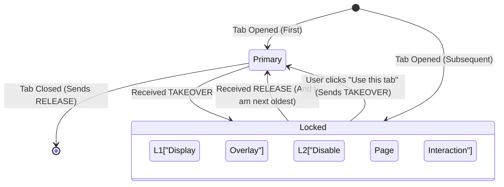
**Sources:** [frontend/src/components/SingleTabGuard.tsx:17-109]()

## Robot and Dataset Integration

Global hooks facilitate data flow between the UI and the persistent backend storage.

### `useRobots` Hook
This hook manages the lifecycle of robot configurations (`RobotRecord`). It handles fetching the list of robots from the `/robots` endpoint and persisting the user's active selection in `localStorage` [frontend/src/hooks/useRobots.ts:48-78]().

*   **`RobotRecord`**: Contains ports (leader/follower), motor configurations, and camera mappings [frontend/src/hooks/useRobots.ts:7-15]().
*   **Selection Persistence**: The selected robot name is stored under the key `lelab.selectedRobot` [frontend/src/hooks/useRobots.ts:17]().

### `DatasetCombobox`
A specialized component used across `Training` and `EditDataset` pages to select data sources. It categorizes datasets into "Local" (stored on the machine) and "Hugging Face" (remote datasets) [frontend/src/components/replay/DatasetCombobox.tsx:32-33](). It supports a "Custom Mode" for manually entering repository IDs [frontend/src/components/replay/DatasetCombobox.tsx:49-68]().

**Sources:** [frontend/src/hooks/useRobots.ts:7-178](), [frontend/src/components/replay/DatasetCombobox.tsx:19-112]()

---

# Page: Backend Architecture

# Backend Architecture

<details>
<summary>Relevant source files</summary>

The following files were used as context for generating this wiki page:

- [CLAUDE.md](CLAUDE.md)
- [lelab/server.py](lelab/server.py)
- [tests/test_rollout.py](tests/test_rollout.py)
- [tests/test_runners_hf_cloud.py](tests/test_runners_hf_cloud.py)
- [tests/test_scripts_lelab.py](tests/test_scripts_lelab.py)

</details>


The LeLab backend is a FastAPI-driven server that acts as a bridge between the React frontend and the [LeRobot](https://github.com/huggingface/lerobot) hardware/machine learning libraries. It orchestrates complex robot workflows—such as calibration, teleoperation, and dataset recording—while managing real-time telemetry via WebSockets and ensuring persistent configuration across sessions.

### Core Responsibilities
- **Feature Orchestration**: Routes HTTP requests to specific feature modules (e.g., `lelab/record.py`, `lelab/teleoperate.py`) that wrap LeRobot functionality [lelab/server.py:35-78]().
- **Concurrency & Safety**: Enforces mutual exclusion between hardware-facing features to prevent multiple processes from attempting to access the same serial ports or cameras simultaneously [lelab/server.py:46-75]().
- **Telemetry Broadcasting**: Maintains a high-frequency WebSocket stream (typically 20 FPS) for robot joint positions and system status [lelab/server.py:153-201]().
- **Hardware Discovery**: Provides endpoints for scanning serial ports and enumerating cameras across different operating systems [lelab/server.py:80-95]().
- **Asset Management**: Serves the built React frontend and manages local filesystem persistence for robot configurations and calibration files [lelab/server.py:146-150]().

### System Component Map
The following diagram illustrates how high-level system concepts map to specific code entities within the backend.

**System Concept to Code Entity Mapping**
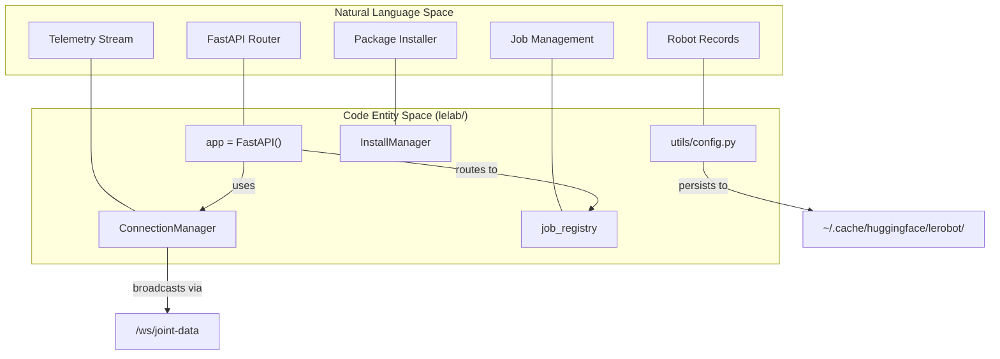
Sources: [lelab/server.py:133-161](), [lelab/utils/config.py:1-20](), [lelab/jobs.py:44-45](), [lelab/utils/system.py:1-20]()

---

### FastAPI Server and WebSocket Broadcast
The server entry point is `lelab/server.py`. It initializes the `FastAPI` application and configures `CORSMiddleware` to allow cross-origin requests during development [lelab/server.py:133-144](). 

A central `ConnectionManager` handles WebSocket lifecycle events. It uses a dedicated background thread, the `_broadcast_worker`, to drain a `broadcast_queue` and send telemetry data to all connected clients without blocking the main event loop [lelab/server.py:153-201](). This architecture ensures that robot control loops (running in their own threads) can emit joint data at high frequencies.

For details, see [FastAPI Server and WebSocket Broadcast](#2.1).

### Configuration and Persistence Utilities
LeLab centralizes its state management in `lelab/utils/config.py`. It follows a specific filesystem layout under `~/.cache/huggingface/lerobot/` to remain compatible with the core LeRobot library [lelab/utils/config.py:1-30](). 

Key utilities include:
- **Robot Records**: CRUD operations for saving and loading leader/follower port assignments and configuration names [lelab/server.py:80-95]().
- **Calibration Sync**: The `setup_calibration_files` pattern, which copies user-selected calibration JSONs into the specific directory structures expected by LeRobot's hardware classes [lelab/utils/config.py:30-74]().

For details, see [Configuration and Persistence Utilities](#2.2).

### System Utilities and Package Management
Because LeLab has optional dependencies (like `wandb` for logging or `accelerate` for training), it includes a `system.py` utility module. The `InstallManager` class tracks the installation status of these packages and provides endpoints to trigger `pip` or `uv` installs at runtime [lelab/utils/system.py:1-50](). This allows the core GUI to remain lightweight while offering a path to "unlock" advanced features like cloud training.

For details, see [System Utilities and Package Management](#2.3).

---

### Backend Process Orchestration
The backend manages three distinct types of execution: synchronous handlers, long-running threads, and external subprocesses.

**Process Execution Model**
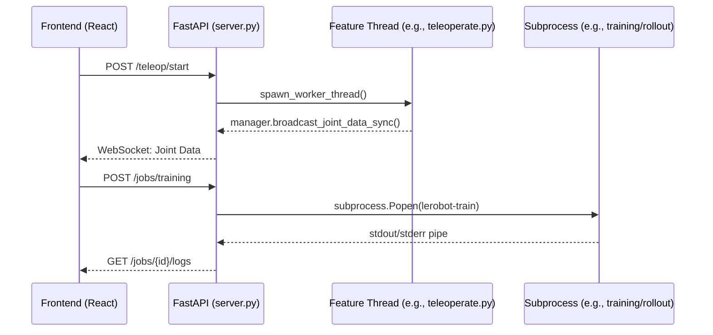
Sources: [lelab/server.py:69-75](), [lelab/teleoperate.py:1-50](), [lelab/train.py:1-30](), [lelab/rollout.py:1-30]()

---

# Page: FastAPI Server and WebSocket Broadcast

# FastAPI Server and WebSocket Broadcast

<details>
<summary>Relevant source files</summary>

The following files were used as context for generating this wiki page:

- [lelab/server.py](lelab/server.py)
- [lelab/teleoperate.py](lelab/teleoperate.py)

</details>


This page provides a deep dive into `lelab/server.py`, the central entry point for the LeLab backend. It explores how the FastAPI server manages real-time telemetry via WebSockets, handles hardware discovery, and orchestrates mutual exclusion between different robot operation modes.

## Server Architecture and Initialization

The LeLab server uses **FastAPI** to provide both a REST API and WebSocket endpoints. It serves the pre-built React frontend as static files and configures Cross-Origin Resource Sharing (CORS) to allow communication during development when the frontend and backend run on different ports (typically 8080 and 8000).

### CORS and Static Files
The server is configured with `CORSMiddleware` to allow all origins, methods, and headers, which is essential for development workflows [lelab/server.py:138-144](). In production, the server mounts the React build directory located at `frontend/dist` to the root path `/` [lelab/server.py:146-146](), [lelab/server.py:438-444]().

### Hardware Discovery Endpoints
To facilitate robot setup, the server provides endpoints for discovering connected hardware:
*   **/available-ports**: Scans the system for serial ports, filtering for those likely to be robot controllers (e.g., `/dev/tty.usbmodem*` or `COM*`) [lelab/server.py:284-288]().
*   **/available-cameras**: Lists available camera indices. On macOS, it utilizes a specific workaround for the AVFoundation backend [lelab/server.py:291-314]().

**Sources:** [lelab/server.py:133-150](), [lelab/server.py:284-314](), [lelab/server.py:438-444]()

---

## WebSocket Telemetry and Broadcast

Real-time joint data and robot state are delivered to the frontend via a WebSocket endpoint at `/ws/joint-data`. To ensure high-frequency updates (approx. 20Hz) without blocking the main FastAPI event loop, the server employs a dedicated broadcast worker thread.

### ConnectionManager
The `ConnectionManager` class handles the lifecycle of WebSocket connections and the background broadcasting logic.

| Component | Role |
| :--- | :--- |
| `active_connections` | A list of currently connected `WebSocket` objects [lelab/server.py:155-155](). |
| `broadcast_queue` | A `queue.Queue` used to pass telemetry data from hardware threads to the broadcast worker [lelab/server.py:156-156](). |
| `_broadcast_worker` | A background thread that pulls data from the queue and sends it to all active clients [lelab/server.py:202-239](). |
| `_connections_lock` | A `threading.Lock` that prevents race conditions when adding/removing connections [lelab/server.py:161-161](). |

### The Broadcast Loop
The `_broadcast_worker` runs a private `asyncio` event loop [lelab/server.py:207-208](). It continuously monitors the `broadcast_queue`. When data (such as joint positions or recording status) is placed in the queue by modules like `teleoperate.py` or `record.py`, the worker iterates through `active_connections` and sends the JSON payload [lelab/server.py:211-230](). If a send fails, the connection is automatically removed from the active list [lelab/server.py:226-228]().

### Data Flow: Telemetry Broadcast
The following diagram illustrates how joint data travels from the hardware to the browser.

Title: Telemetry Data Flow
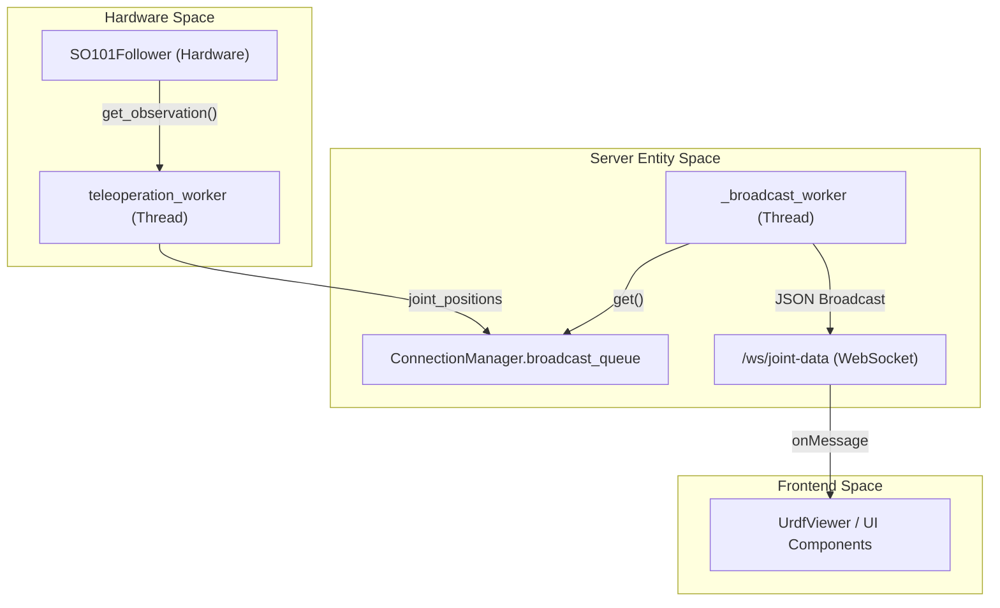
**Sources:** [lelab/server.py:153-239](), [lelab/teleoperate.py:65-118](), [lelab/teleoperate.py:193-197]()

---

## Hardware Discovery and macOS Workaround

Camera enumeration via OpenCV (`cv2.VideoCapture`) can be unstable on macOS, where indices may not correspond directly to physical devices or may trigger permission prompts.

### macOS AVFoundation Workaround
To solve this, `server.py` implements `_avfoundation_cameras_in_cv2_order`. This function runs a short-lived subprocess that attempts to open camera indices 0 through 7 using the `cv2.CAP_AVFOUNDATION` backend [lelab/server.py:255-274](). It returns a list of indices that successfully returned a frame, ensuring the frontend only displays valid camera options [lelab/server.py:276-281]().

**Sources:** [lelab/server.py:242-281](), [lelab/server.py:302-308]()

---

## Mutual Exclusion and State Management

LeLab enforces a strict mutual exclusion policy: only one hardware-intensive operation (Calibration, Teleoperation, Recording, or Inference) can be active at a time. This is managed via module-level global flags and a `_state_lock`.

### Lock Implementation
Each hardware module (e.g., `lelab/teleoperate.py`) defines a `_state_lock` and an `active` boolean [lelab/teleoperate.py:50-55](). Before starting a new operation, the server-side handlers check the status of all other modules.

Title: Mutual Exclusion Logic in server.py
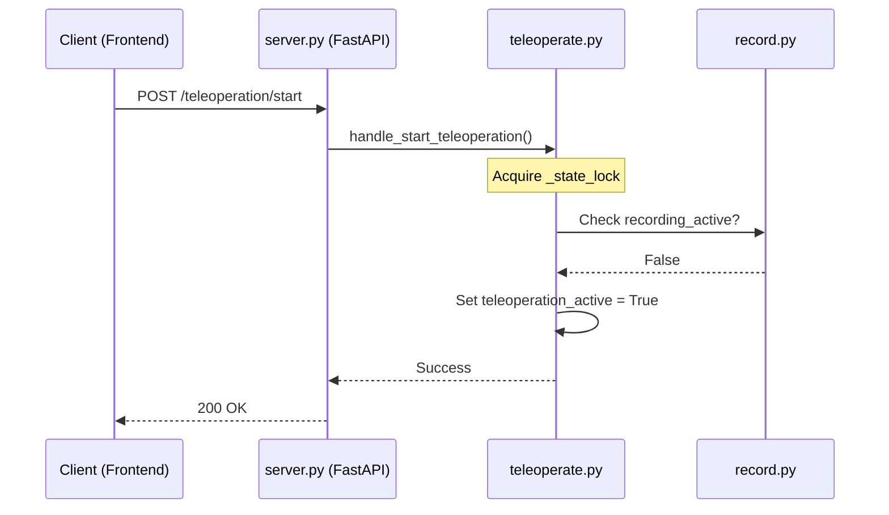

### Key Request Handlers
The server acts as a router for these specialized modules:
*   **Teleoperation**: `handle_start_teleoperation` initializes the `SO101Follower` and `SO101Leader` and starts the 20Hz broadcast loop [lelab/teleoperate.py:125-202]().
*   **Recording**: `handle_start_recording` manages the transition from teleoperation to dataset storage [lelab/record.py:159-218]().
*   **Calibration**: `calibration_manager` handles the state machine for motor homing and range discovery [lelab/calibrate.py:140-165]().

**Sources:** [lelab/server.py:330-345](), [lelab/teleoperate.py:131-138](), [lelab/record.py:159-175]()

---

# Page: Configuration and Persistence Utilities

# Configuration and Persistence Utilities

<details>
<summary>Relevant source files</summary>

The following files were used as context for generating this wiki page:

- [CLAUDE.md](CLAUDE.md)
- [lelab/utils/config.py](lelab/utils/config.py)
- [tests/test_rollout.py](tests/test_rollout.py)
- [tests/test_runners_hf_cloud.py](tests/test_runners_hf_cloud.py)
- [tests/test_scripts_lelab.py](tests/test_scripts_lelab.py)
- [tests/test_utils_config.py](tests/test_utils_config.py)

</details>


This page covers the utilities and filesystem conventions used by LeLab for managing robot configurations, calibration data, serial port persistence, and Hub-integrated tagging. These utilities ensure that the application state remains consistent across restarts and that hardware settings are correctly propagated to the underlying LeRobot framework.

## Filesystem Layout

LeLab follows the LeRobot convention of storing all configuration and data under the `~/.cache/huggingface/lerobot/` directory [lelab/utils/config.py:29-45]().

| Path | Purpose |
| :--- | :--- |
| `calibration/teleoperators/so_leader/` | Storage for leader arm calibration JSON files [lelab/utils/config.py:31](). |
| `calibration/robots/so_follower/` | Storage for follower arm calibration JSON files [lelab/utils/config.py:32](). |
| `ports/` | Persistence for last-used serial ports (`leader_port.txt`, `follower_port.txt`) [lelab/utils/config.py:35-37](). |
| `saved_configs/` | Persistence for last-selected calibration profile names [lelab/utils/config.py:40-42](). |
| `robots/` | JSON metadata records for "Robot" entities (logical pairings of arms and cameras) [lelab/utils/config.py:45](). |

### Atomic Writes
To prevent file corruption during system crashes or power loss, LeLab uses an atomic write pattern via `_atomic_write_text`. It writes content to a `.tmp` file first, then performs an `os.replace` to the final destination [lelab/utils/config.py:60-68]().

## Robot Record CRUD

LeLab introduces a higher-level abstraction called a **Robot Record**. While LeRobot tracks individual arms, LeLab's Robot Records group a leader arm, a follower arm, and a set of camera configurations into a single named entity [lelab/utils/config.py:44-45]().

### Implementation Details
- **List**: `list_robot_records()` scans the `ROBOTS_PATH` for `.json` files and returns a list of dictionaries [lelab/utils/config.py:45]().
- **Get**: `get_robot_record(name)` retrieves and parses a specific JSON record [tests/test_utils_config.py:108-111]().
- **Save**: `save_robot_record(name, record, allow_create)` performs a merge-and-save. If `allow_create` is false, it only updates existing records [lelab/utils/config.py:44](), [tests/test_utils_config.py:136-146]().
- **Delete**: `delete_robot_record(name)` removes the JSON file from disk [tests/test_utils_config.py:116-117]().

**Sources:** [lelab/utils/config.py:44-70](), [tests/test_utils_config.py:102-147]()

## Calibration File Management

LeLab utilizes a "dual-location" pattern for calibration. While user-created calibration files are stored in `LEADER_CONFIG_PATH` and `FOLLOWER_CONFIG_PATH`, the underlying LeRobot scripts often expect specific file naming or locations during execution.

### `setup_calibration_files`
This function is called by recording, teleoperation, and rollout modules before hardware initialization [CLAUDE.md:63-66](). It ensures that the selected `.json` configuration exists and is accessible to the backend processes.

1.  **Extraction**: It strips the `.json` extension to get the config name [lelab/utils/config.py:91-92]().
2.  **Validation**: It verifies the existence of the source files in the calibration directories [lelab/utils/config.py:95-102]().
3.  **Sync**: It copies the files to the target directories if they are missing [lelab/utils/config.py:111-130]().

**Sources:** [lelab/utils/config.py:88-132](), [CLAUDE.md:63-66]()

## Port Discovery and Persistence

To provide a seamless "plug-and-play" experience, LeLab persists the serial port paths (e.g., `/dev/ttyUSB0`) for both leader and follower arms.

### Data Flow: Port Persistence
The following diagram illustrates how serial port strings move between the UI and the filesystem.

**Serial Port Persistence Flow**
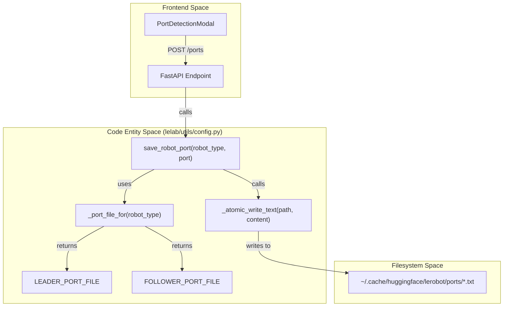
**Sources:** [lelab/utils/config.py:34-37](), [lelab/utils/config.py:60-77](), [tests/test_utils_config.py:34-42]()

## Hub Integration: LELAB_TAG

LeLab ensures that datasets created through its interface are easily discoverable on the Hugging Face Hub. This is achieved through the `LELAB_TAG` constant.

- **Tag Value**: `"LeLab"` [lelab/utils/config.py:49]().
- **Injection**: The `with_lelab_tag(tags)` function takes an existing list of tags and appends the `LELAB_TAG`, ensuring it is deduplicated [lelab/utils/config.py:52-57]().
- **Purpose**: This allows the LeLab UI to filter for datasets produced specifically by the web interface when querying the Hub [lelab/utils/config.py:47-49]().

### Entity Association
The following diagram bridges the natural language concept of "Tagging" to the specific code implementation.

**Dataset Tagging Implementation**
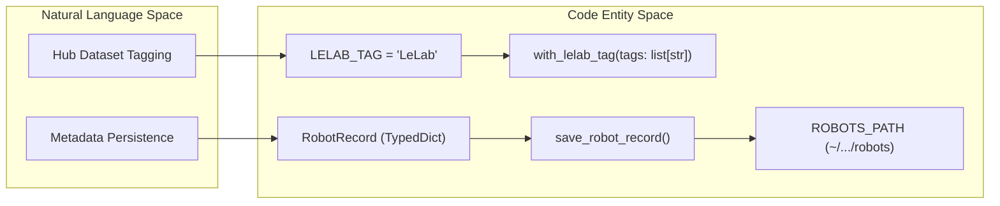
**Sources:** [lelab/utils/config.py:45-57](), [tests/test_utils_config.py:179-193]()

---

# Page: System Utilities and Package Management

# System Utilities and Package Management

<details>
<summary>Relevant source files</summary>

The following files were used as context for generating this wiki page:

- [frontend/src/components/training/config/AdvancedCard.tsx](frontend/src/components/training/config/AdvancedCard.tsx)
- [frontend/src/components/training/config/EssentialsCard.tsx](frontend/src/components/training/config/EssentialsCard.tsx)
- [frontend/src/components/training/config/TargetCard.tsx](frontend/src/components/training/config/TargetCard.tsx)
- [frontend/src/components/ui/command.tsx](frontend/src/components/ui/command.tsx)
- [lelab/utils/system.py](lelab/utils/system.py)

</details>


The system utilities module provides the infrastructure for managing optional dependencies and detecting the runtime environment. Since LeLab aims to be lightweight, heavy dependencies like `accelerate` (required for local training) and `wandb` (for experiment tracking) are treated as optional extras that can be installed on-demand via the web UI.

## Dependency Detection and Availability

LeLab checks for the presence of optional packages at module load time using `importlib.util.find_spec`. These checks are cached; if a package is installed while the server is running, the server must be restarted to recognize the new dependency [lelab/utils/system.py:31-32]().

| Flag | Package | Purpose |
| :--- | :--- | :--- |
| `TRAINING_AVAILABLE` | `accelerate` | Enables local training runners [lelab/utils/system.py:33]() |
| `WANDB_AVAILABLE` | `wandb` | Enables Weights & Biases logging [lelab/utils/system.py:36]() |

### Code Entity Space: Availability Logic
The following diagram illustrates how the frontend queries package availability through the backend endpoints.

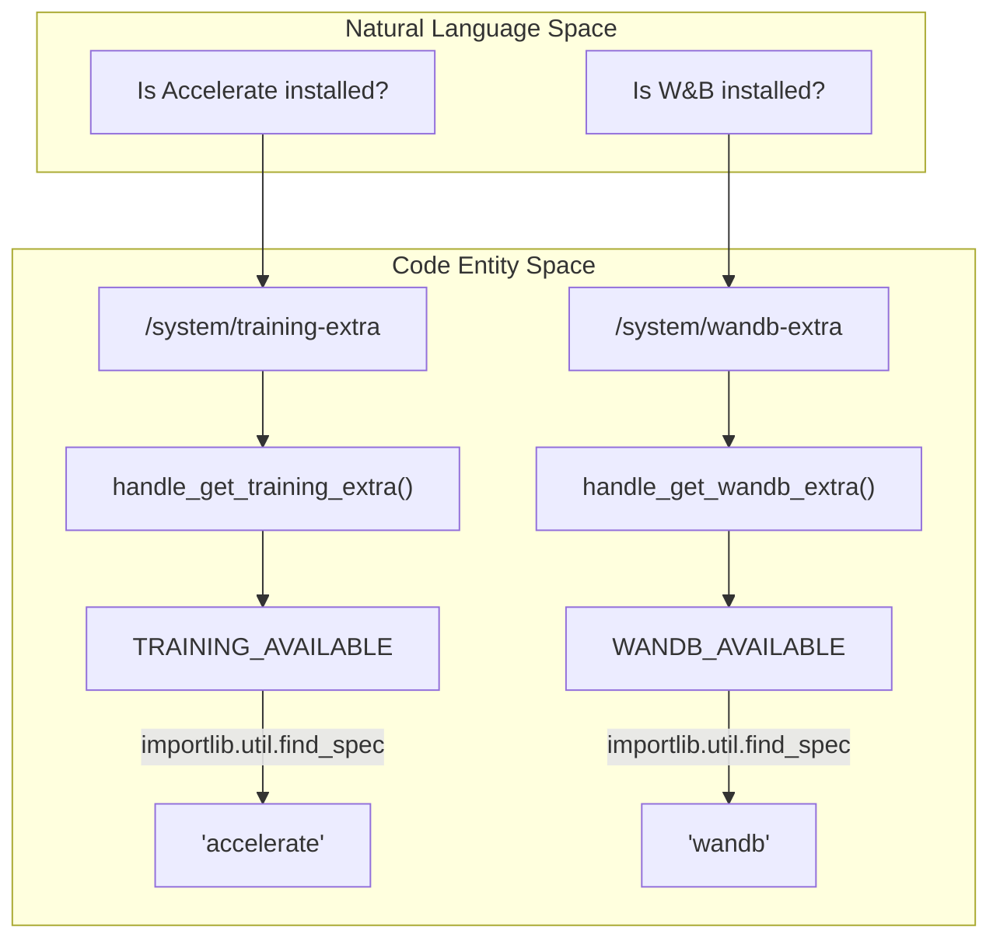
Sources: [lelab/utils/system.py:31-38](), [lelab/utils/system.py:156-177]()

## The InstallManager Class

The `InstallManager` class manages the lifecycle of a background `pip` or `uv` installation process. It ensures that only one installation for a specific package happens at a time and provides a thread-safe way to stream logs back to the frontend [lelab/utils/system.py:69-78]().

### Key Components
- **State Management**: Tracks the installation status across four states: `idle`, `installing`, `done`, or `error` [lelab/utils/system.py:64]().
- **Process Orchestration**: Uses `subprocess.Popen` to execute the installation command with `stdout` and `stderr` merged [lelab/utils/system.py:89-95]().
- **Log Buffering**: Implements a `queue.Queue` to store process output. The queue is capped at 1000 lines to prevent unbounded memory growth from chatty installers [lelab/utils/system.py:138-142]().
- **Monitor Thread**: A daemon thread reads the subprocess output line-by-line and updates the final state based on the return code [lelab/utils/system.py:116-136]().

### UV vs PIP Detection
The function `_build_install_cmd` determines the best installation tool. If `uv` is found on the system `PATH`, it is preferred for its speed. It uses the `--python` flag pinned to `sys.executable` to ensure the package is installed into the same environment running LeLab [lelab/utils/system.py:40-50]().

Sources: [lelab/utils/system.py:40-150]()

## Package Management Flow

The installation flow is triggered by the frontend when a user attempts to use a feature (like W&B) that is not currently available.

### Sequence: W&B Installation Check
When a user toggles "Enable Weights & Biases" in the `EssentialsCard`, the frontend performs a pre-flight check [frontend/src/components/training/config/EssentialsCard.tsx:30-53]().

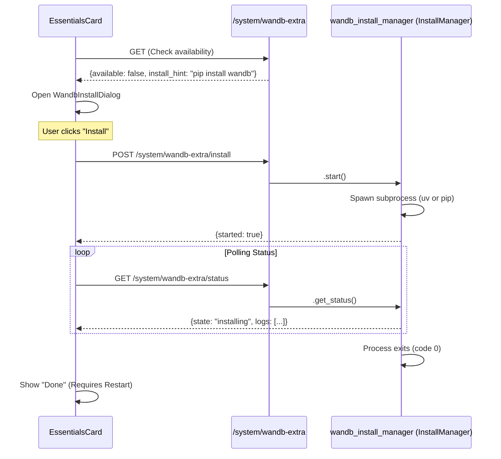
Sources: [frontend/src/components/training/config/EssentialsCard.tsx:30-53](), [lelab/utils/system.py:79-114]()

## System Endpoints

The backend exposes two sets of identical endpoints for the two supported optional packages.

| Package | Info Endpoint | Install Endpoint | Status Endpoint |
| :--- | :--- | :--- | :--- |
| **Accelerate** | `/system/training-extra` | `/system/training-extra/install` | `/system/training-extra/status` |
| **W&B** | `/system/wandb-extra` | `/system/wandb-extra/install` | `/system/wandb-extra/status` |

### Endpoint Handlers
The handlers wrap global instances of `InstallManager`: `training_install_manager` and `wandb_install_manager` [lelab/utils/system.py:152-153]().

- `handle_get_...`: Returns the cached boolean and the string hint [lelab/utils/system.py:156-158]().
- `handle_install_...`: Invokes the `start()` method to begin the background process [lelab/utils/system.py:160-161]().
- `handle_install_..._status`: Invokes `get_status()` which drains the log queue and returns the current state [lelab/utils/system.py:164-165]().

Sources: [lelab/utils/system.py:152-177]()

---

# Page: Robot Hardware Workflows

# Robot Hardware Workflows

<details>
<summary>Relevant source files</summary>

The following files were used as context for generating this wiki page:

- [CLAUDE.md](CLAUDE.md)
- [lelab/server.py](lelab/server.py)
- [tests/test_rollout.py](tests/test_rollout.py)
- [tests/test_runners_hf_cloud.py](tests/test_runners_hf_cloud.py)
- [tests/test_scripts_lelab.py](tests/test_scripts_lelab.py)

</details>


This page provides a high-level overview of the four primary hardware-facing workflows in LeLab. These workflows allow users to calibrate physical arms, control them via teleoperation, record datasets for imitation learning, and run inference using trained policies.

LeLab is specifically architected for the **SO-101 leader/follower arm** setup [CLAUDE.md:67-69](). It utilizes a leader/follower architecture where a human manipulates a "leader" arm to control a "follower" arm.

## Mutual Exclusion and State Management

Hardware access in LeLab is governed by a mutual exclusion model. Because the robot serial ports and cameras are shared resources, only one hardware-intensive workflow can be active at a time.

*   **Module-level Globals**: Each feature module (e.g., `lelab/record.py`, `lelab/teleoperate.py`) maintains its own state (e.g., `recording_active`, `teleoperation_active`) [CLAUDE.md:36-46]().
*   **Concurrency**: While the backend does not strictly enforce a global lock across all modules in code, the frontend and API handlers use these status flags to prevent overlapping operations [CLAUDE.md:45-47]().
*   **State Machine Logic**: Complex workflows like calibration use a `CalibrationManager` singleton to track transitions through various states (e.g., `connecting`, `recording`, `completed`) [lelab/server.py:38-38]().

### Hardware-to-Code Mapping

The following diagram illustrates how physical hardware components relate to the software entities and state managers within the codebase.

**Hardware Entity Space Mapping**
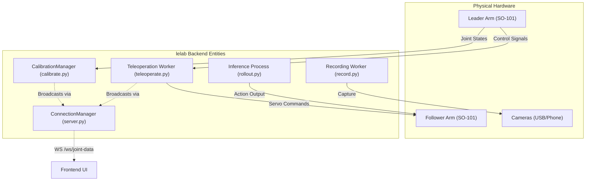
Sources: [lelab/server.py:153-162](), [CLAUDE.md:36-41](), [CLAUDE.md:67-69]()

---

## Workflow Overview

### 1. Calibration
Calibration is the prerequisite for all other workflows. It maps the raw potentiometer readings of the SO-101 motors to a normalized joint space. The `CalibrationManager` in `lelab/calibrate.py` handles the state machine for homing offsets and range-of-motion recording.

For details, see [Calibration](#3.1).

### 2. Teleoperation
Teleoperation enables real-time control of the follower arm using the leader arm. It involves a high-frequency control loop (typically 20 FPS) that reads joint positions from the leader and sends them to the follower while broadcasting telemetry to the frontend via WebSockets.

For details, see [Teleoperation](#3.2).

### 3. Dataset Recording
Recording captures synchronized streams of joint data and camera frames into a LeRobot-compatible dataset format. It patches the standard `lerobot` keyboard listeners to allow the LeLab UI to trigger episodes, handle "exit early" signals, and trigger re-recordings of failed episodes.

For details, see [Dataset Recording](#3.3).

### 4. Inference (Policy Rollout)
Inference involves loading a trained model (policy) from the Hugging Face Hub or a local path and executing it on the follower arm. The `lelab/rollout.py` module manages the lifecycle of the inference subprocess, handles device detection (CUDA/MPS/CPU), and monitors the rollout for safety.

For details, see [Inference (Policy Rollout)](#3.4).

---

## System Integration Diagram

This diagram shows how the `FastAPI` router in `server.py` orchestrates the different hardware modules.

**Workflow Orchestration**
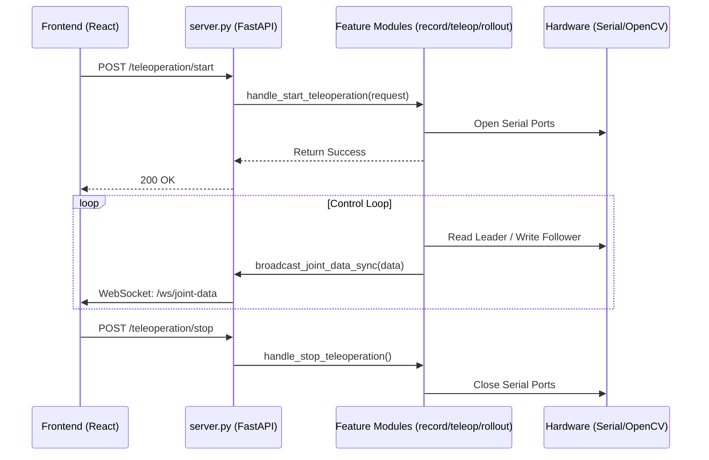
Sources: [lelab/server.py:68-75](), [lelab/server.py:202-220](), [CLAUDE.md:48-51]()

### Key Data Structures
| Workflow | Request Model | Primary Handler |
| :--- | :--- | :--- |
| **Calibration** | `CalibrationRequest` | `calibration_manager` |
| **Teleoperation** | `TeleoperateRequest` | `handle_start_teleoperation` |
| **Recording** | `RecordingRequest` | `handle_start_recording` |
| **Inference** | `InferenceRequest` | `handle_start_inference` |

Sources: [lelab/server.py:38-75](), [lelab/rollout.py:52-60]()

---

# Page: Calibration

# Calibration

<details>
<summary>Relevant source files</summary>

The following files were used as context for generating this wiki page:

- [frontend/src/lib/calibrationTargets.ts](frontend/src/lib/calibrationTargets.ts)
- [frontend/src/pages/Calibration.tsx](frontend/src/pages/Calibration.tsx)
- [lelab/calibrate.py](lelab/calibrate.py)
- [tests/test_calibrate.py](tests/test_calibrate.py)

</details>


The calibration system in LeLab provides a guided, web-based workflow for determining the hardware limits and homing offsets of SO-101 robot arms. It transitions the robot through a state machine that manages hardware connection, range-of-motion recording, and the final generation of `lerobot` compatible calibration files.

## Calibration Lifecycle

The calibration process is managed by the `CalibrationManager` class in the backend. It handles the transition between different states while ensuring thread-safe access to the hardware.

### State Machine Transitions
The manager follows a strict state progression:
1.  **Idle**: The initial state where no hardware is engaged `[lelab/calibrate.py:59]()`.
2.  **Connecting**: The manager attempts to instantiate a `Robot` or `Teleoperator` object using the provided serial port `[lelab/calibrate.py:168]()`.
3.  **Recording**: The hardware is in torque-off mode, allowing the user to manually move the joints to their limits `[lelab/calibrate.py:103]()`.
4.  **Stopping**: The manager is cleaning up resources and closing the serial bus `[lelab/calibrate.py:59]()`.
5.  **Completed/Error**: Terminal states where the process finishes successfully or encounters a failure `[lelab/calibrate.py:59]()`.

### System Entity Mapping: Backend State Management

The following diagram maps the logical calibration steps to the internal code entities and state variables within `CalibrationManager`.

**Calibration State Entity Map**
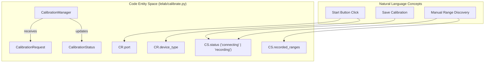
Sources: `[lelab/calibrate.py:55-77]()`, `[lelab/calibrate.py:79-145]()`.

## Range-of-Motion Recording

During the `recording` phase, the backend enters a loop that polls the motor positions at high frequency.

### Discontinuity Detection
Feetech encoders are 12-bit (0-4095). If a joint is moved across the wrap-around boundary (e.g., from 4095 to 0), it produces a massive delta in a single frame. The `CalibrationManager` detects this jump and raises a `CalibrationDiscontinuityError` `[lelab/calibrate.py:44-51]()`. Users are instructed to start calibration with joints centered in their physical range to avoid this `[frontend/src/pages/Calibration.tsx:39]()`.

### Range Calculation
As the user moves the arm, the system tracks the `min` and `max` raw values for each motor:
*   **Current Position**: Read via `device.bus.sync_read("Present_Position")` `[lelab/calibrate.py:109]()`.
*   **Min/Max Tracking**: The `recorded_ranges` dictionary is updated continuously `[lelab/calibrate.py:132-137]()`.
*   **Homing Offset**: Calculated as the difference between the starting position and the target center point of the discovered range.

## Frontend Calibration Interface

The frontend provides a real-time visualization of the calibration progress, including a checklist of motors and their current discovered ranges.

### Completion Logic
The UI determines if a motor has been sufficiently exercised by comparing the current range against hardcoded targets in `frontend/src/lib/calibrationTargets.ts`.

| Parameter | Value | Description |
| :--- | :--- | :--- |
| `RANGE_TOLERANCE` | `0.98` | Motors must reach 98% of target range to be marked complete `[frontend/src/lib/calibrationTargets.ts:27]()`. |
| `SO101_LEADER_TARGETS` | e.g., `shoulder_pan: 2400` | Target raw step ranges for leader (teleop) arms `[frontend/src/lib/calibrationTargets.ts:4-11]()`. |
| `SO101_FOLLOWER_TARGETS` | e.g., `gripper: 1400` | Target raw step ranges for follower (robot) arms `[frontend/src/lib/calibrationTargets.ts:13-20]()`. |

### Motor Progress Tracking
The function `isMotorRangeComplete` takes the `deviceType`, `motor` name, and `rangeAchieved` to return a boolean status used to render the checklist `[frontend/src/lib/calibrationTargets.ts:29-38]()`.

## Data Flow: From Hardware to Record

When calibration is finalized, the results are written back to the robot configuration records to ensure persistence across sessions.

**Calibration Data Flow**
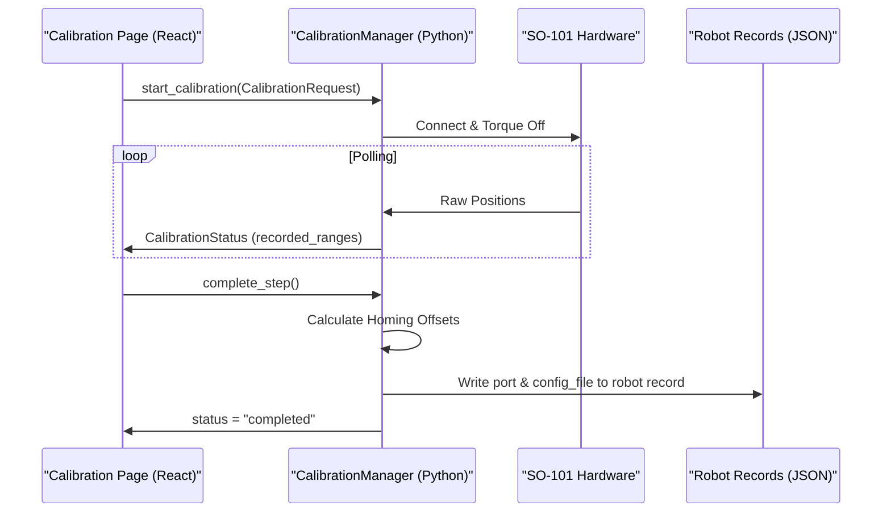
Sources: `[lelab/calibrate.py:154-180]()`, `[frontend/src/pages/Calibration.tsx:205-224]()`, `[lelab/calibrate.py:76-77]()`.

## Key Functions and Classes

### `CalibrationManager` (lelab/calibrate.py)
*   `get_status()`: Returns the current state, including thread-safe position readings from the hardware bus `[lelab/calibrate.py:99-145]()`.
*   `start_calibration(request)`: Spawns the calibration thread and initializes the state machine `[lelab/calibrate.py:154-185]()`.
*   `_update_status(**kwargs)`: Internal helper for thread-safe updates to the `CalibrationStatus` dataclass `[lelab/calibrate.py:147-152]()`.

### `Calibration` Page (frontend/src/pages/Calibration.tsx)
*   `pollStatus()`: An interval-based function that fetches the latest `CalibrationStatus` from the backend `[frontend/src/pages/Calibration.tsx:205-224]()`.
*   `handleCamerasChange()`: Persists camera configuration changes to the robot record using a debounced fetch call `[frontend/src/pages/Calibration.tsx:134-154]()`.
*   `unmount cleanup`: Automatically sends a `/stop-calibration` request if the user navigates away while calibration is active `[frontend/src/pages/Calibration.tsx:195-203]()`.

Sources: `[lelab/calibrate.py:79-152]()`, `[frontend/src/pages/Calibration.tsx:73-224]()`.

---

# Page: Teleoperation

# Teleoperation

<details>
<summary>Relevant source files</summary>

The following files were used as context for generating this wiki page:

- [frontend/.gitignore](frontend/.gitignore)
- [frontend/src/contexts/UrdfContext.tsx](frontend/src/contexts/UrdfContext.tsx)
- [frontend/src/hooks/useRealTimeJoints.ts](frontend/src/hooks/useRealTimeJoints.ts)
- [frontend/src/lib/UrdfDragAndDrop.ts](frontend/src/lib/UrdfDragAndDrop.ts)
- [frontend/src/lib/meshLoaders.ts](frontend/src/lib/meshLoaders.ts)
- [frontend/src/lib/types.ts](frontend/src/lib/types.ts)
- [frontend/src/lib/urdfViewerHelpers.ts](frontend/src/lib/urdfViewerHelpers.ts)
- [frontend/src/lib/utils.ts](frontend/src/lib/utils.ts)
- [lelab/teleoperate.py](lelab/teleoperate.py)

</details>


Teleoperation is the core real-time control workflow in LeLab, enabling a leader robot (typically a SO-101 arm) to control a follower robot. This module manages the low-level serial communication via LeRobot, performs coordinate transformations for 3D visualization, and broadcasts real-time joint states to the frontend at 20 FPS via WebSockets.

## Teleoperation Backend

The teleoperation logic is encapsulated in `lelab/teleoperate.py`. It uses a threaded worker model to maintain a high-frequency control loop without blocking the FastAPI event loop.

### TeleoperateRequest and Lifecycle
The lifecycle of a teleoperation session is managed by the `handle_start_teleoperation` function. It enforces mutual exclusion with other hardware-intensive tasks like recording or inference using a global `_state_lock` [lelab/teleoperate.py:55-55]().

1.  **Request Validation**: Checks if teleoperation, recording, or inference is already active [lelab/teleoperate.py:131-138]().
2.  **Configuration**: Invokes `setup_calibration_files` to ensure the correct `.json` calibration files exist in the LeRobot cache [lelab/teleoperate.py:146-148]().
3.  **Worker Initialization**: Spawns a `teleoperation_worker` thread [lelab/teleoperate.py:162-162]().
4.  **Connection**: Initializes `SO101Follower` and `SO101Leader` instances and connects to their respective serial buses [lelab/teleoperate.py:167-175]().
5.  **Calibration Sync**: Writes calibration data directly to the motor memory [lelab/teleoperate.py:178-180]().
6.  **Control Loop**: Enters a `while teleoperation_active` loop that reads from the leader and writes to the follower [lelab/teleoperate.py:192-205]().

### Joint Coordinate Transformation
To support 3D visualization, LeLab converts raw motor positions into URDF-compatible joint angles. The `get_joint_positions_from_robot` function handles this mapping [lelab/teleoperate.py:65-65]().

While most joints follow a direct mapping, the SO-101 `shoulder_lift` and `elbow_flex` require corrections because the URDF zero-pose (sleep position) differs from the calibration's mid-range pose [lelab/teleoperate.py:33-41]().

**Correction Formula:**
`URDF_value = sign * (motor_normalized_deg - motor_at_urdf_zero_deg)`
where `motor_at_urdf_zero_deg` is derived from constant `urdf_zero_ticks` [lelab/teleoperate.py:36-47]().

### Data Flow: Robot to WebSocket
Teleoperation telemetry is broadcasted at approximately 20 FPS (0.05s sleep interval) [lelab/teleoperate.py:202-205](). The joint data is formatted into a `joint_update` message and sent via the `websocket_manager` [lelab/teleoperate.py:199-201]().

**Sources:** [lelab/teleoperate.py:1-210]()

## Teleoperation Frontend Visualization

The frontend uses a custom `<urdf-viewer>` Web Component to render the robot's state in 3D.

### URDF Viewer and Mesh Loading
The `UrdfProvider` manages the URDF state, including the default SO-101 model and any custom models uploaded via drag-and-drop [frontend/src/contexts/UrdfContext.tsx:58-62]().

*   **Mesh Loading**: The `loadMeshFile` utility supports STL, GLTF, GLB, Collada (DAE), and OBJ formats using THREE.js loaders [frontend/src/lib/meshLoaders.ts:43-97]().
*   **Fallback Geometry**: If an STL fails to load, the system generates a 5cm orange cube as a placeholder to prevent the visualization from breaking [frontend/src/lib/meshLoaders.ts:85-94]().

### Real-Time Updates
The `useRealTimeJoints` hook establishes a WebSocket connection to `/ws/joint-data` [frontend/src/hooks/useRealTimeJoints.ts:26-26](). When a `joint_update` message is received, it calls `viewer.setJointValue(jointName, value)` on the `URDFViewerElement` to update the 3D model [frontend/src/hooks/useRealTimeJoints.ts:34-45]().

### Drag and Drop Support
Users can drop URDF folders into the application. The `dataTransferToFiles` utility recursively processes the `DataTransfer` object, converting files into Blobs and generating temporary URLs for the viewer [frontend/src/lib/UrdfDragAndDrop.ts:13-20]().

**Sources:** [frontend/src/contexts/UrdfContext.tsx:1-102](), [frontend/src/hooks/useRealTimeJoints.ts:1-130](), [frontend/src/lib/meshLoaders.ts:1-101](), [frontend/src/lib/UrdfDragAndDrop.ts:1-120](), [frontend/src/lib/urdfViewerHelpers.ts:15-33]()

## System Architecture Diagrams

### Teleoperation Lifecycle and Threading
This diagram bridges the `TeleoperateRequest` model to the backend worker thread and the hardware communication.

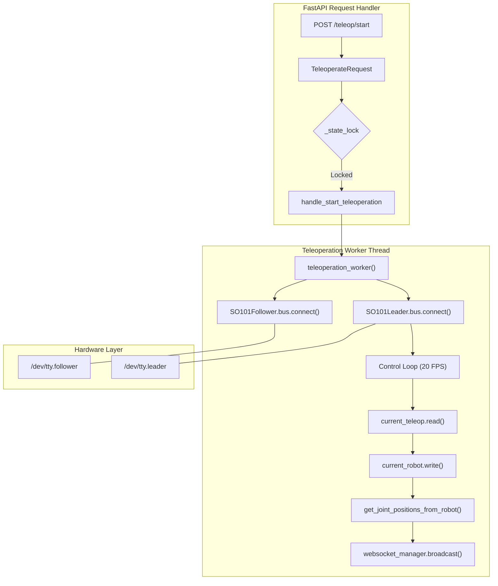
**Sources:** [lelab/teleoperate.py:55-55](), [lelab/teleoperate.py:125-138](), [lelab/teleoperate.py:162-205]()

### Frontend Visualization Data Flow
This diagram shows how joint data travels from the WebSocket to the `UrdfViewer` component.

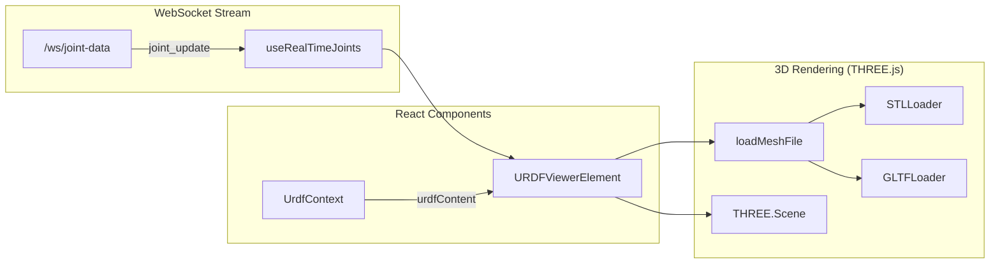
**Sources:** [frontend/src/hooks/useRealTimeJoints.ts:26-45](), [frontend/src/lib/urdfViewerHelpers.ts:15-33](), [frontend/src/lib/meshLoaders.ts:43-73]()

## Teleoperation State Summary

| Entity | Type | Responsibility |
| :--- | :--- | :--- |
| `teleoperation_active` | `bool` | Global flag controlling the worker loop [lelab/teleoperate.py:50](). |
| `_state_lock` | `threading.Lock` | Prevents concurrent hardware access [lelab/teleoperate.py:55](). |
| `_SO101_URDF_CORRECTIONS` | `dict` | Constants for aligning motor ticks to URDF radians [lelab/teleoperate.py:43](). |
| `URDFViewerElement` | `interface` | Web Component interface for 3D visualization [frontend/src/lib/urdfViewerHelpers.ts:15](). |
| `useRealTimeJoints` | `hook` | Manages WebSocket lifecycle and viewer updates [frontend/src/hooks/useRealTimeJoints.ts:20](). |

**Sources:** [lelab/teleoperate.py:43-55](), [frontend/src/lib/urdfViewerHelpers.ts:15-33](), [frontend/src/hooks/useRealTimeJoints.ts:20-33]()

---

# Page: Dataset Recording

# Dataset Recording

<details>
<summary>Relevant source files</summary>

The following files were used as context for generating this wiki page:

- [frontend/src/lib/recordingAudio.ts](frontend/src/lib/recordingAudio.ts)
- [frontend/src/pages/Recording.tsx](frontend/src/pages/Recording.tsx)
- [frontend/vite.config.ts](frontend/vite.config.ts)
- [lelab/record.py](lelab/record.py)

</details>


The Dataset Recording system provides a managed interface for capturing teleoperated robot episodes into a LeRobot-compatible dataset. It orchestrates the lifecycle of hardware connection, phase transitions (recording vs. resetting), and automated dataset uploading to the Hugging Face Hub.

## Recording Lifecycle and State Machine

The recording process is governed by a background worker thread in the backend and a polling-based state machine in the frontend. This architecture ensures that hardware control remains stable even if the browser tab is refreshed or the network fluctuates.

### Backend State Machine
The recording session moves through four distinct phases defined in `lelab/record.py`:
1.  **`preparing`**: Initializing hardware, cameras, and the `LeRobotDataset` object [lelab/record.py:46]().
2.  **`recording`**: Active data collection where leader/follower joint states and camera frames are written to disk [lelab/record.py:46]().
3.  **`resetting`**: A timed interval between episodes allowing the operator to reset the environment [lelab/record.py:46]().
4.  **`completed`**: The session has reached the target number of episodes or was manually terminated [lelab/record.py:46]().

### Hardware Control and Signals
The `recording_worker` thread manages the session using a `threading.Event` dictionary (`recording_events`) to respond to asynchronous signals from the API [lelab/record.py:206-208]():
-   **`stop_recording`**: Gracefully shuts down the loop and saves the dataset.
-   **`exit_early`**: Stops the current episode and transitions immediately to the next phase.
-   **`rerecord_episode`**: Discards the current episode's data and restarts the same episode index.

### System Data Flow: API to Worker
The following diagram illustrates how a `RecordingRequest` is transformed into a running hardware session.

**Recording Orchestration Flow**
```mermaid
graph TD
    subgraph "Natural Language Space"
        User["User clicks 'Start Recording'"]
    end

    subgraph "Code Entity Space"
        Request["RecordingRequest (BaseModel)"]
        StartHandler["handle_start_recording()"]
        ConfigGen["create_record_config()"]
        Worker["recording_worker()"]
        LeRobotRecord["lerobot.scripts.lerobot_record.record()"]
        
        User -->|POST /start-recording| StartHandler
        StartHandler -->|Validates _state_lock| Request
        Request --> ConfigGen
        ConfigGen -->|Returns RecordConfig| Worker
        Worker -->|Spawns thread| LeRobotRecord
    end
```
Sources: [lelab/record.py:56-75](), [lelab/record.py:87-170](), [lelab/record.py:173-203](), [lelab/record.py:206-258]()

## Backend Implementation Details

### Camera Backend Selection
To ensure consistency between the browser preview and the OpenCV capture, `lelab/record.py` pins the backend based on the operating system. This prevents macOS `AVFoundation` index shifting [lelab/record.py:98-103]().

| OS | Backend | Rationale |
| :--- | :--- | :--- |
| **Darwin (macOS)** | `Cv2Backends.AVFOUNDATION` | Avoids index reordering between `cv2.CAP_ANY` calls [lelab/record.py:98-99](). |
| **Linux** | `Cv2Backends.V4L2` | Standard for Video4Linux2 devices [lelab/record.py:100-101](). |
| **Other** | `Cv2Backends.ANY` | Default fallback [lelab/record.py:103](). |

### The Recording Worker
The `recording_worker` function acts as a wrapper around `lerobot.scripts.lerobot_record.record`. It initializes global state variables like `recording_active`, `current_episode`, and `saved_episodes` before invoking the core LeRobot recording logic [lelab/record.py:206-258](). It also handles post-recording cleanup, such as setting `session_end_elapsed_seconds` for the summary UI [lelab/record.py:245]().

Sources: [lelab/record.py:38-53](), [lelab/record.py:87-104](), [lelab/record.py:206-258]()

## Frontend Recording Page

The `Recording.tsx` component provides a high-stakes UI designed for hands-free or keyboard-centric operation.

### Optimistic UI and Polling
The frontend uses a polling loop (`pollStatus`) every 1000ms to fetch `backendStatus` from `/recording-status` [frontend/src/pages/Recording.tsx:146-207](). To provide immediate feedback, it employs `optimisticPhase` state, which is cleared once the backend status confirms the transition [frontend/src/pages/Recording.tsx:155-159]().

### Audio Cues and Keyboard Shortcuts
Since operators are often looking at the robot rather than the screen, the system provides synthesized audio feedback using the Web Audio API in `recordingAudio.ts`.

-   **Start Cue**: Two rising tones when `current_phase` becomes `recording` [frontend/src/lib/recordingAudio.ts:38-41]().
-   **Reset Cue**: Two falling tones when entering `resetting` phase [frontend/src/lib/recordingAudio.ts:43-46]().
-   **Auto-Advance Warning**: Three beeps in the final 3 seconds of a phase [frontend/src/lib/recordingAudio.ts:48-52]().

**Keyboard Mapping**
| Key | Action | Backend Signal |
| :--- | :--- | :--- |
| `Escape` | Stop Recording | `stop_recording` [frontend/src/pages/Recording.tsx:238]() |
| `Enter` | Skip/Exit Early | `exit_early` [frontend/src/pages/Recording.tsx:244]() |
| `R` | Re-record Episode | `rerecord_episode` [frontend/src/pages/Recording.tsx:250]() |

### Data Flow: Frontend to Backend
The following diagram maps UI interactions to the specific API endpoints and backend events they trigger.

**Frontend Control Flow**
```mermaid
graph LR
    subgraph "Recording.tsx (Frontend)"
        UI_Stop["Stop Button / Escape"]
        UI_Skip["Skip Button / Enter"]
        UI_Retry["Retry Button / 'R'"]
    end

    subgraph "Server API (lelab/server.py)"
        StopEP["POST /stop-recording"]
        SignalEP["POST /recording-signal"]
    end

    subgraph "Record State (lelab/record.py)"
        Events["recording_events (dict)"]
        EventStop["stop_recording (Event)"]
        EventExit["exit_early (Event)"]
        EventRetry["rerecord_episode (Event)"]
    end

    UI_Stop --> StopEP
    UI_Skip -->|"{signal: 'exit_early'}"| SignalEP
    UI_Retry -->|"{signal: 'rerecord_episode'}"| SignalEP

    StopEP --> EventStop
    SignalEP --> EventExit
    SignalEP --> EventRetry
    
    EventStop -.->|Sets| Events
    EventExit -.->|Sets| Events
    EventRetry -.->|Sets| Events
```
Sources: [frontend/src/pages/Recording.tsx:236-253](), [lelab/record.py:261-294](), [lelab/record.py:313-333]()

## Dataset Upload and Finalization

Once the session is complete (either by reaching `num_episodes` or manual stop), the frontend detects `session_ended` and navigates to the `/upload` page [frontend/src/pages/Recording.tsx:189-199]().

### Hub Integration
The backend provides `handle_push_to_hub` which uses `LeRobotDataset.push_to_hub`. This function ensures that datasets are tagged with the `LELAB_TAG` to facilitate discovery within the LeLab ecosystem [lelab/record.py:348-369]().

-   **`tags`**: Automatically includes `lelab` via `with_lelab_tag` [lelab/utils/config.py]().
-   **`private`**: Respects the user's privacy settings during the Hub push [lelab/record.py:365]().

Sources: [lelab/record.py:348-369](), [frontend/src/pages/Recording.tsx:189-199]()

---

# Page: Inference (Policy Rollout)

# Inference (Policy Rollout)

<details>
<summary>Relevant source files</summary>

The following files were used as context for generating this wiki page:

- [frontend/src/components/training/WandbInstallDialog.tsx](frontend/src/components/training/WandbInstallDialog.tsx)
- [frontend/src/lib/checkpointsApi.ts](frontend/src/lib/checkpointsApi.ts)
- [frontend/src/lib/inferenceApi.ts](frontend/src/lib/inferenceApi.ts)
- [frontend/src/lib/jobsApi.ts](frontend/src/lib/jobsApi.ts)
- [frontend/src/pages/Inference.tsx](frontend/src/pages/Inference.tsx)
- [lelab/rollout.py](lelab/rollout.py)

</details>


The Inference module is responsible for executing trained policies on the SO-101 robot hardware. It orchestrates a one-shot "rollout" session where a model (either local or from the Hugging Face Hub) drives the follower robot's motors based on real-time camera feedback. This module mirrors the architecture of teleoperation and recording but executes `lerobot.scripts.lerobot_rollout` as a managed subprocess.

## Core Implementation

Inference is managed as a single global session in the backend to ensure mutual exclusion with other hardware-access modules.

### InferenceRequest Model
The `InferenceRequest` Pydantic model defines the parameters required to start a rollout:
*   `follower_port`: Serial port for the follower robot.
*   `follower_config`: The robot configuration ID used to locate calibration files.
*   `policy_ref`: An opaque reference to the policy checkpoint (local path or Hub string).
*   `cameras`: A mapping of camera names to their hardware configurations (index, resolution, fps).
*   `duration_s`: The maximum length of the rollout in seconds.

Sources: `[lelab/rollout.py:44-50]()`

### Policy Resolution and Device Detection
Before spawning the inference subprocess, the system resolves the `policy_ref` into a local directory path. If the reference matches a Hugging Face Hub pattern (`repo@checkpoints/step`), it uses `snapshot_download` to fetch only the required `pretrained_model` files `[lelab/rollout.py:111-132]()`.

The system also automatically detects the best available compute device (CUDA > MPS > CPU) to pass to the policy `[lelab/rollout.py:97-108]()`.

### Subprocess Orchestration
The rollout is executed via `subprocess.Popen` calling `lerobot.scripts.lerobot_rollout` `[lelab/rollout.py:188-232]()`.
*   **Stdin Seeding**: The process is seeded with `\n` to bypass any "Press Enter to start" prompts in the underlying script `[lelab/rollout.py:234-235]()`.
*   **Stdout Pump**: A dedicated thread `_pump_stdout` reads the subprocess output, tees it to a log file, and watches for the `_ROLLOUT_START_MARKER` ("Rollout setup complete") `[lelab/rollout.py:69-95]()`.
*   **Shutdown**: The `handle_stop_inference` function attempts a `SIGTERM` followed by a `SIGKILL` if the process does not exit within 2 seconds, ensuring the serial bus is released `[lelab/rollout.py:284-315]()`.

Sources: `[lelab/rollout.py:66-66]()`, `[lelab/rollout.py:69-95]()`, `[lelab/rollout.py:284-315]()`

## Inference Data Flow

The following diagram illustrates the transition from the frontend request to the backend subprocess management.

### System Entity Mapping: Frontend to Backend
| Frontend Concept | Code Entity | Role |
| :--- | :--- | :--- |
| **Start Button** | `startInference` | API call to `/start-inference` `[frontend/src/lib/inferenceApi.ts:31-42]()` |
| **Inference Page** | `Inference.tsx` | UI state machine (Setup vs. Running) `[frontend/src/pages/Inference.tsx:33-33]()` |
| **Policy Selector** | `JobCheckpoint` | Metadata for selecting model steps `[frontend/src/lib/checkpointsApi.ts:3-7]()` |
| **Backend Controller** | `handle_start_inference` | Logic for mutex checks and process spawning `[lelab/rollout.py:149-149]()` |
| **Hardware Driver** | `lerobot_rollout` | The LeRobot script running in a subprocess `[lelab/rollout.py:20-21]()` |

```mermaid
graph TD
    subgraph "Frontend (Inference.tsx)"
        A["UI: Start Inference"] --> B["startInference()"]
        B --> C["Poll: getInferenceStatus()"]
    end

    subgraph "Backend (lelab/rollout.py)"
        B -- "POST /start-inference" --> D["handle_start_inference()"]
        D --> E["_resolve_policy_path()"]
        E --> F["subprocess.Popen(lerobot_rollout)"]
        F --> G["_pump_stdout Thread"]
        G -- "Detects Marker" --> H["_inference_rollout_started_at"]
        C -- "GET /inference-status" --> I["handle_get_inference_status()"]
        I -- "Returns" --> H
    end

    subgraph "Hardware Space"
        F -- "Serial Commands" --> J["Follower Robot"]
        F -- "Capture" --> K["OpenCV Cameras"]
    end
```
Sources: `[lelab/rollout.py:149-180]()`, `[frontend/src/pages/Inference.tsx:54-74]()`, `[frontend/src/lib/inferenceApi.ts:31-63]()`

## Inference Frontend Lifecycle

The Inference page (`frontend/src/pages/Inference.tsx`) manages two distinct phases: **Setup** and **Rollout**.

### Phase Management
1.  **Setup Phase**: The backend is loading the policy, downloading weights, and connecting to hardware. The UI displays "SETTING UP" with an amber pulsing timer `[frontend/src/pages/Inference.tsx:148-154]()`.
2.  **Rollout Phase**: Once the `_ROLLOUT_START_MARKER` is detected in the logs, the backend sets `rollout_started_at`. The UI switches to "RUNNING" with a green timer and progress bar `[frontend/src/pages/Inference.tsx:140-154]()`.

### Safety Mechanisms
*   **Hung Inference Protection**: The frontend monitors `rollout_elapsed_s`. If the rollout exceeds the user-defined `duration_s` by more than 10 seconds without the subprocess exiting, the frontend automatically triggers `stopInference` as a safety net `[frontend/src/pages/Inference.tsx:79-96]()`.
*   **Auto-Bounce**: Upon successful completion (or failure), the page displays a toast with the exit status and automatically navigates the user back to the Landing page `[frontend/src/pages/Inference.tsx:59-74]()`.

### Process Orchestration Diagram
```mermaid
sequenceDiagram
    participant FE as Inference Page
    participant BE as rollout.py
    participant SUB as lerobot_rollout (Subprocess)

    FE->>BE: handle_start_inference(Request)
    BE->>SUB: spawn process
    BE-->>FE: 200 OK (inference_active=true)
    
    Note over FE, SUB: Setup Phase (Loading Model/Hardware)
    
    SUB->>BE: stdout: "Rollout setup complete"
    BE->>BE: Set _inference_rollout_started_at
    
    Note over FE, SUB: Rollout Phase (Active Control)
    
    FE->>BE: getInferenceStatus()
    BE-->>FE: { rollout_started_at: timestamp }
    
    alt Normal Completion
        SUB->>BE: Process Exit (code 0)
        BE->>BE: Set inference_active=false
    else Hung Process
        FE->>BE: stopInference() (Safety Net)
        BE->>SUB: SIGTERM/SIGKILL
    end
    
    FE->>FE: navigate("/")
```
Sources: `[lelab/rollout.py:69-89]()`, `[frontend/src/pages/Inference.tsx:59-96]()`, `[lelab/rollout.py:284-315]()`

## API Endpoints

| Endpoint | Method | Function | Description |
| :--- | :--- | :--- | :--- |
| `/start-inference` | POST | `handle_start_inference` | Spawns the rollout subprocess if mutex is clear. |
| `/stop-inference` | POST | `handle_stop_inference` | Signals the subprocess to terminate. |
| `/inference-status` | GET | `handle_get_inference_status` | Returns timing, logs, and process state. |

Sources: `[lelab/rollout.py:149-149]()`, `[lelab/rollout.py:284-284]()`, `[lelab/rollout.py:257-257]()`

---

# Page: Camera Management

# Camera Management

<details>
<summary>Relevant source files</summary>

The following files were used as context for generating this wiki page:

- [frontend/dist/index.html](frontend/dist/index.html)
- [frontend/src/components/landing/InferenceModal.tsx](frontend/src/components/landing/InferenceModal.tsx)
- [frontend/src/components/recording/CameraConfiguration.tsx](frontend/src/components/recording/CameraConfiguration.tsx)
- [lelab/server.py](lelab/server.py)

</details>


LeLab provides a unified system for managing camera hardware across the browser (for real-time user previews) and the Python backend (for dataset recording and policy inference). Because physical camera devices are often exclusive-access resources, LeLab implements a specific **Hardware Contention Lifecycle** to ensure that browser-side previews are released before backend OpenCV processes attempt to capture the stream.

## Hardware Contention Lifecycle

The primary challenge in LeLab's camera management is the handoff between the browser's `MediaDevices` API and the backend's `cv2.VideoCapture`. On most operating systems, a camera opened by the browser cannot be simultaneously opened by a backend subprocess.

LeLab manages this through a coordinated release protocol:
1.  **Preview Phase**: The frontend uses `useCameraStream` to display live feeds in the `CameraConfiguration` or `InferenceModal` components [frontend/src/components/recording/CameraConfiguration.tsx:155-164]().
2.  **Release Signal**: When a user clicks "Start Recording" or "Start Inference", the application invokes a `releaseStreamsRef` callback [frontend/src/components/recording/CameraConfiguration.tsx:32-38]().
3.  **Handoff**: The browser stops all active `MediaStreamTrack` objects. Once the tracks are stopped, the frontend triggers the backend API call [frontend/src/components/landing/InferenceModal.tsx:207-213]().
4.  **Backend Capture**: The backend subprocess (OpenCV) initializes its own capture session using the synchronized camera indices [lelab/record.py:165-175]().

### Entity Mapping: Lifecycle & Hardware

The following diagram bridges the natural language concepts of "Preview" and "Handoff" to the specific code entities that implement them.

Title: Camera Lifecycle Entity Mapping
```mermaid
graph TD
    subgraph "Browser Space (UI/Preview)"
        A["CameraConfiguration Component"] -- "manages" --> B["useCameraStream Hook"]
        B -- "renders" --> C["videoRef / MediaStream"]
        A -- "exposes" --> D["releaseStreamsRef"]
    end

    subgraph "Transition Logic"
        E["handleStartRecording / handleStart"] -- "calls" --> D
        D -- "sets paused=true" --> B
    end

    subgraph "Backend Space (OpenCV)"
        F["handle_start_recording"] -- "spawns" --> G["record.py subprocess"]
        H["handle_start_inference"] -- "spawns" --> I["rollout.py subprocess"]
        G -- "cv2.VideoCapture(index)" --> J["Physical Camera"]
        I -- "cv2.VideoCapture(index)" --> J
    end

    C -. "Exclusive Access" .- J
```
Sources: [frontend/src/components/recording/CameraConfiguration.tsx:32-38](), [frontend/src/components/recording/CameraConfiguration.tsx:155-164](), [frontend/src/components/landing/InferenceModal.tsx:207-213](), [lelab/record.py:165-175]()

## Camera Index Synchronization

LeLab must reconcile two different ways of identifying cameras:
*   **Browser `deviceId`**: A stable, origin-specific UUID used by the browser to remember a specific physical device.
*   **OpenCV `camera_index`**: An integer (0, 1, 2...) used by the backend. On macOS, these indices are notoriously unstable and can shift if devices are plugged/unplugged.

The `CameraConfiguration` component solves this by storing both. On initialization, it uses the `useAvailableCameras` hook to refresh the `camera_index` by matching the stable `deviceId` against the current hardware list [frontend/src/components/recording/CameraConfiguration.tsx:54-71]().

### Backend Enumeration Workaround
On macOS, standard OpenCV enumeration often fails to match the order expected by the system. LeLab uses a specialized subprocess `_avfoundation_cameras_in_cv2_order` in the backend to ensure the indices provided to the frontend match what OpenCV will actually open [lelab/server.py:273-305]().

Sources: [frontend/src/components/recording/CameraConfiguration.tsx:18-27](), [lelab/server.py:273-305]()

## Key Components

### CameraConfiguration
The primary interface for binding physical cameras to logical names (e.g., "laptop", "base", "hand"). It allows users to set resolution and FPS targets which are then persisted in the `RobotRecord` [frontend/src/components/recording/CameraConfiguration.tsx:114-124]().

### useAvailableCameras
A hook that polls the `/available-cameras` backend endpoint. It returns a list of cameras including their OpenCV index and their browser-compatible `deviceId` [frontend/src/hooks/useAvailableCameras.ts:1-20]().

### CameraPreview & CameraThumbnail
Lightweight components used to render the stream. They listen to the `paused` prop to automatically drop the `MediaStream` when the hardware handoff begins [frontend/src/components/landing/InferenceModal.tsx:37-61]().

| Component/Hook | Responsibility | File |
| :--- | :--- | :--- |
| `CameraConfiguration` | UI for adding/removing cameras and syncing indices. | [frontend/src/components/recording/CameraConfiguration.tsx:35-39]() |
| `useCameraStream` | Manages `MediaStream` lifecycle and `video` element refs. | [frontend/src/hooks/useCameraStream.ts:1-15]() |
| `OpenCVCameraConfig` | Backend Pydantic model for camera parameters. | [lelab/record.py:75-84]() |

## Child Pages

For detailed implementation specifics, refer to the following sub-pages:

*   **[Browser Camera Streams](#4.1)**: Deep dive into the React hooks, the `MediaStream` lifecycle, and the frontend release protocol.
*   **[Backend Camera Enumeration](#4.2)**: Details on the macOS AVFoundation workaround, OpenCV backend selection (V4L2 vs AVFoundation), and index discovery.

---

# Page: Browser Camera Streams

# Browser Camera Streams

<details>
<summary>Relevant source files</summary>

The following files were used as context for generating this wiki page:

- [frontend/dist/index.html](frontend/dist/index.html)
- [frontend/src/components/landing/InferenceModal.tsx](frontend/src/components/landing/InferenceModal.tsx)
- [frontend/src/components/recording/CameraConfiguration.tsx](frontend/src/components/recording/CameraConfiguration.tsx)
- [frontend/src/hooks/useAvailableCameras.ts](frontend/src/hooks/useAvailableCameras.ts)
- [frontend/src/hooks/useCameraStream.ts](frontend/src/hooks/useCameraStream.ts)

</details>


The frontend camera subsystem manages the lifecycle of browser-side camera previews and ensures a clean handoff to the backend's OpenCV-based recording and inference engines. Because many operating systems and hardware drivers allow only a single process to access a camera device at once, LeLab implements a strict "release-before-handoff" protocol.

## Camera Configuration and Synchronization

The `CameraConfiguration` component manages the list of cameras associated with a robot record. It bridges the gap between the browser's stable `deviceId` and the backend's volatile `camera_index`.

### Data Structures and Interfaces
The `CameraConfig` interface defines how a camera is persisted and used:
*   **`camera_index`**: The integer index used by OpenCV (`cv2.VideoCapture(index)`) on the backend [[frontend/src/components/recording/CameraConfiguration.tsx:22-22]]().
*   **`device_id`**: The browser-specific unique identifier. This is used to maintain a stable link to a physical device even if indices shift [[frontend/src/components/recording/CameraConfiguration.tsx:23-23]]().

### Index Re-sync Logic
On macOS (AVFoundation), plugging or unplugging USB devices can shift the indices assigned to cameras [[frontend/src/components/recording/CameraConfiguration.tsx:49-53]](). To prevent the backend from opening the wrong physical device, `CameraConfiguration` uses a `useEffect` hook to automatically refresh the `camera_index` of all configured cameras whenever the list of available cameras changes, matching them by their stable browser `device_id` [[frontend/src/components/recording/CameraConfiguration.tsx:54-71]]().

### The `useAvailableCameras` Hook
This hook enumerates system cameras by combining two data sources:
1.  **Browser Enumeration**: Calls `navigator.mediaDevices.enumerateDevices()` to get `deviceId` and `label` [[frontend/src/hooks/useAvailableCameras.ts:42-44]]().
2.  **Backend Enumeration**: Fetches the ordered list of indices from the `/available-cameras` endpoint [[frontend/src/hooks/useAvailableCameras.ts:46-51]]().

The hook performs a fuzzy string match between the browser's `label` (often modified by the OS/Browser) and the backend's reported device name to create a unified `AvailableCamera` object [[frontend/src/hooks/useAvailableCameras.ts:62-81]]().

**Sources:**
*   [frontend/src/components/recording/CameraConfiguration.tsx:18-27]()
*   [frontend/src/components/recording/CameraConfiguration.tsx:49-71]()
*   [frontend/src/hooks/useAvailableCameras.ts:24-102]()

## Stream Lifecycle and Management

Live previews are managed via the `useCameraStream` hook, which handles the `MediaStream` lifecycle.

### The `useCameraStream` Hook
This hook attaches a camera feed to a `<video>` element. It handles:
*   **Initialization**: Requesting access via `getUserMedia` using a specific `deviceId` [[frontend/src/hooks/useCameraStream.ts:23-25]]().
*   **Cleanup**: Automatically stopping all tracks when the component unmounts to free the hardware [[frontend/src/hooks/useCameraStream.ts:39-42]]().
*   **Pausing**: If the `paused` prop is true, the hook stops the stream, allowing other processes (like the backend recorder) to claim the device [[frontend/src/hooks/useCameraStream.ts:13-16]]().

### Camera Preview Components
*   **`CameraPreview`**: (Internal to `CameraConfiguration`) Used during setup to verify the camera feed.
*   **`CameraThumbnail`**: Used in the `InferenceModal` to show the currently bound cameras for a specific policy [[frontend/src/components/landing/InferenceModal.tsx:37-61]]().

### Stream Release Protocol
Before a recording or inference session begins, the frontend must release all browser-side camera streams. This is orchestrated through a `releaseStreamsRef` [[frontend/src/components/recording/CameraConfiguration.tsx:32-32]]().

1.  The `CameraConfiguration` component populates the ref with a `releaseAllCameraStreams` callback [[frontend/src/components/recording/CameraConfiguration.tsx:160-164]]().
2.  When the user clicks "Start Recording" or "Start Inference", the parent component calls this function [[frontend/src/components/recording/CameraConfiguration.tsx:156-158]]().
3.  This sets a `paused` state which propagates to all `useCameraStream` hooks, calling `track.stop()` on every active stream [[frontend/src/hooks/useCameraStream.ts:39-42]]().
4.  Only after the streams are released does the frontend send the API request to the backend to start the hardware-intensive process [[frontend/src/components/landing/InferenceModal.tsx:212-213]]().

**Sources:**
*   [frontend/src/hooks/useCameraStream.ts:8-46]()
*   [frontend/src/components/recording/CameraConfiguration.tsx:155-164]()
*   [frontend/src/components/landing/InferenceModal.tsx:37-61]()

## System Integration Diagrams

### Camera Entity Mapping
This diagram shows how different identifiers for the same physical camera are associated across the system.

```mermaid
graph TD
    subgraph "Natural Language Space"
        UserLabel["'Top-down View' (User Name)"]
    end

    subgraph "Code Entity Space: CameraConfig"
        CC_ID["id: 'camera_171...'"]
        CC_Name["name: 'Top-down View'"]
        CC_Index["camera_index: 0"]
        CC_DeviceID["device_id: 'a1b2c3...'"]
    end

    subgraph "Hardware/OS Space"
        CV2["OpenCV Backend (Index 0)"]
        Browser["navigator.mediaDevices (a1b2c3...)"]
    end

    UserLabel --> CC_Name
    CC_Name --> CC_ID
    CC_Index -.->|Passed to Backend| CV2
    CC_DeviceID -.->|Used by useCameraStream| Browser
    CC_DeviceID <==>|Synced by useAvailableCameras| CC_Index
```
**Sources:**
*   [frontend/src/components/recording/CameraConfiguration.tsx:18-27]()
*   [frontend/src/hooks/useAvailableCameras.ts:62-81]()

### Stream Release Sequence
The following sequence ensures that the backend does not encounter "Device Busy" errors when attempting to start a session.

```mermaid
sequenceDiagram
    participant U as User
    participant IM as InferenceModal / RecordingModal
    participant CC as CameraConfiguration
    participant UCS as useCameraStream
    participant API as Backend API

    U->>IM: Click "Start"
    IM->>CC: Invoke releaseStreamsRef.current()
    CC->>CC: setStreamsPaused(true)
    CC->>UCS: prop: paused = true
    UCS->>UCS: MediaStreamTrack.stop()
    Note over UCS: Hardware Released
    IM->>API: POST /inference/start (camera_index: 0)
    API->>API: cv2.VideoCapture(0)
    Note over API: Hardware Acquired by Backend
```
**Sources:**
*   [frontend/src/components/recording/CameraConfiguration.tsx:155-164]()
*   [frontend/src/hooks/useCameraStream.ts:39-42]()
*   [frontend/src/components/landing/InferenceModal.tsx:212-213]()

---

# Page: Backend Camera Enumeration

# Backend Camera Enumeration

<details>
<summary>Relevant source files</summary>

The following files were used as context for generating this wiki page:

- [lelab/record.py](lelab/record.py)
- [lelab/rollout.py](lelab/rollout.py)
- [lelab/server.py](lelab/server.py)

</details>


The LeLab backend provides a robust mechanism for discovering and configuring cameras across different operating systems. This system addresses specific hardware instabilities on macOS and ensures that camera indices selected in the frontend GUI are accurately mapped to the underlying OpenCV backends used during dataset recording and policy rollout.

## The macOS AVFoundation Challenge

On macOS, OpenCV's default camera enumeration (using `cv2.CAP_ANY`) is notoriously unstable. Camera indices can shift between process restarts or even between different calls within the same process. To solve this, LeLab implements a specialized discovery routine that forces the use of the `AVFOUNDATION` backend.

### Subprocess Enumeration Workaround
In `lelab/server.py`, the `_avfoundation_cameras_in_cv2_order` function executes a short-lived Python subprocess. This subprocess explicitly iterates through indices using `cv2.VideoCapture(i, cv2.CAP_AVFOUNDATION)` to build a stable map of available hardware devices [lelab/server.py:284-314]().

### Data Flow: Discovery to Frontend
The `/available-cameras` endpoint orchestrates this discovery. It captures a thumbnail from every detected camera to allow users to visually identify which index corresponds to which physical device (e.g., "Top" vs. "Wrist") [lelab/server.py:330-385]().

**Camera Discovery Sequence**

```mermaid
sequenceDiagram
    participant FE as Frontend (useAvailableCameras)
    participant BE as FastAPI (server.py)
    participant SP as Subprocess (AVFoundation)
    participant HW as Camera Hardware

    FE->>BE: GET /available-cameras
    BE->>SP: Spawn _avfoundation_cameras_in_cv2_order
    loop Index 0 to 7
        SP->>HW: cv2.VideoCapture(i, CAP_AVFOUNDATION)
        HW-->>SP: Success/Failure
    end
    SP-->>BE: List of valid indices
    loop Each valid index
        BE->>HW: Capture Frame (Thumbnail)
        HW-->>BE: Frame Data
    end
    BE-->>FE: JSON [{index, thumbnail_base64}]
```
Sources: [lelab/server.py:284-314](), [lelab/server.py:330-385]()

## Backend Selection Logic

To maintain consistency between the visual preview in the browser and the actual recording/inference processes, LeLab pins the OpenCV backend based on the host operating system. This prevents the "silent reordering" bug where a camera assigned to index `0` in the UI might be opened as index `1` by a different backend driver.

| Operating System | OpenCV Backend (`Cv2Backends`) | Rationale |
| :--- | :--- | :--- |
| **macOS (Darwin)** | `AVFOUNDATION` | Overcomes index instability of `CAP_ANY`. |
| **Linux** | `V4L2` | Standard Video4Linux2 interface for robotics. |
| **Other** | `ANY` | Default fallback. |

This logic is encapsulated in `create_record_config` [lelab/record.py:98-103]() and used to instantiate `OpenCVCameraConfig` objects [lelab/record.py:115-121]().

Sources: [lelab/record.py:87-124](), [lelab/rollout.py:135-146]()

## Implementation Details

### Camera Configuration Mapping
The system bridges the gap between the frontend's simplified `camera_index` and the backend's requirement for structured configuration.

1.  **Recording**: The `RecordingRequest` contains a `cameras` dictionary [lelab/record.py:56-74](). The `create_record_config` function iterates through this, converting each entry into an `OpenCVCameraConfig` with the pinned backend [lelab/record.py:110-124]().
2.  **Inference**: The `InferenceRequest` also passes a camera dictionary [lelab/rollout.py:44-50](). The `_format_cameras_arg` function converts this into a CLI-compatible string format (e.g., `{laptop: {index_or_path: 0, ...}}`) to be passed to the `lerobot_rollout` subprocess [lelab/rollout.py:135-146]().

### Code Entity Association

The following diagram illustrates how frontend camera requests are transformed into `LeRobot` configuration entities.

```mermaid
graph TD
    subgraph "Frontend Space"
        CC["CameraConfiguration.tsx"] -- "JSON cameras dict" --> RR["RecordingRequest"]
    end

    subgraph "Backend Logic (record.py)"
        RR -- "parse" --> CRC["create_record_config()"]
        CRC -- "OS Detection" --> BE_SEL["Cv2Backends selection"]
        BE_SEL -- "Instantiate" --> OCCC["OpenCVCameraConfig"]
    end

    subgraph "LeRobot Core"
        OCCC --> RC["RecordConfig"]
        RC --> LRR["lerobot_record.py"]
    end

    style OCCC stroke-width:2px
    style CRC stroke-width:2px
```
Sources: [lelab/record.py:56-74](), [lelab/record.py:87-170](), [lelab/rollout.py:44-50]()

## Integration with Hardware Workflows

When a recording or rollout session starts, the backend ensures that the cameras are initialized with the exact parameters (width, height, FPS) specified during the enumeration phase.

-   **Mutual Exclusion**: Both `handle_start_recording` and `handle_start_inference` check a global `_state_lock` to ensure that camera hardware is not accessed by multiple processes simultaneously [lelab/record.py:192-205](), [lelab/rollout.py:158-179]().
-   **CLI Argument Passing**: For policy rollouts, the camera configuration is serialized into a string and passed via the `--robot.cameras` argument to the `lerobot` script [lelab/rollout.py:210-220]().

### Summary of Key Functions

| Function | Location | Role |
| :--- | :--- | :--- |
| `_avfoundation_cameras_in_cv2_order` | `lelab/server.py` | macOS-specific subprocess for stable indexing. |
| `create_record_config` | `lelab/record.py` | Converts API requests into `LeRobot` config objects. |
| `_format_cameras_arg` | `lelab/rollout.py` | Formats camera dicts for CLI subprocess execution. |
| `/available-cameras` | `lelab/server.py` | API endpoint for hardware discovery and thumbnails. |

Sources: [lelab/server.py:284-314](), [lelab/record.py:87-170](), [lelab/rollout.py:135-146](), [lelab/server.py:330-385]()

---

# Page: Training System

# Training System

<details>
<summary>Relevant source files</summary>

The following files were used as context for generating this wiki page:

- [frontend/src/components/landing/HfAuthBanner.tsx](frontend/src/components/landing/HfAuthBanner.tsx)
- [frontend/src/components/training/ConfigurationTab.tsx](frontend/src/components/training/ConfigurationTab.tsx)
- [frontend/src/components/training/TrainingExtraGate.tsx](frontend/src/components/training/TrainingExtraGate.tsx)
- [frontend/src/components/training/types.ts](frontend/src/components/training/types.ts)
- [frontend/src/pages/Training.tsx](frontend/src/pages/Training.tsx)
- [lelab/datasets.py](lelab/datasets.py)
- [lelab/runners/__init__.py](lelab/runners/__init__.py)
- [lelab/train.py](lelab/train.py)

</details>


The Training System in LeLab provides a unified interface for fine-tuning LeRobot policies. It abstracts the complexity of `lerobot-train` CLI arguments into a structured configuration UI and manages the execution of training jobs either on the user's local machine or on Hugging Face Cloud infrastructure.

## System Architecture

The training pipeline is built around a centralized `JobRegistry` that manages the lifecycle of training tasks. Users configure a `TrainingRequest` through the frontend, which is then dispatched to a specific `JobRunner` implementation based on the selected target.

### Training Flow Diagram
This diagram illustrates how a user's configuration in the "Natural Language Space" (UI) translates into "Code Entity Space" objects and execution.

```mermaid
graph TD
    subgraph "Frontend (React)"
        A["Training.tsx (UI Page)"] -->|"configToRequest()"| B["TrainingRequest (JSON)"]
        A -->|"startTrainingJob()"| C["API: /jobs/train"]
    end

    subgraph "Backend (FastAPI / Python)"
        C --> D["JobRegistry (jobs.py)"]
        D -->|"instantiates"| E["JobRecord"]
        E --> F{"Runner Selection"}
        
        F -->|"target: local"| G["LocalJobRunner (jobs.py)"]
        F -->|"target: hf_cloud"| H["HfCloudJobRunner (hf_cloud.py)"]
        
        G -->|"build_training_command()"| I["lerobot.scripts.lerobot_train"]
        H -->|"Job Submission"| J["HF Cloud Infrastructure"]
    end

    subgraph "Persistence"
        E -->|"atomic write"| K["job.json"]
        G -->|"stream logs"| L["log.jsonl"]
    end
```
**Sources:** [frontend/src/pages/Training.tsx:67-96](), [lelab/train.py:28-87](), [lelab/train.py:89-104]()

## Training Request Schema

All training jobs are defined by the `TrainingRequest` Pydantic model. This schema ensures that parameters like batch size, learning rate, and dataset repository IDs are validated before execution.

| Category | Key Parameters |
| :--- | :--- |
| **Dataset** | `dataset_repo_id`, `dataset_episodes` |
| **Policy** | `policy_type` (e.g., ACT, Diffusion), `policy_device`, `policy_use_amp` |
| **Hyperparameters** | `steps`, `batch_size`, `optimizer_lr`, `optimizer_type` |
| **Logging** | `wandb_enable`, `wandb_project`, `log_freq`, `save_freq` |

**Sources:** [lelab/train.py:28-87](), [frontend/src/components/training/types.ts:1-44]()

## Execution Targets

LeLab supports two primary execution environments, managed by distinct runner implementations.

### Local Runner
The `LocalJobRunner` executes training as a background subprocess on the host machine. It uses the same Python interpreter as the LeLab server to ensure all dependencies are available. It handles real-time metric parsing from `tqdm` output and manages local log persistence.
For details, see [Job Registry and Local Runner](#5.2).

### Hugging Face Cloud Runner
The `HfCloudJobRunner` offloads computation to Hugging Face's managed infrastructure. It handles dataset synchronization to the Hub, secret injection (tokens), and provides a dual-thread monitoring system to poll job status and tail logs via SSE.
For details, see [Hugging Face Cloud Runner](#5.3).

**Sources:** [lelab/runners/__init__.py:15-20](), [frontend/src/pages/Training.tsx:107-126]()

## Job Lifecycle and Monitoring

Training jobs progress through a defined state machine: `pending` → `running` → `completed` (or `failed`/`stopped`).

1.  **Configuration**: Users define parameters in the [Training Configuration UI](#5.1).
2.  **Submission**: The `JobRegistry` creates a `JobRecord` and starts the runner.
3.  **Real-time Monitoring**: The [Training Monitoring UI](#5.4) connects to the backend to stream logs and visualize metrics like loss and learning rate.
4.  **Checkpointing**: As the job runs, checkpoints are discovered and indexed, allowing users to select them later for inference.

### Component Relationship Diagram
This diagram shows how UI components interact with backend logic to manage job state.

```mermaid
graph LR
    subgraph "UI Components"
        Config["ConfigurationTab.tsx"]
        Logs["TrainingLogs.tsx"]
        Stats["MonitoringStats.tsx"]
    end

    subgraph "Backend Entities"
        Registry["JobRegistry (jobs.py)"]
        Local["LocalJobRunner"]
        Cloud["HfCloudJobRunner"]
    end

    Config -->|"POST /jobs/train"| Registry
    Registry -->|"updates"| Stats
    Local -->|"writes"| Logs
    Cloud -->|"streams"| Logs
```
**Sources:** [frontend/src/pages/Training.tsx:41-65](), [frontend/src/components/training/ConfigurationTab.tsx:17-44](), [lelab/train.py:15-19]()

## Environment Requirements

Training requires specific dependencies (e.g., `accelerate`). LeLab includes a "Training Extra Gate" that detects if these packages are missing and provides an in-app installation workflow.

**Sources:** [frontend/src/components/training/TrainingExtraGate.tsx:15-54](), [frontend/src/pages/Training.tsx:146-154]()

---

## Sub-pages
*   [Training Configuration UI](#5.1) — Details on the form cards and dataset picker.
*   [Job Registry and Local Runner](#5.2) — Deep dive into subprocess management and metric parsing.
*   [Hugging Face Cloud Runner](#5.3) — Technical details on cloud job submission and remote monitoring.
*   [Training Monitoring UI](#5.4) — Overview of the real-time log viewer and metric charts.

---

# Page: Training Configuration UI

# Training Configuration UI

<details>
<summary>Relevant source files</summary>

The following files were used as context for generating this wiki page:

- [frontend/src/components/landing/DatasetPicker.tsx](frontend/src/components/landing/DatasetPicker.tsx)
- [frontend/src/components/training/TrainingHeader.tsx](frontend/src/components/training/TrainingHeader.tsx)
- [frontend/src/components/training/config/AdvancedCard.tsx](frontend/src/components/training/config/AdvancedCard.tsx)
- [frontend/src/components/training/config/EssentialsCard.tsx](frontend/src/components/training/config/EssentialsCard.tsx)
- [frontend/src/components/training/config/TargetCard.tsx](frontend/src/components/training/config/TargetCard.tsx)
- [frontend/src/components/ui/command.tsx](frontend/src/components/ui/command.tsx)

</details>


The Training Configuration UI provides a structured interface for defining the parameters of a machine learning training job. It is composed of modular cards that manage different aspects of the `TrainingRequest` schema, including dataset selection, policy architecture, hardware target allocation, and advanced optimization parameters.

## Essentials Configuration

The `EssentialsCard` component handles the primary parameters required for any training run. It integrates the `DatasetCombobox` for repository selection and manages the integration with Weights & Biases (W&B).

### W&B Pre-flight Check
Before enabling W&B, the UI performs a pre-flight check by calling the `/system/wandb-extra` endpoint [frontend/src/components/training/config/EssentialsCard.tsx:40-42](). This ensures that the `wandb` package is installed in the backend environment. If missing, it triggers the `WandbInstallDialog` [frontend/src/components/training/config/EssentialsCard.tsx:145-149]().

### Data Flow: Essentials
| Field | Component | Description |
| :--- | :--- | :--- |
| `dataset_repo_id` | `DatasetCombobox` | Searchable picker for Hub/local datasets [frontend/src/components/training/config/EssentialsCard.tsx:64-71](). |
| `policy_type` | `Select` | Choice of architecture (e.g., `act`, `diffusion`, `pi0`) [frontend/src/components/training/config/EssentialsCard.tsx:83-101](). |
| `steps` | `NumberInput` | Total training iterations [frontend/src/components/training/config/EssentialsCard.tsx:108-116](). |
| `batch_size` | `NumberInput` | Samples per gradient update [frontend/src/components/training/config/EssentialsCard.tsx:122-130](). |
| `wandb_enable` | `Switch` | Toggle for experiment tracking [frontend/src/components/training/config/EssentialsCard.tsx:133-142](). |

**Sources:**
- [frontend/src/components/training/config/EssentialsCard.tsx:25-170]()
- [frontend/src/components/training/config/EssentialsCard.tsx:40-52]() for pre-flight logic.

## Advanced Parameters

The `AdvancedCard` is a collapsible section [frontend/src/components/training/config/AdvancedCard.tsx:25-51]() containing lower-level configurations for the training engine.

### Implementation Details
- **Policy Settings**: Configures the compute device (`cuda`, `cpu`, `mps`) and Automatic Mixed Precision (AMP) [frontend/src/components/training/config/AdvancedCard.tsx:56-87]().
- **Optimizer**: Supports `Adam`, `AdamW`, `SGD`, and `Multi Adam` [frontend/src/components/training/config/AdvancedCard.tsx:132-145](). It allows fine-grained control over Learning Rate, Weight Decay, and Gradient Clipping [frontend/src/components/training/config/AdvancedCard.tsx:147-180]().
- **Reproducibility**: Includes fields for the random `seed` and the number of data loading `workers` [frontend/src/components/training/config/AdvancedCard.tsx:93-121]().

**Sources:**
- [frontend/src/components/training/config/AdvancedCard.tsx:24-180]()

## Compute Target and Costing

The `TargetCard` component allows users to switch between local execution and Hugging Face Cloud runners.

### Runner Selection Logic
The component maps the UI selection to the `target` object in the training configuration [frontend/src/components/training/config/TargetCard.tsx:37-48]().
- **Local**: Runs on the user's machine (free).
- **HF Cloud**: Requires `authenticated` state. It iterates through available `flavors` (GPU types) and displays their hourly cost [frontend/src/components/training/config/TargetCard.tsx:64-79]().

### Cost Display
Hourly costs are calculated based on `unit_cost_usd` and `unit_label` (e.g., converting per-minute rates to per-hour) [frontend/src/components/training/config/TargetCard.tsx:20-23]().

**Sources:**
- [frontend/src/components/training/config/TargetCard.tsx:30-90]()

## Dataset Selection Component

The `DatasetPicker` (and its specialized training wrapper `DatasetCombobox`) provides a unified interface for finding datasets across local storage and the Hugging Face Hub.

### Search and Filtering Logic
The picker uses a regex-based validation system to determine if a user input is a simple name or a full Repository ID [frontend/src/components/landing/DatasetPicker.tsx:27-28]().

### UI Entity Mapping: Dataset Selection
The following diagram maps the UI interaction states to the internal validation logic.

```mermaid
graph TD
    subgraph "Natural Language Space (User Input)"
        Input["User types in Search Box"]
    end

    subgraph "Code Entity Space (DatasetPicker.tsx)"
        Query["query state"]
        REPO_RE["REPO_ID_RE: ^[\w.\-]+\/[\w.\-]+$"]
        NAME_RE["NAME_RE: ^[A-Za-z0-9._-]+$"]
        
        Input --> Query
        Query --> REPO_RE
        Query --> NAME_RE
        
        REPO_RE -- "Matches" --> isRepoId["canOpenCustom = true"]
        NAME_RE -- "Matches" --> isName["canCreate = true"]
        
        isRepoId --> ActionCustom["onOpenCustom(trimmed)"]
        isName --> ActionCreate["onCreateNew(trimmed)"]
    end
```

**Sources:**
- [frontend/src/components/landing/DatasetPicker.tsx:27-57]()
- [frontend/src/components/landing/DatasetPicker.tsx:115-130]()

## Configuration State Management

Training configuration is managed as a unified object passed through `ConfigComponentProps`.

### Data Flow Architecture
The configuration flows from the parent `Training` page down to individual cards. Each card uses an `updateConfig` callback to modify specific keys within the global state.

```mermaid
sequenceDiagram
    participant P as TrainingPage
    participant E as EssentialsCard
    participant T as TargetCard
    participant A as ApiProvider

    P->>E: Pass config & updateConfig
    E->>A: fetchWithHeaders(/system/wandb-extra)
    A-->>E: {available: true}
    E->>P: updateConfig('wandb_enable', true)
    
    P->>T: Pass flavors & authenticated
    T->>P: updateConfig('target', {runner: 'hf_cloud', flavor: 'gpus-h100'})
```

### Component Hierarchy
1.  **EssentialsCard**: [frontend/src/components/training/config/EssentialsCard.tsx]()
    *   `DatasetCombobox` [frontend/src/components/landing/DatasetPicker.tsx]()
    *   `WandbInstallDialog`
2.  **AdvancedCard**: [frontend/src/components/training/config/AdvancedCard.tsx]()
3.  **TargetCard**: [frontend/src/components/training/config/TargetCard.tsx]()

**Sources:**
- [frontend/src/components/training/config/EssentialsCard.tsx:25-53]()
- [frontend/src/components/training/config/TargetCard.tsx:30-49]()

---

# Page: Job Registry and Local Runner

# Job Registry and Local Runner

<details>
<summary>Relevant source files</summary>

The following files were used as context for generating this wiki page:

- [lelab/datasets.py](lelab/datasets.py)
- [lelab/jobs.py](lelab/jobs.py)
- [lelab/runners/__init__.py](lelab/runners/__init__.py)
- [lelab/train.py](lelab/train.py)
- [tests/test_jobs.py](tests/test_jobs.py)

</details>


The Job Registry and Local Runner system manages the lifecycle of training tasks within LeLab. It provides a unified interface for launching training jobs, persisting their state to disk, monitoring real-time metrics through log parsing, and managing subprocesses in a way that survives application reloads.

## System Architecture

The system is built around the `JobRegistry` singleton, which manages a collection of `JobRecord` objects. These records are persisted as `job.json` files within individual job directories. Execution is delegated to a `JobRunner`, with `LocalJobRunner` being the primary implementation for on-machine training.

### Entity Relationship Diagram

The following diagram illustrates how natural language concepts map to specific code entities in the `lelab/jobs.py` module.

```mermaid
graph TD
    subgraph "Natural Language Space"
        A["Training Job"]
        B["Job Database"]
        C["Process Monitor"]
        D["Metric Extractor"]
    end

    subgraph "Code Entity Space"
        A1["JobRecord (Class)"]
        B1["JobRegistry (Singleton)"]
        C1["LocalJobRunner (Class)"]
        D1["parse_metrics_into (Function)"]
    end

    A --- A1
    B --- B1
    C --- C1
    D --- D1

    A1 -->|persisted in| B1
    B1 -->|orchestrates| C1
    C1 -->|uses| D1
```
Sources: [lelab/jobs.py:49-130](), [lelab/jobs.py:173-206]()

## Job Registry and Persistence

The `JobRegistry` serves as the central authority for all training jobs. It handles discovery of existing jobs on disk and provides thread-safe access to job metadata.

- **Persistence**: Every job has a dedicated directory under `outputs/train/`. Inside, a `job.json` file contains the serialized `JobRecord` [lelab/jobs.py:71-96]().
- **Atomic Writes**: To prevent data corruption, `JobRegistry` writes to a temporary file and uses `os.replace` to update the actual `job.json` [lelab/jobs.py:612-615]().
- **State Recovery**: Upon initialization, the registry scans the output directory and loads all `JobRecord` files. It identifies "running" jobs that have a `process_pid` and attempts to re-attach to them [lelab/jobs.py:530-555]().

### Job State Machine
A job progresses through the following states defined in `JobState`:
- `running`: Subprocess is active.
- `done`: Subprocess exited with code 0.
- `failed`: Subprocess exited with a non-zero code.
- `interrupted`: User manually stopped the job or the system shut down.

Sources: [lelab/jobs.py:46-46](), [lelab/jobs.py:503-520]()

## Local Job Runner Implementation

The `LocalJobRunner` manages a local subprocess using `subprocess.Popen`. It is designed to be decoupled from the main FastAPI thread to ensure that training continues even if the web server restarts.

### Process Lifecycle
1. **Start**: Launches `lerobot_train` using `start_new_session=True` so the subprocess belongs to a new process group and isn't killed if the parent process exits [lelab/jobs.py:348-355]().
2. **Execution**: The runner starts a "pump" thread that reads `stdout` and `stderr` line-by-line [lelab/jobs.py:364-370]().
3. **Logging**: Every line of output is timestamped and appended to a `log.jsonl` file in the job directory [lelab/jobs.py:440-450]().
4. **Metric Parsing**: The pump thread passes each line to `parse_metrics_into`, which uses regex to extract progress from `tqdm` and training stats (loss, learning rate) from LeRobot logs [lelab/jobs.py:173-206]().

### Re-attachment with TailingJobRunner
If LeLab is restarted (e.g., during `uvicorn --reload`), the `JobRegistry` detects that a PID is still alive but no active `LocalJobRunner` instance exists. It then instantiates a `TailingJobRunner` [lelab/jobs.py:466-470](). This runner does not own the process but tails the existing `log.jsonl` to continue providing real-time updates to the UI [lelab/jobs.py:488-498]().

Sources: [lelab/jobs.py:328-460](), [lelab/jobs.py:466-498]()

## Data Flow: From Subprocess to UI

The flow of information from the training script to the frontend involves multiple stages of parsing and buffering.

```mermaid
sequenceDiagram
    participant P as Subprocess (lerobot_train)
    participant R as LocalJobRunner (Pump Thread)
    participant F as log.jsonl (Disk)
    participant J as JobRegistry
    participant API as FastAPI Endpoints

    P->>R: stdout (Training: 10%... loss: 0.5)
    R->>R: parse_metrics_into()
    R->>F: append LogLine (JSONL)
    R->>J: update JobRecord.metrics
    J->>F: atomic write job.json
    API->>F: read_metrics_history()
    API->>J: get_job(id)
```

### Key Functions for Data Access
- **`drain_logs(job_id)`**: Reads the tail of `log.jsonl` to provide recent log messages [lelab/jobs.py:734-754]().
- **`read_metrics_history(job_id)`**: Scans the entire `log.jsonl` and reconstructs a time-series of metrics (loss, lr) for the monitoring charts [lelab/jobs.py:760-785]().
- **`extract_wandb_run_url(line)`**: A specialized regex parser that identifies the Weights & Biases URL in the logs so the UI can provide a direct link to the experiment [lelab/jobs.py:152-158]().

Sources: [lelab/jobs.py:173-206](), [lelab/jobs.py:734-785]()

## Checkpoint Discovery

Training jobs produce checkpoints at a frequency defined in the `TrainingRequest` [lelab/train.py:46-46](). The `JobRegistry` provides a mechanism to discover these on the filesystem.

- **`list_checkpoints(job_id)`**: Scans the job's `checkpoints` directory.
- **`JobCheckpoint`**: Represents a specific step. The `ref` field is an absolute path used by the Inference/Rollout system to load the model [lelab/jobs.py:98-108]().
- **`checkpoint_count`**: A summary field in `JobRecord` that is updated dynamically during list/get operations to reflect the current progress on disk [lelab/jobs.py:93-95]().

Sources: [lelab/jobs.py:98-108](), [lelab/jobs.py:787-805]()

---

# Page: Hugging Face Cloud Runner

# Hugging Face Cloud Runner

<details>
<summary>Relevant source files</summary>

The following files were used as context for generating this wiki page:

- [lelab/runners/hf_cloud.py](lelab/runners/hf_cloud.py)
- [lelab/utils/hf_auth.py](lelab/utils/hf_auth.py)

</details>


The Hugging Face Cloud Runner allows LeLab to offload compute-intensive training tasks to the Hugging Face Jobs platform. It orchestrates the entire lifecycle of a remote job, including dataset synchronization, secret injection, sidecar checkpoint uploading, and real-time log tailing.

## Overview and Purpose

The `HfCloudJobRunner` [lelab/runners/hf_cloud.py:228-235]() implements the `JobRunner` interface to execute training on `huggingface/lerobot-gpu:latest` [lelab/runners/hf_cloud.py:43](). It solves the "local data, remote compute" problem by ensuring datasets are pushed to the Hub before job submission and providing a mechanism to stream checkpoints back to the Hub while the job is still running.

### Key Responsibilities
- **Dataset Sync**: Ensures the local dataset exists on the Hub before starting the job [lelab/runners/hf_cloud.py:249-266]().
- **Secret Injection**: Forwards `HF_TOKEN` and `WANDB_API_KEY` to the remote container [lelab/runners/hf_cloud.py:270-284]().
- **Sidecar Execution**: Wraps the training command in a Python script (`WRAPPER_SOURCE`) that monitors the filesystem for new checkpoints [lelab/runners/hf_cloud.py:59-154]().
- **Dual-Thread Monitoring**: Uses a status polling loop and an SSE-based log tailing loop to track job progress [lelab/runners/hf_cloud.py:307-331]().

Sources: [lelab/runners/hf_cloud.py:15-20](), [lelab/runners/hf_cloud.py:228-235]()

---

## Data Flow: Submission and Execution

The submission process bridges the local filesystem and the Hugging Face Hub. Before the job is created, the runner verifies that the dataset is accessible remotely.

### Training Submission Sequence
"Natural Language Space" | "Code Entity Space"
--- | ---
**Dataset Verification** | `shared_hf_api().repo_info()` [lelab/runners/hf_cloud.py:252]()
**Secret Resolution** | `resolve_wandb_api_key()` [lelab/runners/hf_cloud.py:182]()
**Job Configuration** | `HfApi.run_job()` [lelab/runners/hf_cloud.py:291]()
**Sidecar Logic** | `WRAPPER_SOURCE` [lelab/runners/hf_cloud.py:59]()

### Logic Flow Diagram
Title: HF Cloud Job Submission Flow
```mermaid
graph TD
    subgraph "Local_LeLab_Process"
        [Start_Job] --> [Check_Dataset_on_Hub]
        [Check_Dataset_on_Hub] -- "Missing" --> [Error_Dataset_Not_Found]
        [Check_Dataset_on_Hub] -- "Exists" --> [Resolve_Secrets]
        [Resolve_Secrets] --> [Build_Wrapper_Command]
        [Build_Wrapper_Command] --> [HfApi_run_job]
    end

    subgraph "HF_Jobs_Platform"
        [HfApi_run_job] --> [Provision_Pod]
        [Provision_Pod] --> [Execute_WRAPPER_SOURCE]
    end

    subgraph "WRAPPER_SOURCE_Execution"
        [Execute_WRAPPER_SOURCE] --> [Launch_Trainer_Subprocess]
        [Execute_WRAPPER_SOURCE] --> [Start_ckpt_watcher_Thread]
        [Start_ckpt_watcher_Thread] -- "Scans_/_tmp/lelab/train" --> [Upload_Folder_to_Hub]
    end
```
Sources: [lelab/runners/hf_cloud.py:249-301](), [lelab/runners/hf_cloud.py:59-154]()

---

## Sidecar Checkpoint Uploader (`WRAPPER_SOURCE`)

Because standard LeRobot training only pushes to the Hub at the very end of a run, the `HfCloudJobRunner` injects a sidecar script [lelab/runners/hf_cloud.py:59-154](). This script is executed as the main entry point of the container: `python -c "WRAPPER_SOURCE" -- <trainer_args>`.

### Components of WRAPPER_SOURCE
- **Trainer Subprocess**: Launches the actual `lerobot` training command using `subprocess.Popen` [lelab/runners/hf_cloud.py:141]().
- **Checkpoint Watcher Thread**: Runs a loop every 15 seconds [lelab/runners/hf_cloud.py:134]() to scan the `--output_dir` for new subdirectories in `checkpoints/` [lelab/runners/hf_cloud.py:102]().
- **Repo Initialization**: Ensures the target model repository exists before training begins [lelab/runners/hf_cloud.py:91-95]().
- **Final Sync**: Performs one last scan after the trainer exits to catch any final checkpoints [lelab/runners/hf_cloud.py:148]().

Sources: [lelab/runners/hf_cloud.py:59-154]()

---

## Monitoring and Log Tailing

Once a job is submitted, the runner enters a dual-threaded monitoring state to provide real-time feedback to the LeLab UI.

### Dual-Thread Architecture
1.  **Status Poll Loop (`_status_loop`)**: Hits the `inspect_job` endpoint every 5 seconds [lelab/runners/hf_cloud.py:165](). This is the authoritative source for determining if a job is in a `_TERMINAL_STAGES` (COMPLETED, CANCELED, ERROR, DELETED) [lelab/runners/hf_cloud.py:170]().
2.  **Log Tail Loop (`_tail_loop`)**: Uses `HfApi.fetch_job_logs(stream=True)` to receive Server-Sent Events (SSE) [lelab/runners/hf_cloud.py:355]().

### Reconnection and Backoff
- **Clean End**: If the log stream ends but the job is still active, it waits 15 seconds (`_TAIL_CLEAN_END_WAIT_S`) [lelab/runners/hf_cloud.py:175]() before reconnecting to avoid re-streaming the entire buffer unnecessarily.
- **Network Error**: If an SSE exception occurs, it backs off for 5 seconds (`_TAIL_RECONNECT_BACKOFF_S`) [lelab/runners/hf_cloud.py:179]().

### Entity Mapping
Title: Monitoring Thread Relationships
```mermaid
graph LR
    subgraph "HfCloudJobRunner_Instance"
        [Runner_start] --> [Thread_status_loop]
        [Runner_start] --> [Thread_tail_loop]
    end

    [Thread_status_loop] -- "shared_hf_api.inspect_job" --> [HF_Jobs_API]
    [Thread_tail_loop] -- "shared_hf_api.fetch_job_logs" --> [HF_Logs_SSE_Stream]

    [HF_Logs_SSE_Stream] -- "Raw_Logs" --> [parse_metrics_into]
    [parse_metrics_into] -- "Update" --> [JobRecord_metrics]
    [HF_Jobs_API] -- "Terminal_State" --> [Stop_Event_Set]
```
Sources: [lelab/runners/hf_cloud.py:307-331](), [lelab/runners/hf_cloud.py:333-388]()

---

## Rate Limit Mitigation

The Hugging Face Hub `/whoami-v2` endpoint is heavily rate-limited. To prevent the training UI from exhausting the limit during polling, LeLab implements a shared API strategy.

### `shared_hf_api` and `_whoami_default_cache`
The `lelab/utils/hf_auth.py` module monkey-patches the `HfApi.whoami` method [lelab/utils/hf_auth.py:38-42](). This ensures that any internal call within `huggingface_hub` (like those inside `run_job` or `inspect_job`) uses the in-process cache by default [lelab/utils/hf_auth.py:32-34]().

| Entity | Role |
| --- | --- |
| `_WHOAMI_API` | Singleton `HfApi` instance [lelab/utils/hf_auth.py:28](). |
| `cached_whoami` | Helper that safely returns user info or `None` [lelab/utils/hf_auth.py:45](). |
| `invalidate_whoami_cache` | Clears the cache after a token rotation [lelab/utils/hf_auth.py:68](). |

Sources: [lelab/utils/hf_auth.py:25-42](), [lelab/runners/hf_cloud.py:39]()

---

# Page: Training Monitoring UI

# Training Monitoring UI

<details>
<summary>Relevant source files</summary>

The following files were used as context for generating this wiki page:

- [frontend/src/components/jobs/JobCard.tsx](frontend/src/components/jobs/JobCard.tsx)
- [frontend/src/components/jobs/JobsSection.tsx](frontend/src/components/jobs/JobsSection.tsx)
- [frontend/src/components/training/WandbInstallDialog.tsx](frontend/src/components/training/WandbInstallDialog.tsx)
- [frontend/src/components/training/monitoring/MonitoringStats.tsx](frontend/src/components/training/monitoring/MonitoringStats.tsx)
- [frontend/src/components/training/monitoring/TrainingLogs.tsx](frontend/src/components/training/monitoring/TrainingLogs.tsx)
- [frontend/src/hooks/useJobsChangedSignal.ts](frontend/src/hooks/useJobsChangedSignal.ts)
- [frontend/src/lib/checkpointsApi.ts](frontend/src/lib/checkpointsApi.ts)
- [frontend/src/lib/inferenceApi.ts](frontend/src/lib/inferenceApi.ts)
- [frontend/src/lib/jobsApi.ts](frontend/src/lib/jobsApi.ts)
- [frontend/src/pages/Inference.tsx](frontend/src/pages/Inference.tsx)
- [tests/test_datasets.py](tests/test_datasets.py)

</details>


The Training Monitoring UI provides a real-time dashboard for observing active training jobs and reviewing historical runs. It facilitates live metric visualization, log streaming, and checkpoint management for both local and Hugging Face Cloud runners.

## Monitoring Lifecycle and Data Flow

The monitoring system employs a dual-strategy for data acquisition: initial seeding followed by real-time updates via WebSockets and polling.

### 1. Log Seeding and Polling
When a user navigates to a specific job's monitoring page, the UI seeds the log buffer by calling `getJobLogFile` [frontend/src/lib/jobsApi.ts:128-141](). This retrieves the full historical log from the backend. Subsequent updates are fetched via `getJobLogs` [frontend/src/lib/jobsApi.ts:113-126](), which typically returns incremental lines. To prevent browser memory exhaustion during long-running jobs, the UI maintains a `MAX_LOG_LINES` buffer cap.

### 2. Real-time Job Progress
The UI utilizes the `useJobsChangedSignal` hook [frontend/src/hooks/useJobsChangedSignal.ts:18-71]() to subscribe to the `/ws/joint-data` WebSocket. This hook handles two critical event types:
*   **`jobs_changed`**: Triggered when a job is submitted, deleted, or finalized by the watchdog. It invokes the `onChange` callback to refresh the job list [frontend/src/hooks/useJobsChangedSignal.ts:44-46]().
*   **`job_progress`**: Pushed by the backend `watchdog` thread at approximately 1Hz. It carries `JobProgressSnapshot` objects containing the latest metrics (loss, learning rate, step count) and W&B URLs [frontend/src/hooks/useJobsChangedSignal.ts:47-52]().

### 3. Metric History
To render continuous charts without requiring the tab to remain open, `MonitoringStats` calls `getJobMetricsHistory` [frontend/src/lib/jobsApi.ts:143-156]() on mount. This seeds the `lossHistory` and `lrHistory` arrays with up to 2,000 historical points [frontend/src/components/training/monitoring/MonitoringStats.tsx:33-77]().

### System Data Flow Diagram

Title: Training Monitoring Data Flow
```mermaid
sequenceDiagram
    participant UI as Training Page (React)
    participant WS as /ws/joint-data (WebSocket)
    participant API as FastAPI Backend
    participant Runner as Job Runner (Local/Cloud)

    UI->>API: getJobLogFile(jobId)
    API-->>UI: Full log history (LogLine[])
    
    UI->>API: getJobMetricsHistory(jobId)
    API-->>UI: Historical metrics (MetricsHistoryPoint[])

    Note over UI, Runner: Live Monitoring Phase
    
    Runner->>API: Write metrics/logs to disk
    API->>WS: Broadcast "job_progress" (1Hz)
    WS-->>UI: useJobsChangedSignal (snapshots)
    
    UI->>UI: Update MonitoringStats charts
    UI->>API: getJobLogs(jobId) (incremental poll)
    API-->>UI: New LogLine[]
```

**Sources:** [frontend/src/lib/jobsApi.ts:113-156](), [frontend/src/hooks/useJobsChangedSignal.ts:18-71](), [frontend/src/components/training/monitoring/MonitoringStats.tsx:33-77]()

---

## Core Monitoring Components

### TrainingLogs
The `TrainingLogs` component [frontend/src/components/training/monitoring/TrainingLogs.tsx:12-51]() renders the `LogEntry` stream in a monospaced, auto-scrolling container. It formats the `timestamp` into a human-readable local time string [frontend/src/components/training/monitoring/TrainingLogs.tsx:38-40]().

### MonitoringStats
This component manages the visualization of training progress and numerical stability.
*   **Progress Bar**: Calculates percentage based on `current_step` and `total_steps` [frontend/src/components/training/monitoring/MonitoringStats.tsx:108-114]().
*   **Loss & LR Charts**: Uses `recharts` to render `LineChart` components. It includes logic to reset histories if the `current_step` regresses (indicating a job restart) [frontend/src/components/training/monitoring/MonitoringStats.tsx:81-87]().
*   **ETA Calculation**: Displays the estimated time remaining provided by the backend's `tqdm` parsing [frontend/src/components/training/monitoring/MonitoringStats.tsx:115-116]().

### Checkpoint Management
The `JobCard` [frontend/src/components/jobs/JobCard.tsx:48-197]() and the monitoring view integrate with the `checkpointsApi`.
*   **`listJobCheckpoints`**: Retrieves available model weights stored in the job's output directory [frontend/src/lib/checkpointsApi.ts:15-28]().
*   **`CheckpointDropdown`**: Allows users to select a specific step for evaluation [frontend/src/components/jobs/JobCard.tsx:178-183]().
*   **Inference Integration**: Clicking the play icon on a checkpoint triggers `onPlay`, which opens the `InferenceModal` with the selected `job.id` and `step` [frontend/src/components/jobs/JobCard.tsx:111-115]().

### Weights & Biases (W&B)
If W&B is enabled, the `JobRecord` contains a `wandb_run_url` [frontend/src/lib/jobsApi.ts:72](). The UI renders an external link to the W&B dashboard. If the `wandb` package is missing, the `WandbInstallDialog` [frontend/src/components/training/WandbInstallDialog.tsx:23-68]() facilitates runtime installation via the `/system/wandb-extra` endpoint.

**Sources:** [frontend/src/components/training/monitoring/TrainingLogs.tsx:12-51](), [frontend/src/components/training/monitoring/MonitoringStats.tsx:81-116](), [frontend/src/lib/checkpointsApi.ts:15-28](), [frontend/src/components/training/WandbInstallDialog.tsx:23-68]()

---

## Code Entity Mapping

The following diagrams map UI concepts to their underlying TypeScript interfaces and API endpoints.

Title: Monitoring UI Entity Mapping
```mermaid
classDiagram
    class JobRecord {
        +string id
        +JobState state
        +TrainingMetrics metrics
        +string wandb_run_url
        +number checkpoint_count
    }
    class TrainingMetrics {
        +number current_step
        +number total_steps
        +number current_loss
        +number current_lr
    }
    class LogLine {
        +number timestamp
        +string message
    }
    class JobCheckpoint {
        +number step
        +string ref
        +string source
    }

    JobRecord "1" -- "1" TrainingMetrics : contains
    JobRecord "1" -- "*" LogLine : produces
    JobRecord "1" -- "*" JobCheckpoint : saves
```

Title: API Endpoint to UI Component Mapping
```mermaid
graph TD
    subgraph "API Endpoints (jobsApi.ts)"
        GET_LOGS["/jobs/{id}/logs"]
        GET_LOG_FILE["/jobs/{id}/log-file"]
        GET_METRICS["/jobs/{id}/metrics-history"]
        GET_CHECKPOINTS["/jobs/{id}/checkpoints"]
    end

    subgraph "UI Components"
        TL[TrainingLogs.tsx]
        MS[MonitoringStats.tsx]
        JC[JobCard.tsx]
        CD[CheckpointDropdown.tsx]
    end

    GET_LOGS --> TL
    GET_LOG_FILE --> TL
    GET_METRICS --> MS
    GET_CHECKPOINTS --> CD
    CD --> JC
```

**Sources:** [frontend/src/lib/jobsApi.ts:3-85](), [frontend/src/lib/checkpointsApi.ts:3-7](), [frontend/src/components/training/monitoring/TrainingLogs.tsx:12-13](), [frontend/src/components/training/monitoring/MonitoringStats.tsx:35-40]()

---

## State Presentation
The UI uses a standardized `statePresentation` mapping to provide visual cues for job status [frontend/src/components/jobs/JobCard.tsx:38-46]():

| State | Label | Icon | Color |
| :--- | :--- | :--- | :--- |
| `running` | Running | `Loader2` (Animated) | `text-green-400` |
| `done` | Done | `CheckCircle2` | `text-slate-400` |
| `failed` | Failed | `XCircle` | `text-red-400` |
| `interrupted` | Interrupted | `AlertTriangle` | `text-amber-400` |

**Sources:** [frontend/src/components/jobs/JobCard.tsx:38-46]()

---

# Page: Landing Page and Robot Management

# Landing Page and Robot Management

<details>
<summary>Relevant source files</summary>

The following files were used as context for generating this wiki page:

- [frontend/src/components/Footer.tsx](frontend/src/components/Footer.tsx)
- [frontend/src/components/landing/RecordingModal.tsx](frontend/src/components/landing/RecordingModal.tsx)
- [frontend/src/components/landing/RobotConfigManager.tsx](frontend/src/components/landing/RobotConfigManager.tsx)
- [frontend/src/components/landing/RobotSelector.tsx](frontend/src/components/landing/RobotSelector.tsx)
- [frontend/src/components/landing/RobotTile.tsx](frontend/src/components/landing/RobotTile.tsx)
- [frontend/src/pages/Landing.tsx](frontend/src/pages/Landing.tsx)

</details>


The Landing page serves as the central hub of the LeLab application. It provides a unified dashboard for managing robot hardware configurations, selecting or creating datasets, and monitoring active or past training jobs. From this interface, users can transition into hardware-specific workflows such as calibration, teleoperation, and recording.

### System Overview

The `Landing` component in [frontend/src/pages/Landing.tsx]() orchestrates several high-level state domains:
- **Robot Management**: Selection and CRUD operations for robot hardware profiles.
- **Dataset Selection**: Browsing local and Hub-hosted datasets to prepare for recording or training.
- **Session Initialization**: Configuring parameters for a new recording session via the `RecordingModal`.
- **Job Monitoring**: Real-time status updates for local and cloud training jobs.

The following diagram illustrates the relationship between the Landing page UI components and their corresponding backend/hook entities:

**Landing Page Entity Map**
```mermaid
graph TD
    subgraph "Frontend UI (Landing.tsx)"
        RC["RobotConfigManager"]
        DP["DatasetPicker"]
        JS["JobsSection"]
        RM["RecordingModal"]
    end

    subgraph "State & Logic (Hooks/Contexts)"
        UR["useRobots()"]
        UD["useDatasets()"]
        UAC["useAvailableCameras()"]
        HAC["HfAuthContext"]
    end

    subgraph "Backend Entities (lelab/)"
        RR["RobotRecord (config.py)"]
        DR["Dataset discovery (server.py)"]
        JR["JobRegistry (jobs.py)"]
    end

    RC <--> UR
    DP <--> UD
    JS <--> JR
    RM <--> UAC
    UR <--> RR
    UD <--> DR
    RM -.-> HAC
```
Sources: [frontend/src/pages/Landing.tsx:23-47](), [frontend/src/components/landing/RobotConfigManager.tsx:18-26](), [frontend/src/hooks/useRobots.ts]() (implied), [lelab/utils/config.py]() (implied).

---

## Robot Configuration Management

Robot management is handled primarily through the `RobotConfigManager` and its child `RobotTile`. The system uses the `useRobots` hook to persist the `selectedName` in `localStorage` and perform CRUD operations against the backend's `RobotRecord` storage.

- **Robot Selection**: The `RobotSelector` [frontend/src/components/landing/RobotSelector.tsx:27-33]() provides a searchable combobox to switch between profiles or create new ones by name.
- **State Validation**: A robot is considered "Ready" only if `is_clean` is true [frontend/src/components/landing/RobotTile.tsx:44-45](), indicating that calibration has been completed.
- **Hardware Handoff**: Clicking "Teleoperation" triggers a POST request to `/move-arm` [frontend/src/components/landing/RobotConfigManager.tsx:35-48]() before navigating to the teleoperation view.

For details on the `RobotRecord` structure, port detection, and the calibration workflow, see **[Robot Configuration Management (#6.1)](#)**.

Sources: [frontend/src/components/landing/RobotConfigManager.tsx:31-68](), [frontend/src/components/landing/RobotTile.tsx:44-123](), [frontend/src/components/landing/RobotSelector.tsx:67-140]().

---

## Dataset Management and Upload

The Landing page integrates dataset discovery via the `DatasetPicker` component [frontend/src/components/landing/DatasetPicker.tsx](). It allows users to:
- **Discover**: List datasets from local storage and the Hugging Face Hub using the `useDatasets` hook [frontend/src/pages/Landing.tsx:37]().
- **Action Handoff**: Selecting a local dataset navigates the user to the `/upload` page for Hub synchronization [frontend/src/pages/Landing.tsx:100-109](), while Hub datasets open in the official LeRobot Visualizer [frontend/src/pages/Landing.tsx:91-97]().
- **Creation**: Users can initiate a new dataset by entering a name, which triggers the `RecordingModal` [frontend/src/pages/Landing.tsx:120-123]().

For details on dataset tagging, Hub privacy settings, and the `push_to_hub` implementation, see **[Dataset Management and Upload (#6.2)](#)**.

Sources: [frontend/src/pages/Landing.tsx:99-123](), [frontend/src/components/landing/DatasetPicker.tsx]().

---

## Recording Session Setup

The `RecordingModal` [frontend/src/components/landing/RecordingModal.tsx]() is the final configuration step before hardware control is handed over to the recording subsystem.

- **Parameter Assembly**: It gathers `numEpisodes`, `episodeTimeS`, `resetTimeS`, and `streamingEncoding` [frontend/src/components/landing/RecordingModal.tsx:35-42]().
- **Camera Mapping**: Integrates the `CameraConfiguration` component to map physical camera indices to logical names (e.g., `laptop`, `base`) [frontend/src/components/landing/RecordingModal.tsx:21-23]().
- **Stream Lifecycle**: A critical `releaseStreamsRef` [frontend/src/pages/Landing.tsx:49]() is used to ensure browser-side camera previews are terminated before the backend attempts to open the same devices via OpenCV [frontend/src/pages/Landing.tsx:157-171]().

**Recording Initialization Flow**
```mermaid
sequenceDiagram
    participant L as Landing.tsx
    participant RM as RecordingModal.tsx
    participant CC as CameraConfiguration.tsx
    participant B as Backend (/recording)

    L->>RM: openRecordingModal()
    RM->>CC: useAvailableCameras()
    CC-->>RM: Device List
    Note over RM: User sets Task & Episodes
    RM->>L: onStart()
    L->>L: releaseStreamsRef.current()
    Note right of L: Wait 500ms for hardware release
    L->>B: navigate("/recording", { state: recordingConfig })
```
Sources: [frontend/src/pages/Landing.tsx:125-216](), [frontend/src/components/landing/RecordingModal.tsx:49-69](), [frontend/src/components/recording/CameraConfiguration.tsx]().

For details on the recording state machine and camera backend selection, see **[Recording Session Setup (#6.3)](#)**.

---

## Jobs Section

The `JobsSection` [frontend/src/components/jobs/JobsSection.tsx]() is embedded at the bottom of the Landing page. It provides a summary of all training activities managed by the `JobRegistry` in the backend. This section allows users to quickly check the progress of local subprocesses or cloud-based training runs without navigating to the full Training page.

Sources: [frontend/src/pages/Landing.tsx:11](), [lelab/jobs.py]() (implied).

---

# Page: Robot Configuration Management

# Robot Configuration Management

<details>
<summary>Relevant source files</summary>

The following files were used as context for generating this wiki page:

- [frontend/src/components/landing/RobotConfigManager.tsx](frontend/src/components/landing/RobotConfigManager.tsx)
- [frontend/src/components/landing/RobotSelector.tsx](frontend/src/components/landing/RobotSelector.tsx)
- [frontend/src/components/landing/RobotTile.tsx](frontend/src/components/landing/RobotTile.tsx)
- [frontend/src/components/ui/PortDetectionButton.tsx](frontend/src/components/ui/PortDetectionButton.tsx)
- [frontend/src/components/ui/PortDetectionModal.tsx](frontend/src/components/ui/PortDetectionModal.tsx)
- [frontend/src/contexts/ApiContext.tsx](frontend/src/contexts/ApiContext.tsx)
- [frontend/src/hooks/useRobots.ts](frontend/src/hooks/useRobots.ts)

</details>


Robot configuration management in LeLab handles the lifecycle of robot hardware profiles, including serial port discovery, calibration status tracking, and persistence of hardware-specific settings. The system ensures that the frontend is synchronized with the backend's robot registry while providing a user-friendly interface for identifying physical hardware ports.

## Data Structures

The core data entity for robot management is the `RobotRecord`. This structure encapsulates the connectivity parameters and state for a pair of arms (leader and follower).

### RobotRecord Interface
Defined in [frontend/src/hooks/useRobots.ts:7-15](), the `RobotRecord` contains:
| Field | Type | Description |
| :--- | :--- | :--- |
| `name` | `string` | Unique identifier for the robot profile. |
| `leader_port` | `string` | Serial port path for the leader arm. |
| `follower_port` | `string` | Serial port path for the follower arm. |
| `leader_config` | `string` | Configuration profile name for the leader (e.g., "so101"). |
| `follower_config` | `string` | Configuration profile name for the follower (e.g., "so101"). |
| `cameras` | `CameraConfig[]` | List of camera configurations associated with this robot. |
| `is_clean` | `boolean` | Indicates if the robot has been fully calibrated and is ready for use. |

## Component Architecture

The management UI is built around a hierarchical set of components that transition the user from high-level selection to low-level hardware configuration.

### RobotConfigManager
The `RobotConfigManager` acts as the primary controller for robot interactions on the Landing page. It orchestrates navigation to the `/calibration` route [frontend/src/components/landing/RobotConfigManager.tsx:31-33]() and handles the initiation of teleoperation by POSTing port and config data to the `/move-arm` backend endpoint [frontend/src/components/landing/RobotConfigManager.tsx:35-46]().

### RobotTile and RobotSelector
*   **RobotTile**: A card-based UI that displays the current status (`Ready` vs `Needs configuration`) based on the `is_clean` flag [frontend/src/components/landing/RobotTile.tsx:44-45](). It provides buttons for configuration (calibration), deletion, and teleoperation.
*   **RobotSelector**: A combobox component that allows users to search existing profiles or create new ones by typing a name [frontend/src/components/landing/RobotSelector.tsx:41-48](). It uses the `Command` and `Popover` primitives to provide a searchable interface [frontend/src/components/landing/RobotSelector.tsx:89-139]().

### Component Relationships
The following diagram maps the UI components to their functional roles in the codebase.

**Robot Configuration UI Mapping**
```mermaid
graph TD
    subgraph "Landing Page Space"
        RCM["RobotConfigManager"] -- "manages" --> RT["RobotTile"]
        RT -- "contains" --> RS["RobotSelector"]
        RT -- "triggers" --> CDM["Delete Dialog"]
    end

    subgraph "Code Entities"
        RCM_C["RobotConfigManager.tsx"]
        RT_C["RobotTile.tsx"]
        RS_C["RobotSelector.tsx"]
        UR_H["useRobots.ts"]
    end

    RCM --- RCM_C
    RT --- RT_C
    RS --- RS_C
    RT -- "calls" --> UR_H
```
Sources: [frontend/src/components/landing/RobotConfigManager.tsx:6-85](), [frontend/src/components/landing/RobotTile.tsx:32-158](), [frontend/src/components/landing/RobotSelector.tsx:27-144]()

## The useRobots Hook

The `useRobots` hook provides the CRUD interface for robot profiles and manages synchronization between the backend and the browser's `localStorage`.

### Key Features
*   **Persistence**: The `selectedName` is stored in `localStorage` under the key `lelab.selectedRobot` [frontend/src/hooks/useRobots.ts:17-35]().
*   **Race Condition Protection**: Uses a `cancelled` flag within `useEffect` to ensure that state updates from async fetch operations are ignored if the component unmounts [frontend/src/hooks/useRobots.ts:49-72]().
*   **Validation**: When creating a new robot, the hook validates that the name is not empty and does not contain illegal path characters like `/`, `\`, or `..` [frontend/src/hooks/useRobots.ts:90-98]().
*   **Automatic Cleanup**: If a robot is deleted (potentially in another tab), the hook detects the missing record during its periodic fetch and clears the `selectedName` if necessary [frontend/src/hooks/useRobots.ts:59-60]().

### CRUD Operations
| Operation | Implementation | Endpoint |
| :--- | :--- | :--- |
| **List** | `fetchAll` in `useEffect` | `GET /robots` |
| **Create** | `createRobot(name)` | `POST /robots/{name}?create=true` |
| **Delete** | `deleteRobot(name)` | `DELETE /robots/{name}` |

Sources: [frontend/src/hooks/useRobots.ts:37-178]()

## Port Detection Workflow

Identifying serial ports (e.g., `/dev/tty.usbmodem...`) can be difficult for users. LeLab implements a "Port Detection by Disconnect" workflow via the `PortDetectionModal`.

### Implementation Logic
The detection process relies on comparing the set of available serial ports before and after a hardware change.

1.  **Start Detection**: The frontend calls `/start-port-detection`, which snapshots the current system ports [frontend/src/components/ui/PortDetectionModal.tsx:43-56]().
2.  **Polling for Disconnect**: The frontend enters a loop calling `/detect-port-after-disconnect`, passing the initial snapshot [frontend/src/components/ui/PortDetectionModal.tsx:61-71]().
3.  **Backend Comparison**: The backend waits for a port to disappear from the system. When a port is missing compared to the `ports_before` list, that port is identified as the target device.
4.  **Success and Persistence**: Once detected, the port is displayed to the user and automatically saved to the backend via `/save-robot-port` [frontend/src/components/ui/PortDetectionModal.tsx:105-114]().

**Port Detection Sequence**
```mermaid
sequenceDiagram
    participant U as User
    participant F as PortDetectionModal
    participant B as Backend Server

    U->>F: Clicks "Find"
    F->>B: POST /start-port-detection
    B-->>F: { ports_before: [...] }
    
    loop Every 15s (until disconnect)
        F->>B: POST /detect-port-after-disconnect
        Note over U,B: User unplugs USB cable
        B-->>F: { status: "success", port: "/dev/ttyACM0" }
    end

    F->>B: POST /save-robot-port
    F-->>U: Display Success
```
Sources: [frontend/src/components/ui/PortDetectionModal.tsx:40-103](), [frontend/src/components/ui/PortDetectionButton.tsx:11-38]()

## API Integration

All robot management operations utilize the `ApiContext` to resolve the `baseUrl` and apply consistent headers.

*   **Headers**: The `fetchWithHeaders` utility automatically injects `Content-Type: application/json` [frontend/src/contexts/ApiContext.tsx:40-48]().
*   **Base URL**: The application determines the backend location from `localStorage` or a URL query parameter (`?api=...`), defaulting to `http://localhost:8000` [frontend/src/contexts/ApiContext.tsx:16-32]().

Sources: [frontend/src/contexts/ApiContext.tsx:1-65]()

---

# Page: Dataset Management and Upload

# Dataset Management and Upload

<details>
<summary>Relevant source files</summary>

The following files were used as context for generating this wiki page:

- [frontend/src/components/landing/DatasetPicker.tsx](frontend/src/components/landing/DatasetPicker.tsx)
- [frontend/src/hooks/useDatasets.ts](frontend/src/hooks/useDatasets.ts)
- [frontend/src/pages/Upload.tsx](frontend/src/pages/Upload.tsx)
- [lelab/datasets.py](lelab/datasets.py)
- [lelab/runners/__init__.py](lelab/runners/__init__.py)
- [lelab/train.py](lelab/train.py)

</details>


LeLab provides a comprehensive system for managing robotic datasets, encompassing local discovery, Hugging Face Hub integration, and a dedicated upload workflow. This system ensures that datasets recorded during teleoperation or automated sessions are correctly tagged, versioned, and accessible for training.

## Dataset Discovery and Source Tagging

LeLab aggregates datasets from two primary locations: the local LeRobot cache and the Hugging Face Hub. The backend logic merges these sources into a unified list, tagging each entry with its origin.

### Backend Implementation
The discovery logic is implemented in `lelab/datasets.py`. It distinguishes between three source states: `local`, `hub`, and `both`.

*   **Local Discovery**: `list_local_datasets` scans the directory defined by `HF_LEROBOT_HOME` (defaulting to `~/.cache/huggingface/lerobot`) [lelab/datasets.py:28-30](). It identifies a directory as a valid dataset if it contains a `meta/info.json` file [lelab/datasets.py:32-37](). The scanner walks one level deep to support both flat structures and `<org>/<dataset>` structures [lelab/datasets.py:48-104]().
*   **Hub Discovery**: `list_user_datasets` uses the `shared_hf_api` to query the Hugging Face Hub for datasets authored by the current user or their organizations [lelab/datasets.py:107-115](). It specifically filters for datasets tagged with "LeRobot" [lelab/datasets.py:118]().
*   **Merging Logic**: `list_all_datasets` combines these lists. If a `repo_id` exists in both locations, it is marked as `source: "both"` and the `last_modified` timestamp is set to the most recent of the two [lelab/datasets.py:136-162]().

### Data Flow: Discovery to UI
The frontend consumes this data through the `useDatasets` hook, which abstracts the API call to the `/datasets` endpoint (via `listDatasets` in `replayApi`).

Sources: `lelab/datasets.py:28-162`(), `frontend/src/hooks/useDatasets.ts:5-23`()

## DatasetPicker Component

The `DatasetPicker` is a specialized combobox used on the Landing page and Training configuration screens to select or create datasets.

### Key Features
*   **Source Visualization**: Items are grouped by "Local" and "Hugging Face" [frontend/src/components/landing/DatasetPicker.tsx:140-148]().
*   **Smart Creation**: It validates input using regex (`REPO_ID_RE`, `NAME_RE`) to determine if the user is typing a new local name or a full Hub repository ID [frontend/src/components/landing/DatasetPicker.tsx:27-48]().
*   **Hub Status**: Datasets present on both local and Hub are visually flagged with an "on Hub" badge [frontend/src/components/landing/DatasetPicker.tsx:98-100]().
*   **Privacy Indicators**: Displays a "private" badge for Hub datasets that are not public [frontend/src/components/landing/DatasetPicker.tsx:101-103]().

### Diagram: Dataset Selection Logic
This diagram bridges the user's intent in the `DatasetPicker` to the underlying `DatasetItem` properties.

| User Action | Frontend Logic (`DatasetPicker.tsx`) | Resulting `DatasetItem` Source |
| :--- | :--- | :--- |
| Select Local Item | `handlePick(item)` | `local` or `both` |
| Type new name | `onCreateNew(trimmed)` | (New local entry) |
| Type `org/repo` | `onOpenCustom(trimmed)` | `hub` |

Sources: `frontend/src/components/landing/DatasetPicker.tsx:30-175`()

## The Upload Workflow

After a recording session, users are directed to the `Upload` page (`frontend/src/pages/Upload.tsx`). This page serves as a staging area before pushing data to the Hugging Face Hub.

### Dataset Metadata Loading
Upon entry, the page calls the `/dataset-info` endpoint [frontend/src/pages/Upload.tsx:90](). This retrieves actual disk statistics (number of episodes, total frames) rather than relying solely on session state, ensuring accuracy even if a recording was interrupted [frontend/src/pages/Upload.tsx:99-107]().

### Push to Hub Implementation
The upload process involves configuring tags and privacy settings:
1.  **Default Tags**: Automatically includes `robotics` and `lerobot` [frontend/src/pages/Upload.tsx:66]().
2.  **Privacy**: Users can toggle between public and private repository visibility [frontend/src/pages/Upload.tsx:67]().
3.  **Backend Execution**: The `/upload-dataset` endpoint (invoked at [frontend/src/pages/Upload.tsx:169]()) triggers the `push_to_hub` operation. In the backend, this typically applies the `LELAB_TAG` to the repository to ensure it remains discoverable within the LeLab ecosystem.

### Deletion and Path Protection
The Upload page also provides a deletion mechanism for local datasets.
*   **UI Safety**: Requires explicit confirmation via an `AlertDialog` [frontend/src/pages/Upload.tsx:73]().
*   **Path Traversal Protection**: The backend (noted in the purpose but implemented in server-side handlers) ensures that the `dataset_repo_id` provided for deletion does not allow escaping the LeRobot cache directory.

### Diagram: Dataset Upload Data Flow
This diagram shows the transition from local storage to the Hugging Face Hub via the `Upload` component.

```mermaid
graph TD
    subgraph "Local Storage Space"
        CACHE["~/.cache/huggingface/lerobot/"]
        INFO_JSON["meta/info.json"]
    end

    subgraph "Code Entity Space"
        UPLOAD_PAGE["Upload.tsx Component"]
        API_DS_INFO["/dataset-info (POST)"]
        API_UPLOAD["/upload-dataset (POST)"]
        DS_UTILS["lelab/datasets.py"]
    end

    subgraph "Natural Language Space"
        HUB["Hugging Face Hub"]
    end

    CACHE --> DS_UTILS
    DS_UTILS --> API_DS_INFO
    API_DS_INFO --> UPLOAD_PAGE
    UPLOAD_PAGE -- "Triggers Upload" --> API_UPLOAD
    API_UPLOAD -- "push_to_hub()" --> HUB
    INFO_JSON -- "Validates Dataset" --> DS_UTILS
```

Sources: `frontend/src/pages/Upload.tsx:51-226`(), `lelab/datasets.py:32-37`()

## Summary of Key Functions and Classes

| Entity | Location | Role |
| :--- | :--- | :--- |
| `list_all_datasets` | `lelab/datasets.py` | Merges Hub and local dataset lists with source tagging. |
| `DatasetPicker` | `DatasetPicker.tsx` | Searchable UI component for selecting/creating datasets. |
| `useDatasets` | `useDatasets.ts` | React hook for fetching and refreshing the dataset list. |
| `TrainingRequest` | `lelab/train.py` | Schema containing `dataset_repo_id` for training jobs. |
| `Upload` | `Upload.tsx` | Page managing the lifecycle of pushing local data to the Hub. |

Sources: `lelab/datasets.py:136`(), `frontend/src/components/landing/DatasetPicker.tsx:30`(), `frontend/src/hooks/useDatasets.ts:5`(), `lelab/train.py:28`(), `frontend/src/pages/Upload.tsx:51`()

---

# Page: Recording Session Setup

# Recording Session Setup

<details>
<summary>Relevant source files</summary>

The following files were used as context for generating this wiki page:

- [frontend/src/components/Footer.tsx](frontend/src/components/Footer.tsx)
- [frontend/src/components/landing/RecordingModal.tsx](frontend/src/components/landing/RecordingModal.tsx)
- [frontend/src/pages/Landing.tsx](frontend/src/pages/Landing.tsx)
- [frontend/src/pages/Recording.tsx](frontend/src/pages/Recording.tsx)
- [frontend/vite.config.ts](frontend/vite.config.ts)

</details>


This page details the configuration and initialization process for a dataset recording session in LeLab. The setup phase bridges the gap between hardware configuration (robot selection) and the actual recording loop, ensuring that camera resources are correctly managed and dataset metadata is properly formatted for the Hugging Face Hub.

## Recording Configuration Pipeline

The recording session is initialized on the `Landing` page [frontend/src/pages/Landing.tsx:23-216](). It involves assembling a `recordingConfig` object that contains all parameters required by the backend to orchestrate the `lerobot` recording worker.

### Data Flow: Setup to Execution

The process follows a strict pipeline:
1.  **Robot Selection**: The user selects a calibrated robot record [frontend/src/pages/Landing.tsx:134-142]().
2.  **Metadata Entry**: User provides `datasetName` and `singleTask` [frontend/src/pages/Landing.tsx:143-150]().
3.  **Parameter Tuning**: Configuration of episode counts and timing via the `RecordingModal`.
4.  **Camera Mapping**: Transformation of the UI camera state into a dictionary compatible with the backend `RecordingRequest` schema [frontend/src/pages/Landing.tsx:173-194]().
5.  **Resource Cleanup**: Releasing browser-side camera streams to prevent hardware contention [frontend/src/pages/Landing.tsx:157-171]().
6.  **Navigation**: Routing to `/recording` with the assembled configuration in the React Router state [frontend/src/pages/Landing.tsx:215]().

### Recording Session Flow Diagram

The following diagram illustrates the transition from the "Natural Language Space" (user intent) to the "Code Entity Space" (internal objects and routes).

**Title: Recording Setup and Initialization Flow**
```mermaid
graph TD
    subgraph "Natural Language Space"
        UserIntent["'I want to record 5 episodes of picking up a block'"]
    end

    subgraph "Code Entity Space (frontend/src/pages/Landing.tsx)"
        UI["Landing Component"] -->|openRecordingModal| RM["RecordingModal"]
        RM -->|handleStartRecording| Validation{"Validate Robot & Metadata"}
        Validation -->|Success| Auth["HfAuthContext Integration"]
        Auth -->|Generate Repo ID| Config["recordingConfig Object"]
        Config -->|releaseStreamsRef.current()| Cleanup["Stream Cleanup"]
        Cleanup -->|navigate('/recording')| RecPage["Recording Page"]
    end

    UserIntent --> UI
    RecPage -->|useEffect| StartAPI["POST /start-recording"]
```
Sources: [frontend/src/pages/Landing.tsx:125-216](), [frontend/src/components/landing/RecordingModal.tsx:49-121](), [frontend/src/pages/Recording.tsx:125-133]()

## The RecordingModal Component

The `RecordingModal` [frontend/src/components/landing/RecordingModal.tsx:49-69]() is the primary interface for session parameterization. It enforces validation rules, such as requiring a "clean" (calibrated) robot record [frontend/src/components/landing/RecordingModal.tsx:72]().

### Key Parameters

| Parameter | Type | Description |
| :--- | :--- | :--- |
| `numEpisodes` | `number` | Total number of episodes to record in the session [frontend/src/components/landing/RecordingModal.tsx:35](). |
| `episodeTimeS` | `number` | Maximum duration for a single recording phase [frontend/src/components/landing/RecordingModal.tsx:37](). |
| `resetTimeS` | `number` | Time allocated for the user to reset the environment between episodes [frontend/src/components/landing/RecordingModal.tsx:39](). |
| `streamingEncoding` | `boolean` | If true, encodes video frames on-the-fly to reduce post-processing time [frontend/src/components/landing/RecordingModal.tsx:41](). |

Sources: [frontend/src/components/landing/RecordingModal.tsx:27-47]()

## Hugging Face Auth Integration

The system integrates with `HfAuthContext` to determine the ownership of the resulting dataset. 

*   **Authenticated**: If the user is logged in, the `dataset_repo_id` is prefixed with their username: `${auth.username}/${datasetName}` [frontend/src/pages/Landing.tsx:152-154]().
*   **Unauthenticated**: The system uses the raw `datasetName`, which typically results in a local-only dataset unless a full repo ID is manually provided [frontend/src/pages/Landing.tsx:155]().

The `RecordingModal` provides real-time feedback on the final repository path [frontend/src/components/landing/RecordingModal.tsx:151-163]().

Sources: [frontend/src/pages/Landing.tsx:152-155](), [frontend/src/components/landing/RecordingModal.tsx:70](), [frontend/src/components/landing/RecordingModal.tsx:151-163]()

## Stream Cleanup and Handoff

A critical step in the `handleStartRecording` flow is the invocation of `releaseStreamsRef.current()` [frontend/src/pages/Landing.tsx:157-171](). 

Since the browser and the backend (OpenCV) cannot access the same camera hardware simultaneously on most operating systems, the frontend must explicitly stop all `MediaStreamTrack` objects before the backend attempts to initialize the recording worker.

1.  **Cleanup Trigger**: `handleStartRecording` checks if `cameras.length > 0`.
2.  **Execution**: It calls the function stored in `releaseStreamsRef`, which was populated by the `CameraConfiguration` component [frontend/src/pages/Landing.tsx:163]().
3.  **Delay**: A 500ms `setTimeout` is used to ensure the OS has fully released the hardware handles before the navigation to `/recording` triggers the backend start [frontend/src/pages/Landing.tsx:164]().

**Title: Hardware Handoff Sequence**
```mermaid
sequenceDiagram
    participant B as Browser (React)
    participant H as Hardware (Camera)
    participant S as Server (FastAPI)

    B->>H: MediaStream Active (Preview)
    Note over B: User clicks "Start Recording"
    B->>B: releaseStreamsRef.current()
    B->>H: Stop Tracks
    H-->>B: Hardware Released
    B->>B: Wait 500ms
    B->>S: navigate("/recording")
    S->>S: POST /start-recording
    S->>H: OpenCV open(index)
    H-->>S: Stream Acquired by Backend
```
Sources: [frontend/src/pages/Landing.tsx:157-171](), [frontend/src/pages/Recording.tsx:125-133]()

## Transition to Recording State

Once the configuration is assembled and streams are released, the application navigates to the `/recording` route. 

The `Recording` page uses a `startInitiatedRef` to ensure that the `startRecordingSession` function (which calls the backend `/start-recording` endpoint) is only invoked once, even if React's `StrictMode` triggers a double-effect [frontend/src/pages/Recording.tsx:99-100](), [frontend/src/pages/Recording.tsx:125-133]().

Sources: [frontend/src/pages/Recording.tsx:77-133]()

---

# Page: Hugging Face Integration

# Hugging Face Integration

<details>
<summary>Relevant source files</summary>

The following files were used as context for generating this wiki page:

- [frontend/src/components/landing/HfAuthBanner.tsx](frontend/src/components/landing/HfAuthBanner.tsx)
- [frontend/src/components/training/ConfigurationTab.tsx](frontend/src/components/training/ConfigurationTab.tsx)
- [frontend/src/components/training/TrainingExtraGate.tsx](frontend/src/components/training/TrainingExtraGate.tsx)
- [frontend/src/components/training/types.ts](frontend/src/components/training/types.ts)
- [frontend/src/pages/Training.tsx](frontend/src/pages/Training.tsx)
- [lelab/runners/hf_cloud.py](lelab/runners/hf_cloud.py)
- [lelab/utils/hf_auth.py](lelab/utils/hf_auth.py)

</details>


LeLab is designed to be a bridge between local robot hardware and the Hugging Face ecosystem. It leverages the Hugging Face Hub for dataset storage, model hosting, and cloud-based GPU compute. This integration allows users to record data locally, upload it to the Hub, train policies using Hugging Face Jobs, and pull trained checkpoints back down for local inference.

### Integration Overview

The integration architecture connects the local FastAPI server to the Hugging Face Hub via `huggingface_hub`.

```mermaid
graph TD
    subgraph "Local Environment (Code Entity Space)"
        A["HfAuthContext (Frontend)"] -- "GET /hf-auth-status" --> B["server.py / handle_hf_auth_status"]
        B -- "calls" --> C["hf_auth.py / cached_whoami"]
        D["HfCloudJobRunner"] -- "uses" --> E["shared_hf_api()"]
        F["Training.tsx"] -- "POST /hf-auth/login" --> G["hf_auth.py / handle_hf_login"]
    end

    subgraph "Hugging Face Hub (Natural Language Space)"
        E -- "inspect_job / run_job" --> H["HF Jobs API"]
        C -- "whoami" --> I["/whoami-v2 Endpoint"]
        J["push_to_hub"] -- "Uploads" --> K["Datasets/Models"]
    end

    G -- "hf_login()" --> I
```

**Sources:** [lelab/utils/hf_auth.py:25-65](), [lelab/runners/hf_cloud.py:15-20](), [frontend/src/components/landing/HfAuthBanner.tsx:25-41]()

---

## Authentication

Authentication is the foundation of the LeLab-Hub integration. LeLab manages Hugging Face tokens to authorize dataset uploads and cloud training job submissions.

- **Backend Utilities**: The `hf_auth.py` module provides a `shared_hf_api` singleton [lelab/utils/hf_auth.py:61-65]() that implements a custom `_whoami_default_cache` [lelab/utils/hf_auth.py:38-42]() to mitigate aggressive rate-limiting on the `/whoami-v2` endpoint.
- **Frontend Context**: The `HfAuthContext` polls the backend to maintain the user's authentication state (authenticated, unauthenticated, or loading).
- **UI Components**: 
    - `HfAuthBanner`: Promptly displayed when cloud features are requested but the user is unauthenticated [frontend/src/components/landing/HfAuthBanner.tsx:15-17]().
    - `HfAuthDialog`: Allows users to paste a token with `Write` access to enable policy uploads [frontend/src/components/landing/HfAuthBanner.tsx:63-65]().

For details, see [Authentication](#7.1).

**Sources:** [lelab/utils/hf_auth.py:1-117](), [frontend/src/components/landing/HfAuthBanner.tsx:8-108]()

---

## Hub Dataset and Model Operations

LeLab treats the Hugging Face Hub as the primary remote storage for robotics data and neural network weights.

- **Dataset Management**: Users can list their Hub datasets filtered by the `lerobot` tag. The `push_to_hub` utility ensures datasets are tagged with `LELAB_TAG` [lelab/utils/config.py:38-38]() for easy discovery within the app.
- **Model Checkpoints**: During inference, the system can resolve `policy_ref` identifiers to Hub repositories, automatically downloading snapshots using `snapshot_download`.
- **UI Integration**: Components like `CheckpointDropdown` [frontend/src/pages/Training.tsx:34-34]() allow users to select specific versions of a model hosted on the Hub for local evaluation.

For details, see [Hub Dataset and Model Operations](#7.2).

**Sources:** [lelab/utils/config.py:38-38](), [lelab/runners/hf_cloud.py:82-96](), [frontend/src/pages/Training.tsx:107-126]()

---

## Cloud Training Execution

The `HfCloudJobRunner` [lelab/runners/hf_cloud.py:15-20]() allows LeLab to scale training beyond local hardware by spinning up ephemeral GPU instances on Hugging Face infrastructure.

### Cloud Workflow Entity Map

```mermaid
graph LR
    subgraph "LeLab Client"
        A["Training.tsx"] --> B["HfCloudJobRunner"]
    end

    subgraph "HF Infrastructure"
        B -- "Submit" --> C["run_job()"]
        C --> D["lerobot-gpu:latest Image"]
        D --> E["WRAPPER_SOURCE Sidecar"]
        E -- "Subprocess" --> F["lerobot.common.scripts.train"]
    end

    subgraph "Storage"
        E -- "upload_folder" --> G["Hub Model Repo"]
        F -- "read" --> H["Hub Dataset Repo"]
    end
```

- **Sidecar Uploader**: Because the remote trainer only pushes the final model, LeLab injects a `WRAPPER_SOURCE` script [lelab/runners/hf_cloud.py:59-154]() into the cloud job. This script runs concurrently with the trainer, watching for new checkpoint directories and uploading them to the Hub in real-time [lelab/runners/hf_cloud.py:101-126]().
- **Monitoring**: The frontend `Training` page monitors these jobs by polling status and tailing logs via the `HfApi` [lelab/runners/hf_cloud.py:165-180]().

**Sources:** [lelab/runners/hf_cloud.py:59-154](), [lelab/runners/hf_cloud.py:165-180](), [frontend/src/pages/Training.tsx:169-183]()

---

# Page: Authentication

# Authentication

<details>
<summary>Relevant source files</summary>

The following files were used as context for generating this wiki page:

- [frontend/src/components/landing/HfAuthBanner.tsx](frontend/src/components/landing/HfAuthBanner.tsx)
- [frontend/src/components/landing/HfAuthChip.tsx](frontend/src/components/landing/HfAuthChip.tsx)
- [frontend/src/components/landing/HfAuthDialog.tsx](frontend/src/components/landing/HfAuthDialog.tsx)
- [frontend/src/components/training/ConfigurationTab.tsx](frontend/src/components/training/ConfigurationTab.tsx)
- [frontend/src/components/training/TrainingExtraGate.tsx](frontend/src/components/training/TrainingExtraGate.tsx)
- [frontend/src/components/training/types.ts](frontend/src/components/training/types.ts)
- [frontend/src/pages/Training.tsx](frontend/src/pages/Training.tsx)
- [lelab/runners/hf_cloud.py](lelab/runners/hf_cloud.py)
- [lelab/utils/hf_auth.py](lelab/utils/hf_auth.py)

</details>


The Authentication system in LeLab manages the connection between the local application and the Hugging Face Hub. It is critical for workflows involving dataset uploads, Hub-hosted model inference, and HF Cloud training. The system is designed to mitigate the heavy rate-limiting on Hugging Face's security endpoints while providing a seamless transition between terminal-based CLI login and the browser-based UI.

## Backend Utilities (`hf_auth.py`)

The backend manages authentication state through the `huggingface_hub` library, wrapping it with caching layers to prevent 429 Rate Limit errors.

### Rate-Limit Mitigation
The Hugging Face `/whoami-v2` endpoint is heavily rate-limited. To handle this, LeLab implements a shared singleton and a method-level shim:

*   **`shared_hf_api`**: A singleton instance of `HfApi` used throughout the application [lelab/utils/hf_auth.py:28-65]().
*   **`_whoami_default_cache`**: A monkey-patch on the shared `HfApi` instance that forces `cache=True` by default. This ensures that internal calls (like those within `run_job`) do not exhaust the rate limit by repeatedly hitting the Hub for the same token [lelab/utils/hf_auth.py:38-42]().
*   **`cached_whoami`**: A helper that retrieves the current user's info using the cached singleton, gracefully returning `None` on transport errors to prevent UI crashes [lelab/utils/hf_auth.py:45-58]().

### Key Functions

| Function | Description |
| :--- | :--- |
| `handle_hf_auth_status` | Checks for a local token and returns a dictionary containing `authenticated` status, `username`, `orgs`, and the `LOGIN_COMMAND` [lelab/utils/hf_auth.py:74-90](). |
| `handle_hf_login` | Validates a token provided via the UI. If valid, it persists the token to the local machine (mimicking `hf auth login`) and invalidates the in-process cache [lelab/utils/hf_auth.py:93-116](). |
| `invalidate_whoami_cache` | Clears the `_whoami_cache` on the shared `HfApi` instance, usually called after token rotation [lelab/utils/hf_auth.py:68-71](). |

**Sources:** [lelab/utils/hf_auth.py:1-117]()

## Frontend Authentication Context

The `HfAuthContext` (provided by `HfAuthProvider`) serves as the source of truth for the React application's authentication state.

### Authentication States
The system tracks three primary states:
1.  **`loading`**: Initial check against the `/hf-auth-status` endpoint is in progress [frontend/src/components/landing/HfAuthChip.tsx:10-17]().
2.  **`authenticated`**: A valid token exists. The UI displays the `username` and enables Hub-dependent features [frontend/src/components/landing/HfAuthChip.tsx:19-31]().
3.  **`unauthenticated`**: No token found. The UI prompts the user to log in via the CLI or the Token Banner [frontend/src/components/landing/HfAuthChip.tsx:35-48]().

### Data Flow: Auth Status Polling
The frontend periodically or manually triggers `refetch()` to sync with the backend's state, such as after a user completes a login in the terminal or pastes a token into the `HfAuthBanner` [frontend/src/components/landing/HfAuthBanner.tsx:35](), [frontend/src/components/landing/HfAuthDialog.tsx:37-44]().

**Sources:** [frontend/src/components/landing/HfAuthChip.tsx:1-55](), [frontend/src/components/landing/HfAuthBanner.tsx:1-108]()

## UI Components

### HfAuthBanner
A prominent warning displayed on pages like **Training** or **Upload** when the user is unauthenticated. It provides a direct link to Hugging Face token settings and an input field to save a "Write" access token [frontend/src/components/landing/HfAuthBanner.tsx:44-103]().

### HfAuthChip
A small status indicator located in the application header. It shows the current username with a green indicator if authenticated, or an "HF not configured" warning with an amber indicator if not [frontend/src/components/landing/HfAuthChip.tsx:19-48]().

### HfAuthDialog
Triggered by clicking the `HfAuthChip` when unauthenticated. It provides the exact CLI command (`hf auth login`) to run in a terminal and a "Recheck" button to refresh the state once the CLI login is complete [frontend/src/components/landing/HfAuthDialog.tsx:47-88]().

**Sources:** [frontend/src/components/landing/HfAuthBanner.tsx:8-108](), [frontend/src/components/landing/HfAuthChip.tsx:6-54](), [frontend/src/components/landing/HfAuthDialog.tsx:18-90]()

## Implementation Diagrams

### Authentication State Machine
This diagram shows how the frontend state transitions based on backend responses and user actions.

```mermaid
stateDiagram-v2
    [*] --> "loading" : "App Mount"
    "loading" --> "authenticated" : "/hf-auth-status (success)"
    "loading" --> "unauthenticated" : "/hf-auth-status (401/error)"
    
    "unauthenticated" --> "loading" : "refetch() / handleSave()"
    "authenticated" --> "unauthenticated" : "Token Invalidation (Manual)"
    
    note right of "unauthenticated"
        Triggers HfAuthBanner 
        and HfAuthDialog
    end note
```
**Sources:** [frontend/src/components/landing/HfAuthChip.tsx:10-48](), [frontend/src/components/landing/HfAuthBanner.tsx:15-41]()

### Backend Auth Flow and Caching
This diagram bridges the Natural Language concept of "Login" to the Code Entities in `hf_auth.py` and `hf_cloud.py`.

```mermaid
flowchart TD
    subgraph "Frontend Space"
        "HfAuthBanner" -->|POST /hf-auth/login| "handle_hf_login"
        "HfAuthDialog" -->|GET /hf-auth-status| "handle_hf_auth_status"
    end

    subgraph "Code Entity Space (hf_auth.py)"
        "handle_hf_login" --> "whoami_check"["whoami(token=token)"]
        "whoami_check" --> "hf_login_call"["huggingface_hub.login()"]
        "hf_login_call" --> "invalidate_whoami_cache"
        
        "handle_hf_auth_status" --> "cached_whoami"
        "cached_whoami" --> "_WHOAMI_API"["_WHOAMI_API (HfApi singleton)"]
        "_WHOAMI_API" --> "_whoami_default_cache"["_whoami_default_cache (Shim)"]
    end

    subgraph "External Hub Space"
        "_whoami_default_cache" -->|Rate-Limited Request| "HF_Hub_API"["HF Hub /whoami-v2"]
    end

    subgraph "HF Cloud Execution (hf_cloud.py)"
        "HfCloudJobRunner" -->|Uses| "shared_hf_api"
        "shared_hf_api" -->|Shares Cache| "_WHOAMI_API"
    end
```
**Sources:** [lelab/utils/hf_auth.py:25-116](), [lelab/runners/hf_cloud.py:39-40](), [frontend/src/components/landing/HfAuthBanner.tsx:25-29]()

## Authentication in Cloud Training
Authentication is a prerequisite for the `hf_cloud` runner. Before submitting a job, the system:
1.  Resolves the local HF token via `get_token()` [lelab/runners/hf_cloud.py:33]().
2.  Resolves the W&B API key from environment variables or `~/.netrc` [lelab/runners/hf_cloud.py:182-191]().
3.  Injects these secrets into the HF Jobs environment so the remote container can upload checkpoints back to the user's Hub repository [lelab/runners/hf_cloud.py:59-154]().

**Sources:** [lelab/runners/hf_cloud.py:1-191]()

---

# Page: Hub Dataset and Model Operations

# Hub Dataset and Model Operations

<details>
<summary>Relevant source files</summary>

The following files were used as context for generating this wiki page:

- [frontend/dist/assets/index-C5sEOO3o.css](frontend/dist/assets/index-C5sEOO3o.css)
- [frontend/dist/assets/index-b-p29zlw.js](frontend/dist/assets/index-b-p29zlw.js)
- [frontend/src/components/UrdfViewer.tsx](frontend/src/components/UrdfViewer.tsx)
- [frontend/src/components/jobs/CheckpointDropdown.tsx](frontend/src/components/jobs/CheckpointDropdown.tsx)
- [frontend/src/components/jobs/HubJobCard.tsx](frontend/src/components/jobs/HubJobCard.tsx)
- [frontend/src/components/training/WandbInstallDialog.tsx](frontend/src/components/training/WandbInstallDialog.tsx)
- [frontend/src/lib/checkpointsApi.ts](frontend/src/lib/checkpointsApi.ts)
- [frontend/src/lib/inferenceApi.ts](frontend/src/lib/inferenceApi.ts)
- [frontend/src/lib/jobsApi.ts](frontend/src/lib/jobsApi.ts)
- [frontend/src/pages/Inference.tsx](frontend/src/pages/Inference.tsx)
- [lelab/datasets.py](lelab/datasets.py)
- [lelab/runners/__init__.py](lelab/runners/__init__.py)
- [lelab/train.py](lelab/train.py)

</details>


This page describes the technical implementation of Hugging Face Hub-facing operations in LeLab, including dataset discovery, remote job monitoring, and model checkpoint management for inference.

## Dataset Operations

LeLab provides a unified interface for managing datasets across the local filesystem and the Hugging Face Hub.

### Dataset Discovery and Tagging
Datasets are discovered by scanning the local LeRobot cache and querying the Hub API. LeLab uses a specific tag filter to ensure only compatible datasets are displayed.

*   **Local Scanning**: The backend identifies local datasets by checking for the existence of `meta/info.json` within directories in the LeRobot home path [lelab/datasets.py:32-37]().
*   **Hub Filtering**: When listing user datasets, LeLab filters by the `LeRobot` tag [lelab/datasets.py:118-118]().
*   **Merging Logic**: The `list_all_datasets` function merges local and Hub results. If a dataset exists in both locations, it is marked with `source: "both"` and the most recent `last_modified` timestamp is retained [lelab/datasets.py:136-162]().

### Pushing to Hub
While the recording workflow handles initial uploads, the application ensures that datasets are properly tagged for visibility within the LeRobot ecosystem. This is typically managed via the `LELAB_TAG` during the `push_to_hub` process to facilitate easier filtering in the GUI.

### Dataset Discovery Flow
The following diagram illustrates how the system aggregates datasets from different sources into the `DatasetPicker` component.

**Diagram: Dataset Aggregation Flow**
```mermaid
graph TD
    subgraph "Natural Language Space"
        User["User browsing datasets"]
        Hub["Hugging Face Hub"]
        Local["Local Disk"]
    end

    subgraph "Code Entity Space"
        DP["DatasetPicker (React)"]
        API["/datasets endpoint"]
        LAD["list_all_datasets (lelab/datasets.py)"]
        LUD["list_user_datasets (lelab/datasets.py)"]
        LLD["list_local_datasets (lelab/datasets.py)"]
        SHA["shared_hf_api (lelab/utils/hf_auth.py)"]
    end

    User --> DP
    DP -- "fetches" --> API
    API -- "calls" --> LAD
    LAD --> LUD
    LAD --> LLD
    LUD -- "queries Hub API" --> SHA
    LLD -- "scans FS" --> Local
    SHA -- "filters tag:LeRobot" --> Hub
```
Sources: [lelab/datasets.py:48-162](), [lelab/utils/hf_auth.py:23-23]()

---

## Hub Job and Model UI Components

LeLab provides specialized UI components for interacting with assets hosted on or managed by the Hugging Face Hub.

### HubJobCard
The `HubJobCard` component displays the status of training jobs running on Hugging Face Cloud.
*   **Status Mapping**: It maps Hub-specific stages (e.g., `RUNNING`, `QUEUED`, `COMPLETED`, `FAILED`) to visual indicators and icons [frontend/src/components/jobs/HubJobCard.tsx:37-46]().
*   **Metadata**: Displays the docker image or Space ID, hardware flavor, and relative creation time [frontend/src/components/jobs/HubJobCard.tsx:56-94]().

### HubModelCard
Used in the model selection interface, this component presents metadata for trained models stored as Hub repositories, including privacy status and last modification date [frontend/src/lib/jobsApi.ts:254-258]().

### Checkpoint Selection
The `CheckpointDropdown` allows users to select specific training steps for evaluation or inference.
*   **Data Structure**: Checkpoints are represented by the `JobCheckpoint` interface, which tracks the `step`, `source` (local vs. hub), and the `ref` (path or repo ID) [frontend/src/lib/checkpointsApi.ts:3-7]().
*   **Dynamic Loading**: The dropdown populates from the `listJobCheckpoints` API call [frontend/src/lib/checkpointsApi.ts:15-28]().

**Diagram: Hub Asset Interaction Architecture**
```mermaid
graph LR
    subgraph "UI Components"
        HJC["HubJobCard.tsx"]
        CDC["CheckpointDropdown.tsx"]
    end

    subgraph "API Client (frontend/src/lib/)"
        JAPI["jobsApi.ts"]
        CAPI["checkpointsApi.ts"]
    end

    subgraph "Backend Endpoints"
        LHJ["/jobs/hub"]
        LJC["/jobs/{id}/checkpoints"]
    end

    HJC -- "uses" --> JAPI
    JAPI -- "calls" --> LHJ
    CDC -- "uses" --> CAPI
    CAPI -- "calls" --> LJC
```
Sources: [frontend/src/components/jobs/HubJobCard.tsx:4-16](), [frontend/src/components/jobs/CheckpointDropdown.tsx:9-25](), [frontend/src/lib/jobsApi.ts:272-281](), [frontend/src/lib/checkpointsApi.ts:15-28]()

---

## Model Operations for Inference

Inference requires resolving a model reference (`policy_ref`) to a set of weights and configuration files.

### Checkpoint Resolution
When a user starts inference, the `policy_ref` can point to a local directory or a Hub repository. 
*   **Hub Checkpoints**: If a Hub checkpoint is selected, the backend uses `snapshot_download` to fetch the specific revision before launching the inference subprocess [frontend/src/pages/Inference.tsx:75-78]().
*   **Policy Config**: Before starting, the frontend calls `getCheckpointPolicyConfig` to retrieve the `policy_type` and expected camera dimensions (`image_features`), ensuring the hardware setup matches the model's requirements [frontend/src/lib/checkpointsApi.ts:30-43]().

### Inference Lifecycle
The inference process involves a "Setup" phase (loading weights from Hub/Disk) and a "Running" phase (the actual rollout loop).

| Phase | Indicator | Activity |
| :--- | :--- | :--- |
| **Setup** | `isSettingUp` | Policy load, snapshot download, hardware bus connection [frontend/src/pages/Inference.tsx:140-140](). |
| **Running** | `isRunning` | Policy execution loop, motor commands, camera stream processing [frontend/src/pages/Inference.tsx:141-141](). |

### Safety Mechanisms
The frontend implements a "Safety Net" for Hub-hosted models. If the rollout duration exceeds the configured time by more than 10 seconds, the system assumes the inference process is hung and triggers an automatic stop [frontend/src/pages/Inference.tsx:79-96]().

Sources: [frontend/src/pages/Inference.tsx:45-113](), [frontend/src/lib/inferenceApi.ts:3-16](), [frontend/src/lib/checkpointsApi.ts:9-13]()

---

# Page: Testing and CI/CD

# Testing and CI/CD

<details>
<summary>Relevant source files</summary>

The following files were used as context for generating this wiki page:

- [.github/workflows/tests.yml](.github/workflows/tests.yml)
- [CLAUDE.md](CLAUDE.md)
- [tests/test_rollout.py](tests/test_rollout.py)
- [tests/test_runners_hf_cloud.py](tests/test_runners_hf_cloud.py)
- [tests/test_scripts_lelab.py](tests/test_scripts_lelab.py)

</details>


This page provides an overview of the verification and deployment infrastructure for LeLab. The project employs a combination of `pytest` for backend logic validation and GitHub Actions for continuous integration, code quality enforcement, and automated deployment to Hugging Face Spaces.

## Test Suite

The test suite, located in the `tests/` directory, focuses on validating request schemas, pure helper functions, and the "idle" or "mutex" branches of the system's state machines. 

### Testing Philosophy
LeLab's testing strategy prioritizes safety and logic over full end-to-end integration in the unit test suite.
*   **Unit Tested**: Pydantic schemas, configuration resolution, device detection, and mutual exclusion logic (e.g., ensuring a second inference cannot start if one is already active) [tests/test_rollout.py:14-20]().
*   **Deliberately Not Unit Tested**: Subprocess orchestration (spawning `lerobot` CLI), real-time threading/stdout pumping, and actual hardware communication [tests/test_rollout.py:17-20](). These are verified via manual smoke testing [CLAUDE.md:30-31]().
*   **Mocks and Fixtures**: Tests use `pytest.MonkeyPatch` extensively to simulate hardware environments (e.g., mocking `torch.cuda.is_available`) [tests/test_rollout.py:62-80]() or network state (e.g., mocking `netrc` for W&B keys) [tests/test_runners_hf_cloud:35-47]().

### Test Coverage Areas
| Module | Coverage Description |
| :--- | :--- |
| `lelab.rollout` | Schema validation, device detection (`cpu`/`cuda`/`mps`), and policy path resolution [tests/test_rollout.py:40-143](). |
| `lelab.runners.hf_cloud` | Resolution of W&B API keys from environment variables and `.netrc` [tests/test_runners_hf_cloud:26-49](). |
| `lelab.scripts.lelab` | Logic for `_wait_for_port` used during server startup [tests/test_scripts_lelab:36-45](). |
| `utils` | Config persistence, HF authentication helpers, and system capability checks [CLAUDE.md:30-31](). |

For implementation details on fixtures and specific test cases, see [Test Suite](#8.1).

**Sources:** [CLAUDE.md:30-31](), [tests/test_rollout.py:14-20](), [tests/test_runners_hf_cloud:14-17](), [tests/test_scripts_lelab:14-17]()

---

## CI/CD Pipelines

LeLab uses GitHub Actions to automate the software development lifecycle, from linting to deployment.

### Workflow Orchestration
The following diagram maps the CI/CD triggers to the specific code entities and external targets they affect.

**CI/CD Pipeline Mapping**
```mermaid
graph TD
    subgraph "GitHub Actions"
        TESTS["tests.yml"]
        QUALITY["quality.yml"]
        BUILD["build_frontend.yml"]
        SYNC["sync_space.yml"]
    end

    subgraph "Code Entities"
        PY["lelab/*.py"]
        TS["frontend/src/**/*.tsx"]
        DIST["frontend/dist/"]
    end

    subgraph "Targets"
        PR["Pull Request Check"]
        MAIN["main branch"]
        HF_SPACE["Hugging Face Space"]
    end

    PY --> TESTS
    PY --> QUALITY
    TESTS --> PR
    QUALITY --> PR

    TS --> BUILD
    BUILD --> DIST
    DIST --> MAIN

    TS --> SYNC
    SYNC --> HF_SPACE
```
**Sources:** [.github/workflows/tests.yml:15-38](), [CLAUDE.md:9-11](), [CLAUDE.md:28-30]()

### Automated Workflows
1.  **Tests (`tests.yml`)**: Runs the `pytest` suite on `ubuntu-latest`. It installs native dependencies required by `lerobot` (e.g., `ffmpeg`, `libusb-1.0-0-dev`) before executing tests [ .github/workflows/tests.yml:59-75]().
2.  **Quality (`quality.yml`)**: Enforces code style using `ruff check` and `ruff format` [CLAUDE.md:30-31]().
3.  **Frontend Build (`build_frontend.yml`)**: Automatically triggers when source files in `frontend/` change. It runs `npm run build` and commits the resulting `frontend/dist/` bundle back to the repository [CLAUDE.md:28-30]().
4.  **Space Sync (`sync_space.yml`)**: Force-pushes the `frontend/` directory to the [lerobot/LeLab](https://huggingface.co/spaces/lerobot/LeLab) Hugging Face Space [CLAUDE.md:9-11]().

### Deployment Architecture
The Hugging Face Space environment utilizes a `Dockerfile` located in the `frontend/` directory. While the repository contains a pre-built `dist/` folder for local Python installations, the Space builds the frontend from source during its container image creation [CLAUDE.md:9-11]().

For details on workflow triggers and environment configuration, see [CI/CD Pipelines](#8.2).

**Sources:** [CLAUDE.md:9-11](), [CLAUDE.md:28-30](), [.github/workflows/tests.yml:48-76]()

---

# Page: Test Suite

# Test Suite

<details>
<summary>Relevant source files</summary>

The following files were used as context for generating this wiki page:

- [CLAUDE.md](CLAUDE.md)
- [tests/__init__.py](tests/__init__.py)
- [tests/conftest.py](tests/conftest.py)
- [tests/mocks.py](tests/mocks.py)
- [tests/test_record.py](tests/test_record.py)
- [tests/test_rollout.py](tests/test_rollout.py)
- [tests/test_runners_hf_cloud.py](tests/test_runners_hf_cloud.py)
- [tests/test_scripts_lelab.py](tests/test_scripts_lelab.py)
- [tests/test_server.py](tests/test_server.py)
- [tests/test_smoke.py](tests/test_smoke.py)
- [tests/test_teleoperate.py](tests/test_teleoperate.py)
- [tests/test_train.py](tests/test_train.py)
- [tests/test_utils_hf_auth.py](tests/test_utils_hf_auth.py)
- [tests/test_utils_system.py](tests/test_utils_system.py)

</details>


The LeLab test suite is located in the `tests/` directory and is designed to validate the FastAPI backend's request schemas, internal state machines, and utility functions. It employs a testing philosophy that prioritizes unit testing of pure logic and idle/mutex branches while deliberately avoiding the testing of complex hardware-driven subprocesses or external cloud integrations [CLAUDE.md:30-31]().

## Testing Philosophy

LeLab's test suite focuses on high-confidence unit testing rather than end-to-end hardware simulation.

| Category | Tested Areas | Non-Tested Areas (Manual Validation) |
| :--- | :--- | :--- |
| **Logic** | Pydantic schemas, CLI argument builders, status handlers [tests/test_train.py:27-38](), [tests/test_rollout.py:40-47]() | Real subprocess lifecycles (e.g., `lerobot-train` execution) [CLAUDE.md:30-31]() |
| **State** | Mutex branches (e.g., rejecting a start request when already active) [tests/test_rollout.py:186-191]() | Real hardware thread "happy paths" [CLAUDE.md:30-31]() |
| **Utilities** | Config path persistence, HF Auth caching, System install commands [tests/test_utils_hf_auth.py:21-49](), [tests/test_utils_system.py:21-29]() | Real Hub API network calls, actual `pip install` execution [CLAUDE.md:30-31]() |
| **Server** | Route availability, health checks, WebSocket connection tracking [tests/test_server.py:22-41](), [tests/test_server.py:68-82]() | Browser-to-Backend integration [CLAUDE.md:30-31]() |

Sources: [CLAUDE.md:30-31](), [tests/test_train.py:27-38](), [tests/test_rollout.py:40-47](), [tests/test_rollout.py:186-191](), [tests/test_utils_hf_auth.py:21-49](), [tests/test_utils_system.py:21-29](), [tests/test_server.py:22-41](), [tests/test_server.py:68-82]()

## Infrastructure and Fixtures

The test suite uses `pytest` and relies on shared fixtures defined in `tests/conftest.py` to isolate the environment and mock external dependencies.

### Environment Isolation: `tmp_lerobot_home`
To prevent tests from corrupting the user's local configuration, the `tmp_lerobot_home` fixture redirects all persistent state paths (usually in `~/.cache/huggingface/lerobot/`) to a temporary directory [tests/conftest.py:36-44](). It patches the following constants in `lelab.utils.config`:
* `CALIBRATION_BASE_PATH_TELEOP` / `CALIBRATION_BASE_PATH_ROBOTS` [tests/conftest.py:60-61]()
* `LEADER_CONFIG_PATH` / `FOLLOWER_CONFIG_PATH` [tests/conftest.py:62-63]()
* `PORT_CONFIG_PATH` / `CONFIG_STORAGE_PATH` [tests/conftest.py:64-67]()

### Mock Objects
The suite provides several specialized mocks to simulate external components:
* **`client`**: A FastAPI `TestClient` bound to the real `lelab.server.app` [tests/conftest.py:26-32]().
* **`mock_subprocess_popen`**: Patches `subprocess.Popen` in `lelab.jobs` to return a fake process with a PID and simulated status [tests/conftest.py:94-108]().
* **`FakeRobot` / `FakeTeleoperator`**: Located in `tests/mocks.py`, these classes provide the minimal interface needed to simulate SO-101 hardware without a physical connection [tests/mocks.py:21-61]().

### Hardware-to-Code Mapping
The following diagram illustrates how the test suite bridges the gap between the physical hardware concepts and the code entities used in testing.

**Mock Hardware Entity Mapping**
```mermaid
graph TD
    subgraph "Natural Language / Hardware Space"
        Leader["Leader Arm (SO-101)"]
        Follower["Follower Arm (SO-101)"]
        Process["Training Subprocess"]
    end

    subgraph "Code Entity Space (tests/mocks.py)"
        Leader --> FakeTele["FakeTeleoperator (class)"]
        Follower --> FakeRobot["FakeRobot (class)"]
    end

    subgraph "Test Fixtures (tests/conftest.py)"
        Process --> MockPopen["mock_subprocess_popen (fixture)"]
        FakeTele --> MockTele["mock_lerobot_teleoperate (fixture)"]
        FakeRobot --> MockRec["mock_lerobot_record (fixture)"]
    end

    FakeTele -- "tracks" --> Calls1["self.calls (list)"]
    FakeRobot -- "tracks" --> Calls2["self.calls (list)"]
    MockPopen -- "returns" --> FakeProc["fake_proc (MagicMock)"]
```
Sources: [tests/mocks.py:21-61](), [tests/conftest.py:75-108]()

## Coverage Areas

### Feature Handlers
Tests verify that feature modules correctly manage their internal state and reject invalid requests.
* **Teleoperation**: Validates `TeleoperateRequest` schemas and ensuring `handle_teleoperation_status` returns correct dictionaries [tests/test_teleoperate.py:21-35]().
* **Recording**: Ensures `handle_recording_status` exposes required state fields like `recording_active` and `current_phase` [tests/test_record.py:30-40]().
* **Rollout**: Tests the `_detect_device` logic for CUDA/MPS/CPU selection and ensures `_resolve_policy_path` correctly handles Hub refs (e.g., `user/repo@checkpoints/000050`) [tests/test_rollout.py:62-104](), [tests/test_rollout.py:121-143]().
* **Training**: Validates the `build_training_command` helper, which translates a `TrainingRequest` into a CLI `argv` list for `lerobot.scripts.lerobot_train` [tests/test_train.py:27-38]().

### Utility Tests
* **HF Auth**: Tests `invalidate_whoami_cache` to ensure the `_WHOAMI_API` cache is cleared and subsequent calls hit the network [tests/test_utils_hf_auth.py:21-49]().
* **System**: Verifies that `_build_install_cmd` correctly chooses between `uv pip` and `python -m pip` based on the environment [tests/test_utils_system.py:21-43]().
* **Scripts**: Tests the `_wait_for_port` helper used during startup to detect when the server is ready [tests/test_scripts_lelab.py:36-41]().

### Data Flow: Training CLI Generation
This diagram shows how the test suite validates the transformation of a frontend request into a backend command-line execution.

**Training Command Validation Flow**
```mermaid
graph LR
    subgraph "Input Space"
        Req["TrainingRequest (Pydantic)"]
    end

    subgraph "Logic Under Test (lelab/train.py)"
        Builder["build_training_command()"]
    end

    subgraph "Validation Space (tests/test_train.py)"
        Assert["test_minimal_request_yields_well_formed_argv"]
        ArgVal["_arg_value() helper"]
    end

    Req --> Builder
    Builder -- "returns list[str]" --> Assert
    Assert --> ArgVal
    ArgVal -- "checks" --> Flag1["--dataset.repo_id"]
    ArgVal -- "checks" --> Flag2["--policy.type"]
```
Sources: [tests/test_train.py:21-38]()

## Running Tests

To run the test suite, ensure the development dependencies are installed and use `pytest`.

1. **Installation**:
   ```bash
   pip install -e ".[test]"
   ```
   [CLAUDE.md:30-31]()

2. **Execution**:
   ```bash
   pytest
   ```
   The configuration for `pytest` (including coverage and warning settings) is defined in `pyproject.toml` [CLAUDE.md:30-31]().

Sources: [CLAUDE.md:30-31]()

---

# Page: CI/CD Pipelines

# CI/CD Pipelines

<details>
<summary>Relevant source files</summary>

The following files were used as context for generating this wiki page:

- [.github/workflows/build_frontend.yml](.github/workflows/build_frontend.yml)
- [.github/workflows/quality.yml](.github/workflows/quality.yml)
- [.github/workflows/sync_space.yml](.github/workflows/sync_space.yml)
- [.github/workflows/tests.yml](.github/workflows/tests.yml)
- [.pre-commit-config.yaml](.pre-commit-config.yaml)
- [frontend/README.md](frontend/README.md)

</details>


LeLab utilizes GitHub Actions to automate testing, code quality enforcement, frontend distribution management, and synchronization with the Hugging Face Hub. The pipeline ensures that the backend Python logic is verified against the test suite, the frontend bundle is kept in sync with source changes, and the public Hugging Face Space is updated automatically.

## Workflow Overview

The CI/CD architecture consists of four primary workflows and a pre-commit configuration that enforces standards locally and in the cloud.

### CI/CD Component Diagram
This diagram maps the GitHub Action workflows to the specific code entities and external targets they interact with.

```mermaid
graph TD
    subgraph "GitHub Actions"
        TESTS["tests.yml"]
        QUALITY["quality.yml"]
        BUILD["build_frontend.yml"]
        SYNC["sync_space.yml"]
    end

    subgraph "Codebase Entities"
        PYTEST["pytest tests/"]
        RUFF["ruff check / format"]
        NPM_BUILD["npm run build"]
        DIST["frontend/dist/"]
        SRC["frontend/src/"]
    end

    subgraph "External Targets"
        HF_SPACE["lerobot/LeLab Space"]
    end

    TESTS --> PYTEST
    QUALITY --> RUFF
    BUILD --> NPM_BUILD
    NPM_BUILD --> DIST
    BUILD -- "git commit" --> DIST
    SYNC -- "force-push" --> HF_SPACE
    SRC -- "triggers" --> BUILD
    SRC -- "triggers" --> SYNC
```
**Sources:** [.github/workflows/tests.yml:17-49](), [.github/workflows/quality.yml:16-37](), [.github/workflows/build_frontend.yml:1-18](), [.github/workflows/sync_space.yml:1-13]()

---

## 1. Backend Testing (`tests.yml`)

The `tests.yml` workflow executes the `pytest` suite on every pull request to `main` and every push to `main`. It targets the backend logic located in `lelab/` and verified by `tests/`.

### Implementation Details
- **Environment**: Runs on `ubuntu-latest` using Python 3.12 [.github/workflows/tests.yml:41-50]().
- **Native Dependencies**: Because `lerobot` is a transitive dependency, the workflow installs several native libraries required at import time, including `ffmpeg`, `libusb-1.0-0-dev`, and `portaudio19-dev` [.github/workflows/tests.yml:59-63]().
- **Execution**: Installs the package with `[test]` extras and runs `pytest tests -vv --maxfail=10` [.github/workflows/tests.yml:71-75]().
- **Concurrency**: Automatically cancels older runs if a new commit is pushed to the same PR [.github/workflows/tests.yml:43-45]().

**Sources:** [.github/workflows/tests.yml:1-76]()

---

## 2. Code Quality (`quality.yml`)

The `quality.yml` workflow enforces linting, formatting, and static analysis using `pre-commit`.

### Configured Hooks
The pipeline relies on `.pre-commit-config.yaml` to define the following checks:
- **Ruff**: Handles both formatting (`ruff-format`) and linting (`ruff --fix`) [.pre-commit-config.yaml:41-46]().
- **General Hooks**: Includes `check-added-large-files`, `check-yaml`, `end-of-file-fixer`, and `trailing-whitespace` [.pre-commit-config.yaml:28-39]().
- **Security**: Runs `gitleaks` for secret detection and `bandit` for security-oriented static analysis [.pre-commit-config.yaml:70-85]().
- **Static Analysis**: Configured for `mypy` (excluding tests) and `pyupgrade` to maintain Python 3.12+ syntax [.pre-commit-config.yaml:54-58](), [.pre-commit-config.yaml:89-94]().

**Sources:** [.github/workflows/quality.yml:1-53](), [.pre-commit-config.yaml:1-109]()

---

## 3. Frontend Distribution Management (`build_frontend.yml`)

Since the LeLab FastAPI server serves the frontend as static files from `frontend/dist/`, this workflow ensures the production bundle is always up-to-date with the React source code.

### Build and Commit Logic
1. **Trigger**: Activated by changes in `frontend/**` (excluding `frontend/dist/`) on the `main` branch [.github/workflows/build_frontend.yml:4-10]().
2. **Build Process**: Uses Node.js 18 to run `npm ci` and `npm run build` within the `frontend` directory [.github/workflows/build_frontend.yml:24-34]().
3. **Automated Commit**: If `git status` detects changes in `frontend/dist/`, the workflow commits the new bundle with the message `ci: rebuild frontend/dist [skip ci]` and pushes directly back to the branch [.github/workflows/build_frontend.yml:41-47]().

**Sources:** [.github/workflows/build_frontend.yml:1-48]()

---

## 4. Hugging Face Space Sync (`sync_space.yml`)

The `sync_space.yml` workflow mirrors the frontend source code to the `lerobot/LeLab` Hugging Face Space.

### Sync Strategy
- **Trigger**: Pushes to `main` involving `frontend/` source files [.github/workflows/sync_space.yml:2-8]().
- **Artifact Handling**: The `frontend/dist/` directory is explicitly removed before syncing because the Hugging Face Space uses a Docker-based SDK to build its own bundle. Including pre-built binaries would trigger HF's pre-receive hook rejections [.github/workflows/sync_space.yml:25-28]().
- **Force Push**: The workflow initializes a fresh git repository in the `frontend/` folder and force-pushes to `huggingface.co/spaces/lerobot/LeLab` using a `HF_TOKEN` secret [.github/workflows/sync_space.yml:29-34]().

### Space Configuration
The Hugging Face Space is configured via metadata in `frontend/README.md`:
- **SDK**: `docker` [.frontend/README.md:6]().
- **Port**: `7860` [.frontend/README.md:7]().

**Sources:** [.github/workflows/sync_space.yml:1-35](), [.frontend/README.md:1-10]()

---

## Deployment Data Flow

This diagram illustrates how code moves from the local developer environment through the GitHub CI/CD pipelines to the final deployment targets.

```mermaid
flowchart LR
    DEV["Developer Commit"] --> GITHUB["GitHub Repository"]
    
    subgraph "Validation & Build"
        GITHUB --> QAL["quality.yml (Ruff/Bandit)"]
        GITHUB --> TST["tests.yml (Pytest)"]
        GITHUB --> BLD["build_frontend.yml (Vite Build)"]
    end
    
    BLD -- "Commit dist/" --> GITHUB
    
    subgraph "Deployment"
        GITHUB --> SYNC["sync_space.yml"]
        SYNC -- "Force Push" --> HF_SPACE["HF Space (Docker Build)"]
        GITHUB -- "pip install" --> LOCAL["Local User Machine"]
    end
```
**Sources:** [.github/workflows/build_frontend.yml:35-47](), [.github/workflows/sync_space.yml:21-34](), [.github/workflows/tests.yml:15-17]()

---

# Page: Glossary

# Glossary

<details>
<summary>Relevant source files</summary>

The following files were used as context for generating this wiki page:

- [CLAUDE.md](CLAUDE.md)
- [README.md](README.md)
- [frontend/src/components/Footer.tsx](frontend/src/components/Footer.tsx)
- [frontend/src/components/landing/HfAuthBanner.tsx](frontend/src/components/landing/HfAuthBanner.tsx)
- [frontend/src/components/landing/RecordingModal.tsx](frontend/src/components/landing/RecordingModal.tsx)
- [frontend/src/components/training/ConfigurationTab.tsx](frontend/src/components/training/ConfigurationTab.tsx)
- [frontend/src/components/training/TrainingExtraGate.tsx](frontend/src/components/training/TrainingExtraGate.tsx)
- [frontend/src/components/training/config/AdvancedCard.tsx](frontend/src/components/training/config/AdvancedCard.tsx)
- [frontend/src/components/training/config/EssentialsCard.tsx](frontend/src/components/training/config/EssentialsCard.tsx)
- [frontend/src/components/training/config/TargetCard.tsx](frontend/src/components/training/config/TargetCard.tsx)
- [frontend/src/components/training/types.ts](frontend/src/components/training/types.ts)
- [frontend/src/components/ui/command.tsx](frontend/src/components/ui/command.tsx)
- [frontend/src/pages/Landing.tsx](frontend/src/pages/Landing.tsx)
- [frontend/src/pages/Recording.tsx](frontend/src/pages/Recording.tsx)
- [frontend/src/pages/Training.tsx](frontend/src/pages/Training.tsx)
- [frontend/vite.config.ts](frontend/vite.config.ts)
- [lelab/calibrate.py](lelab/calibrate.py)
- [lelab/jobs.py](lelab/jobs.py)
- [lelab/rollout.py](lelab/rollout.py)
- [lelab/runners/hf_cloud.py](lelab/runners/hf_cloud.py)
- [lelab/teleoperate.py](lelab/teleoperate.py)
- [lelab/utils/config.py](lelab/utils/config.py)
- [lelab/utils/hf_auth.py](lelab/utils/hf_auth.py)
- [pyproject.toml](pyproject.toml)
- [tests/test_rollout.py](tests/test_rollout.py)
- [tests/test_runners_hf_cloud.py](tests/test_runners_hf_cloud.py)
- [tests/test_scripts_lelab.py](tests/test_scripts_lelab.py)
- [tests/test_utils_config.py](tests/test_utils_config.py)

</details>


This page defines codebase-specific terms, domain concepts, and technical jargon used throughout the LeLab project. It serves as a reference for onboarding engineers to understand how high-level robotics concepts map to specific implementation details in the code.

## System Components & Architecture

### LeLab
The web-based graphical user interface for the LeRobot framework. It acts as a wrapper around LeRobot's CLI scripts, providing a unified dashboard for robot calibration, teleoperation, dataset recording, and model training [README.md:1-15]().

### SingleTabGuard
A frontend mechanism used to prevent hardware contention. Since serial ports and camera devices can typically only be opened by one process or context at a time, this guard ensures that only one browser tab can actively control or stream from the robot hardware.

### ConnectionManager
A backend class in `lelab/server.py` that manages WebSocket connections. It maintains a `_broadcast_worker` thread that drains a queue and sends joint telemetry data to all connected clients at a consistent frequency (typically 20-30 FPS) [lelab/server.py:104-206]().

### JobRegistry
A singleton service in the backend that manages the lifecycle of long-running asynchronous tasks, primarily training jobs. It handles persistence of job metadata to `job.json`, log streaming, and re-attaching to processes that survive a server restart [lelab/jobs.py:15-18]().

**Hardware Architecture Mapping**

```mermaid
graph TD
    subgraph "Natural Language Space"
        L["Leader Arm"]
        F["Follower Arm"]
        C["Cameras"]
    end

    subgraph "Code Entity Space"
        L_ID["'teleop' / so101_leader"]
        F_ID["'robot' / so101_follower"]
        C_CFG["CameraConfig / OpenCVCameraConfig"]
        
        L_ID --- L_PATH["lelab/utils/config.py: LEADER_CONFIG_PATH"]
        F_ID --- F_PATH["lelab/utils/config.py: FOLLOWER_CONFIG_PATH"]
        C_CFG --- C_API["lelab/server.py: /available-cameras"]
    end

    L --> L_ID
    F --> F_ID
    C --> C_CFG
```
Sources: [lelab/utils/config.py:30-74](), [lelab/server.py:104-206](), [README.md:1-15]()

---

## Domain Concepts

### Leader / Follower
In the SO-101 setup, the **Leader** is the arm manipulated by the human user to provide demonstrations. The **Follower** is the arm that mirrors the leader's movements during teleoperation or executes a trained policy during inference [CLAUDE.md:68-70]().
*   **Leader** is often referred to in code as `teleop` [lelab/calibrate.py:73]().
*   **Follower** is often referred to in code as `robot` [lelab/calibrate.py:73]().

### Calibration
The process of mapping raw motor encoder values (0-4095 for Feetech motors) to a normalized coordinate system. 
*   **Homing Offset**: The position where the arm is in its "zero" pose [lelab/calibrate.py:93]().
*   **Discontinuity**: A state where a motor crosses the encoder wrap-around point, causing a jump in values [lelab/calibrate.py:44-51]().

### Policy
A machine learning model (e.g., ACT, Diffusion Policy) that takes camera observations and joint states as input and outputs the next set of actions for the follower arm [lelab/rollout.py:15-22]().

### Rollout
The execution of a policy on the physical robot. The term "Rollout" is used interchangeably with "Inference" in the UI and backend [lelab/rollout.py:15-22]().

**Workflow State Transitions**

```mermaid
stateDiagram-v2
    [*] --> Idle
    Idle --> "CalibrationManager" : start_calibration()
    "CalibrationManager" --> Idle : completed / error
    
    Idle --> "TeleoperateWorker" : handle_start_teleoperation()
    "TeleoperateWorker" --> Idle : handle_stop_teleoperation()
    
    Idle --> "RecordingWorker" : handle_start_recording()
    "RecordingWorker" --> "UploadPage" : session_ended
    
    Idle --> "RolloutProcess" : handle_start_inference()
    "RolloutProcess" --> Idle : SIGTERM / Completion
```
Sources: [lelab/calibrate.py:79-146](), [lelab/record.py:77-110](), [lelab/rollout.py:149-189]()

---

## Technical Jargon & Abbreviations

| Term | Definition | Code Pointer |
| :--- | :--- | :--- |
| **AMP** | Automatic Mixed Precision. A training optimization that uses both 16-bit and 32-bit floating point types. | [lelab/train.py: TrainingRequest.policy_use_amp]() |
| **CV2 Index** | The integer identifier assigned by OpenCV to a camera device. On macOS, these can be unstable. | [lelab/server.py: _avfoundation_cameras_in_cv2_order]() |
| **Dist** | The directory containing the production-built React frontend. | [frontend/dist/]() |
| **HF Jobs** | Hugging Face's cloud infrastructure for running training on remote GPUs. | [lelab/runners/hf_cloud.py]() |
| **LELAB_TAG** | A specific tag (`lelab`) applied to datasets uploaded to the Hub to filter them in the UI. | [lelab/utils/config.py: LELAB_TAG]() |
| **Sidecar** | A helper process or thread that runs alongside the main task (e.g., the `WRAPPER_SOURCE` uploader). | [lelab/runners/hf_cloud.py:59-154]() |
| **URDF** | Unified Robot Description Format. Used by the `UrdfViewer` component to render the 3D robot. | [frontend/src/contexts/UrdfContext.tsx]() |

---

## Implementation Details

### Mutual Exclusion (Mutex)
Hardware resources (serial ports) are protected by module-level global flags and threading locks. The backend enforces that only one of Teleoperation, Recording, or Inference can be active at any time [lelab/rollout.py:158-179]().

### Dual-Location Pattern
Calibration files are stored in a user-accessible directory but must be copied to the LeRobot cache directory (`~/.cache/huggingface/lerobot/calibration/`) before LeRobot scripts can consume them. This is handled by `setup_calibration_files` [lelab/utils/config.py:30-74]().

### TailingJobRunner
A specialized runner that connects to an already-running training process by reading its `log.jsonl` file. This allows the UI to maintain state even if the FastAPI server restarts [lelab/jobs.py:83-85]().

**Data Flow: From Hardware to UI**

```mermaid
graph LR
    subgraph "Backend (Python)"
        HW["Serial Port / Bus"]
        DEV["Robot/Teleoperator Class"]
        MGR["ConnectionManager"]
        
        HW --> DEV
        DEV -- "sync_read()" --> MGR
    end

    subgraph "Frontend (React)"
        WS["WebSocket /ws/joint-data"]
        CTX["Global Context / Hooks"]
        VIS["Visualizer / UrdfViewer"]
        
        MGR -- "broadcast_joint_data_sync()" --> WS
        WS --> CTX
        CTX --> VIS
    end
```
Sources: [lelab/server.py:104-206](), [lelab/calibrate.py:99-146](), [frontend/src/pages/Landing.tsx:157-194]()