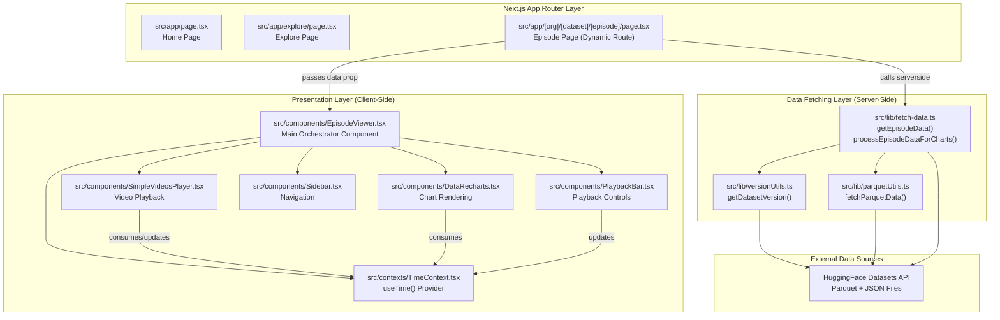
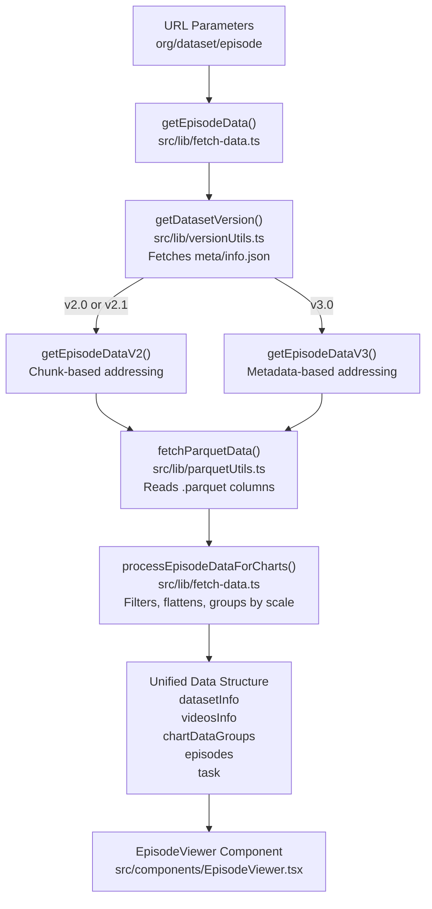

<!-- source: DeepWiki mcp.deepwiki.com · repo huggingface/lerobot-dataset-visualizer · page 1 Overview · fetched 2026-10-26 -->

# Overview

<details>
<summary>Relevant source files</summary>

The following files were used as context for generating this wiki page:

- [LICENSE](LICENSE)
- [README.md](README.md)
- [package.json](package.json)

</details>


This page provides a high-level introduction to the LeRobot Dataset Visualizer codebase, its architecture, and organization. It is intended to help new developers understand the system's purpose, structure, and key components.

For installation and setup instructions, see [Quick Start Guide](#2). For detailed documentation of specific subsystems, refer to the child pages listed in the table of contents.

## Purpose

The LeRobot Dataset Visualizer is a web application that enables interactive exploration of robotics datasets stored in the LeRobot format on HuggingFace. The application provides synchronized visualization of video recordings and time-series data (sensor readings, control signals, etc.) for individual robot episodes.

The primary use case is for robotics researchers and practitioners who need to quickly inspect and understand large, complex datasets containing recorded robot trajectories.

**Sources:** [README.md:1-13]()

## System Architecture

The LeRobot Dataset Visualizer follows a three-tier architecture:

1. **Routing Layer:** Next.js App Router with dynamic routes for dataset navigation
2. **Data Layer:** Server-side data fetching, version detection, and Parquet processing
3. **Presentation Layer:** Client-side React components for visualization and interaction



**Diagram 1: System Architecture with Code File Paths**

This diagram maps high-level system concepts to their concrete implementations in the codebase. The data flows from external HuggingFace storage through server-side processing into client-side visualization components.

**Sources:** [README.md:1-28](), [package.json:1-32]()

## Data Flow Pipeline

The most critical system in the application is the data fetching and processing pipeline, which transforms raw Parquet and JSON files from HuggingFace into structured data ready for visualization.



**Diagram 2: Data Processing Pipeline with Function Names**

This pipeline shows the sequence of function calls that transform raw dataset files into visualization-ready data. The `getEpisodeData()` function serves as the central orchestrator, delegating to version-specific handlers and coordinating Parquet parsing.

**Sources:** Inferred from architectural diagrams and wiki structure

## Key Technologies

The application is built using the following core technologies:

| Technology | Purpose | Key Files |
|------------|---------|-----------|
| **Next.js 15** | React framework with App Router for server-side rendering and routing | [package.json:14]() |
| **React 19** | UI component library | [package.json:15-16]() |
| **hyparquet** | Parquet file parsing in the browser | [package.json:13]() |
| **Recharts** | Data visualization library for charts | [package.json:18]() |
| **Tailwind CSS 4** | Utility-first CSS framework | [package.json:29]() |
| **TypeScript** | Type-safe JavaScript | [package.json:30]() |

**Sources:** [package.json:12-31](), [README.md:21-27]()

## Key Concepts

Understanding the following concepts is essential for working with this codebase:

### Dataset Versions

The application supports three dataset format versions:
- **v2.0:** Legacy chunk-based format
- **v2.1:** Chunk-based format with additional metadata
- **v3.0:** Modern metadata-based format with video segmentation

Version detection and compatibility handling is critical for cross-version support. See [Version Detection and Compatibility](#3.2) for details.

### Episode Data Structure

An episode represents a single recorded robot trajectory. Each episode contains:
- **Videos:** One or more synchronized video streams (e.g., camera feeds)
- **Observations:** Time-series sensor data (e.g., joint positions, velocities)
- **Actions:** Time-series control signals sent to the robot
- **Metadata:** Episode duration, timestamps, task information

### Time Synchronization

All visualization components (videos, charts, playback controls) share a unified timeline managed by `TimeContext`. This enables synchronized playback where seeking in one component updates all others. See [Time Synchronization System](#7) for implementation details.

### Chart Data Groups

The system automatically organizes time-series data into chart groups based on scale similarity. This prevents mixing data with vastly different magnitudes (e.g., positions in meters vs. velocities in radians/second) on the same chart. See [Chart Data Transformation](#3.4) for the grouping algorithm.

**Sources:** Inferred from architectural diagrams and wiki structure

## Repository Structure

The codebase follows Next.js conventions with the following organization:

```
src/
├── app/                          # Next.js App Router pages
│   ├── page.tsx                  # Home page with input form
│   ├── explore/                  # Dataset discovery page
│   └── [org]/[dataset]/[episode]/ # Dynamic episode viewer route
├── components/                    # React components
│   ├── EpisodeViewer.tsx         # Main episode orchestrator
│   ├── SimpleVideosPlayer.tsx    # Video playback component
│   ├── DataRecharts.tsx          # Chart rendering component
│   ├── Sidebar.tsx               # Navigation sidebar
│   └── PlaybackBar.tsx           # Playback controls
├── contexts/                      # React Context providers
│   └── TimeContext.tsx           # Time synchronization state
└── lib/                          # Utility functions and data fetching
    ├── fetch-data.ts             # Episode data orchestration
    ├── versionUtils.ts           # Dataset version detection
    └── parquetUtils.ts           # Parquet file parsing
```

**Sources:** Inferred from architectural diagrams and file paths

## System Component Roles

The following table summarizes the role of each major code module:

| Module | File Path | Primary Responsibility |
|--------|-----------|------------------------|
| **Episode Data Orchestrator** | `src/lib/fetch-data.ts` | Coordinates data fetching, version handling, and chart data processing. Contains `getEpisodeData()` and `processEpisodeDataForCharts()` functions. |
| **Version Detector** | `src/lib/versionUtils.ts` | Detects dataset version by fetching `meta/info.json` and parsing `codebase_version` field. |
| **Parquet Parser** | `src/lib/parquetUtils.ts` | Reads Parquet files using hyparquet library and extracts columns. |
| **Episode Viewer** | `src/components/EpisodeViewer.tsx` | Main UI component that orchestrates video players, charts, sidebar, and playback controls. |
| **Video Player** | `src/components/SimpleVideosPlayer.tsx` | Renders video streams with segmentation support for v3.0 datasets. |
| **Chart Renderer** | `src/components/DataRecharts.tsx` | Renders time-series data using Recharts library with interactive legends. |
| **Time Provider** | `src/contexts/TimeContext.tsx` | Provides global time state for synchronization across components. |
| **Episode Route** | `src/app/[org]/[dataset]/[episode]/page.tsx` | Dynamic route handler that fetches episode data server-side and renders EpisodeViewer. |

**Sources:** Inferred from architectural diagrams and wiki structure

## Data Flow Summary

The typical data flow for viewing an episode follows these steps:

1. User navigates to URL: `/{org}/{dataset}/{episodeId}`
2. Next.js App Router matches dynamic route in `src/app/[org]/[dataset]/[episode]/page.tsx`
3. Server-side: `getEpisodeData()` is called with URL parameters
4. Server-side: `getDatasetVersion()` fetches `meta/info.json` to detect format version
5. Server-side: Version-specific handler (`getEpisodeDataV2` or `getEpisodeDataV3`) fetches episode metadata
6. Server-side: `fetchParquetData()` retrieves observation and action data from Parquet files
7. Server-side: `processEpisodeDataForCharts()` transforms raw data into grouped, scaled chart series
8. Server-side: Unified data structure is returned to the page component
9. Client-side: `EpisodeViewer` component receives data as props
10. Client-side: Child components (videos, charts, controls) render and subscribe to `TimeContext`
11. User interaction: Playback controls update `TimeContext`, triggering synchronized updates across all components

**Sources:** Inferred from architectural diagrams

## Navigation Through This Wiki

This wiki is organized hierarchically by system:

- **[Core Data Pipeline](#3):** Start here to understand data fetching, the most critical system
  - [Episode Data Fetching](#3.1): The `getEpisodeData()` orchestrator function
  - [Version Detection](#3.2): How the system handles v2.0, v2.1, and v3.0 datasets
  - [Parquet Processing](#3.3): Reading columnar data from Parquet files
  - [Chart Data Transformation](#3.4): Auto-grouping and scaling algorithm

- **[Episode Viewer Component](#4):** Main UI orchestrator
  - [State Management](#4.1): Loading states and component lifecycle
  - [User Interactions](#4.2): Keyboard shortcuts and navigation

- **[Video Playback System](#5):** Video rendering and segmentation
  - [SimpleVideosPlayer](#5.1): Primary video player implementation
  - [Video Segmentation](#5.2): v3.0 timestamp-based segments

- **[Data Visualization](#6):** Chart rendering
  - [Chart Rendering](#6.1): Recharts integration
  - [Interactive Legend](#6.2): Visibility toggling and current values

- **[Time Synchronization](#7):** Critical cross-component coordination
  - [TimeContext Provider](#7.1): React Context implementation
  - [Synchronization Patterns](#7.2): Producer/consumer patterns

- **[Navigation and UI Controls](#8):** Supporting UI components

- **[Routing and Page Structure](#9):** Next.js pages and routing

- **[Utility Functions](#10):** Helper functions

- **[Configuration](#11):** Project setup and tooling

- **[Error Handling](#12):** Compatibility checks and error boundaries

For a quick start on running the application, see [Quick Start Guide](#2). For understanding the most important system (data fetching), begin with [Core Data Pipeline](#3).

**Sources:** Wiki table of contents JSON structure

---

