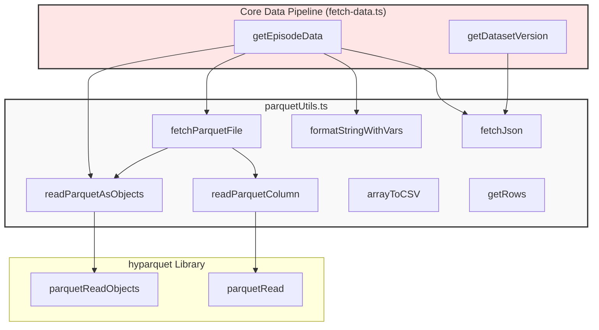
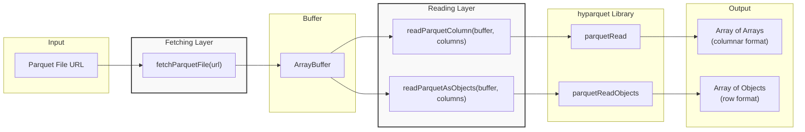
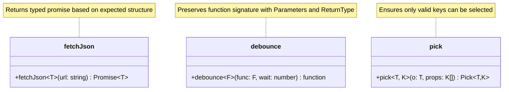

<!-- source: DeepWiki mcp.deepwiki.com · repo huggingface/lerobot-dataset-visualizer · page 10 Utility Functions and Helpers · fetched 2026-10-26 -->

# Utility Functions and Helpers

<details>
<summary>Relevant source files</summary>

The following files were used as context for generating this wiki page:

- [src/utils/debounce.ts](src/utils/debounce.ts)
- [src/utils/parquetUtils.ts](src/utils/parquetUtils.ts)
- [src/utils/pick.ts](src/utils/pick.ts)
- [src/utils/postParentMessage.ts](src/utils/postParentMessage.ts)

</details>


## Purpose and Scope

This document covers the utility functions and helper modules that provide supporting functionality across the LeRobot Dataset Visualizer application. These utilities are general-purpose functions that handle common tasks such as data fetching, Parquet file processing, string formatting, UI event debouncing, and inter-window communication.

For detailed information about how these utilities are integrated into the core data processing pipeline, see [Core Data Pipeline](#3). For Parquet-specific data processing and transformation logic, see [Parquet Data Processing](#3.3).

## Overview of Utility Modules

The application contains four primary utility modules, each serving distinct purposes:

| Module | File Path | Primary Functions | Usage Context |
|--------|-----------|-------------------|---------------|
| Parquet Utilities | `src/utils/parquetUtils.ts` | Data fetching, Parquet parsing, CSV conversion | Data pipeline, episode loading |
| Debounce | `src/utils/debounce.ts` | Event rate limiting | Playback controls, user input |
| Object Selection | `src/utils/pick.ts` | Property filtering | State management, data cleanup |
| Parent Communication | `src/utils/postParentMessage.ts` | Cross-window messaging | HuggingFace iframe integration |

**Sources:** [src/utils/parquetUtils.ts:1-120](), [src/utils/debounce.ts:1-11](), [src/utils/pick.ts:1-20](), [src/utils/postParentMessage.ts:1-13]()

## Parquet Data Utilities

The `parquetUtils.ts` module provides the foundational utilities for data fetching and Parquet file processing. This module has an importance score of 4.12, making it the most critical utility in the application due to its role in the data pipeline.

### System Architecture: Parquet Utilities in Data Flow



**Sources:** [src/utils/parquetUtils.ts:1-120]()

### JSON Fetching: fetchJson

The `fetchJson` function is a type-safe wrapper around the native `fetch` API for retrieving JSON data. It provides error handling and automatic JSON parsing.

**Function Signature:** [src/utils/parquetUtils.ts:27-35]()

```typescript
async function fetchJson<T>(url: string): Promise<T>
```

**Key Characteristics:**
- Generic type parameter `<T>` for type-safe return values
- HTTP status code validation (throws on non-OK responses)
- Automatic JSON deserialization
- Error messages include URL, status code, and status text

**Usage Pattern:** This function is primarily used in the version detection system to fetch dataset metadata files like `meta/info.json`.

**Sources:** [src/utils/parquetUtils.ts:27-35]()

### String Formatting: formatStringWithVars

The `formatStringWithVars` function performs template string interpolation by replacing placeholders with values from a provided object.

**Function Signature:** [src/utils/parquetUtils.ts:37-42]()

```typescript
function formatStringWithVars(
  format: string,
  vars: Record<string, any>
): string
```

**Template Syntax:**
- Placeholder format: `{variable_name}` or `{variable_name:Nd}` where `N` is a digit
- The `:Nd` suffix is ignored (legacy format specifier)
- Non-matching placeholders are left unchanged

**Example Use Case:** Constructing file paths from dataset metadata templates like `data/{episode_chunk}/episode_{episode_index:06d}.parquet`.

**Sources:** [src/utils/parquetUtils.ts:37-42]()

### Parquet File Operations

The module provides three functions for Parquet file operations, building on the `hyparquet` library:

#### fetchParquetFile

Retrieves a Parquet file and returns it as an `ArrayBuffer`.

**Function Signature:** [src/utils/parquetUtils.ts:45-53]()

```typescript
async function fetchParquetFile(url: string): Promise<ArrayBuffer>
```

**Behavior:**
- Performs HTTP GET request
- Validates response status
- Returns raw binary data as `ArrayBuffer`
- Throws descriptive error on failure

#### readParquetColumn

Reads specific columns from a Parquet file buffer using the `hyparquet` library's `parquetRead` function.

**Function Signature:** [src/utils/parquetUtils.ts:56-73]()

```typescript
async function readParquetColumn(
  fileBuffer: ArrayBuffer,
  columns: string[]
): Promise<any[]>
```

**Key Features:**
- Wraps `parquetRead` callback-based API in a Promise
- If `columns` array is empty, reads all columns
- Returns data as arrays (columnar format)
- Uses `onComplete` callback for asynchronous processing

#### readParquetAsObjects

Reads Parquet data and returns it as an array of objects with column names as keys.

**Function Signature:** [src/utils/parquetUtils.ts:76-84]()

```typescript
async function readParquetAsObjects(
  fileBuffer: ArrayBuffer,
  columns: string[] = []
): Promise<Record<string, any>[]>
```

**Key Features:**
- Uses `parquetReadObjects` from hyparquet
- Returns row-oriented data (more intuitive for JavaScript processing)
- Default empty array for `columns` parameter reads all columns
- Preferred for data processing where row-based access is needed

**Sources:** [src/utils/parquetUtils.ts:45-84]()

### Parquet Data Processing Flow



**Sources:** [src/utils/parquetUtils.ts:45-84]()

### Data Transformation Utilities

#### arrayToCSV

Converts a 2D array into a CSV-formatted string.

**Function Signature:** [src/utils/parquetUtils.ts:87-89]()

```typescript
function arrayToCSV(data: (number | string)[][]): string
```

**Implementation:**
- Joins each row with commas
- Joins rows with newlines
- Simple implementation without escaping (suitable for numeric data)

**Usage:** This function is used for exporting data to CSV format, though it's not extensively used in the current visualization-focused application.

#### getRows

Transforms columnar frame data into row-based format with null padding for mismatched lengths.

**Function Signature:** [src/utils/parquetUtils.ts:92-119]()

```typescript
function getRows(currentFrameData: any[], columns: any[])
```

**Key Algorithm:**
1. Determines maximum row count across all columns
2. Iterates through rows, extracting values from `currentFrameData`
3. Handles mismatched lengths by inserting `{ isNull: true }` objects
4. Assumes data is laid out sequentially: `[state0, state1, ..., stateN, action0, action1, ..., actionN]`

**Null Padding Logic:** When state columns have different lengths than action columns, null cells are inserted to maintain consistent table structure.

**Sources:** [src/utils/parquetUtils.ts:87-119]()

### DatasetMetadata Interface

The module defines a TypeScript interface for dataset metadata structure:

**Interface Definition:** [src/utils/parquetUtils.ts:3-25]()

```typescript
interface DatasetMetadata {
  codebase_version: string;
  robot_type: string;
  total_episodes: number;
  total_frames: number;
  total_tasks: number;
  total_videos: number;
  total_chunks: number;
  chunks_size: number;
  fps: number;
  splits: Record<string, string>;
  data_path: string;
  video_path: string;
  features: Record<string, {
    dtype: string;
    shape: any[];
    names: any[] | Record<string, any> | null;
    info?: Record<string, any>;
  }>;
}
```

**Purpose:** Type-safe representation of the `meta/info.json` file structure used in both v2.x and v3.0 datasets.

**Sources:** [src/utils/parquetUtils.ts:3-25]()

## UI Interaction Utilities

### Debounce Function

The `debounce` utility implements a timer-based rate limiting pattern for event handlers.

**Function Signature:** [src/utils/debounce.ts:1-11]()

```typescript
function debounce<F extends (...args: any[]) => any>(
  func: F,
  waitFor: number
): (...args: Parameters<F>) => void
```

**Implementation Details:**
- Generic type parameter `<F>` preserves function signature
- Uses `window.setTimeout` for timer management
- Clears previous timeout on each invocation
- Only executes function after `waitFor` milliseconds of inactivity

**Common Use Cases:**

| Component | Event | Debounce Duration | Purpose |
|-----------|-------|-------------------|---------|
| Playback Bar | Slider drag | Varies | Reduce time update frequency |
| Search Input | Text input | ~300ms | Limit API calls |
| Window Resize | Resize event | ~150ms | Throttle layout recalculations |

**Sources:** [src/utils/debounce.ts:1-11]()

### Debounce Pattern Diagram

```mermaid
sequenceDiagram
    participant User
    participant Handler["debounce(func, 300)"]
    participant Timer["setTimeout"]
    participant Function["Original Function"]
    
    User->>Handler: "Event 1"
    Handler->>Timer: "Start 300ms timer"
    
    User->>Handler: "Event 2 (50ms later)"
    Handler->>Timer: "Clear previous timer"
    Handler->>Timer: "Start new 300ms timer"
    
    User->>Handler: "Event 3 (100ms later)"
    Handler->>Timer: "Clear previous timer"
    Handler->>Timer: "Start new 300ms timer"
    
    Note over Timer: "Wait 300ms with no interruption"
    
    Timer->>Function: "Execute function"
    Function-->>User: "Process final state"
```

**Sources:** [src/utils/debounce.ts:1-11]()

### Object Property Selection: pick

The `pick` function creates a shallow copy of an object containing only specified properties.

**Function Signature:** [src/utils/pick.ts:6-19]()

```typescript
function pick<T, K extends keyof T>(
  o: T,
  props: K[] | ReadonlyArray<K>
): Pick<T, K>
```

**Key Behaviors:**
- Type-safe property selection using TypeScript's `keyof` and `Pick<T, K>`
- Omits properties that are `undefined` in the source object
- Returns a new object (no mutation)
- Uses `Object.assign` for efficient copying

**Example Usage:**
```typescript
const user = { name: "John", age: 30, email: "john@example.com", password: "secret" };
const publicUser = pick(user, ["name", "age"]); 
// Result: { name: "John", age: 30 }
```

**Use Cases:**
- Filtering sensitive data before sending to client
- Extracting relevant properties for component props
- Creating clean state objects without internal flags

**Sources:** [src/utils/pick.ts:1-20]()

## Cross-Window Communication

### Parent Window Messaging: postParentMessageWithParams

This utility facilitates communication between the visualizer (running in an iframe) and the parent HuggingFace page.

**Function Signature:** [src/utils/postParentMessage.ts:2-12]()

```typescript
function postParentMessageWithParams(
  setParams: (params: URLSearchParams) => void
)
```

**Implementation Details:**
- Target origin: `https://huggingface.co` (hardcoded for security)
- Message format: `{ queryString: string }`
- Uses callback pattern to allow caller to configure `URLSearchParams`
- Leverages browser's `postMessage` API for secure cross-origin communication

**Typical Usage Pattern:**
```typescript
postParentMessageWithParams((params) => {
  params.set('episode', episodeNumber.toString());
  params.set('time', currentTime.toString());
});
```

**Security Considerations:**
- Hardcoded origin prevents messages from being sent to untrusted domains
- Only sends query string data (no sensitive information)
- Parent window must implement corresponding `message` event listener

**Sources:** [src/utils/postParentMessage.ts:1-13]()

### Cross-Window Communication Flow

```mermaid
flowchart LR
    subgraph IframeContext["Visualizer (iframe)"]
        Component["EpisodeViewer or other component"]
        PostFunc["postParentMessageWithParams"]
    end
    
    subgraph BrowserAPI["Browser API"]
        PostMessage["window.parent.postMessage"]
    end
    
    subgraph ParentContext["HuggingFace Page (parent)"]
        MessageListener["message event listener"]
        UpdateURL["Update URL or state"]
    end
    
    Component --> PostFunc
    PostFunc --> |"setParams callback"| URLParams["URLSearchParams"]
    URLParams --> PostMessage
    PostMessage --> |"origin: huggingface.co<br/>data: {queryString}"| MessageListener
    MessageListener --> UpdateURL
    
    style IframeContext fill:#f9f9f9,stroke:#333,stroke-width:2px
    style ParentContext fill:#e6f3ff,stroke:#333,stroke-width:2px
```



**Sources:** [src/utils/postParentMessage.ts:1-13]()

## Utility Function Usage Summary

The following table summarizes where each utility function is primarily used within the application:

| Utility Function | Primary Consumers | Call Frequency | Critical Path |
|-----------------|-------------------|----------------|---------------|
| `fetchJson` | Version detection, metadata loading | Per dataset load | Yes - blocking |
| `formatStringWithVars` | Episode file path construction | Per episode load | Yes - blocking |
| `fetchParquetFile` | Episode data loading | Multiple per episode | Yes - blocking |
| `readParquetColumn` | Legacy data processing | Rare | No |
| `readParquetAsObjects` | Episode data, metadata loading | Multiple per episode | Yes - blocking |
| `arrayToCSV` | Data export features | On-demand | No |
| `getRows` | Table rendering | Per frame update | No |
| `debounce` | Playback controls, search inputs | Continuous during interaction | No |
| `pick` | State management, prop passing | Frequent | No |
| `postParentMessageWithParams` | Episode navigation | Per navigation | No |

**Sources:** [src/utils/parquetUtils.ts:1-120](), [src/utils/debounce.ts:1-11](), [src/utils/pick.ts:1-20](), [src/utils/postParentMessage.ts:1-13]()

## Error Handling Patterns

The utility functions implement consistent error handling patterns:

### HTTP Fetch Errors

Both `fetchJson` and `fetchParquetFile` follow the same pattern:

1. Check `response.ok` status
2. Throw `Error` with descriptive message including:
   - URL that failed
   - HTTP status code
   - HTTP status text

**Example Error Message:**
```
Failed to fetch JSON https://huggingface.co/.../meta/info.json: 404 Not Found
```

### Parquet Reading Errors

The `readParquetColumn` function wraps the callback-based `parquetRead` API in a Promise, catching and rejecting with any errors thrown during parsing:

```typescript
try {
  parquetRead({ /* ... */ });
} catch (error) {
  reject(error);
}
```

This ensures all Parquet operations can be handled with standard `async`/`await` error handling.

**Sources:** [src/utils/parquetUtils.ts:27-73]()

## Type Safety and Generics

Several utility functions leverage TypeScript generics to provide type safety:

### Generic Type Patterns



**Benefits:**
- Compile-time type checking
- IntelliSense support in IDEs
- Prevents runtime type errors
- Self-documenting code through type signatures

**Sources:** [src/utils/parquetUtils.ts:27-35](), [src/utils/debounce.ts:1-11](), [src/utils/pick.ts:6-19]()

---

