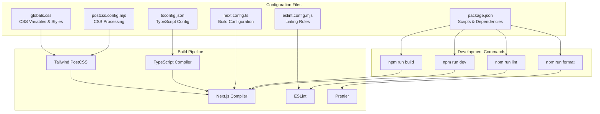
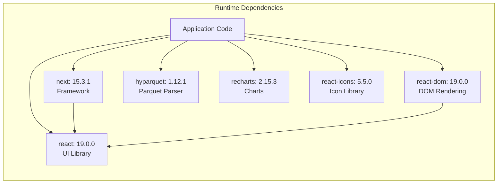
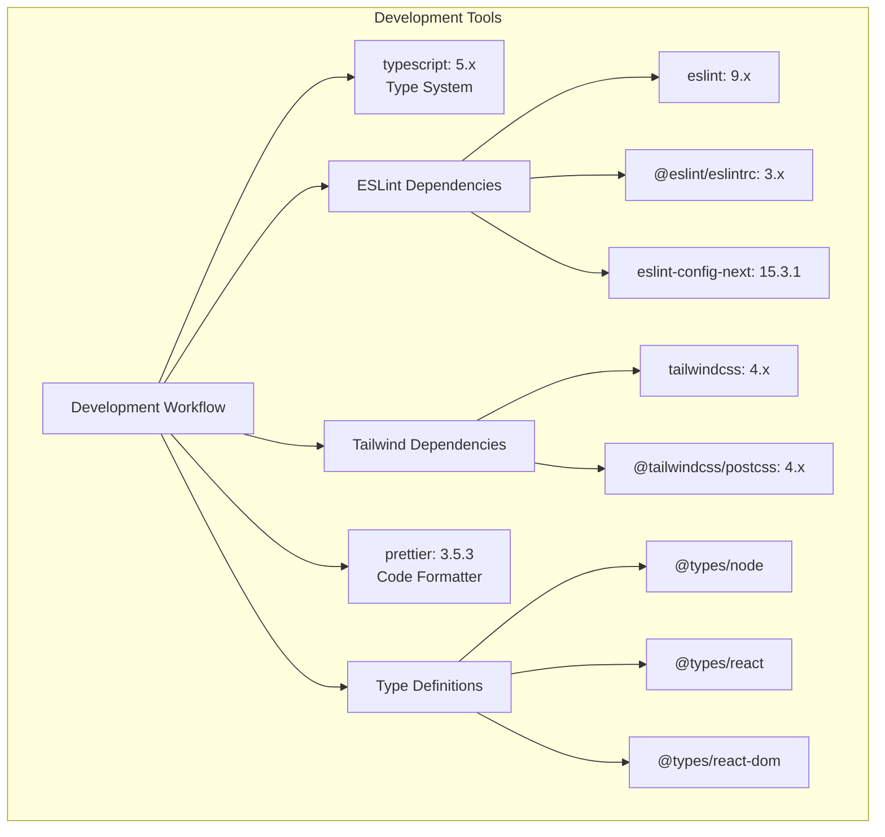
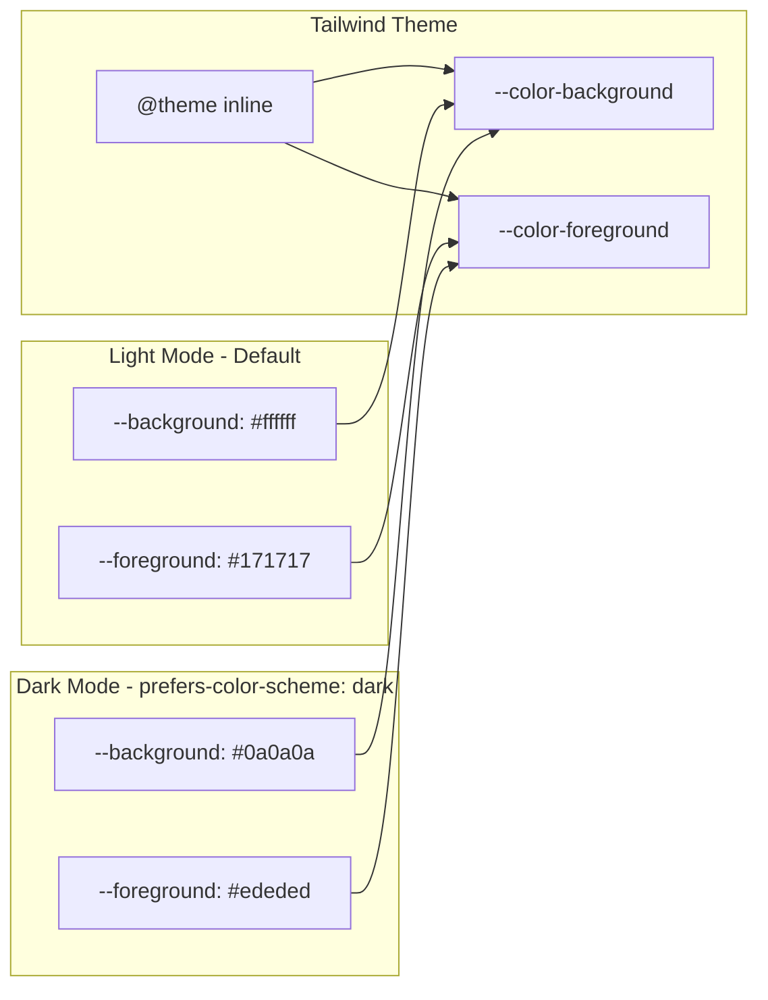
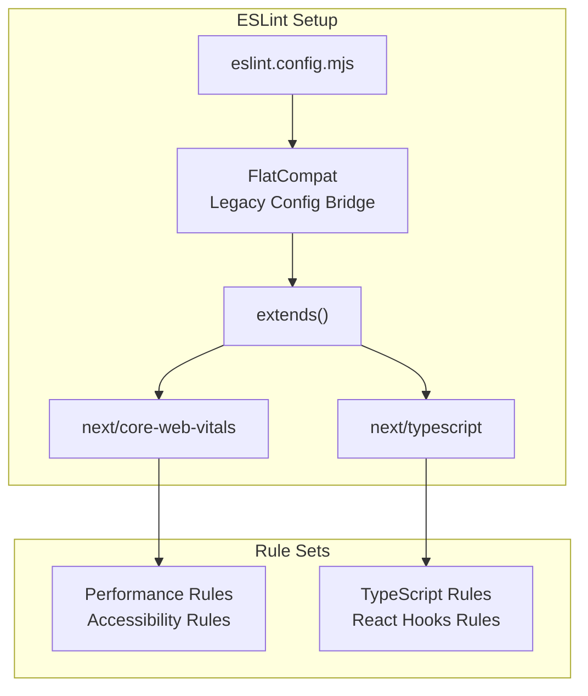
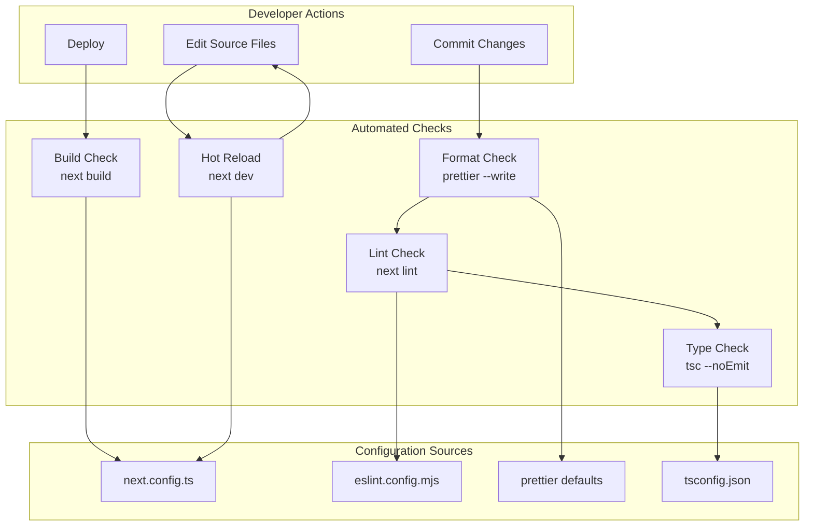

<!-- source: DeepWiki mcp.deepwiki.com · repo huggingface/lerobot-dataset-visualizer · page 11 Configuration and Development Setup · fetched 2026-10-26 -->

# Configuration and Development Setup

<details>
<summary>Relevant source files</summary>

The following files were used as context for generating this wiki page:

- [eslint.config.mjs](eslint.config.mjs)
- [next.config.ts](next.config.ts)
- [package.json](package.json)
- [postcss.config.mjs](postcss.config.mjs)
- [src/app/globals.css](src/app/globals.css)

</details>


This document covers the project's configuration files, build system, development tools, and setup procedures for the LeRobot Dataset Visualizer. It provides an overview of the technical infrastructure that supports development, including Next.js configuration, dependency management, code quality tools, and styling systems.

For specific details about individual configuration subsystems, see:
- Next.js build configuration and TypeScript settings: [Next.js Configuration](#11.1)
- Styling, theming, and Tailwind setup: [Styling with Tailwind CSS](#11.2)
- ESLint and code formatting tools: [Code Quality Tools](#11.3)

## Project Overview

The LeRobot Dataset Visualizer is a Next.js 15.3.1 application built with TypeScript and React 19. The project uses a modern toolchain with strict type checking, automated formatting, and CSS-in-JS via Tailwind CSS v4.

| Technology | Version | Purpose |
|------------|---------|---------|
| Next.js | 15.3.1 | Application framework with App Router |
| React | 19.0.0 | UI component library |
| TypeScript | 5.x | Type safety and developer experience |
| Tailwind CSS | 4.x | Utility-first styling |
| Recharts | 2.15.3 | Data visualization library |
| Hyparquet | 1.12.1 | Parquet file parsing |

**Sources:** [package.json:1-32]()

## Configuration Architecture

The following diagram shows how configuration files interact with the build system and development workflow:



**Sources:** [package.json:1-32](), [next.config.ts:1-16](), [eslint.config.mjs:1-17](), [postcss.config.mjs:1-6]()

## Package Scripts

The `package.json` defines the following development scripts:

| Script | Command | Description |
|--------|---------|-------------|
| `dev` | `next dev` | Starts development server with hot reload |
| `build` | `next build` | Creates production build |
| `start` | `next start` | Runs production server |
| `lint` | `next lint` | Executes ESLint checks |
| `format` | `prettier --write .` | Formats all files with Prettier |

**Usage Example:**
```bash
# Start development server (typically runs on http://localhost:3000)
npm run dev

# Create production build
npm run build

# Format code before committing
npm run format
```

**Sources:** [package.json:5-11]()

## Core Dependencies

The application has two dependency categories: production dependencies required at runtime and development dependencies used only during build/development.

### Production Dependencies



| Package | Version | Purpose |
|---------|---------|---------|
| `hyparquet` | 1.12.1 | Parquet file parsing for dataset loading |
| `next` | 15.3.1 | React framework with App Router |
| `react` | 19.0.0 | Component-based UI library |
| `react-dom` | 19.0.0 | React DOM rendering |
| `react-icons` | 5.5.0 | Icon components (UI controls) |
| `recharts` | 2.15.3 | Chart visualization library |

**Sources:** [package.json:12-19]()

### Development Dependencies



| Package | Purpose |
|---------|---------|
| `typescript` | TypeScript language support |
| `eslint` + `eslint-config-next` | Code linting with Next.js rules |
| `@eslint/eslintrc` | ESLint compatibility layer for flat config |
| `prettier` | Code formatting |
| `tailwindcss` + `@tailwindcss/postcss` | Utility-first CSS framework |
| `@types/*` | TypeScript type definitions |

**Sources:** [package.json:20-31]()

## Build Configuration

### Next.js Configuration

The `next.config.ts` file configures the Next.js build process with the following settings:

```typescript
// Simplified structure from next.config.ts
{
  typescript: {
    ignoreBuildErrors: true  // Allows build to proceed with TS errors
  },
  eslint: {
    ignoreDuringBuilds: true  // Skips ESLint during production builds
  },
  generateBuildId: () => packageJson.version  // Uses package version as build ID
}
```

**Key Configuration Points:**

| Setting | Value | Rationale |
|---------|-------|-----------|
| `typescript.ignoreBuildErrors` | `true` | Prevents build failures from blocking deployment; enables gradual type fixing |
| `eslint.ignoreDuringBuilds` | `true` | Separates linting from build process; linting handled separately via CI/CD |
| `generateBuildId` | `packageJson.version` | Ties build artifacts to package version for cache busting |

The build ID generation using `package.json` version ensures that each versioned release creates a unique build identifier, which is useful for caching strategies and deployment tracking.

**Sources:** [next.config.ts:1-16](), [package.json:2-3]()

### PostCSS Configuration

The PostCSS configuration enables Tailwind CSS v4 processing:

```javascript
// postcss.config.mjs
const config = {
  plugins: ["@tailwindcss/postcss"],
};
```

This minimal configuration delegates all CSS processing to the Tailwind PostCSS plugin, which handles utility class generation, purging, and optimization.

**Sources:** [postcss.config.mjs:1-6]()

## Global Styling System

The `globals.css` file establishes the application's theming system using CSS custom properties and Tailwind's `@theme` directive.

### Color Scheme



### CSS Variable Structure

| Variable | Light Mode | Dark Mode | Usage |
|----------|-----------|-----------|-------|
| `--background` | `#ffffff` | `#0a0a0a` | Page background color |
| `--foreground` | `#171717` | `#ededed` | Text color |
| `--color-background` | Inherits `--background` | Inherits `--background` | Tailwind utility classes |
| `--color-foreground` | Inherits `--foreground` | Inherits `--foreground` | Tailwind utility classes |

The color scheme automatically adapts based on the user's system preference via the `@media (prefers-color-scheme: dark)` query.

**Sources:** [src/app/globals.css:1-26]()

### Video Background Utilities

The global CSS includes specialized classes for the YouTube video background feature on the home page:

```css
/* Key aspects of .video-background implementation */
.video-background {
  position: fixed;
  z-index: -10;  /* Behind all content */
  overflow: hidden;
}

.video-background iframe {
  position: absolute;
  pointer-events: none;  /* Non-interactive */
  /* Responsive scaling via aspect ratio media queries */
}
```

The responsive scaling ensures the video covers the viewport at all aspect ratios while maintaining 16:9 video proportions.

**Sources:** [src/app/globals.css:28-46]()

## ESLint Configuration

The project uses ESLint with Next.js recommended rules via the flat config format:



The configuration uses `FlatCompat` from `@eslint/eslintrc` to bridge between ESLint's new flat config format and Next.js's traditional config format. This enables the use of Next.js preset configurations while adopting the modern ESLint architecture.

**Rule Presets:**
- `next/core-web-vitals`: Enforces best practices for web performance metrics
- `next/typescript`: TypeScript-specific linting rules and React patterns

**Sources:** [eslint.config.mjs:1-17]()

## Development Workflow

The following diagram illustrates the typical development cycle and how configuration files support it:



**Typical Development Session:**

1. **Start Development Server:** `npm run dev`
   - Watches files for changes
   - Provides hot module replacement
   - Runs on `http://localhost:3000` by default

2. **Make Code Changes:**
   - TypeScript provides inline type checking in IDE
   - Changes automatically reflected via hot reload

3. **Format Code:** `npm run format`
   - Prettier formats all files
   - Ensures consistent code style

4. **Lint Code:** `npm run lint`
   - ESLint checks for code quality issues
   - Catches common mistakes and anti-patterns

5. **Build for Production:** `npm run build`
   - Creates optimized production bundle
   - Generates static assets
   - Validates configuration

**Sources:** [package.json:5-11](), [next.config.ts:1-16](), [eslint.config.mjs:1-17]()

## File System Structure

The configuration files are located at the project root:

```
lerobot-dataset-visualizer/
├── package.json              # Dependencies and scripts
├── next.config.ts            # Next.js configuration
├── eslint.config.mjs         # ESLint rules
├── postcss.config.mjs        # PostCSS plugins
├── tsconfig.json             # TypeScript settings
└── src/
    └── app/
        └── globals.css       # Global styles and CSS variables
```

Each configuration file is independent but coordinated through the build pipeline. The `package.json` acts as the entry point for all commands, while `next.config.ts` orchestrates the build process.

**Sources:** [package.json:1-32](), [next.config.ts:1-16](), [eslint.config.mjs:1-17](), [postcss.config.mjs:1-6](), [src/app/globals.css:1-47]()

## Environment-Specific Behavior

The application adapts its behavior based on the execution environment:

| Environment | Detection | Behavior |
|-------------|-----------|----------|
| Development | `process.env.NODE_ENV === 'development'` | Hot reload, verbose errors, unoptimized builds |
| Production | `process.env.NODE_ENV === 'production'` | Optimized builds, minification, error boundaries |

The `next.config.ts` build configuration applies regardless of environment, but Next.js automatically adjusts optimization strategies based on `NODE_ENV`.

**Sources:** [next.config.ts:1-16]()

## Build Output

When running `npm run build`, Next.js generates:

1. **`.next/` Directory:**
   - Compiled pages and API routes
   - Optimized JavaScript bundles
   - Static assets and images
   - Build ID file (set to package version)

2. **Build Artifacts:**
   - Server-side rendered pages (SSR)
   - Static pages (SSG)
   - Client-side JavaScript chunks

The build ID, set to `package.json` version via `generateBuildId`, is used for cache invalidation and deployment tracking.

**Sources:** [next.config.ts:12-12](), [package.json:3-3]()

## TypeScript Configuration Notes

The `next.config.ts` sets `typescript.ignoreBuildErrors` to `true`, which allows builds to complete even with TypeScript errors. This configuration choice:

- **Enables:** Gradual TypeScript adoption and incremental fixing
- **Trade-off:** Reduces type safety guarantees in production
- **Mitigation:** Type checking should be enforced via CI/CD separately

For projects requiring strict type safety, this setting should be changed to `false` and type errors resolved before deployment.

**Sources:** [next.config.ts:6-8]()

## Summary

The LeRobot Dataset Visualizer uses a modern JavaScript/TypeScript stack with minimal configuration overhead. The build system prioritizes developer experience (hot reload, flexible type checking) while maintaining production optimization capabilities. All configuration files follow their respective tool's latest conventions (ESLint flat config, Tailwind v4 PostCSS integration, Next.js 15 App Router).

For detailed information about specific configuration subsystems, refer to the child pages:
- [Next.js Configuration](#11.1)
- [Styling with Tailwind CSS](#11.2)
- [Code Quality Tools](#11.3)

---

