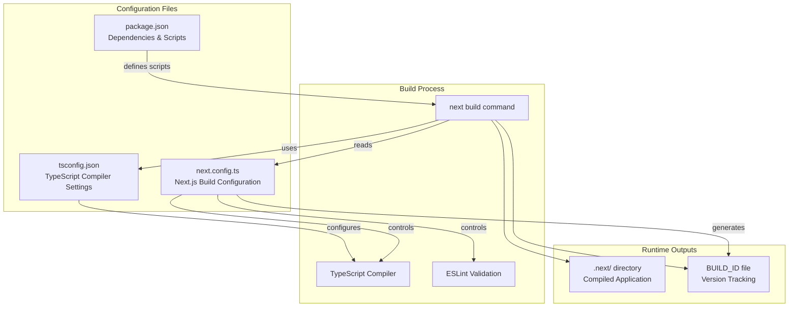
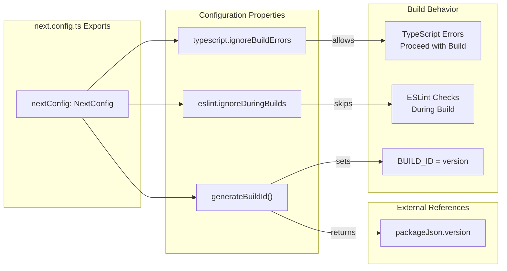
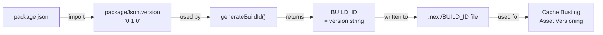
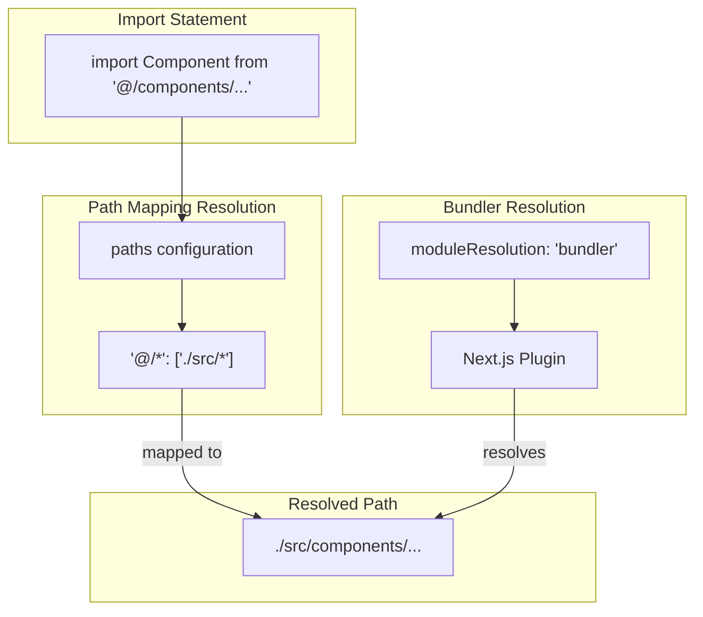
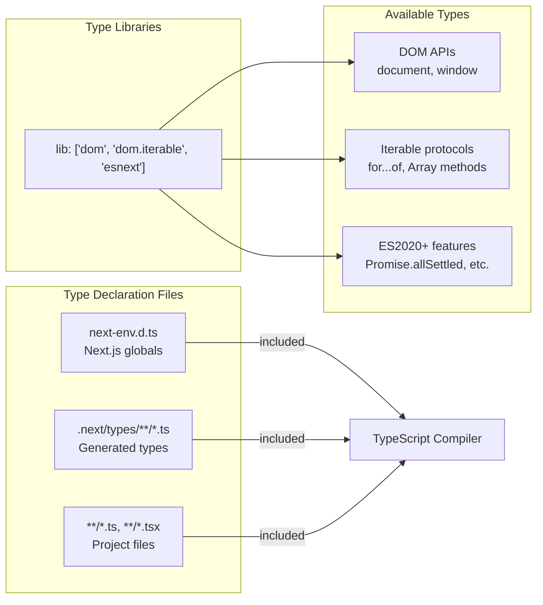
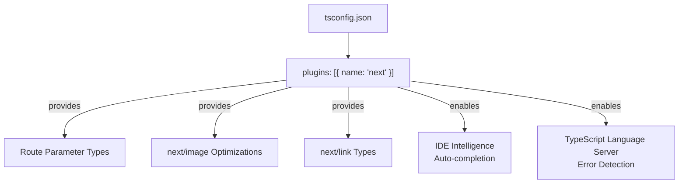
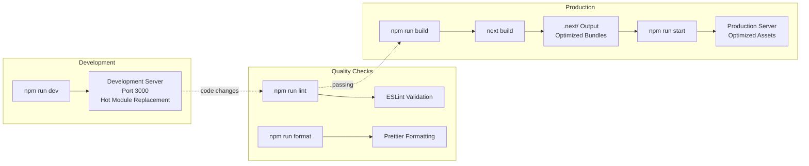
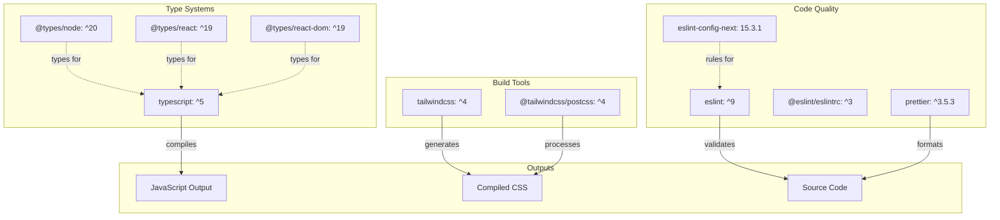
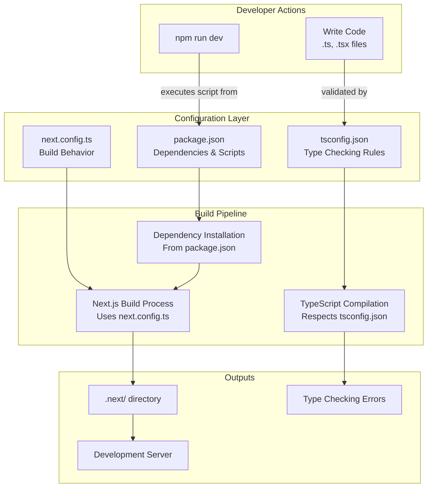

<!-- source: DeepWiki mcp.deepwiki.com · repo huggingface/lerobot-dataset-visualizer · page 11.1 Next.js Configuration · fetched 2026-10-26 -->

# Next.js Configuration

<details>
<summary>Relevant source files</summary>

The following files were used as context for generating this wiki page:

- [next.config.ts](next.config.ts)
- [package.json](package.json)
- [tsconfig.json](tsconfig.json)

</details>


## Purpose and Scope

This document covers the Next.js build configuration, TypeScript compiler settings, and project setup for the LeRobot Dataset Visualizer. It explains how the application is configured for development and production builds, including build-time error handling, path resolution, and dependency management.

For styling configuration, see [Styling with Tailwind CSS](#11.2). For code quality tools configuration, see [Code Quality Tools](#11.3).

---

## Configuration Files Overview

The project uses three primary configuration files that work together to define the build and development environment:



**Sources:** [next.config.ts:1-15](), [package.json:1-32](), [tsconfig.json:1-27]()

---

## Next.js Configuration (`next.config.ts`)

The `next.config.ts` file defines the core Next.js build behavior and optimization settings.

### Configuration Structure



**Sources:** [next.config.ts:4-13]()

### Build Error Handling

The configuration disables strict type checking and linting during production builds:

| Configuration Key | Value | Purpose |
|------------------|-------|---------|
| `typescript.ignoreBuildErrors` | `true` | Allows build to complete even with TypeScript compilation errors |
| `eslint.ignoreDuringBuilds` | `true` | Skips ESLint validation during `next build` to speed up builds |

**Implementation:**
- [next.config.ts:6-8]() - TypeScript error suppression
- [next.config.ts:9-11]() - ESLint skip configuration

This configuration prioritizes build speed and deployment velocity over strict compile-time validation. Type checking and linting are expected to be performed during development via the `npm run lint` script.

### Build ID Generation

The `generateBuildId` function provides custom build identification:



**Sources:** [next.config.ts:2](), [next.config.ts:12](), [package.json:3]()

The build ID is generated from the package version string rather than using the default Git commit hash. This approach ensures that the build ID remains consistent across different build environments and matches the semantic versioning scheme defined in `package.json`.

**Use Cases:**
- Cache invalidation when deploying new versions
- Build identification in production monitoring
- Asset URL generation with version suffixes

---

## TypeScript Configuration (`tsconfig.json`)

The TypeScript compiler configuration defines language features, module resolution, and path mappings for the application.

### Compiler Options Summary

| Option | Value | Purpose |
|--------|-------|---------|
| `target` | `ES2017` | Compile to ES2017 JavaScript (supports async/await, Object.entries) |
| `module` | `esnext` | Use latest ES module syntax |
| `moduleResolution` | `bundler` | Use bundler-specific resolution (Next.js/webpack) |
| `jsx` | `preserve` | Keep JSX syntax for Next.js to transform |
| `strict` | `true` | Enable all strict type checking options |
| `skipLibCheck` | `true` | Skip type checking of declaration files for faster builds |
| `isolatedModules` | `true` | Ensure each file can be safely transpiled independently |

**Sources:** [tsconfig.json:3-14]()

### Module Resolution Strategy



**Sources:** [tsconfig.json:11](), [tsconfig.json:21-23]()

The `paths` configuration enables the `@/` import prefix as an alias for the `./src/` directory:

**Example Usage:**
```typescript
// Instead of: import { getEpisodeData } from '../../../lib/fetch-data'
// Use: import { getEpisodeData } from '@/lib/fetch-data'
```

This convention simplifies imports and prevents brittle relative path chains when refactoring directory structures.

### Library and Type Declarations



**Sources:** [tsconfig.json:4](), [tsconfig.json:25]()

The `lib` array specifies which built-in type declarations are available:
- **`dom`**: Browser APIs (HTMLElement, fetch, localStorage)
- **`dom.iterable`**: Iterator support for DOM collections (NodeList, HTMLCollection)
- **`esnext`**: Latest ECMAScript features

The `include` array ensures that Next.js-generated type files and all project TypeScript files are type-checked together.

### Next.js Plugin Integration



**Sources:** [tsconfig.json:16-19]()

The Next.js TypeScript plugin adds framework-specific type intelligence:
- Type-safe route parameters in dynamic routes
- Props validation for Next.js components (`Image`, `Link`)
- Server/client component boundary enforcement
- Metadata API type checking

---

## Project Scripts and Dependencies

### NPM Scripts

The `package.json` defines the standard Next.js development workflow:

| Script | Command | Purpose |
|--------|---------|---------|
| `dev` | `next dev` | Start development server with hot reload (default: http://localhost:3000) |
| `build` | `next build` | Create optimized production build in `.next/` directory |
| `start` | `next start` | Start production server using built files |
| `lint` | `next lint` | Run ESLint validation on project files |
| `format` | `prettier --write .` | Auto-format all files using Prettier |

**Sources:** [package.json:5-11]()

### Build and Deploy Pipeline



**Sources:** [package.json:6-10]()

### Core Dependencies

The application uses a minimal set of production dependencies:

| Package | Version | Purpose |
|---------|---------|---------|
| `next` | `15.3.1` | Next.js framework for React applications with App Router |
| `react` | `^19.0.0` | React library with concurrent features |
| `react-dom` | `^19.0.0` | React DOM renderer |
| `hyparquet` | `^1.12.1` | Parquet file parser for reading episode data (see [Parquet Data Processing](#3.3)) |
| `recharts` | `^2.15.3` | Charting library for data visualization (see [Data Visualization](#6)) |
| `react-icons` | `^5.5.0` | Icon library for UI elements |

**Sources:** [package.json:12-19]()

#### Version Constraints

The `^` caret notation allows compatible updates:
- `^19.0.0` accepts versions `>=19.0.0` and `<20.0.0`
- Ensures React 19 features (use hook, React Compiler compatibility) remain available
- Locks Next.js to specific version `15.3.1` for stability

### Development Dependencies



**Sources:** [package.json:20-31]()

**Key Development Tools:**
- **TypeScript 5**: Provides static type checking with decorators support
- **ESLint 9**: Modern linting with flat config format
- **Tailwind CSS 4**: Utility-first CSS framework (see [Styling with Tailwind CSS](#11.2))
- **Prettier 3.5**: Opinionated code formatter for consistent style

---

## Configuration Integration

All three configuration files work together to define the complete build environment:



**Sources:** [next.config.ts:1-15](), [tsconfig.json:1-27](), [package.json:1-32]()

### Configuration Best Practices

1. **TypeScript Strict Mode**: Enabled via `"strict": true` to catch potential runtime errors at compile time
2. **Build Error Tolerance**: TypeScript and ESLint errors are ignored during builds to allow rapid iteration
3. **Path Aliases**: The `@/` prefix simplifies imports and supports refactoring
4. **Version-Based Build IDs**: Using `package.json` version ensures consistent build identification
5. **Minimal Dependencies**: Only essential libraries included to reduce bundle size

---

## Environment-Specific Behavior

The configuration supports different behaviors for development and production:

| Aspect | Development (`npm run dev`) | Production (`npm run build`) |
|--------|---------------------------|----------------------------|
| TypeScript Errors | Shown in IDE and terminal | Ignored, build continues |
| ESLint | Run manually via `npm run lint` | Skipped during build |
| Source Maps | Generated for debugging | Optimized/minimal |
| Hot Reload | Enabled | N/A |
| Build ID | Generated from version | Generated from version |
| Asset Optimization | Minimal | Full optimization (minification, tree-shaking) |

**Configuration Files:**
- Development behavior: [tsconfig.json:1-27]()
- Production behavior: [next.config.ts:6-11]()

---

## Summary

The LeRobot Dataset Visualizer uses a streamlined configuration approach:

1. **`next.config.ts`** configures Next.js build behavior, disabling strict validation for faster builds and using semantic versioning for build IDs
2. **`tsconfig.json`** enables strict TypeScript checking in development with bundler-specific module resolution and the `@/` path alias
3. **`package.json`** defines the minimal dependency set and standard NPM scripts for the development workflow

This configuration prioritizes developer productivity while maintaining type safety during development. The tolerance for build-time errors enables continuous deployment even when non-critical issues exist, with the expectation that critical errors are caught during local development and testing.

---

