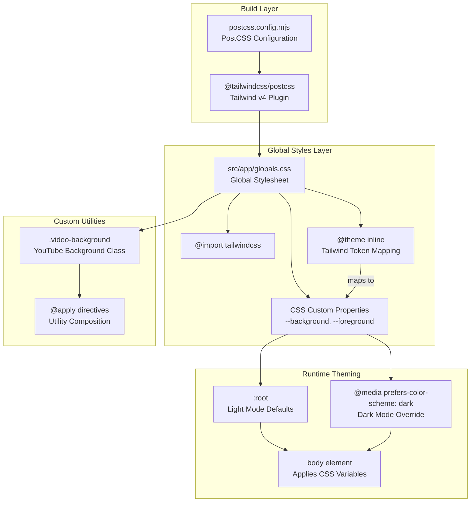
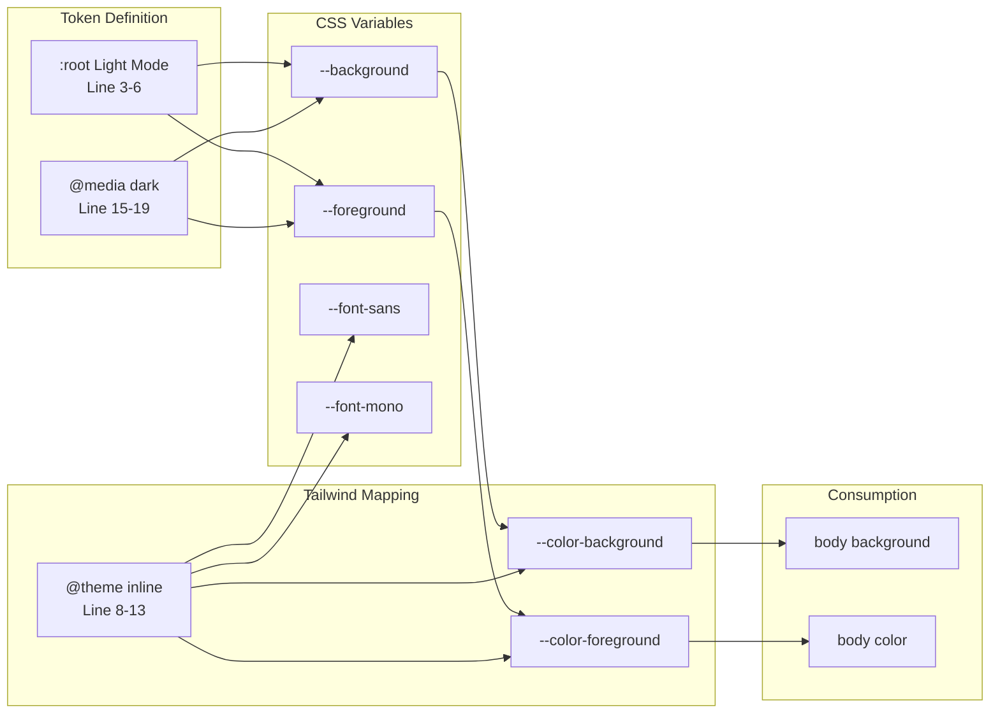
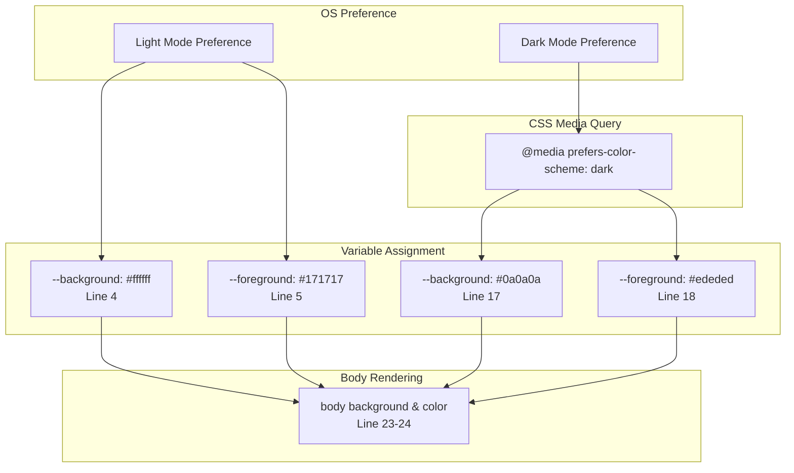

<!-- source: DeepWiki mcp.deepwiki.com · repo huggingface/lerobot-dataset-visualizer · page 11.2 Styling with Tailwind CSS · fetched 2026-10-26 -->

# Styling with Tailwind CSS

<details>
<summary>Relevant source files</summary>

The following files were used as context for generating this wiki page:

- [postcss.config.mjs](postcss.config.mjs)
- [src/app/globals.css](src/app/globals.css)

</details>


## Purpose and Scope

This document covers the styling architecture of the LeRobot Dataset Visualizer, including Tailwind CSS configuration, global styles, theming system, and custom utility classes. The application uses Tailwind CSS v4.x with PostCSS for compile-time style processing and CSS custom properties for runtime theming.

For information about Next.js build configuration, see [Next.js Configuration](#11.1). For application-level component structure, see [Episode Viewer Component](#4).

## Styling System Architecture

The styling system is built on three layers: build-time configuration (PostCSS/Tailwind), global CSS with design tokens, and component-level utility classes.



**Styling Configuration Flow**

The build system processes Tailwind CSS through PostCSS at compile time, then applies global styles that define CSS custom properties for theming. Components consume these styles through Tailwind utility classes.

**Sources:** [postcss.config.mjs:1-6](), [src/app/globals.css:1-47]()

## PostCSS and Tailwind Configuration

The PostCSS configuration at [postcss.config.mjs:1-6]() establishes the build pipeline for processing Tailwind CSS v4.

| Configuration Key | Value | Purpose |
|-------------------|-------|---------|
| `plugins` | `["@tailwindcss/postcss"]` | Enables Tailwind CSS v4 PostCSS plugin |

The minimal configuration delegates all processing to the Tailwind plugin, which automatically discovers styles in the application through the `@import "tailwindcss"` directive at [src/app/globals.css:1]().

**Sources:** [postcss.config.mjs:1-6]()

## CSS Custom Properties and Design Tokens

The global stylesheet defines CSS custom properties that serve as design tokens for colors and typography. This approach enables runtime theme switching without rebuilding the application.



**CSS Variable System**

The system uses a two-tier variable structure: base tokens (`--background`, `--foreground`) and Tailwind-mapped tokens (`--color-background`, `--color-foreground`).

**Sources:** [src/app/globals.css:3-13](), [src/app/globals.css:22-26]()

### Light Mode Default Values

At [src/app/globals.css:3-6](), the `:root` selector defines default color tokens:

| Variable | Value | Purpose |
|----------|-------|---------|
| `--background` | `#ffffff` | Base background color (white) |
| `--foreground` | `#171717` | Base foreground/text color (near-black) |

These values are immediately available when the page loads, providing a light theme by default.

**Sources:** [src/app/globals.css:3-6]()

### Tailwind Theme Integration

The `@theme inline` directive at [src/app/globals.css:8-13]() maps CSS custom properties to Tailwind's design token system:

| Tailwind Token | CSS Variable | Usage |
|----------------|--------------|-------|
| `--color-background` | `var(--background)` | Accessible as `bg-background` utility |
| `--color-foreground` | `var(--foreground)` | Accessible as `text-foreground` utility |
| `--font-sans` | `var(--font-geist-sans)` | Sans-serif font family |
| `--font-mono` | `var(--font-geist-mono)` | Monospace font family |

This mapping allows components to use semantic Tailwind classes like `bg-background` and `text-foreground` while maintaining runtime theme flexibility through CSS variable substitution.

**Sources:** [src/app/globals.css:8-13]()

## Dark Mode Implementation

Dark mode is implemented using CSS `@media (prefers-color-scheme: dark)` queries at [src/app/globals.css:15-20](), which override the base color tokens when the user's operating system prefers dark mode.



**Dark Mode Color Overrides**

| Variable | Light Value | Dark Value | Purpose |
|----------|-------------|------------|---------|
| `--background` | `#ffffff` | `#0a0a0a` | Near-black background in dark mode |
| `--foreground` | `#171717` | `#ededed` | Near-white text in dark mode |

The system provides automatic theme switching based on OS-level preferences without requiring JavaScript state management. The color values are calibrated for appropriate contrast ratios in both modes.

**Sources:** [src/app/globals.css:15-20]()

## Body Element Styling

The `body` element at [src/app/globals.css:22-26]() applies the CSS custom properties and sets the default font stack:

```css
body {
  background: var(--background);
  color: var(--foreground);
  font-family: Arial, Helvetica, sans-serif;
}
```

This establishes:
- Background color from the `--background` token (responds to dark mode)
- Text color from the `--foreground` token (responds to dark mode)
- Fallback font stack (Arial → Helvetica → system sans-serif)

Note that while `--font-sans` and `--font-mono` are defined in the Tailwind theme, the body element uses an explicit font-family declaration as a baseline fallback.

**Sources:** [src/app/globals.css:22-26]()

## Custom Utility Classes

The global stylesheet defines custom utility classes using Tailwind's `@apply` directive for component-specific styling patterns.

### Video Background Utility

The `.video-background` class at [src/app/globals.css:28-46]() implements a full-viewport YouTube video background pattern used on the home page. This utility demonstrates advanced responsive design using aspect-ratio media queries.

```mermaid
graph TB
    subgraph "Class Structure"
        ParentClass[".video-background<br/>Line 28-30"]
        IframeBase[".video-background iframe<br/>Line 31-36"]
        MediaWide["@media min-aspect-ratio: 16/9<br/>Line 37-41"]
        MediaTall["@media max-aspect-ratio: 16/9<br/>Line 42-46"]
    end
    
    subgraph "Parent Utilities"
        Fixed["fixed positioning"]
        ZIndex["-z-10 behind content"]
        FullViewport["w-screen h-screen"]
        Overflow["overflow-hidden"]
    end
    
    subgraph "IFrame Base Styles"
        Absolute["absolute positioning"]
        Center["top-1/2 left-1/2 transform"]
        NoBorder["border-0"]
        NoPointer["pointer-events-none"]
        BaseSize["100vw x 100vh"]
    end
    
    subgraph "Responsive Sizing"
        WideScreen["height: 56.25vw<br/>Wide Aspect Ratio"]
        TallScreen["width: 177.78vh<br/>Tall Aspect Ratio"]
    end
    
    ParentClass --> Fixed
    ParentClass --> ZIndex
    ParentClass --> FullViewport
    ParentClass --> Overflow
    
    IframeBase --> Absolute
    IframeBase --> Center
    IframeBase --> NoBorder
    IframeBase --> NoPointer
    IframeBase --> BaseSize
    
    MediaWide --> WideScreen
    MediaTall --> TallScreen
```



**Video Background Implementation Details**

The parent class at [src/app/globals.css:28-30]() uses `@apply` to compose Tailwind utilities:
- `fixed` - Positions element relative to viewport
- `top-0 right-0 bottom-0 left-0` - Stretches to fill viewport
- `-z-10` - Places behind all content
- `overflow-hidden` - Clips overflow content
- `w-screen h-screen` - Explicit viewport dimensions

The iframe styles at [src/app/globals.css:31-36]() use both `@apply` directives and raw CSS:
- `absolute` positioning with `top-1/2 left-1/2` for centering
- `transform: translate(-50%, -50%)` centers the element
- `border-0` removes iframe border
- `pointer-events-none` makes video non-interactive
- Base dimensions of `100vw × 100vh`
- `bg-black` for letterboxing

**Responsive Aspect Ratio Handling**

The media queries maintain 16:9 video aspect ratio across different viewport shapes:

| Media Query | Dimension Override | Calculation | Purpose |
|-------------|-------------------|-------------|---------|
| `min-aspect-ratio: 16/9` | `height: 56.25vw` | `(9/16) × 100vw` | Wide viewports: scale height to width |
| `max-aspect-ratio: 16/9` | `width: 177.78vh` | `(16/9) × 100vh` | Tall viewports: scale width to height |

This ensures the video always fills the viewport while maintaining its native aspect ratio, preventing distortion or black bars.

**Sources:** [src/app/globals.css:28-46]()

## Font System Configuration

The font system is configured through CSS custom properties that reference Next.js font variables. The `@theme inline` block at [src/app/globals.css:11-12]() defines:

| CSS Variable | Reference | Usage Pattern |
|--------------|-----------|---------------|
| `--font-sans` | `var(--font-geist-sans)` | Sans-serif typography |
| `--font-mono` | `var(--font-geist-mono)` | Monospace code/data display |

These variables reference Next.js font loaders (Geist Sans and Geist Mono) that are configured elsewhere in the application. The font variables are exposed as Tailwind utilities through the `@theme` directive, allowing usage like `font-sans` and `font-mono` in component classes.

The `body` element at [src/app/globals.css:25]() uses a fallback stack (`Arial, Helvetica, sans-serif`) rather than referencing the CSS variables directly, ensuring basic typography renders even before Next.js font loading completes.

**Sources:** [src/app/globals.css:11-12](), [src/app/globals.css:25]()

## Tailwind Utility Usage Patterns

Throughout the application, components use Tailwind utility classes that reference the design tokens defined in the global stylesheet. Common patterns include:

| Utility Class | Maps To | Purpose |
|---------------|---------|---------|
| `bg-background` | `--color-background` | Applies theme-aware background |
| `text-foreground` | `--color-foreground` | Applies theme-aware text color |
| `font-sans` | `--font-sans` | Applies sans-serif font family |
| `font-mono` | `--font-mono` | Applies monospace font family |

The separation between CSS custom properties (runtime) and Tailwind tokens (compile-time) enables:
1. **Build-time optimization** - Tailwind can purge unused utilities
2. **Runtime theming** - CSS variables update without recompilation
3. **Type-safe utilities** - Tailwind's IntelliSense understands available tokens
4. **Consistent spacing/sizing** - Tailwind's scale system remains available

Components combine these semantic tokens with Tailwind's extensive utility catalog for spacing, layout, and responsive design.

**Sources:** [src/app/globals.css:8-13]()

## Summary

The LeRobot Dataset Visualizer's styling system uses Tailwind CSS v4 with a strategic layering approach:

1. **Build Layer** - PostCSS processes Tailwind through `@tailwindcss/postcss` plugin
2. **Token Layer** - CSS custom properties define runtime-configurable colors and fonts
3. **Theme Layer** - `@theme inline` maps CSS variables to Tailwind utilities
4. **Dark Mode Layer** - Media queries override color tokens based on OS preference
5. **Custom Utilities Layer** - Complex patterns like `.video-background` use `@apply` composition

This architecture provides both the developer experience of Tailwind's utility-first approach and the runtime flexibility of CSS custom properties, enabling automatic dark mode support and consistent theming across the application.

**Sources:** [postcss.config.mjs:1-6](), [src/app/globals.css:1-47]()

---

