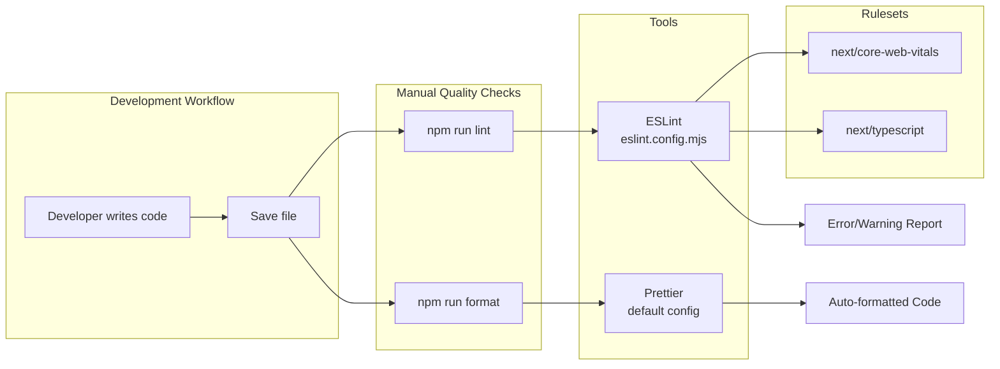
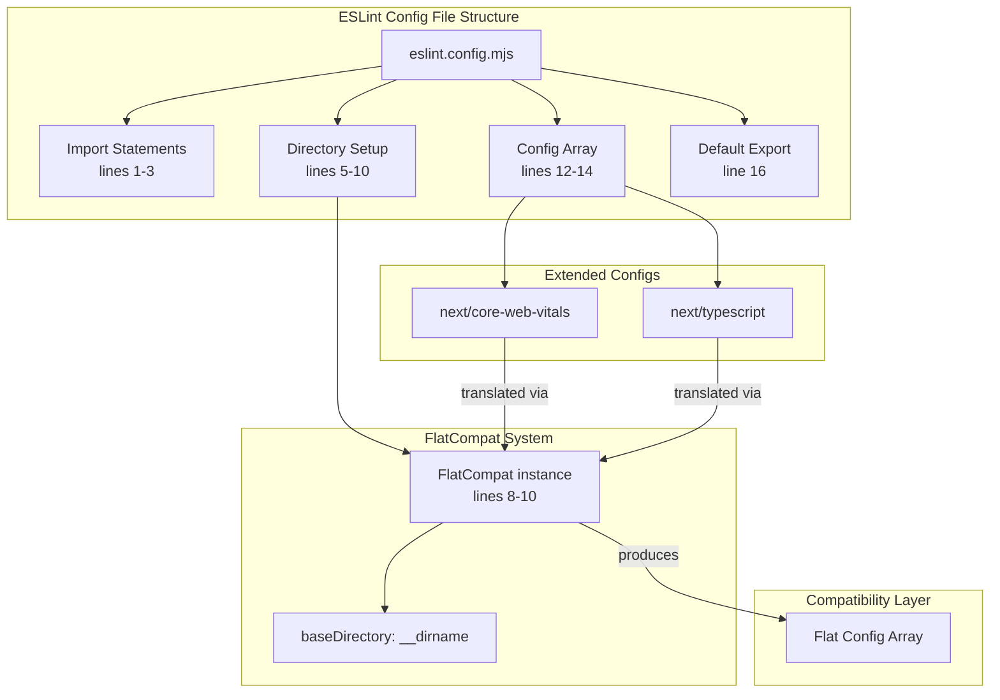
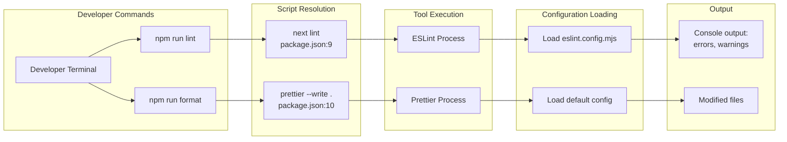
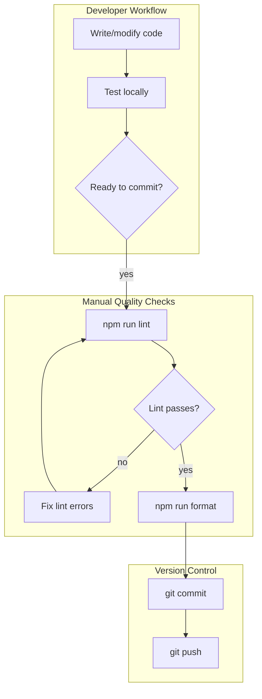

<!-- source: DeepWiki mcp.deepwiki.com · repo huggingface/lerobot-dataset-visualizer · page 11.3 Code Quality Tools · fetched 2026-10-26 -->

# Code Quality Tools

<details>
<summary>Relevant source files</summary>

The following files were used as context for generating this wiki page:

- [eslint.config.mjs](eslint.config.mjs)
- [package.json](package.json)

</details>


## Purpose and Scope

This document covers the code quality tooling configuration for the LeRobot Dataset Visualizer project, including ESLint for static code analysis and Prettier for code formatting. These tools enforce consistent code style and catch common errors during development.

For information about Next.js build configuration and TypeScript settings, see [Next.js Configuration](#11.1). For styling and CSS-related configuration, see [Styling with Tailwind CSS](#11.2).

---

## Overview

The project uses two primary code quality tools:

| Tool | Purpose | Configuration File |
|------|---------|-------------------|
| **ESLint** | Static code analysis, detecting potential errors and enforcing coding standards | `eslint.config.mjs` |
| **Prettier** | Automatic code formatting for consistent style | Not explicitly configured (uses defaults) |

Both tools are integrated with Next.js and can be run via npm scripts defined in [package.json:5-10]().



**Sources:** [package.json](), [eslint.config.mjs]()

---

## ESLint Configuration

### Configuration Structure

The ESLint configuration uses the **flat config format** (ESM modules) introduced in ESLint v9. The configuration file is located at [eslint.config.mjs:1-17]().



**Sources:** [eslint.config.mjs:1-17]()

### Key Components

#### Directory Resolution

The configuration resolves the current directory using ESM-specific utilities:

- **`fileURLToPath`**: Converts `import.meta.url` to a file path [eslint.config.mjs:5]()
- **`dirname`**: Extracts directory name from the file path [eslint.config.mjs:6]()

This is necessary because `__dirname` is not available in ES modules.

#### FlatCompat Adapter

The `FlatCompat` class from `@eslint/eslintrc` provides backward compatibility with legacy ESLint configurations [eslint.config.mjs:8-10](). It allows the project to use Next.js's pre-configured rulesets which were designed for the older `.eslintrc` format.

#### Extended Configurations

The project extends two Next.js-provided ESLint configurations [eslint.config.mjs:13]():

| Configuration | Purpose |
|--------------|---------|
| **`next/core-web-vitals`** | Rules focused on web performance metrics (Core Web Vitals), React best practices, and Next.js-specific patterns |
| **`next/typescript`** | TypeScript-specific linting rules including type checking and TypeScript syntax validation |

---

## Prettier Configuration

### Setup

Prettier is configured as a development dependency [package.json:28]() but does not have an explicit configuration file. This means the project uses **Prettier's default settings**, which include:

- Print width: 80 characters
- Tab width: 2 spaces
- Semicolons: true
- Single quotes: false (uses double quotes)
- Trailing commas: "all"

### Formatting Script

The formatting script is defined in [package.json:10]():

```
"format": "prettier --write ."
```

This command:
- Runs Prettier on all files in the project (`.`)
- Uses the `--write` flag to automatically modify files in-place
- Respects any `.prettierignore` file if present

---

## Available Scripts

### Linting Command

```bash
npm run lint
```

Defined in [package.json:9](), this script executes:

```
next lint
```

The `next lint` command is a Next.js wrapper around ESLint that:
- Automatically sets up ESLint if not configured
- Caches results for faster subsequent runs
- Reports errors and warnings to the console
- Can be integrated with CI/CD pipelines

### Formatting Command

```bash
npm run format
```

Defined in [package.json:10](), this script runs Prettier across the entire codebase to ensure consistent formatting.



**Sources:** [package.json:9-10]()

---

## Integration with Next.js

### Next.js ESLint Integration

Next.js provides first-class ESLint support through the `next lint` command and pre-configured rulesets. The integration includes:

1. **Automatic Setup**: Running `next lint` for the first time offers to install ESLint dependencies
2. **Build-Time Checking**: The `next build` command includes linting by default
3. **Development Experience**: ESLint warnings appear in the development console
4. **Caching**: Next.js caches ESLint results in `.next/cache` for performance

### Configuration Dependencies

The following packages in [package.json:21-27]() support the ESLint configuration:

| Package | Version | Purpose |
|---------|---------|---------|
| `@eslint/eslintrc` | ^3 | Provides `FlatCompat` for legacy config support |
| `eslint` | ^9 | Core ESLint engine |
| `eslint-config-next` | 15.3.1 | Next.js-specific rules and configurations |

### TypeScript Integration

The `next/typescript` configuration in [eslint.config.mjs:13]() enables TypeScript-aware linting, leveraging the TypeScript compiler information to provide:

- Type-aware lint rules
- Import/export validation
- Type consistency checks
- TypeScript syntax validation

This integration works in conjunction with [package.json:30]() which specifies `typescript: ^5` as a development dependency.

---

## Code Quality Enforcement Patterns

### Pre-commit Workflow (Manual)

The project does not include automated pre-commit hooks (e.g., via Husky), so quality checks are manual:



**Sources:** [package.json:5-10]()

### CI/CD Integration

While not explicitly configured in the provided files, the scripts can be integrated into CI/CD pipelines:

- **Linting**: Run `npm run lint` in CI to block merges with lint errors
- **Formatting Check**: Run `prettier --check .` to verify formatting without modifying files

---

## Usage Guidelines

### For Developers

1. **Before Committing**: Run `npm run lint` to check for errors
2. **Code Formatting**: Run `npm run format` to auto-format code before commit
3. **IDE Integration**: Configure your IDE/editor to:
   - Run ESLint on save
   - Format with Prettier on save
   - Show inline lint warnings

### For CI/CD

Recommended pipeline commands:

```bash
# Install dependencies
npm ci

# Run linter (fail on errors)
npm run lint

# Check formatting (without modifying files)
npx prettier --check .

# Build the application
npm run build
```

### Ignoring Files

To exclude files from linting or formatting:
- **ESLint**: Add patterns to `.eslintignore` (not present in repository)
- **Prettier**: Add patterns to `.prettierignore` (not present in repository)

Common patterns to ignore:
- `.next/` - Next.js build output
- `node_modules/` - Dependencies
- `out/` - Export output

---

## Rule Customization

### Extending the Configuration

To add custom ESLint rules, modify [eslint.config.mjs:12-14]() by adding rule objects to the configuration array:

```typescript
const eslintConfig = [
  ...compat.extends("next/core-web-vitals", "next/typescript"),
  {
    rules: {
      // Custom rule overrides here
    },
  },
];
```

### Prettier Customization

To customize Prettier, create a `.prettierrc` file in the project root with desired options:

```json
{
  "printWidth": 100,
  "singleQuote": true,
  "trailingComma": "es5"
}
```

---

## Summary

The LeRobot Dataset Visualizer uses a minimal but effective code quality setup:

- **ESLint** with Next.js-provided rulesets for React and TypeScript
- **Prettier** with default configuration for consistent formatting
- **Manual workflow** requiring developers to run commands before committing
- **Flat config format** for ESLint, ensuring compatibility with modern tooling

The configuration prioritizes simplicity and leverage's Next.js's opinionated defaults rather than extensive custom configuration.

**Sources:** [eslint.config.mjs](), [package.json]()

---

