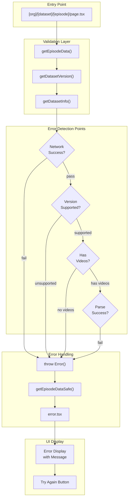
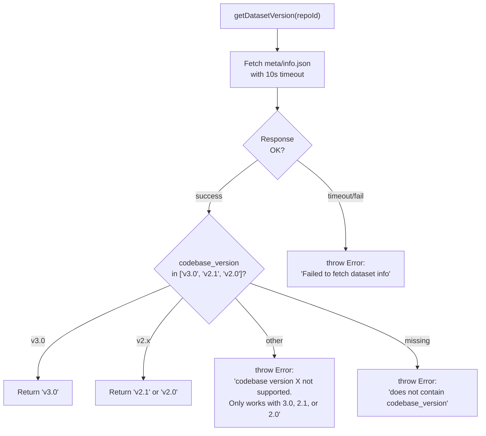
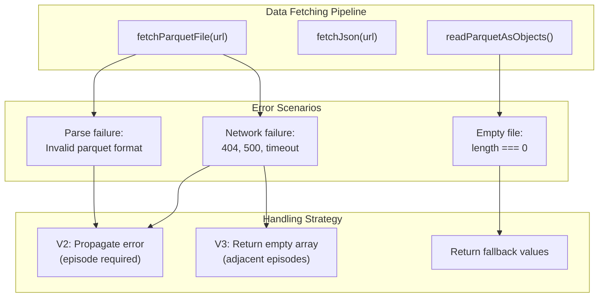
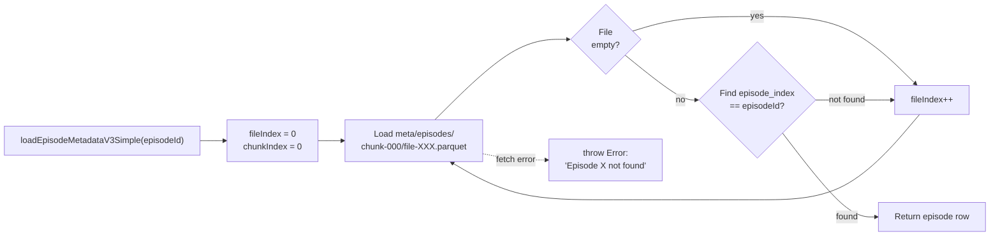
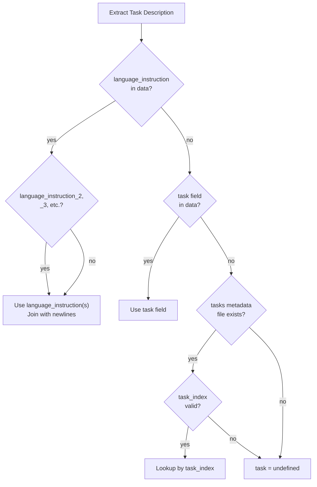
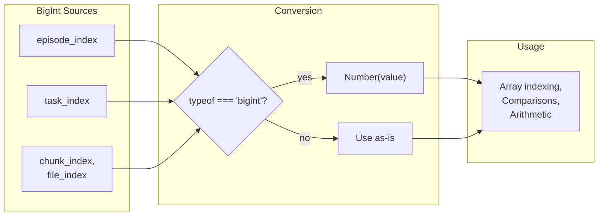
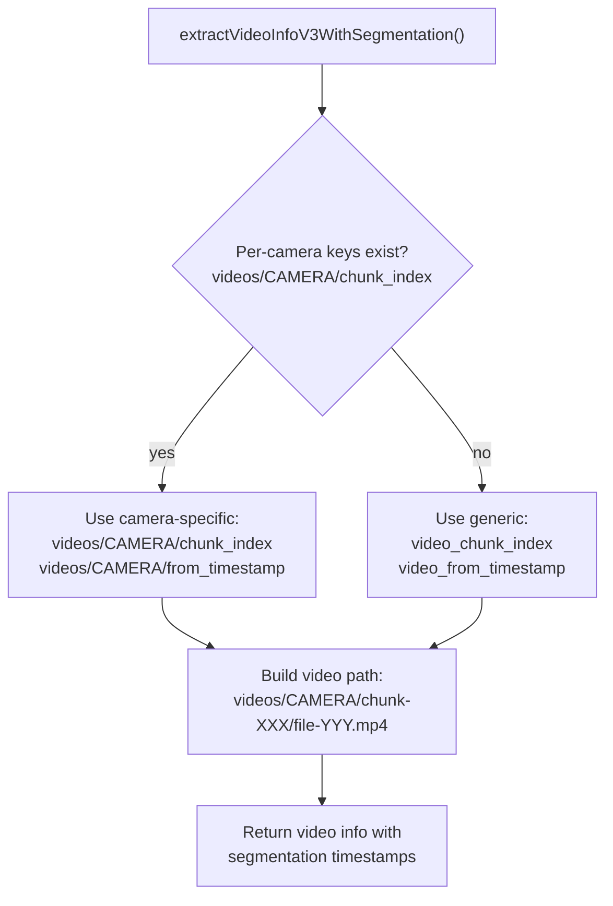
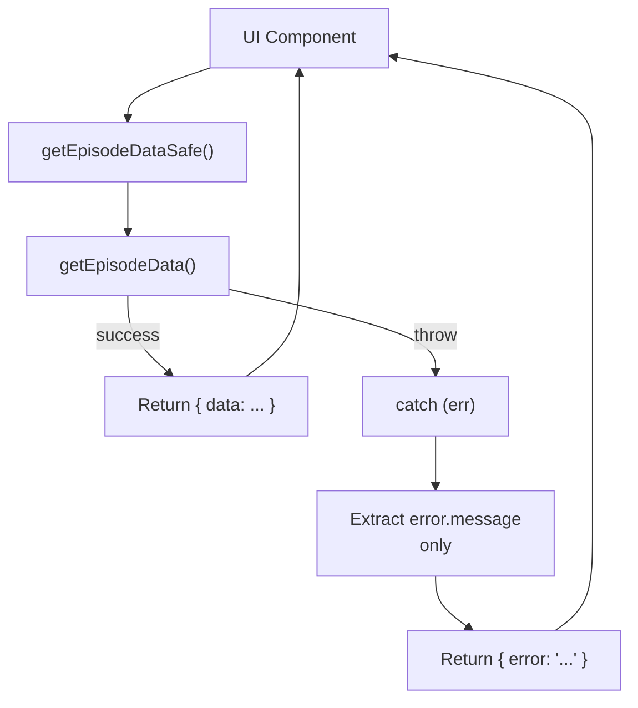

<!-- source: DeepWiki mcp.deepwiki.com · repo huggingface/lerobot-dataset-visualizer · page 12 Error Handling and Edge Cases · fetched 2026-10-26 -->

# Error Handling and Edge Cases

<details>
<summary>Relevant source files</summary>

The following files were used as context for generating this wiki page:

- [src/app/[org]/[dataset]/[episode]/error.tsx](src/app/[org]/[dataset]/[episode]/error.tsx)
- [src/app/[org]/[dataset]/[episode]/fetch-data.ts](src/app/[org]/[dataset]/[episode]/fetch-data.ts)
- [src/utils/versionUtils.ts](src/utils/versionUtils.ts)

</details>


## Purpose and Scope

This document describes the error handling mechanisms and edge case management throughout the LeRobot Dataset Visualizer. It covers validation strategies, error boundaries, graceful degradation patterns, and how the system handles incompatible datasets, missing data, and network failures.

For information about the core data fetching pipeline, see [Core Data Pipeline](#3). For version-specific handling details, see [Version Detection and Compatibility](#3.2).

---

## Overview of Error Handling Strategy

The LeRobot Dataset Visualizer implements a **fail-fast with graceful UI** approach to error handling. The system performs strict validation at the data layer while providing user-friendly error messages at the presentation layer.

### Error Handling Layers



Sources: [src/app/[org]/[dataset]/[episode]/fetch-data.ts:14-40](), [src/app/[org]/[dataset]/[episode]/fetch-data.ts:1076-1088](), [src/app/[org]/[dataset]/[episode]/error.tsx:1-28]()

---

## Version Compatibility Validation

The system performs **strict version validation** before attempting to load any episode data. Only datasets with `codebase_version` set to `v3.0`, `v2.1`, or `v2.0` are supported.

### Version Check Flow



### Implementation Details

The `getDatasetVersion()` function implements several safeguards:

**Timeout Protection**: Network requests have a 10-second timeout to prevent hanging on slow or unresponsive endpoints [src/utils/versionUtils.ts:33-42]().

```typescript
const controller = new AbortController();
const timeoutId = setTimeout(() => controller.abort(), 10000);
const response = await fetch(testUrl, { signal: controller.signal });
```

**Explicit Version Rejection**: Unsupported versions throw immediately with a clear user-facing message [src/utils/versionUtils.ts:82-89]():

| Version | Action | Reason |
|---------|--------|--------|
| `v3.0` | ✅ Accept | Full support with metadata-based architecture |
| `v2.1` | ✅ Accept | Chunk-based architecture with tasks.jsonl |
| `v2.0` | ✅ Accept | Basic chunk-based architecture |
| `v1.x` | ❌ Reject | Incompatible metadata structure |
| Other | ❌ Reject | Unknown compatibility |

**Video Dataset Requirement**: After version validation, the system checks that the dataset contains video data [src/app/[org]/[dataset]/[episode]/fetch-data.ts:26-28]():

```typescript
if (info.video_path === null) {
  throw new Error("Only videos datasets are supported in this visualizer.\nPlease use Rerun visualizer for images datasets.");
}
```

Sources: [src/utils/versionUtils.ts:71-101](), [src/app/[org]/[dataset]/[episode]/fetch-data.ts:20-40]()

---

## Data Fetching Error Handling

### Network Request Failures

All network requests in the data pipeline use try-catch blocks to capture and propagate errors appropriately:



**Primary Episode Loading**: For the main episode being viewed, all errors propagate to the UI [src/app/[org]/[dataset]/[episode]/fetch-data.ts:36-39]():

```typescript
} catch (err) {
  console.error("Error loading episode data:", err);
  throw err;  // Propagate to UI
}
```

**Adjacent Episode Preloading**: For adjacent episodes (used for preloading), errors are caught silently to avoid disrupting the main episode view [src/app/[org]/[dataset]/[episode]/fetch-data.ts:89-91]():

```typescript
} catch {
  // Skip failed episodes silently
}
```

Sources: [src/app/[org]/[dataset]/[episode]/fetch-data.ts:36-99]()

---

## Episode Metadata Edge Cases

### v3.0 Episode Not Found

In v3.0 datasets, episode metadata is stored in chunked parquet files. The system iterates through files until finding the requested episode [src/app/[org]/[dataset]/[episode]/fetch-data.ts:934-983]():



**Iteration Strategy**: The system tries files sequentially (`file-000.parquet`, `file-001.parquet`, etc.) until finding the episode or encountering a fetch error [src/app/[org]/[dataset]/[episode]/fetch-data.ts:947-978]().

**Error Message**: When the episode is not found after exhausting available files, a descriptive error is thrown [src/app/[org]/[dataset]/[episode]/fetch-data.ts:976-977]():

```typescript
throw new Error(`Episode ${episodeId} not found in metadata (searched up to file-${fileIndex.toString().padStart(3, "0")}.parquet)`);
```

### Episode Data Slicing Across Files

v3.0 episodes can span multiple parquet files. The system handles index adjustments to account for file boundaries [src/app/[org]/[dataset]/[episode]/fetch-data.ts:481-496]():

| Issue | Solution |
|-------|----------|
| Episode spans multiple files | Use `dataset_from_index` and `dataset_to_index` to locate data |
| File doesn't start at index 0 | Check `fullData[0].index` to get file's starting position |
| Index mismatch | Convert to local file indices: `localFromIndex = fromIndex - fileStartIndex` |

```typescript
// Find the starting index of this parquet file
let fileStartIndex = 0;
if (fullData.length > 0 && fullData[0].index !== undefined) {
  fileStartIndex = Number(fullData[0].index);
}

// Adjust indices to be relative to this file's starting position
const localFromIndex = Math.max(0, fromIndex - fileStartIndex);
const localToIndex = Math.min(fullData.length, toIndex - fileStartIndex);
```

Sources: [src/app/[org]/[dataset]/[episode]/fetch-data.ts:464-581](), [src/app/[org]/[dataset]/[episode]/fetch-data.ts:934-983]()

---

## Task Metadata Fallback Cascade

The system uses a **multi-tier fallback strategy** to extract task descriptions, prioritizing language instructions over task indices:

### Task Extraction Hierarchy



**Priority 1: Language Instructions** [src/app/[org]/[dataset]/[episode]/fetch-data.ts:211-232]()
- Check for `language_instruction` field
- Check for numbered fields: `language_instruction_2`, `language_instruction_3`, etc.
- Join multiple instructions with line breaks

**Priority 2: Direct Task Field** [src/app/[org]/[dataset]/[episode]/fetch-data.ts:234-237]()
- Use `task` field directly from episode data

**Priority 3: Tasks Metadata Lookup** [src/app/[org]/[dataset]/[episode]/fetch-data.ts:239-269]()
- v2.x: Load `meta/tasks.jsonl` and find by `task_index`
- v3.0: Load `meta/tasks.parquet` and lookup by index

**Priority 4: No Task** - If all methods fail, `task` remains `undefined`

### v3.0 Special Case: Multiple Row Checking

For v3.0 datasets where language instructions might not be in the first row, the system checks middle and last rows [src/app/[org]/[dataset]/[episode]/fetch-data.ts:524-543]():

```typescript
if (languageInstructions.length === 0 && episodeData.length > 1) {
  const middleIndex = Math.floor(episodeData.length / 2);
  const lastIndex = episodeData.length - 1;
  
  [middleIndex, lastIndex].forEach((idx) => {
    // Check for instructions in these rows
  });
}
```

Sources: [src/app/[org]/[dataset]/[episode]/fetch-data.ts:200-269](), [src/app/[org]/[dataset]/[episode]/fetch-data.ts:505-575]()

---

## Data Type Conversions and Edge Cases

### BigInt Handling

Parquet files often contain `BigInt` values that must be converted to `number` for JavaScript compatibility:



**Conversion Pattern** [src/app/[org]/[dataset]/[episode]/fetch-data.ts:993-997]():

```typescript
const toBigIntSafe = (value: any) => {
  if (typeof value === 'bigint') return Number(value);
  if (typeof value === 'number') return value;
  return parseInt(value) || 0;
};
```

**Critical Locations**:
- Episode index comparisons [src/app/[org]/[dataset]/[episode]/fetch-data.ts:1000]()
- Task index lookups [src/app/[org]/[dataset]/[episode]/fetch-data.ts:256-257](), [src/app/[org]/[dataset]/[episode]/fetch-data.ts:563]()
- Video chunk/file indices [src/app/[org]/[dataset]/[episode]/fetch-data.ts:904-905]()

### Boolean to Number Conversion

Chart data requires numeric values. Boolean fields are converted for visualization [src/app/[org]/[dataset]/[episode]/fetch-data.ts:745-748]():

```typescript
} else if (typeof value === 'boolean') {
  // Convert boolean to number for charts
  obj[featureName] = value ? 1 : 0;
}
```

### Empty or Missing Data Arrays

When episode data is empty after slicing, the system returns empty structures rather than erroring [src/app/[org]/[dataset]/[episode]/fetch-data.ts:498-500]():

```typescript
if (episodeData.length === 0) {
  return { chartDataGroups: [], ignoredColumns: [], task: undefined };
}
```

Sources: [src/app/[org]/[dataset]/[episode]/fetch-data.ts:481-500](), [src/app/[org]/[dataset]/[episode]/fetch-data.ts:741-748](), [src/app/[org]/[dataset]/[episode]/fetch-data.ts:986-1070]()

---

## Camera-Specific Metadata Fallbacks

v3.0 datasets may have per-camera video metadata. The system checks for camera-specific fields before falling back to generic metadata:

### Camera Metadata Resolution



**Implementation** [src/app/[org]/[dataset]/[episode]/fetch-data.ts:894-914]():

```typescript
const cameraSpecificKeys = Object.keys(episodeMetadata).filter(key => 
  key.startsWith(`videos/${videoKey}/`)
);

if (cameraSpecificKeys.length > 0) {
  // Use camera-specific metadata
  chunkIndex = episodeMetadata[`videos/${videoKey}/chunk_index`];
  segmentStart = episodeMetadata[`videos/${videoKey}/from_timestamp`];
} else {
  // Fallback to generic video metadata
  chunkIndex = episodeMetadata.video_chunk_index;
  segmentStart = episodeMetadata.video_from_timestamp;
}
```

**Fallback Values**: If metadata is completely missing, the system uses safe defaults [src/app/[org]/[dataset]/[episode]/fetch-data.ts:1020-1024]():

| Field | Default Value | Purpose |
|-------|---------------|---------|
| `video_chunk_index` | `0` | First chunk |
| `video_file_index` | `0` | First file in chunk |
| `video_from_timestamp` | `0` | Start of video |
| `video_to_timestamp` | `30` | Assume 30-second duration |

Sources: [src/app/[org]/[dataset]/[episode]/fetch-data.ts:881-931](), [src/app/[org]/[dataset]/[episode]/fetch-data.ts:1020-1025]()

---

## Safe Wrapper Pattern

The system provides a **safe wrapper** function that catches all errors and returns them as values rather than throwing:

### getEpisodeDataSafe Architecture



**Implementation** [src/app/[org]/[dataset]/[episode]/fetch-data.ts:1076-1088]():

```typescript
export async function getEpisodeDataSafe(
  org: string,
  dataset: string,
  episodeId: number,
): Promise<{ data?: any; error?: string }> {
  try {
    const data = await getEpisodeData(org, dataset, episodeId);
    return { data };
  } catch (err: any) {
    // Only expose the error message, not stack or sensitive info
    return { error: err?.message || String(err) || "Unknown error" };
  }
}
```

**Security Consideration**: The wrapper only exposes `error.message`, preventing stack traces or internal paths from leaking to the client [src/app/[org]/[dataset]/[episode]/fetch-data.ts:1086]().

Sources: [src/app/[org]/[dataset]/[episode]/fetch-data.ts:1076-1088]()

---

## UI Error Boundary

### Next.js Error.tsx Component

The application uses Next.js's error boundary feature to provide a client-side error recovery UI [src/app/[org]/[dataset]/[episode]/error.tsx:1-28]():

**Component Structure**:

| Element | Purpose |
|---------|---------|
| Error message display | Shows `error.message` in monospace font with pre-wrap |
| "Try Again" button | Calls `reset()` to attempt re-rendering |
| Red theme | Visual indication of error state |
| Max-width container | Ensures readability of long error messages |

```typescript
export default function Error({ error, reset }) {
  return (
    <div className="flex h-screen items-center justify-center">
      <div className="max-w-xl p-8 rounded bg-slate-900 border-red-500">
        <h2>Something went wrong</h2>
        <p className="font-mono whitespace-pre-wrap">
          {error.message}
        </p>
        <button onClick={() => reset()}>Try Again</button>
      </div>
    </div>
  );
}
```

**Reset Behavior**: Clicking "Try Again" triggers Next.js to re-render the error boundary's children, effectively retrying the server-side fetch [src/app/[org]/[dataset]/[episode]/error.tsx:23]().

Sources: [src/app/[org]/[dataset]/[episode]/error.tsx:1-28]()

---

## Graceful Degradation Strategies

### Silent Failure Scenarios

Certain non-critical operations fail silently to preserve the core user experience:

**1. Adjacent Episode Preloading** [src/app/[org]/[dataset]/[episode]/fetch-data.ts:89-99]()
- Individual episode preload failures don't affect current episode
- Empty array returned on complete failure
- Enables preloading optimization without risking main flow

**2. Tasks Metadata Loading** [src/app/[org]/[dataset]/[episode]/fetch-data.ts:266-268](), [src/app/[org]/[dataset]/[episode]/fetch-data.ts:572-574]()
- If tasks file doesn't exist, task remains `undefined`
- UI can check and display "No task information" message
- Allows viewing episodes without task metadata

**3. Language Instruction Extraction** [src/app/[org]/[dataset]/[episode]/fetch-data.ts:524-543]()
- Multiple rows checked if first row has no instructions
- Gracefully handles datasets with sparse instruction annotations
- Falls back through multiple strategies

### Partial Data Return

When chart data loading fails but video metadata succeeds, the system returns partial structures:

```typescript
// If data loading fails, return empty charts but preserve video info
return {
  datasetInfo,
  episodeId,
  videosInfo,  // ✅ Successfully loaded
  chartDataGroups: [],  // ⚠️ Empty due to error
  episodes,
  ignoredColumns: [],
  duration,
  task: undefined,
};
```

This allows the UI to at least display videos even if sensor data visualization fails.

Sources: [src/app/[org]/[dataset]/[episode]/fetch-data.ts:43-99](), [src/app/[org]/[dataset]/[episode]/fetch-data.ts:266-268](), [src/app/[org]/[dataset]/[episode]/fetch-data.ts:578-580]()

---

## Common Error Messages

### User-Facing Error Messages

The system provides clear, actionable error messages:

| Error Message | Trigger | User Action |
|---------------|---------|-------------|
| "Only videos datasets are supported in this visualizer. Please use Rerun visualizer for images datasets." | `video_path === null` | Use different visualizer |
| "Dataset {repo} has codebase version {X}, which is not supported. This tool only works with dataset versions 3.0, 2.1, or 2.0." | Unsupported version | Use compatible dataset |
| "Episode {X} not found in metadata (searched up to file-{Y}.parquet)" | Episode doesn't exist in v3.0 dataset | Check episode ID |
| "Failed to fetch dataset info: {status}" | Network failure or missing dataset | Check dataset exists and is accessible |
| "Dataset info.json does not contain codebase_version" | Malformed or old dataset | Dataset needs migration |

### Error Message Design Principles

1. **Specificity**: Include relevant identifiers (episode ID, file names, version numbers)
2. **Actionability**: Suggest what the user should do
3. **No Internal Details**: Don't expose stack traces or internal file paths
4. **Newline Support**: Use `\n` for multi-line messages in error strings

Sources: [src/app/[org]/[dataset]/[episode]/fetch-data.ts:26-28](), [src/utils/versionUtils.ts:78-89](), [src/app/[org]/[dataset]/[episode]/fetch-data.ts:976-977]()

---

## Testing Edge Cases

### Key Edge Cases to Validate

When testing the visualizer, verify these edge case scenarios:

**Dataset Compatibility**:
- ✅ v3.0 dataset with all features
- ✅ v2.1 dataset with tasks.jsonl
- ✅ v2.0 dataset without tasks
- ❌ v1.x or unversioned dataset
- ❌ Image-only dataset (no videos)

**Episode Boundaries**:
- First episode (ID 0)
- Last episode (ID = total_episodes - 1)
- Invalid episode ID (negative, >= total_episodes)
- Episodes spanning multiple parquet files (v3.0)

**Missing Metadata**:
- Dataset without task information
- Episodes without language instructions
- Missing per-camera metadata (should fallback)
- Empty parquet files

**Network Conditions**:
- Slow network (timeout triggers)
- Missing files (404 errors)
- Intermittent failures on adjacent episode preload

**Data Type Edge Cases**:
- BigInt values in all numeric fields
- Boolean fields in chart data
- Empty arrays in episode data
- NaN or Infinity values in sensor data

Sources: [src/app/[org]/[dataset]/[episode]/fetch-data.ts:14-1089](), [src/utils/versionUtils.ts:1-107]()