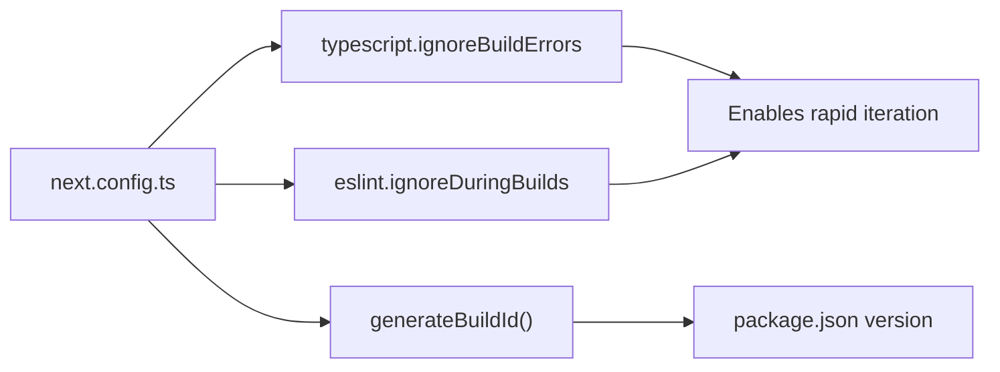
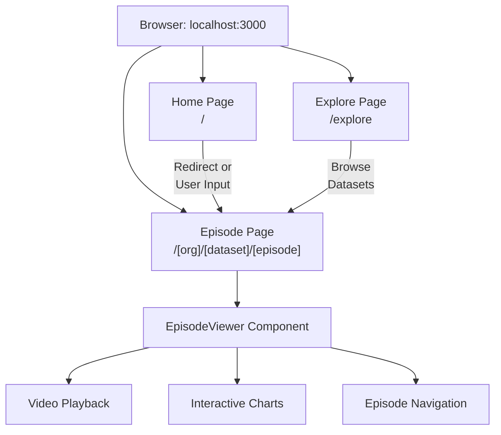
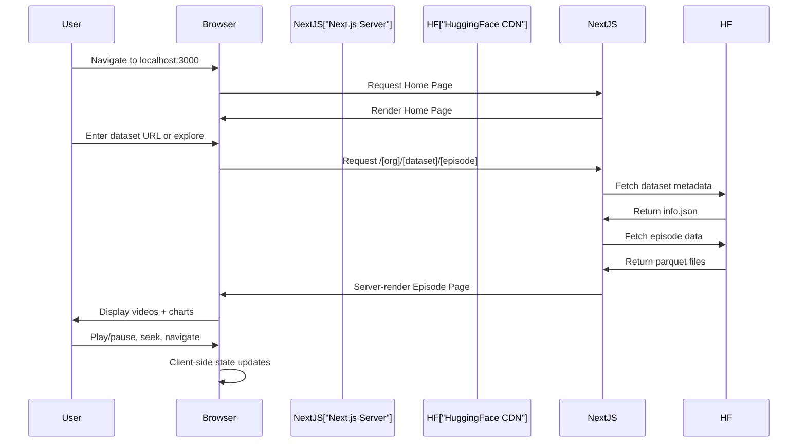
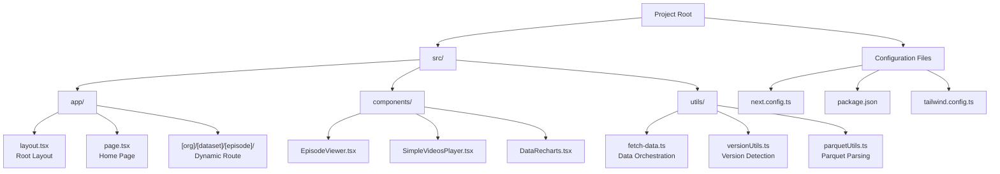

<!-- source: DeepWiki mcp.deepwiki.com · repo huggingface/lerobot-dataset-visualizer · page 2 Quick Start Guide · fetched 2026-10-26 -->

# Quick Start Guide

<details>
<summary>Relevant source files</summary>

The following files were used as context for generating this wiki page:

- [README.md](README.md)
- [next.config.ts](next.config.ts)
- [package.json](package.json)
- [src/app/layout.tsx](src/app/layout.tsx)

</details>


This guide provides step-by-step instructions for installing, configuring, and running the LeRobot Dataset Visualizer for the first time. It covers prerequisite setup, development server launch, environment configuration, and initial navigation of the application interface.

**Scope**: This page focuses on getting the application running locally. For detailed information about the internal data pipeline, see [Core Data Pipeline](#3). For comprehensive UI component documentation, see [Episode Viewer Component](#4) and [Navigation and UI Controls](#8). For deployment and production configuration, see [Configuration and Development Setup](#11).

---

## Prerequisites

The LeRobot Dataset Visualizer requires Node.js and a package manager. The following versions are recommended:

| Requirement | Version | Notes |
|------------|---------|-------|
| Node.js | 20.x or later | Required for Next.js 15.x |
| Package Manager | npm, yarn, pnpm, or bun | Any modern JavaScript package manager |
| Browser | Modern browser | Chrome, Firefox, Safari, or Edge with ES6 support |

**Sources**: [package.json:1-32]()

---

## Installation Steps

### 1. Clone the Repository

```bash
git clone https://github.com/huggingface/lerobot-dataset-visualizer.git
cd lerobot-dataset-visualizer
```

### 2. Install Dependencies

Execute the installation command using your preferred package manager:

```bash
# Using npm
npm install

# Using yarn
yarn install

# Using pnpm
pnpm install

# Using bun
bun install
```

This installs the following core dependencies:

| Package | Version | Purpose |
|---------|---------|---------|
| `next` | 15.3.1 | Next.js framework with App Router |
| `react` | 19.0.0 | React library |
| `hyparquet` | 1.12.1 | Parquet file parsing for dataset loading |
| `recharts` | 2.15.3 | Chart rendering library |
| `tailwindcss` | 4.x | Styling framework |

**Sources**: [package.json:12-19]()

---

## Configuration

### Environment Variables

The application supports optional environment variable configuration:

| Variable | Default | Purpose |
|----------|---------|---------|
| `DATASET_URL` | HuggingFace CDN | Base URL for dataset file hosting |

To configure, create a `.env.local` file in the project root:

```bash
# Optional: Override dataset source URL
DATASET_URL=https://custom-dataset-host.com
```

If `DATASET_URL` is not set, the application defaults to fetching datasets from HuggingFace's public CDN.

**Sources**: [README.md:48-49]()

### Build Configuration

The Next.js configuration is defined in `next.config.ts`:



**Diagram: Build Configuration Flow**

The configuration enables rapid development by:
- Ignoring TypeScript errors during builds ([next.config.ts:6-8]())
- Skipping ESLint during builds ([next.config.ts:9-11]())
- Using package version as build ID ([next.config.ts:12]())

**Sources**: [next.config.ts:1-15]()

---

## Running the Application

### Start Development Server

Execute the development command:

```bash
npm run dev
# or
yarn dev
# or
pnpm dev
# or
bun dev
```

The development server will start and display output similar to:

```
▲ Next.js 15.3.1
- Local:        http://localhost:3000
- Ready in 1.2s
```

**Sources**: [README.md:31-41](), [package.json:6]()

### Access the Application

Open your browser and navigate to `http://localhost:3000`. The application supports hot-reloading, meaning changes to source files will automatically refresh the browser.

---

## Application Entry Points

The application provides three main entry points for different workflows:



**Diagram: Application Navigation Flow**

### Home Page (`/`)

The home page serves as the primary entry point. It provides:
- Direct URL input for dataset navigation
- Environment-based automatic redirection if `DATASET_URL` is configured
- YouTube background video for visual appeal

**Sources**: [README.md:9-20]()

### Explore Page (`/explore`)

The explore page enables dataset discovery:
- Fetches datasets from HuggingFace Hub API
- Displays paginated dataset cards with video previews
- Allows filtering and searching of available datasets

For detailed documentation, see [Explore Page](#9.3).

### Episode Page (`/[org]/[dataset]/[episode]`)

The episode page is the core visualization interface, using Next.js dynamic routing:

| URL Segment | Example | Purpose |
|-------------|---------|---------|
| `[org]` | `lerobot` | Organization or user name on HuggingFace |
| `[dataset]` | `pusht` | Dataset repository name |
| `[episode]` | `episode_0` | Specific episode identifier |

**Example URL**: `http://localhost:3000/lerobot/pusht/episode_0`

For detailed documentation, see [Dynamic Episode Routes](#9.1).

**Sources**: [README.md:3-12]()

---

## First-Time Workflow

### Basic Usage Pattern



**Diagram: Initial Data Fetching Workflow**

**Sources**: [README.md:1-57]()

### Typical First Session

1. **Launch Application**: Start development server with `npm run dev`
2. **Navigate to Home**: Open `http://localhost:3000`
3. **Explore Datasets**: Click "Explore" to browse available datasets
4. **Select Episode**: Choose a dataset and episode to visualize
5. **Interact**: Use playback controls, navigate episodes, inspect charts

---

## Development Workflow

### File Structure Overview

The application uses Next.js App Router file-based routing:



**Diagram: Project File Structure**

Key directories:

| Directory | Purpose |
|-----------|---------|
| `src/app/` | Next.js App Router pages and layouts |
| `src/components/` | React components for visualization |
| `src/utils/` | Data fetching and processing utilities |
| `public/` | Static assets (if present) |

**Sources**: [src/app/layout.tsx:1-22]()

### Hot Reloading

The development server supports automatic reloading when files change:

- **React Components**: Changes in `src/app/` or `src/components/` trigger instant browser refresh
- **Utilities**: Changes in `src/utils/` reload affected components
- **Styles**: Tailwind CSS changes apply without full page reload

**Note**: Some changes to server-side functions may require manual browser refresh.

**Sources**: [README.md:45]()

---

## Available Scripts

The `package.json` defines the following npm scripts:

| Script | Command | Purpose |
|--------|---------|---------|
| `dev` | `next dev` | Start development server with hot-reloading |
| `build` | `next build` | Create production-optimized build |
| `start` | `next start` | Run production build locally |
| `lint` | `next lint` | Run ESLint checks on codebase |
| `format` | `prettier --write .` | Auto-format code using Prettier |

**Example Usage**:

```bash
# Development
npm run dev

# Production build and run
npm run build
npm run start

# Code quality
npm run lint
npm run format
```

**Sources**: [package.json:5-11]()

---

## Metadata and Configuration

### Application Metadata

The root layout defines application-wide metadata:

| Property | Value | Defined In |
|----------|-------|------------|
| Title | "LeRobot Dataset Visualizer" | `src/app/layout.tsx:8` |
| Description | "Visualization of LeRobot Datasets" | `src/app/layout.tsx:9` |
| Font | Inter (Google Fonts) | `src/app/layout.tsx:5` |

This metadata appears in browser tabs, bookmarks, and social media previews.

**Sources**: [src/app/layout.tsx:1-22]()

---

## Troubleshooting Common Issues

### Port Already in Use

If port 3000 is occupied, Next.js will automatically try port 3001, 3002, etc. To specify a port manually:

```bash
PORT=3001 npm run dev
```

### TypeScript Errors

TypeScript errors are ignored during builds ([next.config.ts:6-8]()). For development, ensure your IDE has TypeScript support enabled.

### Dataset Not Loading

If datasets fail to load:
1. Check browser console for network errors
2. Verify HuggingFace CDN is accessible
3. Confirm dataset exists at the specified organization/repository
4. Check dataset version compatibility (see [Version Detection and Compatibility](#3.2))

### Build Failures

If `npm run build` fails:
1. Clear Next.js cache: `rm -rf .next`
2. Reinstall dependencies: `rm -rf node_modules && npm install`
3. Check Node.js version meets requirements (20.x+)

**Sources**: [README.md:29-57]()

---

## Next Steps

After successfully running the application:

1. **Explore the Data Pipeline**: Learn how datasets are fetched and processed in [Core Data Pipeline](#3)
2. **Understand Episode Viewer**: Deep dive into the main visualization interface in [Episode Viewer Component](#4)
3. **Study Video Synchronization**: Learn about time-based coordination in [Video Playback System](#5)
4. **Examine Chart System**: Understand data visualization in [Data Visualization (Charts)](#6)
5. **Customize Configuration**: Advanced setup options in [Configuration and Development Setup](#11)

**Sources**: [README.md:1-57]()

---

