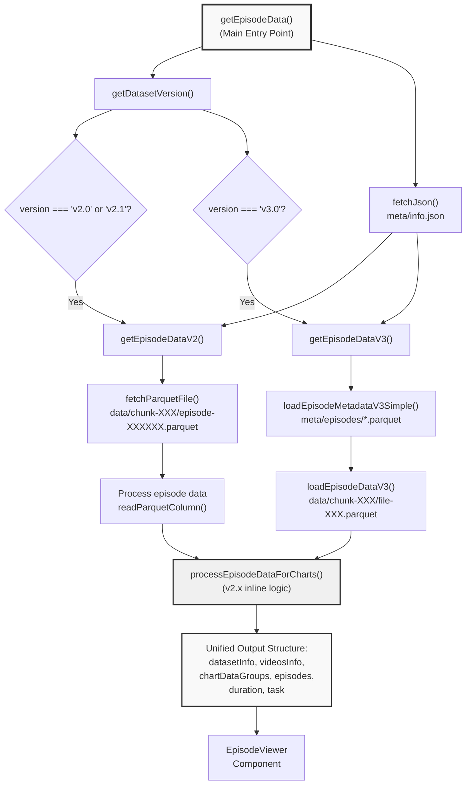
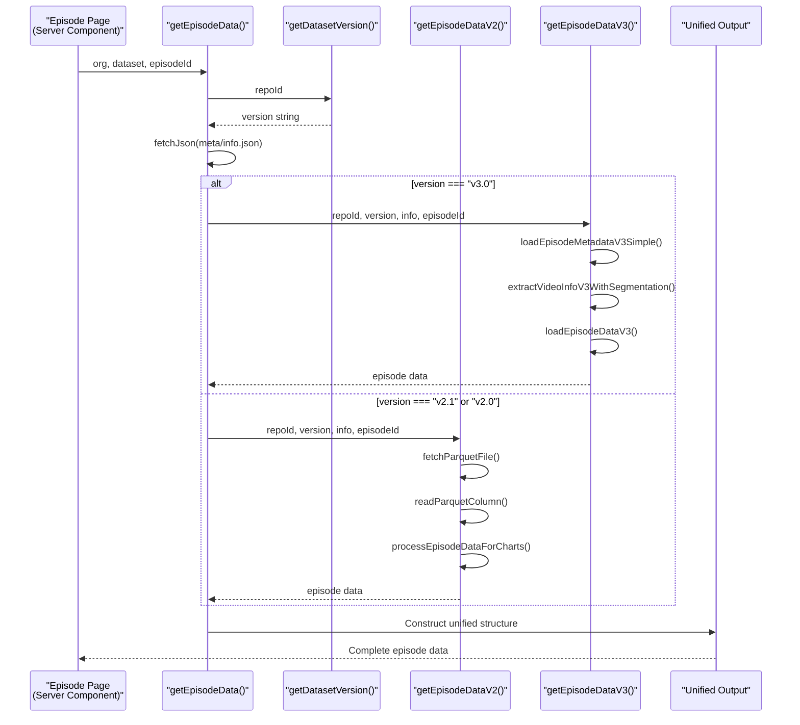
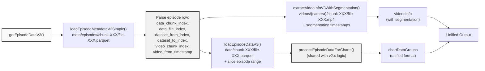
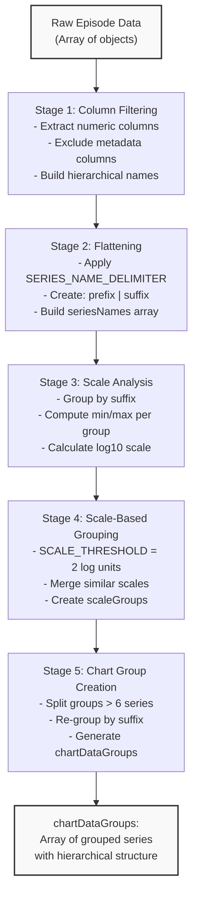
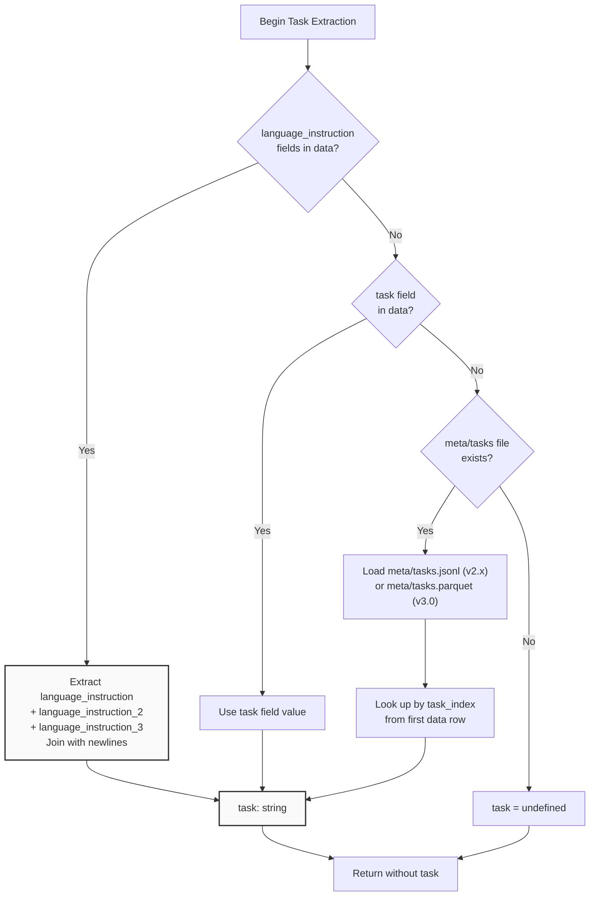
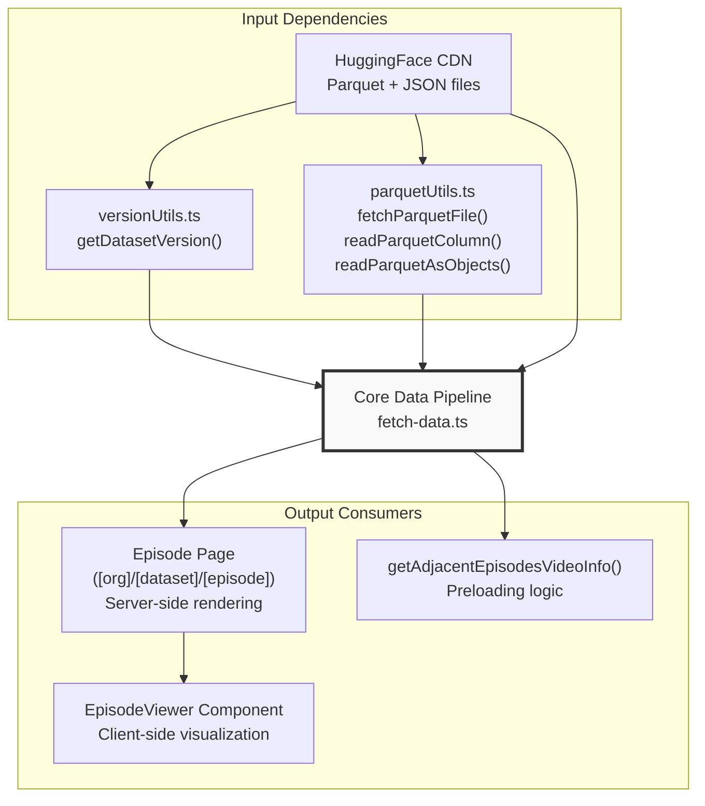

<!-- source: DeepWiki mcp.deepwiki.com · repo huggingface/lerobot-dataset-visualizer · page 3 Core Data Pipeline · fetched 2026-10-26 -->

# Core Data Pipeline

<details>
<summary>Relevant source files</summary>

The following files were used as context for generating this wiki page:

- [src/app/[org]/[dataset]/[episode]/fetch-data.ts](src/app/[org]/[dataset]/[episode]/fetch-data.ts)
- [src/utils/parquetUtils.ts](src/utils/parquetUtils.ts)
- [src/utils/versionUtils.ts](src/utils/versionUtils.ts)

</details>


## Purpose and Scope

The Core Data Pipeline is the most critical system in the LeRobot Dataset Visualizer, responsible for orchestrating all data retrieval, transformation, and preparation for visualization. This page documents the high-level architecture and coordination logic that fetches episode data from HuggingFace datasets, detects version compatibility, and produces a unified output structure for the UI layer.

For detailed documentation of specific subsystems:
- Version detection and compatibility logic: see [Version Detection and Compatibility](#3.2)
- Parquet file processing: see [Parquet Data Processing](#3.3)
- Chart data transformation algorithms: see [Chart Data Transformation](#3.4)
- Detailed episode data fetching: see [Episode Data Fetching System](#3.1)

## Pipeline Architecture Overview

The data pipeline is implemented primarily in `fetch-data.ts` and follows a three-stage architecture: **version detection**, **version-specific data retrieval**, and **unified output preparation**.



**Sources:** [src/app/[org]/[dataset]/[episode]/fetch-data.ts:14-40](), [src/utils/versionUtils.ts:71-101]()

## Main Orchestration Function

The `getEpisodeData()` function serves as the primary orchestrator, implementing a version-dispatch pattern:



The function coordinates several key operations:

1. **Version Detection**: Calls `getDatasetVersion()` to determine compatibility ([fetch-data.ts:22]())
2. **Metadata Loading**: Fetches `meta/info.json` containing dataset structure ([fetch-data.ts:23-24]())
3. **Video Validation**: Checks that `video_path` is not null (image datasets are unsupported) ([fetch-data.ts:26-28]())
4. **Version Dispatch**: Routes to `getEpisodeDataV2()` or `getEpisodeDataV3()` ([fetch-data.ts:31-35]())

**Sources:** [src/app/[org]/[dataset]/[episode]/fetch-data.ts:14-40]()

## Version-Specific Data Handlers

### v2.x Handler (`getEpisodeDataV2`)

The v2.x handler uses a **chunk-based addressing** scheme where episodes are organized by 1000-episode chunks:

| Concept | Implementation | Location |
|---------|---------------|----------|
| Chunk Calculation | `Math.floor(0 / 1000)` (always chunk 0 in current implementation) | [fetch-data.ts:109]() |
| Data Path Pattern | `data/chunk-{chunk}/episode-{episode_index}.parquet` | [fetch-data.ts:189-196]() |
| Video Path Pattern | `videos/{video_key}/chunk-{chunk}/episode-{episode_index}.mp4` | [fetch-data.ts:136-140]() |
| Task Retrieval | `meta/tasks.jsonl` (JSONL format) | [fetch-data.ts:242-269]() |

The v2.x handler performs these operations:

1. Constructs video URLs using `formatStringWithVars()` template replacement ([fetch-data.ts:136-145]())
2. Filters numeric columns (float32, int32, shape length === 1) ([fetch-data.ts:148-154]())
3. Excludes metadata columns: `timestamp`, `frame_index`, `episode_index`, `index`, `task_index` ([fetch-data.ts:157-163]())
4. Reads Parquet data using `readParquetColumn()` ([fetch-data.ts:271]())
5. Flattens hierarchical column names with delimiter `" | "` ([fetch-data.ts:12, 180-186]())
6. Groups data by scale using logarithmic threshold (2 log units) ([fetch-data.ts:327-353]())

**Sources:** [src/app/[org]/[dataset]/[episode]/fetch-data.ts:103-418]()

### v3.0 Handler (`getEpisodeDataV3`)

The v3.0 handler introduces **metadata-based addressing** with per-episode metadata files:



Key differences from v2.x:

| Feature | v3.0 Implementation | Code Reference |
|---------|-------------------|----------------|
| Episode Metadata | Separate Parquet files in `meta/episodes/` | [fetch-data.ts:934-983]() |
| Video Segmentation | Per-camera `from_timestamp` and `to_timestamp` | [fetch-data.ts:882-931]() |
| Data Slicing | `dataset_from_index` to `dataset_to_index` | [fetch-data.ts:481-496]() |
| Task Metadata | `meta/tasks.parquet` (Parquet format) | [fetch-data.ts:554-575]() |
| Multi-Camera Support | Camera-specific metadata keys: `videos/{camera}/chunk_index` | [fetch-data.ts:894-914]() |

**Sources:** [src/app/[org]/[dataset]/[episode]/fetch-data.ts:421-461](), [fetch-data.ts:464-581](), [fetch-data.ts:882-931](), [fetch-data.ts:934-983]()

## Data Transformation Pipeline

Both version handlers converge to produce `chartDataGroups` using the `processEpisodeDataForCharts()` function. This transformation pipeline consists of five stages:



### Stage Details

**Stage 1 - Column Filtering** ([fetch-data.ts:591-655]()):
- Filters features with `dtype` in `["float32", "int32"]` and `shape.length === 1`
- Excludes: `index`, `task_index`, `episode_index`, `frame_index`, `next.done`
- Builds hierarchical names: `observation.state | 0`, `action | 1`, etc.

**Stage 2 - Flattening** ([fetch-data.ts:701-753]()):
- Maps array values to hierarchical keys using `SERIES_NAME_DELIMITER = " | "`
- Creates timestamp alignment: `(index / maxIndex) * videoDuration`
- Produces flat objects: `{ "timestamp": 0.0, "observation.state | 0": 1.23, ... }`

**Stage 3 - Scale Analysis** ([fetch-data.ts:767-793]()):
- Groups series by suffix (after delimiter): `{0: [...], 1: [...], ...}`
- Computes `min` and `max` across all data points for each suffix group
- Stores in `groupStats` keyed by first series in group

**Stage 4 - Scale-Based Grouping** ([fetch-data.ts:796-824]()):
- Compares groups using logarithmic scale: `logMin`, `logMax`
- Merges groups within `SCALE_THRESHOLD = 2` log units of each other
- Creates `scaleGroups` containing arrays of suffix groups

**Stage 5 - Chart Group Creation** ([fetch-data.ts:827-839]()):
- Flattens scale groups into linear arrays
- Splits groups exceeding 6 series into sub-groups
- Applies `groupRowBySuffix()` transformation to re-nest data by suffix

**Sources:** [src/app/[org]/[dataset]/[episode]/fetch-data.ts:584-878]()

## Unified Output Structure

Both `getEpisodeDataV2()` and `getEpisodeDataV3()` return an identical output structure:

```typescript
{
  datasetInfo: {
    repoId: string;           // "org/dataset"
    total_frames: number;     // from meta/info.json
    total_episodes: number;   // from meta/info.json
    fps: number;             // from meta/info.json
  },
  
  episodeId: number,          // requested episode ID
  
  videosInfo: Array<{
    filename: string;         // camera key (e.g., "laptop")
    url: string;             // full HuggingFace URL
    // v3.0 only:
    isSegmented?: boolean;    // true for v3.0
    segmentStart?: number;    // timestamp in seconds
    segmentEnd?: number;      // timestamp in seconds
    segmentDuration?: number; // end - start
  }>,
  
  chartDataGroups: Array<     // array of chart groups
    Array<{                   // array of data points
      timestamp: number;
      [seriesName: string]: number | Record<string, number>; // hierarchical
    }>
  >,
  
  episodes: number[],         // array of available episode IDs
  
  ignoredColumns: string[],   // columns not visualized (2D+)
  
  duration: number,           // episode duration in seconds
  
  task?: string              // language instruction or task description
}
```

### Field Construction

| Field | v2.x Source | v3.0 Source |
|-------|-------------|-------------|
| `datasetInfo` | Constructed from `info.json` | Constructed from `info.json` |
| `videosInfo` | Template expansion with `formatStringWithVars()` | Metadata-based with `extractVideoInfoV3WithSegmentation()` |
| `chartDataGroups` | Inline processing in `getEpisodeDataV2()` | `processEpisodeDataForCharts()` function |
| `episodes` | `process.env.EPISODES` or full range | Full range from `total_episodes` |
| `task` | `language_instruction` fields, then `task` field, then `meta/tasks.jsonl` | `language_instruction` fields, then `meta/tasks.parquet` |
| `duration` | `chartData[last].timestamp` | `length / fps` or `video_to_timestamp - video_from_timestamp` |

**Sources:** [src/app/[org]/[dataset]/[episode]/fetch-data.ts:408-418](), [fetch-data.ts:451-460]()

## Task Extraction Strategy

The pipeline uses a **three-tier fallback strategy** for extracting task descriptions:



**Priority Order:**
1. **Primary**: `language_instruction`, `language_instruction_2`, `language_instruction_3` fields ([fetch-data.ts:212-232](), [fetch-data.ts:505-549]())
2. **Secondary**: Direct `task` field in episode data ([fetch-data.ts:235-237]())
3. **Tertiary**: Metadata file lookup by `task_index` ([fetch-data.ts:240-269](), [fetch-data.ts:552-575]())

**Sources:** [src/app/[org]/[dataset]/[episode]/fetch-data.ts:201-269](), [fetch-data.ts:505-575]()

## Integration Points

The Core Data Pipeline integrates with other systems through well-defined interfaces:



### Function Exports

The module exports three primary functions:

| Export | Purpose | Caller |
|--------|---------|--------|
| `getEpisodeData()` | Main data fetching orchestrator | Episode page component |
| `getAdjacentEpisodesVideoInfo()` | Preload adjacent episode videos | Episode page component |
| `getEpisodeDataSafe()` | Error-wrapped version for UI error display | Not currently used |

**Sources:** [src/app/[org]/[dataset]/[episode]/fetch-data.ts:14-40](), [fetch-data.ts:43-100](), [fetch-data.ts:1076-1088]()

## Error Handling

The pipeline implements a **fail-fast strategy** with informative error messages:

- **Version Incompatibility**: Throws error if `codebase_version` is not in `["v3.0", "v2.1", "v2.0"]` ([versionUtils.ts:84-89]())
- **Video-Only Validation**: Throws error if `video_path === null` ([fetch-data.ts:26-28]())
- **Network Failures**: Propagates fetch errors with context (status, URL) ([parquetUtils.ts:48-50]())
- **Episode Not Found**: Throws error when metadata file search exhausted ([fetch-data.ts:976-978]())

All errors bubble up to the Episode page component, which renders an error boundary UI.

**Sources:** [src/app/[org]/[dataset]/[episode]/fetch-data.ts:36-39](), [src/utils/versionUtils.ts:84-89]()

## Performance Considerations

The pipeline implements several optimizations:

1. **Server-Side Execution**: Runs in Next.js server components, avoiding client bundle size
2. **Selective Column Reading**: Only fetches numeric columns needed for charts ([fetch-data.ts:148-170]())
3. **Episode Metadata Caching**: v3.0 metadata files enable efficient lookups
4. **Adjacent Episode Preloading**: `getAdjacentEpisodesVideoInfo()` with radius parameter ([fetch-data.ts:43-100]())
5. **Data Slicing**: v3.0 only loads relevant data range using `dataset_from_index`/`dataset_to_index` ([fetch-data.ts:481-496]())

**Sources:** [src/app/[org]/[dataset]/[episode]/fetch-data.ts:43-100](), [fetch-data.ts:148-170](), [fetch-data.ts:481-496]()

---

