<!-- source: DeepWiki mcp.deepwiki.com · repo huggingface/lerobot-dataset-visualizer · page 3.1 Episode Data Fetching System · fetched 2026-10-26 -->

# Episode Data Fetching System

<details>
<summary>Relevant source files</summary>

The following files were used as context for generating this wiki page:

- [src/app/[org]/[dataset]/[episode]/fetch-data.ts](src/app/[org]/[dataset]/[episode]/fetch-data.ts)

</details>


## Purpose and Scope

This document describes the Episode Data Fetching System, which is the central orchestrator for retrieving, processing, and preparing episode data for visualization. The system handles version detection, dispatches to version-specific handlers (v2.x or v3.0), loads Parquet data files, extracts task information, and transforms raw data into chart-ready structures.

For information about version detection logic, see [Version Detection and Compatibility](#3.2). For details on Parquet file parsing, see [Parquet Data Processing](#3.3). For the chart data transformation algorithms, see [Chart Data Transformation](#3.4).

---

## System Overview

The Episode Data Fetching System is implemented in [src/app/[org]/[dataset]/[episode]/fetch-data.ts]() and serves as the primary data pipeline for the application. It provides a unified interface for fetching episode data regardless of the underlying dataset version, handling all complexity of different metadata structures internally.

### Main Orchestration Flow

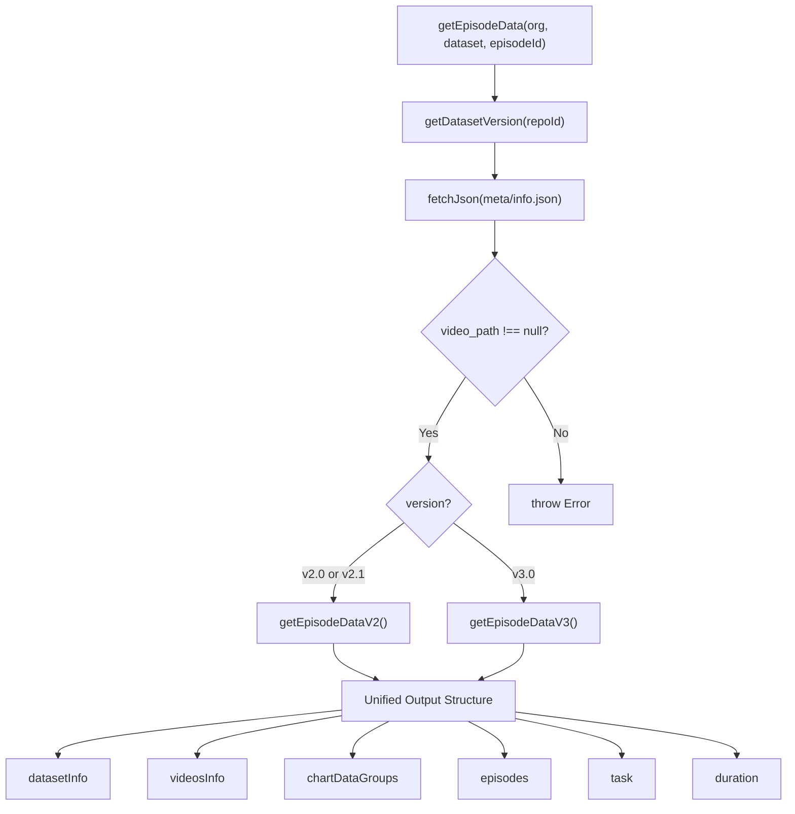

**Sources:** [src/app/[org]/[dataset]/[episode]/fetch-data.ts:14-40]()

---

## Core Entry Point: `getEpisodeData()`

The `getEpisodeData()` function is the main entry point that orchestrates the entire data fetching pipeline.

### Function Signature

```typescript
async function getEpisodeData(
  org: string,
  dataset: string,
  episodeId: number
): Promise<EpisodeData>
```

### Execution Flow

| Step | Action | Code Location |
|------|--------|---------------|
| 1 | Construct repository ID | [fetch-data.ts:19]() |
| 2 | Detect dataset version | [fetch-data.ts:22]() |
| 3 | Fetch dataset metadata | [fetch-data.ts:23-24]() |
| 4 | Validate video support | [fetch-data.ts:26-28]() |
| 5 | Route to version handler | [fetch-data.ts:31-35]() |
| 6 | Handle errors | [fetch-data.ts:36-39]() |

### Version Detection and Routing

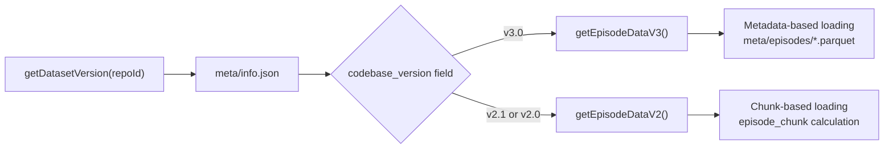

**Sources:** [src/app/[org]/[dataset]/[episode]/fetch-data.ts:14-40]()

---

## Version-Specific Data Handlers

### V2.x Handler: `getEpisodeDataV2()`

The v2.x handler processes datasets using the legacy chunk-based file organization structure.

#### File Path Construction

For v2.x datasets, file paths are constructed using the `episode_chunk` pattern:

```typescript
const episode_chunk = Math.floor(episodeId / 1000);
```

This groups episodes into chunks of 1000 for file organization.

#### Data Loading Pipeline (V2.x)

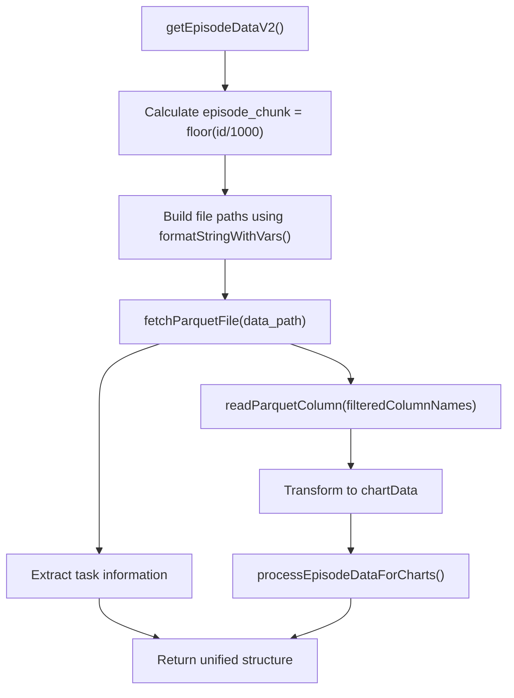

#### Column Filtering

The v2.x handler filters columns from the dataset metadata:

| Filter Type | Criteria | Excluded Columns |
|-------------|----------|------------------|
| Type filter | `dtype in ["float32", "int32"]` | Non-numeric types |
| Shape filter | `shape.length === 1` | Multi-dimensional data |
| Name filter | Key not in exclusion list | `timestamp`, `frame_index`, `episode_index`, `index`, `task_index` |

**Sources:** [src/app/[org]/[dataset]/[episode]/fetch-data.ts:103-196](), [fetch-data.ts:147-170]()

#### Task Extraction (V2.x)

The v2.x handler attempts to extract task information from three sources in priority order:

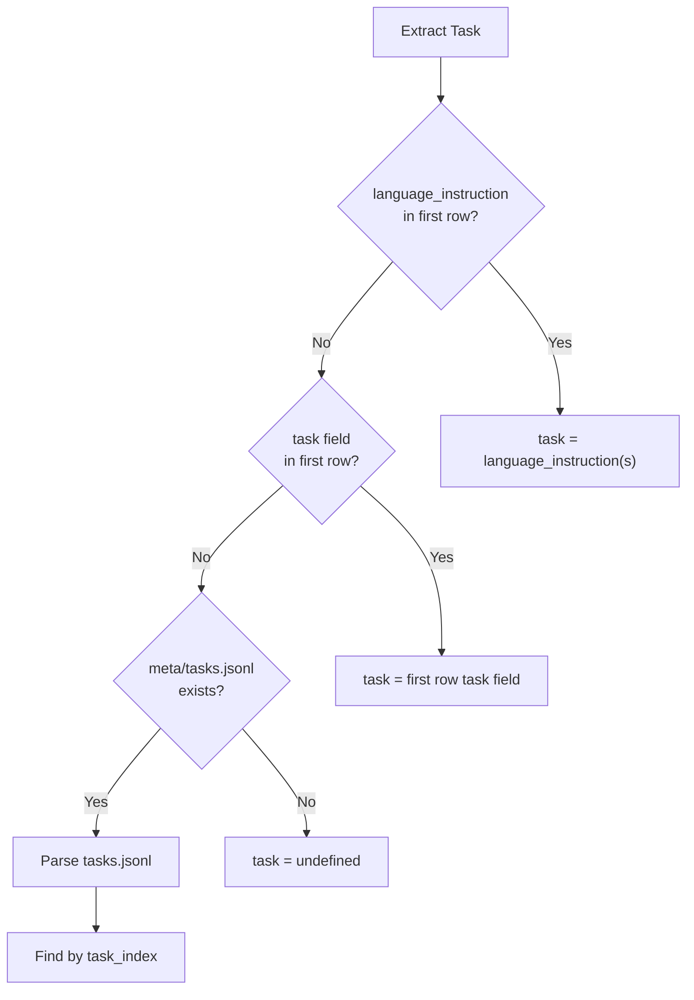

**Sources:** [src/app/[org]/[dataset]/[episode]/fetch-data.ts:200-269]()

---

### V3.0 Handler: `getEpisodeDataV3()`

The v3.0 handler uses a metadata-based approach with structured episode information files.

#### Metadata Loading Pipeline

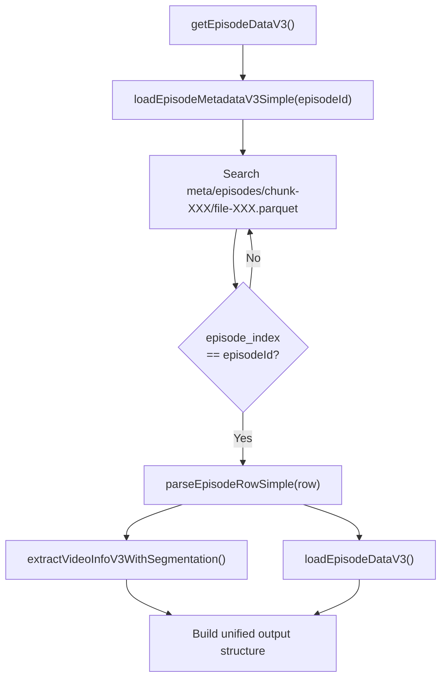

**Sources:** [src/app/[org]/[dataset]/[episode]/fetch-data.ts:421-461]()

#### Episode Metadata Structure

The v3.0 episode metadata contains detailed indexing information:

| Field | Type | Purpose |
|-------|------|---------|
| `episode_index` | number | Episode ID |
| `data_chunk_index` | number | Data file chunk location |
| `data_file_index` | number | Data file index within chunk |
| `dataset_from_index` | number | Starting row in data file |
| `dataset_to_index` | number | Ending row in data file |
| `video_chunk_index` | number | Video file chunk location |
| `video_file_index` | number | Video file index within chunk |
| `video_from_timestamp` | number | Video segment start time (seconds) |
| `video_to_timestamp` | number | Video segment end time (seconds) |
| `length` | number | Number of frames in episode |

**Sources:** [src/app/[org]/[dataset]/[episode]/fetch-data.ts:986-1052]()

#### Data Slicing

The v3.0 handler extracts episode-specific data from larger Parquet files:

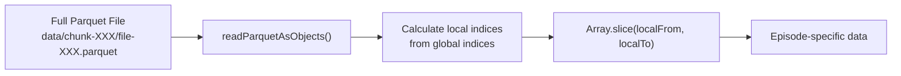

The index calculation accounts for file offsets:

```typescript
const fileStartIndex = Number(fullData[0].index);
const localFromIndex = Math.max(0, fromIndex - fileStartIndex);
const localToIndex = Math.min(fullData.length, toIndex - fileStartIndex);
```

**Sources:** [src/app/[org]/[dataset]/[episode]/fetch-data.ts:464-581](), [fetch-data.ts:482-496]()

#### Video Segmentation (V3.0)

V3.0 datasets support video segmentation, where each episode references a time segment within a longer video file:

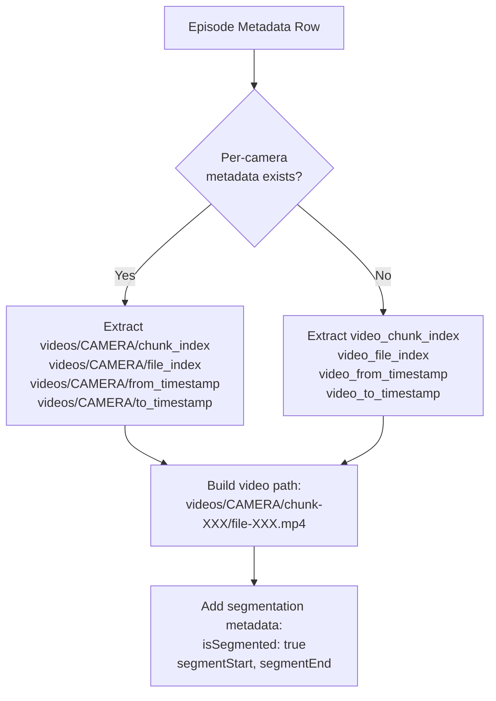

**Sources:** [src/app/[org]/[dataset]/[episode]/fetch-data.ts:882-931]()

---

## Data Transformation Pipeline

Both version handlers converge on a common transformation pipeline that converts raw Parquet data into chart-ready structures.

### Transformation Stages

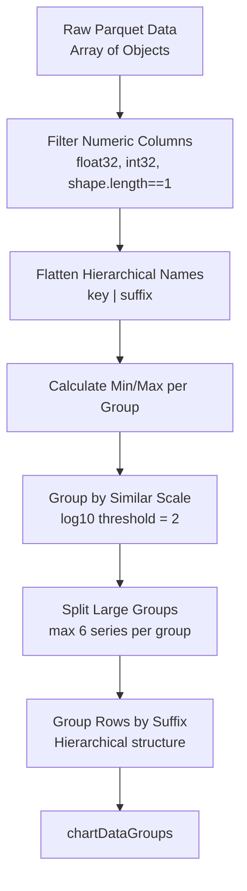

**Sources:** [src/app/[org]/[dataset]/[episode]/fetch-data.ts:584-878]()

### Series Name Delimiter

The system uses a consistent delimiter to create hierarchical series names:

```typescript
const SERIES_NAME_DELIMITER = " | ";
```

This creates names like `"observation.state | 0"` and `"action | x"`.

**Sources:** [src/app/[org]/[dataset]/[episode]/fetch-data.ts:12]()

### Scale-Based Grouping Algorithm

The transformation pipeline groups related data series based on their numerical scale:

| Step | Operation | Threshold |
|------|-----------|-----------|
| 1 | Group by suffix | Exact match on suffix after delimiter |
| 2 | Calculate min/max | Per suffix group |
| 3 | Compute log scale | `log10(abs(value) + 1e-9)` |
| 4 | Group similar scales | `abs(logMin1 - logMin2) <= 2` AND `abs(logMax1 - logMax2) <= 2` |
| 5 | Limit group size | Split groups larger than 6 series |

**Sources:** [src/app/[org]/[dataset]/[episode]/fetch-data.ts:295-369](), [fetch-data.ts:767-839]()

### Row Grouping by Suffix

The final transformation groups row data by suffix to create hierarchical chart data:

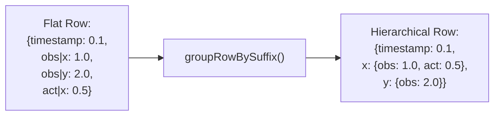

**Sources:** [src/app/[org]/[dataset]/[episode]/fetch-data.ts:374-402](), [fetch-data.ts:842-870]()

---

## Output Data Structure

All handlers return a unified output structure regardless of dataset version:

### Unified Output Schema

| Field | Type | Description |
|-------|------|-------------|
| `datasetInfo` | Object | Repository ID, total frames, total episodes, FPS |
| `episodeId` | number | Current episode ID |
| `videosInfo` | Array | Video URLs and segmentation metadata |
| `chartDataGroups` | Array | Grouped chart data, one group per graph |
| `episodes` | Array | List of all available episode IDs |
| `ignoredColumns` | Array | Columns excluded from charts (2D/3D data) |
| `duration` | number | Episode duration in seconds |
| `task` | string \| undefined | Task description or instruction |

### Video Info Structure

For v2.x datasets:
```typescript
{
  filename: string,      // Camera key (e.g., "observation.images.top")
  url: string           // Full HuggingFace URL to video file
}
```

For v3.0 datasets (with segmentation):
```typescript
{
  filename: string,         // Camera key
  url: string,             // Full HuggingFace URL to video file
  isSegmented: true,       // Segmentation enabled
  segmentStart: number,    // Start timestamp in video file (seconds)
  segmentEnd: number,      // End timestamp in video file (seconds)
  segmentDuration: number  // Duration of this segment (seconds)
}
```

**Sources:** [src/app/[org]/[dataset]/[episode]/fetch-data.ts:408-417](), [fetch-data.ts:451-460](), [fetch-data.ts:919-928]()

---

## Supporting Functions

### Adjacent Episodes Preloading: `getAdjacentEpisodesVideoInfo()`

This function enables video preloading for smooth navigation by fetching video info for episodes surrounding the current episode.

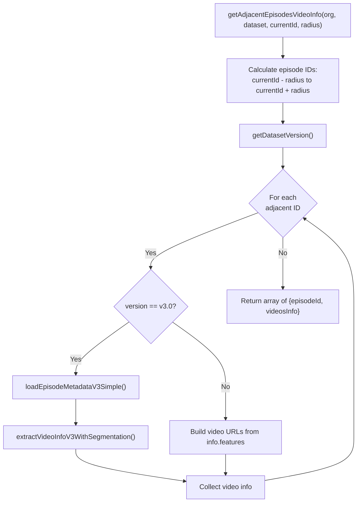

**Parameters:**
- `org`: Organization name
- `dataset`: Dataset name
- `currentEpisodeId`: Current episode being viewed
- `radius`: Number of episodes before/after to fetch (default: 2)

**Sources:** [src/app/[org]/[dataset]/[episode]/fetch-data.ts:43-100]()

### Safe Wrapper: `getEpisodeDataSafe()`

Provides error handling for UI consumption by catching exceptions and returning a structured error object:

```typescript
async function getEpisodeDataSafe(
  org: string,
  dataset: string,
  episodeId: number
): Promise<{ data?: any; error?: string }>
```

This prevents error stack traces from being exposed to the UI and provides clean error messages.

**Sources:** [src/app/[org]/[dataset]/[episode]/fetch-data.ts:1076-1088]()

---

## Error Handling

### Error Types and Handling

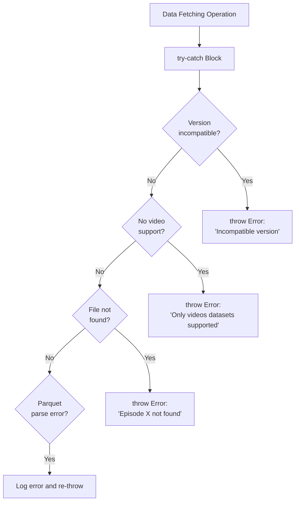

### Validation Points

| Validation | Location | Error Message |
|------------|----------|---------------|
| Version compatibility | [fetch-data.ts:22]() | Handled by `getDatasetVersion()` |
| Video support check | [fetch-data.ts:26-28]() | "Only videos datasets are supported in this visualizer" |
| Episode metadata not found | [fetch-data.ts:976-977]() | "Episode X not found in metadata" |
| General errors | [fetch-data.ts:36-39]() | Logged to console and re-thrown |

**Sources:** [src/app/[org]/[dataset]/[episode]/fetch-data.ts:20-40](), [fetch-data.ts:975-978]()

---

## Code Entity Reference

### Key Functions

| Function | Line Range | Purpose |
|----------|------------|---------|
| `getEpisodeData()` | [14-40]() | Main entry point and orchestrator |
| `getEpisodeDataV2()` | [103-418]() | V2.x dataset handler |
| `getEpisodeDataV3()` | [421-461]() | V3.0 dataset handler |
| `loadEpisodeDataV3()` | [464-581]() | Load and slice v3.0 episode data |
| `processEpisodeDataForCharts()` | [584-878]() | Transform data for charts |
| `extractVideoInfoV3WithSegmentation()` | [882-931]() | Build v3.0 video info with segments |
| `loadEpisodeMetadataV3Simple()` | [934-983]() | Load v3.0 episode metadata |
| `parseEpisodeRowSimple()` | [986-1070]() | Parse v3.0 metadata row |
| `getAdjacentEpisodesVideoInfo()` | [43-100]() | Preload adjacent episode videos |
| `getEpisodeDataSafe()` | [1076-1088]() | Error-safe wrapper |

### Key Constants

| Constant | Value | Usage |
|----------|-------|-------|
| `SERIES_NAME_DELIMITER` | `" | "` | Hierarchical series name separator |
| `SCALE_THRESHOLD` | `2` | Log scale grouping threshold |
| Default preload radius | `2` | Adjacent episodes to preload |

**Sources:** [src/app/[org]/[dataset]/[episode]/fetch-data.ts:1-1089]()

---

