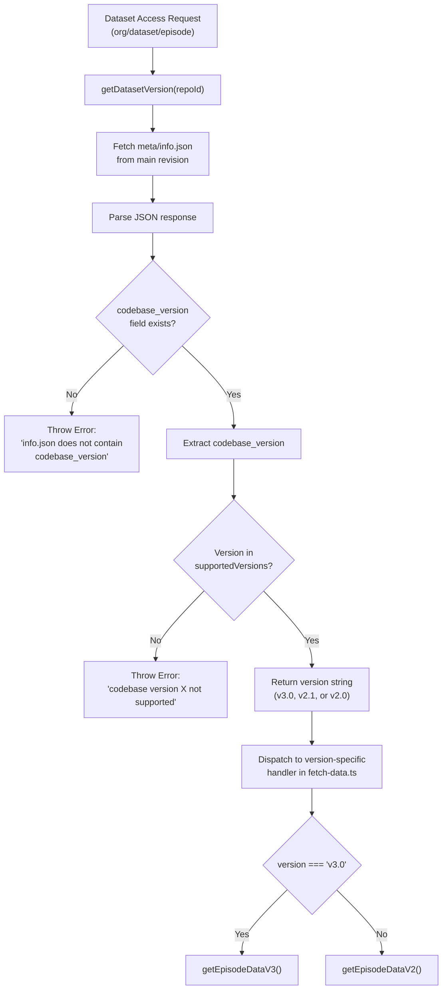
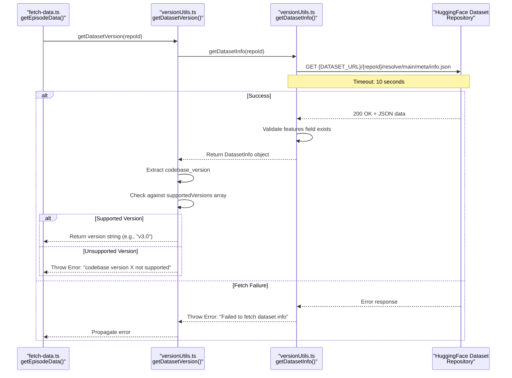
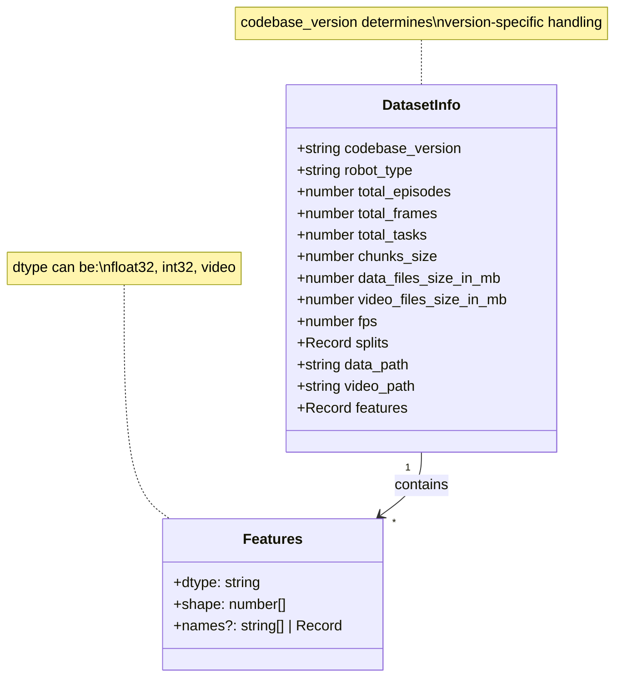
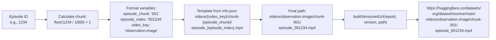
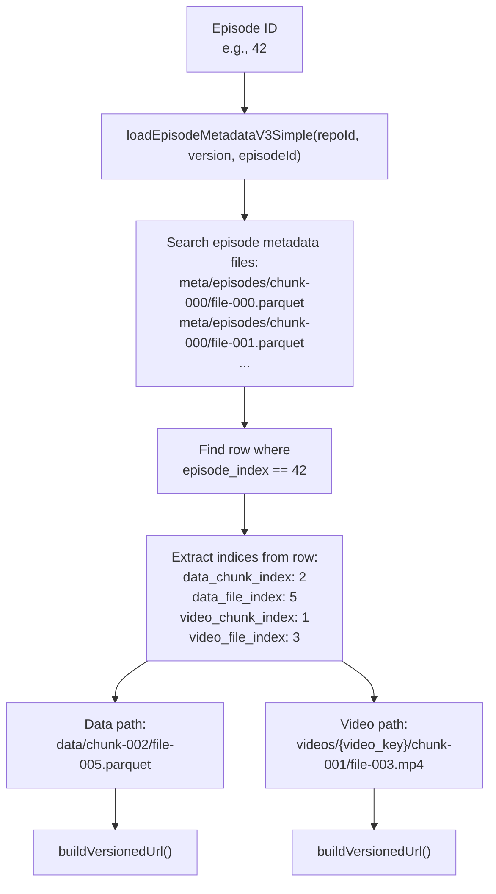
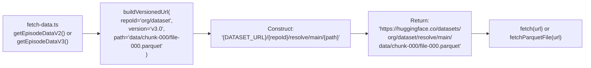
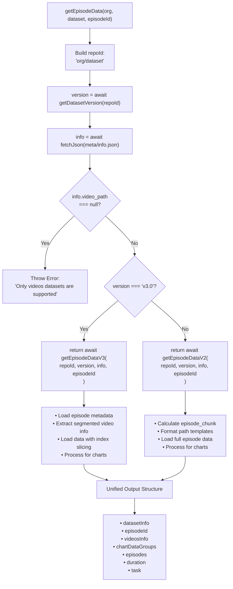
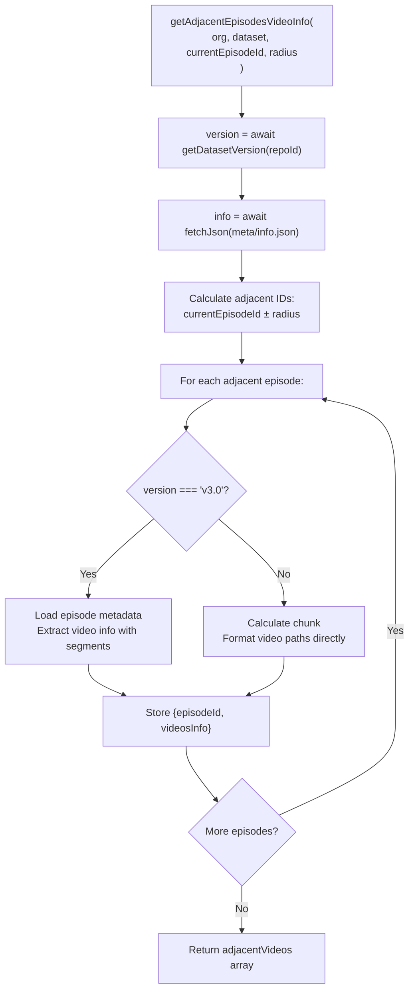

<!-- source: DeepWiki mcp.deepwiki.com · repo huggingface/lerobot-dataset-visualizer · page 3.2 Version Detection and Compatibility · fetched 2026-10-26 -->

# Version Detection and Compatibility

<details>
<summary>Relevant source files</summary>

The following files were used as context for generating this wiki page:

- [src/app/[org]/[dataset]/[episode]/fetch-data.ts](src/app/[org]/[dataset]/[episode]/fetch-data.ts)
- [src/utils/versionUtils.ts](src/utils/versionUtils.ts)

</details>


## Purpose and Scope

This document explains how the LeRobot Dataset Visualizer detects and validates dataset versions to ensure compatibility. The system supports three specific versions of the LeRobot dataset format: **v3.0**, **v2.1**, and **v2.0**. Any other version is explicitly rejected with a clear error message.

The version detection system is responsible for:
- Reading the `codebase_version` field from dataset metadata
- Validating that the version is supported
- Providing version information to downstream data fetching logic

For details on how version-specific data is fetched after detection, see [Episode Data Fetching System](#3.1). For information about how different versions structure their Parquet files, see [Parquet Data Processing](#3.3).

**Sources:** [src/utils/versionUtils.ts:1-107](), [src/app/[org]/[dataset]/[episode]/fetch-data.ts:1-40]()

---

## Supported Dataset Versions

The visualizer implements a **strict validation** approach, supporting only three specific versions of the LeRobot dataset format:

| Version | Support Status | Key Features | Metadata Location |
|---------|---------------|--------------|-------------------|
| **v3.0** | ✅ Supported | Segmented videos, structured episode metadata, Parquet-based tasks | `meta/episodes/chunk-*/file-*.parquet` |
| **v2.1** | ✅ Supported | Chunk-based addressing, JSONL tasks metadata | `meta/tasks.jsonl` |
| **v2.0** | ✅ Supported | Chunk-based addressing, JSONL tasks metadata | `meta/tasks.jsonl` |
| Other | ❌ Rejected | N/A | Error thrown immediately |

The version validation logic is defined in [src/utils/versionUtils.ts:82-89](), where an explicit whitelist ensures only these three versions are accepted.

**Sources:** [src/utils/versionUtils.ts:82-89](), [src/app/[org]/[dataset]/[episode]/fetch-data.ts:21-35]()

---

## Version Detection Process

### High-Level Detection Flow



**Sources:** [src/utils/versionUtils.ts:71-101](), [src/app/[org]/[dataset]/[episode]/fetch-data.ts:14-40]()

---

### Version Detection Implementation

The `getDatasetVersion` function is the entry point for all version checks:



**Sources:** [src/utils/versionUtils.ts:29-65](), [src/utils/versionUtils.ts:71-101]()

---

### Error Handling and Messages

The version detection system provides clear, actionable error messages:

| Error Condition | Error Message | Location |
|----------------|---------------|----------|
| Dataset info fetch fails | `"Failed to fetch dataset info: {status}"` | [versionUtils.ts:45]() |
| Missing features structure | `"Dataset info.json does not have the expected features structure"` | [versionUtils.ts:52]() |
| Missing codebase_version | `"Dataset info.json does not contain codebase_version"` | [versionUtils.ts:78]() |
| Unsupported version | `"Dataset {repoId} has codebase version {version}, which is not supported. This tool only works with dataset versions 3.0, 2.1, or 2.0."` | [versionUtils.ts:84-87]() |

All errors are propagated to the UI layer via the `getEpisodeDataSafe` wrapper in [fetch-data.ts:1076-1088]().

**Sources:** [src/utils/versionUtils.ts:29-101](), [src/app/[org]/[dataset]/[episode]/fetch-data.ts:1076-1088]()

---

## Dataset Metadata Structure

### info.json Schema

All supported dataset versions include a `meta/info.json` file at the repository root with the following structure:



The `codebase_version` field is the **single source of truth** for version detection. It is explicitly checked in [versionUtils.ts:76-89]().

**Sources:** [src/utils/versionUtils.ts:10-24](), [src/app/[org]/[dataset]/[episode]/fetch-data.ts:23-24]()

---

### Version-Specific Metadata Differences

#### v2.x Datasets (v2.0 and v2.1)

```
Repository Structure:
├── meta/
│   ├── info.json          # Contains codebase_version: "v2.1" or "v2.0"
│   └── tasks.jsonl        # One JSON object per line, task metadata
├── data/
│   └── chunk-{XXX}/
│       └── episode_{NNNNNN}.parquet
└── videos/
    └── {video_key}/
        └── chunk-{XXX}/
            └── episode_{NNNNNN}.mp4
```

- **Chunk Addressing**: Episodes are organized into chunks of 1000 episodes
- `episode_chunk = floor(episode_id / 1000)` (calculated in [fetch-data.ts:109]())
- **Direct Path Construction**: Video and data paths are built by formatting template strings
- **Tasks Format**: JSONL file where each line is a task object with `task_index` and `task` fields

**Sources:** [src/app/[org]/[dataset]/[episode]/fetch-data.ts:103-196](), [src/app/[org]/[dataset]/[episode]/fetch-data.ts:239-269]()

#### v3.0 Datasets

```
Repository Structure:
├── meta/
│   ├── info.json                      # Contains codebase_version: "v3.0"
│   ├── tasks.parquet                  # Task metadata in Parquet format
│   └── episodes/
│       └── chunk-{XXX}/
│           └── file-{YYY}.parquet     # Episode metadata with indices
├── data/
│   └── chunk-{XXX}/
│       └── file-{YYY}.parquet         # Timestep data
└── videos/
    └── {video_key}/
        └── chunk-{XXX}/
            └── file-{YYY}.mp4         # Video segments
```

- **Metadata-Based Addressing**: Episode metadata contains chunk/file indices and timestamp ranges
- **Video Segmentation**: Each video file contains multiple episodes with start/end timestamps
- **Structured Episode Metadata**: Each episode row contains:
  - `data_chunk_index`, `data_file_index`: Location of timestep data
  - `dataset_from_index`, `dataset_to_index`: Row range in data file
  - `video_chunk_index`, `video_file_index`: Location of video file
  - `video_from_timestamp`, `video_to_timestamp`: Time segment in video file
  - Per-camera metadata: `videos/{camera_name}/chunk_index`, `videos/{camera_name}/from_timestamp`, etc.

**Sources:** [src/app/[org]/[dataset]/[episode]/fetch-data.ts:421-461](), [src/app/[org]/[dataset]/[episode]/fetch-data.ts:934-983]()

---

## Version-Specific Data Path Patterns

### Path Construction in v2.x

For v2.x datasets, paths are constructed using string template substitution:



The chunk calculation is hardcoded in [fetch-data.ts:109]() and uses a divisor of 1000.

**Sources:** [src/app/[org]/[dataset]/[episode]/fetch-data.ts:109](), [src/app/[org]/[dataset]/[episode]/fetch-data.ts:136-145](), [src/app/[org]/[dataset]/[episode]/fetch-data.ts:189-196]()

---

### Path Construction in v3.0

For v3.0 datasets, paths are read from episode metadata:



The metadata loading logic iterates through files until the episode is found, as shown in [fetch-data.ts:934-983]().

**Sources:** [src/app/[org]/[dataset]/[episode]/fetch-data.ts:421-461](), [src/app/[org]/[dataset]/[episode]/fetch-data.ts:934-983](), [src/app/[org]/[dataset]/[episode]/fetch-data.ts:882-931]()

---

## URL Construction System

### buildVersionedUrl Function

The `buildVersionedUrl` function constructs URLs that always point to the `main` revision of the HuggingFace dataset repository:

```typescript
// Simplified from versionUtils.ts:103-105
buildVersionedUrl(repoId, version, path) {
  return `${DATASET_URL}/${repoId}/resolve/main/${path}`;
}
```

**Key characteristics:**
- The `version` parameter is **currently unused** but kept for future extensibility
- All URLs resolve to the `main` revision (not version-specific revisions)
- Base URL is configurable via `DATASET_URL` environment variable (defaults to `https://huggingface.co/datasets`)

**Usage pattern:**


**Sources:** [src/utils/versionUtils.ts:103-105](), [src/app/[org]/[dataset]/[episode]/fetch-data.ts:23](), [src/app/[org]/[dataset]/[episode]/fetch-data.ts:189-196]()

---

## Integration with Data Fetching Pipeline

### Version-Based Dispatch

The `getEpisodeData` function in [fetch-data.ts:14-40]() coordinates version detection and dispatching:



**Key dispatch logic:**
- Version detection happens **once per episode load**
- Both v2.x and v3.0 handlers return the **same output structure**
- Video-only constraint is enforced in [fetch-data.ts:26-28]()
- Error handling wraps the entire pipeline in [fetch-data.ts:36-39]()

**Sources:** [src/app/[org]/[dataset]/[episode]/fetch-data.ts:14-40](), [src/app/[org]/[dataset]/[episode]/fetch-data.ts:103-418](), [src/app/[org]/[dataset]/[episode]/fetch-data.ts:421-461]()

---

## Version Compatibility Table

### Feature Comparison

| Feature | v2.0 | v2.1 | v3.0 |
|---------|------|------|------|
| **Video Segmentation** | ❌ No | ❌ No | ✅ Yes |
| **Episode Metadata Files** | ❌ No | ❌ No | ✅ Yes (`meta/episodes/`) |
| **Tasks Metadata Format** | JSONL | JSONL | Parquet |
| **Data File Organization** | Chunk-based | Chunk-based | Metadata-indexed |
| **Video File Organization** | Episode-per-file | Episode-per-file | Segment-based |
| **Path Construction** | Template string | Template string | Metadata lookup |
| **Episode Chunk Calculation** | `floor(id/1000)` | `floor(id/1000)` | N/A |
| **Per-Camera Video Metadata** | ❌ No | ❌ No | ✅ Yes |
| **Language Instructions** | ✅ Yes (in data) | ✅ Yes (in data) | ✅ Yes (enhanced) |

**Sources:** [src/app/[org]/[dataset]/[episode]/fetch-data.ts:103-418](), [src/app/[org]/[dataset]/[episode]/fetch-data.ts:421-461]()

---

## Version Detection in Adjacent Episode Preloading

The `getAdjacentEpisodesVideoInfo` function in [fetch-data.ts:43-100]() demonstrates version-aware data fetching for preloading:



This function performs **lightweight version-specific data fetching** without loading full episode data, optimizing for preloading performance.

**Sources:** [src/app/[org]/[dataset]/[episode]/fetch-data.ts:43-100]()

---

