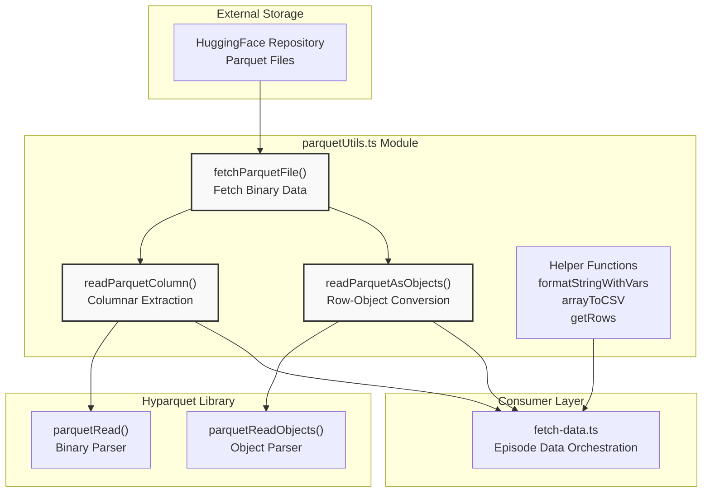
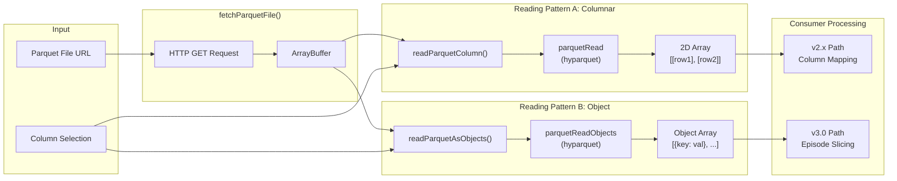
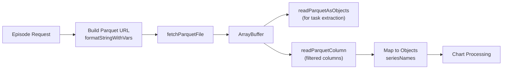

<!-- source: DeepWiki mcp.deepwiki.com · repo huggingface/lerobot-dataset-visualizer · page 3.3 Parquet Data Processing · fetched 2026-10-26 -->

# Parquet Data Processing

<details>
<summary>Relevant source files</summary>

The following files were used as context for generating this wiki page:

- [src/app/[org]/[dataset]/[episode]/fetch-data.ts](src/app/[org]/[dataset]/[episode]/fetch-data.ts)
- [src/utils/parquetUtils.ts](src/utils/parquetUtils.ts)

</details>


## Purpose and Scope

This document covers the Parquet file reading and parsing utilities that form the foundation of the data pipeline. The `parquetUtils.ts` module provides low-level functions for fetching Parquet files from HuggingFace, extracting column data, and converting binary Parquet format into JavaScript objects. These utilities are version-agnostic and handle the raw data extraction that higher-level systems build upon.

For information about how these utilities are orchestrated to fetch complete episode data, see [Episode Data Fetching System](#3.1). For details on how the extracted data is transformed into chart-ready formats, see [Chart Data Transformation](#3.4).

**Sources:** [src/utils/parquetUtils.ts:1-120]()

## Architecture Overview

The Parquet processing system acts as a translation layer between binary Parquet files stored in HuggingFace repositories and JavaScript data structures consumed by the application. It wraps the `hyparquet` library to provide Promise-based APIs and specialized data access patterns.



**Diagram: Parquet Processing Architecture**

The module provides three primary reading patterns:
1. **Binary Fetch**: `fetchParquetFile()` retrieves raw ArrayBuffer from URLs
2. **Columnar Access**: `readParquetColumn()` extracts specific columns as arrays
3. **Row-Object Access**: `readParquetAsObjects()` converts data to key-value objects

**Sources:** [src/utils/parquetUtils.ts:1-84]()

## Hyparquet Integration

The system uses the `hyparquet` library for actual Parquet parsing. This library provides two core functions that `parquetUtils` wraps with Promise-based interfaces:

| Hyparquet Function | Wrapper Function | Return Type | Use Case |
|-------------------|------------------|-------------|----------|
| `parquetRead` | `readParquetColumn` | `any[][]` | Columnar data extraction (v2.x) |
| `parquetReadObjects` | `readParquetAsObjects` | `Record<string, any>[]` | Row-based object access (v3.0) |

The `parquetRead` function uses a callback-based API that is converted to Promises:

```typescript
// Promise wrapper pattern
parquetRead({
  file: fileBuffer,
  columns: columns.length > 0 ? columns : undefined,
  onComplete: (data: any[]) => resolve(data)
})
```

**Sources:** [src/utils/parquetUtils.ts:56-73](), [src/utils/parquetUtils.ts:76-84]()

## Core Data Reading Functions

### fetchParquetFile

Fetches a Parquet file from a URL and returns its binary content as an `ArrayBuffer`. This is the entry point for all Parquet data access.

**Signature:**
```typescript
async function fetchParquetFile(url: string): Promise<ArrayBuffer>
```

**Error Handling:**
- Throws descriptive errors including HTTP status code and status text
- Used by both v2.x and v3.0 data loading paths

**Usage Example in fetch-data.ts:**
```typescript
// v2.x path
const arrayBuffer = await fetchParquetFile(parquetUrl);

// v3.0 path  
const arrayBuffer = await fetchParquetFile(dataUrl);
const tasksArrayBuffer = await fetchParquetFile(tasksUrl);
```

**Sources:** [src/utils/parquetUtils.ts:44-53](), [src/app/[org]/[dataset]/[episode]/fetch-data.ts:198-199](), [src/app/[org]/[dataset]/[episode]/fetch-data.ts:476-477]()

### readParquetColumn

Extracts specific columns from a Parquet file and returns them as a 2D array where each inner array represents a row.

**Signature:**
```typescript
async function readParquetColumn(
  fileBuffer: ArrayBuffer,
  columns: string[]
): Promise<any[]>
```

**Behavior:**
- If `columns` is empty array, reads all columns
- Returns data in columnar format: `[[col1_row1, col2_row1, ...], [col1_row2, col2_row2, ...]]`
- Used primarily in v2.x path for structured column extraction

**Usage Pattern:**
```typescript
const filteredColumnNames = ["timestamp", ...filteredColumns.map(c => c.key)];
const data = await readParquetColumn(arrayBuffer, filteredColumnNames);
// data = [[timestamp1, state1, action1, ...], [timestamp2, state2, action2, ...]]
```

**Sources:** [src/utils/parquetUtils.ts:56-73](), [src/app/[org]/[dataset]/[episode]/fetch-data.ts:271-272]()

### readParquetAsObjects

Reads Parquet data and returns an array of objects where each object represents a row with column names as keys.

**Signature:**
```typescript
async function readParquetAsObjects(
  fileBuffer: ArrayBuffer,
  columns: string[] = []
): Promise<Record<string, any>[]>
```

**Behavior:**
- Returns objects with column names as keys: `[{timestamp: 0, state: [...], action: [...]}, ...]`
- If `columns` is empty or not provided, reads all columns
- Used extensively in v3.0 path for metadata and episode data loading

**Usage Pattern:**
```typescript
const fullData = await readParquetAsObjects(arrayBuffer, []);
// fullData = [
//   {timestamp: 0, 'observation.state': [1,2,3], action: [4,5,6]},
//   {timestamp: 0.1, 'observation.state': [1.1,2.1,3.1], action: [4.1,5.1,6.1]}
// ]
```

**Sources:** [src/utils/parquetUtils.ts:76-84](), [src/app/[org]/[dataset]/[episode]/fetch-data.ts:478](), [src/app/[org]/[dataset]/[episode]/fetch-data.ts:556]()

## Data Flow: Parquet to JavaScript



**Diagram: Data Flow from Parquet to JavaScript Structures**

The two reading patterns serve different use cases:
- **Columnar (v2.x)**: Efficient for extracting specific numeric columns for time-series plotting
- **Object (v3.0)**: Flexible for handling complex metadata with dynamic fields

**Sources:** [src/utils/parquetUtils.ts:44-84]()

## DatasetMetadata Type Structure

The `DatasetMetadata` interface defines the structure of the `meta/info.json` file present in all LeRobot datasets. This metadata describes the dataset's schema and file organization.

**Type Definition:**
```typescript
interface DatasetMetadata {
  codebase_version: string;        // "v2.0", "v2.1", or "v3.0"
  robot_type: string;               // e.g., "aloha", "pusht"
  total_episodes: number;
  total_frames: number;
  total_tasks: number;
  total_videos: number;
  total_chunks: number;
  chunks_size: number;
  fps: number;                      // Video framerate
  splits: Record<string, string>;   // train/test splits
  data_path: string;                // Template: "data/chunk-{episode_chunk:03d}/..."
  video_path: string;               // Template: "videos/{video_key}/..."
  features: Record<string, {
    dtype: string;                  // "float32", "int32", "video", etc.
    shape: any[];                   // Dimensionality
    names: any[] | Record<string, any> | null;  // Column labels
    info?: Record<string, any>;
  }>;
}
```

**Key Features Map:**
The `features` field describes all columns in the dataset:
- **Numeric columns**: `dtype: "float32"` or `"int32"`, used for states/actions
- **Video columns**: `dtype: "video"`, indicates video streams
- **Shape**: `[n]` for 1D vectors, `[h, w, c]` for images, etc.
- **Names**: Hierarchical labels for vector elements (e.g., joint names)

**Sources:** [src/utils/parquetUtils.ts:3-25]()

## Helper Utilities

### formatStringWithVars

Replaces template variables in path strings with actual values. Supports both simple replacement and zero-padded numeric formatting.

**Signature:**
```typescript
function formatStringWithVars(
  format: string,
  vars: Record<string, any>
): string
```

**Pattern Matching:**
- `{variable}` - Simple replacement
- `{variable:03d}` - Zero-padded numeric replacement (padding removed by regex)

**Usage Example:**
```typescript
const path = formatStringWithVars("data/chunk-{episode_chunk:03d}/episode_{episode_index:06d}.parquet", {
  episode_chunk: "000",
  episode_index: "000042"
});
// Result: "data/chunk-000/episode_000042.parquet"
```

**Sources:** [src/utils/parquetUtils.ts:37-42](), [src/app/[org]/[dataset]/[episode]/fetch-data.ts:136-140](), [src/app/[org]/[dataset]/[episode]/fetch-data.ts:192-195]()

### fetchJson

Generic JSON fetching utility with error handling. Used for loading `meta/info.json` and other metadata files.

**Signature:**
```typescript
async function fetchJson<T>(url: string): Promise<T>
```

**Error Handling:**
- Throws errors with HTTP status information
- Type parameter `T` ensures type safety

**Sources:** [src/utils/parquetUtils.ts:27-35]()

### arrayToCSV

Converts a 2D array to CSV string format. Currently not actively used in the codebase but provided as a utility.

**Signature:**
```typescript
function arrayToCSV(data: (number | string)[][]): string
```

**Sources:** [src/utils/parquetUtils.ts:87-89]()

### getRows

Transforms columnar frame data into a 2D row structure for table display. Handles mismatched column lengths with null padding.

**Signature:**
```typescript
function getRows(currentFrameData: any[], columns: any[]): any[]
```

**Behavior:**
- Input: Flat array `[state0, state1, ..., action0, action1, ...]`
- Output: Row-based structure `[[state0, action0], [state1, action1], ...]`
- Null-pads shorter columns

**Sources:** [src/utils/parquetUtils.ts:92-119]()

## Usage Patterns in fetch-data.ts

The `fetch-data.ts` module demonstrates the primary usage patterns of these utilities across both v2.x and v3.0 data paths.

### Version 2.x Pattern: Column Extraction



**Code Flow:**
1. Construct URL using episode_chunk calculation: `Math.floor(0 / 1000)`
2. Fetch complete file: `fetchParquetFile(parquetUrl)`
3. Read objects for task/language_instruction extraction
4. Read filtered columns: `readParquetColumn(arrayBuffer, filteredColumnNames)`
5. Flatten and map to chart data objects

**Sources:** [src/app/[org]/[dataset]/[episode]/fetch-data.ts:189-286]()

### Version 3.0 Pattern: Metadata-Driven Access


**Code Flow:**
1. Load episode metadata from `meta/episodes/chunk-000/file-000.parquet`
2. Parse metadata: `readParquetAsObjects(arrayBuffer, [])`
3. Extract indices: `data_chunk_index`, `data_file_index`, `dataset_from_index`, `dataset_to_index`
4. Fetch episode data slice from appropriate chunk file
5. Process objects directly for charts

**Sources:** [src/app/[org]/[dataset]/[episode]/fetch-data.ts:464-581](), [src/app/[org]/[dataset]/[episode]/fetch-data.ts:934-983]()

## Column Selection and Filtering

Both data paths apply filtering to exclude non-plottable columns before processing:

**Excluded Columns:**
```typescript
const excludedColumns = [
  "timestamp",      // Handled separately as x-axis
  "frame_index",    // Metadata
  "episode_index",  // Metadata
  "index",          // Row index
  "task_index"      // Task reference
];
```

**Filtering Logic:**
```typescript
// v2.x
const filteredColumns = columnNames.filter(
  (column) => !excludedColumns.includes(column.key)
);

// v3.0
const columns = Object.entries(info.features)
  .filter(([key, value]) => 
    ["float32", "int32"].includes(value.dtype) && 
    value.shape.length === 1 && 
    !excludedColumns.includes(key)
  );
```

**Sources:** [src/app/[org]/[dataset]/[episode]/fetch-data.ts:157-170](), [src/app/[org]/[dataset]/[episode]/fetch-data.ts:631-655]()

## Error Handling Strategy

The Parquet utilities implement a straightforward error handling approach:

**Fetch Errors:**
- HTTP errors include status code and status text in exception message
- Network failures propagate as-is to caller

**Parse Errors:**
- Hyparquet parsing errors caught by Promise rejection
- Caller responsible for try-catch and recovery

**Version Compatibility:**
- No version-specific logic in parquetUtils - handled by callers
- Utils are version-agnostic by design

**Example Error Flow:**
```typescript
try {
  const arrayBuffer = await fetchParquetFile(dataUrl);
  const data = await readParquetAsObjects(arrayBuffer, []);
} catch (error) {
  // fetchParquetFile throws: "Failed to fetch {url}: 404 Not Found"
  // readParquetAsObjects throws: Hyparquet parsing errors
  return { chartDataGroups: [], ignoredColumns: [], task: undefined };
}
```

**Sources:** [src/utils/parquetUtils.ts:44-53](), [src/app/[org]/[dataset]/[episode]/fetch-data.ts:475-580]()

## Performance Considerations

**Fetch Strategy:**
- Single file fetch per episode (v2.x) or per data chunk (v3.0)
- No connection pooling or retry logic - relies on browser defaults
- ArrayBuffer held in memory for duration of processing

**Column Selection:**
- Specifying columns reduces parse time and memory for large files
- Empty array `[]` reads all columns - used when full structure needed

**Memory Management:**
- ArrayBuffer discarded after parsing completes
- No caching of raw Parquet data between episodes
- Parsed objects held in memory for duration of episode view

**Sources:** [src/utils/parquetUtils.ts:56-84]()

---

