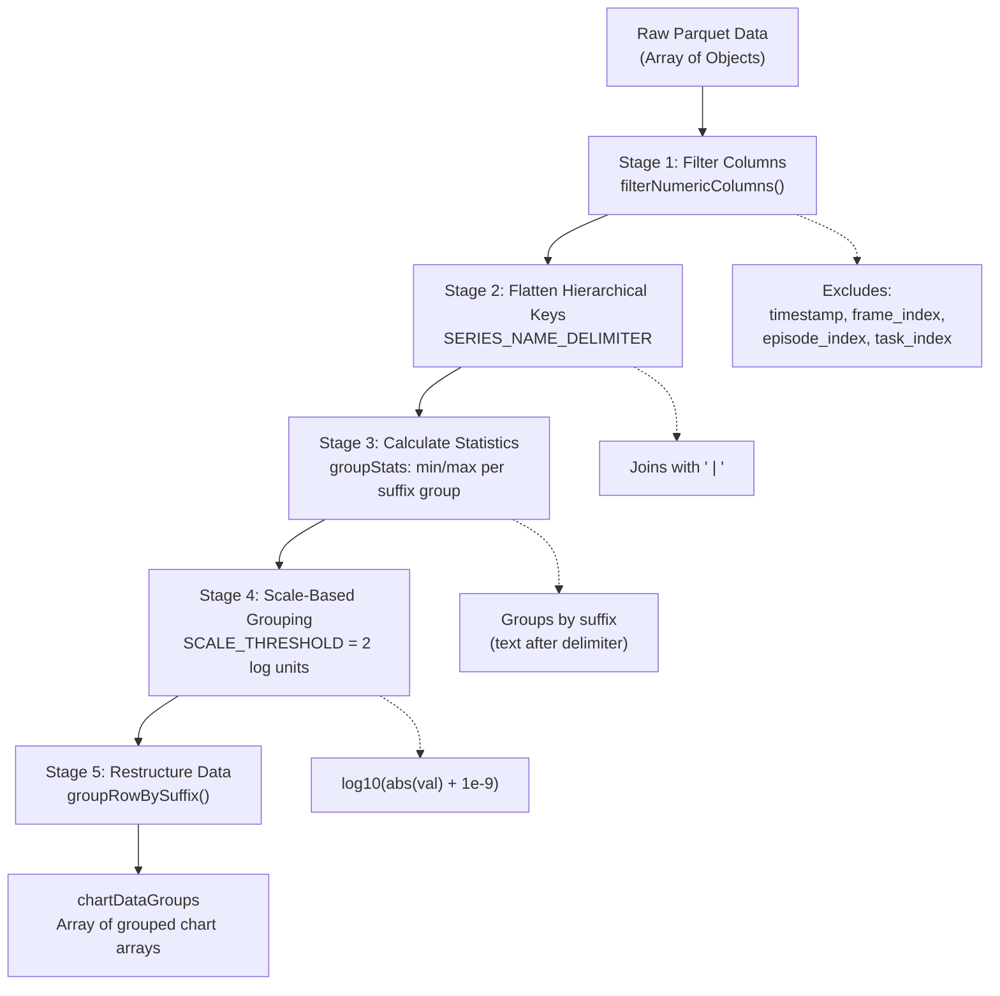
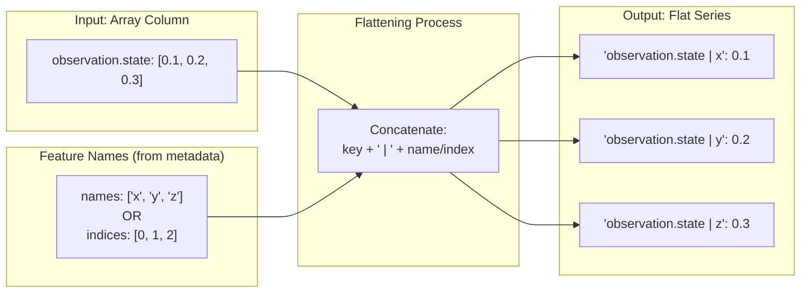
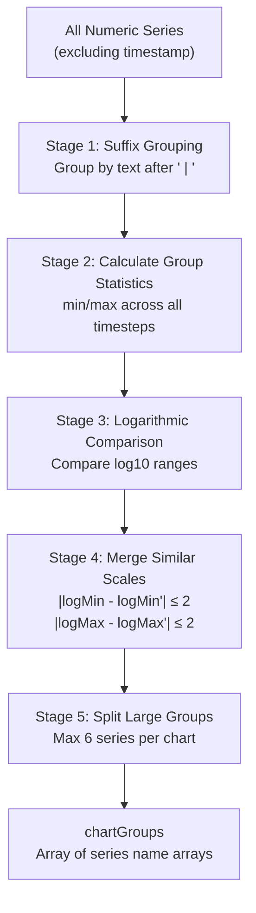
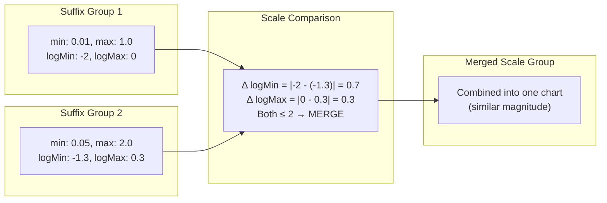
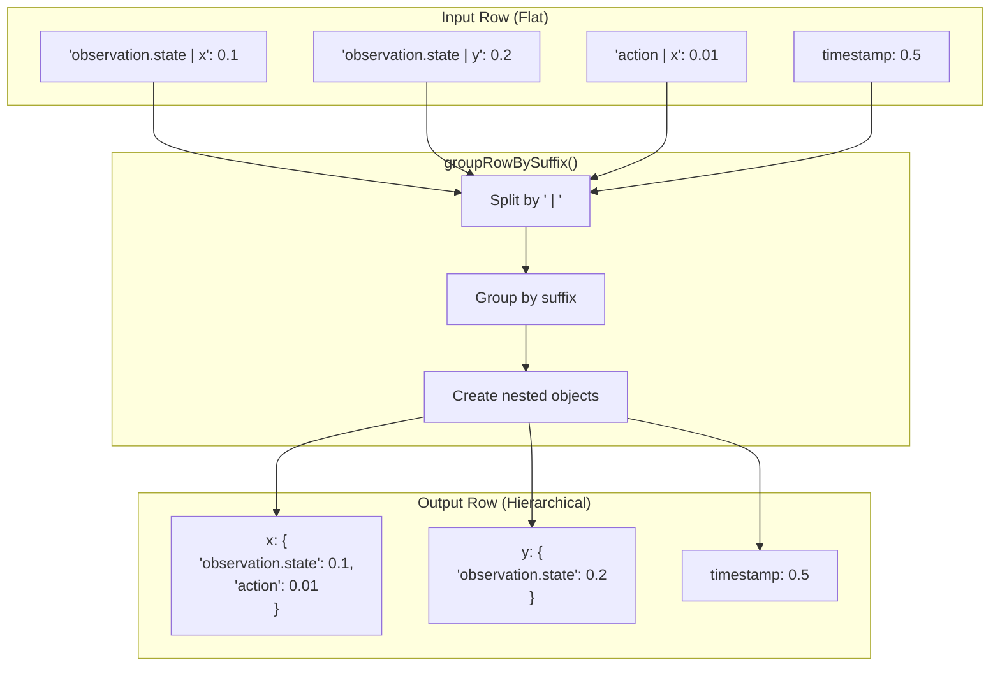
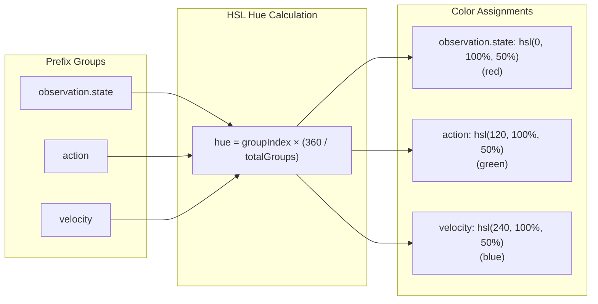
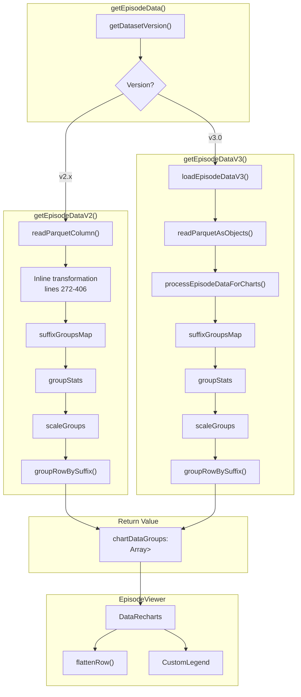

<!-- source: DeepWiki mcp.deepwiki.com · repo huggingface/lerobot-dataset-visualizer · page 3.4 Chart Data Transformation · fetched 2026-10-26 -->

# Chart Data Transformation

<details>
<summary>Relevant source files</summary>

The following files were used as context for generating this wiki page:

- [src/app/[org]/[dataset]/[episode]/fetch-data.ts](src/app/[org]/[dataset]/[episode]/fetch-data.ts)
- [src/components/data-recharts.tsx](src/components/data-recharts.tsx)

</details>


## Purpose and Scope

This document explains the sophisticated data transformation pipeline that converts raw Parquet columnar data into auto-organized, scale-grouped chart data structures ready for visualization. This transformation occurs in the [`processEpisodeDataForCharts`](src/app/[org]/[dataset]/[episode]/fetch-data.ts:583-878) function (v3.0) and inline processing within [`getEpisodeDataV2`](src/app/[org]/[dataset]/[episode]/fetch-data.ts:272-406) (v2.x).

For information about fetching and loading Parquet files, see [Parquet Data Processing](#3.3). For details on how the transformed chart data is rendered, see [Data Visualization (Charts)](#6).

**Sources:** [src/app/[org]/[dataset]/[episode]/fetch-data.ts:1-1089]()

---

## Transformation Pipeline Overview

The chart data transformation pipeline implements a multi-stage process that automatically organizes numeric data series into visually coherent groups without manual configuration.

### Pipeline Stages Diagram



**Sources:** [src/app/[org]/[dataset]/[episode]/fetch-data.ts:583-878](), [src/app/[org]/[dataset]/[episode]/fetch-data.ts:272-406]()

---

## Input Data Structure

The transformation begins with raw Parquet data loaded as an array of objects, where each object represents one timestep/frame in the episode.

### Input Format

```typescript
// Raw parquet data (from readParquetAsObjects or readParquetColumn)
[
  {
    timestamp: 0.0,
    "observation.state": [0.1, 0.2, 0.3, 0.4, 0.5, 0.6],
    action: [0.01, 0.02, 0.03, 0.04, 0.05, 0.06, 0.07],
    "next.reward": 0.0,
    "next.done": false,
    episode_index: 0,      // excluded
    frame_index: 0,        // excluded
    index: 0,              // excluded
    task_index: 0          // excluded
  },
  // ... more timesteps
]
```

### Column Filtering

The transformation identifies numeric columns suitable for charting based on `DatasetMetadata.features`:

| Filter Criterion | Description | Code Reference |
|-----------------|-------------|----------------|
| **Numeric dtype** | Must be `float32` or `int32` | [fetch-data.ts:591-596]() |
| **1D shape** | `shape.length === 1` (excludes 2D/3D data) | [fetch-data.ts:595]() |
| **Not excluded** | Not in `excludedColumns` list | [fetch-data.ts:631]() |

```typescript
// Excluded columns definition
const excludedColumns = [
  'index', 
  'task_index', 
  'episode_index', 
  'frame_index', 
  'next.done'
];
```

**Sources:** [src/app/[org]/[dataset]/[episode]/fetch-data.ts:591-655](), [src/app/[org]/[dataset]/[episode]/fetch-data.ts:147-166]()

---

## Hierarchical Key Flattening

Multi-dimensional array data is flattened into individual series with hierarchical naming using `SERIES_NAME_DELIMITER = " | "`.

### Flattening Algorithm



### Implementation Details

The flattening logic differs slightly between v2.x and v3.0 but follows the same principle:

**V2.x Implementation:**
```typescript
// Extract names from feature metadata
let column_names = info.features[key].names;
while (typeof column_names === "object") {
  if (Array.isArray(column_names)) break;
  column_names = Object.values(column_names ?? {})[0];
}

// Build flat series names
const seriesNames = Array.isArray(column_names)
  ? column_names.map((name) => `${key}${SERIES_NAME_DELIMITER}${name}`)
  : Array.from(
      { length: columnLength },
      (_, i) => `${key}${SERIES_NAME_DELIMITER}${i}`
    );
```

**V3.0 Implementation:**
Similar logic at [fetch-data.ts:640-655](), with additional handling for v3.0's numeric key mapping via `v3IndexToFeatureMap`.

**Sources:** [src/app/[org]/[dataset]/[episode]/fetch-data.ts:172-187](), [src/app/[org]/[dataset]/[episode]/fetch-data.ts:640-655](), [src/app/[org]/[dataset]/[episode]/fetch-data.ts:12]()

---

## Scale-Based Grouping Algorithm

The most sophisticated part of the transformation is automatic grouping of data series by similar scale, ensuring that related measurements appear on the same chart.

### Grouping Strategy Overview



### Stage 1: Suffix Grouping

Series are first grouped by their suffix (the part after `SERIES_NAME_DELIMITER`). This ensures that related dimensions stay together (e.g., all x/y/z components).

```typescript
// Example suffix groups
const suffixGroupsMap = {
  "x": [
    "observation.state | x",
    "action | x"
  ],
  "y": [
    "observation.state | y", 
    "action | y"
  ],
  "0": [
    "some_feature | 0"
  ]
};
```

**Implementation:** [fetch-data.ts:767-776]()

### Stage 2: Statistics Calculation

For each suffix group, calculate min/max values across all timesteps:

```typescript
const groupStats: Record<string, { min: number; max: number }> = {};

suffixGroups.forEach((group) => {
  let min = Infinity, max = -Infinity;
  for (const row of chartData) {
    for (const key of group) {
      const v = row[key];
      if (typeof v === "number" && !isNaN(v)) {
        if (v < min) min = v;
        if (v > max) max = v;
      }
    }
  }
  groupStats[group[0]] = { min, max };
});
```

**Sources:** [fetch-data.ts:779-793](), [fetch-data.ts:306-322]()

### Stage 3-4: Logarithmic Scale Comparison

Suffix groups are merged if their logarithmic ranges are within `SCALE_THRESHOLD = 2` log units:



**Implementation:**

```typescript
const SCALE_THRESHOLD = 2;

for (const group of suffixGroups) {
  const { min, max } = groupStats[groupId];
  const logMin = Math.log10(Math.abs(min) + 1e-9);
  const logMax = Math.log10(Math.abs(max) + 1e-9);
  
  // Find other groups with similar scale
  for (const other of suffixGroups) {
    const { min: omin, max: omax } = groupStats[otherId];
    const ologMin = Math.log10(Math.abs(omin) + 1e-9);
    const ologMax = Math.log10(Math.abs(omax) + 1e-9);
    
    if (
      Math.abs(logMin - ologMin) <= SCALE_THRESHOLD &&
      Math.abs(logMax - ologMax) <= SCALE_THRESHOLD
    ) {
      // Merge into same scale group
      unit.push(other);
    }
  }
}
```

**Why logarithmic comparison?** This ensures that data with similar orders of magnitude are grouped together (e.g., values in range [0.01-1.0] group with [0.05-2.0], but not with [100-1000]).

**Sources:** [fetch-data.ts:795-824](), [fetch-data.ts:324-353]()

### Stage 5: Size-Based Splitting

Scale groups larger than 6 series are split into multiple charts to prevent overcrowding:

```typescript
const chartGroups: string[][] = Object.values(scaleGroups)
  .sort((a, b) => b.length - a.length)  // Largest groups first
  .flatMap((suffixGroupArr) => {
    const merged = suffixGroupArr.flat();
    if (merged.length > 6) {
      // Split into chunks of 6
      const subgroups: string[][] = [];
      for (let i = 0; i < merged.length; i += 6) {
        subgroups.push(merged.slice(i, i + 6));
      }
      return subgroups;
    }
    return [merged];
  });
```

**Sources:** [fetch-data.ts:826-839](), [fetch-data.ts:356-369]()

---

## Data Restructuring with groupRowBySuffix

After grouping is determined, the actual chart data is restructured to create a hierarchical format for the charting library.

### Restructuring Algorithm

The `groupRowBySuffix` function converts flat series names back into nested objects when multiple series share a prefix:



### Implementation

```typescript
function groupRowBySuffix(row: Record<string, number>): Record<string, any> {
  const result: Record<string, any> = {};
  const suffixGroups: Record<string, Record<string, number>> = {};
  
  for (const [key, value] of Object.entries(row)) {
    if (key === "timestamp") {
      result["timestamp"] = value;
      continue;
    }
    
    const parts = key.split(SERIES_NAME_DELIMITER);
    if (parts.length === 2) {
      const [prefix, suffix] = parts;
      if (!suffixGroups[suffix]) suffixGroups[suffix] = {};
      suffixGroups[suffix][prefix] = value;
    } else {
      result[key] = value;
    }
  }
  
  // Convert suffix groups to nested or flat structure
  for (const [suffix, group] of Object.entries(suffixGroups)) {
    const keys = Object.keys(group);
    if (keys.length === 1) {
      // Single series: use full name
      const fullName = `${keys[0]}${SERIES_NAME_DELIMITER}${suffix}`;
      result[fullName] = group[keys[0]];
    } else {
      // Multiple series: create nested object
      result[suffix] = group;
    }
  }
  
  return result;
}
```

This restructuring makes the chart data more intuitive for the visualization layer, where nested objects can be displayed with hierarchical legends.

**Sources:** [fetch-data.ts:842-870](), [fetch-data.ts:374-402]()

---

## Output Data Structure

The final output is an array of chart data groups, where each group represents one chart visualization.

### Output Format Specification

```typescript
type ChartDataGroups = Array<Array<ChartDataPoint>>;

type ChartDataPoint = {
  timestamp: number;
  // Flat series
  [seriesName: string]: number;
  // OR nested series
  [suffix: string]: {
    [prefix: string]: number;
  };
};
```

### Example Output

```javascript
chartDataGroups = [
  // Chart 1: Position data (similar scale)
  [
    {
      timestamp: 0.0,
      x: {
        "observation.state": 0.1,
        "action": 0.01
      },
      y: {
        "observation.state": 0.2,
        "action": 0.02
      }
    },
    // ... more timesteps
  ],
  
  // Chart 2: Velocity data (different scale)
  [
    {
      timestamp: 0.0,
      "velocity | x": 1.5,
      "velocity | y": 2.0
    },
    // ... more timesteps
  ]
];
```

### Return Value Integration

```typescript
return {
  datasetInfo,
  episodeId,
  videosInfo,
  chartDataGroups,  // ← Chart data transformation output
  episodes,
  ignoredColumns,
  duration,
  task,
};
```

**Sources:** [fetch-data.ts:872-874](), [fetch-data.ts:404-406](), [fetch-data.ts:408-417]()

---

## Color Assignment Strategy

Colors are assigned per prefix group (the part before `SERIES_NAME_DELIMITER`) using HSL hue distribution to maximize visual distinction.

### Color Mapping System



### Implementation in DataRecharts

The color assignment is actually performed in the visualization component, not during transformation:

```typescript
// In DataRecharts component
const allGroups = [...Object.keys(groups), ...singles];
const groupColorMap: Record<string, string> = {};

allGroups.forEach((group, idx) => {
  groupColorMap[group] = `hsl(${idx * (360 / allGroups.length)}, 100%, 50%)`;
});
```

All series within the same prefix group share the same hue, with variations indicated by dash patterns (solid line for first series, dashed for subsequent).

**Sources:** [src/components/data-recharts.tsx:115-119](), [src/components/data-recharts.tsx:308-316]()

---

## Version-Specific Considerations

While the core algorithm is shared, there are key differences between v2.x and v3.0 implementations.

### Comparison Table

| Aspect | V2.x | V3.0 |
|--------|------|------|
| **Location** | Inline in `getEpisodeDataV2` | Separate `processEpisodeDataForCharts` function |
| **Column extraction** | `readParquetColumn` with specific names | `readParquetAsObjects` with all columns |
| **Key mapping** | Direct feature names | Numeric keys mapped via `v3IndexToFeatureMap` |
| **Timestamp generation** | Uses actual `timestamp` column | Calculated from index: `(index / length) × duration` |
| **Video alignment** | Not applicable | Aligned with segmented video duration |

### V2.x Timestamp Handling

```typescript
// V2.x: timestamp comes directly from data
const seriesNames = [
  "timestamp",
  ...columns.map(({ value }) => value).flat(),
];
```

### V3.0 Timestamp Calculation

```typescript
// V3.0: timestamp calculated to align with video segments
obj["timestamp"] = (index / Math.max(episodeData.length - 1, 1)) * videoDuration;

// Where videoDuration comes from episode metadata
const videoDuration = 
  (episodeMetadata.video_to_timestamp || 30) - 
  (episodeMetadata.video_from_timestamp || 0);
```

This ensures that chart timestamps match video playback timestamps when videos are segmented.

**Sources:** [fetch-data.ts:701-712](), [fetch-data.ts:271-285]()

---

## Ignored Columns

Columns that are not suitable for charting are tracked in `ignoredColumns`:

```typescript
// V3.0 implementation
const ignoredColumns = [
  ...Object.entries(info.features)
    .filter(([, value]) =>
      ["float32", "int32"].includes(value.dtype) && 
      value.shape.length > 2  // 3D+ arrays
    )
    .map(([key]) => key),
  ...excludedColumns  // Manually excluded
];
```

These columns are excluded from charts but may still be accessed programmatically (e.g., `task_index` for task lookup).

**Sources:** [fetch-data.ts:756-764](), [fetch-data.ts:288-293]()

---

## Processing Flow: Code-to-Code Diagram



**Sources:** [src/app/[org]/[dataset]/[episode]/fetch-data.ts:14-40](), [src/app/[org]/[dataset]/[episode]/fetch-data.ts:103-418](), [src/app/[org]/[dataset]/[episode]/fetch-data.ts:421-461](), [src/components/data-recharts.tsx:25-51]()

---

