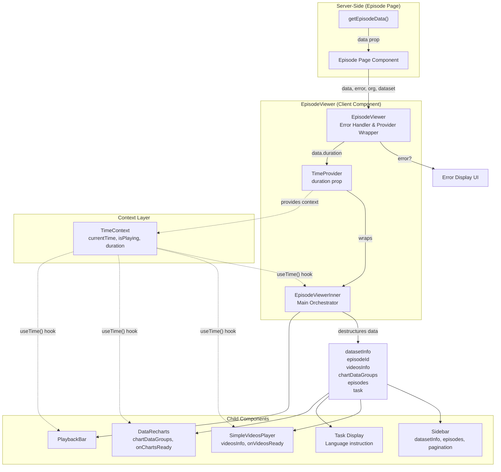
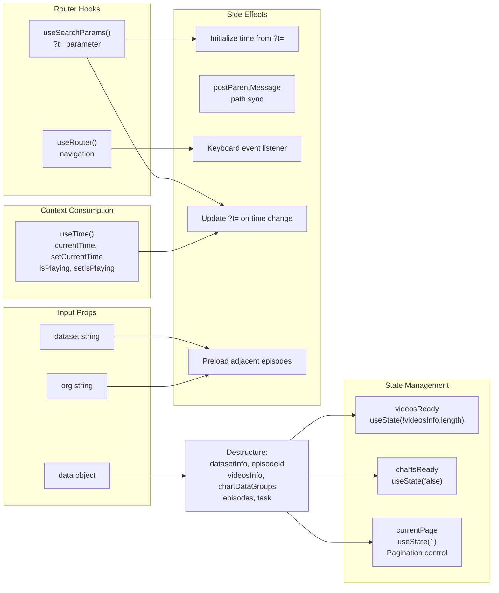
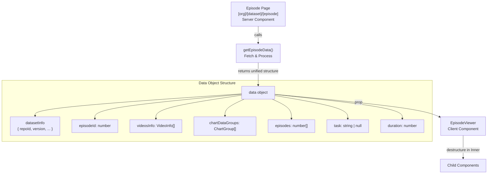
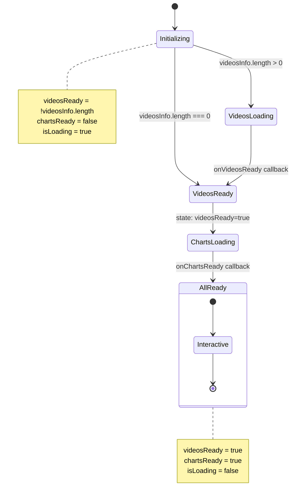
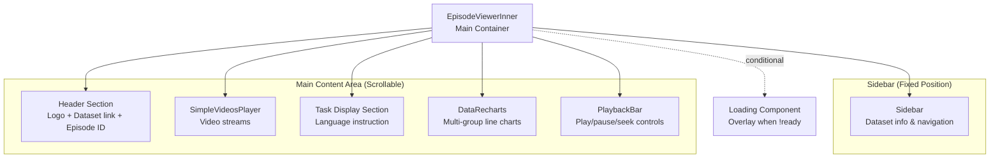
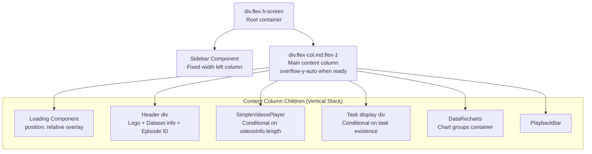
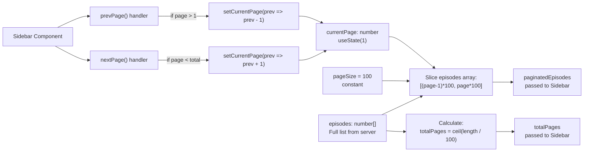
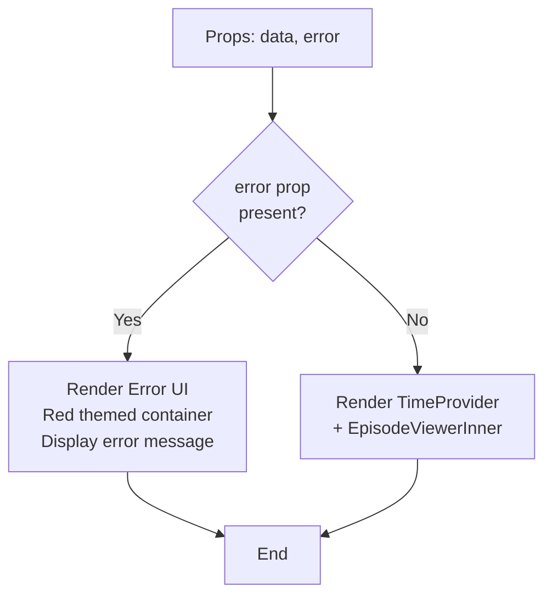

<!-- source: DeepWiki mcp.deepwiki.com · repo huggingface/lerobot-dataset-visualizer · page 4 Episode Viewer Component · fetched 2026-10-26 -->

# Episode Viewer Component

<details>
<summary>Relevant source files</summary>

The following files were used as context for generating this wiki page:

- [src/app/[org]/[dataset]/[episode]/episode-viewer.tsx](src/app/[org]/[dataset]/[episode]/episode-viewer.tsx)
- [src/context/time-context.tsx](src/context/time-context.tsx)

</details>


## Purpose and Scope

The `EpisodeViewer` component is the main UI orchestrator for episode visualization, coordinating the rendering and synchronization of videos, charts, navigation controls, and metadata display. It serves as the bridge between server-side data fetching and client-side interactive visualization, managing component lifecycle, state, and user interactions.

This document covers the component's architecture, data flow, and coordination responsibilities. For detailed information about:
- Internal state management and lifecycle patterns, see [State Management and Lifecycle](#4.1)
- User interactions and keyboard shortcuts, see [User Interactions and Navigation](#4.2)
- Time synchronization mechanisms, see [Time Synchronization System](#7)
- Server-side data fetching, see [Episode Data Fetching System](#3.1)

**Sources:** [src/app/[org]/[dataset]/[episode]/episode-viewer.tsx:1-261]()

---

## Component Architecture

The `EpisodeViewer` implements a two-tier architecture separating concerns between time context provision and UI orchestration.



### Outer Wrapper: EpisodeViewer

The outer `EpisodeViewer` function [src/app/[org]/[dataset]/[episode]/episode-viewer.tsx:14-40]() serves as a lightweight error handler and context provider wrapper:

| Responsibility | Implementation |
|----------------|----------------|
| **Error Handling** | Displays formatted error UI when `error` prop is present [line 25-34]() |
| **Context Provision** | Wraps `EpisodeViewerInner` with `TimeProvider` initialized with `data.duration` [line 36]() |
| **Props Interface** | Accepts `data`, `error`, `org`, `dataset` from server-side page component [line 14-24]() |

### Inner Component: EpisodeViewerInner

The `EpisodeViewerInner` function [src/app/[org]/[dataset]/[episode]/episode-viewer.tsx:42-260]() contains all orchestration logic:



**Sources:** [src/app/[org]/[dataset]/[episode]/episode-viewer.tsx:14-260]()

---

## Data Flow and Props

### Server-to-Client Data Pipeline



The data object passed from the server-side page component contains these key properties [src/app/[org]/[dataset]/[episode]/episode-viewer.tsx:43-50]():

| Property | Type | Purpose |
|----------|------|---------|
| `datasetInfo` | Object | Repository metadata including `repoId`, `version` |
| `episodeId` | number | Current episode identifier |
| `videosInfo` | Array | Video URLs, timestamps, and camera metadata |
| `chartDataGroups` | Array | Processed chart data groups with auto-scaling |
| `episodes` | Array | Complete list of episode IDs for navigation |
| `task` | string \| null | Language instruction for the episode |
| `duration` | number | Episode duration in seconds (used for TimeProvider) |

**Sources:** [src/app/[org]/[dataset]/[episode]/episode-viewer.tsx:42-50]()

---

## Component Readiness System

The component uses a dual-readiness state pattern to coordinate asynchronous loading of videos and charts, displaying a loading overlay until both are ready.



### Implementation Details

The readiness logic [src/app/[org]/[dataset]/[episode]/episode-viewer.tsx:52-54]():

```typescript
const [videosReady, setVideosReady] = useState(!videosInfo.length);
const [chartsReady, setChartsReady] = useState(false);
const isLoading = !videosReady || !chartsReady;
```

Key behaviors:
- **Videos readiness**: Initialized to `true` if no videos exist (`!videosInfo.length`), otherwise `false` until `onVideosReady` callback fires [line 225-229]()
- **Charts readiness**: Always starts `false`, set to `true` via `onChartsReady` callback [line 249-252]()
- **Loading overlay**: Displayed when `isLoading` is `true` [line 194](), also prevents scrolling by setting `overflow-hidden` [line 192]()

**Sources:** [src/app/[org]/[dataset]/[episode]/episode-viewer.tsx:52-54, 192-194, 224-254]()

---

## Child Component Coordination

The `EpisodeViewerInner` orchestrates five primary child components, each receiving specific data props and callbacks.

### Component Rendering Structure



### Props Mapping

| Component | Props Passed | Purpose | Location |
|-----------|-------------|---------|----------|
| **Sidebar** | `datasetInfo`, `paginatedEpisodes`, `episodeId`, `totalPages`, `currentPage`, `prevPage`, `nextPage` | Display dataset metadata and episode navigation with pagination | [line 180-188]() |
| **SimpleVideosPlayer** | `videosInfo`, `onVideosReady` | Render video streams with readiness callback | [line 225-228]() |
| **Task Display** | `task` (conditional) | Show language instruction if present | [line 232-245]() |
| **DataRecharts** | `chartDataGroups`, `onChartsReady` | Render synchronized line charts with readiness callback | [line 249-252]() |
| **PlaybackBar** | (uses TimeContext) | Provide playback controls | [line 256]() |
| **Loading** | (conditional on `isLoading`) | Show loading overlay | [line 194]() |

**Sources:** [src/app/[org]/[dataset]/[episode]/episode-viewer.tsx:178-258]()

---

## Layout Structure

The component implements a two-column flex layout with a fixed sidebar and scrollable main content area.

### DOM Hierarchy



### CSS Classes and Responsive Behavior

[src/app/[org]/[dataset]/[episode]/episode-viewer.tsx:178-258]()

| Element | Classes | Behavior |
|---------|---------|----------|
| Root container | `flex h-screen max-h-screen bg-slate-950 text-gray-200` | Full viewport height, dark theme |
| Content column | `flex max-h-screen flex-col gap-4 p-4 md:flex-1 relative` | Flexible width on medium+ screens, vertical flex, 1rem gap |
| Overflow control | `overflow-hidden` when loading, `overflow-y-auto` when ready | Prevents scroll during loading, enables after |
| Task display | `mb-6 p-4 bg-slate-800 rounded-lg border border-slate-600` | Distinct container for language instruction |

**Sources:** [src/app/[org]/[dataset]/[episode]/episode-viewer.tsx:178-258]()

---

## Context Integration

### TimeProvider Wrapping Pattern

The outer `EpisodeViewer` wraps the inner component with `TimeProvider` [src/app/[org]/[dataset]/[episode]/episode-viewer.tsx:36-38]():

```typescript
<TimeProvider duration={data.duration}>
  <EpisodeViewerInner data={data} org={org} dataset={dataset} />
</TimeProvider>
```

This pattern ensures all descendants have access to synchronized time state via the `useTime()` hook. The `duration` prop from the data object initializes the global duration state.

### Time Context Consumption

The inner component consumes time context [src/app/[org]/[dataset]/[episode]/episode-viewer.tsx:61]():

```typescript
const { currentTime, setCurrentTime, setIsPlaying, isPlaying } = useTime();
```

These values are used for:
- **Reading current time** for URL parameter updates [line 126]()
- **Setting time** from URL `?t=` parameter on mount [line 94]()
- **Toggling playback** via keyboard shortcut (spacebar) [line 148]()

For detailed time synchronization patterns across components, see [Time Synchronization System](#7).

**Sources:** [src/app/[org]/[dataset]/[episode]/episode-viewer.tsx:36-38, 61](), [src/context/time-context.tsx:1-65]()

---

## Pagination System

The component implements client-side pagination for large episode lists to improve sidebar rendering performance.



### Implementation

[src/app/[org]/[dataset]/[episode]/episode-viewer.tsx:64-70, 164-175]()

```typescript
const pageSize = 100;
const [currentPage, setCurrentPage] = useState(1);
const totalPages = Math.ceil(episodes.length / pageSize);
const paginatedEpisodes = episodes.slice(
  (currentPage - 1) * pageSize,
  currentPage * pageSize,
);

const nextPage = () => {
  if (currentPage < totalPages) {
    setCurrentPage((prev) => prev + 1);
  }
};

const prevPage = () => {
  if (currentPage > 1) {
    setCurrentPage((prev) => prev - 1);
  }
};
```

The component also automatically sets the correct page when the episode changes [src/app/[org]/[dataset]/[episode]/episode-viewer.tsx:108-113]():

```typescript
useEffect(() => {
  const episodeIndex = episodes.indexOf(episodeId);
  if (episodeIndex !== -1) {
    setCurrentPage(Math.floor(episodeIndex / pageSize) + 1);
  }
}, [episodes, episodeId, pageSize]);
```

**Sources:** [src/app/[org]/[dataset]/[episode]/episode-viewer.tsx:64-70, 108-113, 164-175]()

---

## Performance Optimizations

### Adjacent Episode Preloading

The component proactively preloads video metadata for adjacent episodes to enable smoother navigation [src/app/[org]/[dataset]/[episode]/episode-viewer.tsx:72-86]():

```typescript
useEffect(() => {
  if (!org || !dataset) return;
  
  const preloadAdjacent = async () => {
    try {
      await getAdjacentEpisodesVideoInfo(org, dataset, episodeId, 2);
      // Preload adjacent episodes for smoother navigation
    } catch {
      // Skip preloading on error
    }
  };
  
  preloadAdjacent();
}, [org, dataset, episodeId]);
```

This uses the `getAdjacentEpisodesVideoInfo` function [src/app/[org]/[dataset]/[episode]/episode-viewer.tsx:12]() which fetches and caches video metadata for the `N` episodes before and after the current episode.

### Conditional Rendering

The videos section only renders when videos exist [src/app/[org]/[dataset]/[episode]/episode-viewer.tsx:224-229]():

```typescript
{videosInfo.length && (
  <SimpleVideosPlayer
    videosInfo={videosInfo}
    onVideosReady={() => setVideosReady(true)}
  />
)}
```

This avoids unnecessary component mounting for datasets without video data.

**Sources:** [src/app/[org]/[dataset]/[episode]/episode-viewer.tsx:12, 72-86, 224-229]()

---

## Error Handling

The outer `EpisodeViewer` implements a dedicated error UI for server-side fetch failures [src/app/[org]/[dataset]/[episode]/episode-viewer.tsx:25-34]():



### Error UI Structure

```html
<div class="flex h-screen items-center justify-center bg-slate-950 text-red-400">
  <div class="max-w-xl p-8 rounded bg-slate-900 border border-red-500 shadow-lg">
    <h2>Something went wrong</h2>
    <p class="font-mono whitespace-pre-wrap">{error}</p>
  </div>
</div>
```

The error message is displayed in a monospace font with preserved whitespace, suitable for technical error details like stack traces or validation errors.

**Sources:** [src/app/[org]/[dataset]/[episode]/episode-viewer.tsx:25-34]()

---

## Related Components and Systems

The `EpisodeViewer` serves as the integration point for multiple specialized subsystems:

| Subsystem | Related Documentation | Integration Point |
|-----------|----------------------|-------------------|
| State Management | [State Management and Lifecycle](#4.1) | Readiness states, URL sync, lifecycle hooks |
| User Interactions | [User Interactions and Navigation](#4.2) | Keyboard shortcuts, parent window communication |
| Video Playback | [Video Playback System](#5) | `SimpleVideosPlayer` component prop |
| Chart Visualization | [Data Visualization (Charts)](#6) | `DataRecharts` component prop |
| Time Synchronization | [Time Synchronization System](#7) | `TimeProvider` wrapper and `useTime()` hook |
| Navigation Controls | [Sidebar Navigation](#8.1), [Playback Controls](#8.2) | `Sidebar` and `PlaybackBar` components |

**Sources:** [src/app/[org]/[dataset]/[episode]/episode-viewer.tsx:1-261]()

---

