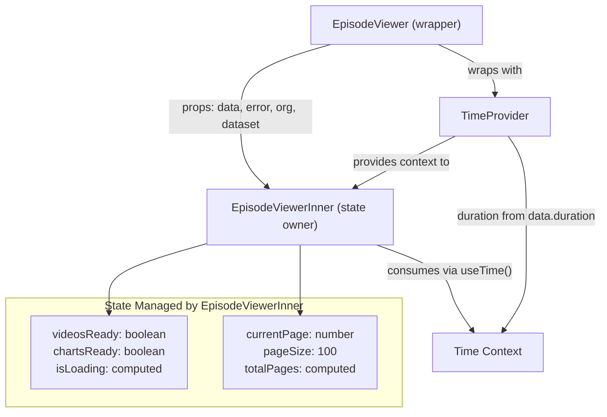
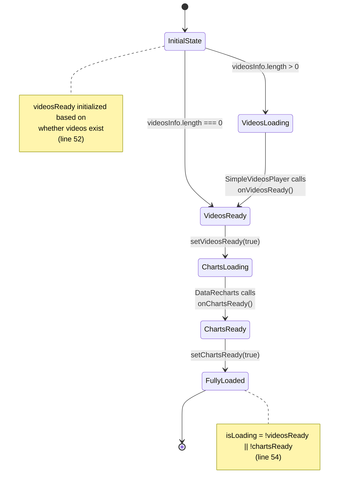
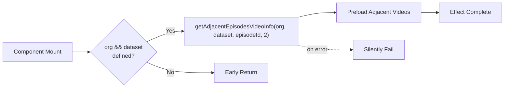
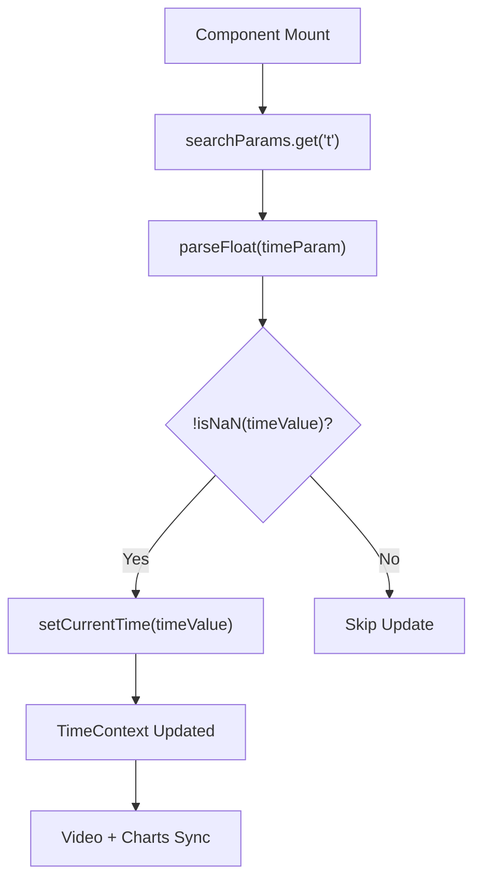
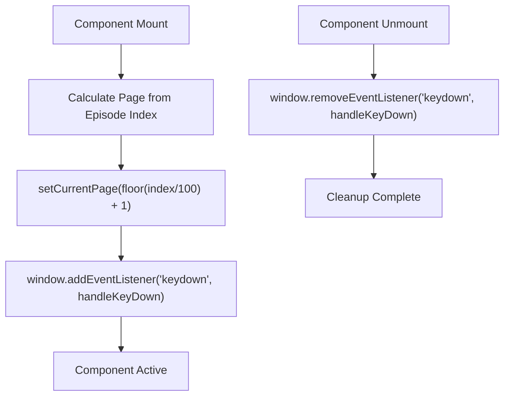
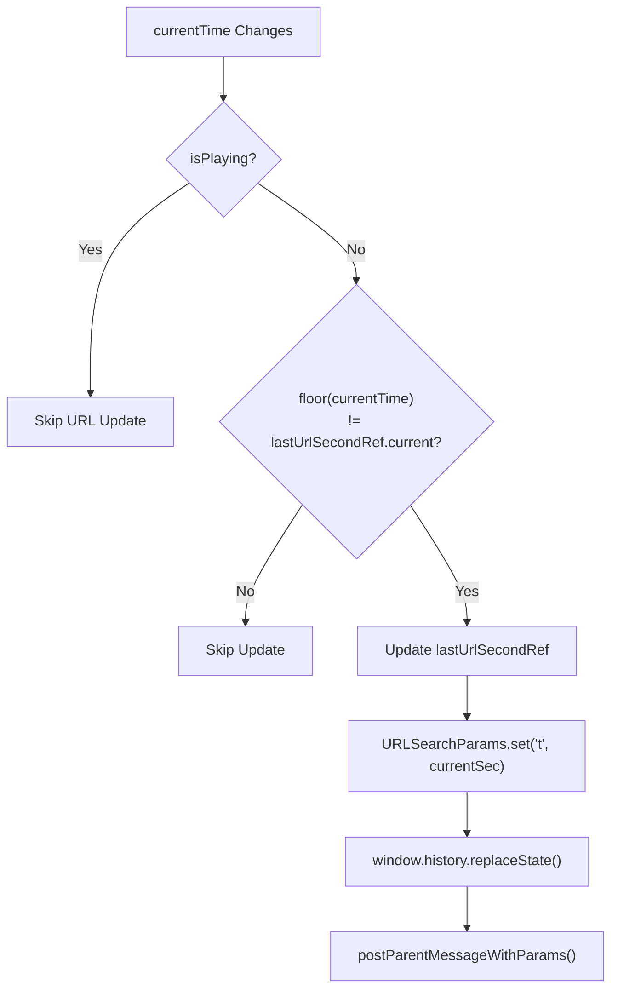
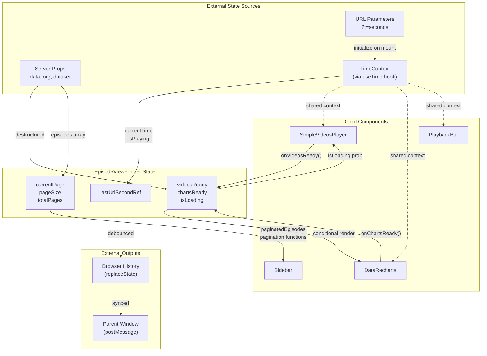
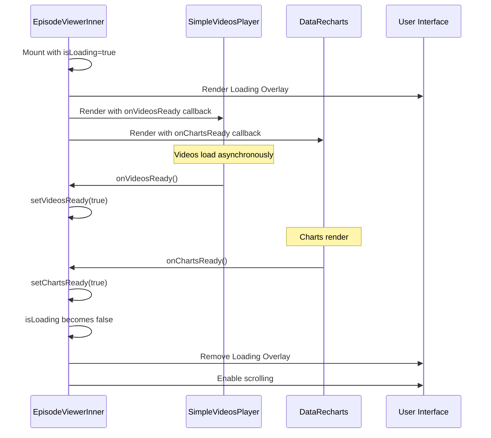

<!-- source: DeepWiki mcp.deepwiki.com · repo huggingface/lerobot-dataset-visualizer · page 4.1 State Management and Lifecycle · fetched 2026-10-26 -->

# State Management and Lifecycle

<details>
<summary>Relevant source files</summary>

The following files were used as context for generating this wiki page:

- [src/app/[org]/[dataset]/[episode]/episode-viewer.tsx](src/app/[org]/[dataset]/[episode]/episode-viewer.tsx)

</details>


## Purpose and Scope

This document explains how the `EpisodeViewer` component manages internal state and coordinates its lifecycle through React hooks. It covers loading state tracking, readiness callbacks for child components, and the various `useEffect` hooks that handle initialization, URL synchronization, keyboard events, and adjacent episode preloading.

For information about user interactions like keyboard shortcuts and pagination controls, see [User Interactions and Navigation](#4.2). For details on how the `TimeContext` provides synchronized playback state, see [TimeContext Provider and Hook](#7.1).

**Sources:** [src/app/[org]/[dataset]/[episode]/episode-viewer.tsx:1-261]()

---

## Component Structure and State Ownership

The `EpisodeViewer` is implemented as two nested components with distinct responsibilities:



**Sources:** [src/app/[org]/[dataset]/[episode]/episode-viewer.tsx:14-40](), [src/app/[org]/[dataset]/[episode]/episode-viewer.tsx:42-51]()

### EpisodeViewer (Wrapper Component)

The outer `EpisodeViewer` component handles error states and wraps the inner component with the `TimeProvider`:

| Responsibility | Implementation |
|----------------|----------------|
| Error Handling | Renders error UI if `error` prop is present [episode-viewer.tsx:25-34]() |
| Context Setup | Wraps `EpisodeViewerInner` with `TimeProvider`, passing `data.duration` [episode-viewer.tsx:36-38]() |
| Prop Forwarding | Passes `data`, `org`, `dataset` props to inner component [episode-viewer.tsx:37]() |

**Sources:** [src/app/[org]/[dataset]/[episode]/episode-viewer.tsx:14-40]()

### EpisodeViewerInner (State Owner)

The `EpisodeViewerInner` component owns all local state and manages the component lifecycle:

```typescript
const [videosReady, setVideosReady] = useState(!videosInfo.length);
const [chartsReady, setChartsReady] = useState(false);
const isLoading = !videosReady || !chartsReady;

const [currentPage, setCurrentPage] = useState(1);
```

**Sources:** [src/app/[org]/[dataset]/[episode]/episode-viewer.tsx:42-70]()

---

## Loading State Management

The component tracks readiness of asynchronous child components using a **callback pattern**, where children notify the parent when they complete initialization.

### Loading State Diagram



**Sources:** [src/app/[org]/[dataset]/[episode]/episode-viewer.tsx:52-54]()

### State Variables

| State Variable | Initial Value | Purpose | Updated By |
|----------------|---------------|---------|------------|
| `videosReady` | `!videosInfo.length` | Tracks video player initialization | `SimpleVideosPlayer` via `onVideosReady` callback [episode-viewer.tsx:227]() |
| `chartsReady` | `false` | Tracks chart rendering completion | `DataRecharts` via `onChartsReady` callback [episode-viewer.tsx:251]() |
| `isLoading` | Computed | Derived state: `!videosReady \|\| !chartsReady` | N/A (computed) [episode-viewer.tsx:54]() |

**Special Case**: If `videosInfo.length === 0`, `videosReady` is initialized to `true` because there are no videos to wait for [episode-viewer.tsx:52]().

**Sources:** [src/app/[org]/[dataset]/[episode]/episode-viewer.tsx:52-54](), [src/app/[org]/[dataset]/[episode]/episode-viewer.tsx:224-229](), [src/app/[org]/[dataset]/[episode]/episode-viewer.tsx:248-252]()

### Loading UI

When `isLoading` is `true`, the component:
1. Renders a `<Loading />` overlay [episode-viewer.tsx:194]()
2. Applies `overflow-hidden` CSS class to prevent scrolling [episode-viewer.tsx:192]()

Once both child components signal readiness, the loading overlay disappears and the UI becomes interactive.

**Sources:** [src/app/[org]/[dataset]/[episode]/episode-viewer.tsx:191-194]()

---

## Time State Integration

The component consumes time-related state from `TimeContext` using the `useTime` hook but does **not own** this state. Time state management is documented in [TimeContext Provider and Hook](#7.1).

### Consumed Time State

```typescript
const { currentTime, setCurrentTime, setIsPlaying, isPlaying } = useTime();
```

| Property | Type | Usage |
|----------|------|-------|
| `currentTime` | `number` | Used for URL sync [episode-viewer.tsx:125-126]() |
| `setCurrentTime` | `(time: number) => void` | Called on URL parameter initialization [episode-viewer.tsx:94]() |
| `isPlaying` | `boolean` | Checked before URL updates [episode-viewer.tsx:124](), toggled by spacebar [episode-viewer.tsx:148]() |
| `setIsPlaying` | `(playing: boolean) => void` | Called by keyboard handler [episode-viewer.tsx:148]() |

**Sources:** [src/app/[org]/[dataset]/[episode]/episode-viewer.tsx:61]()

---

## Pagination State Management

The component manages pagination of the episode list to avoid rendering hundreds of episode links simultaneously.

### Pagination State Variables

```typescript
const pageSize = 100;
const [currentPage, setCurrentPage] = useState(1);
const totalPages = Math.ceil(episodes.length / pageSize);
const paginatedEpisodes = episodes.slice(
  (currentPage - 1) * pageSize,
  currentPage * pageSize,
);
```

| Variable | Type | Purpose |
|----------|------|---------|
| `pageSize` | `number` (constant: 100) | Number of episodes per page [episode-viewer.tsx:64]() |
| `currentPage` | `number` (state) | Current page index (1-based) [episode-viewer.tsx:65]() |
| `totalPages` | `number` (computed) | Total number of pages [episode-viewer.tsx:66]() |
| `paginatedEpisodes` | `number[]` (computed) | Sliced array of episode IDs for current page [episode-viewer.tsx:67-70]() |

**Sources:** [src/app/[org]/[dataset]/[episode]/episode-viewer.tsx:64-70]()

### Pagination Functions

The component provides navigation functions passed to the `Sidebar` component:

```typescript
const nextPage = () => {
  if (currentPage < totalPages) {
    setCurrentPage((prev) => prev + 1);
  }
};

const prevPage = () => {
  if (currentPage > 1) {
    setCurrentPage((prev) => prev - 1);
  }
};
```

These functions are passed as props to `Sidebar` [episode-viewer.tsx:180-188]() and are invoked by pagination controls documented in [Sidebar Navigation](#8.1).

**Sources:** [src/app/[org]/[dataset]/[episode]/episode-viewer.tsx:165-175]()

---

## Lifecycle Management with useEffect Hooks

The component uses **six separate `useEffect` hooks** to manage different aspects of its lifecycle. This separation follows React best practices by isolating concerns with distinct dependencies.

### Effect 1: Adjacent Episode Preloading



**Purpose**: Preload video metadata for adjacent episodes (±2 range) to enable instant navigation.

**Dependencies**: `[org, dataset, episodeId]`

**Behavior**:
- Calls `getAdjacentEpisodesVideoInfo` with a range of 2 episodes [episode-viewer.tsx:78]()
- Errors are caught and ignored [episode-viewer.tsx:80-82]()
- Does not update component state (fire-and-forget pattern)

**Sources:** [src/app/[org]/[dataset]/[episode]/episode-viewer.tsx:73-86]()

---

### Effect 2: URL Time Parameter Initialization



**Purpose**: Initialize playback position from URL query parameter `?t=<seconds>`.

**Dependencies**: `[]` (empty - runs once on mount)

**Note**: While the effect has no dependencies listed, it references `searchParams` and `setCurrentTime`. The empty dependency array means this only runs once on mount, reading the initial URL state [episode-viewer.tsx:89-97]().

**Sources:** [src/app/[org]/[dataset]/[episode]/episode-viewer.tsx:88-97]()

---

### Effect 3: Parent Window Communication (Initial)

```typescript
useEffect(() => {
  postParentMessageWithParams((params: URLSearchParams) => {
    params.set("path", window.location.pathname + window.location.search);
  });
}, []);
```

**Purpose**: Notify parent window (HuggingFace Spaces iframe) of current path on mount.

**Dependencies**: `[]` (runs once)

**Behavior**: Uses `postMessage` API to synchronize the iframe URL with the parent window, documented in [User Interactions and Navigation](#4.2).

**Sources:** [src/app/[org]/[dataset]/[episode]/episode-viewer.tsx:99-104]()

---

### Effect 4: Pagination & Keyboard Event Setup



**Purpose**: Initialize the current page based on the active episode and set up keyboard event listeners.

**Dependencies**: `[episodes, episodeId, pageSize, searchParams]`

**Behavior**:
1. Finds the index of `episodeId` in the `episodes` array [episode-viewer.tsx:109]()
2. Calculates the page containing that episode [episode-viewer.tsx:111]()
3. Attaches global `keydown` event listener [episode-viewer.tsx:115]()
4. Returns cleanup function to remove listener [episode-viewer.tsx:116-118]()

**Sources:** [src/app/[org]/[dataset]/[episode]/episode-viewer.tsx:106-119]()

---

### Effect 5: URL State Synchronization

This is the most complex effect, handling bidirectional URL synchronization:



**Purpose**: Keep URL `?t=` parameter synchronized with `currentTime`, but only when:
1. Playback is paused (`!isPlaying`) [episode-viewer.tsx:124]()
2. The integer second has changed [episode-viewer.tsx:125-126]()
3. Time is greater than 0 [episode-viewer.tsx:126]()

**Dependencies**: `[isPlaying, currentTime, searchParams]`

**Optimization Strategy**: Uses a `useRef` to track the last URL-updated second (`lastUrlSecondRef`) [episode-viewer.tsx:122](). This prevents excessive URL updates when `currentTime` updates at 60fps during scrubbing.

**URL Update Method**: Uses `window.history.replaceState()` instead of `pushState()` to avoid polluting browser history [episode-viewer.tsx:131-135]().

**Sources:** [src/app/[org]/[dataset]/[episode]/episode-viewer.tsx:121-140]()

---

## State Flow Diagram

This diagram illustrates how state flows between the component, its children, and external systems:



**Sources:** [src/app/[org]/[dataset]/[episode]/episode-viewer.tsx:42-260]()

---

## State Initialization Summary

| State | Initialization Strategy | Rationale |
|-------|------------------------|-----------|
| `videosReady` | `!videosInfo.length` | If no videos exist, consider "ready" immediately [episode-viewer.tsx:52]() |
| `chartsReady` | `false` | Charts always require async rendering [episode-viewer.tsx:53]() |
| `currentPage` | `1` | Default to first page, corrected by Effect 4 [episode-viewer.tsx:65]() |
| `currentTime` | Set by `TimeProvider` | Initialized from `data.duration` in wrapper component [episode-viewer.tsx:36]() |
| `lastUrlSecondRef` | `-1` | Sentinel value ensures first update always occurs [episode-viewer.tsx:122]() |

**Sources:** [src/app/[org]/[dataset]/[episode]/episode-viewer.tsx:52-65](), [src/app/[org]/[dataset]/[episode]/episode-viewer.tsx:122]()

---

## Readiness Callback Pattern

The component uses a **callback-based coordination pattern** to track child component readiness:



**Advantages of this pattern**:
- **Explicit coordination**: Parent knows exactly when children are ready
- **Type-safe**: Callbacks have clear signatures
- **Non-blocking**: Children load independently
- **Simple state**: Boolean flags instead of complex promises

**Sources:** [src/app/[org]/[dataset]/[episode]/episode-viewer.tsx:52-54](), [src/app/[org]/[dataset]/[episode]/episode-viewer.tsx:191-194](), [src/app/[org]/[dataset]/[episode]/episode-viewer.tsx:224-229](), [src/app/[org]/[dataset]/[episode]/episode-viewer.tsx:248-252]()

---

