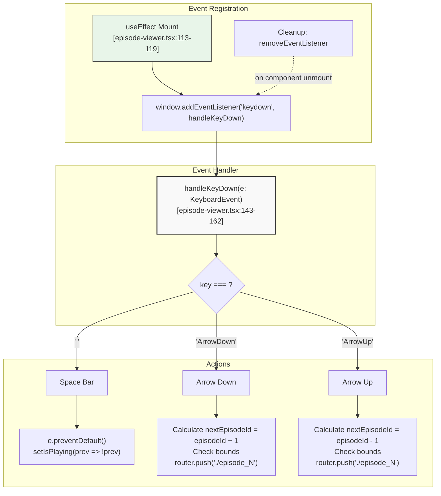
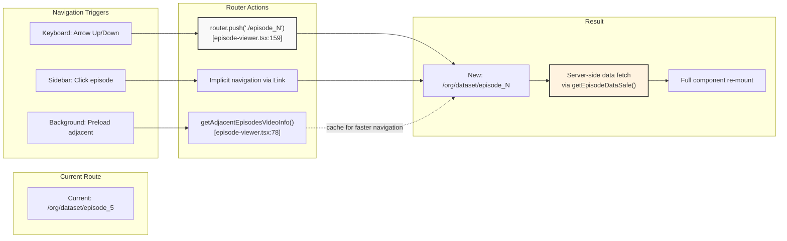
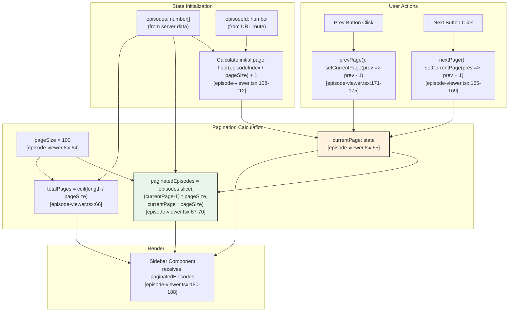
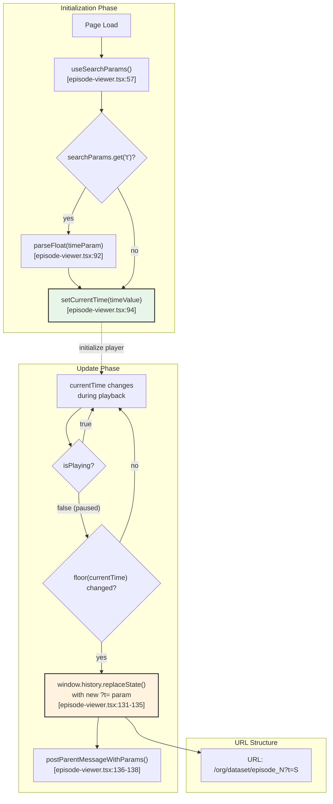
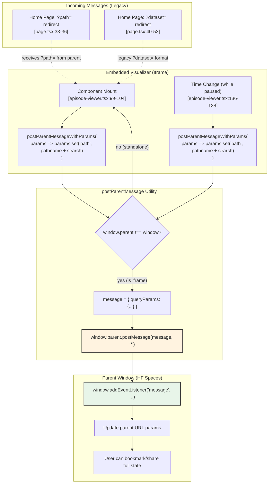
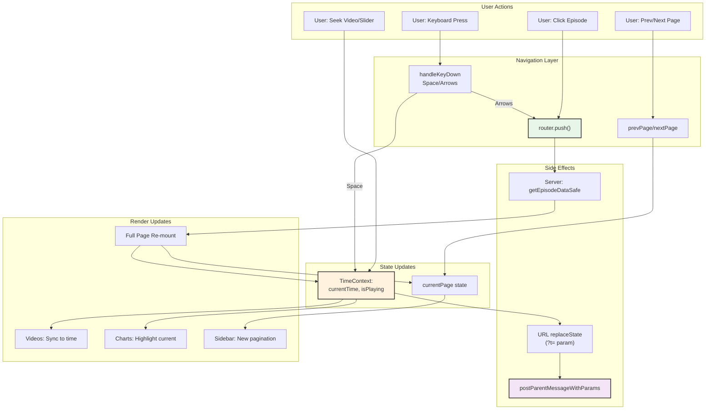

<!-- source: DeepWiki mcp.deepwiki.com · repo huggingface/lerobot-dataset-visualizer · page 4.2 User Interactions and Navigation · fetched 2026-10-26 -->

# User Interactions and Navigation

<details>
<summary>Relevant source files</summary>

The following files were used as context for generating this wiki page:

- [src/app/[org]/[dataset]/[episode]/episode-viewer.tsx](src/app/[org]/[dataset]/[episode]/episode-viewer.tsx)
- [src/app/[org]/[dataset]/[episode]/page.tsx](src/app/[org]/[dataset]/[episode]/page.tsx)
- [src/app/page.tsx](src/app/page.tsx)

</details>


## Purpose and Scope

This document covers the user interaction mechanisms and navigation patterns within the Episode Viewer component. It details keyboard shortcuts, episode navigation controls, URL parameter handling, pagination of episode lists, and iframe-based parent window communication for HuggingFace Spaces integration.

For information about the overall Episode Viewer state management and component lifecycle, see [State Management and Lifecycle](#4.1). For details on playback controls (play/pause buttons, seek slider), see [Playback Controls](#8.2). For sidebar episode list rendering, see [Sidebar Navigation](#8.1).

---

## Keyboard Shortcuts System

The Episode Viewer implements global keyboard shortcuts for efficient navigation and playback control. The keyboard event handler is registered in the `EpisodeViewerInner` component and provides three primary shortcuts.

### Implemented Shortcuts

| Key | Action | Behavior | Constraints |
|-----|--------|----------|-------------|
| `Space` | Toggle Play/Pause | Inverts the `isPlaying` state via `setIsPlaying` | Prevents default to avoid page scrolling |
| `ArrowDown` | Next Episode | Navigates to `episodeId + 1` | Only if within episode bounds |
| `ArrowUp` | Previous Episode | Navigates to `episodeId - 1` | Only if within episode bounds |

### Implementation Architecture



**Episode Navigation Bounds Checking**

The arrow key handlers implement boundary validation to prevent navigation outside the available episode range:

```typescript
// [episode-viewer.tsx:151-160]
const lowestEpisodeId = episodes[0];
const highestEpisodeId = episodes[episodes.length - 1];

if (nextEpisodeId >= lowestEpisodeId && nextEpisodeId <= highestEpisodeId) {
  router.push(`./episode_${nextEpisodeId}`);
}
```

This ensures that pressing `ArrowUp` on the first episode or `ArrowDown` on the last episode does nothing, preventing navigation errors.

**Sources:** [src/app/[org]/[dataset]/[episode]/episode-viewer.tsx:113-162]()

---

## Episode Navigation via Router

Episode navigation is handled through Next.js's App Router, using relative path navigation with the `useRouter` hook from `next/navigation`. The pattern uses sibling-relative paths to maintain the org/dataset context.

### Navigation Pattern



### Adjacent Episode Preloading

To improve navigation performance, the Episode Viewer preloads video information for adjacent episodes in the background:

```typescript
// [episode-viewer.tsx:72-86]
useEffect(() => {
  if (!org || !dataset) return;
  
  const preloadAdjacent = async () => {
    try {
      await getAdjacentEpisodesVideoInfo(org, dataset, episodeId, 2);
      // Preload adjacent episodes for smoother navigation
    } catch {
      // Skip preloading on error
    }
  };
  
  preloadAdjacent();
}, [org, dataset, episodeId]);
```

This prefetches video metadata for 2 episodes before and after the current episode, leveraging HTTP caching to make subsequent navigation nearly instantaneous.

**Sources:** [src/app/[org]/[dataset]/[episode]/episode-viewer.tsx:72-86](), [src/app/[org]/[dataset]/[episode]/episode-viewer.tsx:143-162]()

---

## Pagination System

The sidebar displays a paginated list of episodes to handle datasets with thousands of episodes efficiently. The pagination system is managed entirely within the `EpisodeViewerInner` component.

### Pagination Configuration

| Parameter | Value | Purpose |
|-----------|-------|---------|
| `pageSize` | 100 | Episodes displayed per page |
| `currentPage` | Dynamic state | Current active page (1-indexed) |
| `totalPages` | `Math.ceil(episodes.length / pageSize)` | Total number of pages |
| `paginatedEpisodes` | Slice of `episodes` array | Subset passed to Sidebar |

### Pagination State Flow



### Auto-Navigation to Current Episode's Page

When the component mounts or the episode changes, the pagination automatically jumps to the page containing the current episode:

```typescript
// [episode-viewer.tsx:108-112]
const episodeIndex = episodes.indexOf(episodeId);
if (episodeIndex !== -1) {
  setCurrentPage(Math.floor(episodeIndex / pageSize) + 1);
}
```

This ensures the sidebar always displays the current episode in its list, even when navigating via URL or keyboard shortcuts.

**Sources:** [src/app/[org]/[dataset]/[episode]/episode-viewer.tsx:63-70](), [src/app/[org]/[dataset]/[episode]/episode-viewer.tsx:108-119](), [src/app/[org]/[dataset]/[episode]/episode-viewer.tsx:165-175](), [src/app/[org]/[dataset]/[episode]/episode-viewer.tsx:180-188]()

---

## URL Parameter Handling

The Episode Viewer uses URL query parameters for deep linking and state persistence, primarily for the time parameter (`?t=`). The system handles both initialization from URL parameters and updates to the URL as the user interacts with the player.

### Parameter Types

| Parameter | Format | Purpose | Example |
|-----------|--------|---------|---------|
| `t` | Integer seconds | Current playback time | `?t=42` |
| `path` (legacy) | Full path string | HF Spaces sync | `?path=/org/dataset/episode_5?t=10` |
| `dataset` (legacy) | Dataset ID | Old redirect format | `?dataset=org/dataset&episode=5` |

### URL Parameter Flow



### Debounced URL Updates

The URL is only updated when the player is paused and the integer second value changes. This prevents excessive history modifications during playback:

```typescript
// [episode-viewer.tsx:122-140]
const lastUrlSecondRef = useRef<number>(-1);
useEffect(() => {
  if (isPlaying) return; // Skip updates during playback
  const currentSec = Math.floor(currentTime);
  if (currentTime > 0 && lastUrlSecondRef.current !== currentSec) {
    lastUrlSecondRef.current = currentSec;
    const newParams = new URLSearchParams(searchParams.toString());
    newParams.set("t", currentSec.toString());
    // Replace state instead of pushing to avoid navigation stack bloat
    window.history.replaceState({}, "", `${window.location.pathname}?${newParams.toString()}`);
  }
}, [isPlaying, currentTime, searchParams]);
```

The use of `replaceState` instead of `pushState` ensures that scrubbing through the video doesn't create hundreds of browser history entries.

**Sources:** [src/app/[org]/[dataset]/[episode]/episode-viewer.tsx:88-97](), [src/app/[org]/[dataset]/[episode]/episode-viewer.tsx:121-140]()

---

## Parent Window Communication (HuggingFace Spaces Integration)

The Episode Viewer is designed to be embedded as an iframe within HuggingFace Spaces. It communicates with the parent window to synchronize the URL state, allowing the parent page's URL to reflect the current episode and time.

### Communication Architecture



### Message Format

The `postParentMessageWithParams` utility function constructs a message with the following structure:

```typescript
{
  queryParams: {
    path: "/org/dataset/episode_N?t=S"
  }
}
```

The parent window receives this message via `window.postMessage` and updates its own URL to match, enabling users to bookmark or share the exact state of the visualizer.

### Implementation Details

The communication is established on two occasions:

1. **Initial Mount** - Notifies parent of current location:
```typescript
// [episode-viewer.tsx:99-104]
useEffect(() => {
  postParentMessageWithParams((params: URLSearchParams) => {
    params.set("path", window.location.pathname + window.location.search);
  });
}, []);
```

2. **Time Updates** - Syncs time parameter changes:
```typescript
// [episode-viewer.tsx:136-138]
postParentMessageWithParams((params: URLSearchParams) => {
  params.set("path", window.location.pathname + window.location.search);
});
```

### Reverse Communication: Home Page Redirects

The Home page handles incoming URL parameters from the parent window, supporting both new and legacy formats:

```typescript
// [page.tsx:33-36] - New format
if (searchParams.get('path')) {
  router.push(searchParams.get('path')!);
  return;
}

// [page.tsx:40-53] - Legacy format
if (searchParams.get('dataset') && searchParams.get('episode')) {
  redirectUrl = `/${searchParams.get('dataset')}/episode_${searchParams.get('episode')}`;
}
```

This bidirectional communication ensures seamless integration with HuggingFace Spaces, where the iframe URL and parent URL stay synchronized.

**Sources:** [src/app/[org]/[dataset]/[episode]/episode-viewer.tsx:99-104](), [src/app/[org]/[dataset]/[episode]/episode-viewer.tsx:136-138](), [src/utils/postParentMessage.ts](), [src/app/page.tsx:19-54]()

---

## Complete User Interaction Flow

The following diagram illustrates how all interaction systems work together:



**Sources:** [src/app/[org]/[dataset]/[episode]/episode-viewer.tsx:42-260]()

---

