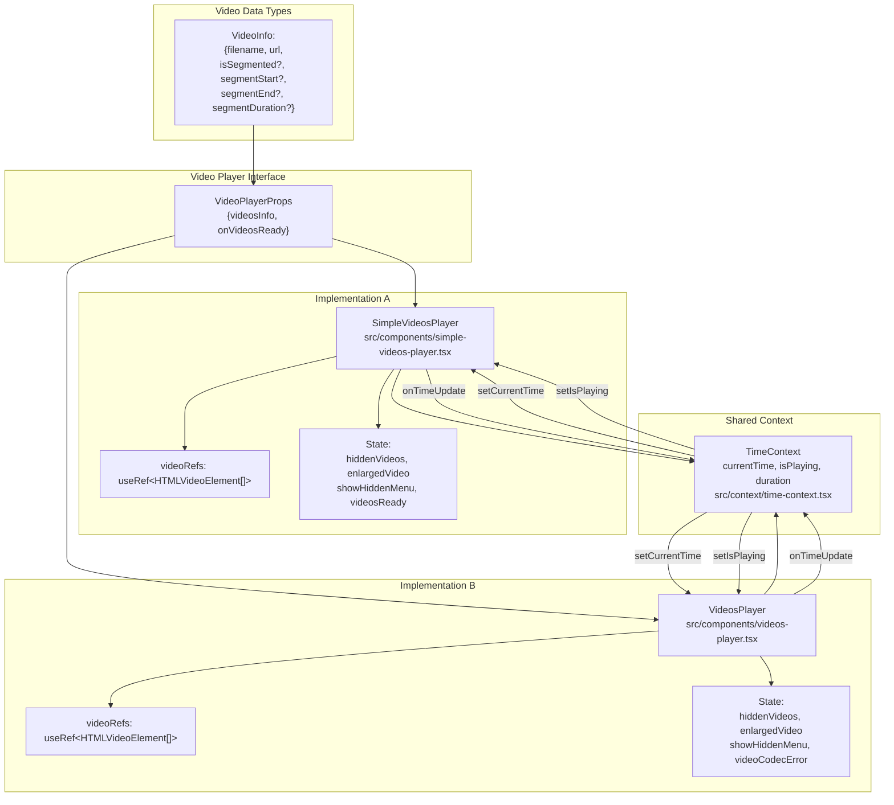
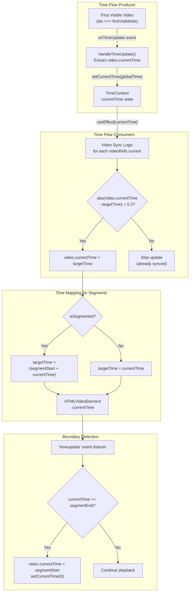
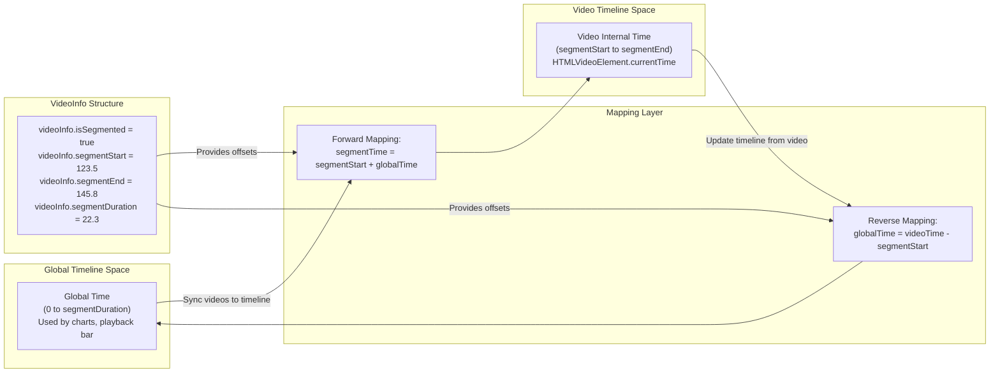
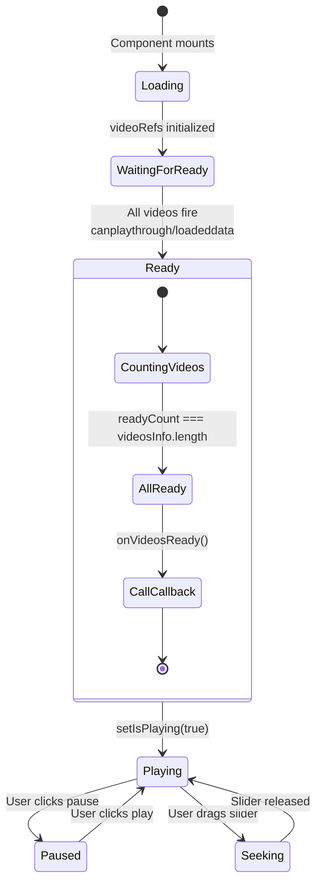
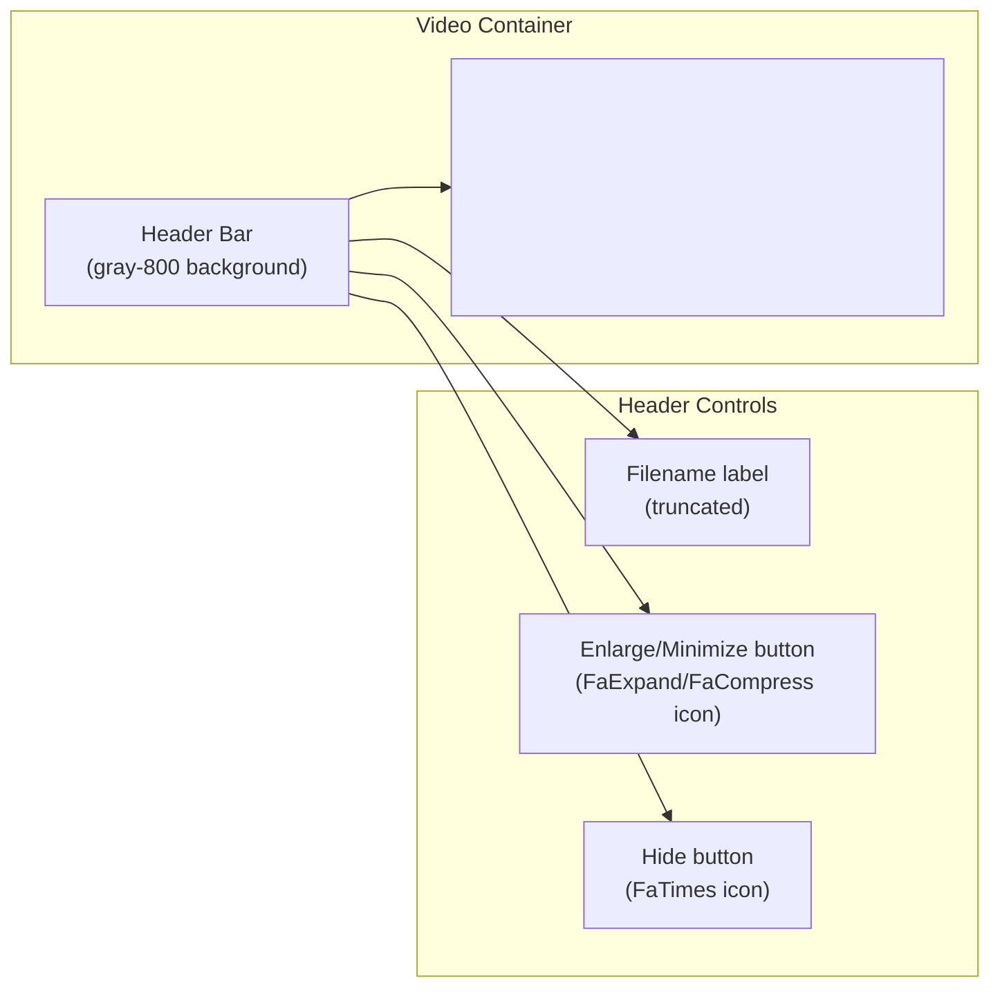
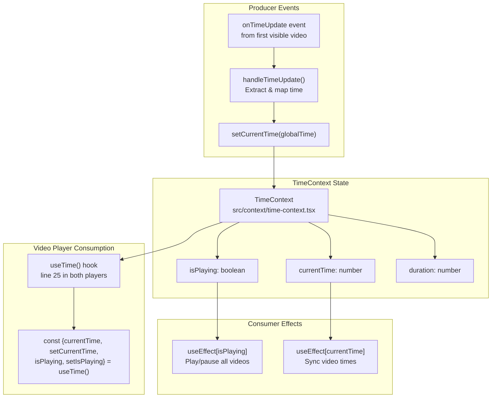

<!-- source: DeepWiki mcp.deepwiki.com · repo huggingface/lerobot-dataset-visualizer · page 5 Video Playback System · fetched 2026-10-26 -->

# Video Playback System

<details>
<summary>Relevant source files</summary>

The following files were used as context for generating this wiki page:

- [src/components/simple-videos-player.tsx](src/components/simple-videos-player.tsx)
- [src/components/videos-player.tsx](src/components/videos-player.tsx)
- [src/context/time-context.tsx](src/context/time-context.tsx)

</details>


## Purpose and Scope

The Video Playback System manages the display and synchronized playback of multiple video streams within episode visualizations. It handles video loading, time synchronization across streams, segment-based playback for v3.0 datasets, and user controls for hiding/enlarging videos. This system coordinates with the TimeContext ([#7](#7)) to maintain a unified timeline across all visualization components.

For information about the data structures that feed into this system, see [Episode Data Fetching System](#3.1). For details on the time synchronization architecture, see [Time Synchronization System](#7).

---

## Architecture Overview

The video playback system consists of two alternative implementations that share the same interface and synchronization patterns:



**Sources:** [src/components/simple-videos-player.tsx:1-270](), [src/components/videos-player.tsx:1-416](), [src/context/time-context.tsx:1-65]()

---

## Component Comparison: SimpleVideosPlayer vs VideosPlayer

Both components implement the same core functionality but with different feature sets and complexity levels:

| Feature | SimpleVideosPlayer | VideosPlayer | Notes |
|---------|-------------------|--------------|-------|
| **Basic Playback** | ✓ | ✓ | Both support play/pause/seek |
| **Video Synchronization** | ✓ | ✓ | Both sync to TimeContext |
| **Segmented Videos** | ✓ | ✓ | Both handle v3.0 segmentation |
| **Hide/Enlarge Controls** | ✓ | ✓ | Both support UI controls |
| **Codec Detection** | ✗ | ✓ | Only VideosPlayer checks AV1 support |
| **Loop Attribute** | ✗ | ✓ | VideosPlayer uses `loop` attribute |
| **Preload Strategy** | `auto` | `auto` | Same for both |
| **Segment Handling** | Event-based reset | Event-based boundary check | Different approaches |

**Primary Differences:**

The `SimpleVideosPlayer` [src/components/simple-videos-player.tsx:21-268]() is optimized for simplicity with a cleaner segment handling approach. It explicitly resets video time at segment boundaries and directly manages playback state.

The `VideosPlayer` [src/components/videos-player.tsx:21-413]() includes additional features like AV1 codec detection [src/components/videos-player.tsx:74-85]() and more sophisticated error handling for browser compatibility.

**Sources:** [src/components/simple-videos-player.tsx:1-270](), [src/components/videos-player.tsx:1-416]()

---

## Video Synchronization Mechanism

The synchronization system maintains a unified timeline across multiple video streams using a first-visible-video pattern:



**First-Visible-Video Pattern:**

The system designates the first non-hidden video as the time producer [src/components/simple-videos-player.tsx:32-34]():

```typescript
const firstVisibleIdx = videosInfo.findIndex(
  (video) => !hiddenVideos.includes(video.filename)
);
```

Only this video's `onTimeUpdate` event updates the global timeline [src/components/simple-videos-player.tsx:257]():

```typescript
onTimeUpdate={isFirstVisible ? handleTimeUpdate : undefined}
```

**Synchronization Tolerance:**

Videos are re-synced only when drift exceeds 0.2 seconds [src/components/simple-videos-player.tsx:147](), [src/components/videos-player.tsx:152](), preventing jitter from frequent updates while maintaining tight synchronization.

**Sources:** [src/components/simple-videos-player.tsx:32-34](), [src/components/simple-videos-player.tsx:134-152](), [src/components/simple-videos-player.tsx:155-167](), [src/components/videos-player.tsx:149-171](), [src/components/videos-player.tsx:174-191]()

---

## Video Segmentation and Time Mapping

V3.0 datasets use segmented videos where each video contains multiple episodes concatenated together. The system maps between a global timeline (0 to `segmentDuration`) and the video's internal timeline:



**Segmentation Setup:**

When a video is marked as segmented, event listeners enforce segment boundaries [src/components/simple-videos-player.tsx:58-102]():

```typescript
if (info.isSegmented) {
  const handleTimeUpdate = () => {
    const segmentEnd = info.segmentEnd || video.duration;
    const segmentStart = info.segmentStart || 0;
    
    if (video.currentTime >= segmentEnd - 0.05) {
      video.currentTime = segmentStart;
      // Also update the global time to reset to start
      if (index === firstVisibleIdx) {
        setCurrentTime(0);
      }
    }
  };
  
  const handleLoadedData = () => {
    video.currentTime = info.segmentStart || 0;
    checkReady();
  };
  
  video.addEventListener('timeupdate', handleTimeUpdate);
  video.addEventListener('loadeddata', handleLoadedData);
}
```

**Forward Mapping (Global → Video):**

When synchronizing videos to the global timeline [src/components/simple-videos-player.tsx:138-151]():

```typescript
videoRefs.current.forEach((video, index) => {
  if (video && !hiddenVideos.includes(videosInfo[index].filename)) {
    const info = videosInfo[index];
    let targetTime = currentTime;
    
    if (info.isSegmented) {
      targetTime = (info.segmentStart || 0) + currentTime;
    }
    
    if (Math.abs(video.currentTime - targetTime) > 0.2) {
      video.currentTime = targetTime;
    }
  }
});
```

**Reverse Mapping (Video → Global):**

When the first visible video updates the timeline [src/components/simple-videos-player.tsx:155-167]():

```typescript
const handleTimeUpdate = (e: React.SyntheticEvent<HTMLVideoElement>) => {
  const video = e.target as HTMLVideoElement;
  const videoIndex = videoRefs.current.findIndex(ref => ref === video);
  const info = videosInfo[videoIndex];
  
  if (info) {
    let globalTime = video.currentTime;
    if (info.isSegmented) {
      globalTime = video.currentTime - (info.segmentStart || 0);
    }
    setCurrentTime(globalTime);
  }
};
```

**Sources:** [src/components/simple-videos-player.tsx:7-14](), [src/components/simple-videos-player.tsx:58-113](), [src/components/simple-videos-player.tsx:134-167](), [src/components/videos-player.tsx:149-171](), [src/components/videos-player.tsx:174-191](), [src/components/videos-player.tsx:194-265]()

---

## Playback State Management

The system coordinates playback state across multiple videos through TimeContext and lifecycle hooks:



**Ready State Detection:**

Videos signal readiness through different events based on segmentation [src/components/simple-videos-player.tsx:42-113]():

- **Segmented videos:** Use `loadeddata` event [src/components/simple-videos-player.tsx:73-76]()
- **Non-segmented videos:** Use `canplaythrough` event [src/components/simple-videos-player.tsx:96]()

When all videos are ready, the component invokes the callback [src/components/simple-videos-player.tsx:47-51]():

```typescript
const checkReady = () => {
  readyCount++;
  if (readyCount === videosInfo.length && onVideosReady) {
    setVideosReady(true);
    onVideosReady();
    setIsPlaying(true);
  }
};
```

**Play/Pause Synchronization:**

Changes to `isPlaying` state propagate to all visible videos [src/components/simple-videos-player.tsx:116-132]():

```typescript
useEffect(() => {
  if (!videosReady) return;
  
  videoRefs.current.forEach((video, idx) => {
    if (video && !hiddenVideos.includes(videosInfo[idx].filename)) {
      if (isPlaying) {
        video.play().catch(e => {
          if (e.name !== 'AbortError') {
            console.error("Error playing video");
          }
        });
      } else {
        video.pause();
      }
    }
  });
}, [isPlaying, videosReady, hiddenVideos, videosInfo]);
```

**Sources:** [src/components/simple-videos-player.tsx:42-113](), [src/components/simple-videos-player.tsx:116-132](), [src/components/videos-player.tsx:88-98](), [src/components/videos-player.tsx:194-265]()

---

## User Control Features

The video player provides interactive controls for customizing the viewing experience:

### Hide/Show Videos

Users can hide individual videos to reduce clutter [src/components/simple-videos-player.tsx:27-29]():

```typescript
const [hiddenVideos, setHiddenVideos] = React.useState<string[]>([]);
const [showHiddenMenu, setShowHiddenMenu] = React.useState(false);
```

The hide button is disabled when only one video remains visible [src/components/simple-videos-player.tsx:243]():

```typescript
disabled={videosInfo.filter(v => !hiddenVideos.includes(v.filename)).length === 1}
```

Hidden videos can be restored through a dropdown menu [src/components/simple-videos-player.tsx:184-210]().

### Enlarge/Minimize Videos

Individual videos can be enlarged to fullscreen mode [src/components/simple-videos-player.tsx:28](), [src/components/simple-videos-player.tsx:217-227]():

```typescript
const [enlargedVideo, setEnlargedVideo] = React.useState<string | null>(null);

const isEnlarged = enlargedVideo === info.filename;
className={`${
  isEnlarged
    ? "z-40 fixed inset-0 bg-black bg-opacity-90 flex flex-col items-center justify-center"
    : "max-w-96"
}`}
```

The `VideosPlayer` implementation additionally supports Escape key to minimize [src/components/videos-player.tsx:100-117]().

### Control Layout

Each video has a header bar with filename and control buttons:



**Sources:** [src/components/simple-videos-player.tsx:27-29](), [src/components/simple-videos-player.tsx:184-265](), [src/components/videos-player.tsx:27-42](), [src/components/videos-player.tsx:100-117](), [src/components/videos-player.tsx:314-411]()

---

## Codec Compatibility Handling

The `VideosPlayer` component includes AV1 codec detection to provide user guidance when video playback is not supported [src/components/videos-player.tsx:74-85]():

```typescript
useEffect(() => {
  const checkCodecSupport = () => {
    const dummyVideo = document.createElement("video");
    const canPlayVideos = dummyVideo.canPlayType(
      'video/mp4; codecs="av01.0.05M.08"'
    );
    setVideoCodecError(!canPlayVideos);
  };

  checkCodecSupport();
}, []);
```

When codec support is unavailable, an error message displays with platform-specific guidance [src/components/videos-player.tsx:270-312]():

- **iPhone:** Requires A17 chip or higher
- **Mac Safari:** Requires M1+ (most browsers) or M3+ (Safari specifically)
- **Other platforms:** Directs users to Discord support channel

Videos are hidden entirely when codec error is detected [src/components/videos-player.tsx:353]():

```typescript
if (hiddenVideos.includes(video.filename) || videoCodecError) return null;
```

**Sources:** [src/components/videos-player.tsx:44](), [src/components/videos-player.tsx:74-85](), [src/components/videos-player.tsx:270-312](), [src/components/videos-player.tsx:353]()

---

## Integration with TimeContext

The video players consume and produce time state through the `useTime` hook from TimeContext:



**Context Consumer Pattern:**

Both players use the same hook pattern [src/components/simple-videos-player.tsx:25](), [src/components/videos-player.tsx:25]():

```typescript
const { currentTime, setCurrentTime, isPlaying, setIsPlaying } = useTime();
```

**Bidirectional Communication:**

1. **Context → Player:** Changes to `currentTime` and `isPlaying` trigger effects that update video elements
2. **Player → Context:** The first visible video's `onTimeUpdate` events call `setCurrentTime` to update the global timeline

**Time Update Flow:**

The context's `setCurrentTime` function [src/context/time-context.tsx:38-41]() updates state and notifies subscribers:

```typescript
const updateTime = useCallback((t: number) => {
  setCurrentTime(t);
  listeners.current.forEach((fn) => fn(t));
}, []);
```

This enables other components (charts, playback bar) to react to time changes without direct coupling to the video player.

**Sources:** [src/components/simple-videos-player.tsx:4](), [src/components/simple-videos-player.tsx:25](), [src/components/videos-player.tsx:4](), [src/components/videos-player.tsx:25](), [src/context/time-context.tsx:22-26](), [src/context/time-context.tsx:28-64]()

---

## Component Lifecycle Summary

The complete lifecycle of a video player component follows this sequence:

| Phase | SimpleVideosPlayer | VideosPlayer | Key Actions |
|-------|-------------------|--------------|-------------|
| **Mount** | Initialize refs, state | Initialize refs, state, check codec | Create empty ref arrays, default state values |
| **Data Load** | Register event listeners | Register event listeners | Setup `loadeddata`/`canplaythrough` handlers |
| **Ready Check** | Count ready videos | Count ready videos | Increment counter per video ready event |
| **All Ready** | Call `onVideosReady()` | Call `onVideosReady()` | Set `videosReady=true`, `setIsPlaying(true)` |
| **Playback** | Sync via TimeContext | Sync via TimeContext | Two-way binding with global timeline |
| **User Interaction** | Handle hide/enlarge | Handle hide/enlarge + Escape | Update local UI state |
| **Unmount** | Remove event listeners | Remove event listeners | Cleanup stored handler functions |

**Cleanup Pattern:**

Both components store cleanup functions on video elements to ensure proper teardown [src/components/simple-videos-player.tsx:82-84](), [src/components/simple-videos-player.tsx:106-111]():

```typescript
// Store cleanup
(video as any)._segmentHandlers = () => {
  video.removeEventListener('timeupdate', handleTimeUpdate);
  video.removeEventListener('loadeddata', handleLoadedData);
};

// Cleanup on unmount
return () => {
  videoRefs.current.forEach((video) => {
    if (video && (video as any)._segmentHandlers) {
      (video as any)._segmentHandlers();
    }
  });
};
```

**Sources:** [src/components/simple-videos-player.tsx:37-113](), [src/components/videos-player.tsx:46-265]()

---

