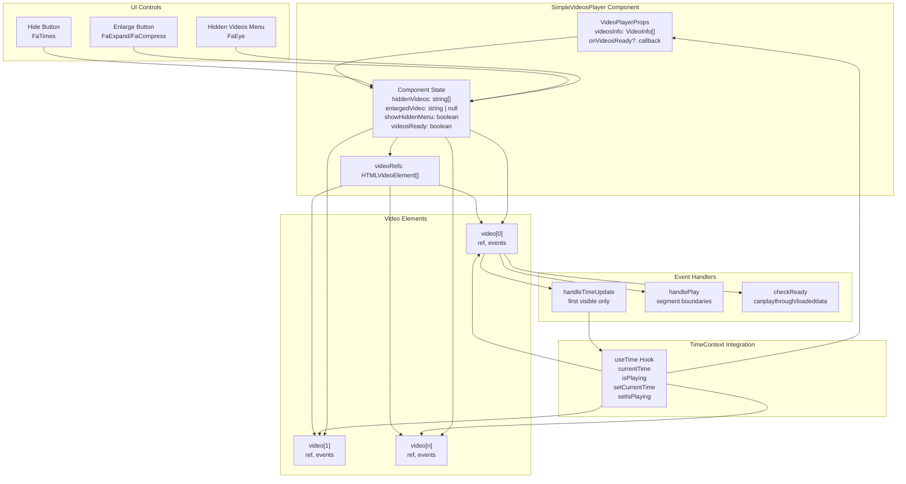
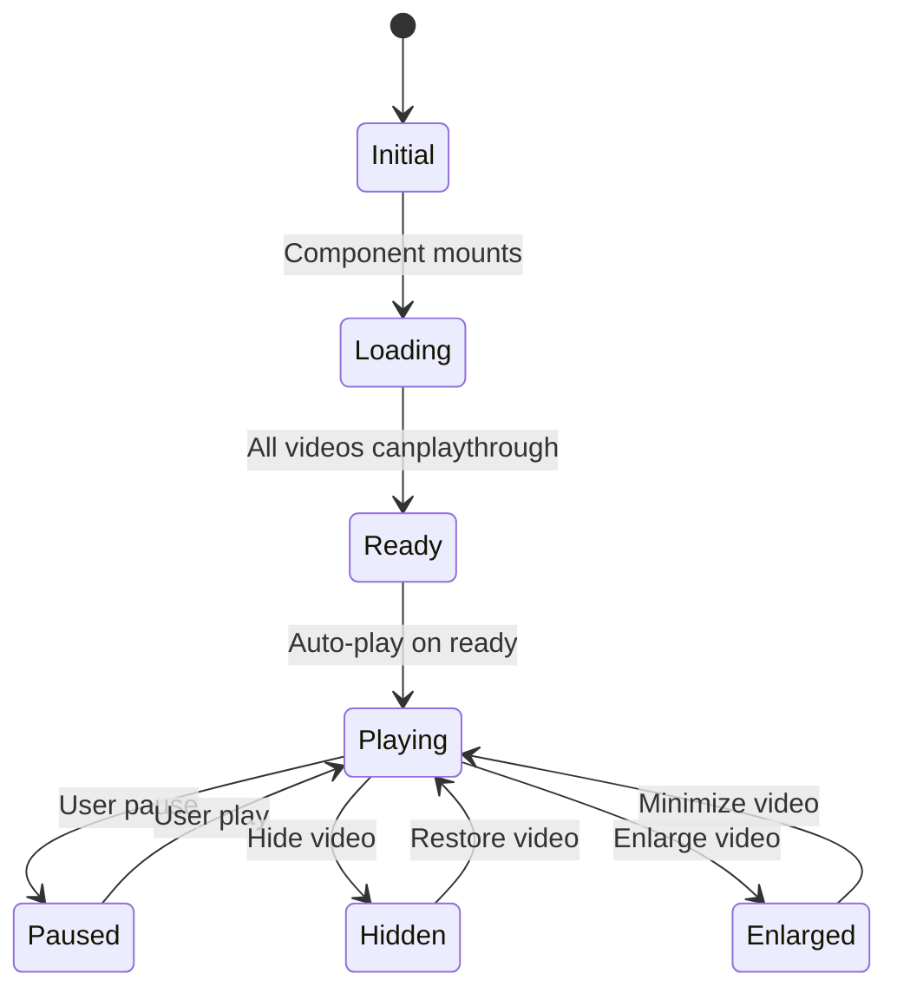
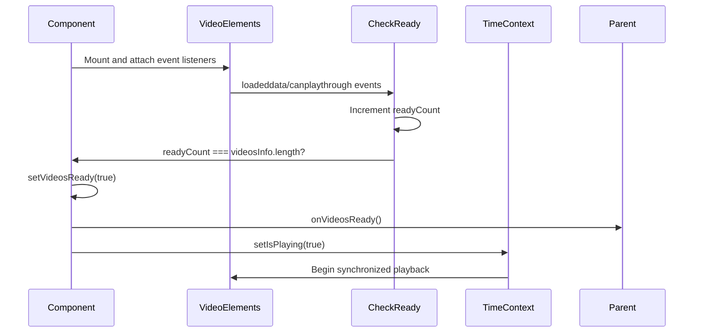
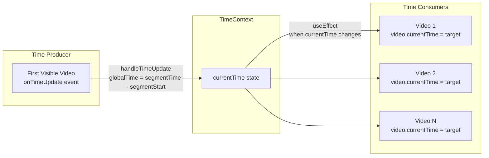
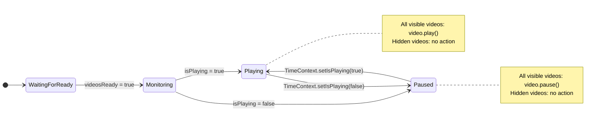
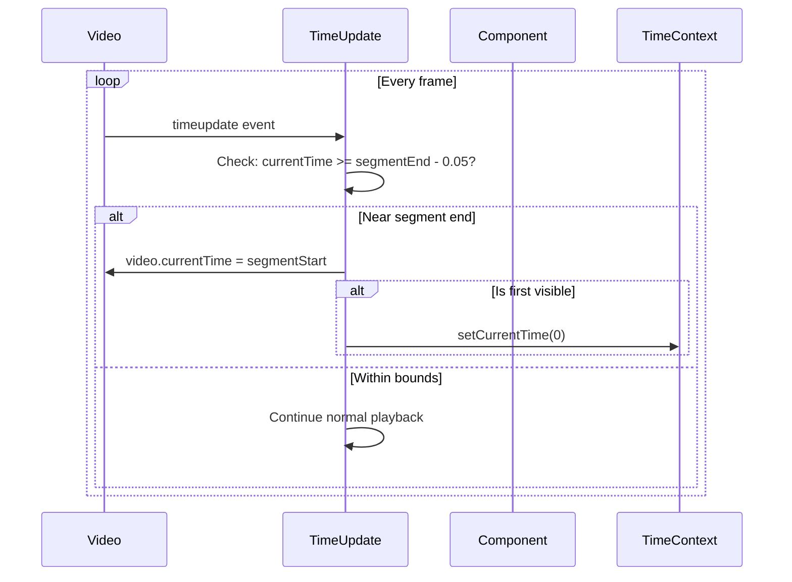
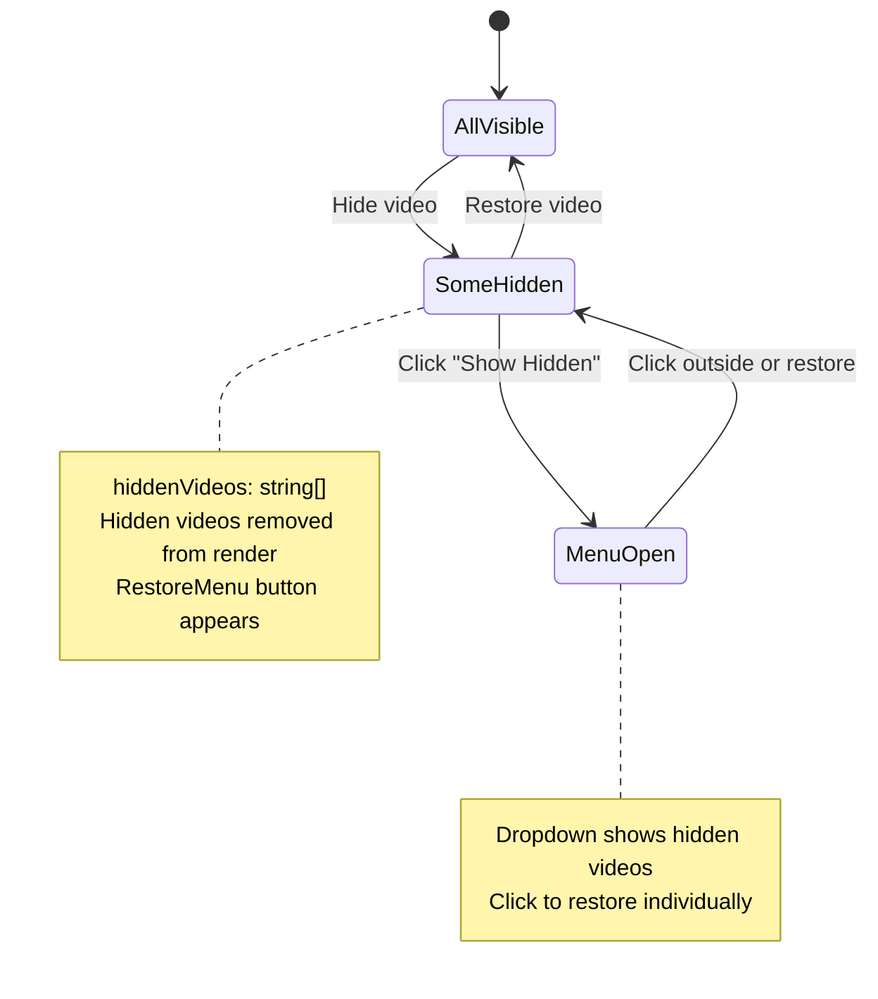
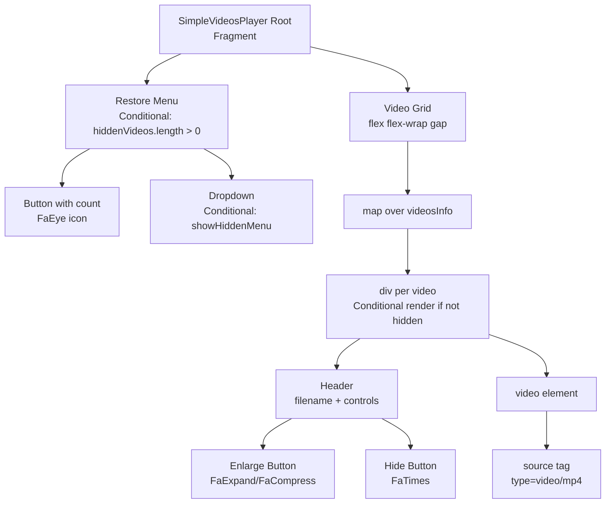

<!-- source: DeepWiki mcp.deepwiki.com · repo huggingface/lerobot-dataset-visualizer · page 5.1 SimpleVideosPlayer Component · fetched 2026-10-26 -->

# SimpleVideosPlayer Component

<details>
<summary>Relevant source files</summary>

The following files were used as context for generating this wiki page:

- [src/components/simple-videos-player.tsx](src/components/simple-videos-player.tsx)

</details>


## Purpose and Scope

The `SimpleVideosPlayer` component is the primary video playback interface for the LeRobot Dataset Visualizer. It handles rendering and synchronizing multiple video streams simultaneously, supporting both standard videos and segmented videos (v3.0 datasets). The component integrates tightly with the TimeContext for global timeline synchronization and provides UI controls for hiding, enlarging, and managing individual video streams.

For information about the broader video playback system architecture, see [Video Playback System](#5). For details on video segmentation specific to v3.0 datasets, see [Video Segmentation](#5.2). For time synchronization mechanics, see [Time Synchronization System](#7).

**Sources**: [src/components/simple-videos-player.tsx:1-270]()

---

## Component Architecture



**Diagram: SimpleVideosPlayer Component Structure**

This diagram illustrates the component's architecture. The component maintains refs to all video DOM elements, synchronizes them with the global TimeContext, and provides UI controls for managing individual videos. Only the first visible video sends time updates back to the context (producer), while all videos respond to context changes (consumers).

**Sources**: [src/components/simple-videos-player.tsx:21-28](), [src/components/simple-videos-player.tsx:36-39]()

---

## Video Information Type

The `VideoInfo` type defines the structure for each video stream in the player:

| Property | Type | Required | Description |
|----------|------|----------|-------------|
| `filename` | `string` | Yes | Display name and unique identifier for the video |
| `url` | `string` | Yes | Video source URL (typically from HuggingFace CDN) |
| `isSegmented` | `boolean` | No | Whether this is a v3.0 segmented video |
| `segmentStart` | `number` | No | Start timestamp within the video file (seconds) |
| `segmentEnd` | `number` | No | End timestamp within the video file (seconds) |
| `segmentDuration` | `number` | No | Duration of the segment (calculated externally) |

For segmented videos (`isSegmented: true`), the component maps between:
- **Global time**: The episode's timeline (0 to episode duration)
- **Segment time**: The actual video file's timeline (`segmentStart` to `segmentEnd`)

**Sources**: [src/components/simple-videos-player.tsx:7-14]()

---

## State Management

The component maintains four pieces of internal state:



**Diagram: Component State Transitions**

| State Variable | Type | Purpose |
|----------------|------|---------|
| `hiddenVideos` | `string[]` | List of video filenames that are currently hidden |
| `enlargedVideo` | `string \| null` | Filename of video currently in fullscreen mode (if any) |
| `showHiddenMenu` | `boolean` | Whether the restore menu is visible |
| `videosReady` | `boolean` | Whether all videos have loaded and are ready to play |

The `videosReady` flag is critical for preventing synchronization logic from running before videos are fully loaded. It gates the play/pause and time synchronization effects.

**Sources**: [src/components/simple-videos-player.tsx:27-30]()

---

## Video Reference Management

The component uses a ref array to maintain direct references to video DOM elements:

```typescript
const videoRefs = useRef<(HTMLVideoElement | null)[]>([]);
```

This array is initialized and maintained to match the length of `videosInfo`:

**Initialization Pattern** [src/components/simple-videos-player.tsx:36-39]():
- The array is sliced to match `videosInfo.length` whenever the prop changes
- Each video element assigns itself to the array via `ref={el => videoRefs.current[idx] = el}`

**First Visible Video Index** [src/components/simple-videos-player.tsx:32-34]():
```typescript
const firstVisibleIdx = videosInfo.findIndex(
  (video) => !hiddenVideos.includes(video.filename)
);
```

This index is critical because only the first visible video acts as the time producer, sending updates to the global TimeContext. This prevents multiple videos from fighting for control of the timeline.

**Sources**: [src/components/simple-videos-player.tsx:26](), [src/components/simple-videos-player.tsx:32-34](), [src/components/simple-videos-player.tsx:36-39]()

---

## Video Lifecycle and Ready State

The component implements a sophisticated ready-state system to ensure all videos are loaded before synchronization begins:



**Diagram: Video Loading and Ready Sequence**

### Ready State Handling

The ready-state logic [src/components/simple-videos-player.tsx:42-52]() uses a closure-based counter:

1. **Counter Initialization**: `readyCount` starts at 0
2. **Event Listeners**: Each video registers either:
   - `loadeddata` event (segmented videos)
   - `canplaythrough` event (non-segmented videos)
3. **Increment on Event**: Each event increments `readyCount`
4. **All Ready Check**: When `readyCount === videosInfo.length`:
   - Sets `videosReady` to `true`
   - Calls `onVideosReady()` callback to notify parent
   - Auto-starts playback via `setIsPlaying(true)`

### Segmented vs Non-Segmented Setup

**Segmented Videos** [src/components/simple-videos-player.tsx:58-86]():
- Register `timeupdate` listener to enforce segment boundaries
- Register `loadeddata` listener to:
  - Initialize video to `segmentStart` position
  - Increment ready counter
- When video reaches `segmentEnd - 0.05`, loop back to `segmentStart`

**Non-Segmented Videos** [src/components/simple-videos-player.tsx:86-102]():
- Register `ended` listener to loop video
- Register `canplaythrough` listener (once) to increment ready counter
- When video ends naturally, reset to time 0

### Cleanup Pattern

The component stores cleanup functions on each video element [src/components/simple-videos-player.tsx:82-85](), [src/components/simple-videos-player.tsx:99-101]():

```typescript
(video as any)._segmentHandlers = () => {
  video.removeEventListener('timeupdate', handleTimeUpdate);
  video.removeEventListener('loadeddata', handleLoadedData);
};
```

These are called in the effect cleanup [src/components/simple-videos-player.tsx:106-112]() to prevent memory leaks.

**Sources**: [src/components/simple-videos-player.tsx:42-113]()

---

## Time Synchronization Logic

The SimpleVideosPlayer implements a **first-visible-video pattern** for time synchronization, where one video acts as the producer and all others act as consumers:



**Diagram: Bidirectional Time Synchronization Flow**

### Time Update (Producer)

Only the first visible video sends time updates to the context [src/components/simple-videos-player.tsx:154-167]():

```typescript
const handleTimeUpdate = (e: React.SyntheticEvent<HTMLVideoElement>) => {
  const video = e.target as HTMLVideoElement;
  const videoIndex = videoRefs.current.findIndex(ref => ref === video);
  const info = videosInfo[videoIndex];
  
  if (info) {
    let globalTime = video.currentTime;
    if (info.isSegmented) {
      globalTime = video.currentTime - (info.segmentStart || 0);
    }
    setCurrentTime(globalTime);
  }
};
```

The `onTimeUpdate` prop is conditionally attached [src/components/simple-videos-player.tsx:257]():
```typescript
onTimeUpdate={isFirstVisible ? handleTimeUpdate : undefined}
```

### Time Synchronization (Consumers)

All visible videos respond to `currentTime` changes from the context [src/components/simple-videos-player.tsx:134-152]():

**Synchronization Algorithm**:
1. Skip if `!videosReady` (prevents premature sync)
2. For each visible video:
   - Calculate target time:
     - Non-segmented: `targetTime = currentTime`
     - Segmented: `targetTime = segmentStart + currentTime`
   - Compare with current video time
   - If difference > 0.2 seconds, seek video to target

The 0.2-second threshold prevents excessive seeking from minor time drift.

### Segment Time Mapping

For segmented videos, time mapping is bidirectional:

| Direction | Formula | Context |
|-----------|---------|---------|
| **Segment → Global** | `globalTime = video.currentTime - segmentStart` | Producer (handleTimeUpdate) |
| **Global → Segment** | `segmentTime = segmentStart + currentTime` | Consumer (sync effect) |

This allows the global timeline to be episode-relative (0 to episode duration) while each video operates on its own file's timeline.

**Sources**: [src/components/simple-videos-player.tsx:134-167]()

---

## Play/Pause Synchronization

Play and pause state is synchronized across all visible videos [src/components/simple-videos-player.tsx:115-132]():



**Diagram: Play/Pause State Synchronization**

**Effect Dependencies**: `[isPlaying, videosReady, hiddenVideos, videosInfo]`

**Logic**:
1. Guard: Return early if `!videosReady`
2. For each video:
   - Skip if hidden
   - If `isPlaying`: Call `video.play()` with error handling
   - If not playing: Call `video.pause()`

**Error Handling** [src/components/simple-videos-player.tsx:122-126]():
```typescript
video.play().catch(e => {
  if (e.name !== 'AbortError') {
    console.error("Error playing video");
  }
});
```

The `AbortError` is ignored because it occurs when `play()` is interrupted by a subsequent `pause()`, which is expected behavior.

**Sources**: [src/components/simple-videos-player.tsx:115-132]()

---

## Segment Boundary Enforcement

For segmented videos, the component enforces strict boundaries to prevent playback outside the designated segment:



**Diagram: Segment Boundary Loop Detection**

**Boundary Logic** [src/components/simple-videos-player.tsx:60-71]():

- **Check on every `timeupdate`**: If `currentTime >= segmentEnd - 0.05`
- **Action**: Reset video to `segmentStart`
- **Global Time Reset**: If this is the first visible video, also reset global time to 0

The 0.05-second buffer ensures the loop triggers before the video actually ends, providing seamless looping.

**Play Handler for Segmented Videos** [src/components/simple-videos-player.tsx:169-180]():

When a segmented video is played (via UI click), the handler checks if the current position is outside bounds:

```typescript
const handlePlay = (video: HTMLVideoElement, info: VideoInfo) => {
  if (info.isSegmented) {
    const segmentStart = info.segmentStart || 0;
    const segmentEnd = info.segmentEnd || video.duration;
    
    if (video.currentTime < segmentStart || video.currentTime >= segmentEnd) {
      video.currentTime = segmentStart;
    }
  }
  video.play();
};
```

This ensures that clicking play on a video that has drifted out of bounds will reset it to the segment start.

**Sources**: [src/components/simple-videos-player.tsx:58-71](), [src/components/simple-videos-player.tsx:169-180]()

---

## Video Visibility Management

The component provides hide/show functionality to reduce visual clutter when working with many camera angles:



**Diagram: Video Visibility State Machine**

### Hide Functionality

**Hide Button** [src/components/simple-videos-player.tsx:239-246]():
- Located in video header next to enlarge button
- Uses `FaTimes` icon
- Action: `setHiddenVideos(prev => [...prev, info.filename])`
- **Protection**: Disabled if only one video is visible (prevents hiding all videos)

**Render Filtering** [src/components/simple-videos-player.tsx:214-215]():
```typescript
if (hiddenVideos.includes(info.filename)) return null;
```

Hidden videos are completely removed from the DOM and do not participate in synchronization.

### Restore Functionality

**Restore Menu UI** [src/components/simple-videos-player.tsx:184-210]():
- Only visible when `hiddenVideos.length > 0`
- Button shows count: `"Show Hidden Videos (N)"`
- Dropdown renders when `showHiddenMenu` is true
- Each hidden video has a restore button
- Action: `setHiddenVideos(prev => prev.filter(v => v !== filename))`

**Sources**: [src/components/simple-videos-player.tsx:184-246]()

---

## Video Enlargement

The component supports fullscreen-style enlargement for focusing on individual videos:

| State | Class | Dimensions | Positioning |
|-------|-------|------------|-------------|
| **Normal** | `max-w-96` | Max width 384px | Inline flex item |
| **Enlarged** | `fixed inset-0` | `max-h-[90vh] max-w-[90vw]` | Fixed, centered, with backdrop |

**Enlarge Logic** [src/components/simple-videos-player.tsx:223-228]():
```typescript
const isEnlarged = enlargedVideo === info.filename;
className={`${
  isEnlarged
    ? "z-40 fixed inset-0 bg-black bg-opacity-90 flex flex-col items-center justify-center"
    : "max-w-96"
}`}
```

**Toggle Button** [src/components/simple-videos-player.tsx:232-238]():
- Icon changes: `FaExpand` (normal) → `FaCompress` (enlarged)
- Action: `setEnlargedVideo(isEnlarged ? null : info.filename)`

When enlarged:
- Video container becomes fixed-position overlay with semi-transparent black backdrop (`bg-black bg-opacity-90`)
- Video constrained to 90% viewport width/height to prevent clipping
- Video remains synchronized with other (non-visible) videos
- Header and controls remain visible

**Sources**: [src/components/simple-videos-player.tsx:217-262]()

---

## Rendering Structure

The component's render output consists of three main sections:



**Diagram: Component Render Tree**

### Key Rendering Details

**Video Container** [src/components/simple-videos-player.tsx:221-228]():
- Dynamic className based on `isEnlarged` state
- Normal: `max-w-96` (flex item)
- Enlarged: Fixed overlay with backdrop

**Video Header** [src/components/simple-videos-player.tsx:229-248]():
- Filename display (truncated)
- Control buttons (enlarge, hide)
- Shared styling: `bg-gray-800 text-gray-300`

**Video Element** [src/components/simple-videos-player.tsx:249-261]():
- `muted`: Required for autoplay
- `preload="auto"`: Eager loading for synchronization
- `onPlay`: Handler for segmented boundary checks
- `onTimeUpdate`: Conditionally attached to first visible video only
- No native controls (controlled via TimeContext and PlaybackBar)

**Sources**: [src/components/simple-videos-player.tsx:182-267]()

---

## Integration Points

The SimpleVideosPlayer integrates with other system components through well-defined interfaces:

| Integration Point | Interface | Direction | Purpose |
|-------------------|-----------|-----------|---------|
| **TimeContext** | `useTime()` hook | Bidirectional | Global timeline synchronization |
| **EpisodeViewer** | `onVideosReady` callback | Outbound | Signal when all videos are loaded |
| **Fetch-data** | `videosInfo` prop | Inbound | Video metadata and URLs |
| **PlaybackBar** | TimeContext (indirect) | Via Context | Play/pause/seek controls |
| **DataRecharts** | TimeContext (indirect) | Via Context | Synchronized chart highlighting |

**TimeContext Contract**:
- **Consumes**: `currentTime`, `isPlaying` for video synchronization
- **Produces**: `setCurrentTime`, `setIsPlaying` from first visible video

**EpisodeViewer Contract**:
- **Callback**: `onVideosReady()` called once when all videos reach ready state
- **Use Case**: EpisodeViewer waits for this before displaying other UI elements

**Data Flow**:
```
fetch-data.ts → videosInfo → SimpleVideosPlayer → video elements
                                                 ↓
                                            TimeContext ← PlaybackBar
                                                 ↓
                                            DataRecharts
```

**Sources**: [src/components/simple-videos-player.tsx:4](), [src/components/simple-videos-player.tsx:16-19](), [src/components/simple-videos-player.tsx:21-24]()

---

## Code Organization

The component's implementation can be logically divided into these sections:

| Section | Lines | Purpose |
|---------|-------|---------|
| **Type Definitions** | [1-14]() | `VideoInfo` type and props interface |
| **Component Setup** | [21-34]() | Props destructuring, hooks, state initialization |
| **Ref Initialization** | [36-39]() | Video refs array sizing |
| **Ready State Logic** | [42-113]() | Event listener setup, ready counting, cleanup |
| **Play/Pause Effect** | [115-132]() | Synchronize play state across videos |
| **Time Sync Effect** | [134-152]() | Synchronize currentTime across videos |
| **Time Update Handler** | [154-167]() | Producer logic for first visible video |
| **Play Handler** | [169-180]() | Segmented video boundary checks |
| **Restore Menu JSX** | [184-210]() | UI for restoring hidden videos |
| **Video Grid JSX** | [213-264]() | Main video rendering loop |

**Key Files Referenced**:
- [src/components/simple-videos-player.tsx:1-270]() (entire component)
- [src/context/time-context.tsx]() (TimeContext implementation, see [#7.1](#7.1))

**Sources**: [src/components/simple-videos-player.tsx:1-270]()

---

