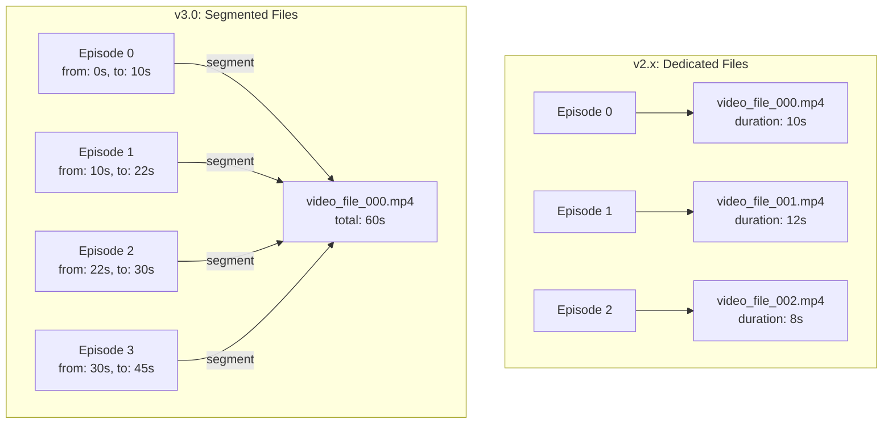
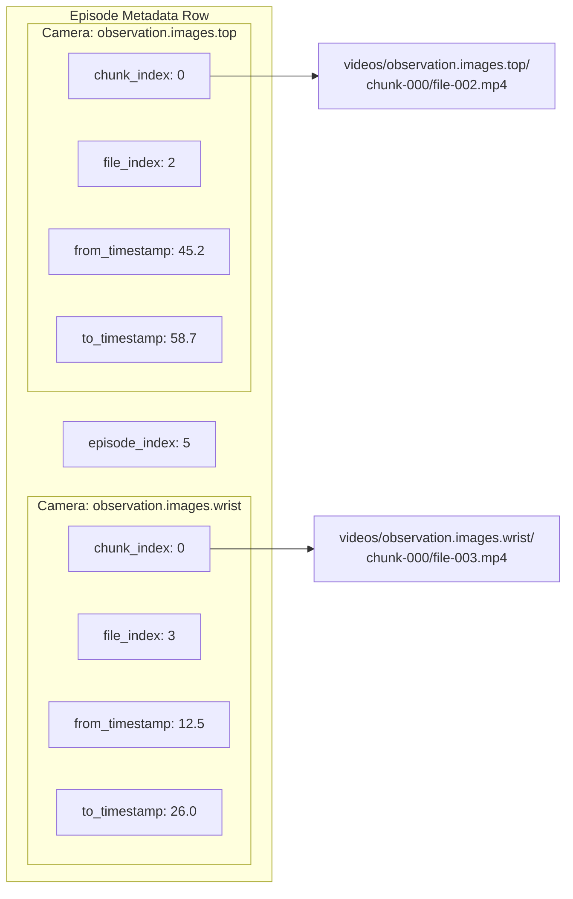
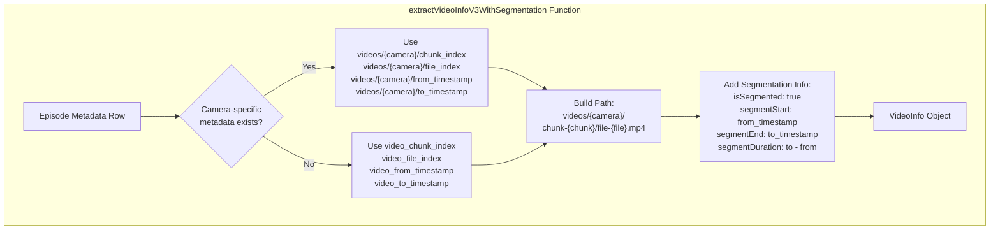
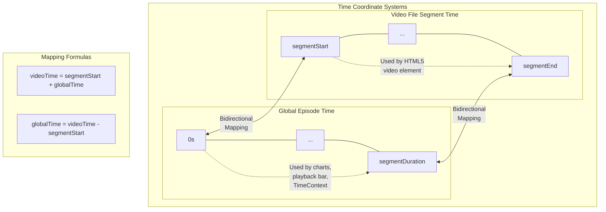
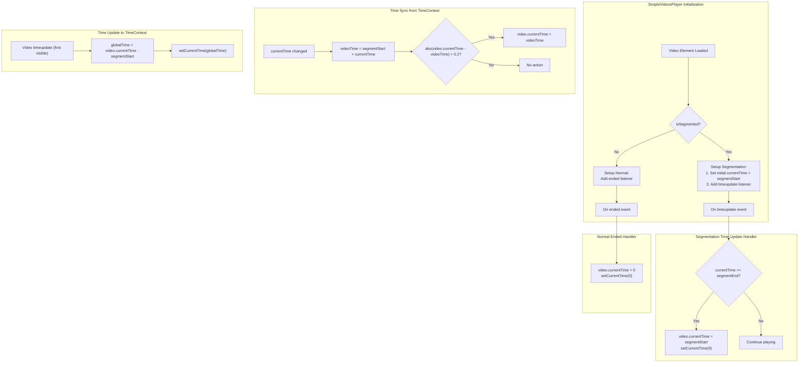
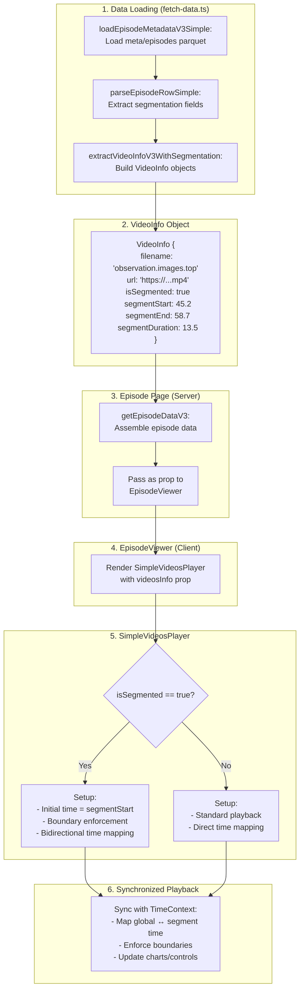
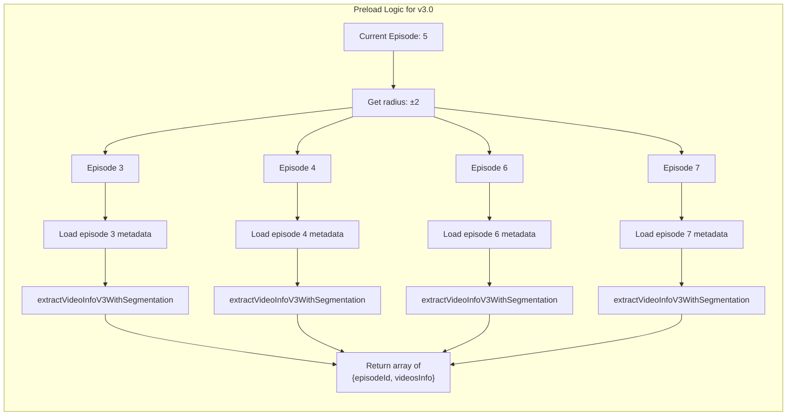

<!-- source: DeepWiki mcp.deepwiki.com · repo huggingface/lerobot-dataset-visualizer · page 5.2 Video Segmentation (v3.0 Feature) · fetched 2026-10-26 -->

# Video Segmentation (v3.0 Feature)

<details>
<summary>Relevant source files</summary>

The following files were used as context for generating this wiki page:

- [src/app/[org]/[dataset]/[episode]/fetch-data.ts](src/app/[org]/[dataset]/[episode]/fetch-data.ts)
- [src/components/simple-videos-player.tsx](src/components/simple-videos-player.tsx)
- [src/components/videos-player.tsx](src/components/videos-player.tsx)

</details>


## Purpose and Scope

This document explains the video segmentation feature introduced in v3.0 datasets. Video segmentation allows multiple episodes to reference different time segments of the same physical video file, enabling more efficient storage and retrieval of video data.

For information about the overall v3.0 data pipeline, see [Episode Data Fetching System](#3.1). For video playback controls and synchronization, see [Video Playback System](#5).

---

## Segmentation Concept

### What is Video Segmentation?

In v3.0 datasets, videos are stored as longer continuous files, and each episode references a specific time segment within these files. This differs fundamentally from v2.x datasets where each episode has its own dedicated video files.

**v2.x Approach:**
- One video file per episode per camera
- File path: `videos/{camera}/chunk-{chunk}/episode_{id}.mp4`
- Direct 1:1 mapping between episodes and files

**v3.0 Approach:**
- Shared video files across multiple episodes
- File path: `videos/{camera}/chunk-{chunk}/file-{file}.mp4`
- Each episode references a time segment: `[from_timestamp, to_timestamp]`
- Multiple episodes can reference different segments of the same file



**Sources:** [src/app/[org]/[dataset]/[episode]/fetch-data.ts:881-931]()

---

## Episode Metadata Structure

### Metadata Fields

V3.0 episodes store segmentation information in the episode metadata files located at `meta/episodes/chunk-{chunk}/file-{file}.parquet`. Each episode row contains:

| Field | Type | Description |
|-------|------|-------------|
| `episode_index` | int | Episode identifier |
| `videos/{camera}/chunk_index` | int | Video file chunk index |
| `videos/{camera}/file_index` | int | Video file index within chunk |
| `videos/{camera}/from_timestamp` | float | Start time in video file (seconds) |
| `videos/{camera}/to_timestamp` | float | End time in video file (seconds) |
| `data/chunk_index` | int | Data parquet chunk index |
| `data/file_index` | int | Data parquet file index |
| `dataset_from_index` | int | Start index in dataset |
| `dataset_to_index` | int | End index in dataset |
| `length` | int | Number of frames in episode |

### Per-Camera Metadata

The metadata supports per-camera segmentation, allowing different cameras to have different time segments or even reference different video files:



**Sources:** [src/app/[org]/[dataset]/[episode]/fetch-data.ts:986-1070](), [src/app/[org]/[dataset]/[episode]/fetch-data.ts:894-914]()

---

## Video Storage and Path Construction

### File Path Pattern

Video files follow the pattern:
```
videos/{camera_key}/chunk-{chunk_index:03d}/file-{file_index:03d}.mp4
```

The `extractVideoInfoV3WithSegmentation` function constructs the full video URL and attaches segmentation metadata:



**Sources:** [src/app/[org]/[dataset]/[episode]/fetch-data.ts:881-931]()

---

## Time Mapping System

### Global Timeline vs Video Segment Timeline

The segmentation feature requires bidirectional time mapping between two coordinate systems:

1. **Global Episode Timeline**: Ranges from `0` to `segmentDuration`
2. **Video Segment Timeline**: Ranges from `segmentStart` to `segmentEnd` within the video file



### Forward Mapping: Global → Video

When synchronizing video playback to a global time position:

**Formula:** `videoTime = segmentStart + globalTime`

**Example:**
- `segmentStart = 45.2s`, `segmentEnd = 58.7s`
- Global time = `5.0s`
- Video time = `45.2 + 5.0 = 50.2s`

**Sources:** [src/components/simple-videos-player.tsx:143-145](), [src/components/videos-player.tsx:155-164]()

### Reverse Mapping: Video → Global

When the video element updates its time and needs to update global state:

**Formula:** `globalTime = videoTime - segmentStart`

**Example:**
- `segmentStart = 45.2s`
- Video time = `50.2s`
- Global time = `50.2 - 45.2 = 5.0s`

**Sources:** [src/components/simple-videos-player.tsx:161-165](), [src/components/videos-player.tsx:181-186]()

---

## Video Player Integration

### VideoInfo Type Definition

Both `SimpleVideosPlayer` and `VideosPlayer` components accept `VideoInfo` objects with segmentation fields:

```typescript
type VideoInfo = {
  filename: string;           // Camera key
  url: string;                // Full video file URL
  isSegmented?: boolean;      // Enable segmentation handling
  segmentStart?: number;      // Start time in video file (seconds)
  segmentEnd?: number;        // End time in video file (seconds)
  segmentDuration?: number;   // Duration of segment (to - from)
}
```

**Sources:** [src/components/simple-videos-player.tsx:7-14](), [src/components/videos-player.tsx:7-14]()

### SimpleVideosPlayer Segmentation Logic



**Sources:** [src/components/simple-videos-player.tsx:42-113](), [src/components/simple-videos-player.tsx:135-152](), [src/components/simple-videos-player.tsx:155-167]()

### Boundary Enforcement

The player enforces segment boundaries by looping back to the start when reaching the end:

**Segment Loop Logic:**
1. Monitor `timeupdate` events
2. Check if `video.currentTime >= segmentEnd - 0.05` (with small buffer)
3. If true, reset to `video.currentTime = segmentStart`
4. Update global time to `0`

This creates a seamless loop within the segment without requiring the entire video file to loop.

**Sources:** [src/components/simple-videos-player.tsx:59-71]()

---

## Implementation Flow

### Complete Data Flow from Metadata to Playback



**Sources:** [src/app/[org]/[dataset]/[episode]/fetch-data.ts:421-461](), [src/app/[org]/[dataset]/[episode]/fetch-data.ts:934-983](), [src/components/simple-videos-player.tsx:21-268]()

---

## Chart Time Alignment

### Video-Aligned Timestamps

When processing chart data for v3.0 episodes, timestamps are aligned with the video segment duration rather than data array length:

```typescript
// Calculate timestamp based on video duration, not data length
let videoDuration = episodeData.length; // Fallback
if (episodeMetadata) {
  videoDuration = (episodeMetadata.video_to_timestamp || 30) 
                - (episodeMetadata.video_from_timestamp || 0);
}
obj["timestamp"] = (index / Math.max(episodeData.length - 1, 1)) * videoDuration;
```

This ensures that chart data points align correctly with video frames when the segment duration differs from the data array length.

**Sources:** [src/app/[org]/[dataset]/[episode]/fetch-data.ts:704-711]()

---

## Preloading Adjacent Episodes

### Segmented Video Preloading

The `getAdjacentEpisodesVideoInfo` function supports preloading segmented videos for adjacent episodes to enable faster navigation:



The browser can begin downloading the video files in the background, and since multiple episodes may reference the same video file, this can significantly improve navigation performance.

**Sources:** [src/app/[org]/[dataset]/[episode]/fetch-data.ts:43-100]()

---

## Error Handling and Edge Cases

### Missing Metadata Fallbacks

The `parseEpisodeRowSimple` function provides fallback values when camera-specific metadata is unavailable:

```typescript
// Fallback values when video metadata is missing
episodeData.video_chunk_index = 0;
episodeData.video_file_index = 0;
episodeData.video_from_timestamp = 0;
episodeData.video_to_timestamp = 30;  // Default 30s segment
```

This ensures the system remains functional even with incomplete metadata, though playback may not be accurate.

**Sources:** [src/app/[org]/[dataset]/[episode]/fetch-data.ts:1020-1025]()

### Segment Boundary Buffer

The boundary enforcement includes a small buffer (`0.05s`) to prevent edge cases where floating-point precision causes premature resets:

```typescript
if (video.currentTime >= segmentEnd - 0.05) {
  video.currentTime = segmentStart;
}
```

**Sources:** [src/components/simple-videos-player.tsx:64]()

---

## Performance Considerations

### Storage Efficiency

Video segmentation provides significant storage savings:

**Example Calculation:**
- 1000 episodes, 3 cameras each
- v2.x: 3000 separate video files (one per episode per camera)
- v3.0: ~50 video files (episodes reuse shared files)
- Storage reduction: ~60x fewer files

### Browser Caching

Since multiple episodes reference the same video files, browser HTTP caching becomes highly effective. Once a video file is downloaded, all episodes referencing that file can play immediately without additional downloads.

### Seek Performance

HTML5 video seeking within a file is fast and efficient. The segmentation approach allows instant seeking to any episode's segment without loading new files, providing smoother navigation between episodes.

---

## Summary

Video segmentation in v3.0 represents a fundamental architectural change in how episode videos are stored and accessed:

| Aspect | v2.x | v3.0 |
|--------|------|------|
| **Storage** | One file per episode per camera | Shared files with time segments |
| **Metadata** | File path patterns | Per-episode timestamp ranges |
| **Time Mapping** | Direct (global = video) | Bidirectional (global ↔ segment) |
| **Browser Caching** | Limited reuse | High reuse across episodes |
| **File Count** | High (episodes × cameras) | Low (shared across episodes) |
| **Seeking** | Requires file load | Instant within loaded file |

The implementation transparently handles both segmented and non-segmented videos through the `isSegmented` flag, ensuring backward compatibility while enabling the efficiency benefits of v3.0 datasets.

**Sources:** [src/app/[org]/[dataset]/[episode]/fetch-data.ts:1-1089](), [src/components/simple-videos-player.tsx:1-271](), [src/components/videos-player.tsx:1-417]()

---

