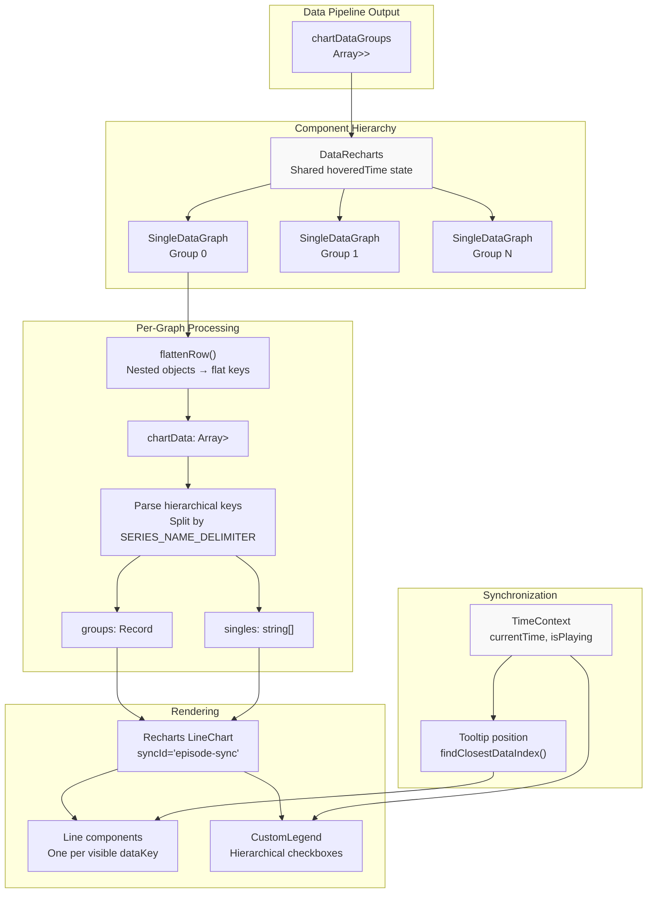
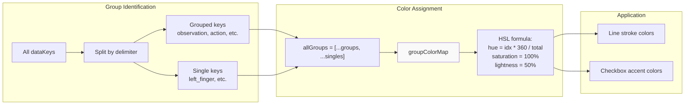
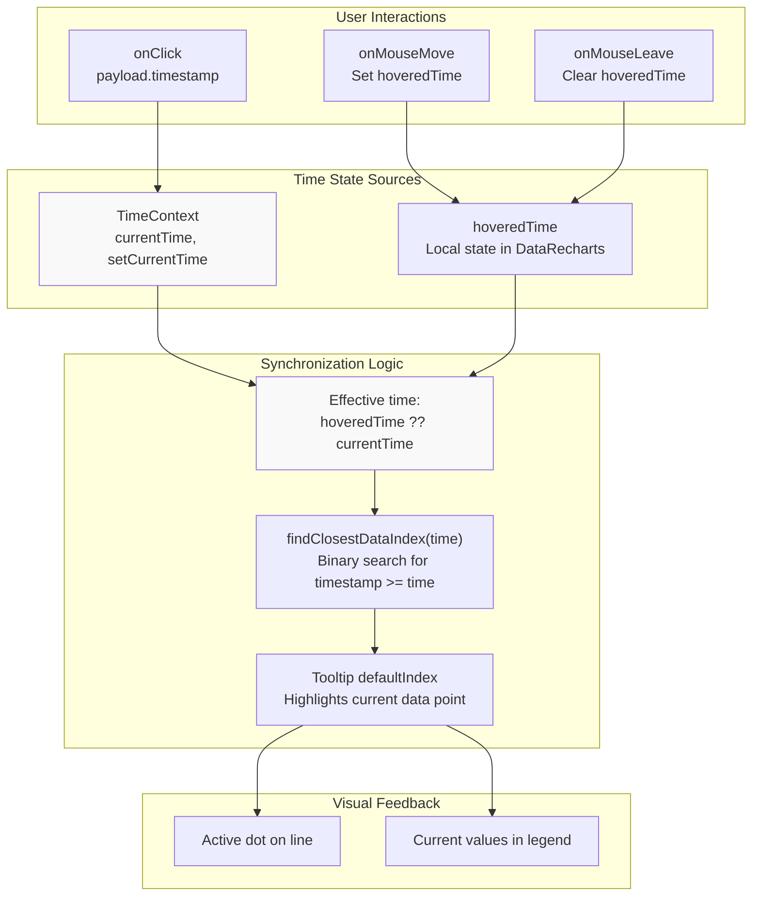
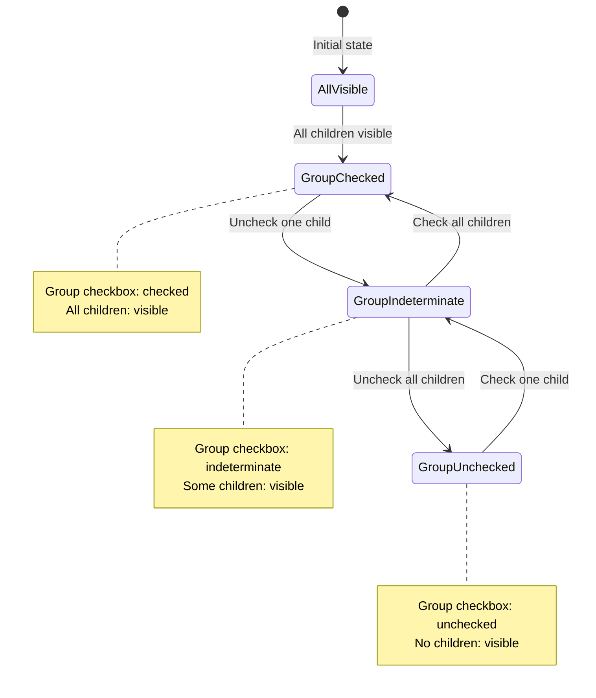
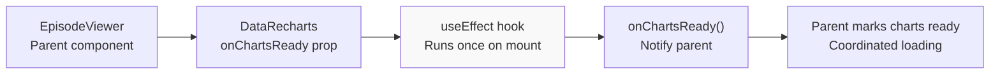

<!-- source: DeepWiki mcp.deepwiki.com · repo huggingface/lerobot-dataset-visualizer · page 6 Data Visualization (Charts) · fetched 2026-10-26 -->

# Data Visualization (Charts)

<details>
<summary>Relevant source files</summary>

The following files were used as context for generating this wiki page:

- [src/components/data-recharts.tsx](src/components/data-recharts.tsx)
- [src/context/time-context.tsx](src/context/time-context.tsx)

</details>


## Purpose and Scope

This document covers the chart visualization system that displays episode telemetry data as interactive line graphs. The charting system receives processed data from the data pipeline and renders synchronized, interactive visualizations with automatic grouping, color assignment, and real-time value display.

For details on how raw Parquet data is transformed into chart-ready format, see [Chart Data Transformation](#3.4). For information on the time synchronization mechanism that coordinates charts with video playback, see [Time Synchronization System](#7).

**Sources:** [src/components/data-recharts.tsx:1-346]()

---

## Overview

The charting system is built around the `DataRecharts` component, which orchestrates the rendering of multiple synchronized line graphs. Each episode can have multiple chart groups (based on data magnitude ranges), and each group displays related time-series data with interactive features including:

- Real-time value display synchronized with video playback
- Hover preview with shared timeline across all charts
- Click-to-seek functionality
- Interactive legend with hierarchical visibility toggling
- Automatic color assignment by data series groups

**Component Structure:**

| Component | Purpose | Location |
|-----------|---------|----------|
| `DataRecharts` | Top-level container, manages shared hover state | [src/components/data-recharts.tsx:25-51]() |
| `SingleDataGraph` | Renders individual chart with legend | [src/components/data-recharts.tsx:54-341]() |
| `CustomLegend` | Interactive legend with current values | [src/components/data-recharts.tsx:143-248]() |

**Sources:** [src/components/data-recharts.tsx:15-51]()

---

## Data Flow Architecture



**Data Structure:** The `DataRecharts` component receives a two-dimensional array structure:
- **Outer array:** Chart groups (separated by data magnitude)
- **Inner arrays:** Time-series data points for each group
- **Records:** Key-value pairs where keys are series names and values are numeric measurements

**Sources:** [src/components/data-recharts.tsx:15-18](), [src/components/data-recharts.tsx:25-49]()

---

## Series Name Hierarchical Structure

The charting system supports hierarchical series naming using a delimiter-based convention. Series names can be flat or nested, enabling automatic grouping in the legend.

**Naming Convention:**

```
SERIES_NAME_DELIMITER = " | "

Examples:
- Flat: "left_finger"
- Nested: "observation | images | top"
- Multi-level: "action | gripper | position"
```

**Key Processing Steps:**

1. **Flattening:** The `flattenRow()` function converts nested data objects into flat key-value pairs using the delimiter [src/components/data-recharts.tsx:65-85]()
2. **Parsing:** Series names are split by delimiter to identify groups [src/components/data-recharts.tsx:103-112]()
3. **Classification:** Keys are categorized as either grouped (multi-part names) or singles (flat names)

**Example Transformation:**

```typescript
// Input nested structure:
{ timestamp: 0.5, observation: { images: { top: 0.1, wrist: 0.2 } } }

// Output flat structure:
{ timestamp: 0.5, "observation | images | top": 0.1, "observation | images | wrist": 0.2 }
```

**Sources:** [src/components/data-recharts.tsx:22-23](), [src/components/data-recharts.tsx:65-85](), [src/components/data-recharts.tsx:103-112]()

---

## Color Assignment System

Colors are assigned deterministically using HSL color space to maximize visual distinction between groups.



**Algorithm:**

| Step | Code Reference | Description |
|------|----------------|-------------|
| 1. Collect groups | [src/components/data-recharts.tsx:115]() | Create array of all group names plus single keys |
| 2. Calculate hue | [src/components/data-recharts.tsx:118]() | `hue = idx * (360 / allGroups.length)` |
| 3. Generate HSL | [src/components/data-recharts.tsx:118]() | `hsl(hue, 100%, 50%)` |
| 4. Apply to lines | [src/components/data-recharts.tsx:311-324]() | Use group color for all series in that group |
| 5. Apply to legend | [src/components/data-recharts.tsx:203-204]() | Set checkbox accent color |

**Visual Distinction:** Within a group, the first series is solid while subsequent series use `strokeDasharray="5 5"` to create dashed lines [src/components/data-recharts.tsx:312-316]().

**Sources:** [src/components/data-recharts.tsx:114-119](), [src/components/data-recharts.tsx:308-333]()

---

## Time Synchronization and Highlighting

Charts integrate with the global `TimeContext` to display the current playback position and allow time-based interactions.



**Key Functions:**

**`findClosestDataIndex(time)`** [src/components/data-recharts.tsx:122-129]()
- Locates the first data point with timestamp ≥ target time (ceiling behavior)
- Returns last index if all timestamps are less than target
- Used to determine which data point to highlight

**Hover Behavior:**
- Mouse movement sets `hoveredTime` for preview [src/components/data-recharts.tsx:259-265]()
- Shared across all graphs via prop drilling [src/components/data-recharts.tsx:44-45]()
- Mouse leave clears `hoveredTime` [src/components/data-recharts.tsx:131-133]()

**Click Behavior:**
- Clicking a data point extracts `timestamp` from payload [src/components/data-recharts.tsx:135-140]()
- Calls `setCurrentTime()` to seek video to that timestamp
- Enables precise navigation through episode timeline

**Sources:** [src/components/data-recharts.tsx:64](), [src/components/data-recharts.tsx:122-140](), [src/components/data-recharts.tsx:259-266]()

---

## Chart Layout and Grid System

The `DataRecharts` component arranges multiple charts in a responsive grid layout.

**Layout Configuration:**

| Breakpoint | Layout | Class |
|------------|--------|-------|
| Mobile (default) | Single column | `grid-cols-1` |
| Desktop (`md` and up) | Two columns | `md:grid-cols-2` |

**Styling:** [src/components/data-recharts.tsx:39]()

**Chart Dimensions:**
- Container: Responsive width, fixed height of 320px [src/components/data-recharts.tsx:252]()
- Margins: Top 24px, right 16px, left 0px, bottom 16px [src/components/data-recharts.tsx:257]()

**Recharts Configuration:**

| Feature | Value | Purpose |
|---------|-------|---------|
| `syncId` | `"episode-sync"` | Synchronizes zoom/pan across charts |
| `isAnimationActive` | `false` | Disables animations for performance |
| `allowDataOverflow` | `true` | Allows data beyond axis bounds |
| `minTickGap` | `20` | Controls X-axis tick density |

**Sources:** [src/components/data-recharts.tsx:38-49](), [src/components/data-recharts.tsx:252-296]()

---

## Visibility Management

Users can toggle visibility of individual series or entire groups through the interactive legend.



**State Management:**

| State Variable | Type | Purpose |
|----------------|------|---------|
| `dataKeys` | `string[]` | All available series names |
| `visibleKeys` | `string[]` | Currently visible series names |

**Checkbox Logic:**

**Group-level checkbox** [src/components/data-recharts.tsx:173-181]():
- **Checked:** All children in `visibleKeys` → Clicking removes all children
- **Indeterminate:** Some children in `visibleKeys` → Visual indicator via `el.indeterminate` property
- **Unchecked:** No children in `visibleKeys` → Clicking adds all children

**Child-level checkbox** [src/components/data-recharts.tsx:183-187]():
- Toggles individual series in `visibleKeys` array

**Rendering:** Only series present in `visibleKeys` are rendered as `<Line>` components [src/components/data-recharts.tsx:318]()

**Sources:** [src/components/data-recharts.tsx:89-98](), [src/components/data-recharts.tsx:170-187](), [src/components/data-recharts.tsx:308-333]()

---

## Current Value Display

The legend displays real-time values for each series, synchronized with playback position or hover state.

**Value Resolution:**

```
effectiveTime = hoveredTime ?? currentTime
closestIndex = findClosestDataIndex(effectiveTime)
currentData = chartData[closestIndex]
displayValue = currentData[seriesKey]
```

**Formatting:**
- Numeric values: `.toFixed(2)` for two decimal places [src/components/data-recharts.tsx:219]()
- Missing values: `"--"` placeholder
- Color coding:
  - Visible series: Orange (`text-orange-300`) [src/components/data-recharts.tsx:218]()
  - Hidden series: Gray (`text-gray-500`)

**Legend Layout:**

| Element | Styling | Purpose |
|---------|---------|---------|
| Container | Auto-fit grid, 250px columns | Responsive multi-column layout |
| Group name | Font semibold, white text | Primary hierarchy level |
| Child name | Font regular, 0.75rem | Secondary hierarchy level |
| Value | Monospace font, right-aligned | Numeric display |

**Sources:** [src/components/data-recharts.tsx:143-248](), [src/components/data-recharts.tsx:218-220]()

---

## Integration with Recharts Library

The component uses the `recharts` library for chart rendering, configuring it for robotics telemetry visualization.

**Import Structure:**

```typescript
import {
  LineChart,      // Container component
  Line,           // Individual data series
  XAxis,          // Time axis
  YAxis,          // Value axis
  CartesianGrid,  // Background grid
  ResponsiveContainer,  // Responsive wrapper
  Tooltip,        // Hover tooltip (disabled)
} from "recharts";
```

**Key Configurations:**

**XAxis** [src/components/data-recharts.tsx:269-290]():
- `dataKey="timestamp"` - Uses timestamp column for X values
- `domain=[first, last]` - Fixed domain from data range
- `ticks` - Computed from unique ceiling values
- Custom label positioned at bottom-left

**YAxis** [src/components/data-recharts.tsx:291-296]():
- `domain=["auto", "auto"]` - Automatic scaling per chart
- `allowDataOverflow={true}` - Permits values outside computed range

**Tooltip** [src/components/data-recharts.tsx:298-305]():
- `content={() => null}` - Disabled default tooltip rendering
- `defaultIndex` - Used for highlighting current position
- Custom legend shows values instead of tooltip

**Line Components** [src/components/data-recharts.tsx:308-333]():
- `type="monotone"` - Smooth line interpolation
- `dot={false}` - No dots at data points
- `activeDot={false}` - No enlarged dot on hover
- `strokeWidth={1.5}` - Consistent line thickness

**Sources:** [src/components/data-recharts.tsx:5-13](), [src/components/data-recharts.tsx:254-335]()

---

## Performance Optimizations

The component implements several performance optimizations for smooth rendering of large datasets.

**React.memo Wrappers:**
- `DataRecharts` memoized to prevent re-renders when parent updates [src/components/data-recharts.tsx:25]()
- `SingleDataGraph` memoized to isolate re-renders per graph [src/components/data-recharts.tsx:54]()

**useMemo Hooks:**
- Chart data flattening cached [src/components/data-recharts.tsx:88]()
- X-axis ticks computed once [src/components/data-recharts.tsx:280-286]()

**Animation Disabling:**
- `isAnimationActive={false}` on LineChart [src/components/data-recharts.tsx:329]()
- `isAnimationActive={false}` on Tooltip [src/components/data-recharts.tsx:301]()
- Prevents expensive transitions during playback

**Conditional Rendering:**
- Early return if data array is empty [src/components/data-recharts.tsx:30]()
- Only visible series render `<Line>` components [src/components/data-recharts.tsx:318]()

**Sources:** [src/components/data-recharts.tsx:25](), [src/components/data-recharts.tsx:54](), [src/components/data-recharts.tsx:88](), [src/components/data-recharts.tsx:280-286]()

---

## Component Lifecycle and Callbacks

The `DataRecharts` component supports a readiness callback to coordinate with parent components.

**Callback Flow:**



**Implementation:** [src/components/data-recharts.tsx:32-36]()
- `useEffect` with `onChartsReady` dependency
- Calls callback if function type
- Used by `EpisodeViewer` to track component readiness

**Sources:** [src/components/data-recharts.tsx:32-36]()

---

