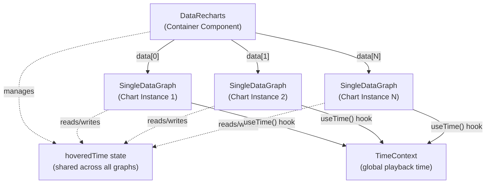
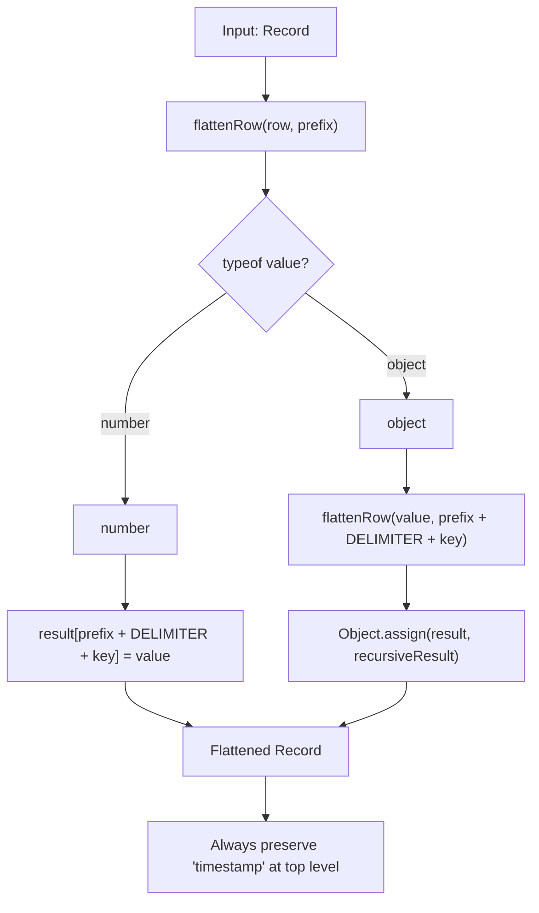
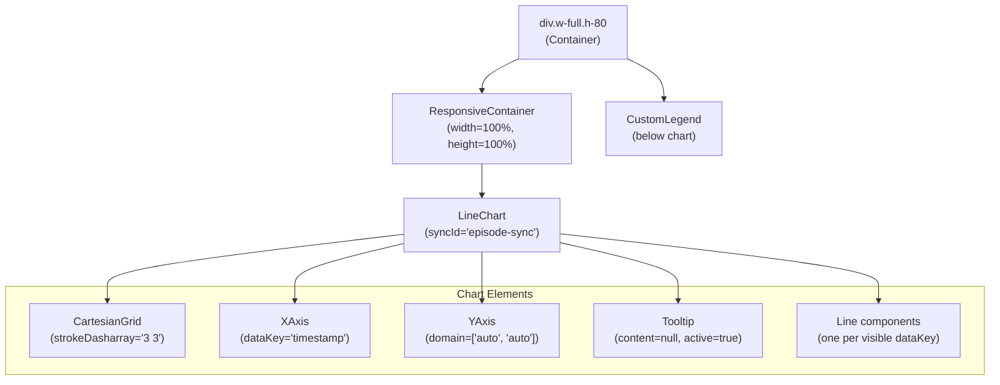
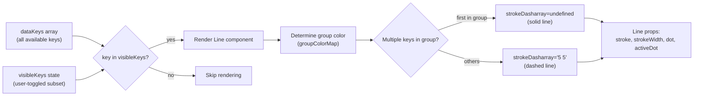
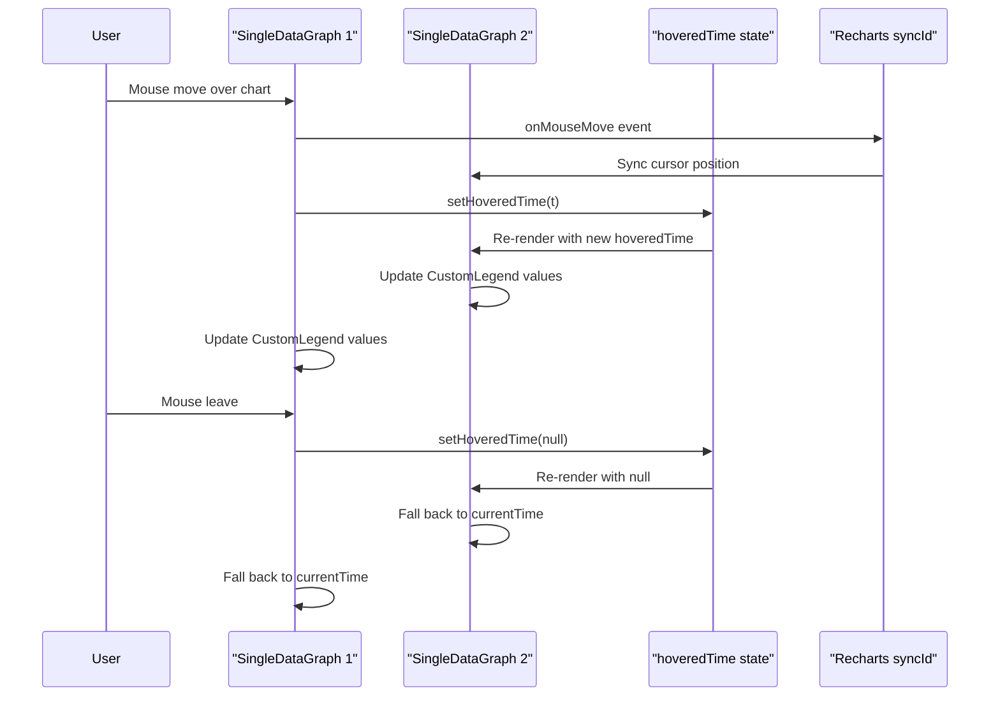
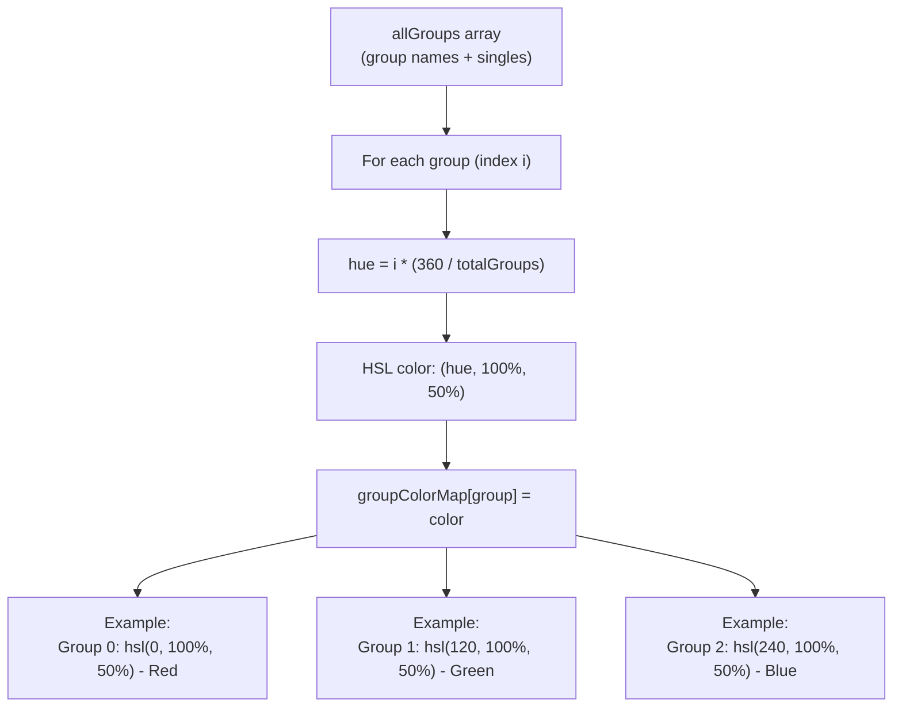
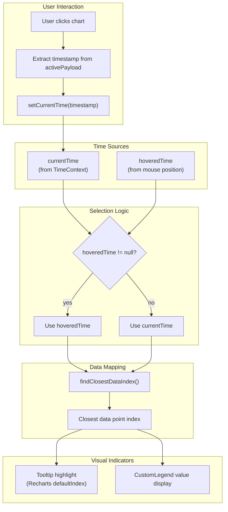
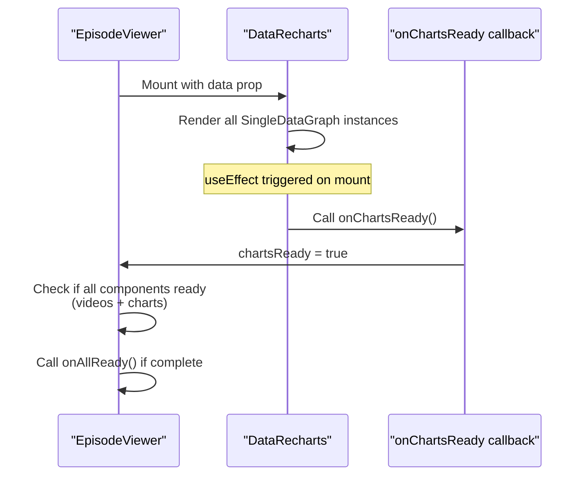

<!-- source: DeepWiki mcp.deepwiki.com · repo huggingface/lerobot-dataset-visualizer · page 6.1 Chart Rendering and Recharts Integration · fetched 2026-10-26 -->

# Chart Rendering and Recharts Integration

<details>
<summary>Relevant source files</summary>

The following files were used as context for generating this wiki page:

- [src/components/data-recharts.tsx](src/components/data-recharts.tsx)

</details>


## Purpose and Scope

This document explains how the `DataRecharts` component renders time-series data using the Recharts library. It covers data flattening, multi-graph layout, Recharts integration, color assignment, and synchronization mechanisms. The interactive legend system with hierarchical checkboxes is documented separately in [Interactive Legend System](#6.2). For information about how raw Parquet data is transformed into chart-ready groups, see [Chart Data Transformation](#3.4).

**Sources:** [src/components/data-recharts.tsx:1-346]()

---

## Component Architecture

The charting system consists of two primary React components that work together to render multiple synchronized graphs.



**Component Responsibilities:**

| Component | Purpose | Props | State |
|-----------|---------|-------|-------|
| `DataRecharts` | Container that manages shared hover state and grid layout | `data`, `onChartsReady` | `hoveredTime` |
| `SingleDataGraph` | Renders individual LineChart with Recharts, handles interactions | `data`, `hoveredTime`, `setHoveredTime` | `dataKeys`, `visibleKeys` |

**Sources:** [src/components/data-recharts.tsx:25-51](), [src/components/data-recharts.tsx:54-63]()

---

## Data Flattening Pipeline

Before data can be rendered by Recharts, hierarchical objects must be flattened into a single-level structure with dot-delimited keys.

### Input and Output Format

**Input (hierarchical):**
```typescript
{
  timestamp: 0.033,
  observation: {
    state: {
      arm_pos: 0.5,
      gripper: 0.1
    }
  }
}
```

**Output (flattened):**
```typescript
{
  timestamp: 0.033,
  "observation | state | arm_pos": 0.5,
  "observation | state | gripper": 0.1
}
```

### Flattening Algorithm

The `flattenRow` function recursively traverses objects and builds composite keys using the `SERIES_NAME_DELIMITER` constant (`" | "`).



**Key Implementation Details:**

- **Delimiter:** Uses `" | "` (space-pipe-space) to separate hierarchy levels [src/components/data-recharts.tsx:23]()
- **Recursive traversal:** Handles arbitrary nesting depth [src/components/data-recharts.tsx:75-78]()
- **Timestamp preservation:** Always keeps `timestamp` at the root level [src/components/data-recharts.tsx:81-83]()
- **Memoization:** `chartData` is memoized to prevent unnecessary recalculation [src/components/data-recharts.tsx:88]()

**Sources:** [src/components/data-recharts.tsx:65-88]()

---

## Recharts Integration and Configuration

The `SingleDataGraph` component wraps Recharts components to create a synchronized, interactive line chart.

### Component Hierarchy



### LineChart Configuration

The `LineChart` component is configured with specific props for synchronization and interaction:

| Prop | Value | Purpose |
|------|-------|---------|
| `data` | `chartData` | Flattened array of records with timestamp and data keys |
| `syncId` | `"episode-sync"` | Synchronizes hover/tooltip position across all charts |
| `margin` | `{ top: 24, right: 16, left: 0, bottom: 16 }` | Padding around chart area |
| `onClick` | `handleClick` | Allows clicking to seek to specific timestamp |
| `onMouseMove` | Handler | Updates shared `hoveredTime` state |
| `onMouseLeave` | `handleMouseLeave` | Clears hover state when mouse leaves chart |

**Sources:** [src/components/data-recharts.tsx:254-266]()

### Axis Configuration

**XAxis (Time Axis):**
- **dataKey:** `"timestamp"` - references the timestamp field in each data point
- **domain:** Dynamic `[firstTimestamp, lastTimestamp]` - sets visible range
- **ticks:** Auto-generated from unique ceiling values to prevent overlap [src/components/data-recharts.tsx:280-286]()
- **minTickGap:** `20` - prevents excessive tick density
- **allowDataOverflow:** `true` - allows rendering beyond domain

**YAxis (Value Axis):**
- **domain:** `["auto", "auto"]` - automatically scales to data range
- **interval:** `0` - shows all tick marks
- **allowDataOverflow:** `true` - allows rendering beyond domain

**Sources:** [src/components/data-recharts.tsx:269-296]()

### Line Rendering

Each visible data key is rendered as a `Line` component. The rendering logic determines which keys are visible and applies appropriate styling:



**Line Component Props:**

| Prop | Value | Purpose |
|------|-------|---------|
| `type` | `"monotone"` | Smooth curve interpolation |
| `dataKey` | Key name (e.g., `"observation \| state \| arm_pos"`) | Data field to plot |
| `stroke` | HSL color from `groupColorMap` | Line color |
| `strokeDasharray` | `"5 5"` for secondary group members, undefined otherwise | Visual distinction within groups |
| `dot` | `false` | Disables dot markers (cleaner for high-frequency data) |
| `activeDot` | `false` | Disables highlight dot on hover |
| `strokeWidth` | `1.5` | Line thickness |
| `isAnimationActive` | `false` | Disables animations for performance |

**Sources:** [src/components/data-recharts.tsx:308-333]()

---

## Multi-Graph Synchronization

All charts rendered by `DataRecharts` are synchronized through two mechanisms: **Recharts syncId** and **shared hover state**.



### Synchronization Mechanisms

**1. Recharts syncId**
- All `LineChart` components use `syncId="episode-sync"` [src/components/data-recharts.tsx:256]()
- Recharts library automatically synchronizes tooltip positions across charts with the same syncId
- This provides visual cursor alignment without additional code

**2. Shared hoveredTime State**
- Managed at the `DataRecharts` level and passed to all `SingleDataGraph` instances [src/components/data-recharts.tsx:28]()
- Updated by `onMouseMove` handler [src/components/data-recharts.tsx:259-265]()
- Cleared by `onMouseLeave` handler [src/components/data-recharts.tsx:131-133]()
- Used by `CustomLegend` to display current values at hovered time [src/components/data-recharts.tsx:144-146]()

**Sources:** [src/components/data-recharts.tsx:25-49](), [src/components/data-recharts.tsx:256](), [src/components/data-recharts.tsx:259-266]()

---

## Color Assignment System

Colors are assigned to groups of data keys using an HSL hue distribution algorithm that maximizes visual distinction.

### Grouping Logic

Data keys are parsed to identify hierarchical groups based on the `SERIES_NAME_DELIMITER`:

```typescript
// Example keys:
"observation | state | arm_pos"  // Group: "observation"
"observation | state | gripper"  // Group: "observation"
"action | position"              // Group: "action"
"timestamp"                      // Single (no group)
```

**Grouping Algorithm:**

1. Split each key by `" | "` delimiter [src/components/data-recharts.tsx:104]()
2. If multiple parts exist, use first part as group name [src/components/data-recharts.tsx:105-108]()
3. If single part, treat as standalone "single" [src/components/data-recharts.tsx:110]()
4. Build `groups` object mapping group names to arrays of full key names

### Color Distribution

Colors are assigned using HSL color space with evenly distributed hues:



**Color Assignment Formula:**

```
hue = index × (360 / totalGroupCount)
color = `hsl(${hue}, 100%, 50%)`
```

This ensures:
- Maximum perceptual difference between adjacent groups
- Consistent colors across re-renders (same index → same color)
- Full spectrum coverage for datasets with many groups

**Sources:** [src/components/data-recharts.tsx:100-119](), [src/components/data-recharts.tsx:164-168]()

---

## Time Highlighting and Interaction

The chart system integrates with the global `TimeContext` to highlight the current playback position and respond to user interactions.



### Finding Closest Data Point

The `findClosestDataIndex` function maps a continuous time value to the nearest data point:

**Algorithm:**
1. Search for first data point where `timestamp >= targetTime` (ceiling approach) [src/components/data-recharts.tsx:125]()
2. If no such point exists (time is past all data), return last index [src/components/data-recharts.tsx:127-128]()
3. Returns array index (0-based)

This ceiling approach ensures the highlight always shows the "next" data point, which is more intuitive for time-series visualization.

**Sources:** [src/components/data-recharts.tsx:122-129]()

### Tooltip Configuration

The Recharts `Tooltip` component is configured with unconventional props to achieve custom behavior:

| Prop | Value | Effect |
|------|-------|--------|
| `content` | `() => null` | Disables default tooltip popup (we use CustomLegend instead) |
| `active` | `true` | Keeps highlight system active even without hovering |
| `isAnimationActive` | `false` | Disables animations for immediate response |
| `defaultIndex` | `findClosestDataIndex(currentTime)` | Highlights current playback position when not hovering |

The `defaultIndex` prop is conditionally set only when `hoveredTime` is null, allowing hover to take precedence over playback position.

**Sources:** [src/components/data-recharts.tsx:298-305]()

### Click-to-Seek Interaction

When a user clicks on the chart, the click handler extracts the timestamp and updates the global time:

**Event Flow:**
1. `onClick={handleClick}` prop on `LineChart` [src/components/data-recharts.tsx:258]()
2. Extract timestamp from `data.activePayload[0].payload.timestamp` [src/components/data-recharts.tsx:137]()
3. Call `setCurrentTime(timeValue)` from `useTime()` hook [src/components/data-recharts.tsx:138]()
4. `TimeContext` broadcasts new time to all consumers (videos, charts, playback bar)

**Sources:** [src/components/data-recharts.tsx:135-140](), [src/components/data-recharts.tsx:64]()

---

## Performance Optimizations

The chart rendering system employs several optimization strategies to maintain smooth performance with high-frequency time-series data.

### React Memoization

**Component-Level Memoization:**
- Both `DataRecharts` and `SingleDataGraph` are wrapped with `React.memo` [src/components/data-recharts.tsx:25](), [src/components/data-recharts.tsx:54]()
- Prevents re-renders when parent components update but props remain unchanged
- Display names set for debugging: `"DataGraph"` and `"SingleDataGraph"` [src/components/data-recharts.tsx:343-344]()

**Data Memoization:**
- `chartData` array is memoized with `useMemo` [src/components/data-recharts.tsx:88]()
- Only recalculates when `data` prop changes
- Prevents expensive flattening operation on every render

**Tick Calculation:**
- X-axis ticks are memoized to prevent recalculation [src/components/data-recharts.tsx:280-286]()
- Uses `Array.from(new Set(...))` to deduplicate ceiling values
- Dependency: `[chartData]` - only recalculates when data changes

**Sources:** [src/components/data-recharts.tsx:25](), [src/components/data-recharts.tsx:54](), [src/components/data-recharts.tsx:88](), [src/components/data-recharts.tsx:280-286]()

### Animation Disabling

All Recharts animations are disabled to reduce CPU load and improve responsiveness:

| Component | Prop | Value |
|-----------|------|-------|
| `Line` | `isAnimationActive` | `false` |
| `Tooltip` | `isAnimationActive` | `false` |

This is critical for:
- **Smooth scrubbing:** Immediate visual response when seeking through timeline
- **Low-latency highlighting:** No delay between mouse movement and chart update
- **Multi-chart synchronization:** All charts update simultaneously without animation lag

**Sources:** [src/components/data-recharts.tsx:301](), [src/components/data-recharts.tsx:329]()

### Grid Layout

Charts are rendered in a responsive grid using Tailwind CSS classes:
- `grid md:grid-cols-2 grid-cols-1 gap-4` [src/components/data-recharts.tsx:39]()
- **Desktop (md and above):** 2 columns
- **Mobile:** 1 column (stacked)
- **Gap:** 4 spacing units between charts

This ensures optimal use of screen space while maintaining readability.

**Sources:** [src/components/data-recharts.tsx:39]()

---

## Integration with Episode Viewer

The `DataRecharts` component is instantiated by the `EpisodeViewer` component and participates in the readiness callback system.

### Initialization Flow



**Readiness Callback:**
- `onChartsReady` prop is optional [src/components/data-recharts.tsx:17]()
- Called once in `useEffect` after initial render [src/components/data-recharts.tsx:32-36]()
- Allows parent component to track when charts are fully initialized
- Used by `EpisodeViewer` to coordinate "ready" state across multiple subsystems

**Data Prop Type:**
```typescript
data: Array<Array<Record<string, number>>>
```
- Outer array: Chart groups (one per graph)
- Inner array: Time-series data points
- Record: Flattened key-value pairs with `timestamp` and numeric fields

**Sources:** [src/components/data-recharts.tsx:15-18](), [src/components/data-recharts.tsx:32-36]()

---

## Summary

The chart rendering system provides a sophisticated yet performant visualization solution:

**Key Capabilities:**
- **Flexible data structure:** Handles arbitrary hierarchical nesting via flattening
- **Multi-graph layout:** Responsive grid with synchronized hover and tooltips
- **Interactive legend:** User-controllable visibility with live value display (detailed in [6.2](#6.2))
- **Time integration:** Bidirectional sync with global playback (highlight and click-to-seek)
- **Performance:** React.memo, data memoization, and disabled animations

**Code Entities:**
- Primary components: `DataRecharts`, `SingleDataGraph`, `CustomLegend`
- Key functions: `flattenRow`, `findClosestDataIndex`
- Recharts components: `LineChart`, `Line`, `XAxis`, `YAxis`, `CartesianGrid`, `Tooltip`
- Context integration: `useTime()` from `TimeContext`

**Sources:** [src/components/data-recharts.tsx:1-346]()

---

