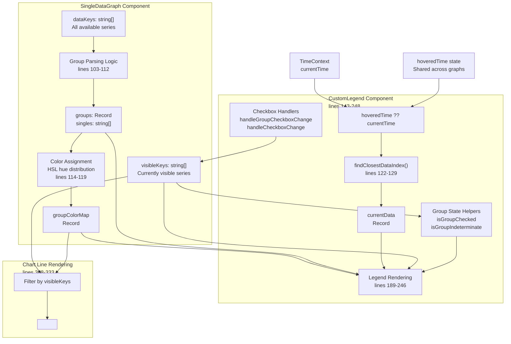
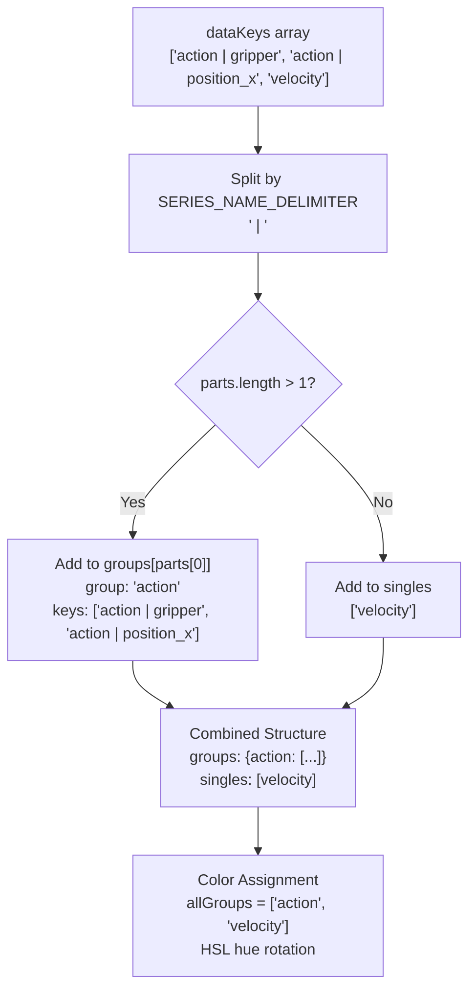
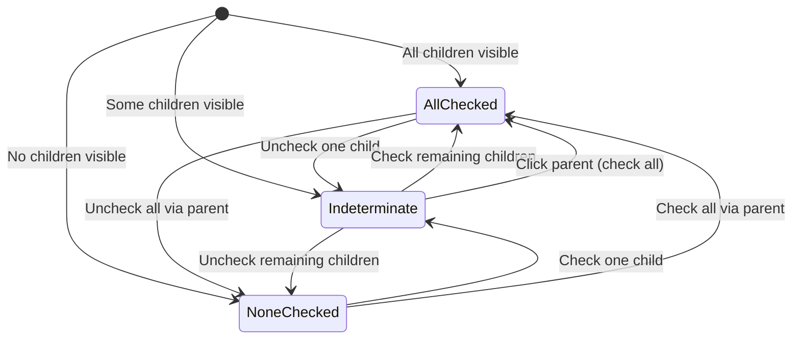
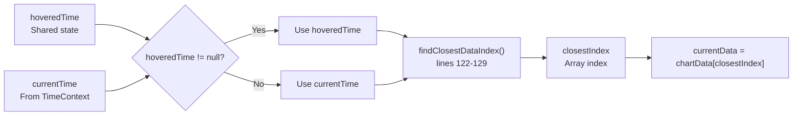
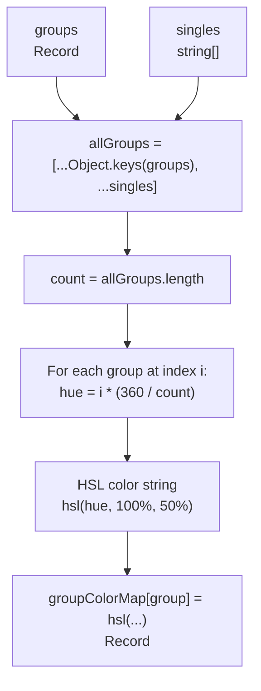
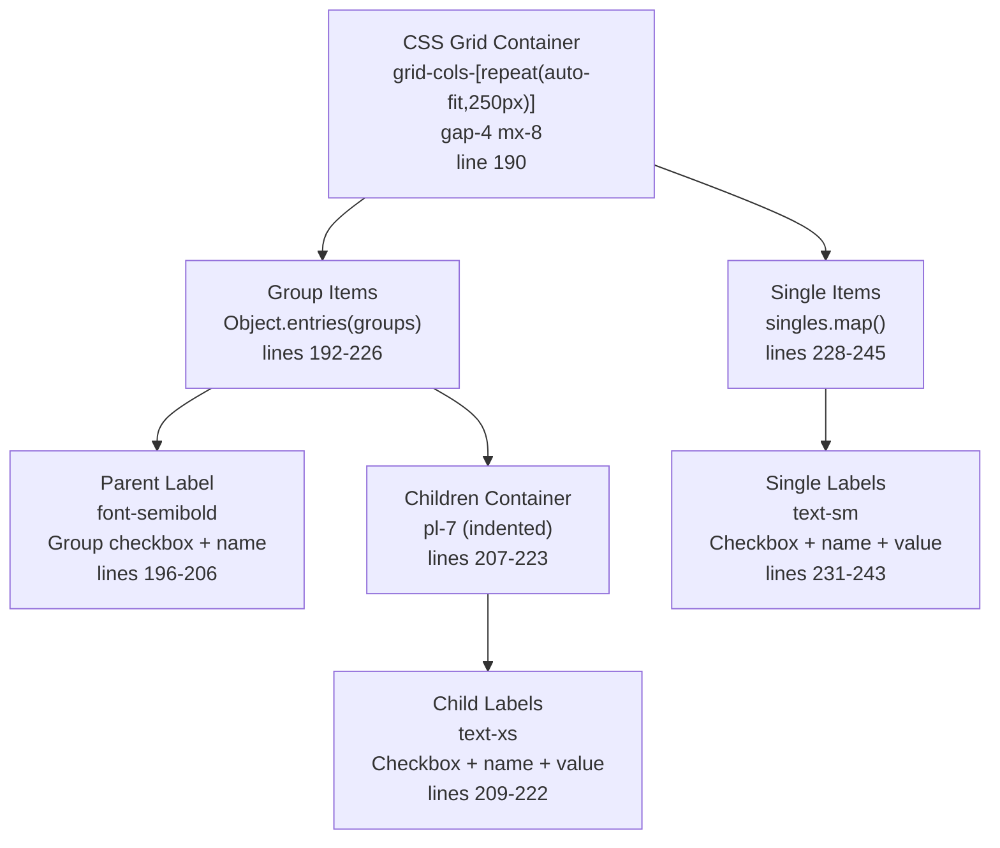
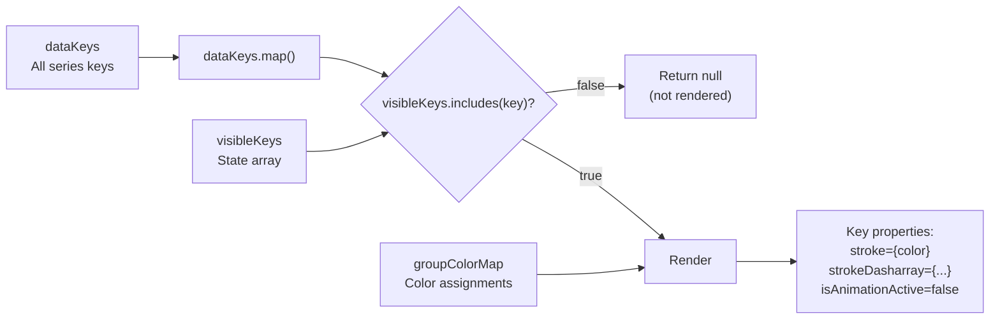
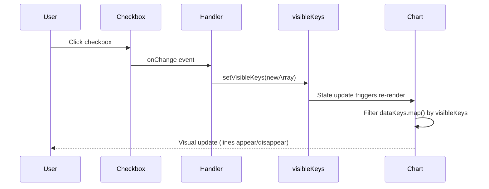
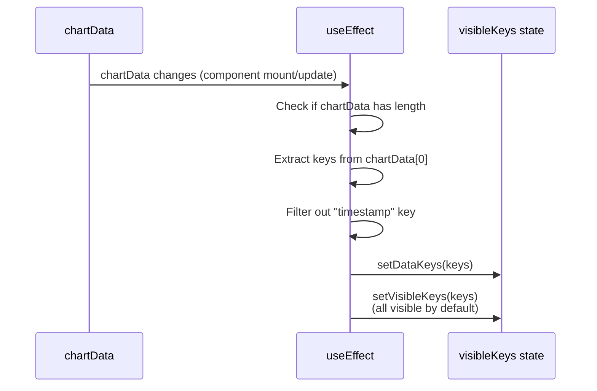

<!-- source: DeepWiki mcp.deepwiki.com · repo huggingface/lerobot-dataset-visualizer · page 6.2 Interactive Legend System · fetched 2026-10-26 -->

# Interactive Legend System

<details>
<summary>Relevant source files</summary>

The following files were used as context for generating this wiki page:

- [src/components/data-recharts.tsx](src/components/data-recharts.tsx)

</details>


## Purpose and Scope

The Interactive Legend System provides a custom legend implementation for the chart visualization that enables users to toggle series visibility, view current data values, and manage hierarchical data groupings. This system is implemented as the `CustomLegend` component within the `DataRecharts` module and replaces Recharts' default legend with a more feature-rich alternative.

This page documents the legend's hierarchical checkbox system, current value display mechanism, and visibility state management. For information about the chart rendering itself, see [Chart Rendering and Recharts Integration](#6.1). For details on how data is grouped and prepared for visualization, see [Chart Data Transformation](#3.4).

**Sources:** [src/components/data-recharts.tsx:143-248]()

---

## Architecture Overview

The legend system operates as a stateful component within each `SingleDataGraph` instance, managing visibility state independently while sharing time-synchronized value displays across all charts.



**Diagram: Interactive Legend Architecture** - Shows the flow from data keys through parsing, color assignment, and legend rendering to chart line filtering. The legend component maintains its own visibility state while consuming shared time state for value display.

**Sources:** [src/components/data-recharts.tsx:54-341]()

---

## Hierarchical Structure and Grouping

The legend parses data keys using the `SERIES_NAME_DELIMITER` (" | ") to determine hierarchical relationships. Keys containing the delimiter are grouped under parent categories, while standalone keys are treated as singles.

### Parsing Logic

The grouping logic executes twice in the component: once at the `SingleDataGraph` level for initial setup [src/components/data-recharts.tsx:100-112](), and again within `CustomLegend` for rendering [src/components/data-recharts.tsx:149-161]().



**Diagram: Data Key Parsing** - Shows how the legend categorizes data keys into hierarchical groups versus standalone singles, which determines the legend's visual structure.

**Sources:** [src/components/data-recharts.tsx:100-112](), [src/components/data-recharts.tsx:149-161]()

### Data Structures

The parsed structure creates two collections:

| Structure | Type | Contents | Example |
|-----------|------|----------|---------|
| `groups` | `Record<string, string[]>` | Parent category mapped to child keys | `{ "action": ["action \| gripper", "action \| position_x"] }` |
| `singles` | `string[]` | Keys without hierarchical structure | `["velocity", "timestamp"]` |

**Sources:** [src/components/data-recharts.tsx:101-111]()

---

## Checkbox State Management

The legend implements a three-state checkbox system for hierarchical groups: checked, unchecked, and indeterminate. The `visibleKeys` state array tracks which series are currently enabled for rendering.

### State Computation



**Diagram: Parent Checkbox State Machine** - Illustrates the three possible states for parent checkboxes and transitions between them based on child visibility.

**Sources:** [src/components/data-recharts.tsx:170-171]()

### Helper Functions

Two helper functions compute the parent checkbox state:

**`isGroupChecked(group: string)`** [src/components/data-recharts.tsx:170]()
- Returns `true` if all children in the group are in `visibleKeys`
- Uses `Array.every()` to check membership

**`isGroupIndeterminate(group: string)`** [src/components/data-recharts.tsx:171]()
- Returns `true` if some (but not all) children are visible
- Evaluated as: `some children visible AND not all checked`

### Checkbox Handlers

**`handleGroupCheckboxChange(group: string)`** [src/components/data-recharts.tsx:173-181]()

Toggles all children in a group based on current state:

```typescript
if (isGroupChecked(group)) {
  // Remove all children from visibleKeys
  setVisibleKeys((prev) => prev.filter(k => !groups[group].includes(k)));
} else {
  // Add all children to visibleKeys (deduplicates with Set)
  setVisibleKeys((prev) => Array.from(new Set([...prev, ...groups[group]])));
}
```

**`handleCheckboxChange(key: string)`** [src/components/data-recharts.tsx:183-187]()

Toggles individual series visibility:

```typescript
setVisibleKeys((prev) =>
  prev.includes(key) ? prev.filter((k) => k !== key) : [...prev, key]
);
```

**Sources:** [src/components/data-recharts.tsx:170-187]()

---

## Current Value Display

The legend displays real-time values for each data series based on the current playback time or hovered time. This provides immediate feedback about data values at the active time point.

### Time Source Resolution



**Diagram: Time Resolution for Value Display** - Shows the precedence logic where hovered time takes priority over playback time for displaying values.

**Sources:** [src/components/data-recharts.tsx:144-147]()

### Closest Data Point Algorithm

The `findClosestDataIndex` function implements a ceiling-based lookup [src/components/data-recharts.tsx:122-129]():

```typescript
const findClosestDataIndex = (time: number) => {
  if (!chartData.length) return 0;
  // Find the first data point whose timestamp is >= time (ceiling)
  const idx = chartData.findIndex((point) => point.timestamp >= time);
  if (idx !== -1) return idx;
  // If all timestamps are less than time, return the last index
  return chartData.length - 1;
};
```

This algorithm ensures that:
1. Values snap to the next available data point (ceiling behavior)
2. Boundary conditions are handled (before first point, after last point)
3. Performance is O(n) but acceptable for typical dataset sizes

**Sources:** [src/components/data-recharts.tsx:122-129]()

### Value Rendering

Values are formatted and displayed with conditional styling [src/components/data-recharts.tsx:218-220]():

```typescript
<span className={`text-xs font-mono ml-auto ${visibleKeys.includes(key) ? "text-orange-300" : "text-gray-500"}`}>
  {typeof currentData[key] === "number" ? currentData[key].toFixed(2) : "--"}
</span>
```

| Condition | Display | Color Class |
|-----------|---------|-------------|
| Series visible + value exists | `value.toFixed(2)` | `text-orange-300` |
| Series visible + value missing | `"--"` | `text-orange-300` |
| Series hidden + value exists | `value.toFixed(2)` | `text-gray-500` |
| Series hidden + value missing | `"--"` | `text-gray-500` |

**Sources:** [src/components/data-recharts.tsx:218-220](), [src/components/data-recharts.tsx:240-242]()

---

## Color Assignment System

The legend uses HSL color space with evenly distributed hues to maximize visual distinction between groups. Each group (or single series) receives a unique color that is shared by all its children.

### Color Map Generation



**Diagram: HSL Hue Distribution** - Shows how colors are assigned by evenly distributing hue values around the color wheel.

**Sources:** [src/components/data-recharts.tsx:114-119](), [src/components/data-recharts.tsx:163-168]()

### Color Application

The color map is used in multiple locations:

1. **Checkbox accent color** [src/components/data-recharts.tsx:203](): `style={{ accentColor: color }}`
2. **Chart line strokes** [src/components/data-recharts.tsx:324](): `stroke={color}`
3. **Visual consistency** across legend items and their corresponding chart lines

For grouped series, the primary (first) child uses a solid line while subsequent children use dashed lines (`strokeDasharray: "5 5"`) [src/components/data-recharts.tsx:312-316]() to maintain visual distinction while preserving color group identity.

**Sources:** [src/components/data-recharts.tsx:114-119](), [src/components/data-recharts.tsx:203](), [src/components/data-recharts.tsx:309-316](), [src/components/data-recharts.tsx:324]()

---

## Legend Rendering Structure

The legend uses a CSS Grid layout to arrange items into a responsive multi-column display, with hierarchical groups showing parent/child relationships through indentation.

### Layout Structure



**Diagram: Legend DOM Structure** - Shows the hierarchical DOM layout with indentation for grouped children and equal treatment for singles.

**Sources:** [src/components/data-recharts.tsx:189-246]()

### Component Hierarchy by Element Type

| Element Type | Parent Element | Indentation | Text Size | Lines |
|--------------|----------------|-------------|-----------|-------|
| Group parent checkbox | Grid cell | None (base) | `text-sm` | 196-206 |
| Group child checkbox | `pl-7` div | 7 units left | `text-xs` | 209-222 |
| Single checkbox | Grid cell | None (base) | `text-sm` | 231-243 |

### Indeterminate Checkbox Implementation

Parent checkboxes use the `indeterminate` DOM property, which cannot be set via HTML attributes [src/components/data-recharts.tsx:200]():

```typescript
<input
  type="checkbox"
  checked={isGroupChecked(group)}
  ref={el => { if (el) el.indeterminate = isGroupIndeterminate(group); }}
  onChange={() => handleGroupCheckboxChange(group)}
  // ...
/>
```

The `ref` callback sets the `indeterminate` property imperatively whenever the element is mounted or updated.

**Sources:** [src/components/data-recharts.tsx:189-246]()

---

## Integration with Chart Rendering

The legend's visibility state directly controls which `<Line>` components are rendered in the Recharts chart. This integration happens through the `visibleKeys` state array.

### Line Rendering Filter



**Diagram: Line Rendering Control Flow** - Shows how the visibility state filters which Line components are rendered in the chart.

**Sources:** [src/components/data-recharts.tsx:308-333]()

### Rendering Logic

The line rendering iterates over all `dataKeys` but conditionally renders based on visibility [src/components/data-recharts.tsx:308-333]():

```typescript
{dataKeys.map((key) => {
  // Determine group and color
  const group = key.includes(SERIES_NAME_DELIMITER) 
    ? key.split(SERIES_NAME_DELIMITER)[0] 
    : key;
  const color = groupColorMap[group];
  
  // Apply dashed style to subsequent children in a group
  let strokeDasharray: string | undefined = undefined;
  if (groups[group] && groups[group].length > 1) {
    const idxInGroup = groups[group].indexOf(key);
    if (idxInGroup > 0) strokeDasharray = "5 5";
  }
  
  return (
    visibleKeys.includes(key) && (
      <Line
        key={key}
        type="monotone"
        dataKey={key}
        stroke={color}
        strokeDasharray={strokeDasharray}
        dot={false}
        activeDot={false}
        strokeWidth={1.5}
        isAnimationActive={false}
      />
    )
  );
})}
```

This approach ensures:
1. React component keys remain stable (based on data key, not visibility)
2. No re-mounting of components when toggling visibility
3. Consistent color assignment regardless of visibility state
4. Group-based visual styling (dashed lines for secondary children)

**Sources:** [src/components/data-recharts.tsx:308-333]()

---

## User Interaction Patterns

The legend supports several interaction patterns that provide control over chart visualization and data exploration.

### Interaction Matrix

| User Action | Target Element | State Change | Visual Effect |
|-------------|---------------|--------------|---------------|
| Click parent checkbox (all checked) | Group parent | Remove all children from `visibleKeys` | All child lines disappear |
| Click parent checkbox (none/some checked) | Group parent | Add all children to `visibleKeys` | All child lines appear |
| Click child checkbox | Individual series | Toggle key in `visibleKeys` | Line appears/disappears |
| Click single checkbox | Ungrouped series | Toggle key in `visibleKeys` | Line appears/disappears |
| Hover over chart | Chart area | Update `hoveredTime` | Values update in legend |
| Leave chart area | Chart area | Set `hoveredTime = null` | Values revert to `currentTime` |

### State Propagation Flow



**Diagram: Checkbox Interaction Sequence** - Shows the event flow from user click to visual chart update through React state management.

**Sources:** [src/components/data-recharts.tsx:173-187](), [src/components/data-recharts.tsx:308-333]()

### Value Display Interactivity

The legend's value display responds to both playback position and mouse hover [src/components/data-recharts.tsx:144-147]():

1. **Default state**: Values reflect `currentTime` from TimeContext
2. **Hover state**: Values reflect `hoveredTime` from mouse position
3. **Shared hover**: All graphs share the same `hoveredTime` state [src/components/data-recharts.tsx:28]()
4. **Transition**: `onMouseLeave` resets to default state [src/components/data-recharts.tsx:131-133]()

This provides immediate visual feedback when exploring data by scrubbing over charts.

**Sources:** [src/components/data-recharts.tsx:28](), [src/components/data-recharts.tsx:131-133](), [src/components/data-recharts.tsx:144-147](), [src/components/data-recharts.tsx:259-266]()

---

## Styling and Visual Design

The legend applies conditional styling based on visibility state and hierarchical level to create clear visual hierarchy and state indication.

### Text Color Scheme

| Element | Visible State | Color Class | Hex Equivalent |
|---------|--------------|-------------|----------------|
| Parent label | N/A | `text-white` | `#FFFFFF` |
| Child label | Visible | `text-white` | `#FFFFFF` |
| Child label | Hidden | `text-gray-400` | `#9CA3AF` |
| Single label | Visible | `text-white` | `#FFFFFF` |
| Single label | Hidden | `text-gray-400` | `#9CA3AF` |
| Value display | Visible | `text-orange-300` | `#FDBA74` |
| Value display | Hidden | `text-gray-500` | `#6B7280` |

**Sources:** [src/components/data-recharts.tsx:205](), [src/components/data-recharts.tsx:217](), [src/components/data-recharts.tsx:239]()

### Responsive Grid Layout

The legend uses CSS Grid with auto-fitting columns [src/components/data-recharts.tsx:190]():

```css
grid-cols-[repeat(auto-fit,250px)]
```

This creates:
- Fixed-width columns (250px each)
- Automatic column count based on available space
- Responsive wrapping to multiple rows when needed
- Consistent spacing with `gap-4` (1rem) between items

### Font Hierarchy

| Element | Font Size | Font Weight | Monospace |
|---------|-----------|-------------|-----------|
| Parent label | `text-sm` (0.875rem) | `font-semibold` | No |
| Child label | `text-xs` (0.75rem) | Normal | No |
| Single label | `text-sm` (0.875rem) | Normal | No |
| Value display | `text-xs` or `text-sm` | Normal | Yes (`font-mono`) |

The monospace font for values ensures numerical alignment and readability.

**Sources:** [src/components/data-recharts.tsx:205](), [src/components/data-recharts.tsx:217-220](), [src/components/data-recharts.tsx:239-242]()

---

## State Initialization and Lifecycle

The legend's visibility state is initialized when chart data is first loaded and maintained independently for each graph instance.

### Initialization Sequence



**Diagram: Visibility State Initialization** - Shows how all series start as visible when chart data loads.

**Sources:** [src/components/data-recharts.tsx:92-98]()

### Initialization Code

```typescript
useEffect(() => {
  if (!chartData || chartData.length === 0) return;
  // Get all keys except timestamp from the first row
  const keys = Object.keys(chartData[0]).filter((k) => k !== "timestamp");
  setDataKeys(keys);
  setVisibleKeys(keys); // All series visible initially
}, [chartData]);
```

Key behaviors:
1. **Dependency**: Re-runs when `chartData` changes
2. **Guard clause**: Early return if data is empty
3. **Key extraction**: Uses first data point as schema reference
4. **Timestamp exclusion**: Removes "timestamp" from plottable series
5. **Default visibility**: All series start visible

**Sources:** [src/components/data-recharts.tsx:92-98]()

### Independent State Per Graph

Each `SingleDataGraph` instance maintains its own `visibleKeys` state [src/components/data-recharts.tsx:90](). This means:

- Multiple graphs can have different visibility configurations
- Toggling visibility in one graph does not affect others
- Each graph's legend operates independently
- State is not lifted to parent component

This design choice prioritizes flexibility over synchronized visibility across graphs.

**Sources:** [src/components/data-recharts.tsx:54-341]()

---

