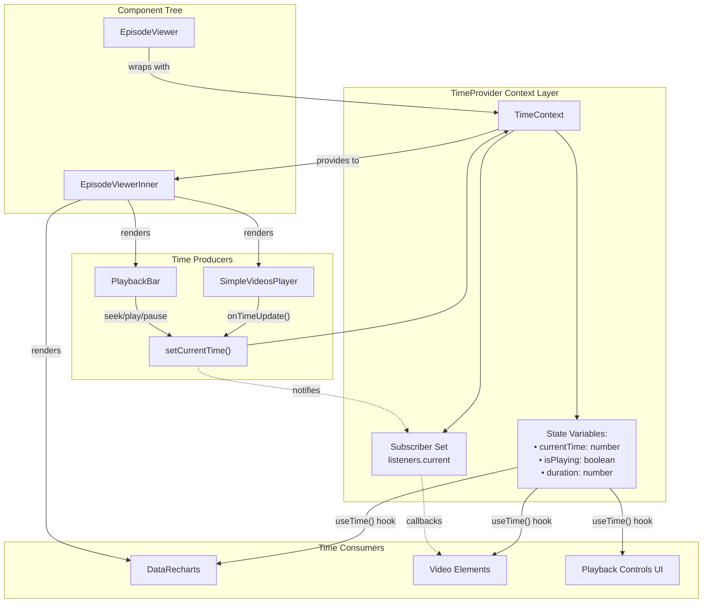
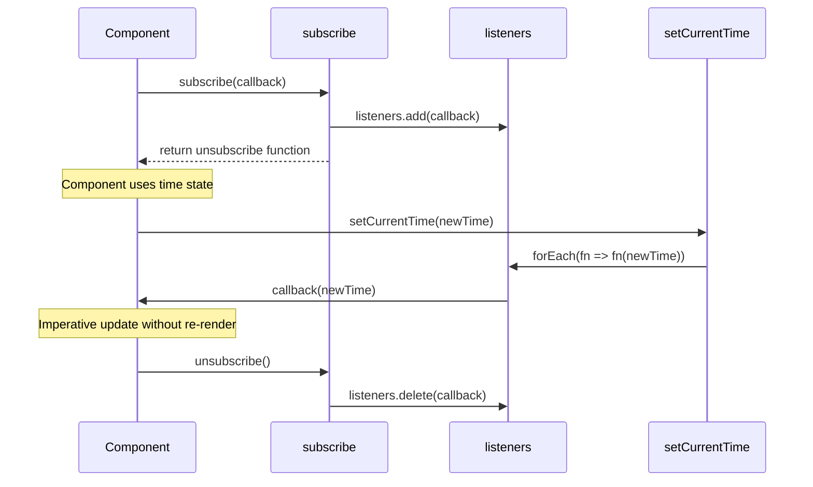
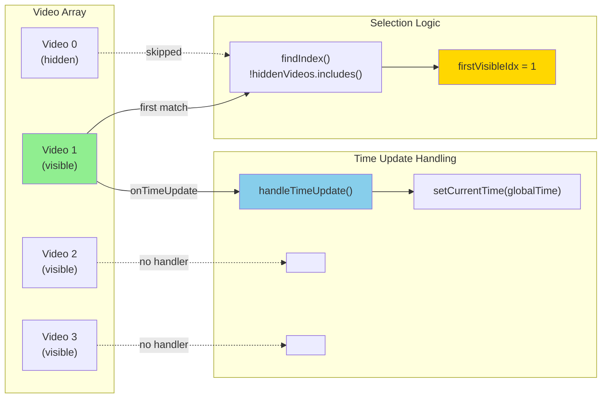
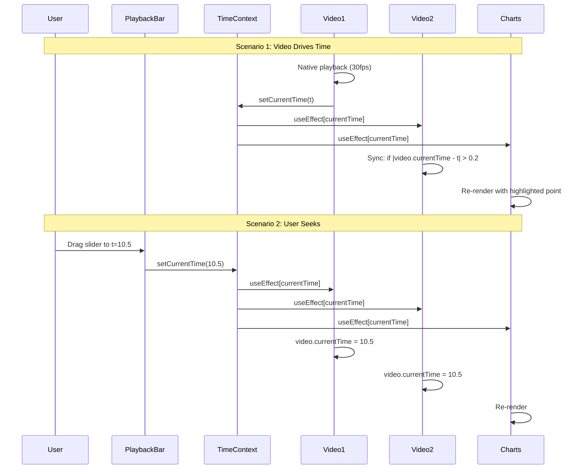
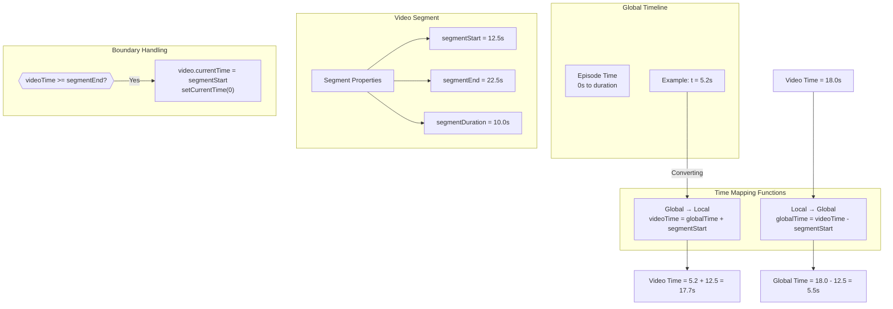
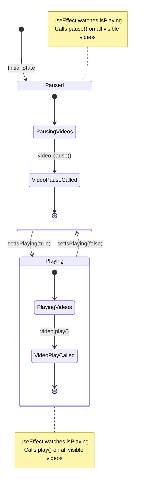
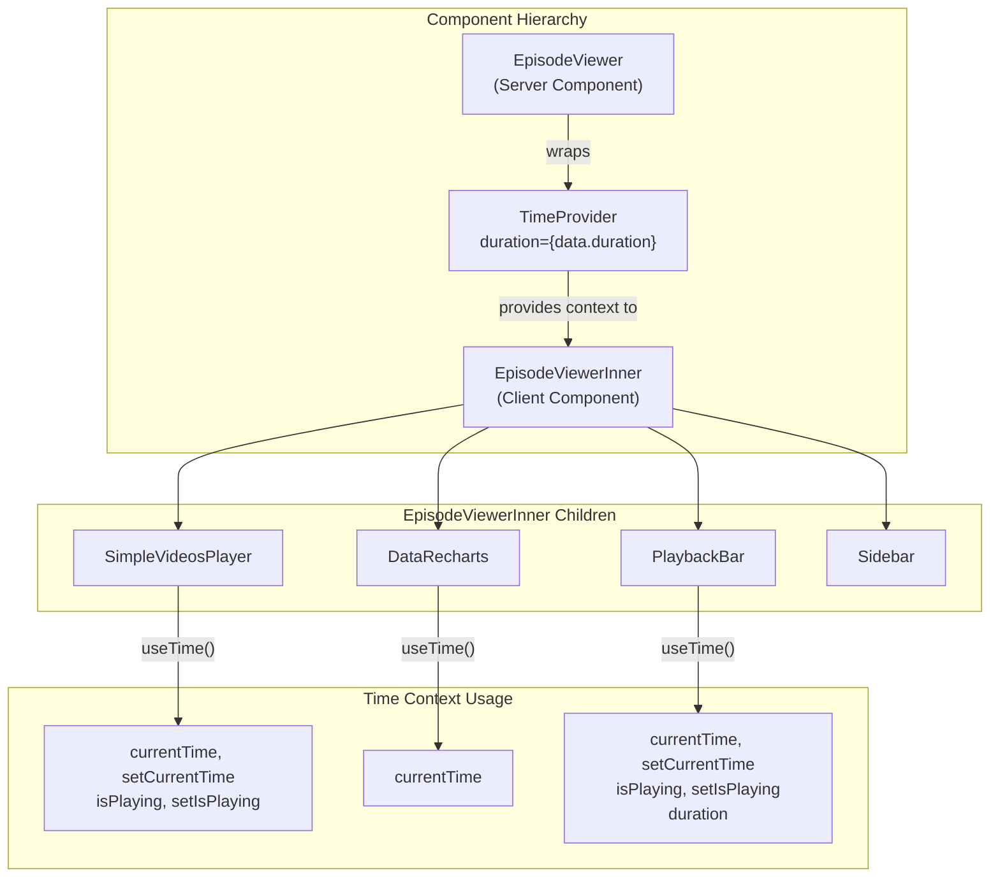
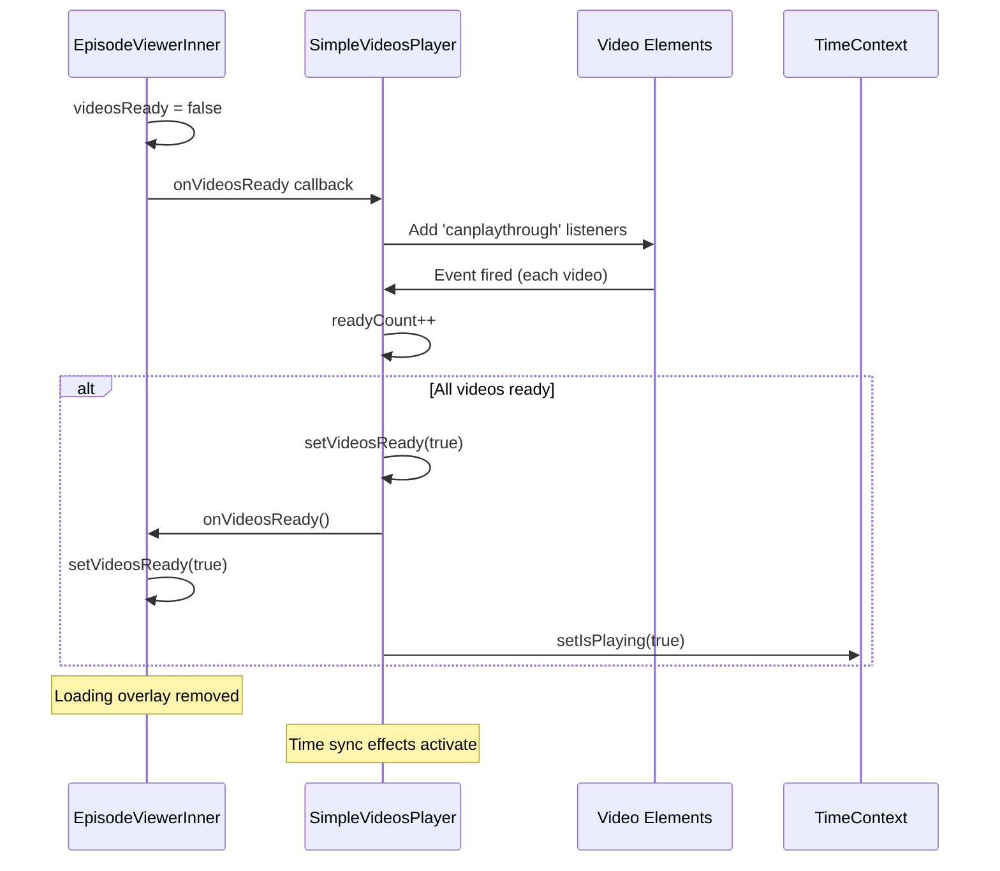
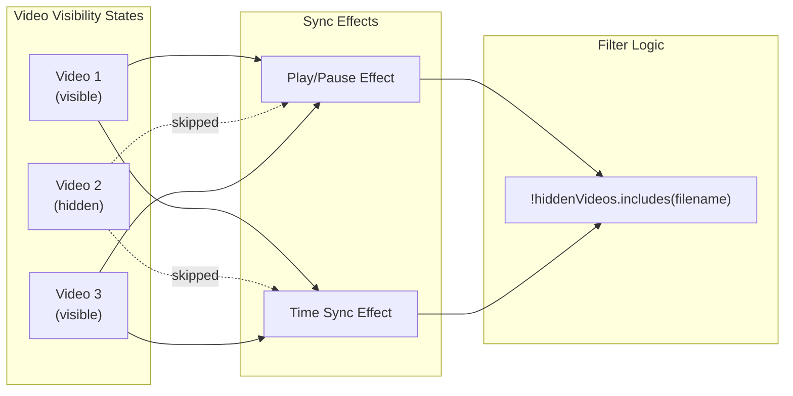

<!-- source: DeepWiki mcp.deepwiki.com · repo huggingface/lerobot-dataset-visualizer · page 7 Time Synchronization System · fetched 2026-10-26 -->

# Time Synchronization System

<details>
<summary>Relevant source files</summary>

The following files were used as context for generating this wiki page:

- [src/app/[org]/[dataset]/[episode]/episode-viewer.tsx](src/app/[org]/[dataset]/[episode]/episode-viewer.tsx)
- [src/components/simple-videos-player.tsx](src/components/simple-videos-player.tsx)
- [src/context/time-context.tsx](src/context/time-context.tsx)

</details>


## Purpose and Scope

The Time Synchronization System provides unified playback state management across multiple video streams and data visualization components in the LeRobot Dataset Visualizer. This system ensures that videos, charts, and playback controls remain synchronized as users scrub through episode timelines, even when dealing with segmented videos or multiple camera angles.

For information about the video playback components themselves, see [Video Playback System](#5). For details on chart rendering and interaction, see [Data Visualization (Charts)](#6).

**Sources:** [src/context/time-context.tsx:1-65](), [src/app/[org]/[dataset]/[episode]/episode-viewer.tsx:1-261]()

---

## Architecture Overview

The synchronization system follows a centralized state management pattern using React Context, where a single `TimeProvider` component maintains global playback state that all child components can access and modify.



**Diagram: Time Synchronization Architecture**

The `TimeProvider` acts as a central hub, maintaining three key state variables and broadcasting changes to all subscribed components. Video players act as the primary time producers through their native `onTimeUpdate` events, while charts and controls consume time state to update their displays.

**Sources:** [src/context/time-context.tsx:9-64](), [src/app/[org]/[dataset]/[episode]/episode-viewer.tsx:36-39]()

---

## Core Components

### TimeContext Provider Implementation

The `TimeContext` is implemented as a React Context with a custom provider component that manages state and provides a subscription mechanism for imperative updates.

| Feature | Implementation | Purpose |
|---------|---------------|---------|
| **State Storage** | `useState` hooks for `currentTime`, `isPlaying`, `duration` | Reactive state that triggers re-renders |
| **Subscriber Registry** | `useRef<Set<(t: number) => void>>` | Non-reactive listener storage for imperative updates |
| **Update Function** | `updateTime` callback | Single entry point that updates state and notifies subscribers |
| **Hook Export** | `useTime()` custom hook | Typed context access with error checking |

The provider is initialized with a `duration` prop from the episode data and wraps the entire `EpisodeViewerInner` component tree:

```
<TimeProvider duration={data.duration}>
  <EpisodeViewerInner ... />
</TimeProvider>
```

**Sources:** [src/context/time-context.tsx:20-64](), [src/app/[org]/[dataset]/[episode]/episode-viewer.tsx:36-39]()

### Time State Variables

The three core state variables maintained by `TimeContext`:

**`currentTime: number`**
- Represents the current playback position in seconds (global timeline)
- Updated by video `onTimeUpdate` events and playback controls
- Range: `0` to `duration`
- For segmented videos (v3.0), this is the **global time**, not the video segment time

**`isPlaying: boolean`**
- Controls play/pause state across all videos simultaneously
- Updated by keyboard shortcuts, playback controls, and video ready callbacks
- When `true`, all visible videos play synchronously

**`duration: number`**
- Total episode duration in seconds
- Initialized from episode data at provider creation
- Can be updated dynamically via `setDuration` (though typically static)

**Sources:** [src/context/time-context.tsx:10-17](), [src/context/time-context.tsx:32-34]()

### Subscription Mechanism

The context provides a `subscribe` function for components that need imperative time updates without triggering React re-renders:



**Diagram: Subscription Lifecycle**

This pattern is useful for performance-critical updates where React's render cycle would be too slow (e.g., high-frequency video time updates).

**Sources:** [src/context/time-context.tsx:35-47](), [src/context/time-context.tsx:38-41]()

---

## Time Producers and Consumers

### First-Visible-Video Pattern

The synchronization system uses a "first-visible-video" pattern to determine which video element drives the global time state. This prevents conflicts when multiple videos are playing simultaneously.



**Diagram: First-Visible-Video Selection Pattern**

Only the first visible video (after filtering hidden videos) has its `onTimeUpdate` handler attached. This video becomes the authoritative source for time updates during playback.

**Sources:** [src/components/simple-videos-player.tsx:32-34](), [src/components/simple-videos-player.tsx:154-167](), [src/components/simple-videos-player.tsx:257]()

### Video Players as Time Producers

The `SimpleVideosPlayer` component produces time updates through the native HTML5 video `onTimeUpdate` event:

**Time Update Flow:**
1. First visible video element fires `onTimeUpdate` event
2. `handleTimeUpdate` extracts `video.currentTime` from event target
3. For segmented videos, converts segment time to global time: `globalTime = video.currentTime - (segmentStart || 0)`
4. Calls `setCurrentTime(globalTime)` to update context
5. Context broadcasts update to all subscribers and triggers React re-renders

**Key Implementation Details:**
- Time updates only propagate from the first visible video to prevent conflicts
- Segmented videos (v3.0 feature) require time transformation from segment coordinates to global coordinates
- Updates occur at ~30-60Hz (video frame rate), though React batches state updates

**Sources:** [src/components/simple-videos-player.tsx:154-167](), [src/components/simple-videos-player.tsx:257]()

### Charts and Controls as Time Consumers

Components that consume time state access it via the `useTime()` hook and react to changes through React's render cycle:

**`DataRecharts` Component:**
- Reads `currentTime` to highlight the current data point
- Listens for `currentTime` changes via React state subscription (automatic through hook)
- Does not produce time updates (pure consumer)

**`PlaybackBar` Component:**
- Reads `currentTime` to update slider position
- Reads `isPlaying` to show play/pause button state
- Produces time updates when user drags slider or clicks play/pause
- Uses debouncing to avoid excessive updates during dragging

**Sources:** [src/app/[org]/[dataset]/[episode]/episode-viewer.tsx:61](), [src/components/simple-videos-player.tsx:25]()

---

## Synchronization Patterns

### Bidirectional Time Synchronization



**Diagram: Bidirectional Synchronization Flow**

The system supports both video-driven time updates (during playback) and user-driven time updates (seeking). A tolerance threshold of 0.2 seconds prevents excessive seeking when videos naturally drift slightly out of sync.

**Sources:** [src/components/simple-videos-player.tsx:134-152](), [src/components/simple-videos-player.tsx:154-167]()

### Segmented Video Time Mapping (v3.0)

For v3.0 datasets with segmented videos, each video operates on a local segment timeline that must be mapped to/from the global episode timeline:



**Diagram: Segmented Video Time Transformation**

**Key Implementation Points:**

1. **Global to Local Transformation** (when syncing from context to video):
   - `targetTime = (segmentStart || 0) + currentTime`
   - Applied in the sync effect: [src/components/simple-videos-player.tsx:143-145]()

2. **Local to Global Transformation** (when updating context from video):
   - `globalTime = video.currentTime - (segmentStart || 0)`
   - Applied in `handleTimeUpdate`: [src/components/simple-videos-player.tsx:160-164]()

3. **Segment Boundary Enforcement**:
   - When `video.currentTime >= segmentEnd`, reset to `segmentStart`
   - Also resets global time to 0 to loop the episode
   - Implemented via `timeupdate` listener: [src/components/simple-videos-player.tsx:60-71]()

**Sources:** [src/components/simple-videos-player.tsx:58-86](), [src/components/simple-videos-player.tsx:143-145](), [src/components/simple-videos-player.tsx:160-164]()

### Play/Pause State Synchronization

All visible videos share a single play/pause state managed by the context:



**Diagram: Play/Pause State Machine**

The synchronization ensures that all visible videos play/pause together, while hidden videos remain paused to conserve resources. The effect runs when `isPlaying` changes or when the `hiddenVideos` array is modified.

**Sources:** [src/components/simple-videos-player.tsx:116-132](), [src/app/[org]/[dataset]/[episode]/episode-viewer.tsx:61]()

---

## Integration with Components

### EpisodeViewer Integration

The `EpisodeViewer` component serves as the integration point that wraps the entire component tree with the `TimeProvider`:



**Diagram: Component Tree Integration**

The provider is initialized with the episode duration from the fetched data and wraps only the `EpisodeViewerInner` component, not the error handling logic. This ensures the context is only available when valid episode data exists.

**Sources:** [src/app/[org]/[dataset]/[episode]/episode-viewer.tsx:36-39](), [src/app/[org]/[dataset]/[episode]/episode-viewer.tsx:42-61]()

### URL Time Parameter Synchronization

The system synchronizes time state with the URL `?t=` parameter to enable deep linking and sharing specific timestamps:

**Synchronization Flow:**

1. **Initialization from URL**:
   - On mount, reads `?t=` parameter from `searchParams`
   - Parses float value and calls `setCurrentTime(timeValue)`
   - Source: [src/app/[org]/[dataset]/[episode]/episode-viewer.tsx:88-97]()

2. **URL Updates During Playback**:
   - Only updates URL when **not playing** (to avoid excessive history entries)
   - Debounces to integer seconds using `lastUrlSecondRef`
   - Uses `window.history.replaceState()` instead of pushing new history entries
   - Source: [src/app/[org]/[dataset]/[episode]/episode-viewer.tsx:122-140]()

3. **Parent Window Communication**:
   - When embedded in HuggingFace Spaces, posts messages to parent window
   - Keeps parent URL in sync with embedded viewer state
   - Source: [src/app/[org]/[dataset]/[episode]/episode-viewer.tsx:136-138]()

**Debouncing Strategy:**
```
Math.floor(currentTime) !== lastUrlSecondRef.current
```
This ensures URL updates only when the integer second changes, preventing excessive browser history pollution during scrubbing.

**Sources:** [src/app/[org]/[dataset]/[episode]/episode-viewer.tsx:88-140]()

### Keyboard Shortcut Integration

The episode viewer provides global keyboard shortcuts that interact with the time synchronization system:

| Key | Action | Time Impact |
|-----|--------|-------------|
| **Space** | Toggle play/pause | Sets `isPlaying` to opposite value |
| **Arrow Down** | Next episode | Navigates to new episode (resets time) |
| **Arrow Up** | Previous episode | Navigates to new episode (resets time) |

The space bar directly manipulates the `isPlaying` state through `setIsPlaying()`, which triggers the synchronization effect in `SimpleVideosPlayer` to play/pause all videos.

**Sources:** [src/app/[org]/[dataset]/[episode]/episode-viewer.tsx:142-162]()

---

## Implementation Details

### Video Ready Synchronization

Before time synchronization begins, the system must ensure all videos are loaded and ready to play. This is managed through a ready callback pattern:



**Diagram: Video Ready Synchronization Flow**

The `videosReady` state gates the time synchronization effects to prevent attempting to control videos that haven't loaded yet. Once all videos report ready, the system automatically starts playback.

**Sources:** [src/components/simple-videos-player.tsx:42-113](), [src/app/[org]/[dataset]/[episode]/episode-viewer.tsx:52-54]()

### Sync Tolerance and Drift Correction

To handle natural video playback drift while avoiding excessive seeking, the synchronization logic uses a tolerance threshold:

**Drift Correction Logic:**
```
if (Math.abs(video.currentTime - targetTime) > 0.2) {
  video.currentTime = targetTime;
}
```

This 0.2-second tolerance prevents:
- Jittery playback from constant micro-corrections
- Audio glitches from frequent seeks
- Performance degradation from excessive DOM manipulation

Videos are allowed to drift up to 200ms before correction is applied. During normal playback, videos stay synchronized through their shared `isPlaying` state rather than constant time corrections.

**Sources:** [src/components/simple-videos-player.tsx:147]()

### Hidden Video Optimization

The synchronization system optimizes performance by excluding hidden videos from time synchronization:



**Diagram: Hidden Video Filtering**

All synchronization effects check the `hiddenVideos` array before operating on video elements. This ensures:
- Hidden videos remain paused to conserve bandwidth
- Hidden videos don't consume CPU for time synchronization
- Only visible videos respond to playback state changes

**Sources:** [src/components/simple-videos-player.tsx:120](), [src/components/simple-videos-player.tsx:139]()

### Event Cleanup and Memory Management

The `SimpleVideosPlayer` component implements careful event listener cleanup to prevent memory leaks:

**Cleanup Strategy:**
1. Store cleanup functions on video elements as `_segmentHandlers` property
2. Remove all event listeners in useEffect cleanup function
3. Slice video refs array on length changes to prevent stale references

This pattern ensures that event listeners are properly removed when:
- Component unmounts
- Video list changes (e.g., dataset navigation)
- Video visibility changes

**Sources:** [src/components/simple-videos-player.tsx:82-111](), [src/components/simple-videos-player.tsx:36-39]()

---

## Summary

The Time Synchronization System provides a centralized, React Context-based solution for maintaining synchronized playback state across multiple video streams and data visualizations. Key design patterns include:

- **Centralized State Management**: Single source of truth via `TimeContext`
- **First-Visible-Video Pattern**: Prevents conflicts during simultaneous playback
- **Bidirectional Synchronization**: Supports both video-driven and user-driven time updates
- **Segmented Video Support**: Transparent time mapping for v3.0 datasets
- **Performance Optimization**: Drift tolerance, hidden video filtering, and subscription mechanisms

The system is architected to be version-agnostic (works with both v2.x and v3.0 datasets) and provides the foundation for synchronized multi-modal visualization of robotics episodes.

**Sources:** [src/context/time-context.tsx:1-65](), [src/components/simple-videos-player.tsx:1-271](), [src/app/[org]/[dataset]/[episode]/episode-viewer.tsx:1-261]()

---

