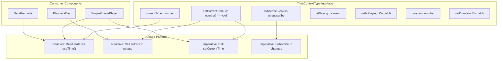
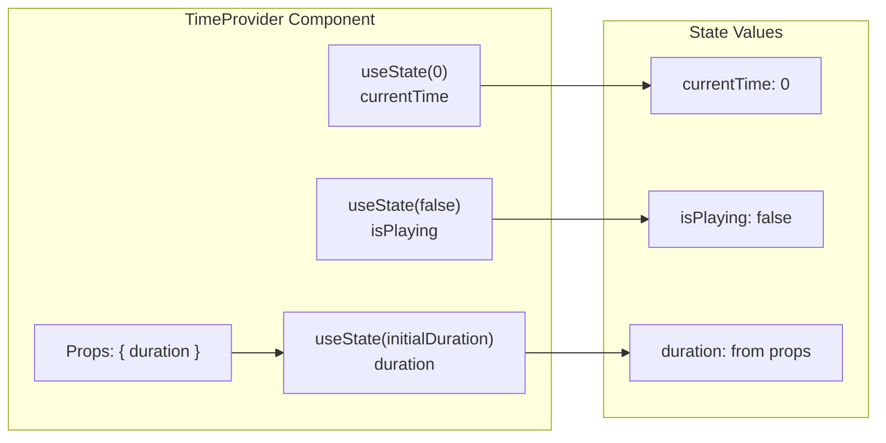
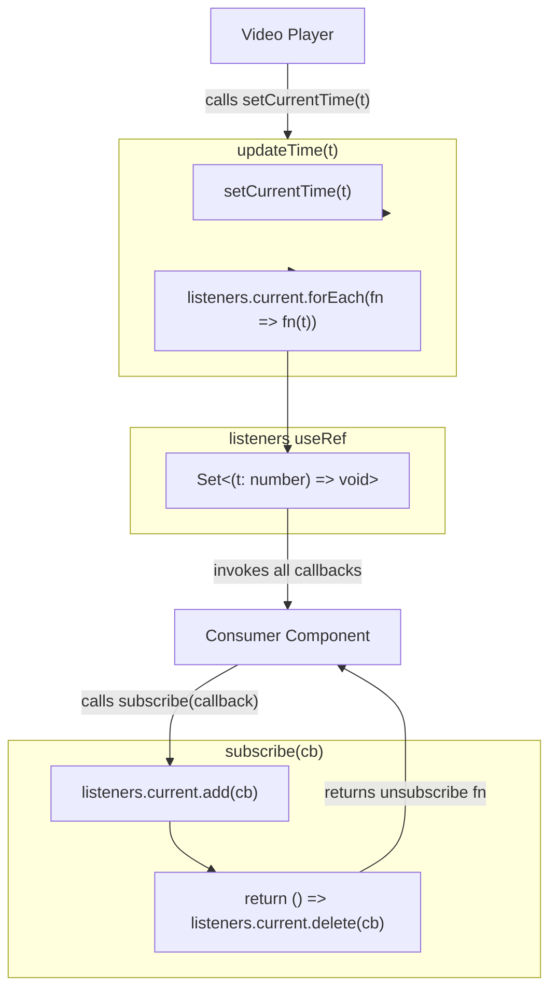
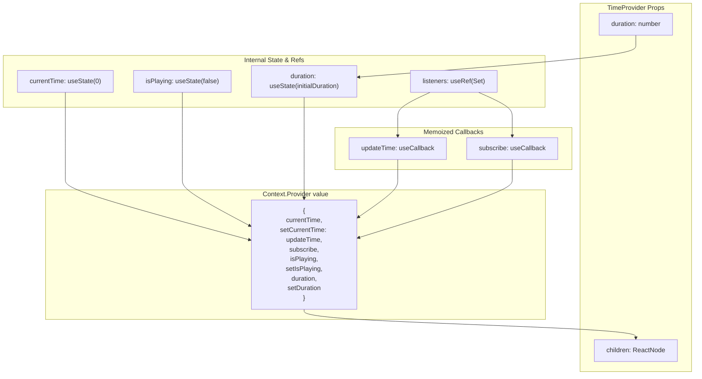
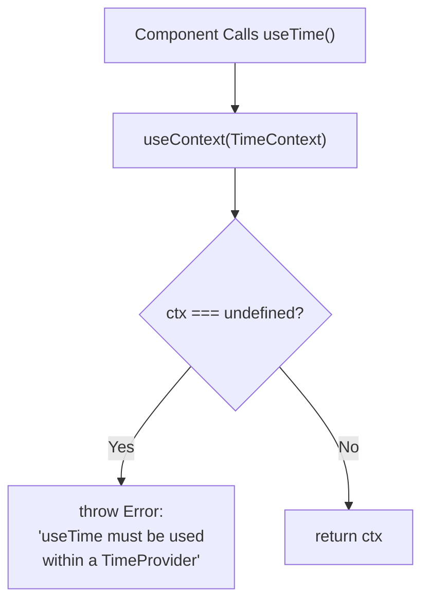
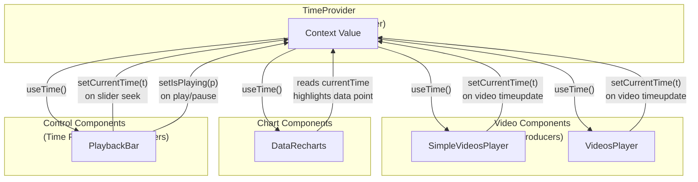

<!-- source: DeepWiki mcp.deepwiki.com · repo huggingface/lerobot-dataset-visualizer · page 7.1 TimeContext Provider and Hook · fetched 2026-10-26 -->

# TimeContext Provider and Hook

<details>
<summary>Relevant source files</summary>

The following files were used as context for generating this wiki page:

- [src/context/time-context.tsx](src/context/time-context.tsx)

</details>


## Purpose and Scope

This document describes the implementation of the `TimeContext` React Context and its associated `useTime` hook, which provide centralized time synchronization across the Episode Viewer interface. The TimeContext manages three pieces of global state (`currentTime`, `isPlaying`, `duration`) and implements a subscribe mechanism for imperative time updates. This architecture enables components like video players, charts, and playback controls to maintain synchronized state without prop drilling.

For information about how components consume and produce time updates in practice, see [Time Synchronization Patterns](#7.2). For the broader architecture that this context enables, see [Time Synchronization System](#7).

**Sources:** [src/context/time-context.tsx:1-64]()

---

## Context API Overview

The `TimeContext` provides a unified interface for managing playback state throughout the application. The context exposes seven members through its `TimeContextType` interface:

| Member | Type | Purpose |
|--------|------|---------|
| `currentTime` | `number` | The current playback position in the episode (global timeline) |
| `setCurrentTime` | `(t: number) => void` | Update current time and notify all subscribers |
| `subscribe` | `(cb: (t: number) => void) => () => void` | Register a callback for imperative time updates; returns unsubscribe function |
| `isPlaying` | `boolean` | Whether playback is currently active |
| `setIsPlaying` | `React.Dispatch<React.SetStateAction<boolean>>` | Standard React state setter for play/pause |
| `duration` | `number` | Total duration of the episode in seconds |
| `setDuration` | `React.Dispatch<React.SetStateAction<number>>` | Standard React state setter for episode duration |



**Sources:** [src/context/time-context.tsx:10-18]()

---

## State Management Architecture

The TimeProvider manages three independent pieces of React state using the `useState` hook. Each serves a distinct purpose in the playback system:

### State Initialization



| State Variable | Initial Value | Mutability Pattern |
|----------------|---------------|-------------------|
| `currentTime` | `0` | Updated via `updateTime` callback (wraps setState + notifies listeners) |
| `isPlaying` | `false` | Standard React state setter exposed directly to consumers |
| `duration` | `initialDuration` prop | Standard React state setter exposed directly to consumers |

The asymmetry in how `currentTime` is updated (via wrapped callback) versus the other states (via direct setters) reflects its dual role: `currentTime` must support both reactive React updates and imperative subscriber notifications.

**Sources:** [src/context/time-context.tsx:28-34]()

---

## Subscribe Mechanism (Pub-Sub Pattern)

The TimeContext implements a publish-subscribe pattern using a `useRef`-based Set to maintain listener callbacks. This enables imperative updates that bypass React's rendering cycle, which is critical for high-frequency time updates from video `onTimeUpdate` events.

### Implementation Details



The subscribe mechanism is implemented with two key functions:

**subscribe function** [src/context/time-context.tsx:44-47]()
- Adds callback to the `listeners` Set
- Returns an unsubscribe function that removes the callback
- Wrapped in `useCallback` to maintain referential stability

**updateTime function** [src/context/time-context.tsx:38-41]()
- Updates React state via `setCurrentTime`
- Synchronously invokes all registered listeners
- Wrapped in `useCallback` to prevent unnecessary re-renders

### Why Use Refs Instead of State?

The listener Set is stored in a `useRef` rather than state because:
1. **No re-renders needed**: Adding/removing listeners should not trigger component re-renders
2. **Synchronous updates**: `forEach` over the Set happens immediately, not queued in React's scheduler
3. **Performance**: Avoids creating new Set instances on every update

**Sources:** [src/context/time-context.tsx:35-47]()

---

## Provider Implementation

The `TimeProvider` component wraps child components and provides the context value through React's Context API.

### Component Structure



The provider's implementation follows standard React Context patterns:

1. **Accepts initial duration** via props [src/context/time-context.tsx:28-31]()
2. **Initializes three state variables** [src/context/time-context.tsx:32-34]()
3. **Creates ref for listener Set** [src/context/time-context.tsx:35]()
4. **Defines memoized callbacks** [src/context/time-context.tsx:38-47]()
5. **Provides context value** [src/context/time-context.tsx:50-62]()

### Callback Memoization

Both `updateTime` and `subscribe` are wrapped in `useCallback` with empty dependency arrays, ensuring they maintain referential stability across re-renders. This is important because:
- Consumers can safely add these callbacks to their own dependency arrays
- Prevents unnecessary re-renders when callbacks are passed as props
- Ensures `subscribe` returns the same unsubscribe function pattern

**Sources:** [src/context/time-context.tsx:28-64]()

---

## Consumer Hook (useTime)

The `useTime` hook provides type-safe access to the TimeContext with runtime validation.

### Implementation



The hook's implementation is minimal but critical for developer experience:

```typescript
export const useTime = () => {
  const ctx = useContext(TimeContext);
  if (!ctx) throw new Error("useTime must be used within a TimeProvider");
  return ctx;
};
```

**Key characteristics:**

| Aspect | Implementation Detail |
|--------|----------------------|
| Context access | Uses React's `useContext(TimeContext)` |
| Error handling | Throws descriptive error if used outside provider |
| Return type | `TimeContextType` (inferred, not explicit) |
| Type safety | TypeScript ensures returned value matches interface |

The error check prevents a common bug where components attempt to use the context outside the provider tree, which would otherwise result in accessing properties on `undefined`.

**Sources:** [src/context/time-context.tsx:22-26]()

---

## Usage Patterns in the Codebase

The TimeContext is consumed by multiple components throughout the application. Here's how different component types interact with it:



### Component Roles

| Component | Role | Methods Used |
|-----------|------|--------------|
| SimpleVideosPlayer | Time Producer | `setCurrentTime`, `subscribe`, reads `isPlaying` |
| DataRecharts | Time Consumer | Reads `currentTime` for highlighting |
| PlaybackBar | Producer & Consumer | `setCurrentTime` (seek), `setIsPlaying`, reads `currentTime` |

The provider is instantiated in the EpisodeViewer component, which wraps all child components that need synchronized time access. For detailed examples of how components use this context in practice, see [Time Synchronization Patterns](#7.2).

**Sources:** [src/context/time-context.tsx:1-64]()

---

## Context Value Stability

The TimeContext value object is created on every render of the TimeProvider. While this might seem inefficient, it's necessary because the state values (`currentTime`, `isPlaying`, `duration`) change frequently. However, the callback functions (`setCurrentTime`, `subscribe`, and the setState functions) are stable:

| Value | Stability | Reason |
|-------|-----------|--------|
| `currentTime` | Changes frequently | Updated by video players during playback |
| `isPlaying` | Changes occasionally | Updated on play/pause actions |
| `duration` | Rarely changes | Only updated when new episode loaded |
| `setCurrentTime` | Stable | `useCallback` with empty deps |
| `subscribe` | Stable | `useCallback` with empty deps |
| `setIsPlaying` | Stable | React setState function identity is stable |
| `setDuration` | Stable | React setState function identity is stable |

This means consumers that only use the callback functions won't re-render when time updates, while consumers that read `currentTime` will re-render on every time change. This is the desired behavior for the pub-sub pattern.

**Sources:** [src/context/time-context.tsx:38-59]()

---

