<!-- source: DeepWiki mcp.deepwiki.com · repo huggingface/lerobot-dataset-visualizer · page 7.2 Time Synchronization Patterns · fetched 2026-10-26 -->

# Time Synchronization Patterns

<details>
<summary>Relevant source files</summary>

The following files were used as context for generating this wiki page:

- [src/components/data-recharts.tsx](src/components/data-recharts.tsx)
- [src/components/playback-bar.tsx](src/components/playback-bar.tsx)
- [src/components/simple-videos-player.tsx](src/components/simple-videos-player.tsx)

</details>


## Purpose and Scope

This document explains the architectural patterns used to synchronize time state across multiple UI components in the LeRobot Dataset Visualizer. It covers how video players, charts, and playback controls maintain a unified timeline, including producer-consumer relationships, debouncing strategies, and special handling for segmented videos.

For the underlying TimeContext implementation details, see [TimeContext Provider and Hook](#7.1). For video-specific features like segmentation, see [Video Segmentation (v3.0 Feature)](#5.2).

---

## Time Flow Architecture

The synchronization system uses a unidirectional data flow pattern with a single source of truth (`TimeContext`), multiple time producers, and multiple time consumers. The key principle is that **only one component actively produces time updates at any given moment**, while all others passively consume.

### Overall Time Flow Diagram

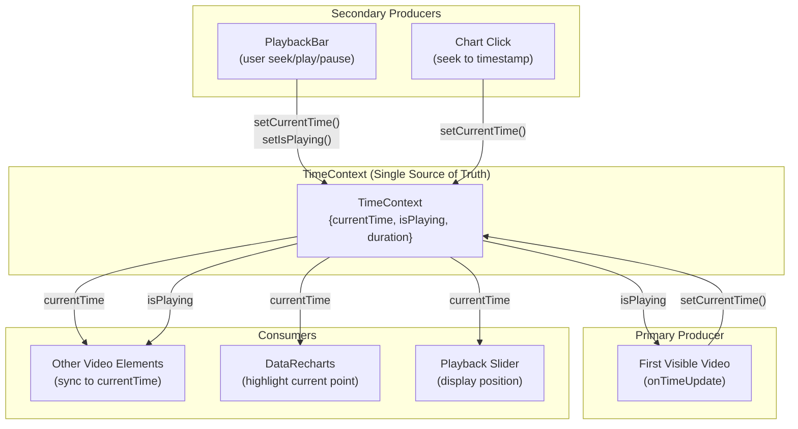

**Sources:** [src/components/simple-videos-player.tsx:1-268](), [src/components/data-recharts.tsx:1-345](), [src/components/playback-bar.tsx:1-133]()

---

## Producer Pattern: First-Visible-Video Strategy

The system designates one video as the **first visible video** to act as the primary time source. This prevents race conditions and ensures deterministic time updates when multiple videos are playing simultaneously.

### First-Visible-Video Selection Logic

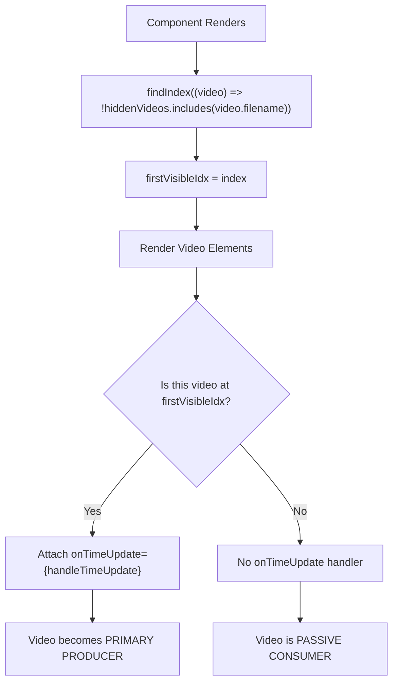

The selection happens at render time:

| Step | Code Location | Behavior |
|------|---------------|----------|
| Calculate index | [src/components/simple-videos-player.tsx:32-34]() | `firstVisibleIdx = videosInfo.findIndex(...)` |
| Conditional handler | [src/components/simple-videos-player.tsx:257]() | `onTimeUpdate={isFirstVisible ? handleTimeUpdate : undefined}` |
| Time update | [src/components/simple-videos-player.tsx:154-167]() | Extract time and call `setCurrentTime()` |

### Time Update Handler Implementation

The first visible video's `handleTimeUpdate` function transforms video-local time to global time:

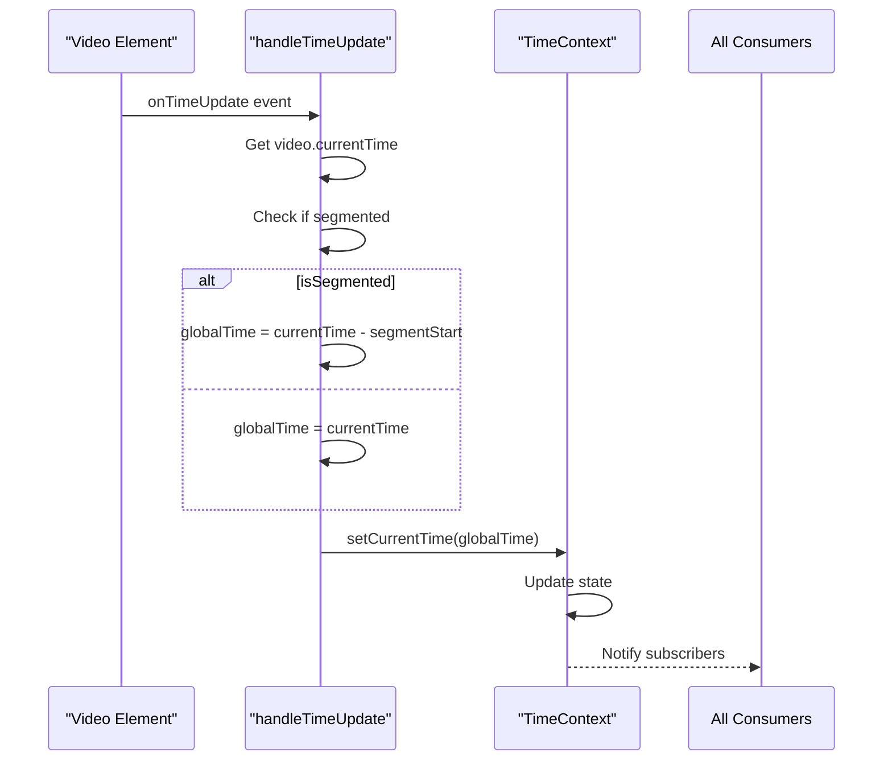

**Sources:** [src/components/simple-videos-player.tsx:154-167](), [src/components/simple-videos-player.tsx:25](), [src/components/simple-videos-player.tsx:32-34]()

---

## Consumer Patterns

### Video Synchronization (Passive Consumers)

All non-first videos synchronize their playback to match the global `currentTime` from the context. This synchronization uses a tolerance threshold to avoid constant micro-adjustments.

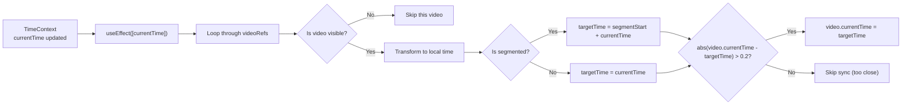

The tolerance threshold prevents jitter from minor timing discrepancies:

| Threshold | Value | Purpose |
|-----------|-------|---------|
| Sync tolerance | 0.2 seconds | [src/components/simple-videos-player.tsx:147]() |
| Segment boundary | 0.05 seconds | [src/components/simple-videos-player.tsx:64]() |

**Sources:** [src/components/simple-videos-player.tsx:134-152]()

### Chart Highlighting (Read-Only Consumers)

Charts consume `currentTime` to highlight the corresponding data point but never produce time updates (except via click events):

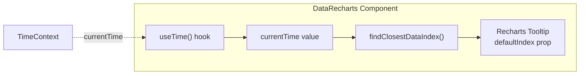

The `findClosestDataIndex` function performs a binary search-like operation:

```
1. Find first timestamp >= currentTime (ceiling)
2. If not found, return last index
3. Use result as defaultIndex for Recharts Tooltip
```

**Sources:** [src/components/data-recharts.tsx:122-129](), [src/components/data-recharts.tsx:302-304]()

---

## Debouncing and Performance Optimization

### Playback Bar Debouncing Strategy

The playback bar implements debouncing to reduce the frequency of time updates during slider drag, preventing excessive re-renders and video seeks.

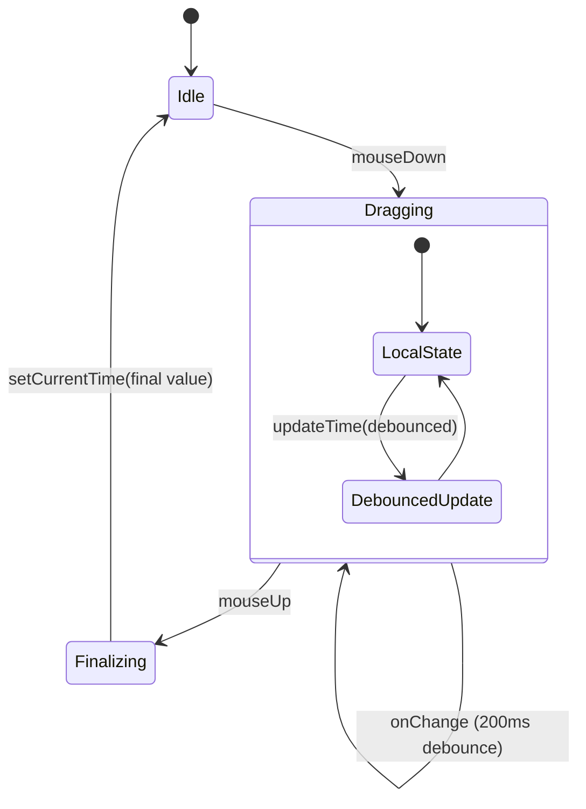

Implementation details:

| Phase | State Management | Code Location |
|-------|------------------|---------------|
| Idle | `sliderValue` tracks `currentTime` | [src/components/playback-bar.tsx:24-28]() |
| Drag Start | Set `sliderActiveRef = true`, pause video | [src/components/playback-bar.tsx:40-44]() |
| Dragging | Update local `sliderValue`, debounce context | [src/components/playback-bar.tsx:34-38]() |
| Drag End | Sync final value immediately | [src/components/playback-bar.tsx:46-53]() |

The debounce implementation:

```
const updateTime = debounce((t: number) => {
  setCurrentTime(t);
}, 200);  // 200ms delay
```

**Sources:** [src/components/playback-bar.tsx:30-32](), [src/components/playback-bar.tsx:19-53]()

---

## State Management During User Interaction

### Slider Interaction State Machine

The playback bar maintains local state during slider interaction to provide smooth UI feedback while preventing conflicting updates.

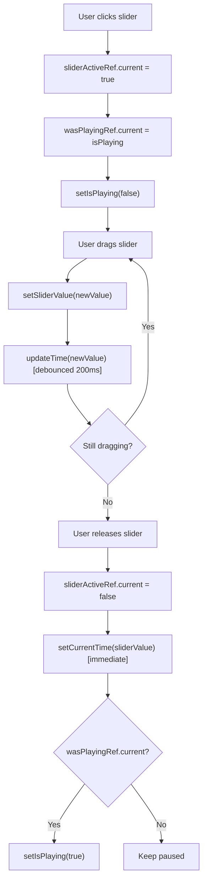

Key state variables:

| Variable | Type | Purpose |
|----------|------|---------|
| `sliderActiveRef` | `useRef<boolean>` | Prevents external updates during drag |
| `wasPlayingRef` | `useRef<boolean>` | Remembers play state to restore after drag |
| `sliderValue` | `useState<number>` | Local state for immediate UI feedback |

**Sources:** [src/components/playback-bar.tsx:19-53]()

---

## Segmented Video Time Mapping

For v3.0 datasets with segmented videos, a bidirectional time mapping ensures the global timeline remains continuous while each video plays only its segment.

### Global to Local Time Mapping

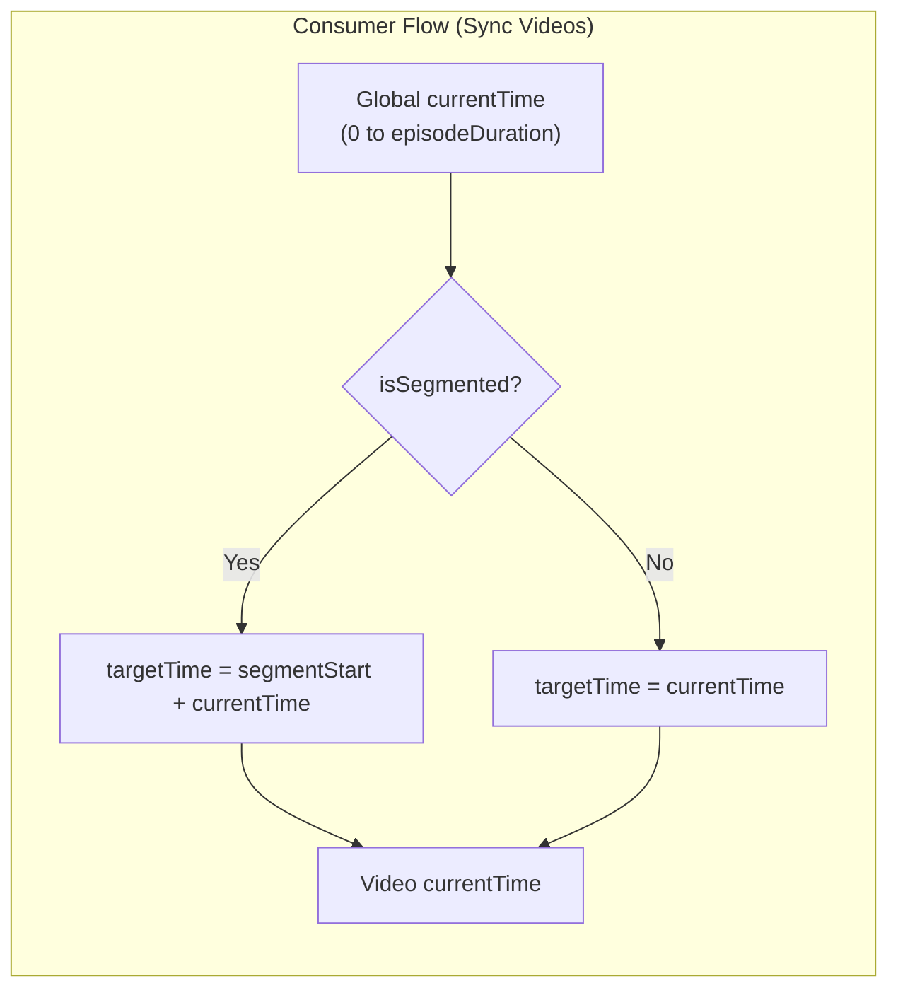

### Local to Global Time Mapping

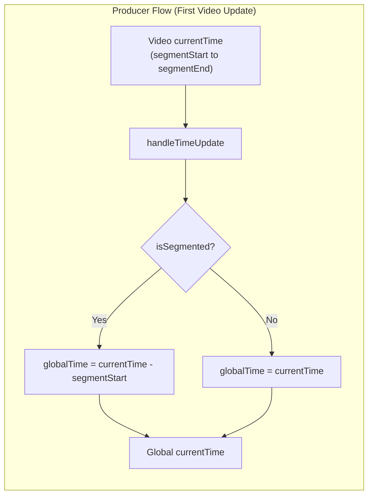

### Segment Boundary Handling

When a segmented video reaches its end boundary, it loops back to the segment start:

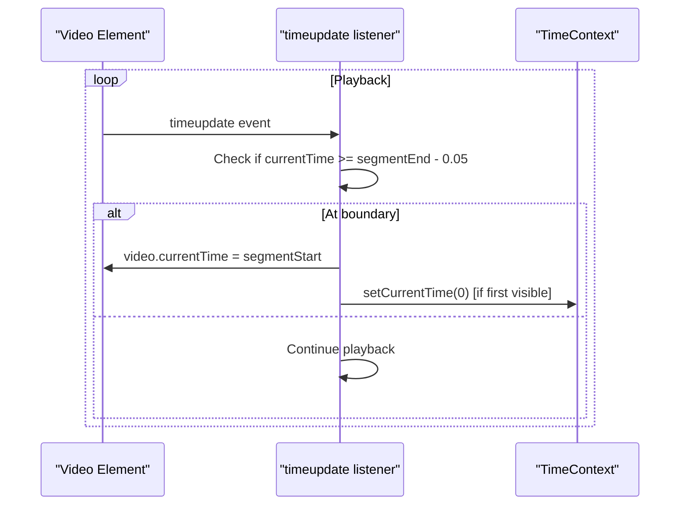

**Sources:** [src/components/simple-videos-player.tsx:58-76](), [src/components/simple-videos-player.tsx:143-145](), [src/components/simple-videos-player.tsx:162-164]()

---

## Hover Preview Synchronization

Charts implement a separate hover synchronization mechanism for preview functionality, independent of the playback timeline.

### Hover State Architecture

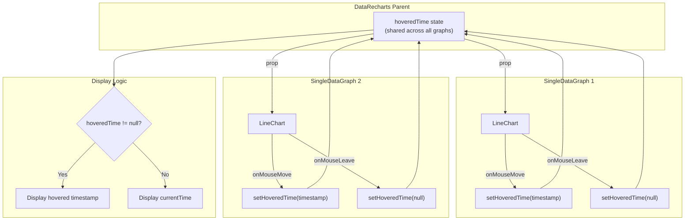

This dual-timeline approach allows users to preview data at different timestamps without affecting playback:

| Timeline Type | State Variable | Purpose | Update Trigger |
|---------------|----------------|---------|----------------|
| Playback | `currentTime` (context) | Active playback position | Video `onTimeUpdate` |
| Preview | `hoveredTime` (local) | Hover preview position | Chart `onMouseMove` |

**Sources:** [src/components/data-recharts.tsx:28](), [src/components/data-recharts.tsx:259-265](), [src/components/data-recharts.tsx:144-146]()

---

## Click-to-Seek Pattern

Charts support click-to-seek, making them secondary time producers:

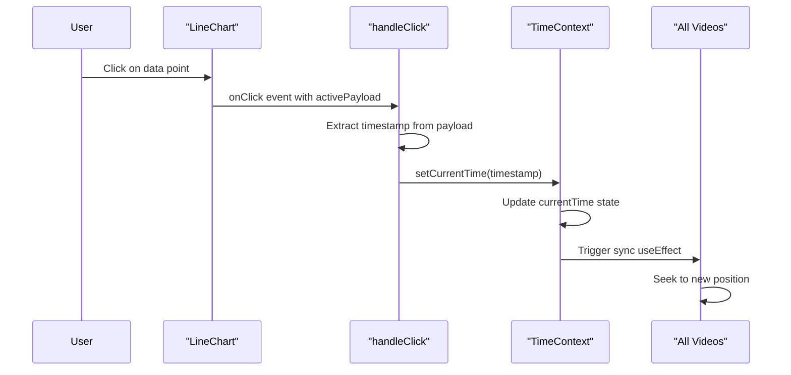

**Sources:** [src/components/data-recharts.tsx:135-140]()

---

## Synchronization Tolerance and Recovery

### Tolerance Threshold Rationale

The 0.2-second tolerance prevents constant micro-adjustments caused by:
1. Frame rate mismatches between video and React render cycles
2. Network jitter affecting video buffering
3. Floating-point precision differences in time calculations

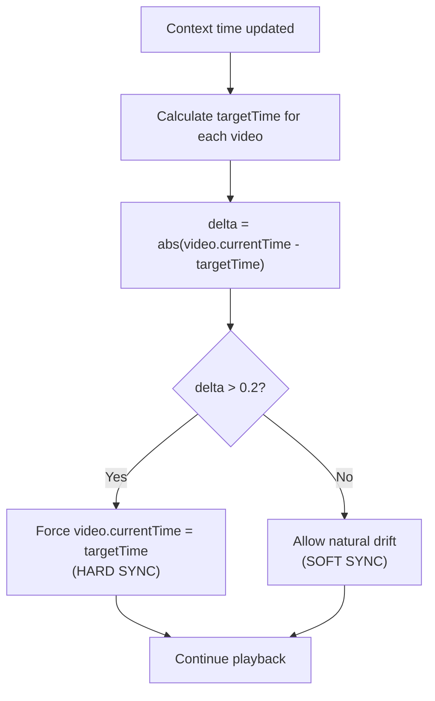

### Play/Pause Synchronization

All videos synchronize play/pause state immediately without tolerance:

```
useEffect(() => {
  if (!videosReady) return;
  
  videoRefs.current.forEach((video, idx) => {
    if (video && !hiddenVideos.includes(videosInfo[idx].filename)) {
      if (isPlaying) {
        video.play().catch(handleError);
      } else {
        video.pause();
      }
    }
  });
}, [isPlaying, videosReady, hiddenVideos, videosInfo]);
```

**Sources:** [src/components/simple-videos-player.tsx:116-132](), [src/components/simple-videos-player.tsx:134-152]()

---

## Summary of Synchronization Patterns

| Pattern | Producer(s) | Consumer(s) | Update Strategy |
|---------|-------------|-------------|-----------------|
| **Primary Playback** | First visible video | Other videos, charts, slider | Continuous with 0.2s tolerance |
| **User Seek** | Playback slider | All videos, charts | Immediate (debounced 200ms) |
| **Chart Click** | Any chart | All videos | Immediate |
| **Hover Preview** | Any chart hover | All charts | Immediate (independent of playback) |
| **Play/Pause** | Playback bar | All videos | Immediate |

The architecture ensures that:
- **Determinism**: Only one time producer is active during normal playback
- **Responsiveness**: User interactions override playback immediately
- **Performance**: Debouncing and tolerance thresholds reduce unnecessary updates
- **Consistency**: All consumers share a single source of truth

**Sources:** [src/components/simple-videos-player.tsx:1-268](), [src/components/data-recharts.tsx:1-345](), [src/components/playback-bar.tsx:1-133]()

---

