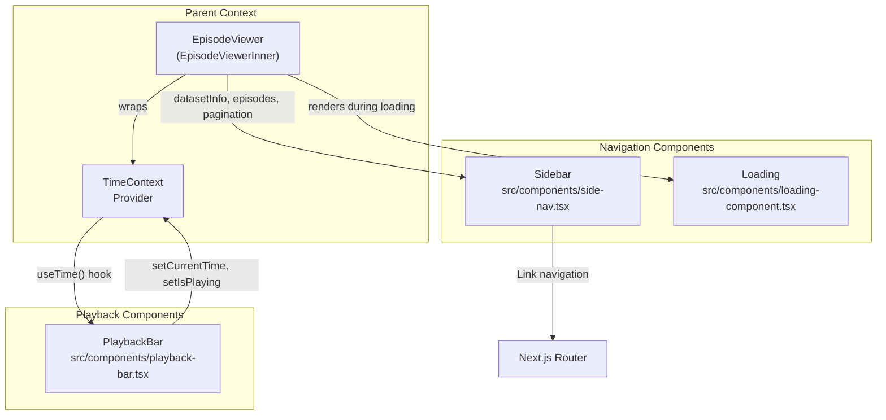
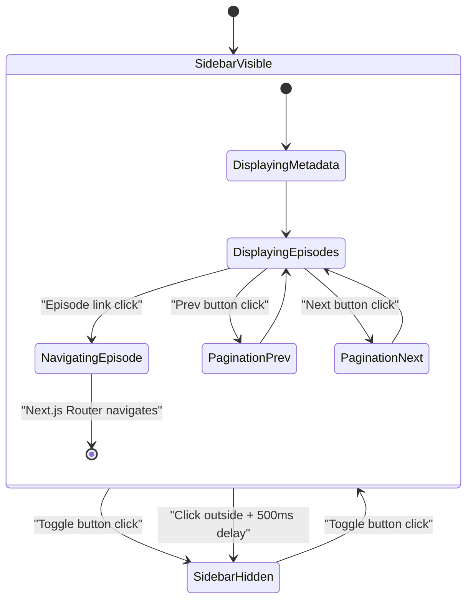
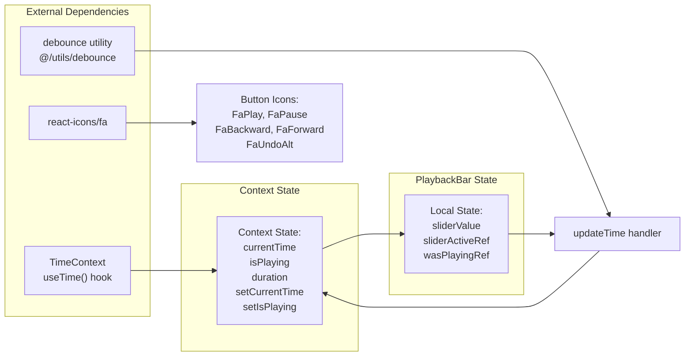
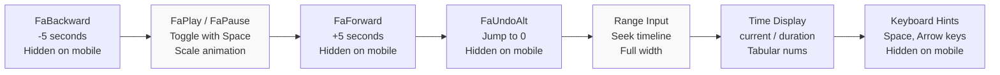
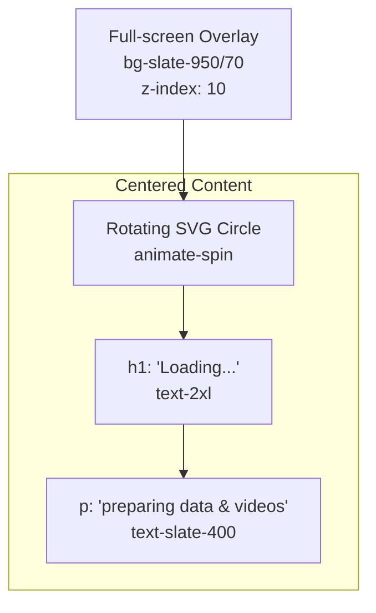
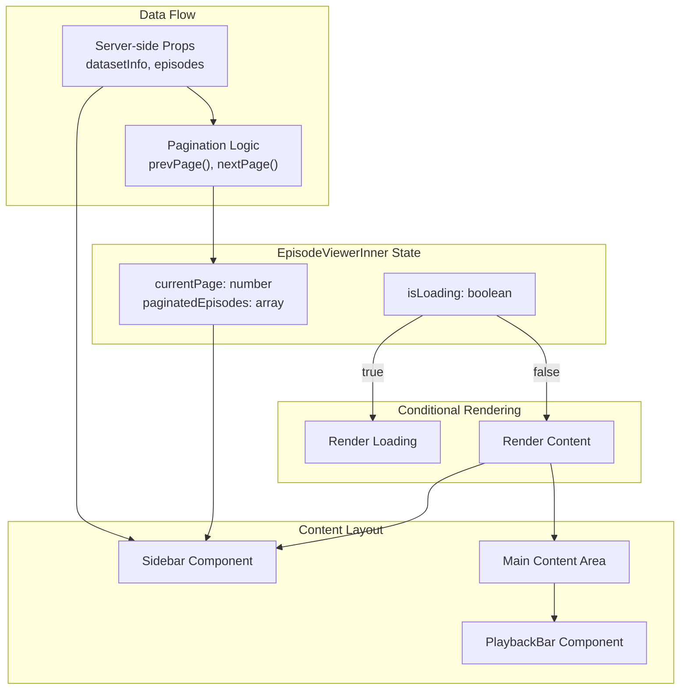

<!-- source: DeepWiki mcp.deepwiki.com · repo huggingface/lerobot-dataset-visualizer · page 8 Navigation and UI Controls · fetched 2026-10-26 -->

# Navigation and UI Controls

<details>
<summary>Relevant source files</summary>

The following files were used as context for generating this wiki page:

- [src/components/loading-component.tsx](src/components/loading-component.tsx)
- [src/components/playback-bar.tsx](src/components/playback-bar.tsx)
- [src/components/side-nav.tsx](src/components/side-nav.tsx)

</details>


## Purpose and Scope

This document covers the supporting UI components that enable user navigation and playback control within the LeRobot Dataset Visualizer. These components provide the interface layer between users and the episode visualization system, including:

- **Sidebar Navigation**: Dataset information display and episode selection
- **Playback Controls**: Timeline seeking, play/pause, and temporal navigation
- **Loading States**: Visual feedback during data fetching and processing

For the main visualization orchestration logic, see [Episode Viewer Component](#4). For time synchronization mechanisms used by these controls, see [Time Synchronization System](#7).

---

## Component Architecture Overview

The navigation and UI control components operate as leaf nodes in the component tree, consuming data and context from parent components while providing user interaction handlers.



**Sources:** [src/components/side-nav.tsx:1-120](), [src/components/playback-bar.tsx:1-133](), [src/components/loading-component.tsx:1-38]()

---

## Sidebar Navigation Component

The `Sidebar` component provides dataset metadata display and paginated episode navigation. It is rendered by the `EpisodeViewerInner` component and receives props containing dataset information and episode lists.

### Component Interface

| Prop | Type | Purpose |
|------|------|---------|
| `datasetInfo` | `any` | Contains `total_frames`, `total_episodes`, `fps` metadata |
| `paginatedEpisodes` | `any[]` | Current page of episode IDs to display |
| `episodeId` | `any` | Currently active episode ID for highlighting |
| `totalPages` | `number` | Total pagination pages available |
| `currentPage` | `number` | Current pagination page index |
| `prevPage` | `() => void` | Pagination handler for previous page |
| `nextPage` | `() => void` | Pagination handler for next page |

**Sources:** [src/components/side-nav.tsx:6-14]()

### User Interaction Flow



**Sources:** [src/components/side-nav.tsx:25-45](), [src/components/side-nav.tsx:78-104]()

### Visibility Management

The sidebar implements toggle functionality with automatic hiding on outside clicks:

- **State Management**: Uses local `sidebarVisible` boolean state ([src/components/side-nav.tsx:25-26]())
- **Toggle Button**: Vertical bar with hover opacity effects ([src/components/side-nav.tsx:108-114]())
- **Click Outside Detection**: Event listener attached to document, with 500ms delayed hide ([src/components/side-nav.tsx:30-45]())
- **Responsive Behavior**: Visible by default on medium+ screens, can be hidden on any viewport

### Episode List Rendering

Episodes are displayed as a vertical list of `Link` components that navigate to episode-specific routes:

- **Route Pattern**: `./episode_{episodeId}` relative navigation ([src/components/side-nav.tsx:69]())
- **Active Highlighting**: Current episode receives bold font weight and negative margin ([src/components/side-nav.tsx:70]())
- **Pagination Controls**: Disabled state for boundary pages (first/last) with visual opacity ([src/components/side-nav.tsx:78-104]())

**Sources:** [src/components/side-nav.tsx:63-105]()

---

## Playback Controls Component

The `PlaybackBar` component provides temporal navigation and playback state control. It consumes the `TimeContext` using the `useTime()` hook and implements debounced seeking to prevent performance issues during slider interaction.

### Component Dependencies and State



**Sources:** [src/components/playback-bar.tsx:1-13](), [src/components/playback-bar.tsx:15-32]()

### Slider Interaction Mechanism

The playback slider implements sophisticated interaction handling to provide smooth user experience while maintaining sync with video playback:

| Interaction Stage | State Changes | Behavior |
|-------------------|---------------|----------|
| **Normal Display** | `sliderActiveRef = false` | `sliderValue` tracks `currentTime` from context ([src/components/playback-bar.tsx:24-28]()) |
| **Mouse Down** | `sliderActiveRef = true`, `wasPlayingRef = isPlaying`, pause playback | Decouples slider from context updates ([src/components/playback-bar.tsx:40-44]()) |
| **Dragging** | `sliderValue` updated locally, debounced `setCurrentTime` calls | Local state prevents jitter, debouncing reduces load ([src/components/playback-bar.tsx:34-38]()) |
| **Mouse Up** | `sliderActiveRef = false`, snap to final value, restore play state | Resumes sync with context ([src/components/playback-bar.tsx:46-53]()) |

### Debouncing Strategy

The component uses a 200ms debounced time update to prevent excessive re-renders and video seeking operations:

```javascript
const updateTime = debounce((t: number) => {
  setCurrentTime(t);
}, 200);
```

This allows the slider to provide visual feedback at 60 FPS while only updating the global time state (and triggering video seeks) every 200ms during active dragging.

**Sources:** [src/components/playback-bar.tsx:30-32]()

### Button Controls Layout



**Implementation Details:**

- **Backward/Forward**: 5-second jumps, clamped to `[0, duration]` bounds ([src/components/playback-bar.tsx:59-86]())
- **Play/Pause**: Conditional rendering with scale animations, only one visible at a time ([src/components/playback-bar.tsx:64-79]())
- **Rewind**: Resets to `currentTime = 0` ([src/components/playback-bar.tsx:88-92]())
- **Slider**: Continuous range input with `0.01` step precision, orange accent color ([src/components/playback-bar.tsx:94-107]())
- **Time Display**: Tabular numerals, right-aligned, fixed width for visual stability ([src/components/playback-bar.tsx:108-110]())

**Sources:** [src/components/playback-bar.tsx:55-129]()

### Keyboard Shortcut Hints

The component displays keyboard shortcut hints on medium+ screens:

- **Space**: Pause/unpause playback
- **Arrow Up/Down**: Navigate to previous/next episode (handled by parent `EpisodeViewer`)

These hints use styled keyboard visual elements with border, background, and shadow for skeuomorphic appearance.

**Sources:** [src/components/playback-bar.tsx:112-127]()

---

## Loading Component

The `Loading` component provides visual feedback during asynchronous data fetching and processing operations. It is conditionally rendered by the `EpisodeViewer` when `isLoading` state is true.

### Visual Structure



**Sources:** [src/components/loading-component.tsx:3-36]()

### Accessibility Features

The loading overlay implements proper ARIA attributes for screen reader support:

- `tabIndex={-1}`: Prevents focus but allows programmatic focus if needed
- `aria-modal="true"`: Indicates modal-like behavior blocking interaction
- `role="dialog"`: Semantic role for assistive technologies

**Sources:** [src/components/loading-component.tsx:7-9]()

### Animation Implementation

- **Fade In**: Uses `animate-fade-in` Tailwind class for smooth appearance
- **Spinner**: SVG circle with `animate-spin` rotation, partial arc for visual motion
- **Opacity Layering**: Circle at 25% opacity, rotating arc at 75% opacity

**Sources:** [src/components/loading-component.tsx:11-32]()

---

## Integration with Episode Viewer

These UI control components are orchestrated by the `EpisodeViewerInner` component, which manages their lifecycle and data flow:



**Sources:** Referenced from [Episode Viewer Component](#4) architecture

### Positioning and Layout

- **Sidebar**: Absolute positioning on mobile (`absolute`), static on desktop (`md:static`), collapsible with toggle ([src/components/side-nav.tsx:48-52]())
- **PlaybackBar**: Sticky bottom positioning (`sticky bottom-0`), centered with max-width constraint, semi-transparent background ([src/components/playback-bar.tsx:56]())
- **Loading**: Absolute overlay covering entire viewport (`absolute inset-0`) with high z-index ([src/components/loading-component.tsx:6]())

---

## Responsive Design Considerations

All UI control components implement responsive behaviors optimized for different viewport sizes:

| Component | Mobile Behavior | Desktop Behavior |
|-----------|----------------|------------------|
| **Sidebar** | Collapsible overlay, toggleable | Static column, always visible by default |
| **PlaybackBar** | Hide forward/back/rewind/hints | Show all controls and keyboard hints |
| **Loading** | Full screen, same as desktop | Full screen with centered content |

Media query breakpoint: `md:` (768px) is used consistently across components for responsive variations.

**Sources:** [src/components/side-nav.tsx:48-52](), [src/components/playback-bar.tsx:60-127]()

---

## Summary

The navigation and UI control components provide essential user interaction capabilities while maintaining clean separation of concerns:

- **Sidebar**: Stateful navigation with pagination and dataset metadata display
- **PlaybackBar**: Time-synchronized controls with debounced seeking and accessibility features
- **Loading**: Simple, accessible loading state indicator

These components consume data from parent contexts and props while providing intuitive interfaces for episode navigation and temporal control, integrating seamlessly with the broader Episode Viewer architecture documented in [Section 4](#4).

---

