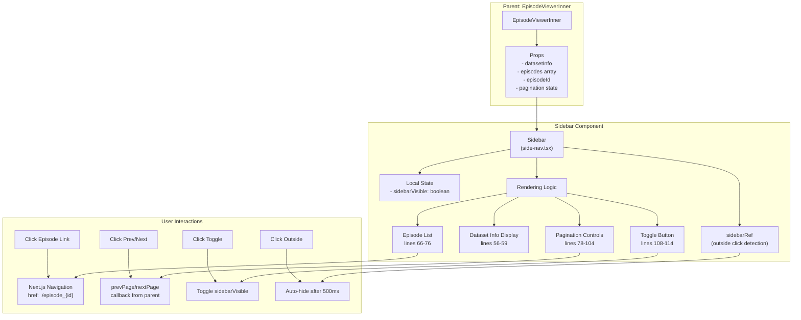
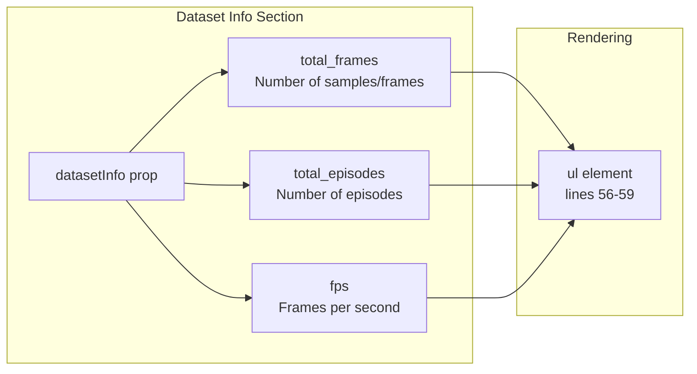
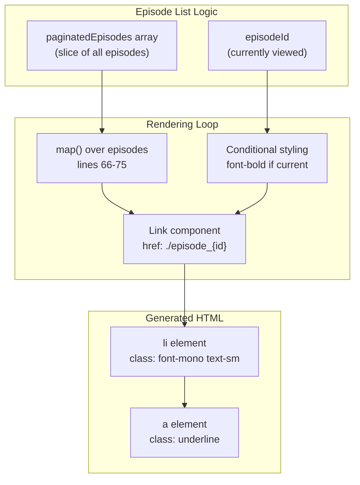
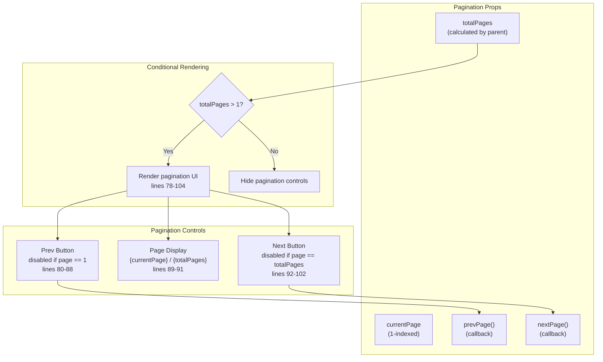
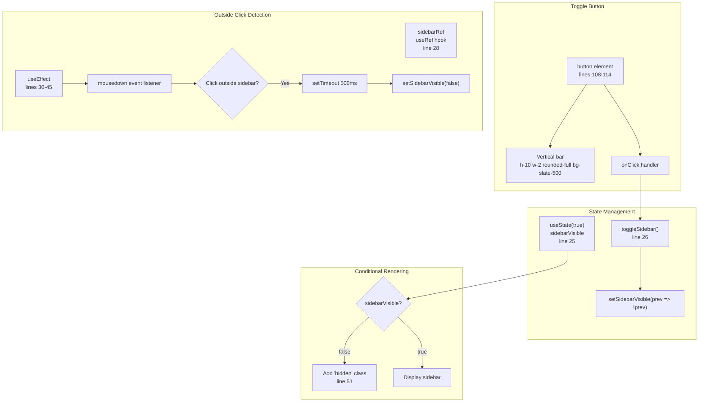
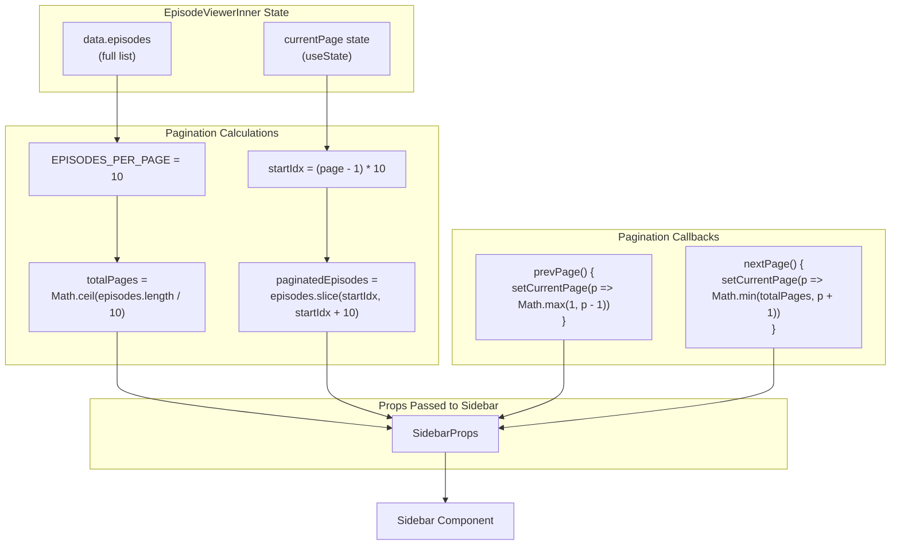

<!-- source: DeepWiki mcp.deepwiki.com · repo huggingface/lerobot-dataset-visualizer · page 8.1 Sidebar Navigation · fetched 2026-10-26 -->

# Sidebar Navigation

<details>
<summary>Relevant source files</summary>

The following files were used as context for generating this wiki page:

- [src/components/side-nav.tsx](src/components/side-nav.tsx)

</details>


## Purpose and Scope

This document describes the `Sidebar` component, which provides dataset information display and paginated episode navigation within the Episode Viewer interface. The sidebar allows users to view key dataset metadata and navigate between episodes using a paginated list with previous/next controls.

For information about the parent component that manages the sidebar state, see [Episode Viewer Component](#4). For details about keyboard shortcuts and other navigation mechanisms, see [User Interactions and Navigation](#4.2).

---

## Component Overview

The `Sidebar` component is a client-side React component located in [src/components/side-nav.tsx:1-120](). It renders a collapsible navigation panel on the left side of the Episode Viewer interface, displaying dataset metadata and a paginated list of episodes.

**Key Responsibilities:**
- Display dataset statistics (total frames, episodes, FPS)
- Render a paginated list of episode links
- Handle pagination controls (prev/next page)
- Manage sidebar visibility state
- Auto-hide on outside clicks

Sources: [src/components/side-nav.tsx:1-120]()

---

## Component Architecture



Sources: [src/components/side-nav.tsx:1-120]()

---

## Props Interface

The `Sidebar` component accepts a `SidebarProps` interface defined in [src/components/side-nav.tsx:6-14]():

| Prop | Type | Description |
|------|------|-------------|
| `datasetInfo` | `any` | Object containing dataset metadata (total_frames, total_episodes, fps) |
| `paginatedEpisodes` | `any[]` | Array of episode IDs for the current page |
| `episodeId` | `any` | Currently active episode ID (highlighted in the list) |
| `totalPages` | `number` | Total number of pagination pages |
| `currentPage` | `number` | Current pagination page (1-indexed) |
| `prevPage` | `() => void` | Callback to navigate to previous page |
| `nextPage` | `() => void` | Callback to navigate to next page |

The parent component (EpisodeViewerInner) is responsible for calculating pagination state and providing the appropriate slice of episodes for the current page.

Sources: [src/components/side-nav.tsx:6-14]()

---

## Dataset Information Display

The sidebar displays three key dataset statistics at the top of the navigation panel:



The implementation in [src/components/side-nav.tsx:56-59]() renders these values in a simple unordered list:

```
<ul>
  <li>Number of samples/frames: {datasetInfo.total_frames}</li>
  <li>Number of episodes: {datasetInfo.total_episodes}</li>
  <li>Frames per second: {datasetInfo.fps}</li>
</ul>
```

This metadata is fetched by the Episode Data Fetching System (see [Episode Data Fetching System](#3.1)) and passed down through the EpisodeViewer hierarchy.

Sources: [src/components/side-nav.tsx:56-59]()

---

## Episode List Rendering

The sidebar displays a paginated list of episode links below the dataset information:



The implementation in [src/components/side-nav.tsx:66-76]() uses Next.js `Link` components for client-side navigation:

- Each episode is rendered as a list item with the pattern "Episode {id}"
- The currently active episode receives additional styling: `-ml-1 font-bold`
- Links use relative paths: `./episode_${episode}`
- Font styling: `font-mono text-sm` for consistent typography

Sources: [src/components/side-nav.tsx:66-76]()

---

## Pagination System

The sidebar implements pagination controls to handle datasets with large numbers of episodes:



### Pagination Control Features

**Previous Button** [src/components/side-nav.tsx:80-88]():
- Label: `« Prev`
- Disabled when `currentPage === 1`
- Disabled styling: `cursor-not-allowed opacity-50`
- Triggers `prevPage()` callback on click

**Current Page Display** [src/components/side-nav.tsx:89-91]():
- Format: `{currentPage} / {totalPages}`
- Styled with `font-mono` for numeric clarity

**Next Button** [src/components/side-nav.tsx:92-102]():
- Label: `Next »`
- Disabled when `currentPage === totalPages`
- Disabled styling: `cursor-not-allowed opacity-50`
- Triggers `nextPage()` callback on click

The parent component (EpisodeViewerInner) manages the actual pagination logic, including calculating which episodes to display on each page. See [User Interactions and Navigation](#4.2) for details on the parent's pagination implementation.

Sources: [src/components/side-nav.tsx:78-104]()

---

## Visibility Toggle Mechanism

The sidebar includes a collapsible toggle feature controlled by local component state:



### Toggle Implementation Details

**Initial State** [src/components/side-nav.tsx:25]():
- Default value: `true` (sidebar visible on load)
- Managed by `useState` hook

**Toggle Button** [src/components/side-nav.tsx:108-114]():
- Visual design: Small vertical bar (2px width, 40px height)
- Opacity animation: 50% default, 100% on hover
- No visible text label (uses `title` attribute for accessibility)
- Positioned adjacent to the sidebar panel

**Outside Click Detection** [src/components/side-nav.tsx:30-45]():
- Uses `useRef` to track the sidebar DOM element
- Attaches a `mousedown` event listener when sidebar is visible
- Checks if click target is outside the sidebar using `contains()`
- Implements a 500ms delay before hiding with `setTimeout`
- Properly cleans up event listener on unmount

**Conditional Display** [src/components/side-nav.tsx:50-52]():
- Applies `hidden` class when `sidebarVisible === false`
- On mobile (default): Sidebar is absolutely positioned and overlays content
- On desktop (`md:` breakpoint): Sidebar is statically positioned

Sources: [src/components/side-nav.tsx:25-45](), [src/components/side-nav.tsx:108-114]()

---

## Responsive Layout

The sidebar implements a responsive layout strategy for different screen sizes:

| Breakpoint | Position | Width | Behavior |
|------------|----------|-------|----------|
| Mobile (default) | `absolute` | `w-60` (240px) | Overlays main content, can be toggled |
| Desktop (`md:`) | `static` | `w-60 md:shrink` | Part of normal layout flow, shrinks if needed |

The container structure in [src/components/side-nav.tsx:48-49]():
```
<div className="flex z-10 min-h-screen absolute md:static">
```

Key responsive classes:
- `absolute md:static`: Mobile overlay, desktop inline
- `z-10`: Ensures sidebar appears above main content on mobile
- `min-h-screen`: Full viewport height
- `md:max-h-screen`: On desktop, constrain to viewport height with scrolling

Sources: [src/components/side-nav.tsx:48-52]()

---

## Styling and Appearance

The sidebar uses Tailwind CSS classes for styling:

**Container** [src/components/side-nav.tsx:49-53]():
- Background: `bg-slate-900` (dark theme)
- Padding: `p-5`
- Width: `w-60` (fixed 240px)
- Overflow: `overflow-y-auto` (vertical scrolling)
- Text wrapping: `break-words` (prevent overflow)

**Episode Links** [src/components/side-nav.tsx:68-73]():
- Font: `font-mono text-sm` (monospace, small)
- Decoration: `underline`
- Active episode: `font-bold` with `-ml-1` (negative left margin)
- Spacing: `mt-0.5` between items

**Pagination Controls** [src/components/side-nav.tsx:79-102]():
- Button background: `bg-slate-800`
- Button padding: `px-2 py-1`
- Button rounding: `rounded`
- Text size: `text-xs`
- Disabled opacity: `opacity-50`

Sources: [src/components/side-nav.tsx:49-104]()

---

## Integration with Parent Component

The `Sidebar` component is integrated into the EpisodeViewerInner component, which manages the pagination logic:



The parent component is responsible for:
1. Maintaining the `currentPage` state (1-indexed)
2. Calculating `totalPages` based on episode count
3. Slicing the episode array to get the current page's episodes
4. Providing `prevPage` and `nextPage` callbacks that update the page state

The `Sidebar` component remains stateless with respect to pagination, delegating all pagination logic to its parent. This separation of concerns allows the parent to coordinate pagination with other features like keyboard navigation and URL parameter updates.

Sources: [src/components/side-nav.tsx:6-14]()

---

## Accessibility Features

The sidebar implements several accessibility considerations:

**ARIA Label** [src/components/side-nav.tsx:53]():
```
aria-label="Sidebar navigation"
```
Provides semantic meaning for screen readers.

**Toggle Button Title** [src/components/side-nav.tsx:111]():
```
title="Toggle sidebar"
```
Provides tooltip text describing the button's function.

**Button Disabled States** [src/components/side-nav.tsx:85](), [src/components/side-nav.tsx:99]():
- Uses proper `disabled` attribute on buttons
- Visual feedback via `cursor-not-allowed opacity-50`
- Prevents interaction when at page boundaries

**Keyboard Focus** [src/components/side-nav.tsx:109]():
- Toggle button includes `focus:outline-none focus:ring-0` for custom focus styling
- Episode links are standard `<Link>` components that support keyboard navigation

Sources: [src/components/side-nav.tsx:53](), [src/components/side-nav.tsx:85-111]()

---

## Summary

The `Sidebar` component provides a clean, collapsible navigation interface for browsing episodes within the LeRobot Dataset Visualizer. Key features include:

- **Dataset Metadata Display**: Shows total frames, episodes, and FPS
- **Paginated Episode List**: Handles large episode counts with 10 episodes per page
- **Responsive Design**: Overlay on mobile, inline on desktop
- **Auto-hide Behavior**: Collapses automatically when clicking outside
- **Stateless Pagination**: Delegates pagination logic to parent component
- **Accessibility Support**: ARIA labels, disabled states, keyboard navigation

The component integrates seamlessly with the EpisodeViewer hierarchy, receiving all necessary data and callbacks through props while managing only its visibility state locally.

Sources: [src/components/side-nav.tsx:1-120]()

---

