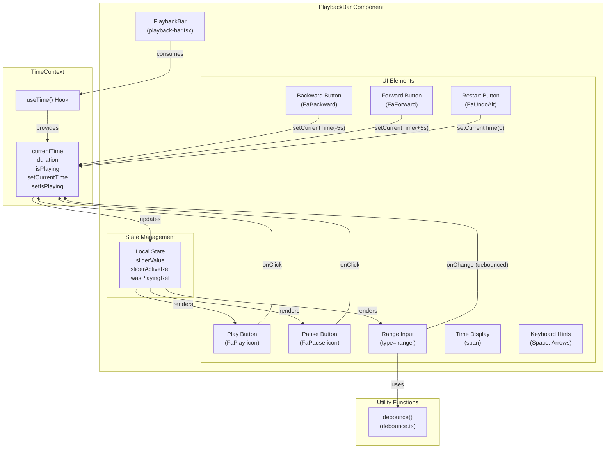
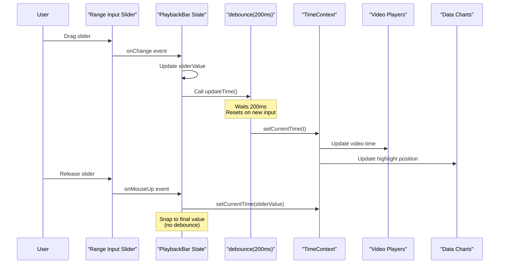
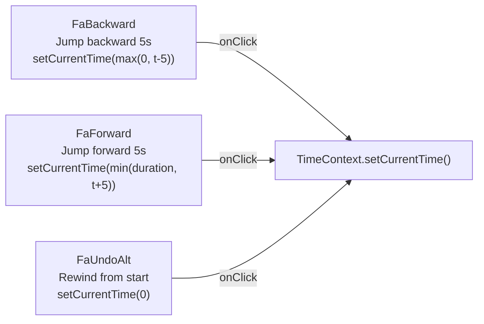
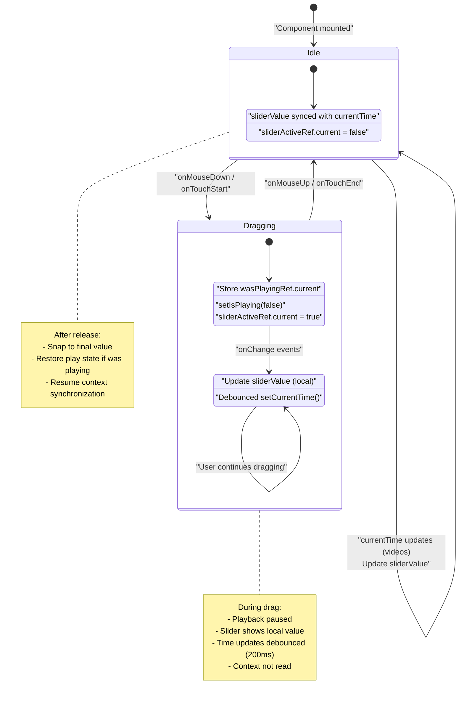
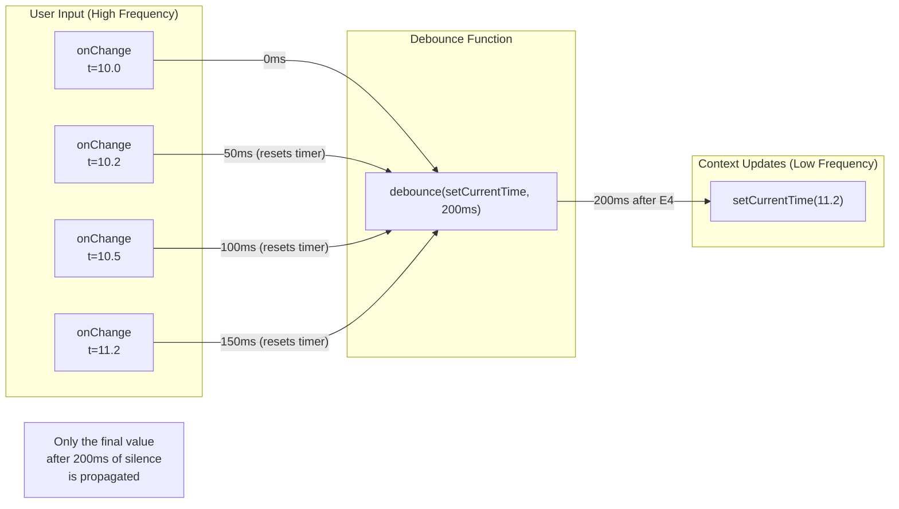

<!-- source: DeepWiki mcp.deepwiki.com · repo huggingface/lerobot-dataset-visualizer · page 8.2 Playback Controls · fetched 2026-10-26 -->

# Playback Controls

<details>
<summary>Relevant source files</summary>

The following files were used as context for generating this wiki page:

- [src/components/playback-bar.tsx](src/components/playback-bar.tsx)
- [src/utils/debounce.ts](src/utils/debounce.ts)

</details>


## Purpose and Scope

This document describes the `PlaybackBar` component, which provides the primary playback control interface for episode visualization. The component enables users to play/pause, seek through episodes, and navigate forward/backward in time. It integrates with the TimeContext system to synchronize playback state across all visualization components.

For information about the TimeContext architecture and synchronization mechanisms, see [TimeContext Provider and Hook](#7.1) and [Time Synchronization Patterns](#7.2). For keyboard navigation of episodes, see [User Interactions and Navigation](#4.2).

**Sources:** [src/components/playback-bar.tsx:1-132]()

---

## Component Architecture

The `PlaybackBar` component is a React functional component that consumes the `TimeContext` to both read and modify global playback state. It renders a sticky control bar at the bottom of the viewport containing interactive buttons and a seek slider.



**Sources:** [src/components/playback-bar.tsx:15-130]()

---

## TimeContext Integration

The `PlaybackBar` integrates with the global time synchronization system through the `useTime` hook, which provides access to shared playback state and control functions.

### Consumed State

| State Variable | Type | Purpose |
|---------------|------|---------|
| `currentTime` | `number` | Current playback position in seconds |
| `duration` | `number` | Total episode duration in seconds |
| `isPlaying` | `boolean` | Whether playback is active |
| `setCurrentTime` | `(t: number) => void` | Function to update playback position |
| `setIsPlaying` | `(playing: boolean) => void` | Function to control play/pause state |

**Sources:** [src/components/playback-bar.tsx:16-17]()

### Time Update Flow



**Sources:** [src/components/playback-bar.tsx:30-38](), [src/utils/debounce.ts:1-10]()

---

## User Interface Elements

### Play/Pause Button

The PlaybackBar displays a single button that toggles between play and pause states. The button icon and scale transform dynamically based on the `isPlaying` state.

| State | Icon | Scale | Opacity |
|-------|------|-------|---------|
| Paused | `FaPlay` | 110% | 100% |
| Playing | `FaPause` | 110% | 100% |
| Inactive | (hidden via `display: none`) | 90% | 60% |

**Implementation Details:**
- Only one button is visible at a time using `display` CSS property
- Visual feedback through `scale` transform and `opacity`
- Title attributes: "Play. Toggle with Space" / "Pause. Toggle with Space"

**Sources:** [src/components/playback-bar.tsx:64-79]()

### Navigation Buttons

The component provides three navigation buttons hidden on mobile devices (`hidden md:block`):



**Sources:** [src/components/playback-bar.tsx:57-93]()

### Seek Slider

The seek slider is an HTML5 range input with custom styling and interaction behavior.

| Attribute | Value | Purpose |
|-----------|-------|---------|
| `type` | `"range"` | HTML5 range input |
| `min` | `0` | Start of episode |
| `max` | `duration` | End of episode |
| `step` | `0.01` | 10ms granularity |
| `value` | `sliderValue` | Current slider position |
| `className` | `"accent-orange-500"` | Orange slider thumb |

**Event Handlers:**
- `onChange`: Updates local state and triggers debounced time update
- `onMouseDown` / `onTouchStart`: Pauses playback and stores play state
- `onMouseUp` / `onTouchEnd`: Snaps to final value and restores play state

**Sources:** [src/components/playback-bar.tsx:94-107]()

### Time Display

The time display shows current position and total duration in seconds using tabular numbers for stable layout:

```
Format: "{current} / {duration}"
Example: "45 / 120"
```

- Uses `Math.floor()` to display whole seconds
- `tabular-nums` class for monospaced digit alignment
- Fixed width (`w-16`) to prevent layout shifts

**Sources:** [src/components/playback-bar.tsx:108-110]()

### Keyboard Shortcut Hints

The component displays contextual keyboard shortcuts on desktop viewports (`hidden md:flex`):

| Shortcut | Action | Icon |
|----------|--------|------|
| `Space` | Pause/unpause | Styled key indicator |
| `↑` / `↓` | Previous/next episode | `FaArrowUp` / `FaArrowDown` |

**Note:** These hints are informational only; actual keyboard handling is implemented in `EpisodeViewer` (see [User Interactions and Navigation](#4.2)).

**Sources:** [src/components/playback-bar.tsx:112-127]()

---

## Interaction Patterns

### Slider Drag Behavior State Machine

The slider interaction implements a sophisticated state machine to provide smooth user experience during seeking:



**Sources:** [src/components/playback-bar.tsx:19-53]()

### State References

The component uses React refs to track interaction state without triggering re-renders:

| Ref | Type | Purpose |
|-----|------|---------|
| `sliderActiveRef` | `boolean` | Whether user is dragging slider |
| `wasPlayingRef` | `boolean` | Stores play state before drag started |

**Synchronization Logic:**

```typescript
// Only update sliderValue from context if not dragging
React.useEffect(() => {
  if (!sliderActiveRef.current) {
    setSliderValue(currentTime);
  }
}, [currentTime]);
```

This prevents the slider from jumping while the user is dragging it, even if the underlying `currentTime` updates from other sources.

**Sources:** [src/components/playback-bar.tsx:19-28]()

### Debounced Time Updates

The slider uses a 200ms debounce to reduce the frequency of context updates during drag operations:



**Benefits:**
- Reduces computational load on video players and charts
- Prevents excessive re-renders
- Provides responsive local feedback (slider moves immediately)
- Final value is applied without debounce on `onMouseUp` for precise positioning

**Sources:** [src/components/playback-bar.tsx:30-38](), [src/utils/debounce.ts:1-10]()

---

## Implementation Details

### Component Structure

The PlaybackBar renders as a sticky footer element with responsive layout:

```
┌─────────────────────────────────────────────────────────────┐
│ [◄] [▶] [►] [↻] ━━━━●━━━━━━━━━━━ 45 / 120  [Space] [↑/↓]  │
└─────────────────────────────────────────────────────────────┘
  └─┬─┘ └─┬─┘ └──────┬──────┘ └──┬──┘ └──────┬─────────┘
    │     │          │           │            │
  Nav  Play/     Seek Slider   Time      Keyboard
 Buttons Pause                Display      Hints
```

**CSS Classes:**
- `sticky bottom-0`: Sticks to bottom of viewport
- `bg-slate-900/95`: Semi-transparent dark background
- `rounded-3xl`: Rounded corners
- `max-w-4xl mx-auto`: Centered with max width
- `gap-4`: Spacing between elements

**Responsive Behavior:**
- Navigation buttons: `hidden md:block` (hidden on mobile)
- Keyboard hints: `hidden md:flex` (hidden on mobile)
- Slider: Always visible, `flex-1` to fill available space

**Sources:** [src/components/playback-bar.tsx:55-130]()

### Accessibility Features

The component includes several accessibility features:

| Feature | Implementation | Purpose |
|---------|---------------|---------|
| ARIA label | `aria-label="Seek video"` on slider | Screen reader description |
| Title attributes | On all buttons | Hover tooltips |
| Keyboard focus | Default browser focus rings preserved | Keyboard navigation |
| Touch support | `onTouchStart`/`onTouchEnd` events | Mobile device compatibility |
| Tabular numbers | `tabular-nums` class on time display | Stable layout for screen magnifiers |

**Sources:** [src/components/playback-bar.tsx:55-130]()

### Integration with Parent Component

The PlaybackBar is rendered by `EpisodeViewerInner` and positioned within its layout structure. It does not accept props; all state is managed through TimeContext.

**Component Tree:**
```
EpisodeViewer
└── TimeContext.Provider
    └── EpisodeViewerInner
        ├── SimpleVideosPlayer
        ├── DataRecharts
        ├── Sidebar
        └── PlaybackBar  ← This component
```

**Sources:** [src/components/playback-bar.tsx:15-132]()

---

## Debounce Utility

The debounce utility used for slider updates is a generic higher-order function that delays execution until a period of inactivity.

### Function Signature

```typescript
function debounce<F extends (...args: any[]) => any>(
  func: F,
  waitFor: number,
): (...args: Parameters<F>) => void
```

### Behavior

- Accepts a function and delay duration in milliseconds
- Returns a wrapped function that delays execution
- Resets timer on each invocation
- Uses `window.setTimeout` for browser compatibility
- Type-safe with TypeScript generics

**Usage in PlaybackBar:**

```typescript
const updateTime = debounce((t: number) => {
  setCurrentTime(t);
}, 200);
```

This creates a debounced version of `setCurrentTime` with a 200ms delay, preventing excessive updates during slider drag operations.

**Sources:** [src/utils/debounce.ts:1-10](), [src/components/playback-bar.tsx:30-32]()

---

