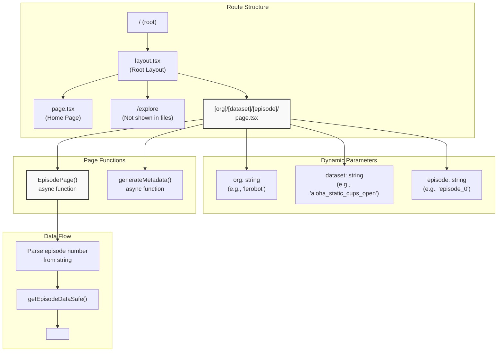
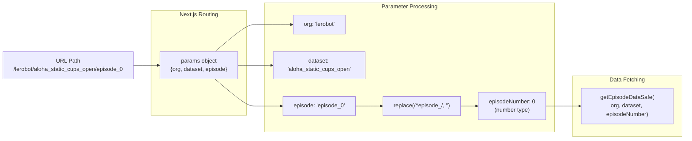
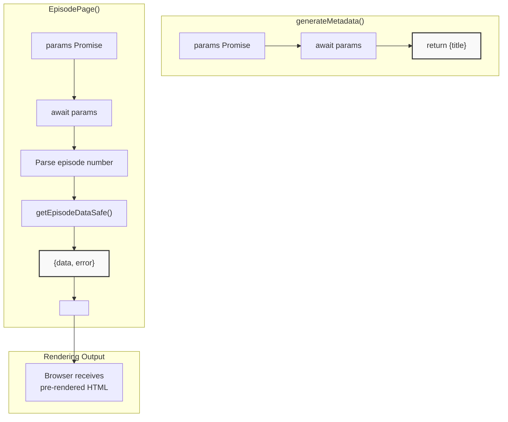
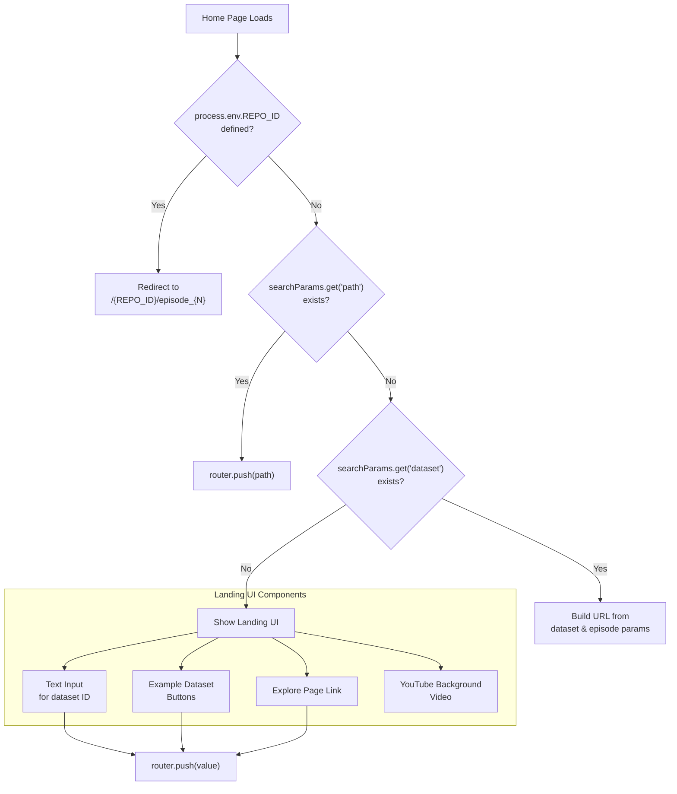
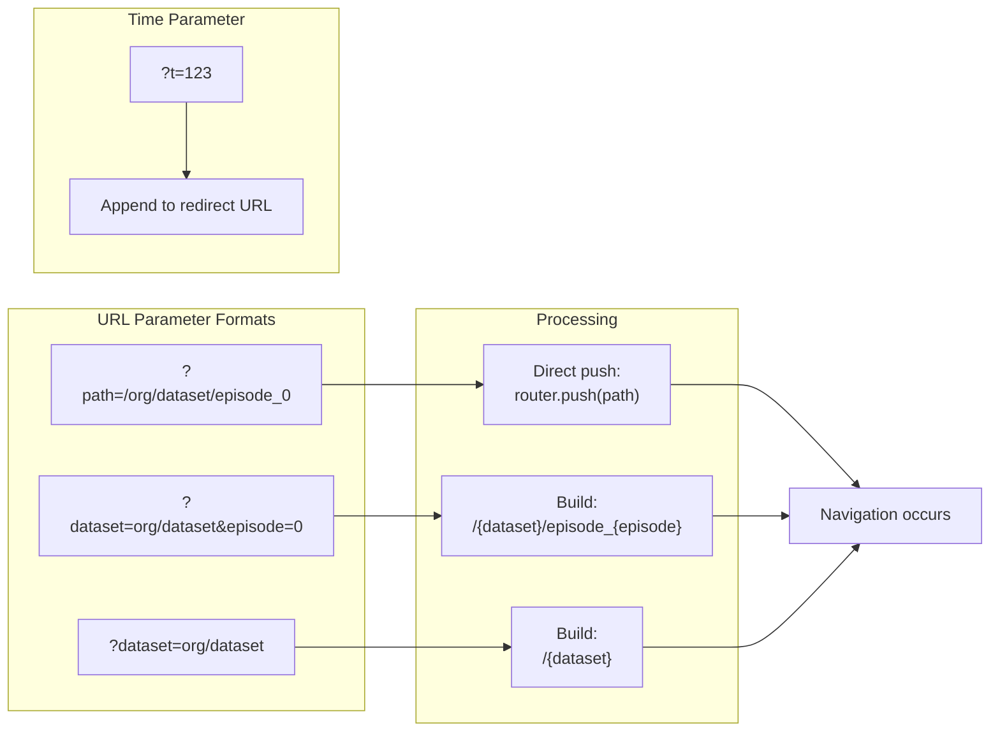
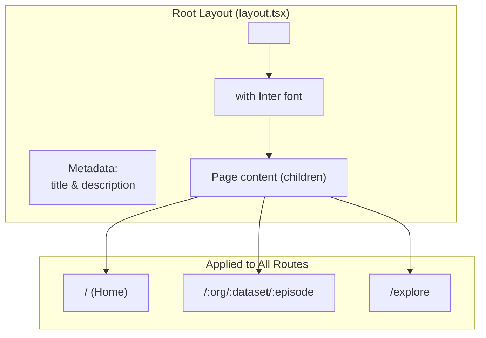
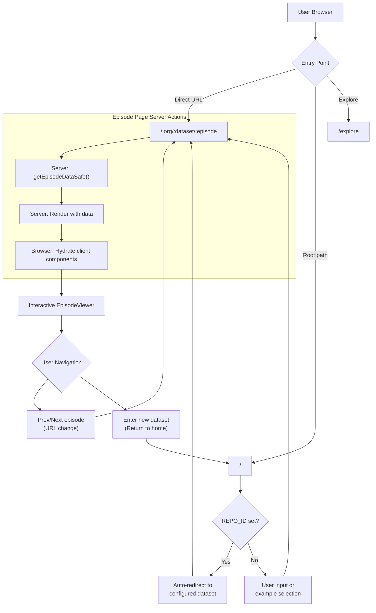

<!-- source: DeepWiki mcp.deepwiki.com · repo huggingface/lerobot-dataset-visualizer · page 9 Routing and Page Structure · fetched 2026-10-26 -->

# Routing and Page Structure

<details>
<summary>Relevant source files</summary>

The following files were used as context for generating this wiki page:

- [src/app/[org]/[dataset]/[episode]/page.tsx](src/app/[org]/[dataset]/[episode]/page.tsx)
- [src/app/layout.tsx](src/app/layout.tsx)
- [src/app/page.tsx](src/app/page.tsx)

</details>


## Purpose and Scope

This document describes the Next.js App Router architecture used in the LeRobot Dataset Visualizer. It covers the route structure, dynamic parameter handling, server-side rendering patterns, and page component responsibilities. For detailed information about the data fetching that occurs on these routes, see [Core Data Pipeline](#3). For UI components rendered by these pages, see [Episode Viewer Component](#4).

---

## Route Architecture Overview

The application uses Next.js 13+ App Router with file-system based routing. All routes are defined under `src/app/`, following the App Router convention where folder names in square brackets represent dynamic segments.



**Sources:** [src/app/layout.tsx:1-23](), [src/app/page.tsx:1-191](), [src/app/[org]/[dataset]/[episode]/page.tsx:1-34]()

---

## Dynamic Route Pattern

The primary visualization route follows the pattern `/:org/:dataset/:episode`, implemented as a nested folder structure with bracket notation. This pattern allows users to navigate directly to any episode of any dataset from any organization on HuggingFace.

### Route Segment Structure

| Segment | Type | Example | Constraint |
|---------|------|---------|------------|
| `org` | Dynamic | `lerobot` | Organization name on HuggingFace |
| `dataset` | Dynamic | `aloha_static_cups_open` | Dataset name within organization |
| `episode` | Dynamic | `episode_0` | Episode identifier with `episode_` prefix |

The episode segment uses a specific naming convention where the route parameter is a string like `episode_0`, which is parsed to extract the numeric episode index [src/app/[org]/[dataset]/[episode]/page.tsx:26]().



**Sources:** [src/app/[org]/[dataset]/[episode]/page.tsx:18-27]()

---

## Server-Side Rendering Pattern

The episode page uses Next.js server components for server-side rendering and data fetching. The configuration explicitly sets `dynamic = "force-dynamic"` to prevent static generation and ensure fresh data on each request [src/app/[org]/[dataset]/[episode]/page.tsx:5]().

### Server Component Functions



**Key Implementation Details:**

1. **Metadata Generation** [src/app/[org]/[dataset]/[episode]/page.tsx:7-16](): Generates page title dynamically based on route parameters. Used by Next.js for HTML `<title>` tag and OpenGraph metadata.

2. **Data Fetching** [src/app/[org]/[dataset]/[episode]/page.tsx:27](): Calls `getEpisodeDataSafe()` on the server before rendering. This returns both successful data and error states for graceful error handling.

3. **Suspense Boundary** [src/app/[org]/[dataset]/[episode]/page.tsx:29-31](): Wraps `EpisodeViewer` in React Suspense with `fallback={null}` to handle streaming server rendering.

**Sources:** [src/app/[org]/[dataset]/[episode]/page.tsx:1-34]()

---

## Home Page and Routing Logic

The home page (`src/app/page.tsx`) serves multiple purposes: displaying a landing interface, handling redirects based on environment variables, and processing URL parameters for HuggingFace Spaces integration.

### Client-Side Routing Patterns

The home page uses client-side routing with several redirect mechanisms:



**Sources:** [src/app/page.tsx:15-54](), [src/app/page.tsx:102-189]()

### Environment Variable Configuration

| Variable | Purpose | Example | Usage |
|----------|---------|---------|-------|
| `REPO_ID` | Dataset identifier for single-dataset mode | `lerobot/aloha_static_cups_open` | Redirects home to specific dataset [src/app/page.tsx:22-29]() |
| `EPISODES` | Space-separated episode list | `0 1 2 3` | Determines first episode to display [src/app/page.tsx:23-26]() |

When `REPO_ID` is set, the application operates in single-dataset mode, automatically redirecting users to the first episode of the configured dataset.

### URL Parameter Handling

The home page supports multiple URL parameter formats for integration with HuggingFace Spaces:



**Sources:** [src/app/page.tsx:32-53]()

### YouTube Background Video

The home page includes a YouTube video background player for visual appeal:

1. **API Loading** [src/app/page.tsx:58-64](): Dynamically loads YouTube IFrame API script
2. **Player Initialization** [src/app/page.tsx:66-93](): Creates player with autoplay, mute, and loop settings
3. **Loop Management** [src/app/page.tsx:85-90](): Implements manual loop by seeking to start when video reaches 60 seconds
4. **Cleanup** [src/app/page.tsx:95-99](): Destroys player on component unmount

**Sources:** [src/app/page.tsx:56-100]()

---

## Root Layout Configuration

The root layout provides global configuration for all pages:



**Configuration Details:**

- **Font**: Inter font family from Google Fonts [src/app/layout.tsx:5]()
- **Default Metadata**: Application title and description [src/app/layout.tsx:7-10]()
- **Global Styles**: Imports `globals.css` for Tailwind CSS [src/app/layout.tsx:3]()

The layout is minimal, allowing individual pages to control their own structure. The episode page can override the default title through its `generateMetadata` function.

**Sources:** [src/app/layout.tsx:1-23]()

---

## Navigation Flow Summary



**Sources:** [src/app/page.tsx:1-191](), [src/app/[org]/[dataset]/[episode]/page.tsx:1-34]()

---

## Key Routing Patterns

### 1. Server Component Data Fetching

The episode page demonstrates the Next.js 13+ pattern of fetching data directly in server components:

```typescript
// Pattern: await async function in component
const { data, error } = await getEpisodeDataSafe(org, dataset, episodeNumber);
```

This eliminates the need for `getServerSideProps` and allows data fetching to be collocated with the component [src/app/[org]/[dataset]/[episode]/page.tsx:27]().

### 2. Promise-based Parameters

Next.js 15+ returns route parameters as Promises, requiring async/await:

```typescript
// Pattern: await params before use
const { org, dataset, episode } = await params;
```

Both `generateMetadata` and `EpisodePage` follow this pattern [src/app/[org]/[dataset]/[episode]/page.tsx:12](), [src/app/[org]/[dataset]/[episode]/page.tsx:24]().

### 3. Suspense Boundaries

Server components use Suspense to handle streaming rendering:

```typescript
<Suspense fallback={null}>
  <EpisodeViewer data={data} error={error} />
</Suspense>
```

The `fallback={null}` provides a clean loading experience while server-rendering completes [src/app/[org]/[dataset]/[episode]/page.tsx:29-31]().

### 4. Client-Side Navigation

The home page uses `useRouter` for programmatic navigation and `useSearchParams` for reading URL parameters [src/app/page.tsx:4-5](), [src/app/page.tsx:16-17](). This enables smooth client-side transitions without full page reloads.

**Sources:** [src/app/[org]/[dataset]/[episode]/page.tsx:1-34](), [src/app/page.tsx:1-191]()

---

