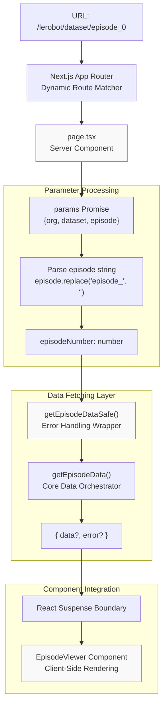
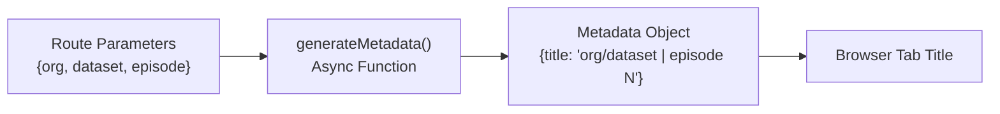
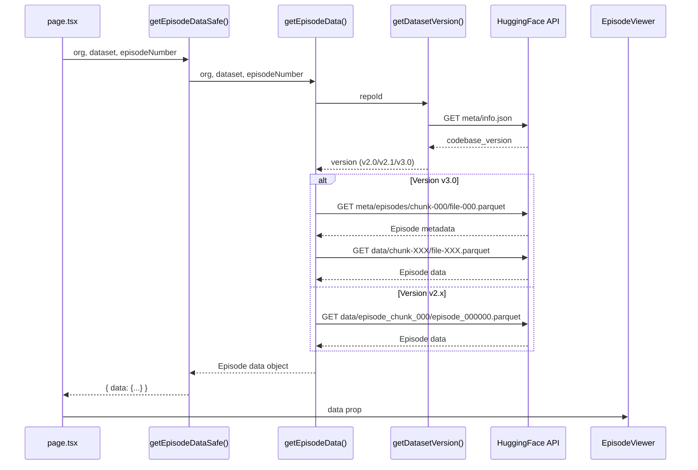
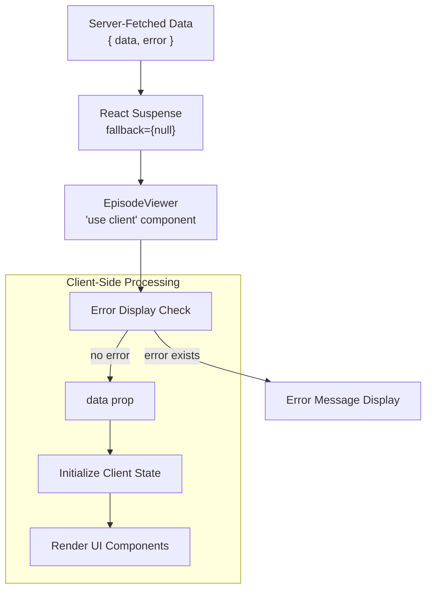
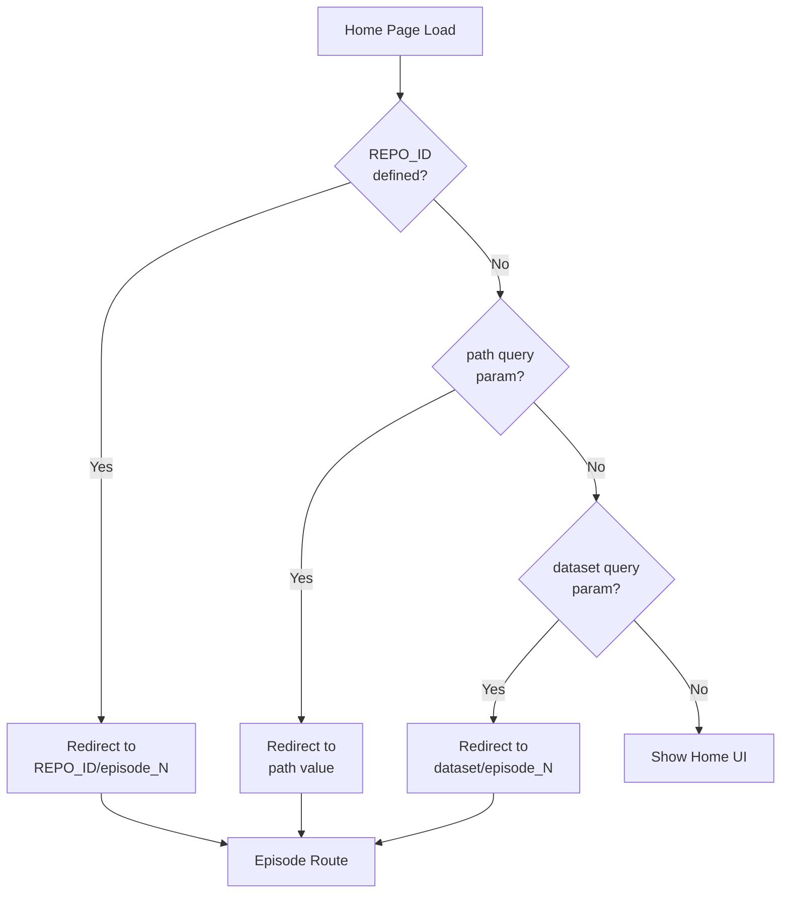
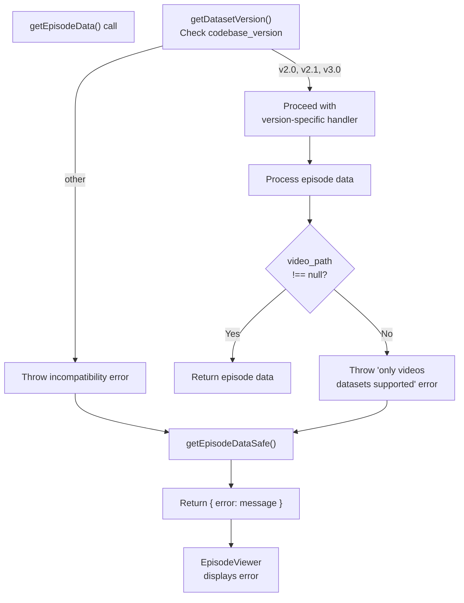

<!-- source: DeepWiki mcp.deepwiki.com · repo huggingface/lerobot-dataset-visualizer · page 9.1 Dynamic Episode Routes · fetched 2026-10-26 -->

# Dynamic Episode Routes

<details>
<summary>Relevant source files</summary>

The following files were used as context for generating this wiki page:

- [src/app/[org]/[dataset]/[episode]/fetch-data.ts](src/app/[org]/[dataset]/[episode]/fetch-data.ts)
- [src/app/[org]/[dataset]/[episode]/page.tsx](src/app/[org]/[dataset]/[episode]/page.tsx)
- [src/app/page.tsx](src/app/page.tsx)

</details>


## Purpose and Scope

This document explains the Next.js App Router dynamic route structure for viewing individual dataset episodes. It covers URL pattern parsing, server-side data fetching, metadata generation, and the integration with the Episode Viewer component. For information about the data fetching logic itself, see [Episode Data Fetching System](#3.1). For details about the EpisodeViewer component that renders the fetched data, see [Episode Viewer Component](#4).

---

## URL Structure and Pattern Matching

The episode viewer uses a three-segment dynamic route pattern located at `src/app/[org]/[dataset]/[episode]/page.tsx`. The URL structure follows this format:

```
/{org}/{dataset}/episode_{N}
```

Where:
- `org` - HuggingFace organization or username (e.g., "lerobot")
- `dataset` - Dataset repository name (e.g., "aloha_static_cups_open")
- `episode_{N}` - Episode identifier where N is the zero-indexed episode number (e.g., "episode_0", "episode_42")

### Parameter Extraction

The route handler receives parameters as a Promise that resolves to an object containing the three segments:

[src/app/[org]/[dataset]/[episode]/page.tsx:18-27]()

The episode string is parsed by removing the `episode_` prefix and converting the remainder to a number. This numeric episode ID is then passed to the data fetching layer.

**Sources:** [src/app/[org]/[dataset]/[episode]/page.tsx:1-34]()

---

## Route Handler Architecture



**Sources:** [src/app/[org]/[dataset]/[episode]/page.tsx:18-33]()

---

## Server-Side Rendering Configuration

The page explicitly forces dynamic rendering to ensure fresh data on each request:

[src/app/[org]/[dataset]/[episode]/page.tsx:5]()

This configuration prevents Next.js from attempting to statically generate or cache these pages at build time, which is necessary because:
1. Dataset content changes over time
2. Episode data is fetched from external HuggingFace repositories
3. Different users may access different datasets dynamically

### Metadata Generation

The route provides dynamic metadata for SEO and browser tab titles:



[src/app/[org]/[dataset]/[episode]/page.tsx:7-16]()

The metadata function runs during the server-side rendering phase and constructs a human-readable title like "lerobot/aloha_static_cups_open | episode 0".

**Sources:** [src/app/[org]/[dataset]/[episode]/page.tsx:5-16]()

---

## Data Fetching Pipeline

### Safe Error Handling Wrapper

The page uses `getEpisodeDataSafe()` instead of calling `getEpisodeData()` directly. This wrapper catches exceptions and returns a structured result object:

```typescript
// Return type structure
{
  data?: {
    datasetInfo: {...},
    episodeId: number,
    videosInfo: [...],
    chartDataGroups: [...],
    episodes: number[],
    ignoredColumns: string[],
    duration: number,
    task?: string
  },
  error?: string
}
```

[src/app/[org]/[dataset]/[episode]/fetch-data.ts:1076-1088]()

The wrapper implementation:
- Calls `getEpisodeData()` with the parsed parameters
- On success, returns `{ data: <result> }`
- On failure, extracts only the error message (not stack traces) and returns `{ error: <message> }`

This pattern ensures that sensitive error details or stack traces are never sent to the client, while still providing actionable error messages to users.

**Sources:** [src/app/[org]/[dataset]/[episode]/page.tsx:27](), [src/app/[org]/[dataset]/[episode]/fetch-data.ts:1076-1088]()

### Data Fetching Sequence



**Sources:** [src/app/[org]/[dataset]/[episode]/page.tsx:18-33](), [src/app/[org]/[dataset]/[episode]/fetch-data.ts:14-40]()

---

## Component Integration and Rendering

### Suspense Boundary

The page wraps the EpisodeViewer component in a React Suspense boundary:

[src/app/[org]/[dataset]/[episode]/page.tsx:29-31]()

While the Suspense boundary uses `fallback={null}` (no loading UI), it serves an important architectural purpose:
- Enables proper hydration boundaries between server and client components
- Allows the EpisodeViewer (a client component) to be integrated with server-fetched data
- Provides a clear boundary for client-side state management

### Data Flow to Client



The EpisodeViewer component receives both `data` and `error` props and handles display logic:
- If `error` is present, displays error message to user
- If `data` is present, initializes visualization components
- Manages loading states during client-side hydration

**Sources:** [src/app/[org]/[dataset]/[episode]/page.tsx:28-32]()

---

## Navigation Patterns

### Entry Points to Episode Routes

Episode routes can be reached through multiple navigation paths:

| Entry Point | URL Pattern | Implementation |
|------------|-------------|----------------|
| Home Page | Direct input → `/{org}/{dataset}/episode_{N}` | [src/app/page.tsx:104-110]() |
| Home Page | Query param redirect → `?dataset={org}/{dataset}&episode={N}` | [src/app/page.tsx:39-53]() |
| Home Page | Environment variable → `REPO_ID` + `EPISODES` | [src/app/page.tsx:22-30]() |
| Explore Page | Dataset card click → `/{org}/{dataset}` → first episode | Not shown in provided files |
| EpisodeViewer | Keyboard navigation (←/→) → adjacent episodes | Referenced in [Episode Viewer Component](#4) |
| EpisodeViewer | Sidebar pagination → selected episode | Referenced in [Episode Viewer Component](#4) |

### Home Page Redirect Logic

The home page implements several redirect strategies:



[src/app/page.tsx:20-54]()

This multi-tiered redirect system supports:
1. **Environment-based**: Embedded visualizer with pre-configured dataset
2. **Query parameters**: Deep linking from HuggingFace Spaces
3. **Legacy parameters**: Backward compatibility with older URL format
4. **Manual input**: User-entered dataset identifiers

**Sources:** [src/app/page.tsx:20-54](), [src/app/page.tsx:104-110]()

---

## Error Handling and Edge Cases

### Version Compatibility Errors

The data fetching layer may throw errors for incompatible dataset versions:



[src/app/[org]/[dataset]/[episode]/fetch-data.ts:20-39]()

### Episode Not Found Errors

For v3.0 datasets, the metadata loading function searches through episode metadata files sequentially. If an episode is not found, a descriptive error is thrown:

[src/app/[org]/[dataset]/[episode]/fetch-data.ts:976-978]()

This error message indicates which metadata files were searched, helping users diagnose whether the episode ID is out of range.

**Sources:** [src/app/[org]/[dataset]/[episode]/fetch-data.ts:20-39](), [src/app/[org]/[dataset]/[episode]/fetch-data.ts:934-983]()

---

## Performance Considerations

### Server-Side vs. Client-Side Trade-offs

The route architecture makes deliberate choices about what to process server-side:

| Aspect | Server-Side | Client-Side |
|--------|-------------|-------------|
| URL parsing | ✓ (Next.js router) | |
| Episode parameter extraction | ✓ (page.tsx) | |
| Version detection | ✓ (fetch-data.ts) | |
| Parquet file fetching | ✓ (fetch-data.ts) | |
| Parquet parsing | ✓ (fetch-data.ts) | |
| Chart data grouping | ✓ (fetch-data.ts) | |
| Video playback | | ✓ (EpisodeViewer) |
| Chart rendering | | ✓ (DataRecharts) |
| Time synchronization | | ✓ (TimeContext) |
| User interactions | | ✓ (EpisodeViewer) |

This division ensures:
1. Heavy data processing happens on the server with better computational resources
2. Interactive UI remains responsive on the client
3. Initial page load includes fully-prepared data (no loading spinners for data fetching)
4. SEO-friendly metadata is available immediately

### Adjacent Episodes Preloading

The system includes functionality for preloading adjacent episode videos:

[src/app/[org]/[dataset]/[episode]/fetch-data.ts:43-100]()

This function (not currently invoked by the route handler) can fetch video information for episodes within a radius of the current episode, enabling preload hints for smoother navigation. The radius parameter defaults to 2, meaning it would fetch info for `[current-2, current-1, current+1, current+2]`.

**Sources:** [src/app/[org]/[dataset]/[episode]/page.tsx:1-34](), [src/app/[org]/[dataset]/[episode]/fetch-data.ts:43-100]()

---

## Integration Points

### Data Flow Summary

```mermaid
graph LR
    subgraph "Route Handler Layer"
        Route["page.tsx<br/>Server Component"]
    end
    
    subgraph "Data Fetching Layer"
        FetchData["fetch-data.ts<br/>getEpisodeDataSafe()"]
    end
    
    subgraph "Presentation Layer"
        Viewer["EpisodeViewer<br/>Client Component"]
    end
    
    subgraph "External Systems"
        HF["HuggingFace<br/>Dataset Repository"]
    end
    
    Browser["Browser URL"] -->|params| Route
    Route -->|org, dataset, episodeNumber| FetchData
    FetchData <-->|HTTP requests| HF
    FetchData -->|{ data, error }| Route
    Route -->|props| Viewer
    Viewer -->|updates| Browser
```

The dynamic episode route serves as the critical bridge between:
1. User navigation (URL parameters)
2. Data fetching infrastructure (fetch-data.ts)
3. Visualization components (EpisodeViewer and children)

This architecture enables the visualizer to handle arbitrary datasets from HuggingFace without requiring build-time knowledge of available datasets or episodes.

**Sources:** [src/app/[org]/[dataset]/[episode]/page.tsx:1-34](), [src/app/[org]/[dataset]/[episode]/fetch-data.ts:14-40](), [src/app/[org]/[dataset]/[episode]/fetch-data.ts:1076-1088]()

---

