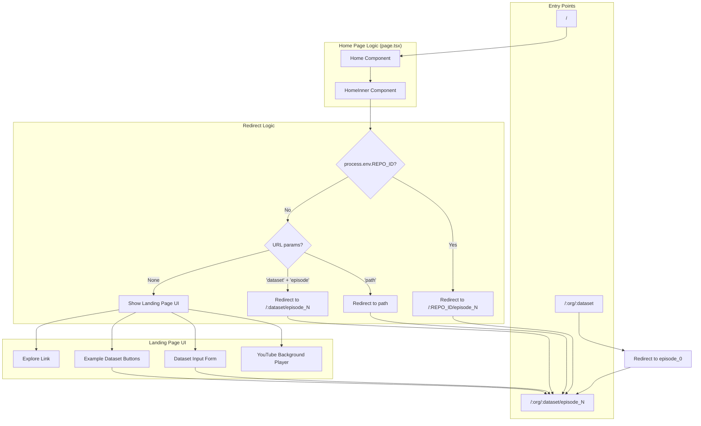
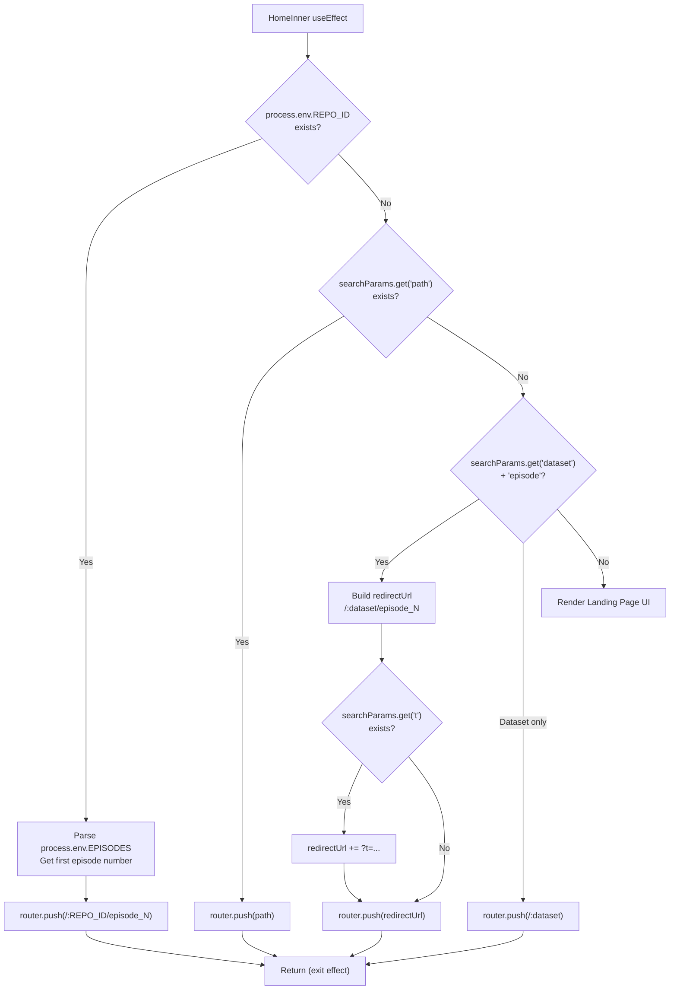
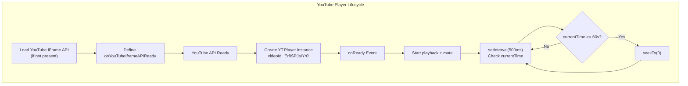
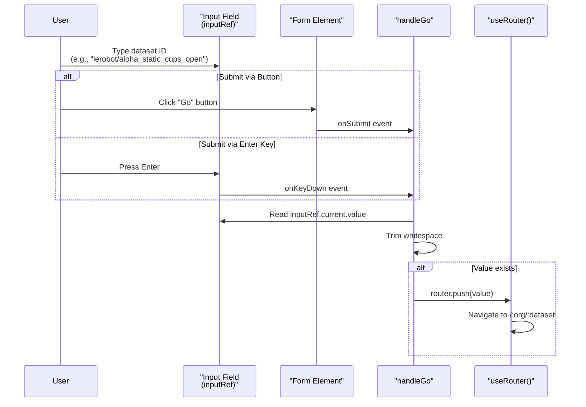
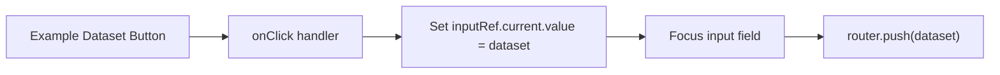
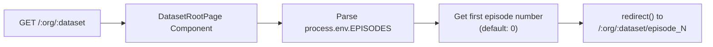
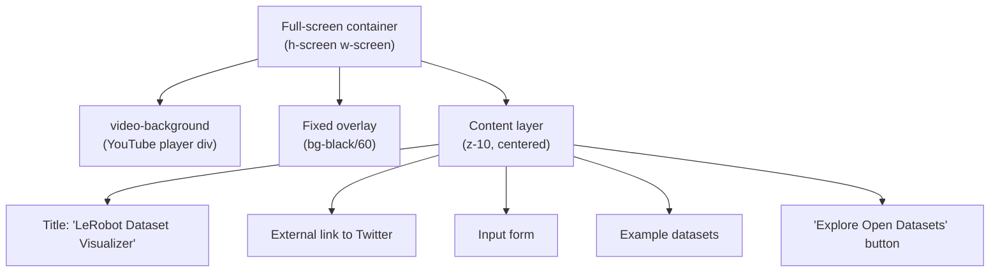

<!-- source: DeepWiki mcp.deepwiki.com · repo huggingface/lerobot-dataset-visualizer · page 9.2 Home Page and Entry Points · fetched 2026-10-26 -->

# Home Page and Entry Points

<details>
<summary>Relevant source files</summary>

The following files were used as context for generating this wiki page:

- [src/app/[org]/[dataset]/[episode]/page.tsx](src/app/[org]/[dataset]/[episode]/page.tsx)
- [src/app/[org]/[dataset]/page.tsx](src/app/[org]/[dataset]/page.tsx)
- [src/app/page.tsx](src/app/page.tsx)

</details>


## Purpose and Scope

This document describes the home page and application entry point system. It covers the root route (`/`) implementation, environment-based redirects, URL parameter handling for HuggingFace Spaces integration, and the interactive landing page UI. For information about the dataset root page redirect logic, see the Dataset Root Route section below. For the explore page, see [Explore Page](#9.3). For the dynamic episode routes, see [Dynamic Episode Routes](#9.1).

## System Overview

The home page serves as the primary entry point to the LeRobot Dataset Visualizer, implementing several key responsibilities: environment-based automatic redirects for embedded usage, URL parameter parsing for HuggingFace Spaces integration, a YouTube background video player, and a user input form for manual dataset navigation.



**Sources:** [src/app/page.tsx:1-190](), [src/app/[org]/[dataset]/page.tsx:1-16]()

## Component Architecture

The home page uses a two-component architecture with client-side rendering and Suspense boundaries.

### Component Structure

| Component | Type | File Location | Purpose |
|-----------|------|---------------|---------|
| `Home` | Server Component | [src/app/page.tsx:7-13]() | Wraps `HomeInner` with Suspense |
| `HomeInner` | Client Component | [src/app/page.tsx:15-190]() | Contains all interactive logic and UI |

The outer `Home` component exists solely to provide a Suspense boundary around `HomeInner`, allowing Next.js to handle the `useSearchParams()` hook correctly during server-side rendering.

**Sources:** [src/app/page.tsx:7-13](), [src/app/page.tsx:15-16]()

## Redirect Flow System

The home page implements a priority-based redirect system that handles three different scenarios: environment-based configuration, HuggingFace Spaces URL parameters, and legacy URL parameters.



**Sources:** [src/app/page.tsx:20-54]()

### Environment Variable Redirect

When `process.env.REPO_ID` is defined, the application operates in embedded mode and automatically redirects to a specific dataset's episode viewer.

**Logic:** [src/app/page.tsx:22-30]()

| Environment Variable | Purpose | Format |
|---------------------|---------|--------|
| `process.env.REPO_ID` | Target dataset identifier | `org/dataset` |
| `process.env.EPISODES` | Space-separated episode numbers | `"0 1 2 3"` |

The redirect target is constructed as:
```
/${process.env.REPO_ID}/episode_${firstEpisodeNumber}
```

The first episode number is extracted by splitting `process.env.EPISODES` on whitespace, parsing integers, filtering valid numbers, and taking the first element (defaulting to 0).

### URL Parameter Redirect

The home page supports two URL parameter patterns for integration with HuggingFace Spaces:

**Modern Pattern (Priority 1):** [src/app/page.tsx:33-36]()
- Parameter: `?path=/org/dataset/episode_N`
- Behavior: Direct redirect to the specified path
- Example: `/?path=/lerobot/aloha_static_cups_open/episode_0`

**Legacy Pattern (Priority 2):** [src/app/page.tsx:39-53]()
- Parameters: `?dataset=org/dataset&episode=0&t=5.2`
- Behavior: Constructs redirect URL from components
- Supports optional `t` parameter for initial timestamp
- Example: `/?dataset=lerobot/aloha_static_cups_open&episode=0&t=5.2` → `/lerobot/aloha_static_cups_open/episode_0?t=5.2`

**Sources:** [src/app/page.tsx:20-54]()

## YouTube Background Video

The home page implements a YouTube background video player using the YouTube IFrame API, configured for continuous looping playback.



**Sources:** [src/app/page.tsx:58-100]()

### Player Configuration

The YouTube player is created with the following configuration:

| Parameter | Value | Purpose |
|-----------|-------|---------|
| `videoId` | `"Er8SPJsIYr0"` | HuggingFace robot demo video |
| `autoplay` | `1` | Start playing immediately |
| `mute` | `1` | Muted by default |
| `controls` | `0` | Hide player controls |
| `showinfo` | `0` | Hide video info |
| `modestbranding` | `1` | Minimal YouTube branding |
| `rel` | `0` | Don't show related videos |
| `loop` | `1` | Enable looping |
| `fs` | `0` | Disable fullscreen button |
| `playlist` | `"Er8SPJsIYr0"` | Required for loop functionality |
| `start` | `0` | Start from beginning |

**Configuration:** [src/app/page.tsx:68-80]()

### Loop Implementation

The player implements a custom 60-second loop mechanism using an interval timer:
1. Every 500ms, check the current playback time
2. If time >= 60 seconds, seek to 0
3. This ensures the video loops smoothly without showing the full video length

**Loop Logic:** [src/app/page.tsx:85-90]()

### Cleanup

The component properly cleans up resources on unmount:
- Clears the interval timer
- Destroys the YouTube player instance

**Cleanup:** [src/app/page.tsx:95-99]()

**Sources:** [src/app/page.tsx:58-100]()

## User Input Form

The landing page provides an interactive form for manual dataset navigation.

### Form Components

| Element | Type | Purpose |
|---------|------|---------|
| Input Field | `<input type="text">` | Dataset ID entry |
| Submit Button | `<button type="submit">` | Trigger navigation |
| Enter Key Handler | `onKeyDown` | Alternative submission |

**Form Structure:** [src/app/page.tsx:133-153]()

### Navigation Flow



**Sources:** [src/app/page.tsx:102-110](), [src/app/page.tsx:133-153]()

### Submission Handler

The `handleGo` function processes form submissions:

1. Prevents default form submission behavior
2. Reads the trimmed input value from `inputRef`
3. If value is non-empty, navigates to the entered path
4. Uses `router.push()` for client-side navigation

**Implementation:** [src/app/page.tsx:104-110]()

The form supports both button clicks and Enter key presses, with explicit `e.preventDefault()` handling to avoid double submission.

**Sources:** [src/app/page.tsx:102-153]()

## Example Datasets

The landing page displays three pre-configured example datasets for quick access.

### Example Dataset List

| Dataset ID | Purpose |
|------------|---------|
| `lerobot/aloha_static_cups_open` | ALOHA robot manipulation |
| `lerobot/columbia_cairlab_pusht_real` | Pushing task dataset |
| `lerobot/taco_play` | TACO play demonstration |

**Example List:** [src/app/page.tsx:158-162]()

### Interaction Behavior

Each example dataset button provides two actions:
1. **Click**: Navigate directly to the dataset
2. **Focus**: Populate the input field with the dataset ID



**Button Implementation:** [src/app/page.tsx:163-177]()

The button uses `router.push(ds)` to navigate directly to the dataset, which triggers the dataset root page redirect (see Dataset Root Route below).

**Sources:** [src/app/page.tsx:155-179]()

## Dataset Root Route

The dataset root route (`/:org/:dataset`) implements a simple redirect to the first episode.

### Route Structure

**File:** [src/app/[org]/[dataset]/page.tsx:1-16]()



**Sources:** [src/app/[org]/[dataset]/page.tsx:3-15]()

### Episode Selection Logic

The redirect target is determined by:
1. Split `process.env.EPISODES` by whitespace
2. Parse each token as an integer
3. Filter out NaN values
4. Take the first valid episode number
5. Default to 0 if no valid episodes found

**Logic:** [src/app/[org]/[dataset]/page.tsx:9-12]()

This ensures that when users navigate to a dataset without specifying an episode (e.g., via the example buttons or explore page), they are automatically redirected to the first available episode.

**Sources:** [src/app/[org]/[dataset]/page.tsx:1-16]()

## Landing Page UI Layout

The landing page uses a full-screen layout with layered elements.

### Layout Structure

| Layer | Z-Index | Content |
|-------|---------|---------|
| Background Video | N/A | YouTube player iframe |
| Overlay | -0 | Semi-transparent black backdrop |
| Content | 10 | Text, form, buttons |

**Layout:** [src/app/page.tsx:113-188]()

### Visual Hierarchy



**Sources:** [src/app/page.tsx:113-188]()

### Content Elements

1. **Title**: Large heading with drop shadow [src/app/page.tsx:122-124]()
2. **External Link**: Twitter/X link for robot training resources [src/app/page.tsx:125-132]()
3. **Input Form**: Dataset ID entry with submit button [src/app/page.tsx:133-153]()
4. **Example Datasets**: Section with three quick-access buttons [src/app/page.tsx:155-179]()
5. **Explore Link**: Navigation to dataset discovery page [src/app/page.tsx:181-186]()

**Sources:** [src/app/page.tsx:113-188]()

## Component Lifecycle and Effects

The `HomeInner` component uses multiple `useEffect` hooks for different concerns.

### Effect Dependencies

| Effect | Dependencies | Purpose | Timing |
|--------|--------------|---------|--------|
| Redirect Logic | `[searchParams, router]` | Handle URL-based redirects | On mount and param changes |
| YouTube Setup | `[]` | Initialize YouTube player | Once on mount |

**Redirect Effect:** [src/app/page.tsx:20-54]()
**YouTube Effect:** [src/app/page.tsx:58-100]()

### Refs Usage

| Ref | Type | Purpose |
|-----|------|---------|
| `playerRef` | `any` | Store YouTube player instance |
| `inputRef` | `HTMLInputElement` | Access input field value |

**Ref Declarations:** [src/app/page.tsx:56](), [src/app/page.tsx:102]()

**Sources:** [src/app/page.tsx:20-100]()

## Integration Points

The home page integrates with several other parts of the application:

| Integration | Mechanism | Target |
|-------------|-----------|--------|
| Episode Viewer | `router.push()` | [Dynamic Episode Routes](#9.1) |
| Explore Page | `<Link href="/explore">` | [Explore Page](#9.3) |
| Dataset Root | `router.push(dataset)` | Dataset redirect handler |
| HuggingFace Spaces | URL parameter parsing | External embedding |

The home page acts as a routing hub, translating various input methods (environment vars, URL params, user input, example buttons) into navigation actions that lead to the core episode viewer functionality.

**Sources:** [src/app/page.tsx:1-190](), [src/app/[org]/[dataset]/page.tsx:1-16]()

---

