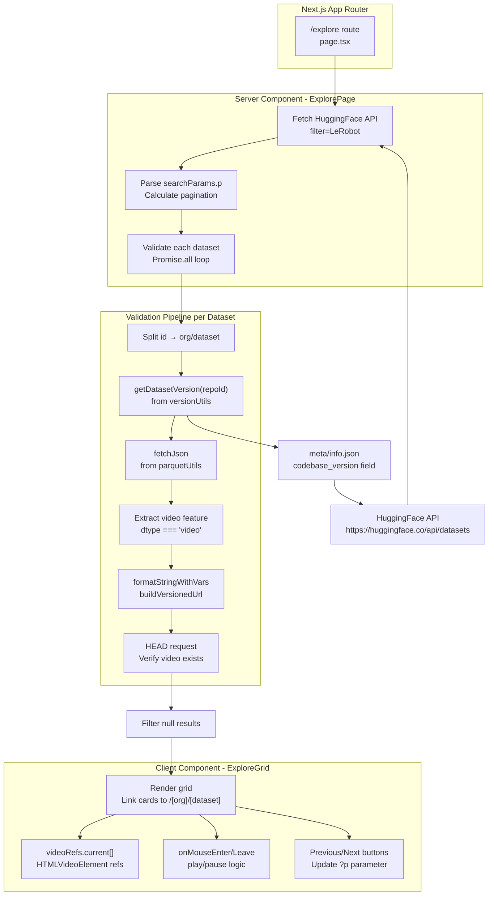
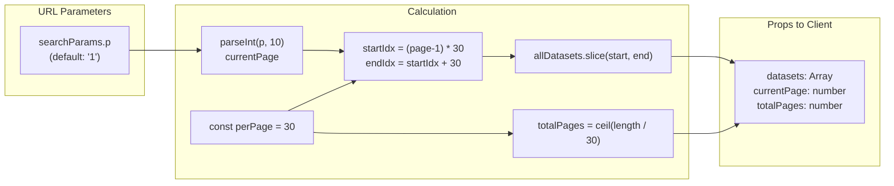
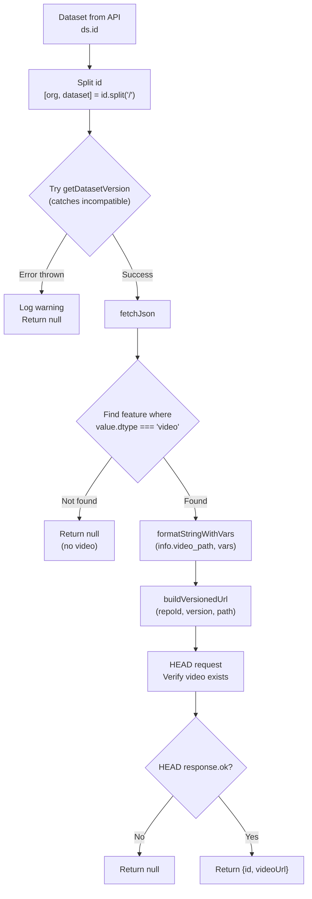
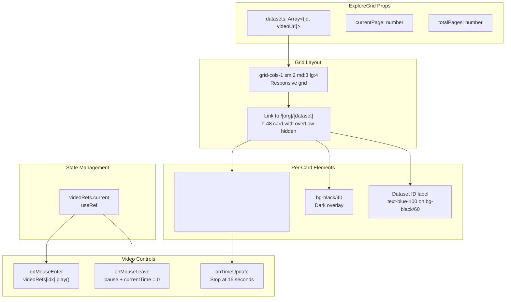
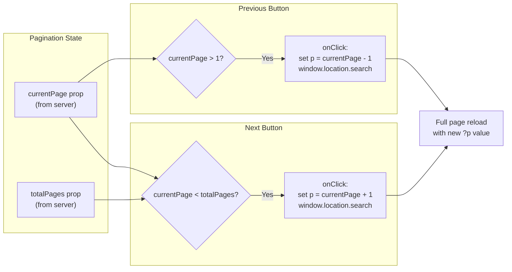
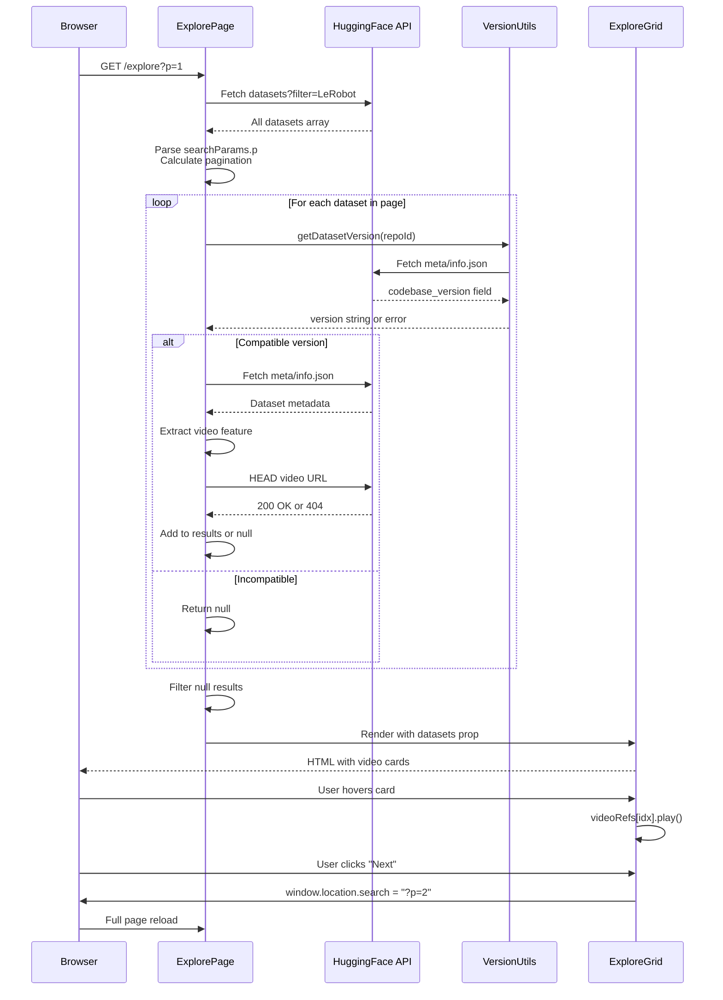

<!-- source: DeepWiki mcp.deepwiki.com · repo huggingface/lerobot-dataset-visualizer · page 9.3 Explore Page · fetched 2026-10-26 -->

# Explore Page

<details>
<summary>Relevant source files</summary>

The following files were used as context for generating this wiki page:

- [src/app/explore/explore-grid.tsx](src/app/explore/explore-grid.tsx)
- [src/app/explore/page.tsx](src/app/explore/page.tsx)

</details>


## Purpose and Scope

The Explore Page provides a dataset discovery interface that allows users to browse all available LeRobot datasets hosted on HuggingFace. This page fetches dataset metadata from the HuggingFace API, validates compatibility, generates video previews, and displays results in a paginated grid format. When users click on a dataset card, they navigate to the full episode viewer for that dataset.

This document covers the server-side data fetching logic, client-side rendering and interaction patterns, and the integration with version detection utilities. For information about the episode viewing experience after selecting a dataset, see [Dynamic Episode Routes](#9.1). For details on version compatibility checks performed during dataset filtering, see [Version Detection and Compatibility](#3.2).

Sources: [src/app/explore/page.tsx:1-104](), [src/app/explore/explore-grid.tsx:1-105]()

---

## System Architecture

The Explore Page follows Next.js 13+ App Router patterns with a clear separation between server-side data fetching and client-side interactivity. The `ExplorePage` component executes on the server to fetch and validate datasets, while the `ExploreGrid` component runs on the client to handle user interactions.



**Key Components:**
- **`ExplorePage`**: Server component that orchestrates API calls and dataset validation [src/app/explore/page.tsx:10-103]()
- **`ExploreGrid`**: Client component that manages grid rendering and user interactions [src/app/explore/explore-grid.tsx:15-104]()
- **`getDatasetVersion`**: Utility that verifies dataset compatibility [src/app/explore/page.tsx:53]()
- **`buildVersionedUrl`**: Constructs version-aware URLs for dataset resources [src/app/explore/page.tsx:60]()

Sources: [src/app/explore/page.tsx:10-103](), [src/app/explore/explore-grid.tsx:15-104]()

---

## Dataset Fetching and Pagination

The server component fetches all LeRobot datasets from the HuggingFace API and implements server-side pagination to reduce initial payload size.

### HuggingFace API Integration

The page queries the HuggingFace datasets API with specific filters:

| Parameter | Value | Purpose |
|-----------|-------|---------|
| `sort` | `lastModified` | Show recently updated datasets first |
| `filter` | `LeRobot` | Only retrieve datasets tagged with LeRobot |
| `cache` | `no-store` | Ensure fresh data on every request |

[src/app/explore/page.tsx:19-24]()

### Pagination Logic

The pagination system divides results into pages of 30 datasets each:



**Implementation Details:**
- Page parameter extracted from `searchParams?.p` [src/app/explore/page.tsx:29]()
- Default page is `1` if parameter missing
- `perPage` constant set to `30` [src/app/explore/page.tsx:30]()
- Array slicing applied to full dataset list [src/app/explore/page.tsx:35-37]()

Sources: [src/app/explore/page.tsx:28-37]()

---

## Dataset Compatibility and Filtering

Before displaying a dataset, the page validates its compatibility using version detection utilities. Incompatible datasets are silently filtered out rather than causing page-wide errors.

### Validation Pipeline

Each dataset undergoes the following validation steps:



**Key Error Handling:**
- Version incompatibility caught with `try-catch` and logged as warning [src/app/explore/page.tsx:52-58]()
- Missing video features result in `null` return [src/app/explore/page.tsx:84]()
- Failed HEAD requests result in `null` return [src/app/explore/page.tsx:80-82]()
- All `null` results filtered before passing to client [src/app/explore/page.tsx:94]()

### Video Path Construction

Video URLs are constructed using metadata templates:

| Variable | Value | Purpose |
|----------|-------|---------|
| `video_key` | Extracted from features | Identifies the video stream |
| `episode_chunk` | `"000"` | Hardcoded to first chunk |
| `episode_index` | `"000000"` | Hardcoded to episode 0 |

[src/app/explore/page.tsx:68-72]()

The `formatStringWithVars` utility replaces template placeholders in `info.video_path` with these values to generate the final path, which is then passed to `buildVersionedUrl` to construct a fully qualified URL.

Sources: [src/app/explore/page.tsx:44-94]()

---

## Grid Rendering and Video Previews

The `ExploreGrid` client component renders validated datasets as interactive cards with video previews.

### Component Structure



**Layout Configuration:**
- Responsive grid: 1 column (mobile), 2 (sm), 3 (md), 4 (lg) [src/app/explore/explore-grid.tsx:33]()
- Fixed card height of `h-48` (192px) [src/app/explore/explore-grid.tsx:38]()
- Video covers entire card with `object-cover object-center` [src/app/explore/explore-grid.tsx:56]()

Sources: [src/app/explore/explore-grid.tsx:30-75]()

### Video Playback Logic

Videos are controlled through three event handlers:

**Mouse Enter (Play):**
```typescript
onMouseEnter={() => {
  const vid = videoRefs.current[idx];
  if (vid) vid.play();
}}
```
[src/app/explore/explore-grid.tsx:39-42]()

**Mouse Leave (Stop and Reset):**
```typescript
onMouseLeave={() => {
  const vid = videoRefs.current[idx];
  if (vid) {
    vid.pause();
    vid.currentTime = 0;
  }
}}
```
[src/app/explore/explore-grid.tsx:43-49]()

**Time Update (Auto-Stop at 15s):**
```typescript
onTimeUpdate={(e) => {
  const vid = e.currentTarget;
  if (vid.currentTime >= 15) {
    vid.pause();
    vid.currentTime = 0;
  }
}}
```
[src/app/explore/explore-grid.tsx:61-67]()

**Video Element Attributes:**
- `loop`: Allows continuous looping if not interrupted
- `muted`: Required for autoplay in browsers
- `playsInline`: Prevents fullscreen on mobile devices
- `preload="metadata"`: Loads first frame without downloading full video

[src/app/explore/explore-grid.tsx:51-60]()

Sources: [src/app/explore/explore-grid.tsx:39-67]()

---

## Client-Side Pagination Controls

The `ExploreGrid` component renders pagination buttons that update the `?p` query parameter.



**Button Rendering Logic:**
- Previous button only rendered when `currentPage > 1` [src/app/explore/explore-grid.tsx:77-87]()
- Next button only rendered when `currentPage < totalPages` [src/app/explore/explore-grid.tsx:89-100]()

**Navigation Implementation:**
Both buttons update the URL search parameters and trigger a full page reload:

```typescript
onClick={() => {
  const params = new URLSearchParams(window.location.search);
  params.set("p", (currentPage ± 1).toString());
  window.location.search = params.toString();
}}
```

This causes the server component to re-execute with the new page parameter, fetching and validating the next/previous batch of 30 datasets.

Sources: [src/app/explore/explore-grid.tsx:76-101]()

---

## Parent Window Communication

The `ExploreGrid` component communicates with parent windows when embedded in iframes, particularly for the HuggingFace Spaces integration.

**Synchronization Effect:**
```typescript
useEffect(() => {
  postParentMessageWithParams((params: URLSearchParams) => {
    params.set("path", window.location.pathname + window.location.search);
  });
}, []);
```
[src/app/explore/explore-grid.tsx:21-25]()

This effect runs once on mount and posts the current path (including query parameters) to the parent window. This allows the embedding page to synchronize its URL bar with the iframe's navigation state.

For more details on the parent message posting mechanism, see the `postParentMessage` utility documentation.

Sources: [src/app/explore/explore-grid.tsx:21-25]()

---

## Error Handling

The Explore Page implements graceful error handling at multiple levels:

### API Fetch Errors

If the initial HuggingFace API request fails:
```typescript
if (!res.ok) throw new Error("Failed to fetch datasets");
```
The catch block renders an error message: `"Failed to load datasets."` [src/app/explore/page.tsx:38-40]()

### Per-Dataset Errors

Individual dataset validation failures are handled silently:

| Error Type | Handling Strategy | Code Location |
|------------|-------------------|---------------|
| Version incompatibility | Log warning, return `null` | [src/app/explore/page.tsx:52-58]() |
| Info.json fetch failure | Log error, return `null` | [src/app/explore/page.tsx:85-90]() |
| Video HEAD request failure | Silent catch, return `null` | [src/app/explore/page.tsx:80-82]() |

All `null` results are filtered before rendering: `.filter(Boolean)` [src/app/explore/page.tsx:94]()

This ensures that a few incompatible or broken datasets don't prevent the entire page from loading.

Sources: [src/app/explore/page.tsx:38-40](), [src/app/explore/page.tsx:52-90](), [src/app/explore/page.tsx:94]()

---

## Data Flow Summary

The complete data flow from API request to rendered grid:



Sources: [src/app/explore/page.tsx:10-103](), [src/app/explore/explore-grid.tsx:15-104]()

---

