# Page: Overview

# Overview

<details>
<summary>Relevant source files</summary>

The following files were used as context for generating this wiki page:

- [LICENSE](LICENSE)
- [README.md](README.md)
- [package.json](package.json)

</details>


This page provides a high-level introduction to the LeRobot Dataset Visualizer codebase, its architecture, and organization. It is intended to help new developers understand the system's purpose, structure, and key components.

For installation and setup instructions, see [Quick Start Guide](#2). For detailed documentation of specific subsystems, refer to the child pages listed in the table of contents.

## Purpose

The LeRobot Dataset Visualizer is a web application that enables interactive exploration of robotics datasets stored in the LeRobot format on HuggingFace. The application provides synchronized visualization of video recordings and time-series data (sensor readings, control signals, etc.) for individual robot episodes.

The primary use case is for robotics researchers and practitioners who need to quickly inspect and understand large, complex datasets containing recorded robot trajectories.

**Sources:** [README.md:1-13]()

## System Architecture

The LeRobot Dataset Visualizer follows a three-tier architecture:

1. **Routing Layer:** Next.js App Router with dynamic routes for dataset navigation
2. **Data Layer:** Server-side data fetching, version detection, and Parquet processing
3. **Presentation Layer:** Client-side React components for visualization and interaction

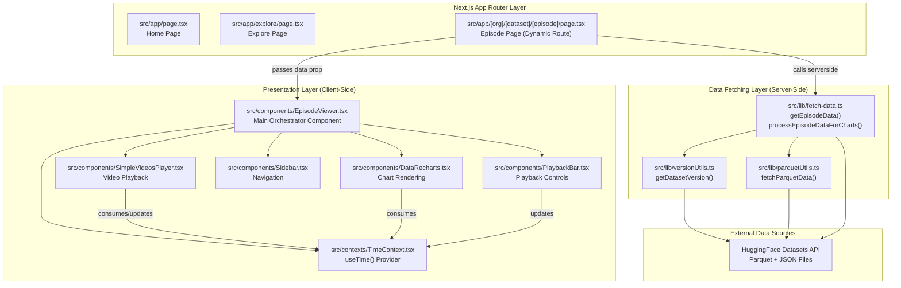

**Diagram 1: System Architecture with Code File Paths**

This diagram maps high-level system concepts to their concrete implementations in the codebase. The data flows from external HuggingFace storage through server-side processing into client-side visualization components.

**Sources:** [README.md:1-28](), [package.json:1-32]()

## Data Flow Pipeline

The most critical system in the application is the data fetching and processing pipeline, which transforms raw Parquet and JSON files from HuggingFace into structured data ready for visualization.

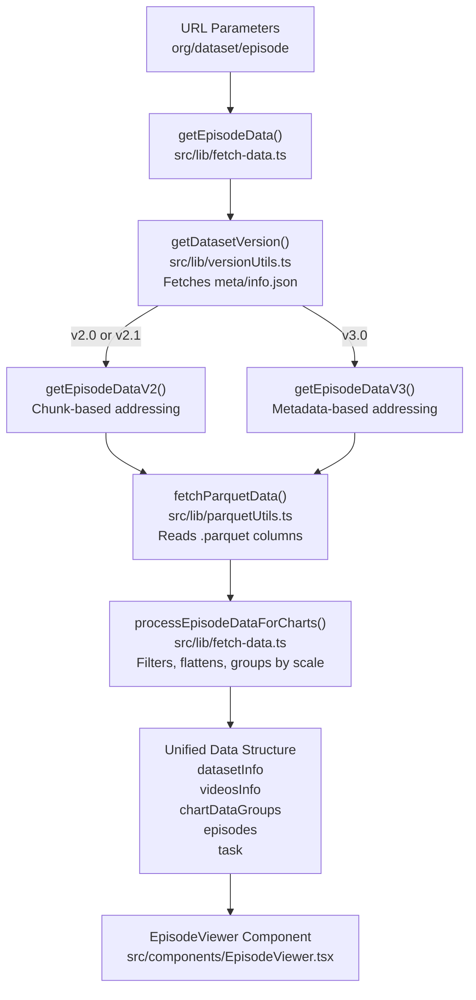

**Diagram 2: Data Processing Pipeline with Function Names**

This pipeline shows the sequence of function calls that transform raw dataset files into visualization-ready data. The `getEpisodeData()` function serves as the central orchestrator, delegating to version-specific handlers and coordinating Parquet parsing.

**Sources:** Inferred from architectural diagrams and wiki structure

## Key Technologies

The application is built using the following core technologies:

| Technology | Purpose | Key Files |
|------------|---------|-----------|
| **Next.js 15** | React framework with App Router for server-side rendering and routing | [package.json:14]() |
| **React 19** | UI component library | [package.json:15-16]() |
| **hyparquet** | Parquet file parsing in the browser | [package.json:13]() |
| **Recharts** | Data visualization library for charts | [package.json:18]() |
| **Tailwind CSS 4** | Utility-first CSS framework | [package.json:29]() |
| **TypeScript** | Type-safe JavaScript | [package.json:30]() |

**Sources:** [package.json:12-31](), [README.md:21-27]()

## Key Concepts

Understanding the following concepts is essential for working with this codebase:

### Dataset Versions

The application supports three dataset format versions:
- **v2.0:** Legacy chunk-based format
- **v2.1:** Chunk-based format with additional metadata
- **v3.0:** Modern metadata-based format with video segmentation

Version detection and compatibility handling is critical for cross-version support. See [Version Detection and Compatibility](#3.2) for details.

### Episode Data Structure

An episode represents a single recorded robot trajectory. Each episode contains:
- **Videos:** One or more synchronized video streams (e.g., camera feeds)
- **Observations:** Time-series sensor data (e.g., joint positions, velocities)
- **Actions:** Time-series control signals sent to the robot
- **Metadata:** Episode duration, timestamps, task information

### Time Synchronization

All visualization components (videos, charts, playback controls) share a unified timeline managed by `TimeContext`. This enables synchronized playback where seeking in one component updates all others. See [Time Synchronization System](#7) for implementation details.

### Chart Data Groups

The system automatically organizes time-series data into chart groups based on scale similarity. This prevents mixing data with vastly different magnitudes (e.g., positions in meters vs. velocities in radians/second) on the same chart. See [Chart Data Transformation](#3.4) for the grouping algorithm.

**Sources:** Inferred from architectural diagrams and wiki structure

## Repository Structure

The codebase follows Next.js conventions with the following organization:

```
src/
├── app/                          # Next.js App Router pages
│   ├── page.tsx                  # Home page with input form
│   ├── explore/                  # Dataset discovery page
│   └── [org]/[dataset]/[episode]/ # Dynamic episode viewer route
├── components/                    # React components
│   ├── EpisodeViewer.tsx         # Main episode orchestrator
│   ├── SimpleVideosPlayer.tsx    # Video playback component
│   ├── DataRecharts.tsx          # Chart rendering component
│   ├── Sidebar.tsx               # Navigation sidebar
│   └── PlaybackBar.tsx           # Playback controls
├── contexts/                      # React Context providers
│   └── TimeContext.tsx           # Time synchronization state
└── lib/                          # Utility functions and data fetching
    ├── fetch-data.ts             # Episode data orchestration
    ├── versionUtils.ts           # Dataset version detection
    └── parquetUtils.ts           # Parquet file parsing
```

**Sources:** Inferred from architectural diagrams and file paths

## System Component Roles

The following table summarizes the role of each major code module:

| Module | File Path | Primary Responsibility |
|--------|-----------|------------------------|
| **Episode Data Orchestrator** | `src/lib/fetch-data.ts` | Coordinates data fetching, version handling, and chart data processing. Contains `getEpisodeData()` and `processEpisodeDataForCharts()` functions. |
| **Version Detector** | `src/lib/versionUtils.ts` | Detects dataset version by fetching `meta/info.json` and parsing `codebase_version` field. |
| **Parquet Parser** | `src/lib/parquetUtils.ts` | Reads Parquet files using hyparquet library and extracts columns. |
| **Episode Viewer** | `src/components/EpisodeViewer.tsx` | Main UI component that orchestrates video players, charts, sidebar, and playback controls. |
| **Video Player** | `src/components/SimpleVideosPlayer.tsx` | Renders video streams with segmentation support for v3.0 datasets. |
| **Chart Renderer** | `src/components/DataRecharts.tsx` | Renders time-series data using Recharts library with interactive legends. |
| **Time Provider** | `src/contexts/TimeContext.tsx` | Provides global time state for synchronization across components. |
| **Episode Route** | `src/app/[org]/[dataset]/[episode]/page.tsx` | Dynamic route handler that fetches episode data server-side and renders EpisodeViewer. |

**Sources:** Inferred from architectural diagrams and wiki structure

## Data Flow Summary

The typical data flow for viewing an episode follows these steps:

1. User navigates to URL: `/{org}/{dataset}/{episodeId}`
2. Next.js App Router matches dynamic route in `src/app/[org]/[dataset]/[episode]/page.tsx`
3. Server-side: `getEpisodeData()` is called with URL parameters
4. Server-side: `getDatasetVersion()` fetches `meta/info.json` to detect format version
5. Server-side: Version-specific handler (`getEpisodeDataV2` or `getEpisodeDataV3`) fetches episode metadata
6. Server-side: `fetchParquetData()` retrieves observation and action data from Parquet files
7. Server-side: `processEpisodeDataForCharts()` transforms raw data into grouped, scaled chart series
8. Server-side: Unified data structure is returned to the page component
9. Client-side: `EpisodeViewer` component receives data as props
10. Client-side: Child components (videos, charts, controls) render and subscribe to `TimeContext`
11. User interaction: Playback controls update `TimeContext`, triggering synchronized updates across all components

**Sources:** Inferred from architectural diagrams

## Navigation Through This Wiki

This wiki is organized hierarchically by system:

- **[Core Data Pipeline](#3):** Start here to understand data fetching, the most critical system
  - [Episode Data Fetching](#3.1): The `getEpisodeData()` orchestrator function
  - [Version Detection](#3.2): How the system handles v2.0, v2.1, and v3.0 datasets
  - [Parquet Processing](#3.3): Reading columnar data from Parquet files
  - [Chart Data Transformation](#3.4): Auto-grouping and scaling algorithm

- **[Episode Viewer Component](#4):** Main UI orchestrator
  - [State Management](#4.1): Loading states and component lifecycle
  - [User Interactions](#4.2): Keyboard shortcuts and navigation

- **[Video Playback System](#5):** Video rendering and segmentation
  - [SimpleVideosPlayer](#5.1): Primary video player implementation
  - [Video Segmentation](#5.2): v3.0 timestamp-based segments

- **[Data Visualization](#6):** Chart rendering
  - [Chart Rendering](#6.1): Recharts integration
  - [Interactive Legend](#6.2): Visibility toggling and current values

- **[Time Synchronization](#7):** Critical cross-component coordination
  - [TimeContext Provider](#7.1): React Context implementation
  - [Synchronization Patterns](#7.2): Producer/consumer patterns

- **[Navigation and UI Controls](#8):** Supporting UI components

- **[Routing and Page Structure](#9):** Next.js pages and routing

- **[Utility Functions](#10):** Helper functions

- **[Configuration](#11):** Project setup and tooling

- **[Error Handling](#12):** Compatibility checks and error boundaries

For a quick start on running the application, see [Quick Start Guide](#2). For understanding the most important system (data fetching), begin with [Core Data Pipeline](#3).

**Sources:** Wiki table of contents JSON structure

---

# Page: Quick Start Guide

# Quick Start Guide

<details>
<summary>Relevant source files</summary>

The following files were used as context for generating this wiki page:

- [README.md](README.md)
- [next.config.ts](next.config.ts)
- [package.json](package.json)
- [src/app/layout.tsx](src/app/layout.tsx)

</details>


This guide provides step-by-step instructions for installing, configuring, and running the LeRobot Dataset Visualizer for the first time. It covers prerequisite setup, development server launch, environment configuration, and initial navigation of the application interface.

**Scope**: This page focuses on getting the application running locally. For detailed information about the internal data pipeline, see [Core Data Pipeline](#3). For comprehensive UI component documentation, see [Episode Viewer Component](#4) and [Navigation and UI Controls](#8). For deployment and production configuration, see [Configuration and Development Setup](#11).

---

## Prerequisites

The LeRobot Dataset Visualizer requires Node.js and a package manager. The following versions are recommended:

| Requirement | Version | Notes |
|------------|---------|-------|
| Node.js | 20.x or later | Required for Next.js 15.x |
| Package Manager | npm, yarn, pnpm, or bun | Any modern JavaScript package manager |
| Browser | Modern browser | Chrome, Firefox, Safari, or Edge with ES6 support |

**Sources**: [package.json:1-32]()

---

## Installation Steps

### 1. Clone the Repository

```bash
git clone https://github.com/huggingface/lerobot-dataset-visualizer.git
cd lerobot-dataset-visualizer
```

### 2. Install Dependencies

Execute the installation command using your preferred package manager:

```bash
# Using npm
npm install

# Using yarn
yarn install

# Using pnpm
pnpm install

# Using bun
bun install
```

This installs the following core dependencies:

| Package | Version | Purpose |
|---------|---------|---------|
| `next` | 15.3.1 | Next.js framework with App Router |
| `react` | 19.0.0 | React library |
| `hyparquet` | 1.12.1 | Parquet file parsing for dataset loading |
| `recharts` | 2.15.3 | Chart rendering library |
| `tailwindcss` | 4.x | Styling framework |

**Sources**: [package.json:12-19]()

---

## Configuration

### Environment Variables

The application supports optional environment variable configuration:

| Variable | Default | Purpose |
|----------|---------|---------|
| `DATASET_URL` | HuggingFace CDN | Base URL for dataset file hosting |

To configure, create a `.env.local` file in the project root:

```bash
# Optional: Override dataset source URL
DATASET_URL=https://custom-dataset-host.com
```

If `DATASET_URL` is not set, the application defaults to fetching datasets from HuggingFace's public CDN.

**Sources**: [README.md:48-49]()

### Build Configuration

The Next.js configuration is defined in `next.config.ts`:

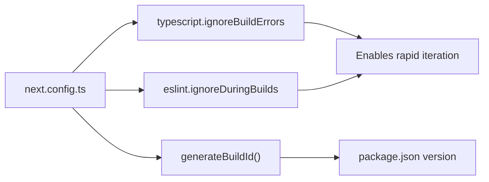

**Diagram: Build Configuration Flow**

The configuration enables rapid development by:
- Ignoring TypeScript errors during builds ([next.config.ts:6-8]())
- Skipping ESLint during builds ([next.config.ts:9-11]())
- Using package version as build ID ([next.config.ts:12]())

**Sources**: [next.config.ts:1-15]()

---

## Running the Application

### Start Development Server

Execute the development command:

```bash
npm run dev
# or
yarn dev
# or
pnpm dev
# or
bun dev
```

The development server will start and display output similar to:

```
▲ Next.js 15.3.1
- Local:        http://localhost:3000
- Ready in 1.2s
```

**Sources**: [README.md:31-41](), [package.json:6]()

### Access the Application

Open your browser and navigate to `http://localhost:3000`. The application supports hot-reloading, meaning changes to source files will automatically refresh the browser.

---

## Application Entry Points

The application provides three main entry points for different workflows:

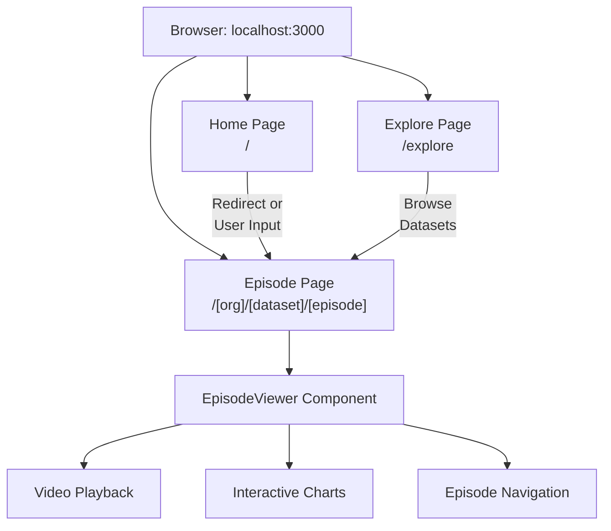

**Diagram: Application Navigation Flow**

### Home Page (`/`)

The home page serves as the primary entry point. It provides:
- Direct URL input for dataset navigation
- Environment-based automatic redirection if `DATASET_URL` is configured
- YouTube background video for visual appeal

**Sources**: [README.md:9-20]()

### Explore Page (`/explore`)

The explore page enables dataset discovery:
- Fetches datasets from HuggingFace Hub API
- Displays paginated dataset cards with video previews
- Allows filtering and searching of available datasets

For detailed documentation, see [Explore Page](#9.3).

### Episode Page (`/[org]/[dataset]/[episode]`)

The episode page is the core visualization interface, using Next.js dynamic routing:

| URL Segment | Example | Purpose |
|-------------|---------|---------|
| `[org]` | `lerobot` | Organization or user name on HuggingFace |
| `[dataset]` | `pusht` | Dataset repository name |
| `[episode]` | `episode_0` | Specific episode identifier |

**Example URL**: `http://localhost:3000/lerobot/pusht/episode_0`

For detailed documentation, see [Dynamic Episode Routes](#9.1).

**Sources**: [README.md:3-12]()

---

## First-Time Workflow

### Basic Usage Pattern

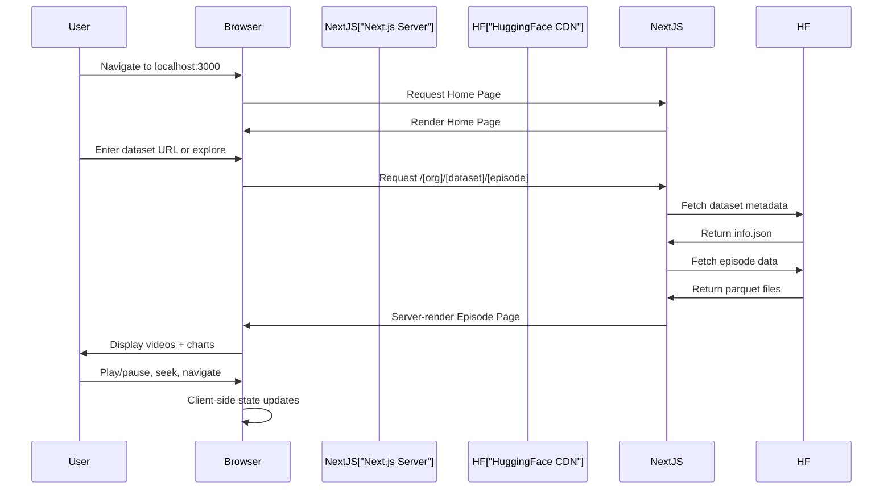

**Diagram: Initial Data Fetching Workflow**

**Sources**: [README.md:1-57]()

### Typical First Session

1. **Launch Application**: Start development server with `npm run dev`
2. **Navigate to Home**: Open `http://localhost:3000`
3. **Explore Datasets**: Click "Explore" to browse available datasets
4. **Select Episode**: Choose a dataset and episode to visualize
5. **Interact**: Use playback controls, navigate episodes, inspect charts

---

## Development Workflow

### File Structure Overview

The application uses Next.js App Router file-based routing:

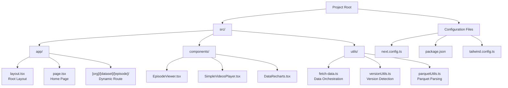

**Diagram: Project File Structure**

Key directories:

| Directory | Purpose |
|-----------|---------|
| `src/app/` | Next.js App Router pages and layouts |
| `src/components/` | React components for visualization |
| `src/utils/` | Data fetching and processing utilities |
| `public/` | Static assets (if present) |

**Sources**: [src/app/layout.tsx:1-22]()

### Hot Reloading

The development server supports automatic reloading when files change:

- **React Components**: Changes in `src/app/` or `src/components/` trigger instant browser refresh
- **Utilities**: Changes in `src/utils/` reload affected components
- **Styles**: Tailwind CSS changes apply without full page reload

**Note**: Some changes to server-side functions may require manual browser refresh.

**Sources**: [README.md:45]()

---

## Available Scripts

The `package.json` defines the following npm scripts:

| Script | Command | Purpose |
|--------|---------|---------|
| `dev` | `next dev` | Start development server with hot-reloading |
| `build` | `next build` | Create production-optimized build |
| `start` | `next start` | Run production build locally |
| `lint` | `next lint` | Run ESLint checks on codebase |
| `format` | `prettier --write .` | Auto-format code using Prettier |

**Example Usage**:

```bash
# Development
npm run dev

# Production build and run
npm run build
npm run start

# Code quality
npm run lint
npm run format
```

**Sources**: [package.json:5-11]()

---

## Metadata and Configuration

### Application Metadata

The root layout defines application-wide metadata:

| Property | Value | Defined In |
|----------|-------|------------|
| Title | "LeRobot Dataset Visualizer" | `src/app/layout.tsx:8` |
| Description | "Visualization of LeRobot Datasets" | `src/app/layout.tsx:9` |
| Font | Inter (Google Fonts) | `src/app/layout.tsx:5` |

This metadata appears in browser tabs, bookmarks, and social media previews.

**Sources**: [src/app/layout.tsx:1-22]()

---

## Troubleshooting Common Issues

### Port Already in Use

If port 3000 is occupied, Next.js will automatically try port 3001, 3002, etc. To specify a port manually:

```bash
PORT=3001 npm run dev
```

### TypeScript Errors

TypeScript errors are ignored during builds ([next.config.ts:6-8]()). For development, ensure your IDE has TypeScript support enabled.

### Dataset Not Loading

If datasets fail to load:
1. Check browser console for network errors
2. Verify HuggingFace CDN is accessible
3. Confirm dataset exists at the specified organization/repository
4. Check dataset version compatibility (see [Version Detection and Compatibility](#3.2))

### Build Failures

If `npm run build` fails:
1. Clear Next.js cache: `rm -rf .next`
2. Reinstall dependencies: `rm -rf node_modules && npm install`
3. Check Node.js version meets requirements (20.x+)

**Sources**: [README.md:29-57]()

---

## Next Steps

After successfully running the application:

1. **Explore the Data Pipeline**: Learn how datasets are fetched and processed in [Core Data Pipeline](#3)
2. **Understand Episode Viewer**: Deep dive into the main visualization interface in [Episode Viewer Component](#4)
3. **Study Video Synchronization**: Learn about time-based coordination in [Video Playback System](#5)
4. **Examine Chart System**: Understand data visualization in [Data Visualization (Charts)](#6)
5. **Customize Configuration**: Advanced setup options in [Configuration and Development Setup](#11)

**Sources**: [README.md:1-57]()

---

# Page: Core Data Pipeline

# Core Data Pipeline

<details>
<summary>Relevant source files</summary>

The following files were used as context for generating this wiki page:

- [src/app/[org]/[dataset]/[episode]/fetch-data.ts](src/app/[org]/[dataset]/[episode]/fetch-data.ts)
- [src/utils/parquetUtils.ts](src/utils/parquetUtils.ts)
- [src/utils/versionUtils.ts](src/utils/versionUtils.ts)

</details>


## Purpose and Scope

The Core Data Pipeline is the most critical system in the LeRobot Dataset Visualizer, responsible for orchestrating all data retrieval, transformation, and preparation for visualization. This page documents the high-level architecture and coordination logic that fetches episode data from HuggingFace datasets, detects version compatibility, and produces a unified output structure for the UI layer.

For detailed documentation of specific subsystems:
- Version detection and compatibility logic: see [Version Detection and Compatibility](#3.2)
- Parquet file processing: see [Parquet Data Processing](#3.3)
- Chart data transformation algorithms: see [Chart Data Transformation](#3.4)
- Detailed episode data fetching: see [Episode Data Fetching System](#3.1)

## Pipeline Architecture Overview

The data pipeline is implemented primarily in `fetch-data.ts` and follows a three-stage architecture: **version detection**, **version-specific data retrieval**, and **unified output preparation**.

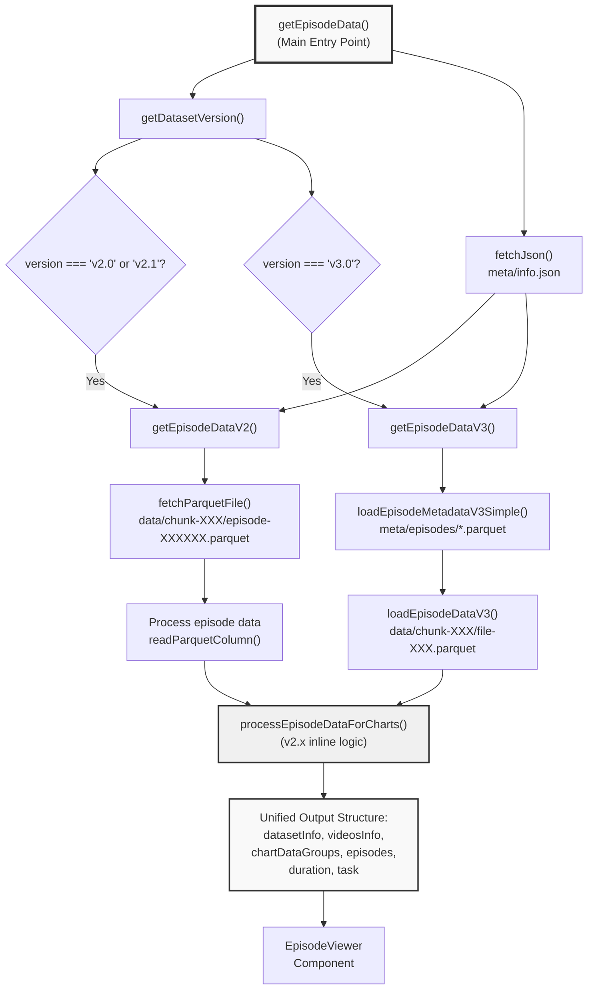

**Sources:** [src/app/[org]/[dataset]/[episode]/fetch-data.ts:14-40](), [src/utils/versionUtils.ts:71-101]()

## Main Orchestration Function

The `getEpisodeData()` function serves as the primary orchestrator, implementing a version-dispatch pattern:

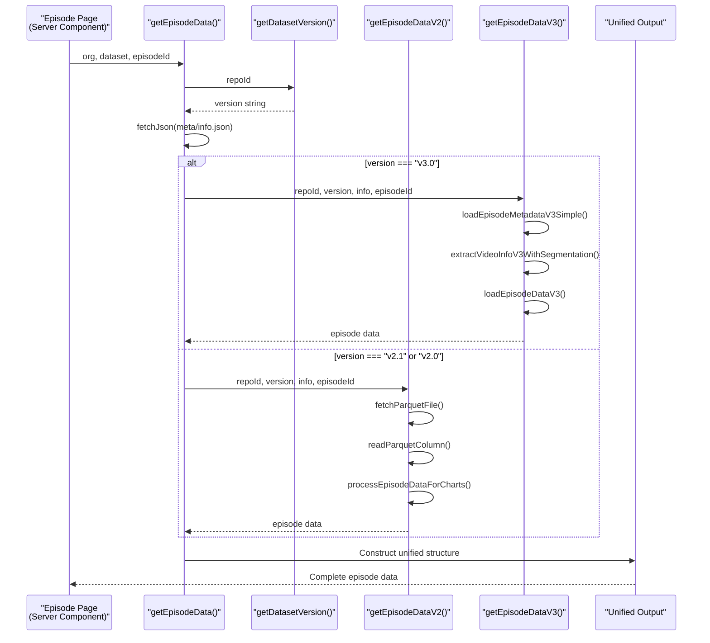

The function coordinates several key operations:

1. **Version Detection**: Calls `getDatasetVersion()` to determine compatibility ([fetch-data.ts:22]())
2. **Metadata Loading**: Fetches `meta/info.json` containing dataset structure ([fetch-data.ts:23-24]())
3. **Video Validation**: Checks that `video_path` is not null (image datasets are unsupported) ([fetch-data.ts:26-28]())
4. **Version Dispatch**: Routes to `getEpisodeDataV2()` or `getEpisodeDataV3()` ([fetch-data.ts:31-35]())

**Sources:** [src/app/[org]/[dataset]/[episode]/fetch-data.ts:14-40]()

## Version-Specific Data Handlers

### v2.x Handler (`getEpisodeDataV2`)

The v2.x handler uses a **chunk-based addressing** scheme where episodes are organized by 1000-episode chunks:

| Concept | Implementation | Location |
|---------|---------------|----------|
| Chunk Calculation | `Math.floor(0 / 1000)` (always chunk 0 in current implementation) | [fetch-data.ts:109]() |
| Data Path Pattern | `data/chunk-{chunk}/episode-{episode_index}.parquet` | [fetch-data.ts:189-196]() |
| Video Path Pattern | `videos/{video_key}/chunk-{chunk}/episode-{episode_index}.mp4` | [fetch-data.ts:136-140]() |
| Task Retrieval | `meta/tasks.jsonl` (JSONL format) | [fetch-data.ts:242-269]() |

The v2.x handler performs these operations:

1. Constructs video URLs using `formatStringWithVars()` template replacement ([fetch-data.ts:136-145]())
2. Filters numeric columns (float32, int32, shape length === 1) ([fetch-data.ts:148-154]())
3. Excludes metadata columns: `timestamp`, `frame_index`, `episode_index`, `index`, `task_index` ([fetch-data.ts:157-163]())
4. Reads Parquet data using `readParquetColumn()` ([fetch-data.ts:271]())
5. Flattens hierarchical column names with delimiter `" | "` ([fetch-data.ts:12, 180-186]())
6. Groups data by scale using logarithmic threshold (2 log units) ([fetch-data.ts:327-353]())

**Sources:** [src/app/[org]/[dataset]/[episode]/fetch-data.ts:103-418]()

### v3.0 Handler (`getEpisodeDataV3`)

The v3.0 handler introduces **metadata-based addressing** with per-episode metadata files:

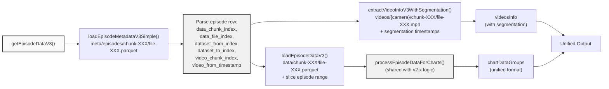

Key differences from v2.x:

| Feature | v3.0 Implementation | Code Reference |
|---------|-------------------|----------------|
| Episode Metadata | Separate Parquet files in `meta/episodes/` | [fetch-data.ts:934-983]() |
| Video Segmentation | Per-camera `from_timestamp` and `to_timestamp` | [fetch-data.ts:882-931]() |
| Data Slicing | `dataset_from_index` to `dataset_to_index` | [fetch-data.ts:481-496]() |
| Task Metadata | `meta/tasks.parquet` (Parquet format) | [fetch-data.ts:554-575]() |
| Multi-Camera Support | Camera-specific metadata keys: `videos/{camera}/chunk_index` | [fetch-data.ts:894-914]() |

**Sources:** [src/app/[org]/[dataset]/[episode]/fetch-data.ts:421-461](), [fetch-data.ts:464-581](), [fetch-data.ts:882-931](), [fetch-data.ts:934-983]()

## Data Transformation Pipeline

Both version handlers converge to produce `chartDataGroups` using the `processEpisodeDataForCharts()` function. This transformation pipeline consists of five stages:

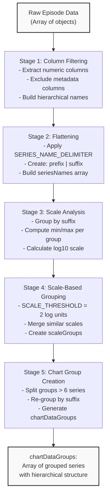

### Stage Details

**Stage 1 - Column Filtering** ([fetch-data.ts:591-655]()):
- Filters features with `dtype` in `["float32", "int32"]` and `shape.length === 1`
- Excludes: `index`, `task_index`, `episode_index`, `frame_index`, `next.done`
- Builds hierarchical names: `observation.state | 0`, `action | 1`, etc.

**Stage 2 - Flattening** ([fetch-data.ts:701-753]()):
- Maps array values to hierarchical keys using `SERIES_NAME_DELIMITER = " | "`
- Creates timestamp alignment: `(index / maxIndex) * videoDuration`
- Produces flat objects: `{ "timestamp": 0.0, "observation.state | 0": 1.23, ... }`

**Stage 3 - Scale Analysis** ([fetch-data.ts:767-793]()):
- Groups series by suffix (after delimiter): `{0: [...], 1: [...], ...}`
- Computes `min` and `max` across all data points for each suffix group
- Stores in `groupStats` keyed by first series in group

**Stage 4 - Scale-Based Grouping** ([fetch-data.ts:796-824]()):
- Compares groups using logarithmic scale: `logMin`, `logMax`
- Merges groups within `SCALE_THRESHOLD = 2` log units of each other
- Creates `scaleGroups` containing arrays of suffix groups

**Stage 5 - Chart Group Creation** ([fetch-data.ts:827-839]()):
- Flattens scale groups into linear arrays
- Splits groups exceeding 6 series into sub-groups
- Applies `groupRowBySuffix()` transformation to re-nest data by suffix

**Sources:** [src/app/[org]/[dataset]/[episode]/fetch-data.ts:584-878]()

## Unified Output Structure

Both `getEpisodeDataV2()` and `getEpisodeDataV3()` return an identical output structure:

```typescript
{
  datasetInfo: {
    repoId: string;           // "org/dataset"
    total_frames: number;     // from meta/info.json
    total_episodes: number;   // from meta/info.json
    fps: number;             // from meta/info.json
  },
  
  episodeId: number,          // requested episode ID
  
  videosInfo: Array<{
    filename: string;         // camera key (e.g., "laptop")
    url: string;             // full HuggingFace URL
    // v3.0 only:
    isSegmented?: boolean;    // true for v3.0
    segmentStart?: number;    // timestamp in seconds
    segmentEnd?: number;      // timestamp in seconds
    segmentDuration?: number; // end - start
  }>,
  
  chartDataGroups: Array<     // array of chart groups
    Array<{                   // array of data points
      timestamp: number;
      [seriesName: string]: number | Record<string, number>; // hierarchical
    }>
  >,
  
  episodes: number[],         // array of available episode IDs
  
  ignoredColumns: string[],   // columns not visualized (2D+)
  
  duration: number,           // episode duration in seconds
  
  task?: string              // language instruction or task description
}
```

### Field Construction

| Field | v2.x Source | v3.0 Source |
|-------|-------------|-------------|
| `datasetInfo` | Constructed from `info.json` | Constructed from `info.json` |
| `videosInfo` | Template expansion with `formatStringWithVars()` | Metadata-based with `extractVideoInfoV3WithSegmentation()` |
| `chartDataGroups` | Inline processing in `getEpisodeDataV2()` | `processEpisodeDataForCharts()` function |
| `episodes` | `process.env.EPISODES` or full range | Full range from `total_episodes` |
| `task` | `language_instruction` fields, then `task` field, then `meta/tasks.jsonl` | `language_instruction` fields, then `meta/tasks.parquet` |
| `duration` | `chartData[last].timestamp` | `length / fps` or `video_to_timestamp - video_from_timestamp` |

**Sources:** [src/app/[org]/[dataset]/[episode]/fetch-data.ts:408-418](), [fetch-data.ts:451-460]()

## Task Extraction Strategy

The pipeline uses a **three-tier fallback strategy** for extracting task descriptions:

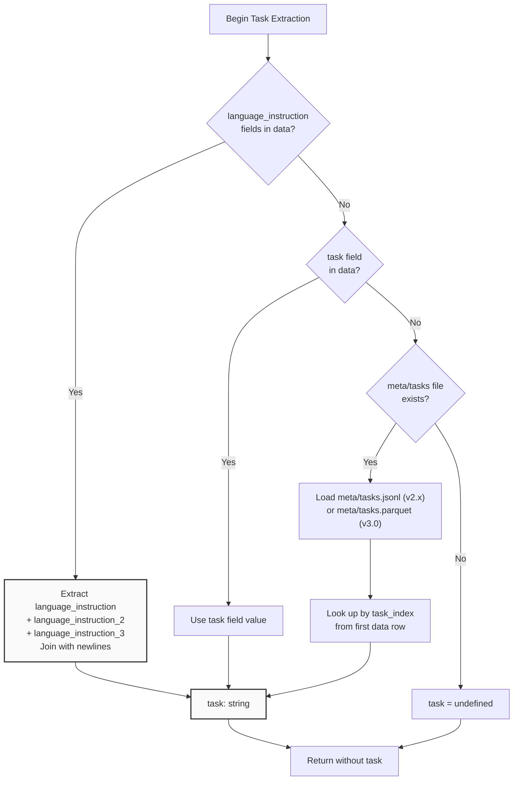

**Priority Order:**
1. **Primary**: `language_instruction`, `language_instruction_2`, `language_instruction_3` fields ([fetch-data.ts:212-232](), [fetch-data.ts:505-549]())
2. **Secondary**: Direct `task` field in episode data ([fetch-data.ts:235-237]())
3. **Tertiary**: Metadata file lookup by `task_index` ([fetch-data.ts:240-269](), [fetch-data.ts:552-575]())

**Sources:** [src/app/[org]/[dataset]/[episode]/fetch-data.ts:201-269](), [fetch-data.ts:505-575]()

## Integration Points

The Core Data Pipeline integrates with other systems through well-defined interfaces:

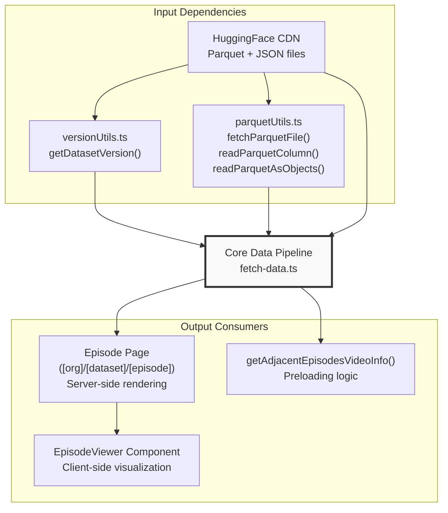

### Function Exports

The module exports three primary functions:

| Export | Purpose | Caller |
|--------|---------|--------|
| `getEpisodeData()` | Main data fetching orchestrator | Episode page component |
| `getAdjacentEpisodesVideoInfo()` | Preload adjacent episode videos | Episode page component |
| `getEpisodeDataSafe()` | Error-wrapped version for UI error display | Not currently used |

**Sources:** [src/app/[org]/[dataset]/[episode]/fetch-data.ts:14-40](), [fetch-data.ts:43-100](), [fetch-data.ts:1076-1088]()

## Error Handling

The pipeline implements a **fail-fast strategy** with informative error messages:

- **Version Incompatibility**: Throws error if `codebase_version` is not in `["v3.0", "v2.1", "v2.0"]` ([versionUtils.ts:84-89]())
- **Video-Only Validation**: Throws error if `video_path === null` ([fetch-data.ts:26-28]())
- **Network Failures**: Propagates fetch errors with context (status, URL) ([parquetUtils.ts:48-50]())
- **Episode Not Found**: Throws error when metadata file search exhausted ([fetch-data.ts:976-978]())

All errors bubble up to the Episode page component, which renders an error boundary UI.

**Sources:** [src/app/[org]/[dataset]/[episode]/fetch-data.ts:36-39](), [src/utils/versionUtils.ts:84-89]()

## Performance Considerations

The pipeline implements several optimizations:

1. **Server-Side Execution**: Runs in Next.js server components, avoiding client bundle size
2. **Selective Column Reading**: Only fetches numeric columns needed for charts ([fetch-data.ts:148-170]())
3. **Episode Metadata Caching**: v3.0 metadata files enable efficient lookups
4. **Adjacent Episode Preloading**: `getAdjacentEpisodesVideoInfo()` with radius parameter ([fetch-data.ts:43-100]())
5. **Data Slicing**: v3.0 only loads relevant data range using `dataset_from_index`/`dataset_to_index` ([fetch-data.ts:481-496]())

**Sources:** [src/app/[org]/[dataset]/[episode]/fetch-data.ts:43-100](), [fetch-data.ts:148-170](), [fetch-data.ts:481-496]()

---

# Page: Episode Data Fetching System

# Episode Data Fetching System

<details>
<summary>Relevant source files</summary>

The following files were used as context for generating this wiki page:

- [src/app/[org]/[dataset]/[episode]/fetch-data.ts](src/app/[org]/[dataset]/[episode]/fetch-data.ts)

</details>


## Purpose and Scope

This document describes the Episode Data Fetching System, which is the central orchestrator for retrieving, processing, and preparing episode data for visualization. The system handles version detection, dispatches to version-specific handlers (v2.x or v3.0), loads Parquet data files, extracts task information, and transforms raw data into chart-ready structures.

For information about version detection logic, see [Version Detection and Compatibility](#3.2). For details on Parquet file parsing, see [Parquet Data Processing](#3.3). For the chart data transformation algorithms, see [Chart Data Transformation](#3.4).

---

## System Overview

The Episode Data Fetching System is implemented in [src/app/[org]/[dataset]/[episode]/fetch-data.ts]() and serves as the primary data pipeline for the application. It provides a unified interface for fetching episode data regardless of the underlying dataset version, handling all complexity of different metadata structures internally.

### Main Orchestration Flow

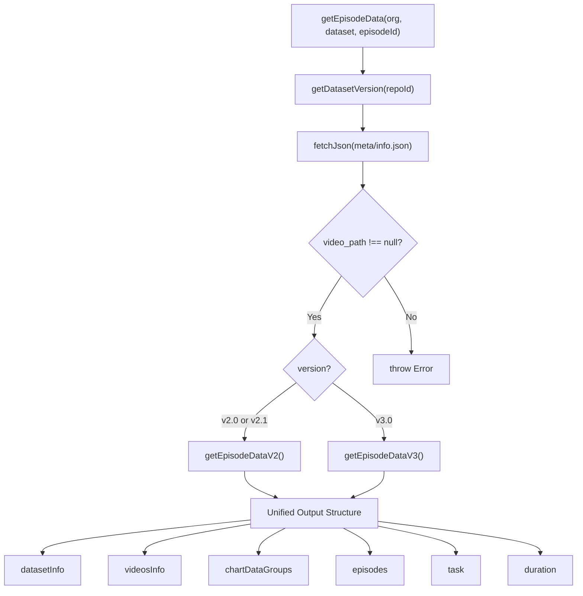

**Sources:** [src/app/[org]/[dataset]/[episode]/fetch-data.ts:14-40]()

---

## Core Entry Point: `getEpisodeData()`

The `getEpisodeData()` function is the main entry point that orchestrates the entire data fetching pipeline.

### Function Signature

```typescript
async function getEpisodeData(
  org: string,
  dataset: string,
  episodeId: number
): Promise<EpisodeData>
```

### Execution Flow

| Step | Action | Code Location |
|------|--------|---------------|
| 1 | Construct repository ID | [fetch-data.ts:19]() |
| 2 | Detect dataset version | [fetch-data.ts:22]() |
| 3 | Fetch dataset metadata | [fetch-data.ts:23-24]() |
| 4 | Validate video support | [fetch-data.ts:26-28]() |
| 5 | Route to version handler | [fetch-data.ts:31-35]() |
| 6 | Handle errors | [fetch-data.ts:36-39]() |

### Version Detection and Routing

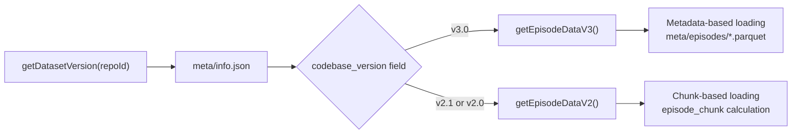

**Sources:** [src/app/[org]/[dataset]/[episode]/fetch-data.ts:14-40]()

---

## Version-Specific Data Handlers

### V2.x Handler: `getEpisodeDataV2()`

The v2.x handler processes datasets using the legacy chunk-based file organization structure.

#### File Path Construction

For v2.x datasets, file paths are constructed using the `episode_chunk` pattern:

```typescript
const episode_chunk = Math.floor(episodeId / 1000);
```

This groups episodes into chunks of 1000 for file organization.

#### Data Loading Pipeline (V2.x)

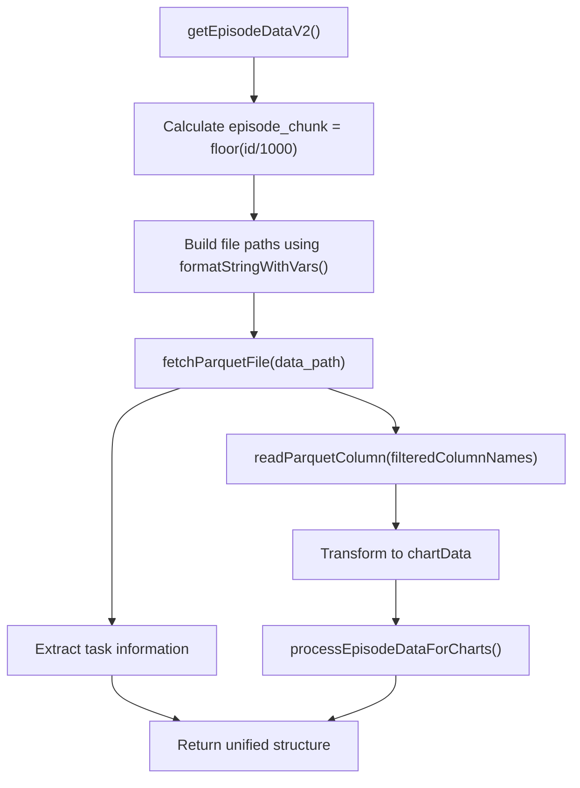

#### Column Filtering

The v2.x handler filters columns from the dataset metadata:

| Filter Type | Criteria | Excluded Columns |
|-------------|----------|------------------|
| Type filter | `dtype in ["float32", "int32"]` | Non-numeric types |
| Shape filter | `shape.length === 1` | Multi-dimensional data |
| Name filter | Key not in exclusion list | `timestamp`, `frame_index`, `episode_index`, `index`, `task_index` |

**Sources:** [src/app/[org]/[dataset]/[episode]/fetch-data.ts:103-196](), [fetch-data.ts:147-170]()

#### Task Extraction (V2.x)

The v2.x handler attempts to extract task information from three sources in priority order:

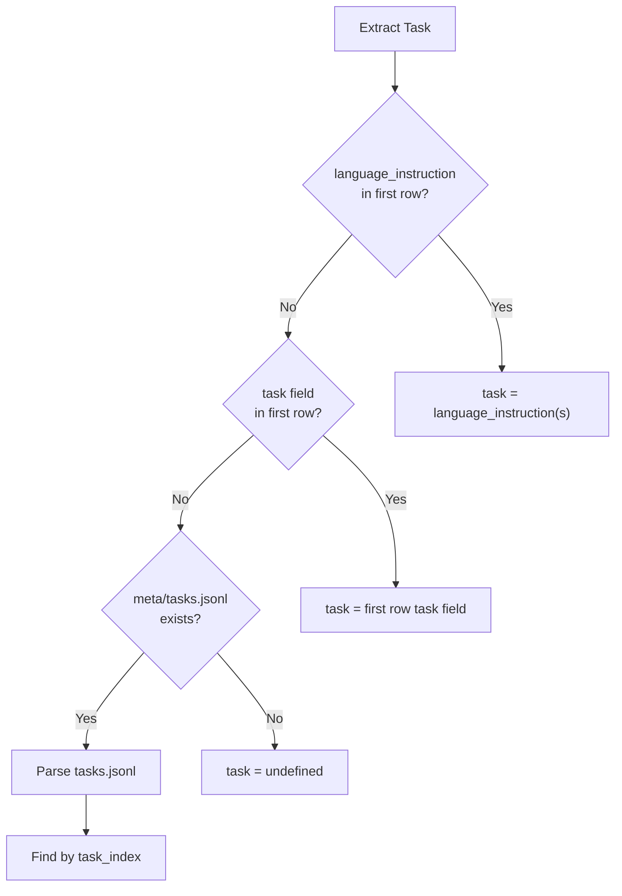

**Sources:** [src/app/[org]/[dataset]/[episode]/fetch-data.ts:200-269]()

---

### V3.0 Handler: `getEpisodeDataV3()`

The v3.0 handler uses a metadata-based approach with structured episode information files.

#### Metadata Loading Pipeline

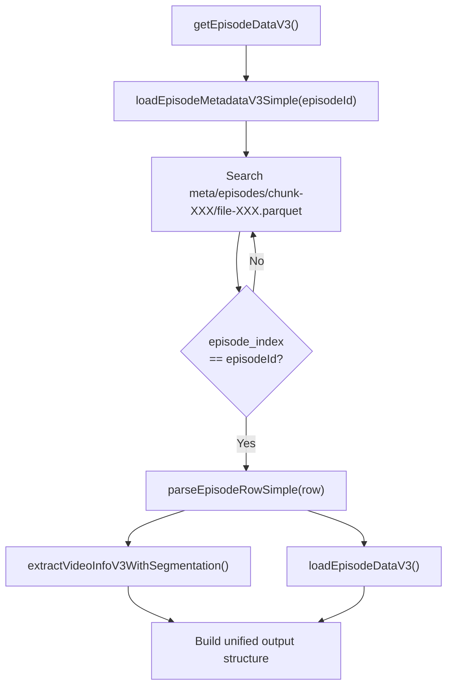

**Sources:** [src/app/[org]/[dataset]/[episode]/fetch-data.ts:421-461]()

#### Episode Metadata Structure

The v3.0 episode metadata contains detailed indexing information:

| Field | Type | Purpose |
|-------|------|---------|
| `episode_index` | number | Episode ID |
| `data_chunk_index` | number | Data file chunk location |
| `data_file_index` | number | Data file index within chunk |
| `dataset_from_index` | number | Starting row in data file |
| `dataset_to_index` | number | Ending row in data file |
| `video_chunk_index` | number | Video file chunk location |
| `video_file_index` | number | Video file index within chunk |
| `video_from_timestamp` | number | Video segment start time (seconds) |
| `video_to_timestamp` | number | Video segment end time (seconds) |
| `length` | number | Number of frames in episode |

**Sources:** [src/app/[org]/[dataset]/[episode]/fetch-data.ts:986-1052]()

#### Data Slicing

The v3.0 handler extracts episode-specific data from larger Parquet files:

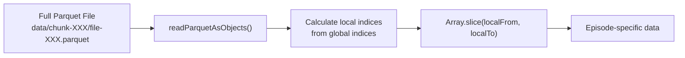

The index calculation accounts for file offsets:

```typescript
const fileStartIndex = Number(fullData[0].index);
const localFromIndex = Math.max(0, fromIndex - fileStartIndex);
const localToIndex = Math.min(fullData.length, toIndex - fileStartIndex);
```

**Sources:** [src/app/[org]/[dataset]/[episode]/fetch-data.ts:464-581](), [fetch-data.ts:482-496]()

#### Video Segmentation (V3.0)

V3.0 datasets support video segmentation, where each episode references a time segment within a longer video file:

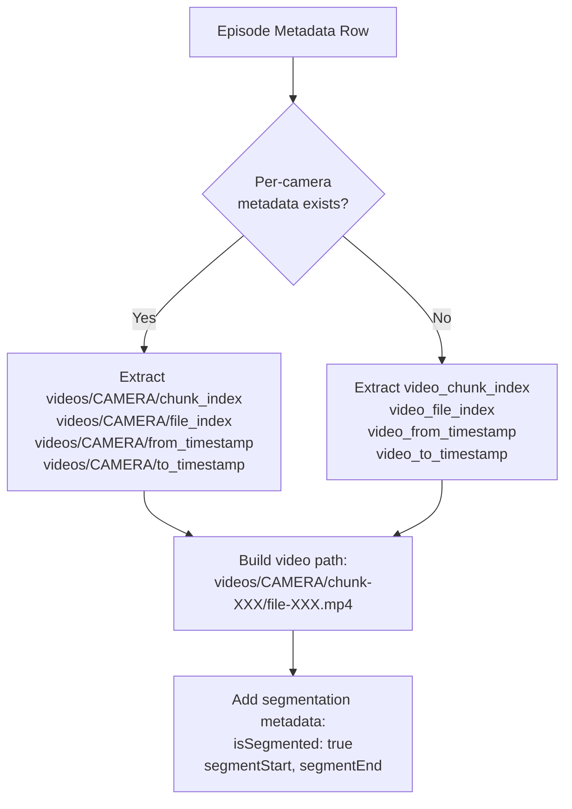

**Sources:** [src/app/[org]/[dataset]/[episode]/fetch-data.ts:882-931]()

---

## Data Transformation Pipeline

Both version handlers converge on a common transformation pipeline that converts raw Parquet data into chart-ready structures.

### Transformation Stages

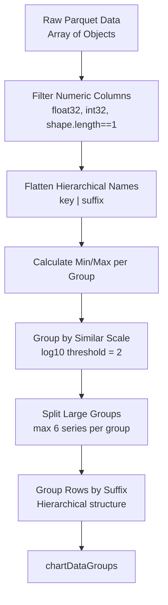

**Sources:** [src/app/[org]/[dataset]/[episode]/fetch-data.ts:584-878]()

### Series Name Delimiter

The system uses a consistent delimiter to create hierarchical series names:

```typescript
const SERIES_NAME_DELIMITER = " | ";
```

This creates names like `"observation.state | 0"` and `"action | x"`.

**Sources:** [src/app/[org]/[dataset]/[episode]/fetch-data.ts:12]()

### Scale-Based Grouping Algorithm

The transformation pipeline groups related data series based on their numerical scale:

| Step | Operation | Threshold |
|------|-----------|-----------|
| 1 | Group by suffix | Exact match on suffix after delimiter |
| 2 | Calculate min/max | Per suffix group |
| 3 | Compute log scale | `log10(abs(value) + 1e-9)` |
| 4 | Group similar scales | `abs(logMin1 - logMin2) <= 2` AND `abs(logMax1 - logMax2) <= 2` |
| 5 | Limit group size | Split groups larger than 6 series |

**Sources:** [src/app/[org]/[dataset]/[episode]/fetch-data.ts:295-369](), [fetch-data.ts:767-839]()

### Row Grouping by Suffix

The final transformation groups row data by suffix to create hierarchical chart data:

```mermaid
flowchart LR
    FlatRow["Flat Row:<br/>{timestamp: 0.1,<br/>obs|x: 1.0,<br/>obs|y: 2.0,<br/>act|x: 0.5}"]
    GroupSuffix["groupRowBySuffix()"]
    HierarchicalRow["Hierarchical Row:<br/>{timestamp: 0.1,<br/>x: {obs: 1.0, act: 0.5},<br/>y: {obs: 2.0}}"]
    
    FlatRow --> GroupSuffix
    GroupSuffix --> HierarchicalRow
```

**Sources:** [src/app/[org]/[dataset]/[episode]/fetch-data.ts:374-402](), [fetch-data.ts:842-870]()

---

## Output Data Structure

All handlers return a unified output structure regardless of dataset version:

### Unified Output Schema

| Field | Type | Description |
|-------|------|-------------|
| `datasetInfo` | Object | Repository ID, total frames, total episodes, FPS |
| `episodeId` | number | Current episode ID |
| `videosInfo` | Array | Video URLs and segmentation metadata |
| `chartDataGroups` | Array | Grouped chart data, one group per graph |
| `episodes` | Array | List of all available episode IDs |
| `ignoredColumns` | Array | Columns excluded from charts (2D/3D data) |
| `duration` | number | Episode duration in seconds |
| `task` | string \| undefined | Task description or instruction |

### Video Info Structure

For v2.x datasets:
```typescript
{
  filename: string,      // Camera key (e.g., "observation.images.top")
  url: string           // Full HuggingFace URL to video file
}
```

For v3.0 datasets (with segmentation):
```typescript
{
  filename: string,         // Camera key
  url: string,             // Full HuggingFace URL to video file
  isSegmented: true,       // Segmentation enabled
  segmentStart: number,    // Start timestamp in video file (seconds)
  segmentEnd: number,      // End timestamp in video file (seconds)
  segmentDuration: number  // Duration of this segment (seconds)
}
```

**Sources:** [src/app/[org]/[dataset]/[episode]/fetch-data.ts:408-417](), [fetch-data.ts:451-460](), [fetch-data.ts:919-928]()

---

## Supporting Functions

### Adjacent Episodes Preloading: `getAdjacentEpisodesVideoInfo()`

This function enables video preloading for smooth navigation by fetching video info for episodes surrounding the current episode.

```mermaid
flowchart TD
    Entry["getAdjacentEpisodesVideoInfo(org, dataset, currentId, radius)"]
    CalcRange["Calculate episode IDs:<br/>currentId - radius to currentId + radius"]
    Version["getDatasetVersion()"]
    Loop{"For each<br/>adjacent ID"}
    V3Check{"version == v3.0?"}
    LoadV3["loadEpisodeMetadataV3Simple()"]
    ExtractV3["extractVideoInfoV3WithSegmentation()"]
    ExtractV2["Build video URLs from info.features"]
    Collect["Collect video info"]
    Return["Return array of {episodeId, videosInfo}"]
    
    Entry --> CalcRange
    CalcRange --> Version
    Version --> Loop
    Loop -->|Yes| V3Check
    V3Check -->|Yes| LoadV3
    V3Check -->|No| ExtractV2
    LoadV3 --> ExtractV3
    ExtractV3 --> Collect
    ExtractV2 --> Collect
    Collect --> Loop
    Loop -->|No| Return
```

**Parameters:**
- `org`: Organization name
- `dataset`: Dataset name
- `currentEpisodeId`: Current episode being viewed
- `radius`: Number of episodes before/after to fetch (default: 2)

**Sources:** [src/app/[org]/[dataset]/[episode]/fetch-data.ts:43-100]()

### Safe Wrapper: `getEpisodeDataSafe()`

Provides error handling for UI consumption by catching exceptions and returning a structured error object:

```typescript
async function getEpisodeDataSafe(
  org: string,
  dataset: string,
  episodeId: number
): Promise<{ data?: any; error?: string }>
```

This prevents error stack traces from being exposed to the UI and provides clean error messages.

**Sources:** [src/app/[org]/[dataset]/[episode]/fetch-data.ts:1076-1088]()

---

## Error Handling

### Error Types and Handling

```mermaid
flowchart TD
    Start["Data Fetching Operation"]
    TryCatch["try-catch Block"]
    VersionError{"Version<br/>incompatible?"}
    VideoError{"No video<br/>support?"}
    FileError{"File not<br/>found?"}
    ParquetError{"Parquet<br/>parse error?"}
    ThrowVersion["throw Error:<br/>'Incompatible version'"]
    ThrowVideo["throw Error:<br/>'Only videos datasets supported'"]
    ThrowFile["throw Error:<br/>'Episode X not found'"]
    CatchAll["Log error and re-throw"]
    
    Start --> TryCatch
    TryCatch --> VersionError
    VersionError -->|Yes| ThrowVersion
    VersionError -->|No| VideoError
    VideoError -->|Yes| ThrowVideo
    VideoError -->|No| FileError
    FileError -->|Yes| ThrowFile
    FileError -->|No| ParquetError
    ParquetError -->|Yes| CatchAll
```

### Validation Points

| Validation | Location | Error Message |
|------------|----------|---------------|
| Version compatibility | [fetch-data.ts:22]() | Handled by `getDatasetVersion()` |
| Video support check | [fetch-data.ts:26-28]() | "Only videos datasets are supported in this visualizer" |
| Episode metadata not found | [fetch-data.ts:976-977]() | "Episode X not found in metadata" |
| General errors | [fetch-data.ts:36-39]() | Logged to console and re-thrown |

**Sources:** [src/app/[org]/[dataset]/[episode]/fetch-data.ts:20-40](), [fetch-data.ts:975-978]()

---

## Code Entity Reference

### Key Functions

| Function | Line Range | Purpose |
|----------|------------|---------|
| `getEpisodeData()` | [14-40]() | Main entry point and orchestrator |
| `getEpisodeDataV2()` | [103-418]() | V2.x dataset handler |
| `getEpisodeDataV3()` | [421-461]() | V3.0 dataset handler |
| `loadEpisodeDataV3()` | [464-581]() | Load and slice v3.0 episode data |
| `processEpisodeDataForCharts()` | [584-878]() | Transform data for charts |
| `extractVideoInfoV3WithSegmentation()` | [882-931]() | Build v3.0 video info with segments |
| `loadEpisodeMetadataV3Simple()` | [934-983]() | Load v3.0 episode metadata |
| `parseEpisodeRowSimple()` | [986-1070]() | Parse v3.0 metadata row |
| `getAdjacentEpisodesVideoInfo()` | [43-100]() | Preload adjacent episode videos |
| `getEpisodeDataSafe()` | [1076-1088]() | Error-safe wrapper |

### Key Constants

| Constant | Value | Usage |
|----------|-------|-------|
| `SERIES_NAME_DELIMITER` | `" | "` | Hierarchical series name separator |
| `SCALE_THRESHOLD` | `2` | Log scale grouping threshold |
| Default preload radius | `2` | Adjacent episodes to preload |

**Sources:** [src/app/[org]/[dataset]/[episode]/fetch-data.ts:1-1089]()

---

# Page: Version Detection and Compatibility

# Version Detection and Compatibility

<details>
<summary>Relevant source files</summary>

The following files were used as context for generating this wiki page:

- [src/app/[org]/[dataset]/[episode]/fetch-data.ts](src/app/[org]/[dataset]/[episode]/fetch-data.ts)
- [src/utils/versionUtils.ts](src/utils/versionUtils.ts)

</details>


## Purpose and Scope

This document explains how the LeRobot Dataset Visualizer detects and validates dataset versions to ensure compatibility. The system supports three specific versions of the LeRobot dataset format: **v3.0**, **v2.1**, and **v2.0**. Any other version is explicitly rejected with a clear error message.

The version detection system is responsible for:
- Reading the `codebase_version` field from dataset metadata
- Validating that the version is supported
- Providing version information to downstream data fetching logic

For details on how version-specific data is fetched after detection, see [Episode Data Fetching System](#3.1). For information about how different versions structure their Parquet files, see [Parquet Data Processing](#3.3).

**Sources:** [src/utils/versionUtils.ts:1-107](), [src/app/[org]/[dataset]/[episode]/fetch-data.ts:1-40]()

---

## Supported Dataset Versions

The visualizer implements a **strict validation** approach, supporting only three specific versions of the LeRobot dataset format:

| Version | Support Status | Key Features | Metadata Location |
|---------|---------------|--------------|-------------------|
| **v3.0** | ✅ Supported | Segmented videos, structured episode metadata, Parquet-based tasks | `meta/episodes/chunk-*/file-*.parquet` |
| **v2.1** | ✅ Supported | Chunk-based addressing, JSONL tasks metadata | `meta/tasks.jsonl` |
| **v2.0** | ✅ Supported | Chunk-based addressing, JSONL tasks metadata | `meta/tasks.jsonl` |
| Other | ❌ Rejected | N/A | Error thrown immediately |

The version validation logic is defined in [src/utils/versionUtils.ts:82-89](), where an explicit whitelist ensures only these three versions are accepted.

**Sources:** [src/utils/versionUtils.ts:82-89](), [src/app/[org]/[dataset]/[episode]/fetch-data.ts:21-35]()

---

## Version Detection Process

### High-Level Detection Flow

```mermaid
graph TB
    Request["Dataset Access Request<br/>(org/dataset/episode)"]
    Request --> GetVersion["getDatasetVersion(repoId)"]
    
    GetVersion --> FetchInfo["Fetch meta/info.json<br/>from main revision"]
    FetchInfo --> ParseJSON["Parse JSON response"]
    
    ParseJSON --> CheckField{"codebase_version<br/>field exists?"}
    CheckField -->|No| ErrorMissing["Throw Error:<br/>'info.json does not contain<br/>codebase_version'"]
    
    CheckField -->|Yes| ExtractVersion["Extract codebase_version"]
    ExtractVersion --> ValidateVersion{"Version in<br/>supportedVersions?"}
    
    ValidateVersion -->|No| ErrorUnsupported["Throw Error:<br/>'codebase version X not supported'"]
    ValidateVersion -->|Yes| ReturnVersion["Return version string<br/>(v3.0, v2.1, or v2.0)"]
    
    ReturnVersion --> Dispatch["Dispatch to version-specific<br/>handler in fetch-data.ts"]
    
    Dispatch --> V3{"version === 'v3.0'"}
    V3 -->|Yes| V3Handler["getEpisodeDataV3()"]
    V3 -->|No| V2Handler["getEpisodeDataV2()"]
```

**Sources:** [src/utils/versionUtils.ts:71-101](), [src/app/[org]/[dataset]/[episode]/fetch-data.ts:14-40]()

---

### Version Detection Implementation

The `getDatasetVersion` function is the entry point for all version checks:

```mermaid
sequenceDiagram
    participant Caller as "fetch-data.ts<br/>getEpisodeData()"
    participant GDV as "versionUtils.ts<br/>getDatasetVersion()"
    participant GDI as "versionUtils.ts<br/>getDatasetInfo()"
    participant HF as "HuggingFace Dataset<br/>Repository"
    
    Caller->>GDV: getDatasetVersion(repoId)
    GDV->>GDI: getDatasetInfo(repoId)
    
    GDI->>HF: GET {DATASET_URL}/{repoId}/resolve/main/meta/info.json
    Note over GDI,HF: Timeout: 10 seconds
    
    alt Success
        HF-->>GDI: 200 OK + JSON data
        GDI->>GDI: Validate features field exists
        GDI-->>GDV: Return DatasetInfo object
        
        GDV->>GDV: Extract codebase_version
        GDV->>GDV: Check against supportedVersions array
        
        alt Supported Version
            GDV-->>Caller: Return version string (e.g., "v3.0")
        else Unsupported Version
            GDV-->>Caller: Throw Error: "codebase version X not supported"
        end
    else Fetch Failure
        HF-->>GDI: Error response
        GDI-->>GDV: Throw Error: "Failed to fetch dataset info"
        GDV-->>Caller: Propagate error
    end
```

**Sources:** [src/utils/versionUtils.ts:29-65](), [src/utils/versionUtils.ts:71-101]()

---

### Error Handling and Messages

The version detection system provides clear, actionable error messages:

| Error Condition | Error Message | Location |
|----------------|---------------|----------|
| Dataset info fetch fails | `"Failed to fetch dataset info: {status}"` | [versionUtils.ts:45]() |
| Missing features structure | `"Dataset info.json does not have the expected features structure"` | [versionUtils.ts:52]() |
| Missing codebase_version | `"Dataset info.json does not contain codebase_version"` | [versionUtils.ts:78]() |
| Unsupported version | `"Dataset {repoId} has codebase version {version}, which is not supported. This tool only works with dataset versions 3.0, 2.1, or 2.0."` | [versionUtils.ts:84-87]() |

All errors are propagated to the UI layer via the `getEpisodeDataSafe` wrapper in [fetch-data.ts:1076-1088]().

**Sources:** [src/utils/versionUtils.ts:29-101](), [src/app/[org]/[dataset]/[episode]/fetch-data.ts:1076-1088]()

---

## Dataset Metadata Structure

### info.json Schema

All supported dataset versions include a `meta/info.json` file at the repository root with the following structure:

```mermaid
classDiagram
    class DatasetInfo {
        +string codebase_version
        +string robot_type
        +number total_episodes
        +number total_frames
        +number total_tasks
        +number chunks_size
        +number data_files_size_in_mb
        +number video_files_size_in_mb
        +number fps
        +Record splits
        +string data_path
        +string video_path
        +Record features
    }
    
    class Features {
        +dtype: string
        +shape: number[]
        +names?: string[] | Record
    }
    
    DatasetInfo "1" --> "*" Features : contains
    
    note for DatasetInfo "codebase_version determines\nversion-specific handling"
    note for Features "dtype can be:\nfloat32, int32, video"
```

The `codebase_version` field is the **single source of truth** for version detection. It is explicitly checked in [versionUtils.ts:76-89]().

**Sources:** [src/utils/versionUtils.ts:10-24](), [src/app/[org]/[dataset]/[episode]/fetch-data.ts:23-24]()

---

### Version-Specific Metadata Differences

#### v2.x Datasets (v2.0 and v2.1)

```
Repository Structure:
├── meta/
│   ├── info.json          # Contains codebase_version: "v2.1" or "v2.0"
│   └── tasks.jsonl        # One JSON object per line, task metadata
├── data/
│   └── chunk-{XXX}/
│       └── episode_{NNNNNN}.parquet
└── videos/
    └── {video_key}/
        └── chunk-{XXX}/
            └── episode_{NNNNNN}.mp4
```

- **Chunk Addressing**: Episodes are organized into chunks of 1000 episodes
- `episode_chunk = floor(episode_id / 1000)` (calculated in [fetch-data.ts:109]())
- **Direct Path Construction**: Video and data paths are built by formatting template strings
- **Tasks Format**: JSONL file where each line is a task object with `task_index` and `task` fields

**Sources:** [src/app/[org]/[dataset]/[episode]/fetch-data.ts:103-196](), [src/app/[org]/[dataset]/[episode]/fetch-data.ts:239-269]()

#### v3.0 Datasets

```
Repository Structure:
├── meta/
│   ├── info.json                      # Contains codebase_version: "v3.0"
│   ├── tasks.parquet                  # Task metadata in Parquet format
│   └── episodes/
│       └── chunk-{XXX}/
│           └── file-{YYY}.parquet     # Episode metadata with indices
├── data/
│   └── chunk-{XXX}/
│       └── file-{YYY}.parquet         # Timestep data
└── videos/
    └── {video_key}/
        └── chunk-{XXX}/
            └── file-{YYY}.mp4         # Video segments
```

- **Metadata-Based Addressing**: Episode metadata contains chunk/file indices and timestamp ranges
- **Video Segmentation**: Each video file contains multiple episodes with start/end timestamps
- **Structured Episode Metadata**: Each episode row contains:
  - `data_chunk_index`, `data_file_index`: Location of timestep data
  - `dataset_from_index`, `dataset_to_index`: Row range in data file
  - `video_chunk_index`, `video_file_index`: Location of video file
  - `video_from_timestamp`, `video_to_timestamp`: Time segment in video file
  - Per-camera metadata: `videos/{camera_name}/chunk_index`, `videos/{camera_name}/from_timestamp`, etc.

**Sources:** [src/app/[org]/[dataset]/[episode]/fetch-data.ts:421-461](), [src/app/[org]/[dataset]/[episode]/fetch-data.ts:934-983]()

---

## Version-Specific Data Path Patterns

### Path Construction in v2.x

For v2.x datasets, paths are constructed using string template substitution:

```mermaid
graph LR
    Input["Episode ID<br/>e.g., 1234"]
    
    Input --> CalcChunk["Calculate chunk:<br/>floor(1234 / 1000) = 1"]
    
    CalcChunk --> FormatVars["Format variables:<br/>episode_chunk: '001'<br/>episode_index: '001234'<br/>video_key: 'observation.image'"]
    
    FormatVars --> Template["Template from info.json:<br/>videos/{video_key}/chunk-{episode_chunk}/<br/>episode_{episode_index}.mp4"]
    
    Template --> Result["Final path:<br/>videos/observation.image/chunk-001/<br/>episode_001234.mp4"]
    
    Result --> BuildURL["buildVersionedUrl(repoId, version, path)"]
    
    BuildURL --> FullURL["https://huggingface.co/datasets/<br/>org/dataset/resolve/main/<br/>videos/observation.image/chunk-001/<br/>episode_001234.mp4"]
```

The chunk calculation is hardcoded in [fetch-data.ts:109]() and uses a divisor of 1000.

**Sources:** [src/app/[org]/[dataset]/[episode]/fetch-data.ts:109](), [src/app/[org]/[dataset]/[episode]/fetch-data.ts:136-145](), [src/app/[org]/[dataset]/[episode]/fetch-data.ts:189-196]()

---

### Path Construction in v3.0

For v3.0 datasets, paths are read from episode metadata:

```mermaid
graph TB
    Input["Episode ID<br/>e.g., 42"]
    
    Input --> LoadMeta["loadEpisodeMetadataV3Simple(repoId, version, episodeId)"]
    
    LoadMeta --> SearchFiles["Search episode metadata files:<br/>meta/episodes/chunk-000/file-000.parquet<br/>meta/episodes/chunk-000/file-001.parquet<br/>..."]
    
    SearchFiles --> FindRow["Find row where<br/>episode_index == 42"]
    
    FindRow --> ExtractIndices["Extract indices from row:<br/>data_chunk_index: 2<br/>data_file_index: 5<br/>video_chunk_index: 1<br/>video_file_index: 3"]
    
    ExtractIndices --> BuildDataPath["Data path:<br/>data/chunk-002/file-005.parquet"]
    
    ExtractIndices --> BuildVideoPath["Video path:<br/>videos/{video_key}/chunk-001/file-003.mp4"]
    
    BuildDataPath --> DataURL["buildVersionedUrl()"]
    BuildVideoPath --> VideoURL["buildVersionedUrl()"]
```

The metadata loading logic iterates through files until the episode is found, as shown in [fetch-data.ts:934-983]().

**Sources:** [src/app/[org]/[dataset]/[episode]/fetch-data.ts:421-461](), [src/app/[org]/[dataset]/[episode]/fetch-data.ts:934-983](), [src/app/[org]/[dataset]/[episode]/fetch-data.ts:882-931]()

---

## URL Construction System

### buildVersionedUrl Function

The `buildVersionedUrl` function constructs URLs that always point to the `main` revision of the HuggingFace dataset repository:

```typescript
// Simplified from versionUtils.ts:103-105
buildVersionedUrl(repoId, version, path) {
  return `${DATASET_URL}/${repoId}/resolve/main/${path}`;
}
```

**Key characteristics:**
- The `version` parameter is **currently unused** but kept for future extensibility
- All URLs resolve to the `main` revision (not version-specific revisions)
- Base URL is configurable via `DATASET_URL` environment variable (defaults to `https://huggingface.co/datasets`)

**Usage pattern:**
```mermaid
graph LR
    Caller["fetch-data.ts<br/>getEpisodeDataV2() or<br/>getEpisodeDataV3()"]
    
    Caller --> BuildURL["buildVersionedUrl(<br/>repoId='org/dataset',<br/>version='v3.0',<br/>path='data/chunk-000/file-000.parquet'<br/>)"]
    
    BuildURL --> Construct["Construct:<br/>'{DATASET_URL}/{repoId}/resolve/main/{path}'"]
    
    Construct --> Return["Return:<br/>'https://huggingface.co/datasets/<br/>org/dataset/resolve/main/<br/>data/chunk-000/file-000.parquet'"]
    
    Return --> Fetch["fetch(url) or fetchParquetFile(url)"]
```

**Sources:** [src/utils/versionUtils.ts:103-105](), [src/app/[org]/[dataset]/[episode]/fetch-data.ts:23](), [src/app/[org]/[dataset]/[episode]/fetch-data.ts:189-196]()

---

## Integration with Data Fetching Pipeline

### Version-Based Dispatch

The `getEpisodeData` function in [fetch-data.ts:14-40]() coordinates version detection and dispatching:

```mermaid
graph TB
    Start["getEpisodeData(org, dataset, episodeId)"]
    
    Start --> BuildRepoId["Build repoId:<br/>'org/dataset'"]
    
    BuildRepoId --> GetVersion["version = await getDatasetVersion(repoId)"]
    
    GetVersion --> FetchInfo["info = await fetchJson(meta/info.json)"]
    
    FetchInfo --> CheckVideo{"info.video_path<br/>=== null?"}
    
    CheckVideo -->|Yes| ErrorVideo["Throw Error:<br/>'Only videos datasets are supported'"]
    
    CheckVideo -->|No| VersionCheck{"version === 'v3.0'?"}
    
    VersionCheck -->|Yes| V3["return await getEpisodeDataV3(<br/>repoId, version, info, episodeId<br/>)"]
    
    VersionCheck -->|No| V2["return await getEpisodeDataV2(<br/>repoId, version, info, episodeId<br/>)"]
    
    V3 --> V3Features["• Load episode metadata<br/>• Extract segmented video info<br/>• Load data with index slicing<br/>• Process for charts"]
    
    V2 --> V2Features["• Calculate episode_chunk<br/>• Format path templates<br/>• Load full episode data<br/>• Process for charts"]
    
    V3Features --> UnifiedOutput["Unified Output Structure"]
    V2Features --> UnifiedOutput
    
    UnifiedOutput --> Fields["• datasetInfo<br/>• episodeId<br/>• videosInfo<br/>• chartDataGroups<br/>• episodes<br/>• duration<br/>• task"]
```

**Key dispatch logic:**
- Version detection happens **once per episode load**
- Both v2.x and v3.0 handlers return the **same output structure**
- Video-only constraint is enforced in [fetch-data.ts:26-28]()
- Error handling wraps the entire pipeline in [fetch-data.ts:36-39]()

**Sources:** [src/app/[org]/[dataset]/[episode]/fetch-data.ts:14-40](), [src/app/[org]/[dataset]/[episode]/fetch-data.ts:103-418](), [src/app/[org]/[dataset]/[episode]/fetch-data.ts:421-461]()

---

## Version Compatibility Table

### Feature Comparison

| Feature | v2.0 | v2.1 | v3.0 |
|---------|------|------|------|
| **Video Segmentation** | ❌ No | ❌ No | ✅ Yes |
| **Episode Metadata Files** | ❌ No | ❌ No | ✅ Yes (`meta/episodes/`) |
| **Tasks Metadata Format** | JSONL | JSONL | Parquet |
| **Data File Organization** | Chunk-based | Chunk-based | Metadata-indexed |
| **Video File Organization** | Episode-per-file | Episode-per-file | Segment-based |
| **Path Construction** | Template string | Template string | Metadata lookup |
| **Episode Chunk Calculation** | `floor(id/1000)` | `floor(id/1000)` | N/A |
| **Per-Camera Video Metadata** | ❌ No | ❌ No | ✅ Yes |
| **Language Instructions** | ✅ Yes (in data) | ✅ Yes (in data) | ✅ Yes (enhanced) |

**Sources:** [src/app/[org]/[dataset]/[episode]/fetch-data.ts:103-418](), [src/app/[org]/[dataset]/[episode]/fetch-data.ts:421-461]()

---

## Version Detection in Adjacent Episode Preloading

The `getAdjacentEpisodesVideoInfo` function in [fetch-data.ts:43-100]() demonstrates version-aware data fetching for preloading:

```mermaid
graph TB
    Request["getAdjacentEpisodesVideoInfo(<br/>org, dataset, currentEpisodeId, radius<br/>)"]
    
    Request --> GetVersion["version = await getDatasetVersion(repoId)"]
    
    GetVersion --> FetchInfo["info = await fetchJson(meta/info.json)"]
    
    FetchInfo --> CalcRange["Calculate adjacent IDs:<br/>currentEpisodeId ± radius"]
    
    CalcRange --> LoopStart["For each adjacent episode:"]
    
    LoopStart --> CheckVersion{"version === 'v3.0'?"}
    
    CheckVersion -->|Yes| V3Load["Load episode metadata<br/>Extract video info with segments"]
    
    CheckVersion -->|No| V2Load["Calculate chunk<br/>Format video paths directly"]
    
    V3Load --> Store["Store {episodeId, videosInfo}"]
    V2Load --> Store
    
    Store --> NextEpisode{"More episodes?"}
    NextEpisode -->|Yes| LoopStart
    NextEpisode -->|No| Return["Return adjacentVideos array"]
```

This function performs **lightweight version-specific data fetching** without loading full episode data, optimizing for preloading performance.

**Sources:** [src/app/[org]/[dataset]/[episode]/fetch-data.ts:43-100]()

---

# Page: Parquet Data Processing

# Parquet Data Processing

<details>
<summary>Relevant source files</summary>

The following files were used as context for generating this wiki page:

- [src/app/[org]/[dataset]/[episode]/fetch-data.ts](src/app/[org]/[dataset]/[episode]/fetch-data.ts)
- [src/utils/parquetUtils.ts](src/utils/parquetUtils.ts)

</details>


## Purpose and Scope

This document covers the Parquet file reading and parsing utilities that form the foundation of the data pipeline. The `parquetUtils.ts` module provides low-level functions for fetching Parquet files from HuggingFace, extracting column data, and converting binary Parquet format into JavaScript objects. These utilities are version-agnostic and handle the raw data extraction that higher-level systems build upon.

For information about how these utilities are orchestrated to fetch complete episode data, see [Episode Data Fetching System](#3.1). For details on how the extracted data is transformed into chart-ready formats, see [Chart Data Transformation](#3.4).

**Sources:** [src/utils/parquetUtils.ts:1-120]()

## Architecture Overview

The Parquet processing system acts as a translation layer between binary Parquet files stored in HuggingFace repositories and JavaScript data structures consumed by the application. It wraps the `hyparquet` library to provide Promise-based APIs and specialized data access patterns.

```mermaid
graph TB
    subgraph "External Storage"
        HF["HuggingFace Repository<br/>Parquet Files"]
    end
    
    subgraph "parquetUtils.ts Module"
        FetchFile["fetchParquetFile()<br/>Fetch Binary Data"]
        ReadColumn["readParquetColumn()<br/>Columnar Extraction"]
        ReadObjects["readParquetAsObjects()<br/>Row-Object Conversion"]
        Helpers["Helper Functions<br/>formatStringWithVars<br/>arrayToCSV<br/>getRows"]
    end
    
    subgraph "Hyparquet Library"
        ParquetRead["parquetRead()<br/>Binary Parser"]
        ParquetReadObj["parquetReadObjects()<br/>Object Parser"]
    end
    
    subgraph "Consumer Layer"
        FetchData["fetch-data.ts<br/>Episode Data Orchestration"]
    end
    
    HF --> FetchFile
    FetchFile --> ReadColumn
    FetchFile --> ReadObjects
    
    ReadColumn --> ParquetRead
    ReadObjects --> ParquetReadObj
    
    ReadColumn --> FetchData
    ReadObjects --> FetchData
    Helpers --> FetchData
    
    style FetchFile fill:#f9f9f9,stroke:#333,stroke-width:2px
    style ReadColumn fill:#f9f9f9,stroke:#333,stroke-width:2px
    style ReadObjects fill:#f9f9f9,stroke:#333,stroke-width:2px
```

**Diagram: Parquet Processing Architecture**

The module provides three primary reading patterns:
1. **Binary Fetch**: `fetchParquetFile()` retrieves raw ArrayBuffer from URLs
2. **Columnar Access**: `readParquetColumn()` extracts specific columns as arrays
3. **Row-Object Access**: `readParquetAsObjects()` converts data to key-value objects

**Sources:** [src/utils/parquetUtils.ts:1-84]()

## Hyparquet Integration

The system uses the `hyparquet` library for actual Parquet parsing. This library provides two core functions that `parquetUtils` wraps with Promise-based interfaces:

| Hyparquet Function | Wrapper Function | Return Type | Use Case |
|-------------------|------------------|-------------|----------|
| `parquetRead` | `readParquetColumn` | `any[][]` | Columnar data extraction (v2.x) |
| `parquetReadObjects` | `readParquetAsObjects` | `Record<string, any>[]` | Row-based object access (v3.0) |

The `parquetRead` function uses a callback-based API that is converted to Promises:

```typescript
// Promise wrapper pattern
parquetRead({
  file: fileBuffer,
  columns: columns.length > 0 ? columns : undefined,
  onComplete: (data: any[]) => resolve(data)
})
```

**Sources:** [src/utils/parquetUtils.ts:56-73](), [src/utils/parquetUtils.ts:76-84]()

## Core Data Reading Functions

### fetchParquetFile

Fetches a Parquet file from a URL and returns its binary content as an `ArrayBuffer`. This is the entry point for all Parquet data access.

**Signature:**
```typescript
async function fetchParquetFile(url: string): Promise<ArrayBuffer>
```

**Error Handling:**
- Throws descriptive errors including HTTP status code and status text
- Used by both v2.x and v3.0 data loading paths

**Usage Example in fetch-data.ts:**
```typescript
// v2.x path
const arrayBuffer = await fetchParquetFile(parquetUrl);

// v3.0 path  
const arrayBuffer = await fetchParquetFile(dataUrl);
const tasksArrayBuffer = await fetchParquetFile(tasksUrl);
```

**Sources:** [src/utils/parquetUtils.ts:44-53](), [src/app/[org]/[dataset]/[episode]/fetch-data.ts:198-199](), [src/app/[org]/[dataset]/[episode]/fetch-data.ts:476-477]()

### readParquetColumn

Extracts specific columns from a Parquet file and returns them as a 2D array where each inner array represents a row.

**Signature:**
```typescript
async function readParquetColumn(
  fileBuffer: ArrayBuffer,
  columns: string[]
): Promise<any[]>
```

**Behavior:**
- If `columns` is empty array, reads all columns
- Returns data in columnar format: `[[col1_row1, col2_row1, ...], [col1_row2, col2_row2, ...]]`
- Used primarily in v2.x path for structured column extraction

**Usage Pattern:**
```typescript
const filteredColumnNames = ["timestamp", ...filteredColumns.map(c => c.key)];
const data = await readParquetColumn(arrayBuffer, filteredColumnNames);
// data = [[timestamp1, state1, action1, ...], [timestamp2, state2, action2, ...]]
```

**Sources:** [src/utils/parquetUtils.ts:56-73](), [src/app/[org]/[dataset]/[episode]/fetch-data.ts:271-272]()

### readParquetAsObjects

Reads Parquet data and returns an array of objects where each object represents a row with column names as keys.

**Signature:**
```typescript
async function readParquetAsObjects(
  fileBuffer: ArrayBuffer,
  columns: string[] = []
): Promise<Record<string, any>[]>
```

**Behavior:**
- Returns objects with column names as keys: `[{timestamp: 0, state: [...], action: [...]}, ...]`
- If `columns` is empty or not provided, reads all columns
- Used extensively in v3.0 path for metadata and episode data loading

**Usage Pattern:**
```typescript
const fullData = await readParquetAsObjects(arrayBuffer, []);
// fullData = [
//   {timestamp: 0, 'observation.state': [1,2,3], action: [4,5,6]},
//   {timestamp: 0.1, 'observation.state': [1.1,2.1,3.1], action: [4.1,5.1,6.1]}
// ]
```

**Sources:** [src/utils/parquetUtils.ts:76-84](), [src/app/[org]/[dataset]/[episode]/fetch-data.ts:478](), [src/app/[org]/[dataset]/[episode]/fetch-data.ts:556]()

## Data Flow: Parquet to JavaScript

```mermaid
flowchart LR
    subgraph Input
        URL["Parquet File URL"]
        Columns["Column Selection"]
    end
    
    subgraph "fetchParquetFile()"
        Fetch["HTTP GET Request"]
        Buffer["ArrayBuffer"]
    end
    
    subgraph "Reading Pattern A: Columnar"
        RPC["readParquetColumn()"]
        PR["parquetRead<br/>(hyparquet)"]
        Array2D["2D Array<br/>[[row1], [row2]]"]
    end
    
    subgraph "Reading Pattern B: Object"
        RPO["readParquetAsObjects()"]
        PRO["parquetReadObjects<br/>(hyparquet)"]
        ObjArray["Object Array<br/>[{key: val}, ...]"]
    end
    
    subgraph "Consumer Processing"
        V2["v2.x Path<br/>Column Mapping"]
        V3["v3.0 Path<br/>Episode Slicing"]
    end
    
    URL --> Fetch
    Fetch --> Buffer
    
    Buffer --> RPC
    Buffer --> RPO
    
    Columns --> RPC
    Columns --> RPO
    
    RPC --> PR
    PR --> Array2D
    Array2D --> V2
    
    RPO --> PRO
    PRO --> ObjArray
    ObjArray --> V3
```

**Diagram: Data Flow from Parquet to JavaScript Structures**

The two reading patterns serve different use cases:
- **Columnar (v2.x)**: Efficient for extracting specific numeric columns for time-series plotting
- **Object (v3.0)**: Flexible for handling complex metadata with dynamic fields

**Sources:** [src/utils/parquetUtils.ts:44-84]()

## DatasetMetadata Type Structure

The `DatasetMetadata` interface defines the structure of the `meta/info.json` file present in all LeRobot datasets. This metadata describes the dataset's schema and file organization.

**Type Definition:**
```typescript
interface DatasetMetadata {
  codebase_version: string;        // "v2.0", "v2.1", or "v3.0"
  robot_type: string;               // e.g., "aloha", "pusht"
  total_episodes: number;
  total_frames: number;
  total_tasks: number;
  total_videos: number;
  total_chunks: number;
  chunks_size: number;
  fps: number;                      // Video framerate
  splits: Record<string, string>;   // train/test splits
  data_path: string;                // Template: "data/chunk-{episode_chunk:03d}/..."
  video_path: string;               // Template: "videos/{video_key}/..."
  features: Record<string, {
    dtype: string;                  // "float32", "int32", "video", etc.
    shape: any[];                   // Dimensionality
    names: any[] | Record<string, any> | null;  // Column labels
    info?: Record<string, any>;
  }>;
}
```

**Key Features Map:**
The `features` field describes all columns in the dataset:
- **Numeric columns**: `dtype: "float32"` or `"int32"`, used for states/actions
- **Video columns**: `dtype: "video"`, indicates video streams
- **Shape**: `[n]` for 1D vectors, `[h, w, c]` for images, etc.
- **Names**: Hierarchical labels for vector elements (e.g., joint names)

**Sources:** [src/utils/parquetUtils.ts:3-25]()

## Helper Utilities

### formatStringWithVars

Replaces template variables in path strings with actual values. Supports both simple replacement and zero-padded numeric formatting.

**Signature:**
```typescript
function formatStringWithVars(
  format: string,
  vars: Record<string, any>
): string
```

**Pattern Matching:**
- `{variable}` - Simple replacement
- `{variable:03d}` - Zero-padded numeric replacement (padding removed by regex)

**Usage Example:**
```typescript
const path = formatStringWithVars("data/chunk-{episode_chunk:03d}/episode_{episode_index:06d}.parquet", {
  episode_chunk: "000",
  episode_index: "000042"
});
// Result: "data/chunk-000/episode_000042.parquet"
```

**Sources:** [src/utils/parquetUtils.ts:37-42](), [src/app/[org]/[dataset]/[episode]/fetch-data.ts:136-140](), [src/app/[org]/[dataset]/[episode]/fetch-data.ts:192-195]()

### fetchJson

Generic JSON fetching utility with error handling. Used for loading `meta/info.json` and other metadata files.

**Signature:**
```typescript
async function fetchJson<T>(url: string): Promise<T>
```

**Error Handling:**
- Throws errors with HTTP status information
- Type parameter `T` ensures type safety

**Sources:** [src/utils/parquetUtils.ts:27-35]()

### arrayToCSV

Converts a 2D array to CSV string format. Currently not actively used in the codebase but provided as a utility.

**Signature:**
```typescript
function arrayToCSV(data: (number | string)[][]): string
```

**Sources:** [src/utils/parquetUtils.ts:87-89]()

### getRows

Transforms columnar frame data into a 2D row structure for table display. Handles mismatched column lengths with null padding.

**Signature:**
```typescript
function getRows(currentFrameData: any[], columns: any[]): any[]
```

**Behavior:**
- Input: Flat array `[state0, state1, ..., action0, action1, ...]`
- Output: Row-based structure `[[state0, action0], [state1, action1], ...]`
- Null-pads shorter columns

**Sources:** [src/utils/parquetUtils.ts:92-119]()

## Usage Patterns in fetch-data.ts

The `fetch-data.ts` module demonstrates the primary usage patterns of these utilities across both v2.x and v3.0 data paths.

### Version 2.x Pattern: Column Extraction

```mermaid
graph LR
    Start["Episode Request"] --> Build["Build Parquet URL<br/>formatStringWithVars"]
    Build --> Fetch["fetchParquetFile"]
    Fetch --> Buffer["ArrayBuffer"]
    
    Buffer --> ReadAll["readParquetAsObjects<br/>(for task extraction)"]
    Buffer --> ReadCols["readParquetColumn<br/>(filtered columns)"]
    
    ReadCols --> Map["Map to Objects<br/>seriesNames"]
    Map --> Process["Chart Processing"]
```

**Code Flow:**
1. Construct URL using episode_chunk calculation: `Math.floor(0 / 1000)`
2. Fetch complete file: `fetchParquetFile(parquetUrl)`
3. Read objects for task/language_instruction extraction
4. Read filtered columns: `readParquetColumn(arrayBuffer, filteredColumnNames)`
5. Flatten and map to chart data objects

**Sources:** [src/app/[org]/[dataset]/[episode]/fetch-data.ts:189-286]()

### Version 3.0 Pattern: Metadata-Driven Access

```mermaid
graph LR
    Start["Episode Request"] --> LoadMeta["loadEpisodeMetadataV3Simple<br/>Episode Parquet"]
    LoadMeta --> MetaObj["readParquetAsObjects"]
    MetaObj --> Extract["Extract chunk/file indices"]
    
    Extract --> DataURL["Build Data URL<br/>chunk-{}/file-{}.parquet"]
    DataURL --> FetchData["fetchParquetFile"]
    FetchData --> ReadData["readParquetAsObjects<br/>(full data)"]
    
    ReadData --> Slice["Slice Episode<br/>dataset_from_index:dataset_to_index"]
    Slice --> Process["processEpisodeDataForCharts"]
```

**Code Flow:**
1. Load episode metadata from `meta/episodes/chunk-000/file-000.parquet`
2. Parse metadata: `readParquetAsObjects(arrayBuffer, [])`
3. Extract indices: `data_chunk_index`, `data_file_index`, `dataset_from_index`, `dataset_to_index`
4. Fetch episode data slice from appropriate chunk file
5. Process objects directly for charts

**Sources:** [src/app/[org]/[dataset]/[episode]/fetch-data.ts:464-581](), [src/app/[org]/[dataset]/[episode]/fetch-data.ts:934-983]()

## Column Selection and Filtering

Both data paths apply filtering to exclude non-plottable columns before processing:

**Excluded Columns:**
```typescript
const excludedColumns = [
  "timestamp",      // Handled separately as x-axis
  "frame_index",    // Metadata
  "episode_index",  // Metadata
  "index",          // Row index
  "task_index"      // Task reference
];
```

**Filtering Logic:**
```typescript
// v2.x
const filteredColumns = columnNames.filter(
  (column) => !excludedColumns.includes(column.key)
);

// v3.0
const columns = Object.entries(info.features)
  .filter(([key, value]) => 
    ["float32", "int32"].includes(value.dtype) && 
    value.shape.length === 1 && 
    !excludedColumns.includes(key)
  );
```

**Sources:** [src/app/[org]/[dataset]/[episode]/fetch-data.ts:157-170](), [src/app/[org]/[dataset]/[episode]/fetch-data.ts:631-655]()

## Error Handling Strategy

The Parquet utilities implement a straightforward error handling approach:

**Fetch Errors:**
- HTTP errors include status code and status text in exception message
- Network failures propagate as-is to caller

**Parse Errors:**
- Hyparquet parsing errors caught by Promise rejection
- Caller responsible for try-catch and recovery

**Version Compatibility:**
- No version-specific logic in parquetUtils - handled by callers
- Utils are version-agnostic by design

**Example Error Flow:**
```typescript
try {
  const arrayBuffer = await fetchParquetFile(dataUrl);
  const data = await readParquetAsObjects(arrayBuffer, []);
} catch (error) {
  // fetchParquetFile throws: "Failed to fetch {url}: 404 Not Found"
  // readParquetAsObjects throws: Hyparquet parsing errors
  return { chartDataGroups: [], ignoredColumns: [], task: undefined };
}
```

**Sources:** [src/utils/parquetUtils.ts:44-53](), [src/app/[org]/[dataset]/[episode]/fetch-data.ts:475-580]()

## Performance Considerations

**Fetch Strategy:**
- Single file fetch per episode (v2.x) or per data chunk (v3.0)
- No connection pooling or retry logic - relies on browser defaults
- ArrayBuffer held in memory for duration of processing

**Column Selection:**
- Specifying columns reduces parse time and memory for large files
- Empty array `[]` reads all columns - used when full structure needed

**Memory Management:**
- ArrayBuffer discarded after parsing completes
- No caching of raw Parquet data between episodes
- Parsed objects held in memory for duration of episode view

**Sources:** [src/utils/parquetUtils.ts:56-84]()

---

# Page: Chart Data Transformation

# Chart Data Transformation

<details>
<summary>Relevant source files</summary>

The following files were used as context for generating this wiki page:

- [src/app/[org]/[dataset]/[episode]/fetch-data.ts](src/app/[org]/[dataset]/[episode]/fetch-data.ts)
- [src/components/data-recharts.tsx](src/components/data-recharts.tsx)

</details>


## Purpose and Scope

This document explains the sophisticated data transformation pipeline that converts raw Parquet columnar data into auto-organized, scale-grouped chart data structures ready for visualization. This transformation occurs in the [`processEpisodeDataForCharts`](src/app/[org]/[dataset]/[episode]/fetch-data.ts:583-878) function (v3.0) and inline processing within [`getEpisodeDataV2`](src/app/[org]/[dataset]/[episode]/fetch-data.ts:272-406) (v2.x).

For information about fetching and loading Parquet files, see [Parquet Data Processing](#3.3). For details on how the transformed chart data is rendered, see [Data Visualization (Charts)](#6).

**Sources:** [src/app/[org]/[dataset]/[episode]/fetch-data.ts:1-1089]()

---

## Transformation Pipeline Overview

The chart data transformation pipeline implements a multi-stage process that automatically organizes numeric data series into visually coherent groups without manual configuration.

### Pipeline Stages Diagram

```mermaid
flowchart TD
    Input["Raw Parquet Data<br/>(Array of Objects)"]
    
    Filter["Stage 1: Filter Columns<br/>filterNumericColumns()"]
    Flatten["Stage 2: Flatten Hierarchical Keys<br/>SERIES_NAME_DELIMITER"]
    CalcStats["Stage 3: Calculate Statistics<br/>groupStats: min/max per suffix group"]
    ScaleGroup["Stage 4: Scale-Based Grouping<br/>SCALE_THRESHOLD = 2 log units"]
    Restructure["Stage 5: Restructure Data<br/>groupRowBySuffix()"]
    
    Output["chartDataGroups<br/>Array of grouped chart arrays"]
    
    Input --> Filter
    Filter --> Flatten
    Flatten --> CalcStats
    CalcStats --> ScaleGroup
    ScaleGroup --> Restructure
    Restructure --> Output
    
    Filter -.-> Exclude["Excludes:<br/>timestamp, frame_index,<br/>episode_index, task_index"]
    Flatten -.-> Delimiter["Joins with ' | '"]
    CalcStats -.-> Suffix["Groups by suffix<br/>(text after delimiter)"]
    ScaleGroup -.-> LogScale["log10(abs(val) + 1e-9)"]
```

**Sources:** [src/app/[org]/[dataset]/[episode]/fetch-data.ts:583-878](), [src/app/[org]/[dataset]/[episode]/fetch-data.ts:272-406]()

---

## Input Data Structure

The transformation begins with raw Parquet data loaded as an array of objects, where each object represents one timestep/frame in the episode.

### Input Format

```typescript
// Raw parquet data (from readParquetAsObjects or readParquetColumn)
[
  {
    timestamp: 0.0,
    "observation.state": [0.1, 0.2, 0.3, 0.4, 0.5, 0.6],
    action: [0.01, 0.02, 0.03, 0.04, 0.05, 0.06, 0.07],
    "next.reward": 0.0,
    "next.done": false,
    episode_index: 0,      // excluded
    frame_index: 0,        // excluded
    index: 0,              // excluded
    task_index: 0          // excluded
  },
  // ... more timesteps
]
```

### Column Filtering

The transformation identifies numeric columns suitable for charting based on `DatasetMetadata.features`:

| Filter Criterion | Description | Code Reference |
|-----------------|-------------|----------------|
| **Numeric dtype** | Must be `float32` or `int32` | [fetch-data.ts:591-596]() |
| **1D shape** | `shape.length === 1` (excludes 2D/3D data) | [fetch-data.ts:595]() |
| **Not excluded** | Not in `excludedColumns` list | [fetch-data.ts:631]() |

```typescript
// Excluded columns definition
const excludedColumns = [
  'index', 
  'task_index', 
  'episode_index', 
  'frame_index', 
  'next.done'
];
```

**Sources:** [src/app/[org]/[dataset]/[episode]/fetch-data.ts:591-655](), [src/app/[org]/[dataset]/[episode]/fetch-data.ts:147-166]()

---

## Hierarchical Key Flattening

Multi-dimensional array data is flattened into individual series with hierarchical naming using `SERIES_NAME_DELIMITER = " | "`.

### Flattening Algorithm

```mermaid
flowchart LR
    subgraph Input["Input: Array Column"]
        Array["observation.state: [0.1, 0.2, 0.3]"]
    end
    
    subgraph Names["Feature Names (from metadata)"]
        NameArr["names: ['x', 'y', 'z']<br/>OR<br/>indices: [0, 1, 2]"]
    end
    
    subgraph Flatten["Flattening Process"]
        Concat["Concatenate:<br/>key + ' | ' + name/index"]
    end
    
    subgraph Output["Output: Flat Series"]
        Series1["'observation.state | x': 0.1"]
        Series2["'observation.state | y': 0.2"]
        Series3["'observation.state | z': 0.3"]
    end
    
    Array --> Concat
    NameArr --> Concat
    Concat --> Series1
    Concat --> Series2
    Concat --> Series3
```

### Implementation Details

The flattening logic differs slightly between v2.x and v3.0 but follows the same principle:

**V2.x Implementation:**
```typescript
// Extract names from feature metadata
let column_names = info.features[key].names;
while (typeof column_names === "object") {
  if (Array.isArray(column_names)) break;
  column_names = Object.values(column_names ?? {})[0];
}

// Build flat series names
const seriesNames = Array.isArray(column_names)
  ? column_names.map((name) => `${key}${SERIES_NAME_DELIMITER}${name}`)
  : Array.from(
      { length: columnLength },
      (_, i) => `${key}${SERIES_NAME_DELIMITER}${i}`
    );
```

**V3.0 Implementation:**
Similar logic at [fetch-data.ts:640-655](), with additional handling for v3.0's numeric key mapping via `v3IndexToFeatureMap`.

**Sources:** [src/app/[org]/[dataset]/[episode]/fetch-data.ts:172-187](), [src/app/[org]/[dataset]/[episode]/fetch-data.ts:640-655](), [src/app/[org]/[dataset]/[episode]/fetch-data.ts:12]()

---

## Scale-Based Grouping Algorithm

The most sophisticated part of the transformation is automatic grouping of data series by similar scale, ensuring that related measurements appear on the same chart.

### Grouping Strategy Overview

```mermaid
flowchart TD
    AllSeries["All Numeric Series<br/>(excluding timestamp)"]
    
    Suffix["Stage 1: Suffix Grouping<br/>Group by text after ' | '"]
    Stats["Stage 2: Calculate Group Statistics<br/>min/max across all timesteps"]
    Compare["Stage 3: Logarithmic Comparison<br/>Compare log10 ranges"]
    Merge["Stage 4: Merge Similar Scales<br/>|logMin - logMin'| ≤ 2<br/>|logMax - logMax'| ≤ 2"]
    Split["Stage 5: Split Large Groups<br/>Max 6 series per chart"]
    
    AllSeries --> Suffix
    Suffix --> Stats
    Stats --> Compare
    Compare --> Merge
    Merge --> Split
    
    Split --> Output["chartGroups<br/>Array of series name arrays"]
```

### Stage 1: Suffix Grouping

Series are first grouped by their suffix (the part after `SERIES_NAME_DELIMITER`). This ensures that related dimensions stay together (e.g., all x/y/z components).

```typescript
// Example suffix groups
const suffixGroupsMap = {
  "x": [
    "observation.state | x",
    "action | x"
  ],
  "y": [
    "observation.state | y", 
    "action | y"
  ],
  "0": [
    "some_feature | 0"
  ]
};
```

**Implementation:** [fetch-data.ts:767-776]()

### Stage 2: Statistics Calculation

For each suffix group, calculate min/max values across all timesteps:

```typescript
const groupStats: Record<string, { min: number; max: number }> = {};

suffixGroups.forEach((group) => {
  let min = Infinity, max = -Infinity;
  for (const row of chartData) {
    for (const key of group) {
      const v = row[key];
      if (typeof v === "number" && !isNaN(v)) {
        if (v < min) min = v;
        if (v > max) max = v;
      }
    }
  }
  groupStats[group[0]] = { min, max };
});
```

**Sources:** [fetch-data.ts:779-793](), [fetch-data.ts:306-322]()

### Stage 3-4: Logarithmic Scale Comparison

Suffix groups are merged if their logarithmic ranges are within `SCALE_THRESHOLD = 2` log units:

```mermaid
flowchart LR
    subgraph Group1["Suffix Group 1"]
        G1Stats["min: 0.01, max: 1.0<br/>logMin: -2, logMax: 0"]
    end
    
    subgraph Group2["Suffix Group 2"]
        G2Stats["min: 0.05, max: 2.0<br/>logMin: -1.3, logMax: 0.3"]
    end
    
    subgraph Comparison["Scale Comparison"]
        Calc["Δ logMin = |-2 - (-1.3)| = 0.7<br/>Δ logMax = |0 - 0.3| = 0.3<br/>Both ≤ 2 → MERGE"]
    end
    
    subgraph Result["Merged Scale Group"]
        Merged["Combined into one chart<br/>(similar magnitude)"]
    end
    
    G1Stats --> Calc
    G2Stats --> Calc
    Calc --> Merged
```

**Implementation:**

```typescript
const SCALE_THRESHOLD = 2;

for (const group of suffixGroups) {
  const { min, max } = groupStats[groupId];
  const logMin = Math.log10(Math.abs(min) + 1e-9);
  const logMax = Math.log10(Math.abs(max) + 1e-9);
  
  // Find other groups with similar scale
  for (const other of suffixGroups) {
    const { min: omin, max: omax } = groupStats[otherId];
    const ologMin = Math.log10(Math.abs(omin) + 1e-9);
    const ologMax = Math.log10(Math.abs(omax) + 1e-9);
    
    if (
      Math.abs(logMin - ologMin) <= SCALE_THRESHOLD &&
      Math.abs(logMax - ologMax) <= SCALE_THRESHOLD
    ) {
      // Merge into same scale group
      unit.push(other);
    }
  }
}
```

**Why logarithmic comparison?** This ensures that data with similar orders of magnitude are grouped together (e.g., values in range [0.01-1.0] group with [0.05-2.0], but not with [100-1000]).

**Sources:** [fetch-data.ts:795-824](), [fetch-data.ts:324-353]()

### Stage 5: Size-Based Splitting

Scale groups larger than 6 series are split into multiple charts to prevent overcrowding:

```typescript
const chartGroups: string[][] = Object.values(scaleGroups)
  .sort((a, b) => b.length - a.length)  // Largest groups first
  .flatMap((suffixGroupArr) => {
    const merged = suffixGroupArr.flat();
    if (merged.length > 6) {
      // Split into chunks of 6
      const subgroups: string[][] = [];
      for (let i = 0; i < merged.length; i += 6) {
        subgroups.push(merged.slice(i, i + 6));
      }
      return subgroups;
    }
    return [merged];
  });
```

**Sources:** [fetch-data.ts:826-839](), [fetch-data.ts:356-369]()

---

## Data Restructuring with groupRowBySuffix

After grouping is determined, the actual chart data is restructured to create a hierarchical format for the charting library.

### Restructuring Algorithm

The `groupRowBySuffix` function converts flat series names back into nested objects when multiple series share a prefix:

```mermaid
flowchart TD
    subgraph Input["Input Row (Flat)"]
        F1["'observation.state | x': 0.1"]
        F2["'observation.state | y': 0.2"]
        F3["'action | x': 0.01"]
        F4["timestamp: 0.5"]
    end
    
    subgraph Process["groupRowBySuffix()"]
        Split["Split by ' | '"]
        Group["Group by suffix"]
        Nest["Create nested objects"]
    end
    
    subgraph Output["Output Row (Hierarchical)"]
        O1["x: {<br/>  'observation.state': 0.1,<br/>  'action': 0.01<br/>}"]
        O2["y: {<br/>  'observation.state': 0.2<br/>}"]
        O3["timestamp: 0.5"]
    end
    
    F1 --> Split
    F2 --> Split
    F3 --> Split
    F4 --> Split
    Split --> Group
    Group --> Nest
    Nest --> O1
    Nest --> O2
    Nest --> O3
```

### Implementation

```typescript
function groupRowBySuffix(row: Record<string, number>): Record<string, any> {
  const result: Record<string, any> = {};
  const suffixGroups: Record<string, Record<string, number>> = {};
  
  for (const [key, value] of Object.entries(row)) {
    if (key === "timestamp") {
      result["timestamp"] = value;
      continue;
    }
    
    const parts = key.split(SERIES_NAME_DELIMITER);
    if (parts.length === 2) {
      const [prefix, suffix] = parts;
      if (!suffixGroups[suffix]) suffixGroups[suffix] = {};
      suffixGroups[suffix][prefix] = value;
    } else {
      result[key] = value;
    }
  }
  
  // Convert suffix groups to nested or flat structure
  for (const [suffix, group] of Object.entries(suffixGroups)) {
    const keys = Object.keys(group);
    if (keys.length === 1) {
      // Single series: use full name
      const fullName = `${keys[0]}${SERIES_NAME_DELIMITER}${suffix}`;
      result[fullName] = group[keys[0]];
    } else {
      // Multiple series: create nested object
      result[suffix] = group;
    }
  }
  
  return result;
}
```

This restructuring makes the chart data more intuitive for the visualization layer, where nested objects can be displayed with hierarchical legends.

**Sources:** [fetch-data.ts:842-870](), [fetch-data.ts:374-402]()

---

## Output Data Structure

The final output is an array of chart data groups, where each group represents one chart visualization.

### Output Format Specification

```typescript
type ChartDataGroups = Array<Array<ChartDataPoint>>;

type ChartDataPoint = {
  timestamp: number;
  // Flat series
  [seriesName: string]: number;
  // OR nested series
  [suffix: string]: {
    [prefix: string]: number;
  };
};
```

### Example Output

```javascript
chartDataGroups = [
  // Chart 1: Position data (similar scale)
  [
    {
      timestamp: 0.0,
      x: {
        "observation.state": 0.1,
        "action": 0.01
      },
      y: {
        "observation.state": 0.2,
        "action": 0.02
      }
    },
    // ... more timesteps
  ],
  
  // Chart 2: Velocity data (different scale)
  [
    {
      timestamp: 0.0,
      "velocity | x": 1.5,
      "velocity | y": 2.0
    },
    // ... more timesteps
  ]
];
```

### Return Value Integration

```typescript
return {
  datasetInfo,
  episodeId,
  videosInfo,
  chartDataGroups,  // ← Chart data transformation output
  episodes,
  ignoredColumns,
  duration,
  task,
};
```

**Sources:** [fetch-data.ts:872-874](), [fetch-data.ts:404-406](), [fetch-data.ts:408-417]()

---

## Color Assignment Strategy

Colors are assigned per prefix group (the part before `SERIES_NAME_DELIMITER`) using HSL hue distribution to maximize visual distinction.

### Color Mapping System

```mermaid
flowchart LR
    subgraph Groups["Prefix Groups"]
        G1["observation.state"]
        G2["action"]
        G3["velocity"]
    end
    
    subgraph ColorCalc["HSL Hue Calculation"]
        Calc["hue = groupIndex × (360 / totalGroups)"]
    end
    
    subgraph ColorMap["Color Assignments"]
        C1["observation.state: hsl(0, 100%, 50%)<br/>(red)"]
        C2["action: hsl(120, 100%, 50%)<br/>(green)"]
        C3["velocity: hsl(240, 100%, 50%)<br/>(blue)"]
    end
    
    G1 --> Calc
    G2 --> Calc
    G3 --> Calc
    Calc --> C1
    Calc --> C2
    Calc --> C3
```

### Implementation in DataRecharts

The color assignment is actually performed in the visualization component, not during transformation:

```typescript
// In DataRecharts component
const allGroups = [...Object.keys(groups), ...singles];
const groupColorMap: Record<string, string> = {};

allGroups.forEach((group, idx) => {
  groupColorMap[group] = `hsl(${idx * (360 / allGroups.length)}, 100%, 50%)`;
});
```

All series within the same prefix group share the same hue, with variations indicated by dash patterns (solid line for first series, dashed for subsequent).

**Sources:** [src/components/data-recharts.tsx:115-119](), [src/components/data-recharts.tsx:308-316]()

---

## Version-Specific Considerations

While the core algorithm is shared, there are key differences between v2.x and v3.0 implementations.

### Comparison Table

| Aspect | V2.x | V3.0 |
|--------|------|------|
| **Location** | Inline in `getEpisodeDataV2` | Separate `processEpisodeDataForCharts` function |
| **Column extraction** | `readParquetColumn` with specific names | `readParquetAsObjects` with all columns |
| **Key mapping** | Direct feature names | Numeric keys mapped via `v3IndexToFeatureMap` |
| **Timestamp generation** | Uses actual `timestamp` column | Calculated from index: `(index / length) × duration` |
| **Video alignment** | Not applicable | Aligned with segmented video duration |

### V2.x Timestamp Handling

```typescript
// V2.x: timestamp comes directly from data
const seriesNames = [
  "timestamp",
  ...columns.map(({ value }) => value).flat(),
];
```

### V3.0 Timestamp Calculation

```typescript
// V3.0: timestamp calculated to align with video segments
obj["timestamp"] = (index / Math.max(episodeData.length - 1, 1)) * videoDuration;

// Where videoDuration comes from episode metadata
const videoDuration = 
  (episodeMetadata.video_to_timestamp || 30) - 
  (episodeMetadata.video_from_timestamp || 0);
```

This ensures that chart timestamps match video playback timestamps when videos are segmented.

**Sources:** [fetch-data.ts:701-712](), [fetch-data.ts:271-285]()

---

## Ignored Columns

Columns that are not suitable for charting are tracked in `ignoredColumns`:

```typescript
// V3.0 implementation
const ignoredColumns = [
  ...Object.entries(info.features)
    .filter(([, value]) =>
      ["float32", "int32"].includes(value.dtype) && 
      value.shape.length > 2  // 3D+ arrays
    )
    .map(([key]) => key),
  ...excludedColumns  // Manually excluded
];
```

These columns are excluded from charts but may still be accessed programmatically (e.g., `task_index` for task lookup).

**Sources:** [fetch-data.ts:756-764](), [fetch-data.ts:288-293]()

---

## Processing Flow: Code-to-Code Diagram

```mermaid
flowchart TD
    subgraph Fetch["getEpisodeData()"]
        Version["getDatasetVersion()"]
        Branch{Version?}
    end
    
    subgraph V2["getEpisodeDataV2()"]
        V2Read["readParquetColumn()"]
        V2Process["Inline transformation<br/>lines 272-406"]
        V2Group["suffixGroupsMap"]
        V2Stats["groupStats"]
        V2Scale["scaleGroups"]
        V2Reorg["groupRowBySuffix()"]
    end
    
    subgraph V3["getEpisodeDataV3()"]
        V3Load["loadEpisodeDataV3()"]
        V3Process["processEpisodeDataForCharts()"]
        V3Read["readParquetAsObjects()"]
        V3Group["suffixGroupsMap"]
        V3Stats["groupStats"]
        V3Scale["scaleGroups"]
        V3Reorg["groupRowBySuffix()"]
    end
    
    subgraph Output["Return Value"]
        Charts["chartDataGroups:<br/>Array<Array<ChartDataPoint>>"]
    end
    
    subgraph Render["EpisodeViewer"]
        Component["DataRecharts"]
        Flatten["flattenRow()"]
        Legend["CustomLegend"]
    end
    
    Version --> Branch
    Branch -->|v2.x| V2Read
    Branch -->|v3.0| V3Load
    
    V2Read --> V2Process
    V2Process --> V2Group
    V2Group --> V2Stats
    V2Stats --> V2Scale
    V2Scale --> V2Reorg
    V2Reorg --> Charts
    
    V3Load --> V3Read
    V3Read --> V3Process
    V3Process --> V3Group
    V3Group --> V3Stats
    V3Stats --> V3Scale
    V3Scale --> V3Reorg
    V3Reorg --> Charts
    
    Charts --> Component
    Component --> Flatten
    Component --> Legend
```

**Sources:** [src/app/[org]/[dataset]/[episode]/fetch-data.ts:14-40](), [src/app/[org]/[dataset]/[episode]/fetch-data.ts:103-418](), [src/app/[org]/[dataset]/[episode]/fetch-data.ts:421-461](), [src/components/data-recharts.tsx:25-51]()

---

# Page: Episode Viewer Component

# Episode Viewer Component

<details>
<summary>Relevant source files</summary>

The following files were used as context for generating this wiki page:

- [src/app/[org]/[dataset]/[episode]/episode-viewer.tsx](src/app/[org]/[dataset]/[episode]/episode-viewer.tsx)
- [src/context/time-context.tsx](src/context/time-context.tsx)

</details>


## Purpose and Scope

The `EpisodeViewer` component is the main UI orchestrator for episode visualization, coordinating the rendering and synchronization of videos, charts, navigation controls, and metadata display. It serves as the bridge between server-side data fetching and client-side interactive visualization, managing component lifecycle, state, and user interactions.

This document covers the component's architecture, data flow, and coordination responsibilities. For detailed information about:
- Internal state management and lifecycle patterns, see [State Management and Lifecycle](#4.1)
- User interactions and keyboard shortcuts, see [User Interactions and Navigation](#4.2)
- Time synchronization mechanisms, see [Time Synchronization System](#7)
- Server-side data fetching, see [Episode Data Fetching System](#3.1)

**Sources:** [src/app/[org]/[dataset]/[episode]/episode-viewer.tsx:1-261]()

---

## Component Architecture

The `EpisodeViewer` implements a two-tier architecture separating concerns between time context provision and UI orchestration.

```mermaid
graph TB
    subgraph "Server-Side (Episode Page)"
        FetchData["getEpisodeData()"]
        PageComponent["Episode Page Component"]
    end
    
    subgraph "EpisodeViewer (Client Component)"
        OuterWrapper["EpisodeViewer<br/>Error Handler & Provider Wrapper"]
        TimeProvider["TimeProvider<br/>duration prop"]
        InnerComponent["EpisodeViewerInner<br/>Main Orchestrator"]
    end
    
    subgraph "Child Components"
        Sidebar["Sidebar<br/>datasetInfo, episodes, pagination"]
        SimpleVideosPlayer["SimpleVideosPlayer<br/>videosInfo, onVideosReady"]
        TaskDisplay["Task Display<br/>Language instruction"]
        DataRecharts["DataRecharts<br/>chartDataGroups, onChartsReady"]
        PlaybackBar["PlaybackBar"]
    end
    
    subgraph "Context Layer"
        TimeContext["TimeContext<br/>currentTime, isPlaying, duration"]
    end
    
    FetchData -->|"data prop"| PageComponent
    PageComponent -->|"data, error, org, dataset"| OuterWrapper
    
    OuterWrapper -->|"error?"| ErrorDisplay["Error Display UI"]
    OuterWrapper -->|"data.duration"| TimeProvider
    TimeProvider -->|"wraps"| InnerComponent
    
    InnerComponent -->|"destructures data"| DataProps["datasetInfo<br/>episodeId<br/>videosInfo<br/>chartDataGroups<br/>episodes<br/>task"]
    
    DataProps --> Sidebar
    DataProps --> SimpleVideosPlayer
    DataProps --> TaskDisplay
    DataProps --> DataRecharts
    
    InnerComponent --> PlaybackBar
    
    TimeProvider -.->|"provides context"| TimeContext
    TimeContext -.->|"useTime() hook"| InnerComponent
    TimeContext -.->|"useTime() hook"| SimpleVideosPlayer
    TimeContext -.->|"useTime() hook"| DataRecharts
    TimeContext -.->|"useTime() hook"| PlaybackBar
```

### Outer Wrapper: EpisodeViewer

The outer `EpisodeViewer` function [src/app/[org]/[dataset]/[episode]/episode-viewer.tsx:14-40]() serves as a lightweight error handler and context provider wrapper:

| Responsibility | Implementation |
|----------------|----------------|
| **Error Handling** | Displays formatted error UI when `error` prop is present [line 25-34]() |
| **Context Provision** | Wraps `EpisodeViewerInner` with `TimeProvider` initialized with `data.duration` [line 36]() |
| **Props Interface** | Accepts `data`, `error`, `org`, `dataset` from server-side page component [line 14-24]() |

### Inner Component: EpisodeViewerInner

The `EpisodeViewerInner` function [src/app/[org]/[dataset]/[episode]/episode-viewer.tsx:42-260]() contains all orchestration logic:

```mermaid
graph LR
    subgraph "Input Props"
        DataProp["data object"]
        OrgProp["org string"]
        DatasetProp["dataset string"]
    end
    
    subgraph "State Management"
        VideosReady["videosReady<br/>useState(!videosInfo.length)"]
        ChartsReady["chartsReady<br/>useState(false)"]
        CurrentPage["currentPage<br/>useState(1)<br/>Pagination control"]
    end
    
    subgraph "Context Consumption"
        TimeCtx["useTime()<br/>currentTime, setCurrentTime<br/>isPlaying, setIsPlaying"]
    end
    
    subgraph "Router Hooks"
        Router["useRouter()<br/>navigation"]
        SearchParams["useSearchParams()<br/>?t= parameter"]
    end
    
    subgraph "Side Effects"
        URLTimeInit["Initialize time from ?t="]
        ParentMsg["postParentMessage<br/>path sync"]
        KeyboardListener["Keyboard event listener"]
        URLUpdate["Update ?t= on time change"]
        Preload["Preload adjacent episodes"]
    end
    
    DataProp --> State["Destructure:<br/>datasetInfo, episodeId<br/>videosInfo, chartDataGroups<br/>episodes, task"]
    
    State --> VideosReady
    State --> ChartsReady
    State --> CurrentPage
    
    TimeCtx --> URLUpdate
    SearchParams --> URLTimeInit
    SearchParams --> URLUpdate
    
    Router --> KeyboardListener
    OrgProp --> Preload
    DatasetProp --> Preload
```

**Sources:** [src/app/[org]/[dataset]/[episode]/episode-viewer.tsx:14-260]()

---

## Data Flow and Props

### Server-to-Client Data Pipeline

```mermaid
flowchart TD
    ServerPage["Episode Page<br/>[org]/[dataset]/[episode]<br/>Server Component"]
    GetEpisodeData["getEpisodeData()<br/>Fetch & Process"]
    
    ServerPage -->|"calls"| GetEpisodeData
    
    GetEpisodeData -->|"returns unified structure"| DataObj["data object"]
    
    subgraph "Data Object Structure"
        DataObj --> DatasetInfo["datasetInfo<br/>{ repoId, version, ... }"]
        DataObj --> EpisodeId["episodeId: number"]
        DataObj --> VideosInfo["videosInfo: VideoInfo[]"]
        DataObj --> ChartDataGroups["chartDataGroups: ChartGroup[]"]
        DataObj --> Episodes["episodes: number[]"]
        DataObj --> Task["task: string | null"]
        DataObj --> Duration["duration: number"]
    end
    
    DataObj -->|"prop"| EpisodeViewer["EpisodeViewer<br/>Client Component"]
    
    EpisodeViewer -->|"destructure in Inner"| InnerComponents["Child Components"]
```

The data object passed from the server-side page component contains these key properties [src/app/[org]/[dataset]/[episode]/episode-viewer.tsx:43-50]():

| Property | Type | Purpose |
|----------|------|---------|
| `datasetInfo` | Object | Repository metadata including `repoId`, `version` |
| `episodeId` | number | Current episode identifier |
| `videosInfo` | Array | Video URLs, timestamps, and camera metadata |
| `chartDataGroups` | Array | Processed chart data groups with auto-scaling |
| `episodes` | Array | Complete list of episode IDs for navigation |
| `task` | string \| null | Language instruction for the episode |
| `duration` | number | Episode duration in seconds (used for TimeProvider) |

**Sources:** [src/app/[org]/[dataset]/[episode]/episode-viewer.tsx:42-50]()

---

## Component Readiness System

The component uses a dual-readiness state pattern to coordinate asynchronous loading of videos and charts, displaying a loading overlay until both are ready.

```mermaid
stateDiagram-v2
    [*] --> Initializing
    
    Initializing --> VideosLoading: videosInfo.length > 0
    Initializing --> VideosReady: videosInfo.length === 0
    
    VideosLoading --> VideosReady: onVideosReady callback
    
    VideosReady --> ChartsLoading: state: videosReady=true
    ChartsLoading --> AllReady: onChartsReady callback
    
    state AllReady {
        [*] --> Interactive
        Interactive --> [*]
    }
    
    note right of Initializing
        videosReady = !videosInfo.length
        chartsReady = false
        isLoading = true
    end note
    
    note right of AllReady
        videosReady = true
        chartsReady = true
        isLoading = false
    end note
```

### Implementation Details

The readiness logic [src/app/[org]/[dataset]/[episode]/episode-viewer.tsx:52-54]():

```typescript
const [videosReady, setVideosReady] = useState(!videosInfo.length);
const [chartsReady, setChartsReady] = useState(false);
const isLoading = !videosReady || !chartsReady;
```

Key behaviors:
- **Videos readiness**: Initialized to `true` if no videos exist (`!videosInfo.length`), otherwise `false` until `onVideosReady` callback fires [line 225-229]()
- **Charts readiness**: Always starts `false`, set to `true` via `onChartsReady` callback [line 249-252]()
- **Loading overlay**: Displayed when `isLoading` is `true` [line 194](), also prevents scrolling by setting `overflow-hidden` [line 192]()

**Sources:** [src/app/[org]/[dataset]/[episode]/episode-viewer.tsx:52-54, 192-194, 224-254]()

---

## Child Component Coordination

The `EpisodeViewerInner` orchestrates five primary child components, each receiving specific data props and callbacks.

### Component Rendering Structure

```mermaid
graph TB
    EpisodeViewerInner["EpisodeViewerInner<br/>Main Container"]
    
    subgraph "Sidebar (Fixed Position)"
        Sidebar["Sidebar<br/>Dataset info & navigation"]
    end
    
    subgraph "Main Content Area (Scrollable)"
        Header["Header Section<br/>Logo + Dataset link + Episode ID"]
        Videos["SimpleVideosPlayer<br/>Video streams"]
        TaskSection["Task Display Section<br/>Language instruction"]
        Charts["DataRecharts<br/>Multi-group line charts"]
        Controls["PlaybackBar<br/>Play/pause/seek controls"]
    end
    
    Loading["Loading Component<br/>Overlay when !ready"]
    
    EpisodeViewerInner --> Sidebar
    EpisodeViewerInner --> Header
    EpisodeViewerInner --> Videos
    EpisodeViewerInner --> TaskSection
    EpisodeViewerInner --> Charts
    EpisodeViewerInner --> Controls
    
    EpisodeViewerInner -.->|"conditional"| Loading
```

### Props Mapping

| Component | Props Passed | Purpose | Location |
|-----------|-------------|---------|----------|
| **Sidebar** | `datasetInfo`, `paginatedEpisodes`, `episodeId`, `totalPages`, `currentPage`, `prevPage`, `nextPage` | Display dataset metadata and episode navigation with pagination | [line 180-188]() |
| **SimpleVideosPlayer** | `videosInfo`, `onVideosReady` | Render video streams with readiness callback | [line 225-228]() |
| **Task Display** | `task` (conditional) | Show language instruction if present | [line 232-245]() |
| **DataRecharts** | `chartDataGroups`, `onChartsReady` | Render synchronized line charts with readiness callback | [line 249-252]() |
| **PlaybackBar** | (uses TimeContext) | Provide playback controls | [line 256]() |
| **Loading** | (conditional on `isLoading`) | Show loading overlay | [line 194]() |

**Sources:** [src/app/[org]/[dataset]/[episode]/episode-viewer.tsx:178-258]()

---

## Layout Structure

The component implements a two-column flex layout with a fixed sidebar and scrollable main content area.

### DOM Hierarchy

```mermaid
graph TB
    Root["div.flex.h-screen<br/>Root container"]
    
    SidebarCol["Sidebar Component<br/>Fixed width left column"]
    
    ContentCol["div.flex-col.md:flex-1<br/>Main content column<br/>overflow-y-auto when ready"]
    
    Root --> SidebarCol
    Root --> ContentCol
    
    subgraph "Content Column Children (Vertical Stack)"
        LoadingOverlay["Loading Component<br/>position: relative overlay"]
        HeaderSection["Header div<br/>Logo + Dataset info + Episode ID"]
        VideosSection["SimpleVideosPlayer<br/>Conditional on videosInfo.length"]
        TaskSection["Task display div<br/>Conditional on task existence"]
        ChartsSection["DataRecharts<br/>Chart groups container"]
        PlaybackSection["PlaybackBar"]
    end
    
    ContentCol --> LoadingOverlay
    ContentCol --> HeaderSection
    ContentCol --> VideosSection
    ContentCol --> TaskSection
    ContentCol --> ChartsSection
    ContentCol --> PlaybackSection
```

### CSS Classes and Responsive Behavior

[src/app/[org]/[dataset]/[episode]/episode-viewer.tsx:178-258]()

| Element | Classes | Behavior |
|---------|---------|----------|
| Root container | `flex h-screen max-h-screen bg-slate-950 text-gray-200` | Full viewport height, dark theme |
| Content column | `flex max-h-screen flex-col gap-4 p-4 md:flex-1 relative` | Flexible width on medium+ screens, vertical flex, 1rem gap |
| Overflow control | `overflow-hidden` when loading, `overflow-y-auto` when ready | Prevents scroll during loading, enables after |
| Task display | `mb-6 p-4 bg-slate-800 rounded-lg border border-slate-600` | Distinct container for language instruction |

**Sources:** [src/app/[org]/[dataset]/[episode]/episode-viewer.tsx:178-258]()

---

## Context Integration

### TimeProvider Wrapping Pattern

The outer `EpisodeViewer` wraps the inner component with `TimeProvider` [src/app/[org]/[dataset]/[episode]/episode-viewer.tsx:36-38]():

```typescript
<TimeProvider duration={data.duration}>
  <EpisodeViewerInner data={data} org={org} dataset={dataset} />
</TimeProvider>
```

This pattern ensures all descendants have access to synchronized time state via the `useTime()` hook. The `duration` prop from the data object initializes the global duration state.

### Time Context Consumption

The inner component consumes time context [src/app/[org]/[dataset]/[episode]/episode-viewer.tsx:61]():

```typescript
const { currentTime, setCurrentTime, setIsPlaying, isPlaying } = useTime();
```

These values are used for:
- **Reading current time** for URL parameter updates [line 126]()
- **Setting time** from URL `?t=` parameter on mount [line 94]()
- **Toggling playback** via keyboard shortcut (spacebar) [line 148]()

For detailed time synchronization patterns across components, see [Time Synchronization System](#7).

**Sources:** [src/app/[org]/[dataset]/[episode]/episode-viewer.tsx:36-38, 61](), [src/context/time-context.tsx:1-65]()

---

## Pagination System

The component implements client-side pagination for large episode lists to improve sidebar rendering performance.

```mermaid
graph LR
    AllEpisodes["episodes: number[]<br/>Full list from server"]
    
    PageState["currentPage: number<br/>useState(1)"]
    PageSize["pageSize = 100<br/>constant"]
    
    AllEpisodes --> Calculate["Calculate:<br/>totalPages = ceil(length / 100)"]
    
    PageState --> Slice["Slice episodes array:<br/>[(page-1)*100, page*100]"]
    PageSize --> Slice
    AllEpisodes --> Slice
    
    Calculate --> TotalPages["totalPages<br/>passed to Sidebar"]
    Slice --> Paginated["paginatedEpisodes<br/>passed to Sidebar"]
    
    Sidebar["Sidebar Component"] --> PrevBtn["prevPage() handler"]
    Sidebar --> NextBtn["nextPage() handler"]
    
    PrevBtn -->|"if page > 1"| DecPage["setCurrentPage(prev => prev - 1)"]
    NextBtn -->|"if page < total"| IncPage["setCurrentPage(prev => prev + 1)"]
    
    DecPage --> PageState
    IncPage --> PageState
```

### Implementation

[src/app/[org]/[dataset]/[episode]/episode-viewer.tsx:64-70, 164-175]()

```typescript
const pageSize = 100;
const [currentPage, setCurrentPage] = useState(1);
const totalPages = Math.ceil(episodes.length / pageSize);
const paginatedEpisodes = episodes.slice(
  (currentPage - 1) * pageSize,
  currentPage * pageSize,
);

const nextPage = () => {
  if (currentPage < totalPages) {
    setCurrentPage((prev) => prev + 1);
  }
};

const prevPage = () => {
  if (currentPage > 1) {
    setCurrentPage((prev) => prev - 1);
  }
};
```

The component also automatically sets the correct page when the episode changes [src/app/[org]/[dataset]/[episode]/episode-viewer.tsx:108-113]():

```typescript
useEffect(() => {
  const episodeIndex = episodes.indexOf(episodeId);
  if (episodeIndex !== -1) {
    setCurrentPage(Math.floor(episodeIndex / pageSize) + 1);
  }
}, [episodes, episodeId, pageSize]);
```

**Sources:** [src/app/[org]/[dataset]/[episode]/episode-viewer.tsx:64-70, 108-113, 164-175]()

---

## Performance Optimizations

### Adjacent Episode Preloading

The component proactively preloads video metadata for adjacent episodes to enable smoother navigation [src/app/[org]/[dataset]/[episode]/episode-viewer.tsx:72-86]():

```typescript
useEffect(() => {
  if (!org || !dataset) return;
  
  const preloadAdjacent = async () => {
    try {
      await getAdjacentEpisodesVideoInfo(org, dataset, episodeId, 2);
      // Preload adjacent episodes for smoother navigation
    } catch {
      // Skip preloading on error
    }
  };
  
  preloadAdjacent();
}, [org, dataset, episodeId]);
```

This uses the `getAdjacentEpisodesVideoInfo` function [src/app/[org]/[dataset]/[episode]/episode-viewer.tsx:12]() which fetches and caches video metadata for the `N` episodes before and after the current episode.

### Conditional Rendering

The videos section only renders when videos exist [src/app/[org]/[dataset]/[episode]/episode-viewer.tsx:224-229]():

```typescript
{videosInfo.length && (
  <SimpleVideosPlayer
    videosInfo={videosInfo}
    onVideosReady={() => setVideosReady(true)}
  />
)}
```

This avoids unnecessary component mounting for datasets without video data.

**Sources:** [src/app/[org]/[dataset]/[episode]/episode-viewer.tsx:12, 72-86, 224-229]()

---

## Error Handling

The outer `EpisodeViewer` implements a dedicated error UI for server-side fetch failures [src/app/[org]/[dataset]/[episode]/episode-viewer.tsx:25-34]():

```mermaid
flowchart TD
    Props["Props: data, error"]
    
    Props --> Check{error prop<br/>present?}
    
    Check -->|Yes| ErrorUI["Render Error UI<br/>Red themed container<br/>Display error message"]
    Check -->|No| Render["Render TimeProvider<br/>+ EpisodeViewerInner"]
    
    ErrorUI --> End[End]
    Render --> End
```

### Error UI Structure

```html
<div class="flex h-screen items-center justify-center bg-slate-950 text-red-400">
  <div class="max-w-xl p-8 rounded bg-slate-900 border border-red-500 shadow-lg">
    <h2>Something went wrong</h2>
    <p class="font-mono whitespace-pre-wrap">{error}</p>
  </div>
</div>
```

The error message is displayed in a monospace font with preserved whitespace, suitable for technical error details like stack traces or validation errors.

**Sources:** [src/app/[org]/[dataset]/[episode]/episode-viewer.tsx:25-34]()

---

## Related Components and Systems

The `EpisodeViewer` serves as the integration point for multiple specialized subsystems:

| Subsystem | Related Documentation | Integration Point |
|-----------|----------------------|-------------------|
| State Management | [State Management and Lifecycle](#4.1) | Readiness states, URL sync, lifecycle hooks |
| User Interactions | [User Interactions and Navigation](#4.2) | Keyboard shortcuts, parent window communication |
| Video Playback | [Video Playback System](#5) | `SimpleVideosPlayer` component prop |
| Chart Visualization | [Data Visualization (Charts)](#6) | `DataRecharts` component prop |
| Time Synchronization | [Time Synchronization System](#7) | `TimeProvider` wrapper and `useTime()` hook |
| Navigation Controls | [Sidebar Navigation](#8.1), [Playback Controls](#8.2) | `Sidebar` and `PlaybackBar` components |

**Sources:** [src/app/[org]/[dataset]/[episode]/episode-viewer.tsx:1-261]()

---

# Page: State Management and Lifecycle

# State Management and Lifecycle

<details>
<summary>Relevant source files</summary>

The following files were used as context for generating this wiki page:

- [src/app/[org]/[dataset]/[episode]/episode-viewer.tsx](src/app/[org]/[dataset]/[episode]/episode-viewer.tsx)

</details>


## Purpose and Scope

This document explains how the `EpisodeViewer` component manages internal state and coordinates its lifecycle through React hooks. It covers loading state tracking, readiness callbacks for child components, and the various `useEffect` hooks that handle initialization, URL synchronization, keyboard events, and adjacent episode preloading.

For information about user interactions like keyboard shortcuts and pagination controls, see [User Interactions and Navigation](#4.2). For details on how the `TimeContext` provides synchronized playback state, see [TimeContext Provider and Hook](#7.1).

**Sources:** [src/app/[org]/[dataset]/[episode]/episode-viewer.tsx:1-261]()

---

## Component Structure and State Ownership

The `EpisodeViewer` is implemented as two nested components with distinct responsibilities:

```mermaid
graph TB
    EV["EpisodeViewer (wrapper)"]
    TP["TimeProvider"]
    EVI["EpisodeViewerInner (state owner)"]
    
    EV --> |"wraps with"| TP
    TP --> |"provides context to"| EVI
    
    EV --> |"props: data, error, org, dataset"| EVI
    TP --> |"duration from data.duration"| Context["Time Context"]
    EVI --> |"consumes via useTime()"| Context
    
    subgraph "State Managed by EpisodeViewerInner"
        LoadingState["videosReady: boolean<br/>chartsReady: boolean<br/>isLoading: computed"]
        PaginationState["currentPage: number<br/>pageSize: 100<br/>totalPages: computed"]
    end
    
    EVI --> LoadingState
    EVI --> PaginationState
```

**Sources:** [src/app/[org]/[dataset]/[episode]/episode-viewer.tsx:14-40](), [src/app/[org]/[dataset]/[episode]/episode-viewer.tsx:42-51]()

### EpisodeViewer (Wrapper Component)

The outer `EpisodeViewer` component handles error states and wraps the inner component with the `TimeProvider`:

| Responsibility | Implementation |
|----------------|----------------|
| Error Handling | Renders error UI if `error` prop is present [episode-viewer.tsx:25-34]() |
| Context Setup | Wraps `EpisodeViewerInner` with `TimeProvider`, passing `data.duration` [episode-viewer.tsx:36-38]() |
| Prop Forwarding | Passes `data`, `org`, `dataset` props to inner component [episode-viewer.tsx:37]() |

**Sources:** [src/app/[org]/[dataset]/[episode]/episode-viewer.tsx:14-40]()

### EpisodeViewerInner (State Owner)

The `EpisodeViewerInner` component owns all local state and manages the component lifecycle:

```typescript
const [videosReady, setVideosReady] = useState(!videosInfo.length);
const [chartsReady, setChartsReady] = useState(false);
const isLoading = !videosReady || !chartsReady;

const [currentPage, setCurrentPage] = useState(1);
```

**Sources:** [src/app/[org]/[dataset]/[episode]/episode-viewer.tsx:42-70]()

---

## Loading State Management

The component tracks readiness of asynchronous child components using a **callback pattern**, where children notify the parent when they complete initialization.

### Loading State Diagram

```mermaid
stateDiagram-v2
    [*] --> InitialState
    InitialState --> VideosLoading: videosInfo.length > 0
    InitialState --> VideosReady: videosInfo.length === 0
    
    VideosLoading --> VideosReady: SimpleVideosPlayer calls<br/>onVideosReady()
    
    VideosReady --> ChartsLoading: setVideosReady(true)
    ChartsLoading --> ChartsReady: DataRecharts calls<br/>onChartsReady()
    
    ChartsReady --> FullyLoaded: setChartsReady(true)
    FullyLoaded --> [*]
    
    note right of InitialState
        videosReady initialized based on
        whether videos exist
        (line 52)
    end note
    
    note right of FullyLoaded
        isLoading = !videosReady || !chartsReady
        (line 54)
    end note
```

**Sources:** [src/app/[org]/[dataset]/[episode]/episode-viewer.tsx:52-54]()

### State Variables

| State Variable | Initial Value | Purpose | Updated By |
|----------------|---------------|---------|------------|
| `videosReady` | `!videosInfo.length` | Tracks video player initialization | `SimpleVideosPlayer` via `onVideosReady` callback [episode-viewer.tsx:227]() |
| `chartsReady` | `false` | Tracks chart rendering completion | `DataRecharts` via `onChartsReady` callback [episode-viewer.tsx:251]() |
| `isLoading` | Computed | Derived state: `!videosReady \|\| !chartsReady` | N/A (computed) [episode-viewer.tsx:54]() |

**Special Case**: If `videosInfo.length === 0`, `videosReady` is initialized to `true` because there are no videos to wait for [episode-viewer.tsx:52]().

**Sources:** [src/app/[org]/[dataset]/[episode]/episode-viewer.tsx:52-54](), [src/app/[org]/[dataset]/[episode]/episode-viewer.tsx:224-229](), [src/app/[org]/[dataset]/[episode]/episode-viewer.tsx:248-252]()

### Loading UI

When `isLoading` is `true`, the component:
1. Renders a `<Loading />` overlay [episode-viewer.tsx:194]()
2. Applies `overflow-hidden` CSS class to prevent scrolling [episode-viewer.tsx:192]()

Once both child components signal readiness, the loading overlay disappears and the UI becomes interactive.

**Sources:** [src/app/[org]/[dataset]/[episode]/episode-viewer.tsx:191-194]()

---

## Time State Integration

The component consumes time-related state from `TimeContext` using the `useTime` hook but does **not own** this state. Time state management is documented in [TimeContext Provider and Hook](#7.1).

### Consumed Time State

```typescript
const { currentTime, setCurrentTime, setIsPlaying, isPlaying } = useTime();
```

| Property | Type | Usage |
|----------|------|-------|
| `currentTime` | `number` | Used for URL sync [episode-viewer.tsx:125-126]() |
| `setCurrentTime` | `(time: number) => void` | Called on URL parameter initialization [episode-viewer.tsx:94]() |
| `isPlaying` | `boolean` | Checked before URL updates [episode-viewer.tsx:124](), toggled by spacebar [episode-viewer.tsx:148]() |
| `setIsPlaying` | `(playing: boolean) => void` | Called by keyboard handler [episode-viewer.tsx:148]() |

**Sources:** [src/app/[org]/[dataset]/[episode]/episode-viewer.tsx:61]()

---

## Pagination State Management

The component manages pagination of the episode list to avoid rendering hundreds of episode links simultaneously.

### Pagination State Variables

```typescript
const pageSize = 100;
const [currentPage, setCurrentPage] = useState(1);
const totalPages = Math.ceil(episodes.length / pageSize);
const paginatedEpisodes = episodes.slice(
  (currentPage - 1) * pageSize,
  currentPage * pageSize,
);
```

| Variable | Type | Purpose |
|----------|------|---------|
| `pageSize` | `number` (constant: 100) | Number of episodes per page [episode-viewer.tsx:64]() |
| `currentPage` | `number` (state) | Current page index (1-based) [episode-viewer.tsx:65]() |
| `totalPages` | `number` (computed) | Total number of pages [episode-viewer.tsx:66]() |
| `paginatedEpisodes` | `number[]` (computed) | Sliced array of episode IDs for current page [episode-viewer.tsx:67-70]() |

**Sources:** [src/app/[org]/[dataset]/[episode]/episode-viewer.tsx:64-70]()

### Pagination Functions

The component provides navigation functions passed to the `Sidebar` component:

```typescript
const nextPage = () => {
  if (currentPage < totalPages) {
    setCurrentPage((prev) => prev + 1);
  }
};

const prevPage = () => {
  if (currentPage > 1) {
    setCurrentPage((prev) => prev - 1);
  }
};
```

These functions are passed as props to `Sidebar` [episode-viewer.tsx:180-188]() and are invoked by pagination controls documented in [Sidebar Navigation](#8.1).

**Sources:** [src/app/[org]/[dataset]/[episode]/episode-viewer.tsx:165-175]()

---

## Lifecycle Management with useEffect Hooks

The component uses **six separate `useEffect` hooks** to manage different aspects of its lifecycle. This separation follows React best practices by isolating concerns with distinct dependencies.

### Effect 1: Adjacent Episode Preloading

```mermaid
graph LR
    Mount["Component Mount"] --> Check{"org && dataset<br/>defined?"}
    Check --> |"Yes"| Fetch["getAdjacentEpisodesVideoInfo(org, dataset, episodeId, 2)"]
    Check --> |"No"| Skip["Early Return"]
    Fetch --> Preload["Preload Adjacent Videos"]
    Preload --> Complete["Effect Complete"]
    
    Fetch -.-> |"on error"| Silent["Silently Fail"]
```

**Purpose**: Preload video metadata for adjacent episodes (±2 range) to enable instant navigation.

**Dependencies**: `[org, dataset, episodeId]`

**Behavior**:
- Calls `getAdjacentEpisodesVideoInfo` with a range of 2 episodes [episode-viewer.tsx:78]()
- Errors are caught and ignored [episode-viewer.tsx:80-82]()
- Does not update component state (fire-and-forget pattern)

**Sources:** [src/app/[org]/[dataset]/[episode]/episode-viewer.tsx:73-86]()

---

### Effect 2: URL Time Parameter Initialization

```mermaid
graph TB
    Mount["Component Mount"] --> GetParam["searchParams.get('t')"]
    GetParam --> Parse["parseFloat(timeParam)"]
    Parse --> Valid{"!isNaN(timeValue)?"}
    Valid --> |"Yes"| Set["setCurrentTime(timeValue)"]
    Valid --> |"No"| Skip["Skip Update"]
    
    Set --> Context["TimeContext Updated"]
    Context --> Children["Video + Charts Sync"]
```

**Purpose**: Initialize playback position from URL query parameter `?t=<seconds>`.

**Dependencies**: `[]` (empty - runs once on mount)

**Note**: While the effect has no dependencies listed, it references `searchParams` and `setCurrentTime`. The empty dependency array means this only runs once on mount, reading the initial URL state [episode-viewer.tsx:89-97]().

**Sources:** [src/app/[org]/[dataset]/[episode]/episode-viewer.tsx:88-97]()

---

### Effect 3: Parent Window Communication (Initial)

```typescript
useEffect(() => {
  postParentMessageWithParams((params: URLSearchParams) => {
    params.set("path", window.location.pathname + window.location.search);
  });
}, []);
```

**Purpose**: Notify parent window (HuggingFace Spaces iframe) of current path on mount.

**Dependencies**: `[]` (runs once)

**Behavior**: Uses `postMessage` API to synchronize the iframe URL with the parent window, documented in [User Interactions and Navigation](#4.2).

**Sources:** [src/app/[org]/[dataset]/[episode]/episode-viewer.tsx:99-104]()

---

### Effect 4: Pagination & Keyboard Event Setup

```mermaid
graph TB
    Mount["Component Mount"] --> InitPage["Calculate Page from Episode Index"]
    InitPage --> SetPage["setCurrentPage(floor(index/100) + 1)"]
    SetPage --> AddListener["window.addEventListener('keydown', handleKeyDown)"]
    AddListener --> Mounted["Component Active"]
    
    Unmount["Component Unmount"] --> RemoveListener["window.removeEventListener('keydown', handleKeyDown)"]
    RemoveListener --> Cleanup["Cleanup Complete"]
```

**Purpose**: Initialize the current page based on the active episode and set up keyboard event listeners.

**Dependencies**: `[episodes, episodeId, pageSize, searchParams]`

**Behavior**:
1. Finds the index of `episodeId` in the `episodes` array [episode-viewer.tsx:109]()
2. Calculates the page containing that episode [episode-viewer.tsx:111]()
3. Attaches global `keydown` event listener [episode-viewer.tsx:115]()
4. Returns cleanup function to remove listener [episode-viewer.tsx:116-118]()

**Sources:** [src/app/[org]/[dataset]/[episode]/episode-viewer.tsx:106-119]()

---

### Effect 5: URL State Synchronization

This is the most complex effect, handling bidirectional URL synchronization:

```mermaid
graph TB
    TimeChange["currentTime Changes"] --> Playing{"isPlaying?"}
    Playing --> |"Yes"| Skip["Skip URL Update"]
    Playing --> |"No"| CheckSecond{"floor(currentTime)<br/>!= lastUrlSecondRef.current?"}
    
    CheckSecond --> |"No"| Skip2["Skip Update"]
    CheckSecond --> |"Yes"| Update["Update lastUrlSecondRef"]
    Update --> SetParam["URLSearchParams.set('t', currentSec)"]
    SetParam --> ReplaceState["window.history.replaceState()"]
    ReplaceState --> PostMessage["postParentMessageWithParams()"]
```

**Purpose**: Keep URL `?t=` parameter synchronized with `currentTime`, but only when:
1. Playback is paused (`!isPlaying`) [episode-viewer.tsx:124]()
2. The integer second has changed [episode-viewer.tsx:125-126]()
3. Time is greater than 0 [episode-viewer.tsx:126]()

**Dependencies**: `[isPlaying, currentTime, searchParams]`

**Optimization Strategy**: Uses a `useRef` to track the last URL-updated second (`lastUrlSecondRef`) [episode-viewer.tsx:122](). This prevents excessive URL updates when `currentTime` updates at 60fps during scrubbing.

**URL Update Method**: Uses `window.history.replaceState()` instead of `pushState()` to avoid polluting browser history [episode-viewer.tsx:131-135]().

**Sources:** [src/app/[org]/[dataset]/[episode]/episode-viewer.tsx:121-140]()

---

## State Flow Diagram

This diagram illustrates how state flows between the component, its children, and external systems:

```mermaid
graph TB
    subgraph "External State Sources"
        URL["URL Parameters<br/>?t=seconds"]
        Props["Server Props<br/>data, org, dataset"]
        TimeContext["TimeContext<br/>(via useTime hook)"]
    end
    
    subgraph "EpisodeViewerInner State"
        Loading["videosReady<br/>chartsReady<br/>isLoading"]
        Pagination["currentPage<br/>pageSize<br/>totalPages"]
        Refs["lastUrlSecondRef"]
    end
    
    subgraph "Child Components"
        SVP["SimpleVideosPlayer"]
        DR["DataRecharts"]
        Sidebar["Sidebar"]
        PB["PlaybackBar"]
    end
    
    subgraph "External Outputs"
        BrowserHistory["Browser History<br/>(replaceState)"]
        ParentWindow["Parent Window<br/>(postMessage)"]
    end
    
    URL --> |"initialize on mount"| TimeContext
    Props --> |"destructured"| Loading
    Props --> |"episodes array"| Pagination
    
    TimeContext --> |"currentTime<br/>isPlaying"| Refs
    Refs --> |"debounced"| BrowserHistory
    BrowserHistory --> |"synced"| ParentWindow
    
    SVP --> |"onVideosReady()"| Loading
    DR --> |"onChartsReady()"| Loading
    
    Loading --> |"isLoading prop"| SVP
    Loading --> |"conditional render"| DR
    
    Pagination --> |"paginatedEpisodes<br/>pagination functions"| Sidebar
    
    TimeContext -.-> |"shared context"| SVP
    TimeContext -.-> |"shared context"| DR
    TimeContext -.-> |"shared context"| PB
```

**Sources:** [src/app/[org]/[dataset]/[episode]/episode-viewer.tsx:42-260]()

---

## State Initialization Summary

| State | Initialization Strategy | Rationale |
|-------|------------------------|-----------|
| `videosReady` | `!videosInfo.length` | If no videos exist, consider "ready" immediately [episode-viewer.tsx:52]() |
| `chartsReady` | `false` | Charts always require async rendering [episode-viewer.tsx:53]() |
| `currentPage` | `1` | Default to first page, corrected by Effect 4 [episode-viewer.tsx:65]() |
| `currentTime` | Set by `TimeProvider` | Initialized from `data.duration` in wrapper component [episode-viewer.tsx:36]() |
| `lastUrlSecondRef` | `-1` | Sentinel value ensures first update always occurs [episode-viewer.tsx:122]() |

**Sources:** [src/app/[org]/[dataset]/[episode]/episode-viewer.tsx:52-65](), [src/app/[org]/[dataset]/[episode]/episode-viewer.tsx:122]()

---

## Readiness Callback Pattern

The component uses a **callback-based coordination pattern** to track child component readiness:

```mermaid
sequenceDiagram
    participant EVI as EpisodeViewerInner
    participant SVP as SimpleVideosPlayer
    participant DR as DataRecharts
    participant UI as User Interface
    
    EVI->>EVI: Mount with isLoading=true
    EVI->>UI: Render Loading Overlay
    
    EVI->>SVP: Render with onVideosReady callback
    EVI->>DR: Render with onChartsReady callback
    
    Note over SVP: Videos load asynchronously
    SVP->>EVI: onVideosReady()
    EVI->>EVI: setVideosReady(true)
    
    Note over DR: Charts render
    DR->>EVI: onChartsReady()
    EVI->>EVI: setChartsReady(true)
    
    EVI->>EVI: isLoading becomes false
    EVI->>UI: Remove Loading Overlay
    EVI->>UI: Enable scrolling
```

**Advantages of this pattern**:
- **Explicit coordination**: Parent knows exactly when children are ready
- **Type-safe**: Callbacks have clear signatures
- **Non-blocking**: Children load independently
- **Simple state**: Boolean flags instead of complex promises

**Sources:** [src/app/[org]/[dataset]/[episode]/episode-viewer.tsx:52-54](), [src/app/[org]/[dataset]/[episode]/episode-viewer.tsx:191-194](), [src/app/[org]/[dataset]/[episode]/episode-viewer.tsx:224-229](), [src/app/[org]/[dataset]/[episode]/episode-viewer.tsx:248-252]()

---

# Page: User Interactions and Navigation

# User Interactions and Navigation

<details>
<summary>Relevant source files</summary>

The following files were used as context for generating this wiki page:

- [src/app/[org]/[dataset]/[episode]/episode-viewer.tsx](src/app/[org]/[dataset]/[episode]/episode-viewer.tsx)
- [src/app/[org]/[dataset]/[episode]/page.tsx](src/app/[org]/[dataset]/[episode]/page.tsx)
- [src/app/page.tsx](src/app/page.tsx)

</details>


## Purpose and Scope

This document covers the user interaction mechanisms and navigation patterns within the Episode Viewer component. It details keyboard shortcuts, episode navigation controls, URL parameter handling, pagination of episode lists, and iframe-based parent window communication for HuggingFace Spaces integration.

For information about the overall Episode Viewer state management and component lifecycle, see [State Management and Lifecycle](#4.1). For details on playback controls (play/pause buttons, seek slider), see [Playback Controls](#8.2). For sidebar episode list rendering, see [Sidebar Navigation](#8.1).

---

## Keyboard Shortcuts System

The Episode Viewer implements global keyboard shortcuts for efficient navigation and playback control. The keyboard event handler is registered in the `EpisodeViewerInner` component and provides three primary shortcuts.

### Implemented Shortcuts

| Key | Action | Behavior | Constraints |
|-----|--------|----------|-------------|
| `Space` | Toggle Play/Pause | Inverts the `isPlaying` state via `setIsPlaying` | Prevents default to avoid page scrolling |
| `ArrowDown` | Next Episode | Navigates to `episodeId + 1` | Only if within episode bounds |
| `ArrowUp` | Previous Episode | Navigates to `episodeId - 1` | Only if within episode bounds |

### Implementation Architecture

```mermaid
flowchart TB
    subgraph "Event Registration"
        Mount["useEffect Mount<br/>[episode-viewer.tsx:113-119]"]
        AddListener["window.addEventListener('keydown', handleKeyDown)"]
        Unmount["Cleanup: removeEventListener"]
    end
    
    subgraph "Event Handler"
        Handler["handleKeyDown(e: KeyboardEvent)<br/>[episode-viewer.tsx:143-162]"]
        CheckKey{"key === ?"}
    end
    
    subgraph "Actions"
        Space["Space Bar"]
        ArrowDown["Arrow Down"]
        ArrowUp["Arrow Up"]
        
        TogglePlay["e.preventDefault()<br/>setIsPlaying(prev => !prev)"]
        NavNext["Calculate nextEpisodeId = episodeId + 1<br/>Check bounds<br/>router.push('./episode_N')"]
        NavPrev["Calculate nextEpisodeId = episodeId - 1<br/>Check bounds<br/>router.push('./episode_N')"]
    end
    
    Mount --> AddListener
    AddListener --> Handler
    Handler --> CheckKey
    
    CheckKey -->|"' '"| Space
    CheckKey -->|"'ArrowDown'"| ArrowDown
    CheckKey -->|"'ArrowUp'"| ArrowUp
    
    Space --> TogglePlay
    ArrowDown --> NavNext
    ArrowUp --> NavPrev
    
    Unmount -.->|"on component unmount"| AddListener

    style Handler fill:#f9f9f9,stroke:#333,stroke-width:2px
    style Mount fill:#e8f5e9,stroke:#333,stroke-width:1px
```

**Episode Navigation Bounds Checking**

The arrow key handlers implement boundary validation to prevent navigation outside the available episode range:

```typescript
// [episode-viewer.tsx:151-160]
const lowestEpisodeId = episodes[0];
const highestEpisodeId = episodes[episodes.length - 1];

if (nextEpisodeId >= lowestEpisodeId && nextEpisodeId <= highestEpisodeId) {
  router.push(`./episode_${nextEpisodeId}`);
}
```

This ensures that pressing `ArrowUp` on the first episode or `ArrowDown` on the last episode does nothing, preventing navigation errors.

**Sources:** [src/app/[org]/[dataset]/[episode]/episode-viewer.tsx:113-162]()

---

## Episode Navigation via Router

Episode navigation is handled through Next.js's App Router, using relative path navigation with the `useRouter` hook from `next/navigation`. The pattern uses sibling-relative paths to maintain the org/dataset context.

### Navigation Pattern

```mermaid
flowchart LR
    subgraph "Current Route"
        CurrentURL["Current: /org/dataset/episode_5"]
    end
    
    subgraph "Navigation Triggers"
        KeyboardArrow["Keyboard: Arrow Up/Down"]
        SidebarClick["Sidebar: Click episode"]
        Preload["Background: Preload adjacent"]
    end
    
    subgraph "Router Actions"
        RouterPush["router.push('./episode_N')<br/>[episode-viewer.tsx:159]"]
        SidebarPush["Implicit navigation via Link"]
        PreloadFetch["getAdjacentEpisodesVideoInfo()<br/>[episode-viewer.tsx:78]"]
    end
    
    subgraph "Result"
        NewURL["New: /org/dataset/episode_N"]
        ServerFetch["Server-side data fetch<br/>via getEpisodeDataSafe()"]
        Rerender["Full component re-mount"]
    end
    
    KeyboardArrow --> RouterPush
    SidebarClick --> SidebarPush
    Preload --> PreloadFetch
    
    RouterPush --> NewURL
    SidebarPush --> NewURL
    PreloadFetch -.->|"cache for faster navigation"| NewURL
    
    NewURL --> ServerFetch
    ServerFetch --> Rerender

    style RouterPush fill:#f9f9f9,stroke:#333,stroke-width:2px
    style ServerFetch fill:#fff3e0,stroke:#333,stroke-width:2px
```

### Adjacent Episode Preloading

To improve navigation performance, the Episode Viewer preloads video information for adjacent episodes in the background:

```typescript
// [episode-viewer.tsx:72-86]
useEffect(() => {
  if (!org || !dataset) return;
  
  const preloadAdjacent = async () => {
    try {
      await getAdjacentEpisodesVideoInfo(org, dataset, episodeId, 2);
      // Preload adjacent episodes for smoother navigation
    } catch {
      // Skip preloading on error
    }
  };
  
  preloadAdjacent();
}, [org, dataset, episodeId]);
```

This prefetches video metadata for 2 episodes before and after the current episode, leveraging HTTP caching to make subsequent navigation nearly instantaneous.

**Sources:** [src/app/[org]/[dataset]/[episode]/episode-viewer.tsx:72-86](), [src/app/[org]/[dataset]/[episode]/episode-viewer.tsx:143-162]()

---

## Pagination System

The sidebar displays a paginated list of episodes to handle datasets with thousands of episodes efficiently. The pagination system is managed entirely within the `EpisodeViewerInner` component.

### Pagination Configuration

| Parameter | Value | Purpose |
|-----------|-------|---------|
| `pageSize` | 100 | Episodes displayed per page |
| `currentPage` | Dynamic state | Current active page (1-indexed) |
| `totalPages` | `Math.ceil(episodes.length / pageSize)` | Total number of pages |
| `paginatedEpisodes` | Slice of `episodes` array | Subset passed to Sidebar |

### Pagination State Flow

```mermaid
flowchart TB
    subgraph "State Initialization"
        EpisodesArray["episodes: number[]<br/>(from server data)"]
        EpisodeId["episodeId: number<br/>(from URL route)"]
        InitPage["Calculate initial page:<br/>floor(episodeIndex / pageSize) + 1<br/>[episode-viewer.tsx:108-112]"]
    end
    
    subgraph "Pagination Calculation"
        PageSize["pageSize = 100<br/>[episode-viewer.tsx:64]"]
        CurrentPage["currentPage: state<br/>[episode-viewer.tsx:65]"]
        TotalPages["totalPages = ceil(length / pageSize)<br/>[episode-viewer.tsx:66]"]
        Slice["paginatedEpisodes = episodes.slice(<br/>(currentPage-1) * pageSize,<br/>currentPage * pageSize)<br/>[episode-viewer.tsx:67-70]"]
    end
    
    subgraph "User Actions"
        PrevButton["Prev Button Click"]
        NextButton["Next Button Click"]
        prevPage["prevPage(): setCurrentPage(prev => prev - 1)<br/>[episode-viewer.tsx:171-175]"]
        nextPage["nextPage(): setCurrentPage(prev => prev + 1)<br/>[episode-viewer.tsx:165-169]"]
    end
    
    subgraph "Render"
        SidebarRender["Sidebar Component<br/>receives paginatedEpisodes<br/>[episode-viewer.tsx:180-188]"]
    end
    
    EpisodesArray --> InitPage
    EpisodeId --> InitPage
    InitPage --> CurrentPage
    
    CurrentPage --> Slice
    PageSize --> Slice
    EpisodesArray --> Slice
    EpisodesArray --> TotalPages
    PageSize --> TotalPages
    
    Slice --> SidebarRender
    CurrentPage --> SidebarRender
    TotalPages --> SidebarRender
    
    PrevButton --> prevPage
    NextButton --> nextPage
    prevPage --> CurrentPage
    nextPage --> CurrentPage

    style CurrentPage fill:#fff3e0,stroke:#333,stroke-width:2px
    style Slice fill:#e8f5e9,stroke:#333,stroke-width:2px
```

### Auto-Navigation to Current Episode's Page

When the component mounts or the episode changes, the pagination automatically jumps to the page containing the current episode:

```typescript
// [episode-viewer.tsx:108-112]
const episodeIndex = episodes.indexOf(episodeId);
if (episodeIndex !== -1) {
  setCurrentPage(Math.floor(episodeIndex / pageSize) + 1);
}
```

This ensures the sidebar always displays the current episode in its list, even when navigating via URL or keyboard shortcuts.

**Sources:** [src/app/[org]/[dataset]/[episode]/episode-viewer.tsx:63-70](), [src/app/[org]/[dataset]/[episode]/episode-viewer.tsx:108-119](), [src/app/[org]/[dataset]/[episode]/episode-viewer.tsx:165-175](), [src/app/[org]/[dataset]/[episode]/episode-viewer.tsx:180-188]()

---

## URL Parameter Handling

The Episode Viewer uses URL query parameters for deep linking and state persistence, primarily for the time parameter (`?t=`). The system handles both initialization from URL parameters and updates to the URL as the user interacts with the player.

### Parameter Types

| Parameter | Format | Purpose | Example |
|-----------|--------|---------|---------|
| `t` | Integer seconds | Current playback time | `?t=42` |
| `path` (legacy) | Full path string | HF Spaces sync | `?path=/org/dataset/episode_5?t=10` |
| `dataset` (legacy) | Dataset ID | Old redirect format | `?dataset=org/dataset&episode=5` |

### URL Parameter Flow

```mermaid
flowchart TB
    subgraph "Initialization Phase"
        PageLoad["Page Load"]
        SearchParams["useSearchParams()<br/>[episode-viewer.tsx:57]"]
        CheckTime{"searchParams.get('t')?"}
        ParseTime["parseFloat(timeParam)<br/>[episode-viewer.tsx:92]"]
        SetTime["setCurrentTime(timeValue)<br/>[episode-viewer.tsx:94]"]
    end
    
    subgraph "Update Phase"
        PlaybackChange["currentTime changes<br/>during playback"]
        CheckPlaying{"isPlaying?"}
        CheckSecond{"floor(currentTime) changed?"}
        UpdateURL["window.history.replaceState()<br/>with new ?t= param<br/>[episode-viewer.tsx:131-135]"]
        NotifyParent["postParentMessageWithParams()<br/>[episode-viewer.tsx:136-138]"]
    end
    
    subgraph "URL Structure"
        FinalURL["URL: /org/dataset/episode_N?t=S"]
    end
    
    PageLoad --> SearchParams
    SearchParams --> CheckTime
    CheckTime -->|"yes"| ParseTime
    ParseTime --> SetTime
    CheckTime -->|"no"| SetTime
    
    SetTime -.->|"initialize player"| PlaybackChange
    PlaybackChange --> CheckPlaying
    CheckPlaying -->|"false (paused)"| CheckSecond
    CheckPlaying -->|"true"| PlaybackChange
    CheckSecond -->|"yes"| UpdateURL
    CheckSecond -->|"no"| PlaybackChange
    
    UpdateURL --> NotifyParent
    UpdateURL --> FinalURL

    style UpdateURL fill:#fff3e0,stroke:#333,stroke-width:2px
    style SetTime fill:#e8f5e9,stroke:#333,stroke-width:2px
```

### Debounced URL Updates

The URL is only updated when the player is paused and the integer second value changes. This prevents excessive history modifications during playback:

```typescript
// [episode-viewer.tsx:122-140]
const lastUrlSecondRef = useRef<number>(-1);
useEffect(() => {
  if (isPlaying) return; // Skip updates during playback
  const currentSec = Math.floor(currentTime);
  if (currentTime > 0 && lastUrlSecondRef.current !== currentSec) {
    lastUrlSecondRef.current = currentSec;
    const newParams = new URLSearchParams(searchParams.toString());
    newParams.set("t", currentSec.toString());
    // Replace state instead of pushing to avoid navigation stack bloat
    window.history.replaceState({}, "", `${window.location.pathname}?${newParams.toString()}`);
  }
}, [isPlaying, currentTime, searchParams]);
```

The use of `replaceState` instead of `pushState` ensures that scrubbing through the video doesn't create hundreds of browser history entries.

**Sources:** [src/app/[org]/[dataset]/[episode]/episode-viewer.tsx:88-97](), [src/app/[org]/[dataset]/[episode]/episode-viewer.tsx:121-140]()

---

## Parent Window Communication (HuggingFace Spaces Integration)

The Episode Viewer is designed to be embedded as an iframe within HuggingFace Spaces. It communicates with the parent window to synchronize the URL state, allowing the parent page's URL to reflect the current episode and time.

### Communication Architecture

```mermaid
flowchart TB
    subgraph "Embedded Visualizer (Iframe)"
        InitComm["Component Mount<br/>[episode-viewer.tsx:99-104]"]
        TimeUpdate["Time Change (while paused)<br/>[episode-viewer.tsx:136-138]"]
        
        PostInit["postParentMessageWithParams(<br/>params => params.set('path', pathname + search)<br/>)"]
        PostTime["postParentMessageWithParams(<br/>params => params.set('path', pathname + search)<br/>)"]
    end
    
    subgraph "postParentMessage Utility"
        CheckParent{"window.parent !== window?"}
        BuildMessage["message = { queryParams: {...} }"]
        PostMessage["window.parent.postMessage(message, '*')"]
    end
    
    subgraph "Parent Window (HF Spaces)"
        MessageListener["window.addEventListener('message', ...)"]
        UpdateURL["Update parent URL params"]
        Preserve["User can bookmark/share full state"]
    end
    
    subgraph "Incoming Messages (Legacy)"
        HomeLegacy["Home Page: ?path= redirect<br/>[page.tsx:33-36]"]
        HomeLegacyOld["Home Page: ?dataset= redirect<br/>[page.tsx:40-53]"]
    end
    
    InitComm --> PostInit
    TimeUpdate --> PostTime
    
    PostInit --> CheckParent
    PostTime --> CheckParent
    
    CheckParent -->|"yes (is iframe)"| BuildMessage
    CheckParent -->|"no (standalone)"| InitComm
    BuildMessage --> PostMessage
    
    PostMessage --> MessageListener
    MessageListener --> UpdateURL
    UpdateURL --> Preserve
    
    HomeLegacy -.->|"receives ?path= from parent"| InitComm
    HomeLegacyOld -.->|"legacy ?dataset= format"| InitComm

    style PostMessage fill:#fff3e0,stroke:#333,stroke-width:2px
    style MessageListener fill:#e8f5e9,stroke:#333,stroke-width:2px
```

### Message Format

The `postParentMessageWithParams` utility function constructs a message with the following structure:

```typescript
{
  queryParams: {
    path: "/org/dataset/episode_N?t=S"
  }
}
```

The parent window receives this message via `window.postMessage` and updates its own URL to match, enabling users to bookmark or share the exact state of the visualizer.

### Implementation Details

The communication is established on two occasions:

1. **Initial Mount** - Notifies parent of current location:
```typescript
// [episode-viewer.tsx:99-104]
useEffect(() => {
  postParentMessageWithParams((params: URLSearchParams) => {
    params.set("path", window.location.pathname + window.location.search);
  });
}, []);
```

2. **Time Updates** - Syncs time parameter changes:
```typescript
// [episode-viewer.tsx:136-138]
postParentMessageWithParams((params: URLSearchParams) => {
  params.set("path", window.location.pathname + window.location.search);
});
```

### Reverse Communication: Home Page Redirects

The Home page handles incoming URL parameters from the parent window, supporting both new and legacy formats:

```typescript
// [page.tsx:33-36] - New format
if (searchParams.get('path')) {
  router.push(searchParams.get('path')!);
  return;
}

// [page.tsx:40-53] - Legacy format
if (searchParams.get('dataset') && searchParams.get('episode')) {
  redirectUrl = `/${searchParams.get('dataset')}/episode_${searchParams.get('episode')}`;
}
```

This bidirectional communication ensures seamless integration with HuggingFace Spaces, where the iframe URL and parent URL stay synchronized.

**Sources:** [src/app/[org]/[dataset]/[episode]/episode-viewer.tsx:99-104](), [src/app/[org]/[dataset]/[episode]/episode-viewer.tsx:136-138](), [src/utils/postParentMessage.ts](), [src/app/page.tsx:19-54]()

---

## Complete User Interaction Flow

The following diagram illustrates how all interaction systems work together:

```mermaid
flowchart TB
    subgraph "User Actions"
        UserKey["User: Keyboard Press"]
        UserSeek["User: Seek Video/Slider"]
        UserClickEpisode["User: Click Episode"]
        UserNav["User: Prev/Next Page"]
    end
    
    subgraph "Navigation Layer"
        KeyboardHandler["handleKeyDown<br/>Space/Arrows"]
        RouterNav["router.push()"]
        PaginationFns["prevPage/nextPage"]
    end
    
    subgraph "State Updates"
        TimeState["TimeContext:<br/>currentTime, isPlaying"]
        PageState["currentPage state"]
    end
    
    subgraph "Side Effects"
        URLUpdate["URL replaceState<br/>(?t= param)"]
        ParentSync["postParentMessageWithParams"]
        ServerFetch["Server: getEpisodeDataSafe"]
    end
    
    subgraph "Render Updates"
        VideoSync["Videos: Sync to time"]
        ChartHighlight["Charts: Highlight current"]
        SidebarRefresh["Sidebar: New pagination"]
        PageReload["Full Page Re-mount"]
    end
    
    UserKey --> KeyboardHandler
    KeyboardHandler -->|"Space"| TimeState
    KeyboardHandler -->|"Arrows"| RouterNav
    
    UserSeek --> TimeState
    UserClickEpisode --> RouterNav
    UserNav --> PaginationFns
    
    TimeState --> VideoSync
    TimeState --> ChartHighlight
    TimeState --> URLUpdate
    
    URLUpdate --> ParentSync
    
    RouterNav --> ServerFetch
    ServerFetch --> PageReload
    PageReload --> TimeState
    PageReload --> PageState
    
    PaginationFns --> PageState
    PageState --> SidebarRefresh

    style TimeState fill:#fff3e0,stroke:#333,stroke-width:2px
    style RouterNav fill:#e8f5e9,stroke:#333,stroke-width:2px
    style ParentSync fill:#f3e5f5,stroke:#333,stroke-width:2px
```

**Sources:** [src/app/[org]/[dataset]/[episode]/episode-viewer.tsx:42-260]()

---

# Page: Video Playback System

# Video Playback System

<details>
<summary>Relevant source files</summary>

The following files were used as context for generating this wiki page:

- [src/components/simple-videos-player.tsx](src/components/simple-videos-player.tsx)
- [src/components/videos-player.tsx](src/components/videos-player.tsx)
- [src/context/time-context.tsx](src/context/time-context.tsx)

</details>


## Purpose and Scope

The Video Playback System manages the display and synchronized playback of multiple video streams within episode visualizations. It handles video loading, time synchronization across streams, segment-based playback for v3.0 datasets, and user controls for hiding/enlarging videos. This system coordinates with the TimeContext ([#7](#7)) to maintain a unified timeline across all visualization components.

For information about the data structures that feed into this system, see [Episode Data Fetching System](#3.1). For details on the time synchronization architecture, see [Time Synchronization System](#7).

---

## Architecture Overview

The video playback system consists of two alternative implementations that share the same interface and synchronization patterns:

```mermaid
graph TB
    subgraph "Video Player Interface"
        Props["VideoPlayerProps<br/>{videosInfo, onVideosReady}"]
    end
    
    subgraph "Implementation A"
        SVP["SimpleVideosPlayer<br/>src/components/simple-videos-player.tsx"]
        SVP_Refs["videoRefs: useRef&lt;HTMLVideoElement[]&gt;"]
        SVP_State["State:<br/>hiddenVideos, enlargedVideo<br/>showHiddenMenu, videosReady"]
        SVP --> SVP_Refs
        SVP --> SVP_State
    end
    
    subgraph "Implementation B"
        VP["VideosPlayer<br/>src/components/videos-player.tsx"]
        VP_Refs["videoRefs: useRef&lt;HTMLVideoElement[]&gt;"]
        VP_State["State:<br/>hiddenVideos, enlargedVideo<br/>showHiddenMenu, videoCodecError"]
        VP --> VP_Refs
        VP --> VP_State
    end
    
    subgraph "Shared Context"
        TC["TimeContext<br/>currentTime, isPlaying, duration<br/>src/context/time-context.tsx"]
    end
    
    subgraph "Video Data Types"
        VI["VideoInfo:<br/>{filename, url,<br/>isSegmented?, segmentStart?,<br/>segmentEnd?, segmentDuration?}"]
    end
    
    Props --> SVP
    Props --> VP
    VI --> Props
    
    SVP --> TC
    VP --> TC
    
    TC --> |"setCurrentTime"| SVP
    TC --> |"setIsPlaying"| SVP
    TC --> |"setCurrentTime"| VP
    TC --> |"setIsPlaying"| VP
    
    SVP --> |"onTimeUpdate"| TC
    VP --> |"onTimeUpdate"| TC
```

**Sources:** [src/components/simple-videos-player.tsx:1-270](), [src/components/videos-player.tsx:1-416](), [src/context/time-context.tsx:1-65]()

---

## Component Comparison: SimpleVideosPlayer vs VideosPlayer

Both components implement the same core functionality but with different feature sets and complexity levels:

| Feature | SimpleVideosPlayer | VideosPlayer | Notes |
|---------|-------------------|--------------|-------|
| **Basic Playback** | ✓ | ✓ | Both support play/pause/seek |
| **Video Synchronization** | ✓ | ✓ | Both sync to TimeContext |
| **Segmented Videos** | ✓ | ✓ | Both handle v3.0 segmentation |
| **Hide/Enlarge Controls** | ✓ | ✓ | Both support UI controls |
| **Codec Detection** | ✗ | ✓ | Only VideosPlayer checks AV1 support |
| **Loop Attribute** | ✗ | ✓ | VideosPlayer uses `loop` attribute |
| **Preload Strategy** | `auto` | `auto` | Same for both |
| **Segment Handling** | Event-based reset | Event-based boundary check | Different approaches |

**Primary Differences:**

The `SimpleVideosPlayer` [src/components/simple-videos-player.tsx:21-268]() is optimized for simplicity with a cleaner segment handling approach. It explicitly resets video time at segment boundaries and directly manages playback state.

The `VideosPlayer` [src/components/videos-player.tsx:21-413]() includes additional features like AV1 codec detection [src/components/videos-player.tsx:74-85]() and more sophisticated error handling for browser compatibility.

**Sources:** [src/components/simple-videos-player.tsx:1-270](), [src/components/videos-player.tsx:1-416]()

---

## Video Synchronization Mechanism

The synchronization system maintains a unified timeline across multiple video streams using a first-visible-video pattern:

```mermaid
graph TB
    subgraph "Time Flow Producer"
        FirstVisible["First Visible Video<br/>(idx === firstVisibleIdx)"]
        FirstVisible --> |"onTimeUpdate event"| Handler["handleTimeUpdate()<br/>Extract video.currentTime"]
        Handler --> |"setCurrentTime(globalTime)"| TC["TimeContext<br/>currentTime state"]
    end
    
    subgraph "Time Flow Consumers"
        TC --> |"useEffect[currentTime]"| SyncLogic["Video Sync Logic<br/>for each videoRefs.current"]
        SyncLogic --> Check{"abs(video.currentTime<br/>- targetTime) > 0.2?"}
        Check --> |"Yes"| Update["video.currentTime = targetTime"]
        Check --> |"No"| Skip["Skip update<br/>(already synced)"]
    end
    
    subgraph "Time Mapping for Segments"
        Update --> SegCheck{"isSegmented?"}
        SegCheck --> |"Yes"| SegMap["targetTime =<br/>(segmentStart + currentTime)"]
        SegCheck --> |"No"| DirectMap["targetTime = currentTime"]
        SegMap --> VideoElem["HTMLVideoElement<br/>.currentTime"]
        DirectMap --> VideoElem
    end
    
    subgraph "Boundary Detection"
        VideoElem --> SegmentHandler["'timeupdate' event listener"]
        SegmentHandler --> BoundCheck{"currentTime >= segmentEnd?"}
        BoundCheck --> |"Yes"| Reset["video.currentTime = segmentStart<br/>setCurrentTime(0)"]
        BoundCheck --> |"No"| Continue["Continue playback"]
    end
```

**First-Visible-Video Pattern:**

The system designates the first non-hidden video as the time producer [src/components/simple-videos-player.tsx:32-34]():

```typescript
const firstVisibleIdx = videosInfo.findIndex(
  (video) => !hiddenVideos.includes(video.filename)
);
```

Only this video's `onTimeUpdate` event updates the global timeline [src/components/simple-videos-player.tsx:257]():

```typescript
onTimeUpdate={isFirstVisible ? handleTimeUpdate : undefined}
```

**Synchronization Tolerance:**

Videos are re-synced only when drift exceeds 0.2 seconds [src/components/simple-videos-player.tsx:147](), [src/components/videos-player.tsx:152](), preventing jitter from frequent updates while maintaining tight synchronization.

**Sources:** [src/components/simple-videos-player.tsx:32-34](), [src/components/simple-videos-player.tsx:134-152](), [src/components/simple-videos-player.tsx:155-167](), [src/components/videos-player.tsx:149-171](), [src/components/videos-player.tsx:174-191]()

---

## Video Segmentation and Time Mapping

V3.0 datasets use segmented videos where each video contains multiple episodes concatenated together. The system maps between a global timeline (0 to `segmentDuration`) and the video's internal timeline:

```mermaid
graph LR
    subgraph "Global Timeline Space"
        GT["Global Time<br/>(0 to segmentDuration)<br/>Used by charts, playback bar"]
    end
    
    subgraph "Mapping Layer"
        Map1["Forward Mapping:<br/>segmentTime = segmentStart + globalTime"]
        Map2["Reverse Mapping:<br/>globalTime = videoTime - segmentStart"]
    end
    
    subgraph "Video Timeline Space"
        VT["Video Internal Time<br/>(segmentStart to segmentEnd)<br/>HTMLVideoElement.currentTime"]
    end
    
    subgraph "VideoInfo Structure"
        VI["videoInfo.isSegmented = true<br/>videoInfo.segmentStart = 123.5<br/>videoInfo.segmentEnd = 145.8<br/>videoInfo.segmentDuration = 22.3"]
    end
    
    GT --> |"Sync videos to timeline"| Map1
    Map1 --> VT
    
    VT --> |"Update timeline from video"| Map2
    Map2 --> GT
    
    VI --> |"Provides offsets"| Map1
    VI --> |"Provides offsets"| Map2
```

**Segmentation Setup:**

When a video is marked as segmented, event listeners enforce segment boundaries [src/components/simple-videos-player.tsx:58-102]():

```typescript
if (info.isSegmented) {
  const handleTimeUpdate = () => {
    const segmentEnd = info.segmentEnd || video.duration;
    const segmentStart = info.segmentStart || 0;
    
    if (video.currentTime >= segmentEnd - 0.05) {
      video.currentTime = segmentStart;
      // Also update the global time to reset to start
      if (index === firstVisibleIdx) {
        setCurrentTime(0);
      }
    }
  };
  
  const handleLoadedData = () => {
    video.currentTime = info.segmentStart || 0;
    checkReady();
  };
  
  video.addEventListener('timeupdate', handleTimeUpdate);
  video.addEventListener('loadeddata', handleLoadedData);
}
```

**Forward Mapping (Global → Video):**

When synchronizing videos to the global timeline [src/components/simple-videos-player.tsx:138-151]():

```typescript
videoRefs.current.forEach((video, index) => {
  if (video && !hiddenVideos.includes(videosInfo[index].filename)) {
    const info = videosInfo[index];
    let targetTime = currentTime;
    
    if (info.isSegmented) {
      targetTime = (info.segmentStart || 0) + currentTime;
    }
    
    if (Math.abs(video.currentTime - targetTime) > 0.2) {
      video.currentTime = targetTime;
    }
  }
});
```

**Reverse Mapping (Video → Global):**

When the first visible video updates the timeline [src/components/simple-videos-player.tsx:155-167]():

```typescript
const handleTimeUpdate = (e: React.SyntheticEvent<HTMLVideoElement>) => {
  const video = e.target as HTMLVideoElement;
  const videoIndex = videoRefs.current.findIndex(ref => ref === video);
  const info = videosInfo[videoIndex];
  
  if (info) {
    let globalTime = video.currentTime;
    if (info.isSegmented) {
      globalTime = video.currentTime - (info.segmentStart || 0);
    }
    setCurrentTime(globalTime);
  }
};
```

**Sources:** [src/components/simple-videos-player.tsx:7-14](), [src/components/simple-videos-player.tsx:58-113](), [src/components/simple-videos-player.tsx:134-167](), [src/components/videos-player.tsx:149-171](), [src/components/videos-player.tsx:174-191](), [src/components/videos-player.tsx:194-265]()

---

## Playback State Management

The system coordinates playback state across multiple videos through TimeContext and lifecycle hooks:

```mermaid
stateDiagram-v2
    [*] --> Loading: Component mounts
    
    Loading --> WaitingForReady: videoRefs initialized
    
    WaitingForReady --> Ready: All videos fire<br/>canplaythrough/loadeddata
    Ready --> Playing: setIsPlaying(true)
    
    Playing --> Paused: User clicks pause
    Paused --> Playing: User clicks play
    
    Playing --> Seeking: User drags slider
    Seeking --> Playing: Slider released
    
    state Ready {
        [*] --> CountingVideos
        CountingVideos --> AllReady: readyCount === videosInfo.length
        AllReady --> CallCallback: onVideosReady()
        CallCallback --> [*]
    }
```

**Ready State Detection:**

Videos signal readiness through different events based on segmentation [src/components/simple-videos-player.tsx:42-113]():

- **Segmented videos:** Use `loadeddata` event [src/components/simple-videos-player.tsx:73-76]()
- **Non-segmented videos:** Use `canplaythrough` event [src/components/simple-videos-player.tsx:96]()

When all videos are ready, the component invokes the callback [src/components/simple-videos-player.tsx:47-51]():

```typescript
const checkReady = () => {
  readyCount++;
  if (readyCount === videosInfo.length && onVideosReady) {
    setVideosReady(true);
    onVideosReady();
    setIsPlaying(true);
  }
};
```

**Play/Pause Synchronization:**

Changes to `isPlaying` state propagate to all visible videos [src/components/simple-videos-player.tsx:116-132]():

```typescript
useEffect(() => {
  if (!videosReady) return;
  
  videoRefs.current.forEach((video, idx) => {
    if (video && !hiddenVideos.includes(videosInfo[idx].filename)) {
      if (isPlaying) {
        video.play().catch(e => {
          if (e.name !== 'AbortError') {
            console.error("Error playing video");
          }
        });
      } else {
        video.pause();
      }
    }
  });
}, [isPlaying, videosReady, hiddenVideos, videosInfo]);
```

**Sources:** [src/components/simple-videos-player.tsx:42-113](), [src/components/simple-videos-player.tsx:116-132](), [src/components/videos-player.tsx:88-98](), [src/components/videos-player.tsx:194-265]()

---

## User Control Features

The video player provides interactive controls for customizing the viewing experience:

### Hide/Show Videos

Users can hide individual videos to reduce clutter [src/components/simple-videos-player.tsx:27-29]():

```typescript
const [hiddenVideos, setHiddenVideos] = React.useState<string[]>([]);
const [showHiddenMenu, setShowHiddenMenu] = React.useState(false);
```

The hide button is disabled when only one video remains visible [src/components/simple-videos-player.tsx:243]():

```typescript
disabled={videosInfo.filter(v => !hiddenVideos.includes(v.filename)).length === 1}
```

Hidden videos can be restored through a dropdown menu [src/components/simple-videos-player.tsx:184-210]().

### Enlarge/Minimize Videos

Individual videos can be enlarged to fullscreen mode [src/components/simple-videos-player.tsx:28](), [src/components/simple-videos-player.tsx:217-227]():

```typescript
const [enlargedVideo, setEnlargedVideo] = React.useState<string | null>(null);

const isEnlarged = enlargedVideo === info.filename;
className={`${
  isEnlarged
    ? "z-40 fixed inset-0 bg-black bg-opacity-90 flex flex-col items-center justify-center"
    : "max-w-96"
}`}
```

The `VideosPlayer` implementation additionally supports Escape key to minimize [src/components/videos-player.tsx:100-117]().

### Control Layout

Each video has a header bar with filename and control buttons:

```mermaid
graph LR
    subgraph "Video Container"
        Header["Header Bar<br/>(gray-800 background)"]
        VideoElem["<video> element"]
    end
    
    subgraph "Header Controls"
        Filename["Filename label<br/>(truncated)"]
        EnlargeBtn["Enlarge/Minimize button<br/>(FaExpand/FaCompress icon)"]
        HideBtn["Hide button<br/>(FaTimes icon)"]
    end
    
    Header --> Filename
    Header --> EnlargeBtn
    Header --> HideBtn
    Header --> VideoElem
```

**Sources:** [src/components/simple-videos-player.tsx:27-29](), [src/components/simple-videos-player.tsx:184-265](), [src/components/videos-player.tsx:27-42](), [src/components/videos-player.tsx:100-117](), [src/components/videos-player.tsx:314-411]()

---

## Codec Compatibility Handling

The `VideosPlayer` component includes AV1 codec detection to provide user guidance when video playback is not supported [src/components/videos-player.tsx:74-85]():

```typescript
useEffect(() => {
  const checkCodecSupport = () => {
    const dummyVideo = document.createElement("video");
    const canPlayVideos = dummyVideo.canPlayType(
      'video/mp4; codecs="av01.0.05M.08"'
    );
    setVideoCodecError(!canPlayVideos);
  };

  checkCodecSupport();
}, []);
```

When codec support is unavailable, an error message displays with platform-specific guidance [src/components/videos-player.tsx:270-312]():

- **iPhone:** Requires A17 chip or higher
- **Mac Safari:** Requires M1+ (most browsers) or M3+ (Safari specifically)
- **Other platforms:** Directs users to Discord support channel

Videos are hidden entirely when codec error is detected [src/components/videos-player.tsx:353]():

```typescript
if (hiddenVideos.includes(video.filename) || videoCodecError) return null;
```

**Sources:** [src/components/videos-player.tsx:44](), [src/components/videos-player.tsx:74-85](), [src/components/videos-player.tsx:270-312](), [src/components/videos-player.tsx:353]()

---

## Integration with TimeContext

The video players consume and produce time state through the `useTime` hook from TimeContext:

```mermaid
graph TB
    subgraph "TimeContext State"
        TC["TimeContext<br/>src/context/time-context.tsx"]
        CT["currentTime: number"]
        IP["isPlaying: boolean"]
        DUR["duration: number"]
        TC --> CT
        TC --> IP
        TC --> DUR
    end
    
    subgraph "Video Player Consumption"
        Hook["useTime() hook<br/>line 25 in both players"]
        Hook --> Destructure["const {currentTime, setCurrentTime,<br/>isPlaying, setIsPlaying} = useTime()"]
    end
    
    subgraph "Consumer Effects"
        Effect1["useEffect[isPlaying]<br/>Play/pause all videos"]
        Effect2["useEffect[currentTime]<br/>Sync video times"]
    end
    
    subgraph "Producer Events"
        TimeUpdate["onTimeUpdate event<br/>from first visible video"]
        TimeUpdate --> Handler["handleTimeUpdate()<br/>Extract & map time"]
        Handler --> Setter["setCurrentTime(globalTime)"]
    end
    
    TC --> Hook
    IP --> Effect1
    CT --> Effect2
    Setter --> TC
```

**Context Consumer Pattern:**

Both players use the same hook pattern [src/components/simple-videos-player.tsx:25](), [src/components/videos-player.tsx:25]():

```typescript
const { currentTime, setCurrentTime, isPlaying, setIsPlaying } = useTime();
```

**Bidirectional Communication:**

1. **Context → Player:** Changes to `currentTime` and `isPlaying` trigger effects that update video elements
2. **Player → Context:** The first visible video's `onTimeUpdate` events call `setCurrentTime` to update the global timeline

**Time Update Flow:**

The context's `setCurrentTime` function [src/context/time-context.tsx:38-41]() updates state and notifies subscribers:

```typescript
const updateTime = useCallback((t: number) => {
  setCurrentTime(t);
  listeners.current.forEach((fn) => fn(t));
}, []);
```

This enables other components (charts, playback bar) to react to time changes without direct coupling to the video player.

**Sources:** [src/components/simple-videos-player.tsx:4](), [src/components/simple-videos-player.tsx:25](), [src/components/videos-player.tsx:4](), [src/components/videos-player.tsx:25](), [src/context/time-context.tsx:22-26](), [src/context/time-context.tsx:28-64]()

---

## Component Lifecycle Summary

The complete lifecycle of a video player component follows this sequence:

| Phase | SimpleVideosPlayer | VideosPlayer | Key Actions |
|-------|-------------------|--------------|-------------|
| **Mount** | Initialize refs, state | Initialize refs, state, check codec | Create empty ref arrays, default state values |
| **Data Load** | Register event listeners | Register event listeners | Setup `loadeddata`/`canplaythrough` handlers |
| **Ready Check** | Count ready videos | Count ready videos | Increment counter per video ready event |
| **All Ready** | Call `onVideosReady()` | Call `onVideosReady()` | Set `videosReady=true`, `setIsPlaying(true)` |
| **Playback** | Sync via TimeContext | Sync via TimeContext | Two-way binding with global timeline |
| **User Interaction** | Handle hide/enlarge | Handle hide/enlarge + Escape | Update local UI state |
| **Unmount** | Remove event listeners | Remove event listeners | Cleanup stored handler functions |

**Cleanup Pattern:**

Both components store cleanup functions on video elements to ensure proper teardown [src/components/simple-videos-player.tsx:82-84](), [src/components/simple-videos-player.tsx:106-111]():

```typescript
// Store cleanup
(video as any)._segmentHandlers = () => {
  video.removeEventListener('timeupdate', handleTimeUpdate);
  video.removeEventListener('loadeddata', handleLoadedData);
};

// Cleanup on unmount
return () => {
  videoRefs.current.forEach((video) => {
    if (video && (video as any)._segmentHandlers) {
      (video as any)._segmentHandlers();
    }
  });
};
```

**Sources:** [src/components/simple-videos-player.tsx:37-113](), [src/components/videos-player.tsx:46-265]()

---

# Page: SimpleVideosPlayer Component

# SimpleVideosPlayer Component

<details>
<summary>Relevant source files</summary>

The following files were used as context for generating this wiki page:

- [src/components/simple-videos-player.tsx](src/components/simple-videos-player.tsx)

</details>


## Purpose and Scope

The `SimpleVideosPlayer` component is the primary video playback interface for the LeRobot Dataset Visualizer. It handles rendering and synchronizing multiple video streams simultaneously, supporting both standard videos and segmented videos (v3.0 datasets). The component integrates tightly with the TimeContext for global timeline synchronization and provides UI controls for hiding, enlarging, and managing individual video streams.

For information about the broader video playback system architecture, see [Video Playback System](#5). For details on video segmentation specific to v3.0 datasets, see [Video Segmentation](#5.2). For time synchronization mechanics, see [Time Synchronization System](#7).

**Sources**: [src/components/simple-videos-player.tsx:1-270]()

---

## Component Architecture

```mermaid
graph TB
    subgraph "SimpleVideosPlayer Component"
        Props["VideoPlayerProps<br/>videosInfo: VideoInfo[]<br/>onVideosReady?: callback"]
        State["Component State<br/>hiddenVideos: string[]<br/>enlargedVideo: string | null<br/>showHiddenMenu: boolean<br/>videosReady: boolean"]
        VideoRefs["videoRefs: HTMLVideoElement[]"]
    end
    
    subgraph "TimeContext Integration"
        TC["useTime Hook<br/>currentTime<br/>isPlaying<br/>setCurrentTime<br/>setIsPlaying"]
    end
    
    subgraph "Video Elements"
        V1["video[0]<br/>ref, events"]
        V2["video[1]<br/>ref, events"]
        VN["video[n]<br/>ref, events"]
    end
    
    subgraph "Event Handlers"
        TimeUpdate["handleTimeUpdate<br/>first visible only"]
        Play["handlePlay<br/>segment boundaries"]
        Ready["checkReady<br/>canplaythrough/loadeddata"]
    end
    
    subgraph "UI Controls"
        Hide["Hide Button<br/>FaTimes"]
        Enlarge["Enlarge Button<br/>FaExpand/FaCompress"]
        RestoreMenu["Hidden Videos Menu<br/>FaEye"]
    end
    
    Props --> State
    TC --> Props
    State --> VideoRefs
    
    VideoRefs --> V1
    VideoRefs --> V2
    VideoRefs --> VN
    
    V1 --> TimeUpdate
    V1 --> Play
    V1 --> Ready
    
    TimeUpdate --> TC
    TC --> V1
    TC --> V2
    TC --> VN
    
    Hide --> State
    Enlarge --> State
    RestoreMenu --> State
    
    State --> V1
    State --> V2
    State --> VN
```

**Diagram: SimpleVideosPlayer Component Structure**

This diagram illustrates the component's architecture. The component maintains refs to all video DOM elements, synchronizes them with the global TimeContext, and provides UI controls for managing individual videos. Only the first visible video sends time updates back to the context (producer), while all videos respond to context changes (consumers).

**Sources**: [src/components/simple-videos-player.tsx:21-28](), [src/components/simple-videos-player.tsx:36-39]()

---

## Video Information Type

The `VideoInfo` type defines the structure for each video stream in the player:

| Property | Type | Required | Description |
|----------|------|----------|-------------|
| `filename` | `string` | Yes | Display name and unique identifier for the video |
| `url` | `string` | Yes | Video source URL (typically from HuggingFace CDN) |
| `isSegmented` | `boolean` | No | Whether this is a v3.0 segmented video |
| `segmentStart` | `number` | No | Start timestamp within the video file (seconds) |
| `segmentEnd` | `number` | No | End timestamp within the video file (seconds) |
| `segmentDuration` | `number` | No | Duration of the segment (calculated externally) |

For segmented videos (`isSegmented: true`), the component maps between:
- **Global time**: The episode's timeline (0 to episode duration)
- **Segment time**: The actual video file's timeline (`segmentStart` to `segmentEnd`)

**Sources**: [src/components/simple-videos-player.tsx:7-14]()

---

## State Management

The component maintains four pieces of internal state:

```mermaid
stateDiagram-v2
    [*] --> Initial
    Initial --> Loading: Component mounts
    Loading --> Ready: All videos canplaythrough
    Ready --> Playing: Auto-play on ready
    Playing --> Paused: User pause
    Paused --> Playing: User play
    Playing --> Hidden: Hide video
    Hidden --> Playing: Restore video
    Playing --> Enlarged: Enlarge video
    Enlarged --> Playing: Minimize video
```

**Diagram: Component State Transitions**

| State Variable | Type | Purpose |
|----------------|------|---------|
| `hiddenVideos` | `string[]` | List of video filenames that are currently hidden |
| `enlargedVideo` | `string \| null` | Filename of video currently in fullscreen mode (if any) |
| `showHiddenMenu` | `boolean` | Whether the restore menu is visible |
| `videosReady` | `boolean` | Whether all videos have loaded and are ready to play |

The `videosReady` flag is critical for preventing synchronization logic from running before videos are fully loaded. It gates the play/pause and time synchronization effects.

**Sources**: [src/components/simple-videos-player.tsx:27-30]()

---

## Video Reference Management

The component uses a ref array to maintain direct references to video DOM elements:

```typescript
const videoRefs = useRef<(HTMLVideoElement | null)[]>([]);
```

This array is initialized and maintained to match the length of `videosInfo`:

**Initialization Pattern** [src/components/simple-videos-player.tsx:36-39]():
- The array is sliced to match `videosInfo.length` whenever the prop changes
- Each video element assigns itself to the array via `ref={el => videoRefs.current[idx] = el}`

**First Visible Video Index** [src/components/simple-videos-player.tsx:32-34]():
```typescript
const firstVisibleIdx = videosInfo.findIndex(
  (video) => !hiddenVideos.includes(video.filename)
);
```

This index is critical because only the first visible video acts as the time producer, sending updates to the global TimeContext. This prevents multiple videos from fighting for control of the timeline.

**Sources**: [src/components/simple-videos-player.tsx:26](), [src/components/simple-videos-player.tsx:32-34](), [src/components/simple-videos-player.tsx:36-39]()

---

## Video Lifecycle and Ready State

The component implements a sophisticated ready-state system to ensure all videos are loaded before synchronization begins:

```mermaid
sequenceDiagram
    participant Component
    participant VideoElements
    participant CheckReady
    participant TimeContext
    participant Parent
    
    Component->>VideoElements: Mount and attach event listeners
    VideoElements->>CheckReady: loadeddata/canplaythrough events
    CheckReady->>CheckReady: Increment readyCount
    CheckReady->>Component: readyCount === videosInfo.length?
    Component->>Component: setVideosReady(true)
    Component->>Parent: onVideosReady()
    Component->>TimeContext: setIsPlaying(true)
    TimeContext->>VideoElements: Begin synchronized playback
```

**Diagram: Video Loading and Ready Sequence**

### Ready State Handling

The ready-state logic [src/components/simple-videos-player.tsx:42-52]() uses a closure-based counter:

1. **Counter Initialization**: `readyCount` starts at 0
2. **Event Listeners**: Each video registers either:
   - `loadeddata` event (segmented videos)
   - `canplaythrough` event (non-segmented videos)
3. **Increment on Event**: Each event increments `readyCount`
4. **All Ready Check**: When `readyCount === videosInfo.length`:
   - Sets `videosReady` to `true`
   - Calls `onVideosReady()` callback to notify parent
   - Auto-starts playback via `setIsPlaying(true)`

### Segmented vs Non-Segmented Setup

**Segmented Videos** [src/components/simple-videos-player.tsx:58-86]():
- Register `timeupdate` listener to enforce segment boundaries
- Register `loadeddata` listener to:
  - Initialize video to `segmentStart` position
  - Increment ready counter
- When video reaches `segmentEnd - 0.05`, loop back to `segmentStart`

**Non-Segmented Videos** [src/components/simple-videos-player.tsx:86-102]():
- Register `ended` listener to loop video
- Register `canplaythrough` listener (once) to increment ready counter
- When video ends naturally, reset to time 0

### Cleanup Pattern

The component stores cleanup functions on each video element [src/components/simple-videos-player.tsx:82-85](), [src/components/simple-videos-player.tsx:99-101]():

```typescript
(video as any)._segmentHandlers = () => {
  video.removeEventListener('timeupdate', handleTimeUpdate);
  video.removeEventListener('loadeddata', handleLoadedData);
};
```

These are called in the effect cleanup [src/components/simple-videos-player.tsx:106-112]() to prevent memory leaks.

**Sources**: [src/components/simple-videos-player.tsx:42-113]()

---

## Time Synchronization Logic

The SimpleVideosPlayer implements a **first-visible-video pattern** for time synchronization, where one video acts as the producer and all others act as consumers:

```mermaid
graph LR
    subgraph "Time Producer"
        FirstVisible["First Visible Video<br/>onTimeUpdate event"]
    end
    
    subgraph "TimeContext"
        CT["currentTime state"]
    end
    
    subgraph "Time Consumers"
        V1["Video 1<br/>video.currentTime = target"]
        V2["Video 2<br/>video.currentTime = target"]
        VN["Video N<br/>video.currentTime = target"]
    end
    
    FirstVisible -->|"handleTimeUpdate<br/>globalTime = segmentTime - segmentStart"| CT
    CT -->|"useEffect<br/>when currentTime changes"| V1
    CT --> V2
    CT --> VN
```

**Diagram: Bidirectional Time Synchronization Flow**

### Time Update (Producer)

Only the first visible video sends time updates to the context [src/components/simple-videos-player.tsx:154-167]():

```typescript
const handleTimeUpdate = (e: React.SyntheticEvent<HTMLVideoElement>) => {
  const video = e.target as HTMLVideoElement;
  const videoIndex = videoRefs.current.findIndex(ref => ref === video);
  const info = videosInfo[videoIndex];
  
  if (info) {
    let globalTime = video.currentTime;
    if (info.isSegmented) {
      globalTime = video.currentTime - (info.segmentStart || 0);
    }
    setCurrentTime(globalTime);
  }
};
```

The `onTimeUpdate` prop is conditionally attached [src/components/simple-videos-player.tsx:257]():
```typescript
onTimeUpdate={isFirstVisible ? handleTimeUpdate : undefined}
```

### Time Synchronization (Consumers)

All visible videos respond to `currentTime` changes from the context [src/components/simple-videos-player.tsx:134-152]():

**Synchronization Algorithm**:
1. Skip if `!videosReady` (prevents premature sync)
2. For each visible video:
   - Calculate target time:
     - Non-segmented: `targetTime = currentTime`
     - Segmented: `targetTime = segmentStart + currentTime`
   - Compare with current video time
   - If difference > 0.2 seconds, seek video to target

The 0.2-second threshold prevents excessive seeking from minor time drift.

### Segment Time Mapping

For segmented videos, time mapping is bidirectional:

| Direction | Formula | Context |
|-----------|---------|---------|
| **Segment → Global** | `globalTime = video.currentTime - segmentStart` | Producer (handleTimeUpdate) |
| **Global → Segment** | `segmentTime = segmentStart + currentTime` | Consumer (sync effect) |

This allows the global timeline to be episode-relative (0 to episode duration) while each video operates on its own file's timeline.

**Sources**: [src/components/simple-videos-player.tsx:134-167]()

---

## Play/Pause Synchronization

Play and pause state is synchronized across all visible videos [src/components/simple-videos-player.tsx:115-132]():

```mermaid
stateDiagram-v2
    direction LR
    [*] --> WaitingForReady
    WaitingForReady --> Monitoring: videosReady = true
    Monitoring --> Playing: isPlaying = true
    Monitoring --> Paused: isPlaying = false
    Playing --> Paused: TimeContext.setIsPlaying(false)
    Paused --> Playing: TimeContext.setIsPlaying(true)
    
    note right of Playing
        All visible videos: video.play()
        Hidden videos: no action
    end note
    
    note right of Paused
        All visible videos: video.pause()
        Hidden videos: no action
    end note
```

**Diagram: Play/Pause State Synchronization**

**Effect Dependencies**: `[isPlaying, videosReady, hiddenVideos, videosInfo]`

**Logic**:
1. Guard: Return early if `!videosReady`
2. For each video:
   - Skip if hidden
   - If `isPlaying`: Call `video.play()` with error handling
   - If not playing: Call `video.pause()`

**Error Handling** [src/components/simple-videos-player.tsx:122-126]():
```typescript
video.play().catch(e => {
  if (e.name !== 'AbortError') {
    console.error("Error playing video");
  }
});
```

The `AbortError` is ignored because it occurs when `play()` is interrupted by a subsequent `pause()`, which is expected behavior.

**Sources**: [src/components/simple-videos-player.tsx:115-132]()

---

## Segment Boundary Enforcement

For segmented videos, the component enforces strict boundaries to prevent playback outside the designated segment:

```mermaid
sequenceDiagram
    participant Video
    participant TimeUpdate
    participant Component
    participant TimeContext
    
    loop Every frame
        Video->>TimeUpdate: timeupdate event
        TimeUpdate->>TimeUpdate: Check: currentTime >= segmentEnd - 0.05?
        alt Near segment end
            TimeUpdate->>Video: video.currentTime = segmentStart
            alt Is first visible
                TimeUpdate->>TimeContext: setCurrentTime(0)
            end
        else Within bounds
            TimeUpdate->>TimeUpdate: Continue normal playback
        end
    end
```

**Diagram: Segment Boundary Loop Detection**

**Boundary Logic** [src/components/simple-videos-player.tsx:60-71]():

- **Check on every `timeupdate`**: If `currentTime >= segmentEnd - 0.05`
- **Action**: Reset video to `segmentStart`
- **Global Time Reset**: If this is the first visible video, also reset global time to 0

The 0.05-second buffer ensures the loop triggers before the video actually ends, providing seamless looping.

**Play Handler for Segmented Videos** [src/components/simple-videos-player.tsx:169-180]():

When a segmented video is played (via UI click), the handler checks if the current position is outside bounds:

```typescript
const handlePlay = (video: HTMLVideoElement, info: VideoInfo) => {
  if (info.isSegmented) {
    const segmentStart = info.segmentStart || 0;
    const segmentEnd = info.segmentEnd || video.duration;
    
    if (video.currentTime < segmentStart || video.currentTime >= segmentEnd) {
      video.currentTime = segmentStart;
    }
  }
  video.play();
};
```

This ensures that clicking play on a video that has drifted out of bounds will reset it to the segment start.

**Sources**: [src/components/simple-videos-player.tsx:58-71](), [src/components/simple-videos-player.tsx:169-180]()

---

## Video Visibility Management

The component provides hide/show functionality to reduce visual clutter when working with many camera angles:

```mermaid
stateDiagram-v2
    [*] --> AllVisible
    AllVisible --> SomeHidden: Hide video
    SomeHidden --> AllVisible: Restore video
    SomeHidden --> MenuOpen: Click "Show Hidden"
    MenuOpen --> SomeHidden: Click outside or restore
    
    note right of SomeHidden
        hiddenVideos: string[]
        Hidden videos removed from render
        RestoreMenu button appears
    end note
    
    note right of MenuOpen
        Dropdown shows hidden videos
        Click to restore individually
    end note
```

**Diagram: Video Visibility State Machine**

### Hide Functionality

**Hide Button** [src/components/simple-videos-player.tsx:239-246]():
- Located in video header next to enlarge button
- Uses `FaTimes` icon
- Action: `setHiddenVideos(prev => [...prev, info.filename])`
- **Protection**: Disabled if only one video is visible (prevents hiding all videos)

**Render Filtering** [src/components/simple-videos-player.tsx:214-215]():
```typescript
if (hiddenVideos.includes(info.filename)) return null;
```

Hidden videos are completely removed from the DOM and do not participate in synchronization.

### Restore Functionality

**Restore Menu UI** [src/components/simple-videos-player.tsx:184-210]():
- Only visible when `hiddenVideos.length > 0`
- Button shows count: `"Show Hidden Videos (N)"`
- Dropdown renders when `showHiddenMenu` is true
- Each hidden video has a restore button
- Action: `setHiddenVideos(prev => prev.filter(v => v !== filename))`

**Sources**: [src/components/simple-videos-player.tsx:184-246]()

---

## Video Enlargement

The component supports fullscreen-style enlargement for focusing on individual videos:

| State | Class | Dimensions | Positioning |
|-------|-------|------------|-------------|
| **Normal** | `max-w-96` | Max width 384px | Inline flex item |
| **Enlarged** | `fixed inset-0` | `max-h-[90vh] max-w-[90vw]` | Fixed, centered, with backdrop |

**Enlarge Logic** [src/components/simple-videos-player.tsx:223-228]():
```typescript
const isEnlarged = enlargedVideo === info.filename;
className={`${
  isEnlarged
    ? "z-40 fixed inset-0 bg-black bg-opacity-90 flex flex-col items-center justify-center"
    : "max-w-96"
}`}
```

**Toggle Button** [src/components/simple-videos-player.tsx:232-238]():
- Icon changes: `FaExpand` (normal) → `FaCompress` (enlarged)
- Action: `setEnlargedVideo(isEnlarged ? null : info.filename)`

When enlarged:
- Video container becomes fixed-position overlay with semi-transparent black backdrop (`bg-black bg-opacity-90`)
- Video constrained to 90% viewport width/height to prevent clipping
- Video remains synchronized with other (non-visible) videos
- Header and controls remain visible

**Sources**: [src/components/simple-videos-player.tsx:217-262]()

---

## Rendering Structure

The component's render output consists of three main sections:

```mermaid
graph TD
    Root["SimpleVideosPlayer Root<br/>Fragment"]
    
    Root --> RestoreMenu["Restore Menu<br/>Conditional: hiddenVideos.length > 0"]
    Root --> VideoGrid["Video Grid<br/>flex flex-wrap gap"]
    
    RestoreMenu --> MenuButton["Button with count<br/>FaEye icon"]
    RestoreMenu --> Dropdown["Dropdown<br/>Conditional: showHiddenMenu"]
    
    VideoGrid --> VideoLoop["map over videosInfo"]
    VideoLoop --> VideoContainer["div per video<br/>Conditional render if not hidden"]
    
    VideoContainer --> Header["Header<br/>filename + controls"]
    VideoContainer --> VideoElement["video element"]
    
    Header --> EnlargeBtn["Enlarge Button<br/>FaExpand/FaCompress"]
    Header --> HideBtn["Hide Button<br/>FaTimes"]
    
    VideoElement --> Source["source tag<br/>type=video/mp4"]
```

**Diagram: Component Render Tree**

### Key Rendering Details

**Video Container** [src/components/simple-videos-player.tsx:221-228]():
- Dynamic className based on `isEnlarged` state
- Normal: `max-w-96` (flex item)
- Enlarged: Fixed overlay with backdrop

**Video Header** [src/components/simple-videos-player.tsx:229-248]():
- Filename display (truncated)
- Control buttons (enlarge, hide)
- Shared styling: `bg-gray-800 text-gray-300`

**Video Element** [src/components/simple-videos-player.tsx:249-261]():
- `muted`: Required for autoplay
- `preload="auto"`: Eager loading for synchronization
- `onPlay`: Handler for segmented boundary checks
- `onTimeUpdate`: Conditionally attached to first visible video only
- No native controls (controlled via TimeContext and PlaybackBar)

**Sources**: [src/components/simple-videos-player.tsx:182-267]()

---

## Integration Points

The SimpleVideosPlayer integrates with other system components through well-defined interfaces:

| Integration Point | Interface | Direction | Purpose |
|-------------------|-----------|-----------|---------|
| **TimeContext** | `useTime()` hook | Bidirectional | Global timeline synchronization |
| **EpisodeViewer** | `onVideosReady` callback | Outbound | Signal when all videos are loaded |
| **Fetch-data** | `videosInfo` prop | Inbound | Video metadata and URLs |
| **PlaybackBar** | TimeContext (indirect) | Via Context | Play/pause/seek controls |
| **DataRecharts** | TimeContext (indirect) | Via Context | Synchronized chart highlighting |

**TimeContext Contract**:
- **Consumes**: `currentTime`, `isPlaying` for video synchronization
- **Produces**: `setCurrentTime`, `setIsPlaying` from first visible video

**EpisodeViewer Contract**:
- **Callback**: `onVideosReady()` called once when all videos reach ready state
- **Use Case**: EpisodeViewer waits for this before displaying other UI elements

**Data Flow**:
```
fetch-data.ts → videosInfo → SimpleVideosPlayer → video elements
                                                 ↓
                                            TimeContext ← PlaybackBar
                                                 ↓
                                            DataRecharts
```

**Sources**: [src/components/simple-videos-player.tsx:4](), [src/components/simple-videos-player.tsx:16-19](), [src/components/simple-videos-player.tsx:21-24]()

---

## Code Organization

The component's implementation can be logically divided into these sections:

| Section | Lines | Purpose |
|---------|-------|---------|
| **Type Definitions** | [1-14]() | `VideoInfo` type and props interface |
| **Component Setup** | [21-34]() | Props destructuring, hooks, state initialization |
| **Ref Initialization** | [36-39]() | Video refs array sizing |
| **Ready State Logic** | [42-113]() | Event listener setup, ready counting, cleanup |
| **Play/Pause Effect** | [115-132]() | Synchronize play state across videos |
| **Time Sync Effect** | [134-152]() | Synchronize currentTime across videos |
| **Time Update Handler** | [154-167]() | Producer logic for first visible video |
| **Play Handler** | [169-180]() | Segmented video boundary checks |
| **Restore Menu JSX** | [184-210]() | UI for restoring hidden videos |
| **Video Grid JSX** | [213-264]() | Main video rendering loop |

**Key Files Referenced**:
- [src/components/simple-videos-player.tsx:1-270]() (entire component)
- [src/context/time-context.tsx]() (TimeContext implementation, see [#7.1](#7.1))

**Sources**: [src/components/simple-videos-player.tsx:1-270]()

---

# Page: Video Segmentation (v3.0 Feature)

# Video Segmentation (v3.0 Feature)

<details>
<summary>Relevant source files</summary>

The following files were used as context for generating this wiki page:

- [src/app/[org]/[dataset]/[episode]/fetch-data.ts](src/app/[org]/[dataset]/[episode]/fetch-data.ts)
- [src/components/simple-videos-player.tsx](src/components/simple-videos-player.tsx)
- [src/components/videos-player.tsx](src/components/videos-player.tsx)

</details>


## Purpose and Scope

This document explains the video segmentation feature introduced in v3.0 datasets. Video segmentation allows multiple episodes to reference different time segments of the same physical video file, enabling more efficient storage and retrieval of video data.

For information about the overall v3.0 data pipeline, see [Episode Data Fetching System](#3.1). For video playback controls and synchronization, see [Video Playback System](#5).

---

## Segmentation Concept

### What is Video Segmentation?

In v3.0 datasets, videos are stored as longer continuous files, and each episode references a specific time segment within these files. This differs fundamentally from v2.x datasets where each episode has its own dedicated video files.

**v2.x Approach:**
- One video file per episode per camera
- File path: `videos/{camera}/chunk-{chunk}/episode_{id}.mp4`
- Direct 1:1 mapping between episodes and files

**v3.0 Approach:**
- Shared video files across multiple episodes
- File path: `videos/{camera}/chunk-{chunk}/file-{file}.mp4`
- Each episode references a time segment: `[from_timestamp, to_timestamp]`
- Multiple episodes can reference different segments of the same file

```mermaid
graph TB
    subgraph "v2.x: Dedicated Files"
        E0v2["Episode 0"] --> V0v2["video_file_000.mp4<br/>duration: 10s"]
        E1v2["Episode 1"] --> V1v2["video_file_001.mp4<br/>duration: 12s"]
        E2v2["Episode 2"] --> V2v2["video_file_002.mp4<br/>duration: 8s"]
    end
    
    subgraph "v3.0: Segmented Files"
        E0v3["Episode 0<br/>from: 0s, to: 10s"] --> |segment| VF0["video_file_000.mp4<br/>total: 60s"]
        E1v3["Episode 1<br/>from: 10s, to: 22s"] --> |segment| VF0
        E2v3["Episode 2<br/>from: 22s, to: 30s"] --> |segment| VF0
        E3v3["Episode 3<br/>from: 30s, to: 45s"] --> |segment| VF0
    end
```

**Sources:** [src/app/[org]/[dataset]/[episode]/fetch-data.ts:881-931]()

---

## Episode Metadata Structure

### Metadata Fields

V3.0 episodes store segmentation information in the episode metadata files located at `meta/episodes/chunk-{chunk}/file-{file}.parquet`. Each episode row contains:

| Field | Type | Description |
|-------|------|-------------|
| `episode_index` | int | Episode identifier |
| `videos/{camera}/chunk_index` | int | Video file chunk index |
| `videos/{camera}/file_index` | int | Video file index within chunk |
| `videos/{camera}/from_timestamp` | float | Start time in video file (seconds) |
| `videos/{camera}/to_timestamp` | float | End time in video file (seconds) |
| `data/chunk_index` | int | Data parquet chunk index |
| `data/file_index` | int | Data parquet file index |
| `dataset_from_index` | int | Start index in dataset |
| `dataset_to_index` | int | End index in dataset |
| `length` | int | Number of frames in episode |

### Per-Camera Metadata

The metadata supports per-camera segmentation, allowing different cameras to have different time segments or even reference different video files:

```mermaid
graph LR
    subgraph "Episode Metadata Row"
        EM["episode_index: 5"]
        
        subgraph "Camera: observation.images.top"
            C1CI["chunk_index: 0"]
            C1FI["file_index: 2"]
            C1FROM["from_timestamp: 45.2"]
            C1TO["to_timestamp: 58.7"]
        end
        
        subgraph "Camera: observation.images.wrist"
            C2CI["chunk_index: 0"]
            C2FI["file_index: 3"]
            C2FROM["from_timestamp: 12.5"]
            C2TO["to_timestamp: 26.0"]
        end
    end
    
    C1CI --> VF2["videos/observation.images.top/<br/>chunk-000/file-002.mp4"]
    C2CI --> VF3["videos/observation.images.wrist/<br/>chunk-000/file-003.mp4"]
```

**Sources:** [src/app/[org]/[dataset]/[episode]/fetch-data.ts:986-1070](), [src/app/[org]/[dataset]/[episode]/fetch-data.ts:894-914]()

---

## Video Storage and Path Construction

### File Path Pattern

Video files follow the pattern:
```
videos/{camera_key}/chunk-{chunk_index:03d}/file-{file_index:03d}.mp4
```

The `extractVideoInfoV3WithSegmentation` function constructs the full video URL and attaches segmentation metadata:

```mermaid
graph TB
    subgraph "extractVideoInfoV3WithSegmentation Function"
        Input["Episode Metadata Row"]
        
        Input --> CheckCamera{"Camera-specific<br/>metadata exists?"}
        
        CheckCamera -->|Yes| UseCameraSpecific["Use videos/{camera}/chunk_index<br/>videos/{camera}/file_index<br/>videos/{camera}/from_timestamp<br/>videos/{camera}/to_timestamp"]
        
        CheckCamera -->|No| UseFallback["Use video_chunk_index<br/>video_file_index<br/>video_from_timestamp<br/>video_to_timestamp"]
        
        UseCameraSpecific --> BuildPath["Build Path:<br/>videos/{camera}/<br/>chunk-{chunk}/file-{file}.mp4"]
        UseFallback --> BuildPath
        
        BuildPath --> AddSegmentInfo["Add Segmentation Info:<br/>isSegmented: true<br/>segmentStart: from_timestamp<br/>segmentEnd: to_timestamp<br/>segmentDuration: to - from"]
        
        AddSegmentInfo --> Output["VideoInfo Object"]
    end
```

**Sources:** [src/app/[org]/[dataset]/[episode]/fetch-data.ts:881-931]()

---

## Time Mapping System

### Global Timeline vs Video Segment Timeline

The segmentation feature requires bidirectional time mapping between two coordinate systems:

1. **Global Episode Timeline**: Ranges from `0` to `segmentDuration`
2. **Video Segment Timeline**: Ranges from `segmentStart` to `segmentEnd` within the video file

```mermaid
graph TB
    subgraph "Time Coordinate Systems"
        subgraph "Global Episode Time"
            GT0["0s"] --- GT1["..."] --- GT2["segmentDuration"]
            GT0 -.->|"Used by charts,<br/>playback bar,<br/>TimeContext"| GT2
        end
        
        subgraph "Video File Segment Time"
            VT0["segmentStart"] --- VT1["..."] --- VT2["segmentEnd"]
            VT0 -.->|"Used by HTML5<br/>video element"| VT2
        end
        
        GT0 <-->|"Bidirectional<br/>Mapping"| VT0
        GT2 <-->|"Bidirectional<br/>Mapping"| VT2
    end
    
    subgraph "Mapping Formulas"
        F1["videoTime = segmentStart + globalTime"]
        F2["globalTime = videoTime - segmentStart"]
    end
```

### Forward Mapping: Global → Video

When synchronizing video playback to a global time position:

**Formula:** `videoTime = segmentStart + globalTime`

**Example:**
- `segmentStart = 45.2s`, `segmentEnd = 58.7s`
- Global time = `5.0s`
- Video time = `45.2 + 5.0 = 50.2s`

**Sources:** [src/components/simple-videos-player.tsx:143-145](), [src/components/videos-player.tsx:155-164]()

### Reverse Mapping: Video → Global

When the video element updates its time and needs to update global state:

**Formula:** `globalTime = videoTime - segmentStart`

**Example:**
- `segmentStart = 45.2s`
- Video time = `50.2s`
- Global time = `50.2 - 45.2 = 5.0s`

**Sources:** [src/components/simple-videos-player.tsx:161-165](), [src/components/videos-player.tsx:181-186]()

---

## Video Player Integration

### VideoInfo Type Definition

Both `SimpleVideosPlayer` and `VideosPlayer` components accept `VideoInfo` objects with segmentation fields:

```typescript
type VideoInfo = {
  filename: string;           // Camera key
  url: string;                // Full video file URL
  isSegmented?: boolean;      // Enable segmentation handling
  segmentStart?: number;      // Start time in video file (seconds)
  segmentEnd?: number;        // End time in video file (seconds)
  segmentDuration?: number;   // Duration of segment (to - from)
}
```

**Sources:** [src/components/simple-videos-player.tsx:7-14](), [src/components/videos-player.tsx:7-14]()

### SimpleVideosPlayer Segmentation Logic

```mermaid
graph TB
    subgraph "SimpleVideosPlayer Initialization"
        Init["Video Element Loaded"] --> CheckSeg{"isSegmented?"}
        
        CheckSeg -->|Yes| SetupSeg["Setup Segmentation:<br/>1. Set initial currentTime = segmentStart<br/>2. Add timeupdate listener"]
        CheckSeg -->|No| SetupNormal["Setup Normal:<br/>Add ended listener"]
        
        SetupSeg --> TimeUpdateHandler
        SetupNormal --> EndedHandler
    end
    
    subgraph "Segmentation Time Update Handler"
        TimeUpdateHandler["On timeupdate event"]
        TimeUpdateHandler --> CheckBoundary{"currentTime >= segmentEnd?"}
        CheckBoundary -->|Yes| ResetToStart["video.currentTime = segmentStart<br/>setCurrentTime(0)"]
        CheckBoundary -->|No| Continue["Continue playing"]
    end
    
    subgraph "Normal Ended Handler"
        EndedHandler["On ended event"]
        EndedHandler --> ResetNormal["video.currentTime = 0<br/>setCurrentTime(0)"]
    end
    
    subgraph "Time Sync from TimeContext"
        SyncTrigger["currentTime changed"] --> MapToVideo["videoTime = segmentStart + currentTime"]
        MapToVideo --> CheckDiff{"abs(video.currentTime - videoTime) > 0.2?"}
        CheckDiff -->|Yes| SeekVideo["video.currentTime = videoTime"]
        CheckDiff -->|No| NoAction["No action"]
    end
    
    subgraph "Time Update to TimeContext"
        VideoTimeUpdate["Video timeupdate (first visible)"] --> MapToGlobal["globalTime = video.currentTime - segmentStart"]
        MapToGlobal --> UpdateContext["setCurrentTime(globalTime)"]
    end
```

**Sources:** [src/components/simple-videos-player.tsx:42-113](), [src/components/simple-videos-player.tsx:135-152](), [src/components/simple-videos-player.tsx:155-167]()

### Boundary Enforcement

The player enforces segment boundaries by looping back to the start when reaching the end:

**Segment Loop Logic:**
1. Monitor `timeupdate` events
2. Check if `video.currentTime >= segmentEnd - 0.05` (with small buffer)
3. If true, reset to `video.currentTime = segmentStart`
4. Update global time to `0`

This creates a seamless loop within the segment without requiring the entire video file to loop.

**Sources:** [src/components/simple-videos-player.tsx:59-71]()

---

## Implementation Flow

### Complete Data Flow from Metadata to Playback

```mermaid
graph TB
    subgraph "1. Data Loading (fetch-data.ts)"
        LoadMeta["loadEpisodeMetadataV3Simple:<br/>Load meta/episodes parquet"] --> ParseMeta["parseEpisodeRowSimple:<br/>Extract segmentation fields"]
        ParseMeta --> ExtractVideo["extractVideoInfoV3WithSegmentation:<br/>Build VideoInfo objects"]
    end
    
    subgraph "2. VideoInfo Object"
        ExtractVideo --> VInfo["VideoInfo {<br/>  filename: 'observation.images.top'<br/>  url: 'https://...mp4'<br/>  isSegmented: true<br/>  segmentStart: 45.2<br/>  segmentEnd: 58.7<br/>  segmentDuration: 13.5<br/>}"]
    end
    
    subgraph "3. Episode Page (Server)"
        VInfo --> ServerFetch["getEpisodeDataV3:<br/>Assemble episode data"]
        ServerFetch --> PropData["Pass as prop to<br/>EpisodeViewer"]
    end
    
    subgraph "4. EpisodeViewer (Client)"
        PropData --> RenderPlayer["Render SimpleVideosPlayer<br/>with videosInfo prop"]
    end
    
    subgraph "5. SimpleVideosPlayer"
        RenderPlayer --> CheckFlag{"isSegmented == true?"}
        CheckFlag -->|Yes| SetupSegmented["Setup:<br/>- Initial time = segmentStart<br/>- Boundary enforcement<br/>- Bidirectional time mapping"]
        CheckFlag -->|No| SetupNormal2["Setup:<br/>- Standard playback<br/>- Direct time mapping"]
    end
    
    subgraph "6. Synchronized Playback"
        SetupSegmented --> Sync["Sync with TimeContext:<br/>- Map global ↔ segment time<br/>- Enforce boundaries<br/>- Update charts/controls"]
        SetupNormal2 --> Sync
    end
```

**Sources:** [src/app/[org]/[dataset]/[episode]/fetch-data.ts:421-461](), [src/app/[org]/[dataset]/[episode]/fetch-data.ts:934-983](), [src/components/simple-videos-player.tsx:21-268]()

---

## Chart Time Alignment

### Video-Aligned Timestamps

When processing chart data for v3.0 episodes, timestamps are aligned with the video segment duration rather than data array length:

```typescript
// Calculate timestamp based on video duration, not data length
let videoDuration = episodeData.length; // Fallback
if (episodeMetadata) {
  videoDuration = (episodeMetadata.video_to_timestamp || 30) 
                - (episodeMetadata.video_from_timestamp || 0);
}
obj["timestamp"] = (index / Math.max(episodeData.length - 1, 1)) * videoDuration;
```

This ensures that chart data points align correctly with video frames when the segment duration differs from the data array length.

**Sources:** [src/app/[org]/[dataset]/[episode]/fetch-data.ts:704-711]()

---

## Preloading Adjacent Episodes

### Segmented Video Preloading

The `getAdjacentEpisodesVideoInfo` function supports preloading segmented videos for adjacent episodes to enable faster navigation:

```mermaid
graph LR
    subgraph "Preload Logic for v3.0"
        CurrentEp["Current Episode: 5"] --> GetRadius["Get radius: ±2"]
        GetRadius --> CheckEp3["Episode 3"]
        GetRadius --> CheckEp4["Episode 4"]
        GetRadius --> CheckEp6["Episode 6"]
        GetRadius --> CheckEp7["Episode 7"]
        
        CheckEp3 --> LoadMeta3["Load episode 3 metadata"]
        CheckEp4 --> LoadMeta4["Load episode 4 metadata"]
        CheckEp6 --> LoadMeta6["Load episode 6 metadata"]
        CheckEp7 --> LoadMeta7["Load episode 7 metadata"]
        
        LoadMeta3 --> Extract3["extractVideoInfoV3WithSegmentation"]
        LoadMeta4 --> Extract4["extractVideoInfoV3WithSegmentation"]
        LoadMeta6 --> Extract6["extractVideoInfoV3WithSegmentation"]
        LoadMeta7 --> Extract7["extractVideoInfoV3WithSegmentation"]
        
        Extract3 --> URLs["Return array of<br/>{episodeId, videosInfo}"]
        Extract4 --> URLs
        Extract6 --> URLs
        Extract7 --> URLs
    end
```

The browser can begin downloading the video files in the background, and since multiple episodes may reference the same video file, this can significantly improve navigation performance.

**Sources:** [src/app/[org]/[dataset]/[episode]/fetch-data.ts:43-100]()

---

## Error Handling and Edge Cases

### Missing Metadata Fallbacks

The `parseEpisodeRowSimple` function provides fallback values when camera-specific metadata is unavailable:

```typescript
// Fallback values when video metadata is missing
episodeData.video_chunk_index = 0;
episodeData.video_file_index = 0;
episodeData.video_from_timestamp = 0;
episodeData.video_to_timestamp = 30;  // Default 30s segment
```

This ensures the system remains functional even with incomplete metadata, though playback may not be accurate.

**Sources:** [src/app/[org]/[dataset]/[episode]/fetch-data.ts:1020-1025]()

### Segment Boundary Buffer

The boundary enforcement includes a small buffer (`0.05s`) to prevent edge cases where floating-point precision causes premature resets:

```typescript
if (video.currentTime >= segmentEnd - 0.05) {
  video.currentTime = segmentStart;
}
```

**Sources:** [src/components/simple-videos-player.tsx:64]()

---

## Performance Considerations

### Storage Efficiency

Video segmentation provides significant storage savings:

**Example Calculation:**
- 1000 episodes, 3 cameras each
- v2.x: 3000 separate video files (one per episode per camera)
- v3.0: ~50 video files (episodes reuse shared files)
- Storage reduction: ~60x fewer files

### Browser Caching

Since multiple episodes reference the same video files, browser HTTP caching becomes highly effective. Once a video file is downloaded, all episodes referencing that file can play immediately without additional downloads.

### Seek Performance

HTML5 video seeking within a file is fast and efficient. The segmentation approach allows instant seeking to any episode's segment without loading new files, providing smoother navigation between episodes.

---

## Summary

Video segmentation in v3.0 represents a fundamental architectural change in how episode videos are stored and accessed:

| Aspect | v2.x | v3.0 |
|--------|------|------|
| **Storage** | One file per episode per camera | Shared files with time segments |
| **Metadata** | File path patterns | Per-episode timestamp ranges |
| **Time Mapping** | Direct (global = video) | Bidirectional (global ↔ segment) |
| **Browser Caching** | Limited reuse | High reuse across episodes |
| **File Count** | High (episodes × cameras) | Low (shared across episodes) |
| **Seeking** | Requires file load | Instant within loaded file |

The implementation transparently handles both segmented and non-segmented videos through the `isSegmented` flag, ensuring backward compatibility while enabling the efficiency benefits of v3.0 datasets.

**Sources:** [src/app/[org]/[dataset]/[episode]/fetch-data.ts:1-1089](), [src/components/simple-videos-player.tsx:1-271](), [src/components/videos-player.tsx:1-417]()

---

# Page: Data Visualization (Charts)

# Data Visualization (Charts)

<details>
<summary>Relevant source files</summary>

The following files were used as context for generating this wiki page:

- [src/components/data-recharts.tsx](src/components/data-recharts.tsx)
- [src/context/time-context.tsx](src/context/time-context.tsx)

</details>


## Purpose and Scope

This document covers the chart visualization system that displays episode telemetry data as interactive line graphs. The charting system receives processed data from the data pipeline and renders synchronized, interactive visualizations with automatic grouping, color assignment, and real-time value display.

For details on how raw Parquet data is transformed into chart-ready format, see [Chart Data Transformation](#3.4). For information on the time synchronization mechanism that coordinates charts with video playback, see [Time Synchronization System](#7).

**Sources:** [src/components/data-recharts.tsx:1-346]()

---

## Overview

The charting system is built around the `DataRecharts` component, which orchestrates the rendering of multiple synchronized line graphs. Each episode can have multiple chart groups (based on data magnitude ranges), and each group displays related time-series data with interactive features including:

- Real-time value display synchronized with video playback
- Hover preview with shared timeline across all charts
- Click-to-seek functionality
- Interactive legend with hierarchical visibility toggling
- Automatic color assignment by data series groups

**Component Structure:**

| Component | Purpose | Location |
|-----------|---------|----------|
| `DataRecharts` | Top-level container, manages shared hover state | [src/components/data-recharts.tsx:25-51]() |
| `SingleDataGraph` | Renders individual chart with legend | [src/components/data-recharts.tsx:54-341]() |
| `CustomLegend` | Interactive legend with current values | [src/components/data-recharts.tsx:143-248]() |

**Sources:** [src/components/data-recharts.tsx:15-51]()

---

## Data Flow Architecture

```mermaid
graph TB
    subgraph "Data Pipeline Output"
        CPD["chartDataGroups<br/>Array<Array<Record<string, number>>>"]
    end
    
    subgraph "Component Hierarchy"
        DR["DataRecharts<br/>Shared hoveredTime state"]
        DR --> SDG1["SingleDataGraph<br/>Group 0"]
        DR --> SDG2["SingleDataGraph<br/>Group 1"]
        DR --> SDGn["SingleDataGraph<br/>Group N"]
    end
    
    subgraph "Per-Graph Processing"
        SDG1 --> Flatten["flattenRow()<br/>Nested objects → flat keys"]
        Flatten --> ChartData["chartData: Array<Record<string, number>>"]
        ChartData --> Parse["Parse hierarchical keys<br/>Split by SERIES_NAME_DELIMITER"]
        Parse --> Groups["groups: Record<string, string[]>"]
        Parse --> Singles["singles: string[]"]
    end
    
    subgraph "Rendering"
        Groups --> RC["Recharts LineChart<br/>syncId='episode-sync'"]
        Singles --> RC
        RC --> Lines["Line components<br/>One per visible dataKey"]
        RC --> CL["CustomLegend<br/>Hierarchical checkboxes"]
    end
    
    subgraph "Synchronization"
        TC["TimeContext<br/>currentTime, isPlaying"]
        TC --> CL
        TC --> Highlight["Tooltip position<br/>findClosestDataIndex()"]
        Highlight --> Lines
    end
    
    CPD --> DR
    
    style DR fill:#f9f9f9
    style TC fill:#f9f9f9
```

**Data Structure:** The `DataRecharts` component receives a two-dimensional array structure:
- **Outer array:** Chart groups (separated by data magnitude)
- **Inner arrays:** Time-series data points for each group
- **Records:** Key-value pairs where keys are series names and values are numeric measurements

**Sources:** [src/components/data-recharts.tsx:15-18](), [src/components/data-recharts.tsx:25-49]()

---

## Series Name Hierarchical Structure

The charting system supports hierarchical series naming using a delimiter-based convention. Series names can be flat or nested, enabling automatic grouping in the legend.

**Naming Convention:**

```
SERIES_NAME_DELIMITER = " | "

Examples:
- Flat: "left_finger"
- Nested: "observation | images | top"
- Multi-level: "action | gripper | position"
```

**Key Processing Steps:**

1. **Flattening:** The `flattenRow()` function converts nested data objects into flat key-value pairs using the delimiter [src/components/data-recharts.tsx:65-85]()
2. **Parsing:** Series names are split by delimiter to identify groups [src/components/data-recharts.tsx:103-112]()
3. **Classification:** Keys are categorized as either grouped (multi-part names) or singles (flat names)

**Example Transformation:**

```typescript
// Input nested structure:
{ timestamp: 0.5, observation: { images: { top: 0.1, wrist: 0.2 } } }

// Output flat structure:
{ timestamp: 0.5, "observation | images | top": 0.1, "observation | images | wrist": 0.2 }
```

**Sources:** [src/components/data-recharts.tsx:22-23](), [src/components/data-recharts.tsx:65-85](), [src/components/data-recharts.tsx:103-112]()

---

## Color Assignment System

Colors are assigned deterministically using HSL color space to maximize visual distinction between groups.

```mermaid
graph LR
    subgraph "Group Identification"
        Keys["All dataKeys"] --> Split["Split by delimiter"]
        Split --> GP["Grouped keys<br/>observation, action, etc."]
        Split --> SP["Single keys<br/>left_finger, etc."]
    end
    
    subgraph "Color Assignment"
        GP --> AllG["allGroups = [...groups, ...singles]"]
        SP --> AllG
        AllG --> Map["groupColorMap"]
        Map --> HSL["HSL formula:<br/>hue = idx * 360 / total<br/>saturation = 100%<br/>lightness = 50%"]
    end
    
    subgraph "Application"
        HSL --> Lines["Line stroke colors"]
        HSL --> Legend["Checkbox accent colors"]
    end
    
    style Map fill:#f9f9f9
```

**Algorithm:**

| Step | Code Reference | Description |
|------|----------------|-------------|
| 1. Collect groups | [src/components/data-recharts.tsx:115]() | Create array of all group names plus single keys |
| 2. Calculate hue | [src/components/data-recharts.tsx:118]() | `hue = idx * (360 / allGroups.length)` |
| 3. Generate HSL | [src/components/data-recharts.tsx:118]() | `hsl(hue, 100%, 50%)` |
| 4. Apply to lines | [src/components/data-recharts.tsx:311-324]() | Use group color for all series in that group |
| 5. Apply to legend | [src/components/data-recharts.tsx:203-204]() | Set checkbox accent color |

**Visual Distinction:** Within a group, the first series is solid while subsequent series use `strokeDasharray="5 5"` to create dashed lines [src/components/data-recharts.tsx:312-316]().

**Sources:** [src/components/data-recharts.tsx:114-119](), [src/components/data-recharts.tsx:308-333]()

---

## Time Synchronization and Highlighting

Charts integrate with the global `TimeContext` to display the current playback position and allow time-based interactions.

```mermaid
graph TB
    subgraph "Time State Sources"
        TC["TimeContext<br/>currentTime, setCurrentTime"]
        HT["hoveredTime<br/>Local state in DataRecharts"]
    end
    
    subgraph "Synchronization Logic"
        Priority["Effective time:<br/>hoveredTime ?? currentTime"]
        Priority --> Find["findClosestDataIndex(time)<br/>Binary search for timestamp >= time"]
        Find --> Highlight["Tooltip defaultIndex<br/>Highlights current data point"]
    end
    
    subgraph "User Interactions"
        Hover["onMouseMove<br/>Set hoveredTime"] --> HT
        Click["onClick<br/>payload.timestamp"] --> TC
        Leave["onMouseLeave<br/>Clear hoveredTime"] --> HT
    end
    
    subgraph "Visual Feedback"
        Highlight --> Dot["Active dot on line"]
        Highlight --> Legend["Current values in legend"]
    end
    
    TC --> Priority
    HT --> Priority
    
    style TC fill:#f9f9f9
    style Priority fill:#f9f9f9
```

**Key Functions:**

**`findClosestDataIndex(time)`** [src/components/data-recharts.tsx:122-129]()
- Locates the first data point with timestamp ≥ target time (ceiling behavior)
- Returns last index if all timestamps are less than target
- Used to determine which data point to highlight

**Hover Behavior:**
- Mouse movement sets `hoveredTime` for preview [src/components/data-recharts.tsx:259-265]()
- Shared across all graphs via prop drilling [src/components/data-recharts.tsx:44-45]()
- Mouse leave clears `hoveredTime` [src/components/data-recharts.tsx:131-133]()

**Click Behavior:**
- Clicking a data point extracts `timestamp` from payload [src/components/data-recharts.tsx:135-140]()
- Calls `setCurrentTime()` to seek video to that timestamp
- Enables precise navigation through episode timeline

**Sources:** [src/components/data-recharts.tsx:64](), [src/components/data-recharts.tsx:122-140](), [src/components/data-recharts.tsx:259-266]()

---

## Chart Layout and Grid System

The `DataRecharts` component arranges multiple charts in a responsive grid layout.

**Layout Configuration:**

| Breakpoint | Layout | Class |
|------------|--------|-------|
| Mobile (default) | Single column | `grid-cols-1` |
| Desktop (`md` and up) | Two columns | `md:grid-cols-2` |

**Styling:** [src/components/data-recharts.tsx:39]()

**Chart Dimensions:**
- Container: Responsive width, fixed height of 320px [src/components/data-recharts.tsx:252]()
- Margins: Top 24px, right 16px, left 0px, bottom 16px [src/components/data-recharts.tsx:257]()

**Recharts Configuration:**

| Feature | Value | Purpose |
|---------|-------|---------|
| `syncId` | `"episode-sync"` | Synchronizes zoom/pan across charts |
| `isAnimationActive` | `false` | Disables animations for performance |
| `allowDataOverflow` | `true` | Allows data beyond axis bounds |
| `minTickGap` | `20` | Controls X-axis tick density |

**Sources:** [src/components/data-recharts.tsx:38-49](), [src/components/data-recharts.tsx:252-296]()

---

## Visibility Management

Users can toggle visibility of individual series or entire groups through the interactive legend.

```mermaid
stateDiagram-v2
    [*] --> AllVisible: Initial state
    
    AllVisible --> GroupChecked: All children visible
    GroupChecked --> GroupIndeterminate: Uncheck one child
    GroupIndeterminate --> GroupUnchecked: Uncheck all children
    GroupUnchecked --> GroupIndeterminate: Check one child
    GroupIndeterminate --> GroupChecked: Check all children
    
    note right of GroupChecked
        Group checkbox: checked
        All children: visible
    end note
    
    note right of GroupIndeterminate
        Group checkbox: indeterminate
        Some children: visible
    end note
    
    note right of GroupUnchecked
        Group checkbox: unchecked
        No children: visible
    end note
```

**State Management:**

| State Variable | Type | Purpose |
|----------------|------|---------|
| `dataKeys` | `string[]` | All available series names |
| `visibleKeys` | `string[]` | Currently visible series names |

**Checkbox Logic:**

**Group-level checkbox** [src/components/data-recharts.tsx:173-181]():
- **Checked:** All children in `visibleKeys` → Clicking removes all children
- **Indeterminate:** Some children in `visibleKeys` → Visual indicator via `el.indeterminate` property
- **Unchecked:** No children in `visibleKeys` → Clicking adds all children

**Child-level checkbox** [src/components/data-recharts.tsx:183-187]():
- Toggles individual series in `visibleKeys` array

**Rendering:** Only series present in `visibleKeys` are rendered as `<Line>` components [src/components/data-recharts.tsx:318]()

**Sources:** [src/components/data-recharts.tsx:89-98](), [src/components/data-recharts.tsx:170-187](), [src/components/data-recharts.tsx:308-333]()

---

## Current Value Display

The legend displays real-time values for each series, synchronized with playback position or hover state.

**Value Resolution:**

```
effectiveTime = hoveredTime ?? currentTime
closestIndex = findClosestDataIndex(effectiveTime)
currentData = chartData[closestIndex]
displayValue = currentData[seriesKey]
```

**Formatting:**
- Numeric values: `.toFixed(2)` for two decimal places [src/components/data-recharts.tsx:219]()
- Missing values: `"--"` placeholder
- Color coding:
  - Visible series: Orange (`text-orange-300`) [src/components/data-recharts.tsx:218]()
  - Hidden series: Gray (`text-gray-500`)

**Legend Layout:**

| Element | Styling | Purpose |
|---------|---------|---------|
| Container | Auto-fit grid, 250px columns | Responsive multi-column layout |
| Group name | Font semibold, white text | Primary hierarchy level |
| Child name | Font regular, 0.75rem | Secondary hierarchy level |
| Value | Monospace font, right-aligned | Numeric display |

**Sources:** [src/components/data-recharts.tsx:143-248](), [src/components/data-recharts.tsx:218-220]()

---

## Integration with Recharts Library

The component uses the `recharts` library for chart rendering, configuring it for robotics telemetry visualization.

**Import Structure:**

```typescript
import {
  LineChart,      // Container component
  Line,           // Individual data series
  XAxis,          // Time axis
  YAxis,          // Value axis
  CartesianGrid,  // Background grid
  ResponsiveContainer,  // Responsive wrapper
  Tooltip,        // Hover tooltip (disabled)
} from "recharts";
```

**Key Configurations:**

**XAxis** [src/components/data-recharts.tsx:269-290]():
- `dataKey="timestamp"` - Uses timestamp column for X values
- `domain=[first, last]` - Fixed domain from data range
- `ticks` - Computed from unique ceiling values
- Custom label positioned at bottom-left

**YAxis** [src/components/data-recharts.tsx:291-296]():
- `domain=["auto", "auto"]` - Automatic scaling per chart
- `allowDataOverflow={true}` - Permits values outside computed range

**Tooltip** [src/components/data-recharts.tsx:298-305]():
- `content={() => null}` - Disabled default tooltip rendering
- `defaultIndex` - Used for highlighting current position
- Custom legend shows values instead of tooltip

**Line Components** [src/components/data-recharts.tsx:308-333]():
- `type="monotone"` - Smooth line interpolation
- `dot={false}` - No dots at data points
- `activeDot={false}` - No enlarged dot on hover
- `strokeWidth={1.5}` - Consistent line thickness

**Sources:** [src/components/data-recharts.tsx:5-13](), [src/components/data-recharts.tsx:254-335]()

---

## Performance Optimizations

The component implements several performance optimizations for smooth rendering of large datasets.

**React.memo Wrappers:**
- `DataRecharts` memoized to prevent re-renders when parent updates [src/components/data-recharts.tsx:25]()
- `SingleDataGraph` memoized to isolate re-renders per graph [src/components/data-recharts.tsx:54]()

**useMemo Hooks:**
- Chart data flattening cached [src/components/data-recharts.tsx:88]()
- X-axis ticks computed once [src/components/data-recharts.tsx:280-286]()

**Animation Disabling:**
- `isAnimationActive={false}` on LineChart [src/components/data-recharts.tsx:329]()
- `isAnimationActive={false}` on Tooltip [src/components/data-recharts.tsx:301]()
- Prevents expensive transitions during playback

**Conditional Rendering:**
- Early return if data array is empty [src/components/data-recharts.tsx:30]()
- Only visible series render `<Line>` components [src/components/data-recharts.tsx:318]()

**Sources:** [src/components/data-recharts.tsx:25](), [src/components/data-recharts.tsx:54](), [src/components/data-recharts.tsx:88](), [src/components/data-recharts.tsx:280-286]()

---

## Component Lifecycle and Callbacks

The `DataRecharts` component supports a readiness callback to coordinate with parent components.

**Callback Flow:**

```mermaid
graph LR
    EV["EpisodeViewer<br/>Parent component"] --> DR["DataRecharts<br/>onChartsReady prop"]
    DR --> Effect["useEffect hook<br/>Runs once on mount"]
    Effect --> Call["onChartsReady()<br/>Notify parent"]
    Call --> EV2["Parent marks charts ready<br/>Coordinated loading"]
    
    style Effect fill:#f9f9f9
```

**Implementation:** [src/components/data-recharts.tsx:32-36]()
- `useEffect` with `onChartsReady` dependency
- Calls callback if function type
- Used by `EpisodeViewer` to track component readiness

**Sources:** [src/components/data-recharts.tsx:32-36]()

---

# Page: Chart Rendering and Recharts Integration

# Chart Rendering and Recharts Integration

<details>
<summary>Relevant source files</summary>

The following files were used as context for generating this wiki page:

- [src/components/data-recharts.tsx](src/components/data-recharts.tsx)

</details>


## Purpose and Scope

This document explains how the `DataRecharts` component renders time-series data using the Recharts library. It covers data flattening, multi-graph layout, Recharts integration, color assignment, and synchronization mechanisms. The interactive legend system with hierarchical checkboxes is documented separately in [Interactive Legend System](#6.2). For information about how raw Parquet data is transformed into chart-ready groups, see [Chart Data Transformation](#3.4).

**Sources:** [src/components/data-recharts.tsx:1-346]()

---

## Component Architecture

The charting system consists of two primary React components that work together to render multiple synchronized graphs.

```mermaid
graph TB
    DataRecharts["DataRecharts<br/>(Container Component)"]
    SingleDataGraph1["SingleDataGraph<br/>(Chart Instance 1)"]
    SingleDataGraph2["SingleDataGraph<br/>(Chart Instance 2)"]
    SingleDataGraphN["SingleDataGraph<br/>(Chart Instance N)"]
    
    DataRecharts --> |"data[0]"| SingleDataGraph1
    DataRecharts --> |"data[1]"| SingleDataGraph2
    DataRecharts --> |"data[N]"| SingleDataGraphN
    
    SharedState["hoveredTime state<br/>(shared across all graphs)"]
    
    DataRecharts -.-> |"manages"| SharedState
    SingleDataGraph1 -.-> |"reads/writes"| SharedState
    SingleDataGraph2 -.-> |"reads/writes"| SharedState
    SingleDataGraphN -.-> |"reads/writes"| SharedState
    
    TimeContext["TimeContext<br/>(global playback time)"]
    
    SingleDataGraph1 --> |"useTime() hook"| TimeContext
    SingleDataGraph2 --> |"useTime() hook"| TimeContext
    SingleDataGraphN --> |"useTime() hook"| TimeContext
```

**Component Responsibilities:**

| Component | Purpose | Props | State |
|-----------|---------|-------|-------|
| `DataRecharts` | Container that manages shared hover state and grid layout | `data`, `onChartsReady` | `hoveredTime` |
| `SingleDataGraph` | Renders individual LineChart with Recharts, handles interactions | `data`, `hoveredTime`, `setHoveredTime` | `dataKeys`, `visibleKeys` |

**Sources:** [src/components/data-recharts.tsx:25-51](), [src/components/data-recharts.tsx:54-63]()

---

## Data Flattening Pipeline

Before data can be rendered by Recharts, hierarchical objects must be flattened into a single-level structure with dot-delimited keys.

### Input and Output Format

**Input (hierarchical):**
```typescript
{
  timestamp: 0.033,
  observation: {
    state: {
      arm_pos: 0.5,
      gripper: 0.1
    }
  }
}
```

**Output (flattened):**
```typescript
{
  timestamp: 0.033,
  "observation | state | arm_pos": 0.5,
  "observation | state | gripper": 0.1
}
```

### Flattening Algorithm

The `flattenRow` function recursively traverses objects and builds composite keys using the `SERIES_NAME_DELIMITER` constant (`" | "`).

```mermaid
graph TB
    Input["Input: Record<string, any>"]
    FlattenRow["flattenRow(row, prefix)"]
    
    Input --> FlattenRow
    
    CheckType{"typeof value?"}
    FlattenRow --> CheckType
    
    Number["number"]
    Object["object"]
    
    CheckType --> |"number"| Number
    CheckType --> |"object"| Object
    
    Number --> AddToResult["result[prefix + DELIMITER + key] = value"]
    Object --> Recurse["flattenRow(value, prefix + DELIMITER + key)"]
    Recurse --> Merge["Object.assign(result, recursiveResult)"]
    
    AddToResult --> Output["Flattened Record"]
    Merge --> Output
    
    SpecialCase["Always preserve 'timestamp' at top level"]
    Output --> SpecialCase
```

**Key Implementation Details:**

- **Delimiter:** Uses `" | "` (space-pipe-space) to separate hierarchy levels [src/components/data-recharts.tsx:23]()
- **Recursive traversal:** Handles arbitrary nesting depth [src/components/data-recharts.tsx:75-78]()
- **Timestamp preservation:** Always keeps `timestamp` at the root level [src/components/data-recharts.tsx:81-83]()
- **Memoization:** `chartData` is memoized to prevent unnecessary recalculation [src/components/data-recharts.tsx:88]()

**Sources:** [src/components/data-recharts.tsx:65-88]()

---

## Recharts Integration and Configuration

The `SingleDataGraph` component wraps Recharts components to create a synchronized, interactive line chart.

### Component Hierarchy

```mermaid
graph TB
    Container["div.w-full.h-80<br/>(Container)"]
    ResponsiveContainer["ResponsiveContainer<br/>(width=100%, height=100%)"]
    LineChart["LineChart<br/>(syncId='episode-sync')"]
    
    Container --> ResponsiveContainer
    ResponsiveContainer --> LineChart
    
    subgraph "Chart Elements"
        CartesianGrid["CartesianGrid<br/>(strokeDasharray='3 3')"]
        XAxis["XAxis<br/>(dataKey='timestamp')"]
        YAxis["YAxis<br/>(domain=['auto', 'auto'])"]
        Tooltip["Tooltip<br/>(content=null, active=true)"]
        Lines["Line components<br/>(one per visible dataKey)"]
    end
    
    LineChart --> CartesianGrid
    LineChart --> XAxis
    LineChart --> YAxis
    LineChart --> Tooltip
    LineChart --> Lines
    
    CustomLegend["CustomLegend<br/>(below chart)"]
    Container --> CustomLegend
```

### LineChart Configuration

The `LineChart` component is configured with specific props for synchronization and interaction:

| Prop | Value | Purpose |
|------|-------|---------|
| `data` | `chartData` | Flattened array of records with timestamp and data keys |
| `syncId` | `"episode-sync"` | Synchronizes hover/tooltip position across all charts |
| `margin` | `{ top: 24, right: 16, left: 0, bottom: 16 }` | Padding around chart area |
| `onClick` | `handleClick` | Allows clicking to seek to specific timestamp |
| `onMouseMove` | Handler | Updates shared `hoveredTime` state |
| `onMouseLeave` | `handleMouseLeave` | Clears hover state when mouse leaves chart |

**Sources:** [src/components/data-recharts.tsx:254-266]()

### Axis Configuration

**XAxis (Time Axis):**
- **dataKey:** `"timestamp"` - references the timestamp field in each data point
- **domain:** Dynamic `[firstTimestamp, lastTimestamp]` - sets visible range
- **ticks:** Auto-generated from unique ceiling values to prevent overlap [src/components/data-recharts.tsx:280-286]()
- **minTickGap:** `20` - prevents excessive tick density
- **allowDataOverflow:** `true` - allows rendering beyond domain

**YAxis (Value Axis):**
- **domain:** `["auto", "auto"]` - automatically scales to data range
- **interval:** `0` - shows all tick marks
- **allowDataOverflow:** `true` - allows rendering beyond domain

**Sources:** [src/components/data-recharts.tsx:269-296]()

### Line Rendering

Each visible data key is rendered as a `Line` component. The rendering logic determines which keys are visible and applies appropriate styling:

```mermaid
graph LR
    DataKeys["dataKeys array<br/>(all available keys)"]
    VisibleKeys["visibleKeys state<br/>(user-toggled subset)"]
    
    DataKeys --> Filter{"key in visibleKeys?"}
    VisibleKeys --> Filter
    
    Filter --> |"yes"| Render["Render Line component"]
    Filter --> |"no"| Skip["Skip rendering"]
    
    Render --> GroupColor["Determine group color<br/>(groupColorMap)"]
    GroupColor --> DashArray{"Multiple keys in group?"}
    
    DashArray --> |"first in group"| Solid["strokeDasharray=undefined<br/>(solid line)"]
    DashArray --> |"others"| Dashed["strokeDasharray='5 5'<br/>(dashed line)"]
    
    Solid --> LineProp["Line props:<br/>stroke, strokeWidth, dot, activeDot"]
    Dashed --> LineProp
```

**Line Component Props:**

| Prop | Value | Purpose |
|------|-------|---------|
| `type` | `"monotone"` | Smooth curve interpolation |
| `dataKey` | Key name (e.g., `"observation \| state \| arm_pos"`) | Data field to plot |
| `stroke` | HSL color from `groupColorMap` | Line color |
| `strokeDasharray` | `"5 5"` for secondary group members, undefined otherwise | Visual distinction within groups |
| `dot` | `false` | Disables dot markers (cleaner for high-frequency data) |
| `activeDot` | `false` | Disables highlight dot on hover |
| `strokeWidth` | `1.5` | Line thickness |
| `isAnimationActive` | `false` | Disables animations for performance |

**Sources:** [src/components/data-recharts.tsx:308-333]()

---

## Multi-Graph Synchronization

All charts rendered by `DataRecharts` are synchronized through two mechanisms: **Recharts syncId** and **shared hover state**.

```mermaid
sequenceDiagram
    participant User
    participant Graph1 as "SingleDataGraph 1"
    participant Graph2 as "SingleDataGraph 2"
    participant SharedState as "hoveredTime state"
    participant Recharts as "Recharts syncId"
    
    User->>Graph1: Mouse move over chart
    Graph1->>Recharts: onMouseMove event
    Recharts->>Graph2: Sync cursor position
    Graph1->>SharedState: setHoveredTime(t)
    SharedState->>Graph2: Re-render with new hoveredTime
    Graph2->>Graph2: Update CustomLegend values
    Graph1->>Graph1: Update CustomLegend values
    
    User->>Graph1: Mouse leave
    Graph1->>SharedState: setHoveredTime(null)
    SharedState->>Graph2: Re-render with null
    Graph2->>Graph2: Fall back to currentTime
    Graph1->>Graph1: Fall back to currentTime
```

### Synchronization Mechanisms

**1. Recharts syncId**
- All `LineChart` components use `syncId="episode-sync"` [src/components/data-recharts.tsx:256]()
- Recharts library automatically synchronizes tooltip positions across charts with the same syncId
- This provides visual cursor alignment without additional code

**2. Shared hoveredTime State**
- Managed at the `DataRecharts` level and passed to all `SingleDataGraph` instances [src/components/data-recharts.tsx:28]()
- Updated by `onMouseMove` handler [src/components/data-recharts.tsx:259-265]()
- Cleared by `onMouseLeave` handler [src/components/data-recharts.tsx:131-133]()
- Used by `CustomLegend` to display current values at hovered time [src/components/data-recharts.tsx:144-146]()

**Sources:** [src/components/data-recharts.tsx:25-49](), [src/components/data-recharts.tsx:256](), [src/components/data-recharts.tsx:259-266]()

---

## Color Assignment System

Colors are assigned to groups of data keys using an HSL hue distribution algorithm that maximizes visual distinction.

### Grouping Logic

Data keys are parsed to identify hierarchical groups based on the `SERIES_NAME_DELIMITER`:

```typescript
// Example keys:
"observation | state | arm_pos"  // Group: "observation"
"observation | state | gripper"  // Group: "observation"
"action | position"              // Group: "action"
"timestamp"                      // Single (no group)
```

**Grouping Algorithm:**

1. Split each key by `" | "` delimiter [src/components/data-recharts.tsx:104]()
2. If multiple parts exist, use first part as group name [src/components/data-recharts.tsx:105-108]()
3. If single part, treat as standalone "single" [src/components/data-recharts.tsx:110]()
4. Build `groups` object mapping group names to arrays of full key names

### Color Distribution

Colors are assigned using HSL color space with evenly distributed hues:

```mermaid
graph TB
    AllGroups["allGroups array<br/>(group names + singles)"]
    
    AllGroups --> Loop["For each group (index i)"]
    
    Loop --> CalcHue["hue = i * (360 / totalGroups)"]
    CalcHue --> HSL["HSL color: (hue, 100%, 50%)"]
    HSL --> Map["groupColorMap[group] = color"]
    
    Map --> Example1["Example:<br/>Group 0: hsl(0, 100%, 50%) - Red"]
    Map --> Example2["Example:<br/>Group 1: hsl(120, 100%, 50%) - Green"]
    Map --> Example3["Example:<br/>Group 2: hsl(240, 100%, 50%) - Blue"]
```

**Color Assignment Formula:**

```
hue = index × (360 / totalGroupCount)
color = `hsl(${hue}, 100%, 50%)`
```

This ensures:
- Maximum perceptual difference between adjacent groups
- Consistent colors across re-renders (same index → same color)
- Full spectrum coverage for datasets with many groups

**Sources:** [src/components/data-recharts.tsx:100-119](), [src/components/data-recharts.tsx:164-168]()

---

## Time Highlighting and Interaction

The chart system integrates with the global `TimeContext` to highlight the current playback position and respond to user interactions.

```mermaid
graph TB
    subgraph "Time Sources"
        CurrentTime["currentTime<br/>(from TimeContext)"]
        HoveredTime["hoveredTime<br/>(from mouse position)"]
    end
    
    subgraph "Selection Logic"
        Select{"hoveredTime != null?"}
        CurrentTime --> Select
        HoveredTime --> Select
        Select --> |"yes"| UseHovered["Use hoveredTime"]
        Select --> |"no"| UseCurrent["Use currentTime"]
    end
    
    subgraph "Data Mapping"
        UseHovered --> FindIndex["findClosestDataIndex()"]
        UseCurrent --> FindIndex
        FindIndex --> ClosestPoint["Closest data point index"]
    end
    
    subgraph "Visual Indicators"
        ClosestPoint --> Tooltip["Tooltip highlight<br/>(Recharts defaultIndex)"]
        ClosestPoint --> Legend["CustomLegend value display"]
    end
    
    subgraph "User Interaction"
        Click["User clicks chart"]
        Click --> GetTimestamp["Extract timestamp from activePayload"]
        GetTimestamp --> SetTime["setCurrentTime(timestamp)"]
        SetTime --> CurrentTime
    end
```

### Finding Closest Data Point

The `findClosestDataIndex` function maps a continuous time value to the nearest data point:

**Algorithm:**
1. Search for first data point where `timestamp >= targetTime` (ceiling approach) [src/components/data-recharts.tsx:125]()
2. If no such point exists (time is past all data), return last index [src/components/data-recharts.tsx:127-128]()
3. Returns array index (0-based)

This ceiling approach ensures the highlight always shows the "next" data point, which is more intuitive for time-series visualization.

**Sources:** [src/components/data-recharts.tsx:122-129]()

### Tooltip Configuration

The Recharts `Tooltip` component is configured with unconventional props to achieve custom behavior:

| Prop | Value | Effect |
|------|-------|--------|
| `content` | `() => null` | Disables default tooltip popup (we use CustomLegend instead) |
| `active` | `true` | Keeps highlight system active even without hovering |
| `isAnimationActive` | `false` | Disables animations for immediate response |
| `defaultIndex` | `findClosestDataIndex(currentTime)` | Highlights current playback position when not hovering |

The `defaultIndex` prop is conditionally set only when `hoveredTime` is null, allowing hover to take precedence over playback position.

**Sources:** [src/components/data-recharts.tsx:298-305]()

### Click-to-Seek Interaction

When a user clicks on the chart, the click handler extracts the timestamp and updates the global time:

**Event Flow:**
1. `onClick={handleClick}` prop on `LineChart` [src/components/data-recharts.tsx:258]()
2. Extract timestamp from `data.activePayload[0].payload.timestamp` [src/components/data-recharts.tsx:137]()
3. Call `setCurrentTime(timeValue)` from `useTime()` hook [src/components/data-recharts.tsx:138]()
4. `TimeContext` broadcasts new time to all consumers (videos, charts, playback bar)

**Sources:** [src/components/data-recharts.tsx:135-140](), [src/components/data-recharts.tsx:64]()

---

## Performance Optimizations

The chart rendering system employs several optimization strategies to maintain smooth performance with high-frequency time-series data.

### React Memoization

**Component-Level Memoization:**
- Both `DataRecharts` and `SingleDataGraph` are wrapped with `React.memo` [src/components/data-recharts.tsx:25](), [src/components/data-recharts.tsx:54]()
- Prevents re-renders when parent components update but props remain unchanged
- Display names set for debugging: `"DataGraph"` and `"SingleDataGraph"` [src/components/data-recharts.tsx:343-344]()

**Data Memoization:**
- `chartData` array is memoized with `useMemo` [src/components/data-recharts.tsx:88]()
- Only recalculates when `data` prop changes
- Prevents expensive flattening operation on every render

**Tick Calculation:**
- X-axis ticks are memoized to prevent recalculation [src/components/data-recharts.tsx:280-286]()
- Uses `Array.from(new Set(...))` to deduplicate ceiling values
- Dependency: `[chartData]` - only recalculates when data changes

**Sources:** [src/components/data-recharts.tsx:25](), [src/components/data-recharts.tsx:54](), [src/components/data-recharts.tsx:88](), [src/components/data-recharts.tsx:280-286]()

### Animation Disabling

All Recharts animations are disabled to reduce CPU load and improve responsiveness:

| Component | Prop | Value |
|-----------|------|-------|
| `Line` | `isAnimationActive` | `false` |
| `Tooltip` | `isAnimationActive` | `false` |

This is critical for:
- **Smooth scrubbing:** Immediate visual response when seeking through timeline
- **Low-latency highlighting:** No delay between mouse movement and chart update
- **Multi-chart synchronization:** All charts update simultaneously without animation lag

**Sources:** [src/components/data-recharts.tsx:301](), [src/components/data-recharts.tsx:329]()

### Grid Layout

Charts are rendered in a responsive grid using Tailwind CSS classes:
- `grid md:grid-cols-2 grid-cols-1 gap-4` [src/components/data-recharts.tsx:39]()
- **Desktop (md and above):** 2 columns
- **Mobile:** 1 column (stacked)
- **Gap:** 4 spacing units between charts

This ensures optimal use of screen space while maintaining readability.

**Sources:** [src/components/data-recharts.tsx:39]()

---

## Integration with Episode Viewer

The `DataRecharts` component is instantiated by the `EpisodeViewer` component and participates in the readiness callback system.

### Initialization Flow

```mermaid
sequenceDiagram
    participant EV as "EpisodeViewer"
    participant DR as "DataRecharts"
    participant Callback as "onChartsReady callback"
    
    EV->>DR: Mount with data prop
    DR->>DR: Render all SingleDataGraph instances
    Note over DR: useEffect triggered on mount
    DR->>Callback: Call onChartsReady()
    Callback->>EV: chartsReady = true
    EV->>EV: Check if all components ready<br/>(videos + charts)
    EV->>EV: Call onAllReady() if complete
```

**Readiness Callback:**
- `onChartsReady` prop is optional [src/components/data-recharts.tsx:17]()
- Called once in `useEffect` after initial render [src/components/data-recharts.tsx:32-36]()
- Allows parent component to track when charts are fully initialized
- Used by `EpisodeViewer` to coordinate "ready" state across multiple subsystems

**Data Prop Type:**
```typescript
data: Array<Array<Record<string, number>>>
```
- Outer array: Chart groups (one per graph)
- Inner array: Time-series data points
- Record: Flattened key-value pairs with `timestamp` and numeric fields

**Sources:** [src/components/data-recharts.tsx:15-18](), [src/components/data-recharts.tsx:32-36]()

---

## Summary

The chart rendering system provides a sophisticated yet performant visualization solution:

**Key Capabilities:**
- **Flexible data structure:** Handles arbitrary hierarchical nesting via flattening
- **Multi-graph layout:** Responsive grid with synchronized hover and tooltips
- **Interactive legend:** User-controllable visibility with live value display (detailed in [6.2](#6.2))
- **Time integration:** Bidirectional sync with global playback (highlight and click-to-seek)
- **Performance:** React.memo, data memoization, and disabled animations

**Code Entities:**
- Primary components: `DataRecharts`, `SingleDataGraph`, `CustomLegend`
- Key functions: `flattenRow`, `findClosestDataIndex`
- Recharts components: `LineChart`, `Line`, `XAxis`, `YAxis`, `CartesianGrid`, `Tooltip`
- Context integration: `useTime()` from `TimeContext`

**Sources:** [src/components/data-recharts.tsx:1-346]()

---

# Page: Interactive Legend System

# Interactive Legend System

<details>
<summary>Relevant source files</summary>

The following files were used as context for generating this wiki page:

- [src/components/data-recharts.tsx](src/components/data-recharts.tsx)

</details>


## Purpose and Scope

The Interactive Legend System provides a custom legend implementation for the chart visualization that enables users to toggle series visibility, view current data values, and manage hierarchical data groupings. This system is implemented as the `CustomLegend` component within the `DataRecharts` module and replaces Recharts' default legend with a more feature-rich alternative.

This page documents the legend's hierarchical checkbox system, current value display mechanism, and visibility state management. For information about the chart rendering itself, see [Chart Rendering and Recharts Integration](#6.1). For details on how data is grouped and prepared for visualization, see [Chart Data Transformation](#3.4).

**Sources:** [src/components/data-recharts.tsx:143-248]()

---

## Architecture Overview

The legend system operates as a stateful component within each `SingleDataGraph` instance, managing visibility state independently while sharing time-synchronized value displays across all charts.

```mermaid
graph TB
    subgraph SingleDataGraph["SingleDataGraph Component"]
        dataKeys["dataKeys: string[]<br/>All available series"]
        visibleKeys["visibleKeys: string[]<br/>Currently visible series"]
        
        Parser["Group Parsing Logic<br/>lines 103-112"]
        ColorMap["Color Assignment<br/>HSL hue distribution<br/>lines 114-119"]
        
        dataKeys --> Parser
        Parser --> GroupsData["groups: Record<string, string[]><br/>singles: string[]"]
        GroupsData --> ColorMap
        ColorMap --> groupColorMap["groupColorMap<br/>Record<string, string>"]
    end
    
    subgraph CustomLegend["CustomLegend Component<br/>lines 143-248"]
        FindClosest["findClosestDataIndex()<br/>lines 122-129"]
        
        TimeSource["hoveredTime ?? currentTime"]
        TimeSource --> FindClosest
        FindClosest --> currentData["currentData<br/>Record<string, number>"]
        
        CheckHandlers["Checkbox Handlers<br/>handleGroupCheckboxChange<br/>handleCheckboxChange"]
        CheckHandlers --> visibleKeys
        
        GroupChecks["Group State Helpers<br/>isGroupChecked<br/>isGroupIndeterminate"]
        visibleKeys --> GroupChecks
        
        Render["Legend Rendering<br/>lines 189-246"]
        groupColorMap --> Render
        GroupsData --> Render
        currentData --> Render
        visibleKeys --> Render
        GroupChecks --> Render
    end
    
    subgraph ChartRendering["Chart Line Rendering<br/>lines 308-333"]
        FilterLines["Filter by visibleKeys"]
        visibleKeys --> FilterLines
        groupColorMap --> FilterLines
        FilterLines --> LineComponents["<Line> components"]
    end
    
    TimeContext["TimeContext<br/>currentTime"] --> TimeSource
    HoveredState["hoveredTime state<br/>Shared across graphs"] --> TimeSource
```

**Diagram: Interactive Legend Architecture** - Shows the flow from data keys through parsing, color assignment, and legend rendering to chart line filtering. The legend component maintains its own visibility state while consuming shared time state for value display.

**Sources:** [src/components/data-recharts.tsx:54-341]()

---

## Hierarchical Structure and Grouping

The legend parses data keys using the `SERIES_NAME_DELIMITER` (" | ") to determine hierarchical relationships. Keys containing the delimiter are grouped under parent categories, while standalone keys are treated as singles.

### Parsing Logic

The grouping logic executes twice in the component: once at the `SingleDataGraph` level for initial setup [src/components/data-recharts.tsx:100-112](), and again within `CustomLegend` for rendering [src/components/data-recharts.tsx:149-161]().

```mermaid
flowchart TD
    dataKeys["dataKeys array<br/>['action | gripper', 'action | position_x', 'velocity']"]
    
    Split["Split by SERIES_NAME_DELIMITER<br/>' | '"]
    dataKeys --> Split
    
    Check{"parts.length > 1?"}
    Split --> Check
    
    Check -->|Yes| AddToGroup["Add to groups[parts[0]]<br/>group: 'action'<br/>keys: ['action | gripper', 'action | position_x']"]
    Check -->|No| AddToSingles["Add to singles<br/>['velocity']"]
    
    AddToGroup --> Combined["Combined Structure<br/>groups: {action: [...]}<br/>singles: [velocity]"]
    AddToSingles --> Combined
    
    Combined --> ColorAssign["Color Assignment<br/>allGroups = ['action', 'velocity']<br/>HSL hue rotation"]
```

**Diagram: Data Key Parsing** - Shows how the legend categorizes data keys into hierarchical groups versus standalone singles, which determines the legend's visual structure.

**Sources:** [src/components/data-recharts.tsx:100-112](), [src/components/data-recharts.tsx:149-161]()

### Data Structures

The parsed structure creates two collections:

| Structure | Type | Contents | Example |
|-----------|------|----------|---------|
| `groups` | `Record<string, string[]>` | Parent category mapped to child keys | `{ "action": ["action \| gripper", "action \| position_x"] }` |
| `singles` | `string[]` | Keys without hierarchical structure | `["velocity", "timestamp"]` |

**Sources:** [src/components/data-recharts.tsx:101-111]()

---

## Checkbox State Management

The legend implements a three-state checkbox system for hierarchical groups: checked, unchecked, and indeterminate. The `visibleKeys` state array tracks which series are currently enabled for rendering.

### State Computation

```mermaid
stateDiagram-v2
    [*] --> AllChecked: All children visible
    [*] --> NoneChecked: No children visible
    [*] --> Indeterminate: Some children visible
    
    AllChecked --> Indeterminate: Uncheck one child
    AllChecked --> NoneChecked: Uncheck all via parent
    
    NoneChecked --> Indeterminate: Check one child
    NoneChecked --> AllChecked: Check all via parent
    
    Indeterminate --> AllChecked: Check remaining children
    Indeterminate --> NoneChecked: Uncheck remaining children
    Indeterminate --> AllChecked: Click parent (check all)
```

**Diagram: Parent Checkbox State Machine** - Illustrates the three possible states for parent checkboxes and transitions between them based on child visibility.

**Sources:** [src/components/data-recharts.tsx:170-171]()

### Helper Functions

Two helper functions compute the parent checkbox state:

**`isGroupChecked(group: string)`** [src/components/data-recharts.tsx:170]()
- Returns `true` if all children in the group are in `visibleKeys`
- Uses `Array.every()` to check membership

**`isGroupIndeterminate(group: string)`** [src/components/data-recharts.tsx:171]()
- Returns `true` if some (but not all) children are visible
- Evaluated as: `some children visible AND not all checked`

### Checkbox Handlers

**`handleGroupCheckboxChange(group: string)`** [src/components/data-recharts.tsx:173-181]()

Toggles all children in a group based on current state:

```typescript
if (isGroupChecked(group)) {
  // Remove all children from visibleKeys
  setVisibleKeys((prev) => prev.filter(k => !groups[group].includes(k)));
} else {
  // Add all children to visibleKeys (deduplicates with Set)
  setVisibleKeys((prev) => Array.from(new Set([...prev, ...groups[group]])));
}
```

**`handleCheckboxChange(key: string)`** [src/components/data-recharts.tsx:183-187]()

Toggles individual series visibility:

```typescript
setVisibleKeys((prev) =>
  prev.includes(key) ? prev.filter((k) => k !== key) : [...prev, key]
);
```

**Sources:** [src/components/data-recharts.tsx:170-187]()

---

## Current Value Display

The legend displays real-time values for each data series based on the current playback time or hovered time. This provides immediate feedback about data values at the active time point.

### Time Source Resolution

```mermaid
flowchart LR
    hoveredTime["hoveredTime<br/>Shared state"]
    currentTime["currentTime<br/>From TimeContext"]
    
    Check{"hoveredTime != null?"}
    hoveredTime --> Check
    currentTime --> Check
    
    Check -->|Yes| UseHovered["Use hoveredTime"]
    Check -->|No| UseCurrent["Use currentTime"]
    
    UseHovered --> FindClosest["findClosestDataIndex()<br/>lines 122-129"]
    UseCurrent --> FindClosest
    
    FindClosest --> closestIndex["closestIndex<br/>Array index"]
    closestIndex --> CurrentData["currentData = chartData[closestIndex]"]
```

**Diagram: Time Resolution for Value Display** - Shows the precedence logic where hovered time takes priority over playback time for displaying values.

**Sources:** [src/components/data-recharts.tsx:144-147]()

### Closest Data Point Algorithm

The `findClosestDataIndex` function implements a ceiling-based lookup [src/components/data-recharts.tsx:122-129]():

```typescript
const findClosestDataIndex = (time: number) => {
  if (!chartData.length) return 0;
  // Find the first data point whose timestamp is >= time (ceiling)
  const idx = chartData.findIndex((point) => point.timestamp >= time);
  if (idx !== -1) return idx;
  // If all timestamps are less than time, return the last index
  return chartData.length - 1;
};
```

This algorithm ensures that:
1. Values snap to the next available data point (ceiling behavior)
2. Boundary conditions are handled (before first point, after last point)
3. Performance is O(n) but acceptable for typical dataset sizes

**Sources:** [src/components/data-recharts.tsx:122-129]()

### Value Rendering

Values are formatted and displayed with conditional styling [src/components/data-recharts.tsx:218-220]():

```typescript
<span className={`text-xs font-mono ml-auto ${visibleKeys.includes(key) ? "text-orange-300" : "text-gray-500"}`}>
  {typeof currentData[key] === "number" ? currentData[key].toFixed(2) : "--"}
</span>
```

| Condition | Display | Color Class |
|-----------|---------|-------------|
| Series visible + value exists | `value.toFixed(2)` | `text-orange-300` |
| Series visible + value missing | `"--"` | `text-orange-300` |
| Series hidden + value exists | `value.toFixed(2)` | `text-gray-500` |
| Series hidden + value missing | `"--"` | `text-gray-500` |

**Sources:** [src/components/data-recharts.tsx:218-220](), [src/components/data-recharts.tsx:240-242]()

---

## Color Assignment System

The legend uses HSL color space with evenly distributed hues to maximize visual distinction between groups. Each group (or single series) receives a unique color that is shared by all its children.

### Color Map Generation

```mermaid
flowchart TD
    groups["groups<br/>Record<string, string[]>"]
    singles["singles<br/>string[]"]
    
    groups --> Combine["allGroups = [...Object.keys(groups), ...singles]"]
    singles --> Combine
    
    Combine --> Count["count = allGroups.length"]
    
    Count --> HueCalc["For each group at index i:<br/>hue = i * (360 / count)"]
    
    HueCalc --> HSL["HSL color string<br/>hsl(hue, 100%, 50%)"]
    
    HSL --> ColorMap["groupColorMap[group] = hsl(...)<br/>Record<string, string>"]
```

**Diagram: HSL Hue Distribution** - Shows how colors are assigned by evenly distributing hue values around the color wheel.

**Sources:** [src/components/data-recharts.tsx:114-119](), [src/components/data-recharts.tsx:163-168]()

### Color Application

The color map is used in multiple locations:

1. **Checkbox accent color** [src/components/data-recharts.tsx:203](): `style={{ accentColor: color }}`
2. **Chart line strokes** [src/components/data-recharts.tsx:324](): `stroke={color}`
3. **Visual consistency** across legend items and their corresponding chart lines

For grouped series, the primary (first) child uses a solid line while subsequent children use dashed lines (`strokeDasharray: "5 5"`) [src/components/data-recharts.tsx:312-316]() to maintain visual distinction while preserving color group identity.

**Sources:** [src/components/data-recharts.tsx:114-119](), [src/components/data-recharts.tsx:203](), [src/components/data-recharts.tsx:309-316](), [src/components/data-recharts.tsx:324]()

---

## Legend Rendering Structure

The legend uses a CSS Grid layout to arrange items into a responsive multi-column display, with hierarchical groups showing parent/child relationships through indentation.

### Layout Structure

```mermaid
graph TB
    Grid["CSS Grid Container<br/>grid-cols-[repeat(auto-fit,250px)]<br/>gap-4 mx-8<br/>line 190"]
    
    Grid --> Groups["Group Items<br/>Object.entries(groups)<br/>lines 192-226"]
    Grid --> Singles["Single Items<br/>singles.map()<br/>lines 228-245"]
    
    Groups --> ParentLabel["Parent Label<br/>font-semibold<br/>Group checkbox + name<br/>lines 196-206"]
    Groups --> ChildrenDiv["Children Container<br/>pl-7 (indented)<br/>lines 207-223"]
    
    ChildrenDiv --> ChildLabel["Child Labels<br/>text-xs<br/>Checkbox + name + value<br/>lines 209-222"]
    
    Singles --> SingleLabel["Single Labels<br/>text-sm<br/>Checkbox + name + value<br/>lines 231-243"]
```

**Diagram: Legend DOM Structure** - Shows the hierarchical DOM layout with indentation for grouped children and equal treatment for singles.

**Sources:** [src/components/data-recharts.tsx:189-246]()

### Component Hierarchy by Element Type

| Element Type | Parent Element | Indentation | Text Size | Lines |
|--------------|----------------|-------------|-----------|-------|
| Group parent checkbox | Grid cell | None (base) | `text-sm` | 196-206 |
| Group child checkbox | `pl-7` div | 7 units left | `text-xs` | 209-222 |
| Single checkbox | Grid cell | None (base) | `text-sm` | 231-243 |

### Indeterminate Checkbox Implementation

Parent checkboxes use the `indeterminate` DOM property, which cannot be set via HTML attributes [src/components/data-recharts.tsx:200]():

```typescript
<input
  type="checkbox"
  checked={isGroupChecked(group)}
  ref={el => { if (el) el.indeterminate = isGroupIndeterminate(group); }}
  onChange={() => handleGroupCheckboxChange(group)}
  // ...
/>
```

The `ref` callback sets the `indeterminate` property imperatively whenever the element is mounted or updated.

**Sources:** [src/components/data-recharts.tsx:189-246]()

---

## Integration with Chart Rendering

The legend's visibility state directly controls which `<Line>` components are rendered in the Recharts chart. This integration happens through the `visibleKeys` state array.

### Line Rendering Filter

```mermaid
flowchart LR
    dataKeys["dataKeys<br/>All series keys"]
    visibleKeys["visibleKeys<br/>State array"]
    groupColorMap["groupColorMap<br/>Color assignments"]
    
    dataKeys --> Map["dataKeys.map()"]
    Map --> Check{"visibleKeys.includes(key)?"}
    visibleKeys --> Check
    
    Check -->|false| Skip["Return null<br/>(not rendered)"]
    Check -->|true| RenderLine["Render <Line> component"]
    
    groupColorMap --> RenderLine
    
    RenderLine --> Props["Key properties:<br/>stroke={color}<br/>strokeDasharray={...}<br/>isAnimationActive=false"]
```

**Diagram: Line Rendering Control Flow** - Shows how the visibility state filters which Line components are rendered in the chart.

**Sources:** [src/components/data-recharts.tsx:308-333]()

### Rendering Logic

The line rendering iterates over all `dataKeys` but conditionally renders based on visibility [src/components/data-recharts.tsx:308-333]():

```typescript
{dataKeys.map((key) => {
  // Determine group and color
  const group = key.includes(SERIES_NAME_DELIMITER) 
    ? key.split(SERIES_NAME_DELIMITER)[0] 
    : key;
  const color = groupColorMap[group];
  
  // Apply dashed style to subsequent children in a group
  let strokeDasharray: string | undefined = undefined;
  if (groups[group] && groups[group].length > 1) {
    const idxInGroup = groups[group].indexOf(key);
    if (idxInGroup > 0) strokeDasharray = "5 5";
  }
  
  return (
    visibleKeys.includes(key) && (
      <Line
        key={key}
        type="monotone"
        dataKey={key}
        stroke={color}
        strokeDasharray={strokeDasharray}
        dot={false}
        activeDot={false}
        strokeWidth={1.5}
        isAnimationActive={false}
      />
    )
  );
})}
```

This approach ensures:
1. React component keys remain stable (based on data key, not visibility)
2. No re-mounting of components when toggling visibility
3. Consistent color assignment regardless of visibility state
4. Group-based visual styling (dashed lines for secondary children)

**Sources:** [src/components/data-recharts.tsx:308-333]()

---

## User Interaction Patterns

The legend supports several interaction patterns that provide control over chart visualization and data exploration.

### Interaction Matrix

| User Action | Target Element | State Change | Visual Effect |
|-------------|---------------|--------------|---------------|
| Click parent checkbox (all checked) | Group parent | Remove all children from `visibleKeys` | All child lines disappear |
| Click parent checkbox (none/some checked) | Group parent | Add all children to `visibleKeys` | All child lines appear |
| Click child checkbox | Individual series | Toggle key in `visibleKeys` | Line appears/disappears |
| Click single checkbox | Ungrouped series | Toggle key in `visibleKeys` | Line appears/disappears |
| Hover over chart | Chart area | Update `hoveredTime` | Values update in legend |
| Leave chart area | Chart area | Set `hoveredTime = null` | Values revert to `currentTime` |

### State Propagation Flow

```mermaid
sequenceDiagram
    participant User
    participant Checkbox
    participant Handler
    participant visibleKeys
    participant Chart
    
    User->>Checkbox: Click checkbox
    Checkbox->>Handler: onChange event
    Handler->>visibleKeys: setVisibleKeys(newArray)
    visibleKeys->>Chart: State update triggers re-render
    Chart->>Chart: Filter dataKeys.map() by visibleKeys
    Chart-->>User: Visual update (lines appear/disappear)
```

**Diagram: Checkbox Interaction Sequence** - Shows the event flow from user click to visual chart update through React state management.

**Sources:** [src/components/data-recharts.tsx:173-187](), [src/components/data-recharts.tsx:308-333]()

### Value Display Interactivity

The legend's value display responds to both playback position and mouse hover [src/components/data-recharts.tsx:144-147]():

1. **Default state**: Values reflect `currentTime` from TimeContext
2. **Hover state**: Values reflect `hoveredTime` from mouse position
3. **Shared hover**: All graphs share the same `hoveredTime` state [src/components/data-recharts.tsx:28]()
4. **Transition**: `onMouseLeave` resets to default state [src/components/data-recharts.tsx:131-133]()

This provides immediate visual feedback when exploring data by scrubbing over charts.

**Sources:** [src/components/data-recharts.tsx:28](), [src/components/data-recharts.tsx:131-133](), [src/components/data-recharts.tsx:144-147](), [src/components/data-recharts.tsx:259-266]()

---

## Styling and Visual Design

The legend applies conditional styling based on visibility state and hierarchical level to create clear visual hierarchy and state indication.

### Text Color Scheme

| Element | Visible State | Color Class | Hex Equivalent |
|---------|--------------|-------------|----------------|
| Parent label | N/A | `text-white` | `#FFFFFF` |
| Child label | Visible | `text-white` | `#FFFFFF` |
| Child label | Hidden | `text-gray-400` | `#9CA3AF` |
| Single label | Visible | `text-white` | `#FFFFFF` |
| Single label | Hidden | `text-gray-400` | `#9CA3AF` |
| Value display | Visible | `text-orange-300` | `#FDBA74` |
| Value display | Hidden | `text-gray-500` | `#6B7280` |

**Sources:** [src/components/data-recharts.tsx:205](), [src/components/data-recharts.tsx:217](), [src/components/data-recharts.tsx:239]()

### Responsive Grid Layout

The legend uses CSS Grid with auto-fitting columns [src/components/data-recharts.tsx:190]():

```css
grid-cols-[repeat(auto-fit,250px)]
```

This creates:
- Fixed-width columns (250px each)
- Automatic column count based on available space
- Responsive wrapping to multiple rows when needed
- Consistent spacing with `gap-4` (1rem) between items

### Font Hierarchy

| Element | Font Size | Font Weight | Monospace |
|---------|-----------|-------------|-----------|
| Parent label | `text-sm` (0.875rem) | `font-semibold` | No |
| Child label | `text-xs` (0.75rem) | Normal | No |
| Single label | `text-sm` (0.875rem) | Normal | No |
| Value display | `text-xs` or `text-sm` | Normal | Yes (`font-mono`) |

The monospace font for values ensures numerical alignment and readability.

**Sources:** [src/components/data-recharts.tsx:205](), [src/components/data-recharts.tsx:217-220](), [src/components/data-recharts.tsx:239-242]()

---

## State Initialization and Lifecycle

The legend's visibility state is initialized when chart data is first loaded and maintained independently for each graph instance.

### Initialization Sequence

```mermaid
sequenceDiagram
    participant Data as chartData
    participant Effect as useEffect
    participant State as visibleKeys state
    
    Data->>Effect: chartData changes (component mount/update)
    Effect->>Effect: Check if chartData has length
    Effect->>Effect: Extract keys from chartData[0]
    Effect->>Effect: Filter out "timestamp" key
    Effect->>State: setDataKeys(keys)
    Effect->>State: setVisibleKeys(keys)<br/>(all visible by default)
```

**Diagram: Visibility State Initialization** - Shows how all series start as visible when chart data loads.

**Sources:** [src/components/data-recharts.tsx:92-98]()

### Initialization Code

```typescript
useEffect(() => {
  if (!chartData || chartData.length === 0) return;
  // Get all keys except timestamp from the first row
  const keys = Object.keys(chartData[0]).filter((k) => k !== "timestamp");
  setDataKeys(keys);
  setVisibleKeys(keys); // All series visible initially
}, [chartData]);
```

Key behaviors:
1. **Dependency**: Re-runs when `chartData` changes
2. **Guard clause**: Early return if data is empty
3. **Key extraction**: Uses first data point as schema reference
4. **Timestamp exclusion**: Removes "timestamp" from plottable series
5. **Default visibility**: All series start visible

**Sources:** [src/components/data-recharts.tsx:92-98]()

### Independent State Per Graph

Each `SingleDataGraph` instance maintains its own `visibleKeys` state [src/components/data-recharts.tsx:90](). This means:

- Multiple graphs can have different visibility configurations
- Toggling visibility in one graph does not affect others
- Each graph's legend operates independently
- State is not lifted to parent component

This design choice prioritizes flexibility over synchronized visibility across graphs.

**Sources:** [src/components/data-recharts.tsx:54-341]()

---

# Page: Time Synchronization System

# Time Synchronization System

<details>
<summary>Relevant source files</summary>

The following files were used as context for generating this wiki page:

- [src/app/[org]/[dataset]/[episode]/episode-viewer.tsx](src/app/[org]/[dataset]/[episode]/episode-viewer.tsx)
- [src/components/simple-videos-player.tsx](src/components/simple-videos-player.tsx)
- [src/context/time-context.tsx](src/context/time-context.tsx)

</details>


## Purpose and Scope

The Time Synchronization System provides unified playback state management across multiple video streams and data visualization components in the LeRobot Dataset Visualizer. This system ensures that videos, charts, and playback controls remain synchronized as users scrub through episode timelines, even when dealing with segmented videos or multiple camera angles.

For information about the video playback components themselves, see [Video Playback System](#5). For details on chart rendering and interaction, see [Data Visualization (Charts)](#6).

**Sources:** [src/context/time-context.tsx:1-65](), [src/app/[org]/[dataset]/[episode]/episode-viewer.tsx:1-261]()

---

## Architecture Overview

The synchronization system follows a centralized state management pattern using React Context, where a single `TimeProvider` component maintains global playback state that all child components can access and modify.

```mermaid
graph TB
    subgraph "TimeProvider Context Layer"
        TC["TimeContext"]
        State["State Variables:<br/>• currentTime: number<br/>• isPlaying: boolean<br/>• duration: number"]
        Listeners["Subscriber Set<br/>listeners.current"]
        
        TC --> State
        TC --> Listeners
    end
    
    subgraph "Time Producers"
        SVP["SimpleVideosPlayer"]
        PB["PlaybackBar"]
        
        SVP -->|"onTimeUpdate()"| UpdateTime["setCurrentTime()"]
        PB -->|"seek/play/pause"| UpdateTime
    end
    
    subgraph "Time Consumers"
        Charts["DataRecharts"]
        Videos["Video Elements"]
        Controls["Playback Controls UI"]
        
        State -->|"useTime() hook"| Charts
        State -->|"useTime() hook"| Videos
        State -->|"useTime() hook"| Controls
    end
    
    UpdateTime --> TC
    
    subgraph "Component Tree"
        EV["EpisodeViewer"]
        EVI["EpisodeViewerInner"]
        
        EV -->|"wraps with"| TC
        TC -->|"provides to"| EVI
        EVI -->|"renders"| SVP
        EVI -->|"renders"| Charts
        EVI -->|"renders"| PB
    end
    
    UpdateTime -.->|"notifies"| Listeners
    Listeners -.->|"callbacks"| Videos
```

**Diagram: Time Synchronization Architecture**

The `TimeProvider` acts as a central hub, maintaining three key state variables and broadcasting changes to all subscribed components. Video players act as the primary time producers through their native `onTimeUpdate` events, while charts and controls consume time state to update their displays.

**Sources:** [src/context/time-context.tsx:9-64](), [src/app/[org]/[dataset]/[episode]/episode-viewer.tsx:36-39]()

---

## Core Components

### TimeContext Provider Implementation

The `TimeContext` is implemented as a React Context with a custom provider component that manages state and provides a subscription mechanism for imperative updates.

| Feature | Implementation | Purpose |
|---------|---------------|---------|
| **State Storage** | `useState` hooks for `currentTime`, `isPlaying`, `duration` | Reactive state that triggers re-renders |
| **Subscriber Registry** | `useRef<Set<(t: number) => void>>` | Non-reactive listener storage for imperative updates |
| **Update Function** | `updateTime` callback | Single entry point that updates state and notifies subscribers |
| **Hook Export** | `useTime()` custom hook | Typed context access with error checking |

The provider is initialized with a `duration` prop from the episode data and wraps the entire `EpisodeViewerInner` component tree:

```
<TimeProvider duration={data.duration}>
  <EpisodeViewerInner ... />
</TimeProvider>
```

**Sources:** [src/context/time-context.tsx:20-64](), [src/app/[org]/[dataset]/[episode]/episode-viewer.tsx:36-39]()

### Time State Variables

The three core state variables maintained by `TimeContext`:

**`currentTime: number`**
- Represents the current playback position in seconds (global timeline)
- Updated by video `onTimeUpdate` events and playback controls
- Range: `0` to `duration`
- For segmented videos (v3.0), this is the **global time**, not the video segment time

**`isPlaying: boolean`**
- Controls play/pause state across all videos simultaneously
- Updated by keyboard shortcuts, playback controls, and video ready callbacks
- When `true`, all visible videos play synchronously

**`duration: number`**
- Total episode duration in seconds
- Initialized from episode data at provider creation
- Can be updated dynamically via `setDuration` (though typically static)

**Sources:** [src/context/time-context.tsx:10-17](), [src/context/time-context.tsx:32-34]()

### Subscription Mechanism

The context provides a `subscribe` function for components that need imperative time updates without triggering React re-renders:

```mermaid
sequenceDiagram
    participant Component
    participant subscribe
    participant listeners
    participant setCurrentTime
    
    Component->>subscribe: subscribe(callback)
    subscribe->>listeners: listeners.add(callback)
    subscribe-->>Component: return unsubscribe function
    
    Note over Component: Component uses time state
    
    Component->>setCurrentTime: setCurrentTime(newTime)
    setCurrentTime->>listeners: forEach(fn => fn(newTime))
    listeners->>Component: callback(newTime)
    
    Note over Component: Imperative update without re-render
    
    Component->>subscribe: unsubscribe()
    subscribe->>listeners: listeners.delete(callback)
```

**Diagram: Subscription Lifecycle**

This pattern is useful for performance-critical updates where React's render cycle would be too slow (e.g., high-frequency video time updates).

**Sources:** [src/context/time-context.tsx:35-47](), [src/context/time-context.tsx:38-41]()

---

## Time Producers and Consumers

### First-Visible-Video Pattern

The synchronization system uses a "first-visible-video" pattern to determine which video element drives the global time state. This prevents conflicts when multiple videos are playing simultaneously.

```mermaid
graph LR
    subgraph "Video Array"
        V0["Video 0<br/>(hidden)"]
        V1["Video 1<br/>(visible)"]
        V2["Video 2<br/>(visible)"]
        V3["Video 3<br/>(visible)"]
    end
    
    subgraph "Selection Logic"
        Find["findIndex()<br/>!hiddenVideos.includes()"]
        V0 -.->|"skipped"| Find
        V1 -->|"first match"| Find
        Find --> FVI["firstVisibleIdx = 1"]
    end
    
    subgraph "Time Update Handling"
        V1 -->|"onTimeUpdate"| Handler["handleTimeUpdate()"]
        V2 -.->|"no handler"| None1[" "]
        V3 -.->|"no handler"| None2[" "]
        
        Handler --> SetTime["setCurrentTime(globalTime)"]
    end
    
    style V1 fill:#90EE90
    style FVI fill:#FFD700
    style Handler fill:#87CEEB
```

**Diagram: First-Visible-Video Selection Pattern**

Only the first visible video (after filtering hidden videos) has its `onTimeUpdate` handler attached. This video becomes the authoritative source for time updates during playback.

**Sources:** [src/components/simple-videos-player.tsx:32-34](), [src/components/simple-videos-player.tsx:154-167](), [src/components/simple-videos-player.tsx:257]()

### Video Players as Time Producers

The `SimpleVideosPlayer` component produces time updates through the native HTML5 video `onTimeUpdate` event:

**Time Update Flow:**
1. First visible video element fires `onTimeUpdate` event
2. `handleTimeUpdate` extracts `video.currentTime` from event target
3. For segmented videos, converts segment time to global time: `globalTime = video.currentTime - (segmentStart || 0)`
4. Calls `setCurrentTime(globalTime)` to update context
5. Context broadcasts update to all subscribers and triggers React re-renders

**Key Implementation Details:**
- Time updates only propagate from the first visible video to prevent conflicts
- Segmented videos (v3.0 feature) require time transformation from segment coordinates to global coordinates
- Updates occur at ~30-60Hz (video frame rate), though React batches state updates

**Sources:** [src/components/simple-videos-player.tsx:154-167](), [src/components/simple-videos-player.tsx:257]()

### Charts and Controls as Time Consumers

Components that consume time state access it via the `useTime()` hook and react to changes through React's render cycle:

**`DataRecharts` Component:**
- Reads `currentTime` to highlight the current data point
- Listens for `currentTime` changes via React state subscription (automatic through hook)
- Does not produce time updates (pure consumer)

**`PlaybackBar` Component:**
- Reads `currentTime` to update slider position
- Reads `isPlaying` to show play/pause button state
- Produces time updates when user drags slider or clicks play/pause
- Uses debouncing to avoid excessive updates during dragging

**Sources:** [src/app/[org]/[dataset]/[episode]/episode-viewer.tsx:61](), [src/components/simple-videos-player.tsx:25]()

---

## Synchronization Patterns

### Bidirectional Time Synchronization

```mermaid
sequenceDiagram
    participant User
    participant PlaybackBar
    participant TimeContext
    participant Video1
    participant Video2
    participant Charts
    
    Note over User,Charts: Scenario 1: Video Drives Time
    Video1->>Video1: Native playback (30fps)
    Video1->>TimeContext: setCurrentTime(t)
    TimeContext->>Video2: useEffect[currentTime]
    TimeContext->>Charts: useEffect[currentTime]
    Video2->>Video2: Sync: if |video.currentTime - t| > 0.2
    Charts->>Charts: Re-render with highlighted point
    
    Note over User,Charts: Scenario 2: User Seeks
    User->>PlaybackBar: Drag slider to t=10.5
    PlaybackBar->>TimeContext: setCurrentTime(10.5)
    TimeContext->>Video1: useEffect[currentTime]
    TimeContext->>Video2: useEffect[currentTime]
    TimeContext->>Charts: useEffect[currentTime]
    Video1->>Video1: video.currentTime = 10.5
    Video2->>Video2: video.currentTime = 10.5
    Charts->>Charts: Re-render
```

**Diagram: Bidirectional Synchronization Flow**

The system supports both video-driven time updates (during playback) and user-driven time updates (seeking). A tolerance threshold of 0.2 seconds prevents excessive seeking when videos naturally drift slightly out of sync.

**Sources:** [src/components/simple-videos-player.tsx:134-152](), [src/components/simple-videos-player.tsx:154-167]()

### Segmented Video Time Mapping (v3.0)

For v3.0 datasets with segmented videos, each video operates on a local segment timeline that must be mapped to/from the global episode timeline:

```mermaid
graph TB
    subgraph "Global Timeline"
        GT["Episode Time<br/>0s to duration"]
        GT_Example["Example: t = 5.2s"]
    end
    
    subgraph "Video Segment"
        VS["Segment Properties"]
        Start["segmentStart = 12.5s"]
        End["segmentEnd = 22.5s"]
        Duration["segmentDuration = 10.0s"]
        
        VS --> Start
        VS --> End
        VS --> Duration
    end
    
    subgraph "Time Mapping Functions"
        G2L["Global → Local<br/>videoTime = globalTime + segmentStart"]
        L2G["Local → Global<br/>globalTime = videoTime - segmentStart"]
    end
    
    GT_Example -->|"Converting"| G2L
    G2L --> VT["Video Time = 5.2 + 12.5 = 17.7s"]
    
    VT2["Video Time = 18.0s"] --> L2G
    L2G --> GT2["Global Time = 18.0 - 12.5 = 5.5s"]
    
    subgraph "Boundary Handling"
        Check{{"videoTime >= segmentEnd?"}}
        Reset["video.currentTime = segmentStart<br/>setCurrentTime(0)"]
        
        Check -->|"Yes"| Reset
    end
```

**Diagram: Segmented Video Time Transformation**

**Key Implementation Points:**

1. **Global to Local Transformation** (when syncing from context to video):
   - `targetTime = (segmentStart || 0) + currentTime`
   - Applied in the sync effect: [src/components/simple-videos-player.tsx:143-145]()

2. **Local to Global Transformation** (when updating context from video):
   - `globalTime = video.currentTime - (segmentStart || 0)`
   - Applied in `handleTimeUpdate`: [src/components/simple-videos-player.tsx:160-164]()

3. **Segment Boundary Enforcement**:
   - When `video.currentTime >= segmentEnd`, reset to `segmentStart`
   - Also resets global time to 0 to loop the episode
   - Implemented via `timeupdate` listener: [src/components/simple-videos-player.tsx:60-71]()

**Sources:** [src/components/simple-videos-player.tsx:58-86](), [src/components/simple-videos-player.tsx:143-145](), [src/components/simple-videos-player.tsx:160-164]()

### Play/Pause State Synchronization

All visible videos share a single play/pause state managed by the context:

```mermaid
stateDiagram-v2
    [*] --> Paused: Initial State
    
    Paused --> Playing: setIsPlaying(true)
    Playing --> Paused: setIsPlaying(false)
    
    state Playing {
        [*] --> PlayingVideos
        PlayingVideos --> VideoPlayCalled: video.play()
        VideoPlayCalled --> [*]
    }
    
    state Paused {
        [*] --> PausingVideos
        PausingVideos --> VideoPauseCalled: video.pause()
        VideoPauseCalled --> [*]
    }
    
    note right of Playing
        useEffect watches isPlaying
        Calls play() on all visible videos
    end note
    
    note left of Paused
        useEffect watches isPlaying
        Calls pause() on all visible videos
    end note
```

**Diagram: Play/Pause State Machine**

The synchronization ensures that all visible videos play/pause together, while hidden videos remain paused to conserve resources. The effect runs when `isPlaying` changes or when the `hiddenVideos` array is modified.

**Sources:** [src/components/simple-videos-player.tsx:116-132](), [src/app/[org]/[dataset]/[episode]/episode-viewer.tsx:61]()

---

## Integration with Components

### EpisodeViewer Integration

The `EpisodeViewer` component serves as the integration point that wraps the entire component tree with the `TimeProvider`:

```mermaid
graph TB
    subgraph "Component Hierarchy"
        EV["EpisodeViewer<br/>(Server Component)"]
        TP["TimeProvider<br/>duration={data.duration}"]
        EVI["EpisodeViewerInner<br/>(Client Component)"]
        
        EV -->|"wraps"| TP
        TP -->|"provides context to"| EVI
    end
    
    subgraph "EpisodeViewerInner Children"
        SVP["SimpleVideosPlayer"]
        DR["DataRecharts"]
        PB["PlaybackBar"]
        SB["Sidebar"]
        
        EVI --> SVP
        EVI --> DR
        EVI --> PB
        EVI --> SB
    end
    
    subgraph "Time Context Usage"
        SVP -->|"useTime()"| Access1["currentTime, setCurrentTime<br/>isPlaying, setIsPlaying"]
        DR -->|"useTime()"| Access2["currentTime"]
        PB -->|"useTime()"| Access3["currentTime, setCurrentTime<br/>isPlaying, setIsPlaying<br/>duration"]
    end
```

**Diagram: Component Tree Integration**

The provider is initialized with the episode duration from the fetched data and wraps only the `EpisodeViewerInner` component, not the error handling logic. This ensures the context is only available when valid episode data exists.

**Sources:** [src/app/[org]/[dataset]/[episode]/episode-viewer.tsx:36-39](), [src/app/[org]/[dataset]/[episode]/episode-viewer.tsx:42-61]()

### URL Time Parameter Synchronization

The system synchronizes time state with the URL `?t=` parameter to enable deep linking and sharing specific timestamps:

**Synchronization Flow:**

1. **Initialization from URL**:
   - On mount, reads `?t=` parameter from `searchParams`
   - Parses float value and calls `setCurrentTime(timeValue)`
   - Source: [src/app/[org]/[dataset]/[episode]/episode-viewer.tsx:88-97]()

2. **URL Updates During Playback**:
   - Only updates URL when **not playing** (to avoid excessive history entries)
   - Debounces to integer seconds using `lastUrlSecondRef`
   - Uses `window.history.replaceState()` instead of pushing new history entries
   - Source: [src/app/[org]/[dataset]/[episode]/episode-viewer.tsx:122-140]()

3. **Parent Window Communication**:
   - When embedded in HuggingFace Spaces, posts messages to parent window
   - Keeps parent URL in sync with embedded viewer state
   - Source: [src/app/[org]/[dataset]/[episode]/episode-viewer.tsx:136-138]()

**Debouncing Strategy:**
```
Math.floor(currentTime) !== lastUrlSecondRef.current
```
This ensures URL updates only when the integer second changes, preventing excessive browser history pollution during scrubbing.

**Sources:** [src/app/[org]/[dataset]/[episode]/episode-viewer.tsx:88-140]()

### Keyboard Shortcut Integration

The episode viewer provides global keyboard shortcuts that interact with the time synchronization system:

| Key | Action | Time Impact |
|-----|--------|-------------|
| **Space** | Toggle play/pause | Sets `isPlaying` to opposite value |
| **Arrow Down** | Next episode | Navigates to new episode (resets time) |
| **Arrow Up** | Previous episode | Navigates to new episode (resets time) |

The space bar directly manipulates the `isPlaying` state through `setIsPlaying()`, which triggers the synchronization effect in `SimpleVideosPlayer` to play/pause all videos.

**Sources:** [src/app/[org]/[dataset]/[episode]/episode-viewer.tsx:142-162]()

---

## Implementation Details

### Video Ready Synchronization

Before time synchronization begins, the system must ensure all videos are loaded and ready to play. This is managed through a ready callback pattern:

```mermaid
sequenceDiagram
    participant EVI as EpisodeViewerInner
    participant SVP as SimpleVideosPlayer
    participant Videos as Video Elements
    participant TC as TimeContext
    
    EVI->>EVI: videosReady = false
    EVI->>SVP: onVideosReady callback
    
    SVP->>Videos: Add 'canplaythrough' listeners
    Videos->>SVP: Event fired (each video)
    SVP->>SVP: readyCount++
    
    alt All videos ready
        SVP->>SVP: setVideosReady(true)
        SVP->>EVI: onVideosReady()
        EVI->>EVI: setVideosReady(true)
        SVP->>TC: setIsPlaying(true)
    end
    
    Note over EVI: Loading overlay removed
    Note over SVP: Time sync effects activate
```

**Diagram: Video Ready Synchronization Flow**

The `videosReady` state gates the time synchronization effects to prevent attempting to control videos that haven't loaded yet. Once all videos report ready, the system automatically starts playback.

**Sources:** [src/components/simple-videos-player.tsx:42-113](), [src/app/[org]/[dataset]/[episode]/episode-viewer.tsx:52-54]()

### Sync Tolerance and Drift Correction

To handle natural video playback drift while avoiding excessive seeking, the synchronization logic uses a tolerance threshold:

**Drift Correction Logic:**
```
if (Math.abs(video.currentTime - targetTime) > 0.2) {
  video.currentTime = targetTime;
}
```

This 0.2-second tolerance prevents:
- Jittery playback from constant micro-corrections
- Audio glitches from frequent seeks
- Performance degradation from excessive DOM manipulation

Videos are allowed to drift up to 200ms before correction is applied. During normal playback, videos stay synchronized through their shared `isPlaying` state rather than constant time corrections.

**Sources:** [src/components/simple-videos-player.tsx:147]()

### Hidden Video Optimization

The synchronization system optimizes performance by excluding hidden videos from time synchronization:

```mermaid
graph LR
    subgraph "Video Visibility States"
        V1["Video 1<br/>(visible)"]
        V2["Video 2<br/>(hidden)"]
        V3["Video 3<br/>(visible)"]
    end
    
    subgraph "Sync Effects"
        PlayEffect["Play/Pause Effect"]
        TimeEffect["Time Sync Effect"]
        
        V1 --> PlayEffect
        V1 --> TimeEffect
        
        V2 -.->|"skipped"| PlayEffect
        V2 -.->|"skipped"| TimeEffect
        
        V3 --> PlayEffect
        V3 --> TimeEffect
    end
    
    subgraph "Filter Logic"
        Filter["!hiddenVideos.includes(filename)"]
        PlayEffect --> Filter
        TimeEffect --> Filter
    end
```

**Diagram: Hidden Video Filtering**

All synchronization effects check the `hiddenVideos` array before operating on video elements. This ensures:
- Hidden videos remain paused to conserve bandwidth
- Hidden videos don't consume CPU for time synchronization
- Only visible videos respond to playback state changes

**Sources:** [src/components/simple-videos-player.tsx:120](), [src/components/simple-videos-player.tsx:139]()

### Event Cleanup and Memory Management

The `SimpleVideosPlayer` component implements careful event listener cleanup to prevent memory leaks:

**Cleanup Strategy:**
1. Store cleanup functions on video elements as `_segmentHandlers` property
2. Remove all event listeners in useEffect cleanup function
3. Slice video refs array on length changes to prevent stale references

This pattern ensures that event listeners are properly removed when:
- Component unmounts
- Video list changes (e.g., dataset navigation)
- Video visibility changes

**Sources:** [src/components/simple-videos-player.tsx:82-111](), [src/components/simple-videos-player.tsx:36-39]()

---

## Summary

The Time Synchronization System provides a centralized, React Context-based solution for maintaining synchronized playback state across multiple video streams and data visualizations. Key design patterns include:

- **Centralized State Management**: Single source of truth via `TimeContext`
- **First-Visible-Video Pattern**: Prevents conflicts during simultaneous playback
- **Bidirectional Synchronization**: Supports both video-driven and user-driven time updates
- **Segmented Video Support**: Transparent time mapping for v3.0 datasets
- **Performance Optimization**: Drift tolerance, hidden video filtering, and subscription mechanisms

The system is architected to be version-agnostic (works with both v2.x and v3.0 datasets) and provides the foundation for synchronized multi-modal visualization of robotics episodes.

**Sources:** [src/context/time-context.tsx:1-65](), [src/components/simple-videos-player.tsx:1-271](), [src/app/[org]/[dataset]/[episode]/episode-viewer.tsx:1-261]()

---

# Page: TimeContext Provider and Hook

# TimeContext Provider and Hook

<details>
<summary>Relevant source files</summary>

The following files were used as context for generating this wiki page:

- [src/context/time-context.tsx](src/context/time-context.tsx)

</details>


## Purpose and Scope

This document describes the implementation of the `TimeContext` React Context and its associated `useTime` hook, which provide centralized time synchronization across the Episode Viewer interface. The TimeContext manages three pieces of global state (`currentTime`, `isPlaying`, `duration`) and implements a subscribe mechanism for imperative time updates. This architecture enables components like video players, charts, and playback controls to maintain synchronized state without prop drilling.

For information about how components consume and produce time updates in practice, see [Time Synchronization Patterns](#7.2). For the broader architecture that this context enables, see [Time Synchronization System](#7).

**Sources:** [src/context/time-context.tsx:1-64]()

---

## Context API Overview

The `TimeContext` provides a unified interface for managing playback state throughout the application. The context exposes seven members through its `TimeContextType` interface:

| Member | Type | Purpose |
|--------|------|---------|
| `currentTime` | `number` | The current playback position in the episode (global timeline) |
| `setCurrentTime` | `(t: number) => void` | Update current time and notify all subscribers |
| `subscribe` | `(cb: (t: number) => void) => () => void` | Register a callback for imperative time updates; returns unsubscribe function |
| `isPlaying` | `boolean` | Whether playback is currently active |
| `setIsPlaying` | `React.Dispatch<React.SetStateAction<boolean>>` | Standard React state setter for play/pause |
| `duration` | `number` | Total duration of the episode in seconds |
| `setDuration` | `React.Dispatch<React.SetStateAction<number>>` | Standard React state setter for episode duration |

```mermaid
graph TB
    subgraph TimeContextType["TimeContextType Interface"]
        currentTime["currentTime: number"]
        setCurrentTime["setCurrentTime: (t: number) => void"]
        subscribe["subscribe: (cb) => unsubscribe"]
        isPlaying["isPlaying: boolean"]
        setIsPlaying["setIsPlaying: Dispatch"]
        duration["duration: number"]
        setDuration["setDuration: Dispatch"]
    end
    
    subgraph Consumers["Consumer Components"]
        SimpleVideosPlayer["SimpleVideosPlayer"]
        DataRecharts["DataRecharts"]
        PlaybackBar["PlaybackBar"]
    end
    
    subgraph Usage["Usage Patterns"]
        ReactiveRead["Reactive: Read state via useTime()"]
        ReactiveWrite["Reactive: Call setters to update"]
        ImperativeWrite["Imperative: Call setCurrentTime"]
        ImperativeRead["Imperative: Subscribe to changes"]
    end
    
    currentTime --> ReactiveRead
    setCurrentTime --> ReactiveWrite
    setCurrentTime --> ImperativeWrite
    subscribe --> ImperativeRead
    
    SimpleVideosPlayer --> ReactiveRead
    SimpleVideosPlayer --> ImperativeWrite
    DataRecharts --> ReactiveRead
    PlaybackBar --> ReactiveWrite
```

**Sources:** [src/context/time-context.tsx:10-18]()

---

## State Management Architecture

The TimeProvider manages three independent pieces of React state using the `useState` hook. Each serves a distinct purpose in the playback system:

### State Initialization

```mermaid
graph LR
    subgraph TimeProvider["TimeProvider Component"]
        Props["Props: { duration }"]
        
        State1["useState(0)<br/>currentTime"]
        State2["useState(false)<br/>isPlaying"]
        State3["useState(initialDuration)<br/>duration"]
        
        Props --> State3
    end
    
    subgraph StateValues["State Values"]
        CT["currentTime: 0"]
        IP["isPlaying: false"]
        DUR["duration: from props"]
    end
    
    State1 --> CT
    State2 --> IP
    State3 --> DUR
```

| State Variable | Initial Value | Mutability Pattern |
|----------------|---------------|-------------------|
| `currentTime` | `0` | Updated via `updateTime` callback (wraps setState + notifies listeners) |
| `isPlaying` | `false` | Standard React state setter exposed directly to consumers |
| `duration` | `initialDuration` prop | Standard React state setter exposed directly to consumers |

The asymmetry in how `currentTime` is updated (via wrapped callback) versus the other states (via direct setters) reflects its dual role: `currentTime` must support both reactive React updates and imperative subscriber notifications.

**Sources:** [src/context/time-context.tsx:28-34]()

---

## Subscribe Mechanism (Pub-Sub Pattern)

The TimeContext implements a publish-subscribe pattern using a `useRef`-based Set to maintain listener callbacks. This enables imperative updates that bypass React's rendering cycle, which is critical for high-frequency time updates from video `onTimeUpdate` events.

### Implementation Details

```mermaid
graph TB
    subgraph RefStorage["listeners useRef"]
        ListenerSet["Set<(t: number) => void>"]
    end
    
    subgraph SubscribeFunction["subscribe(cb)"]
        Add["listeners.current.add(cb)"]
        Return["return () => listeners.current.delete(cb)"]
    end
    
    subgraph UpdateTimeFunction["updateTime(t)"]
        SetState["setCurrentTime(t)"]
        Notify["listeners.current.forEach(fn => fn(t))"]
    end
    
    Component["Consumer Component"] --> |"calls subscribe(callback)"| Add
    Add --> Return
    Return --> |"returns unsubscribe fn"| Component
    
    VideoPlayer["Video Player"] --> |"calls setCurrentTime(t)"| UpdateTimeFunction
    UpdateTimeFunction --> SetState
    UpdateTimeFunction --> Notify
    Notify --> ListenerSet
    ListenerSet --> |"invokes all callbacks"| Component
```

The subscribe mechanism is implemented with two key functions:

**subscribe function** [src/context/time-context.tsx:44-47]()
- Adds callback to the `listeners` Set
- Returns an unsubscribe function that removes the callback
- Wrapped in `useCallback` to maintain referential stability

**updateTime function** [src/context/time-context.tsx:38-41]()
- Updates React state via `setCurrentTime`
- Synchronously invokes all registered listeners
- Wrapped in `useCallback` to prevent unnecessary re-renders

### Why Use Refs Instead of State?

The listener Set is stored in a `useRef` rather than state because:
1. **No re-renders needed**: Adding/removing listeners should not trigger component re-renders
2. **Synchronous updates**: `forEach` over the Set happens immediately, not queued in React's scheduler
3. **Performance**: Avoids creating new Set instances on every update

**Sources:** [src/context/time-context.tsx:35-47]()

---

## Provider Implementation

The `TimeProvider` component wraps child components and provides the context value through React's Context API.

### Component Structure

```mermaid
graph TB
    subgraph ProviderProps["TimeProvider Props"]
        Children["children: ReactNode"]
        InitDuration["duration: number"]
    end
    
    subgraph InternalState["Internal State & Refs"]
        CurrentTime["currentTime: useState(0)"]
        IsPlaying["isPlaying: useState(false)"]
        Duration["duration: useState(initialDuration)"]
        Listeners["listeners: useRef(Set)"]
    end
    
    subgraph Callbacks["Memoized Callbacks"]
        UpdateTime["updateTime: useCallback"]
        Subscribe["subscribe: useCallback"]
    end
    
    subgraph ContextValue["Context.Provider value"]
        Value["{<br/>currentTime,<br/>setCurrentTime: updateTime,<br/>subscribe,<br/>isPlaying,<br/>setIsPlaying,<br/>duration,<br/>setDuration<br/>}"]
    end
    
    InitDuration --> Duration
    Listeners --> UpdateTime
    Listeners --> Subscribe
    
    CurrentTime --> Value
    IsPlaying --> Value
    Duration --> Value
    UpdateTime --> Value
    Subscribe --> Value
    
    Value --> Children
```

The provider's implementation follows standard React Context patterns:

1. **Accepts initial duration** via props [src/context/time-context.tsx:28-31]()
2. **Initializes three state variables** [src/context/time-context.tsx:32-34]()
3. **Creates ref for listener Set** [src/context/time-context.tsx:35]()
4. **Defines memoized callbacks** [src/context/time-context.tsx:38-47]()
5. **Provides context value** [src/context/time-context.tsx:50-62]()

### Callback Memoization

Both `updateTime` and `subscribe` are wrapped in `useCallback` with empty dependency arrays, ensuring they maintain referential stability across re-renders. This is important because:
- Consumers can safely add these callbacks to their own dependency arrays
- Prevents unnecessary re-renders when callbacks are passed as props
- Ensures `subscribe` returns the same unsubscribe function pattern

**Sources:** [src/context/time-context.tsx:28-64]()

---

## Consumer Hook (useTime)

The `useTime` hook provides type-safe access to the TimeContext with runtime validation.

### Implementation

```mermaid
graph TB
    Component["Component Calls useTime()"]
    UseContext["useContext(TimeContext)"]
    Check{"ctx === undefined?"}
    Error["throw Error:<br/>'useTime must be used<br/>within a TimeProvider'"]
    Return["return ctx"]
    
    Component --> UseContext
    UseContext --> Check
    Check --> |"Yes"| Error
    Check --> |"No"| Return
```

The hook's implementation is minimal but critical for developer experience:

```typescript
export const useTime = () => {
  const ctx = useContext(TimeContext);
  if (!ctx) throw new Error("useTime must be used within a TimeProvider");
  return ctx;
};
```

**Key characteristics:**

| Aspect | Implementation Detail |
|--------|----------------------|
| Context access | Uses React's `useContext(TimeContext)` |
| Error handling | Throws descriptive error if used outside provider |
| Return type | `TimeContextType` (inferred, not explicit) |
| Type safety | TypeScript ensures returned value matches interface |

The error check prevents a common bug where components attempt to use the context outside the provider tree, which would otherwise result in accessing properties on `undefined`.

**Sources:** [src/context/time-context.tsx:22-26]()

---

## Usage Patterns in the Codebase

The TimeContext is consumed by multiple components throughout the application. Here's how different component types interact with it:

```mermaid
graph TB
    subgraph TimeProvider["TimeProvider<br/>(wraps entire viewer)"]
        Context["Context Value"]
    end
    
    subgraph VideoComponents["Video Components<br/>(Time Producers)"]
        SVP["SimpleVideosPlayer"]
        VP["VideosPlayer"]
    end
    
    subgraph ChartComponents["Chart Components<br/>(Time Consumers)"]
        DR["DataRecharts"]
    end
    
    subgraph ControlComponents["Control Components<br/>(Time Producers & Consumers)"]
        PB["PlaybackBar"]
    end
    
    Context --> |"useTime()"| SVP
    Context --> |"useTime()"| VP
    Context --> |"useTime()"| DR
    Context --> |"useTime()"| PB
    
    SVP --> |"setCurrentTime(t)<br/>on video timeupdate"| Context
    VP --> |"setCurrentTime(t)<br/>on video timeupdate"| Context
    PB --> |"setCurrentTime(t)<br/>on slider seek"| Context
    PB --> |"setIsPlaying(p)<br/>on play/pause"| Context
    
    DR --> |"reads currentTime<br/>highlights data point"| Context
```

### Component Roles

| Component | Role | Methods Used |
|-----------|------|--------------|
| SimpleVideosPlayer | Time Producer | `setCurrentTime`, `subscribe`, reads `isPlaying` |
| DataRecharts | Time Consumer | Reads `currentTime` for highlighting |
| PlaybackBar | Producer & Consumer | `setCurrentTime` (seek), `setIsPlaying`, reads `currentTime` |

The provider is instantiated in the EpisodeViewer component, which wraps all child components that need synchronized time access. For detailed examples of how components use this context in practice, see [Time Synchronization Patterns](#7.2).

**Sources:** [src/context/time-context.tsx:1-64]()

---

## Context Value Stability

The TimeContext value object is created on every render of the TimeProvider. While this might seem inefficient, it's necessary because the state values (`currentTime`, `isPlaying`, `duration`) change frequently. However, the callback functions (`setCurrentTime`, `subscribe`, and the setState functions) are stable:

| Value | Stability | Reason |
|-------|-----------|--------|
| `currentTime` | Changes frequently | Updated by video players during playback |
| `isPlaying` | Changes occasionally | Updated on play/pause actions |
| `duration` | Rarely changes | Only updated when new episode loaded |
| `setCurrentTime` | Stable | `useCallback` with empty deps |
| `subscribe` | Stable | `useCallback` with empty deps |
| `setIsPlaying` | Stable | React setState function identity is stable |
| `setDuration` | Stable | React setState function identity is stable |

This means consumers that only use the callback functions won't re-render when time updates, while consumers that read `currentTime` will re-render on every time change. This is the desired behavior for the pub-sub pattern.

**Sources:** [src/context/time-context.tsx:38-59]()

---

# Page: Time Synchronization Patterns

# Time Synchronization Patterns

<details>
<summary>Relevant source files</summary>

The following files were used as context for generating this wiki page:

- [src/components/data-recharts.tsx](src/components/data-recharts.tsx)
- [src/components/playback-bar.tsx](src/components/playback-bar.tsx)
- [src/components/simple-videos-player.tsx](src/components/simple-videos-player.tsx)

</details>


## Purpose and Scope

This document explains the architectural patterns used to synchronize time state across multiple UI components in the LeRobot Dataset Visualizer. It covers how video players, charts, and playback controls maintain a unified timeline, including producer-consumer relationships, debouncing strategies, and special handling for segmented videos.

For the underlying TimeContext implementation details, see [TimeContext Provider and Hook](#7.1). For video-specific features like segmentation, see [Video Segmentation (v3.0 Feature)](#5.2).

---

## Time Flow Architecture

The synchronization system uses a unidirectional data flow pattern with a single source of truth (`TimeContext`), multiple time producers, and multiple time consumers. The key principle is that **only one component actively produces time updates at any given moment**, while all others passively consume.

### Overall Time Flow Diagram

```mermaid
graph TB
    subgraph "TimeContext (Single Source of Truth)"
        TC["TimeContext\n{currentTime, isPlaying, duration}"]
    end
    
    subgraph "Primary Producer"
        FirstVideo["First Visible Video\n(onTimeUpdate)"]
    end
    
    subgraph "Secondary Producers"
        PlaybackBar["PlaybackBar\n(user seek/play/pause)"]
        ChartClick["Chart Click\n(seek to timestamp)"]
    end
    
    subgraph "Consumers"
        OtherVideos["Other Video Elements\n(sync to currentTime)"]
        Charts["DataRecharts\n(highlight current point)"]
        Slider["Playback Slider\n(display position)"]
    end
    
    FirstVideo -->|"setCurrentTime()"| TC
    PlaybackBar -->|"setCurrentTime()\nsetIsPlaying()"| TC
    ChartClick -->|"setCurrentTime()"| TC
    
    TC -->|"currentTime"| OtherVideos
    TC -->|"currentTime"| Charts
    TC -->|"currentTime"| Slider
    TC -->|"isPlaying"| FirstVideo
    TC -->|"isPlaying"| OtherVideos
```

**Sources:** [src/components/simple-videos-player.tsx:1-268](), [src/components/data-recharts.tsx:1-345](), [src/components/playback-bar.tsx:1-133]()

---

## Producer Pattern: First-Visible-Video Strategy

The system designates one video as the **first visible video** to act as the primary time source. This prevents race conditions and ensures deterministic time updates when multiple videos are playing simultaneously.

### First-Visible-Video Selection Logic

```mermaid
flowchart TD
    Start["Component Renders"] --> FindFirst["findIndex((video) => !hiddenVideos.includes(video.filename))"]
    FindFirst --> Store["firstVisibleIdx = index"]
    Store --> Render["Render Video Elements"]
    Render --> Check{"Is this video at firstVisibleIdx?"}
    Check -->|Yes| Attach["Attach onTimeUpdate={handleTimeUpdate}"]
    Check -->|No| Skip["No onTimeUpdate handler"]
    Attach --> Producer["Video becomes PRIMARY PRODUCER"]
    Skip --> Consumer["Video is PASSIVE CONSUMER"]
```

The selection happens at render time:

| Step | Code Location | Behavior |
|------|---------------|----------|
| Calculate index | [src/components/simple-videos-player.tsx:32-34]() | `firstVisibleIdx = videosInfo.findIndex(...)` |
| Conditional handler | [src/components/simple-videos-player.tsx:257]() | `onTimeUpdate={isFirstVisible ? handleTimeUpdate : undefined}` |
| Time update | [src/components/simple-videos-player.tsx:154-167]() | Extract time and call `setCurrentTime()` |

### Time Update Handler Implementation

The first visible video's `handleTimeUpdate` function transforms video-local time to global time:

```mermaid
sequenceDiagram
    participant Video as "Video Element"
    participant Handler as "handleTimeUpdate"
    participant Context as "TimeContext"
    
    Video->>Handler: onTimeUpdate event
    Handler->>Handler: Get video.currentTime
    Handler->>Handler: Check if segmented
    alt isSegmented
        Handler->>Handler: globalTime = currentTime - segmentStart
    else
        Handler->>Handler: globalTime = currentTime
    end
    Handler->>Context: setCurrentTime(globalTime)
    Context->>Context: Update state
    Context-->>All Consumers: Notify subscribers
```

**Sources:** [src/components/simple-videos-player.tsx:154-167](), [src/components/simple-videos-player.tsx:25](), [src/components/simple-videos-player.tsx:32-34]()

---

## Consumer Patterns

### Video Synchronization (Passive Consumers)

All non-first videos synchronize their playback to match the global `currentTime` from the context. This synchronization uses a tolerance threshold to avoid constant micro-adjustments.

```mermaid
flowchart LR
    ContextUpdate["TimeContext\ncurrentTime updated"] --> Effect["useEffect([currentTime])"]
    Effect --> Loop["Loop through videoRefs"]
    Loop --> Check{"Is video visible?"}
    Check -->|No| Skip["Skip this video"]
    Check -->|Yes| Transform["Transform to local time"]
    Transform --> Segment{"Is segmented?"}
    Segment -->|Yes| AddOffset["targetTime = segmentStart + currentTime"]
    Segment -->|No| Direct["targetTime = currentTime"]
    AddOffset --> Tolerance{"abs(video.currentTime - targetTime) > 0.2?"}
    Direct --> Tolerance
    Tolerance -->|Yes| Sync["video.currentTime = targetTime"]
    Tolerance -->|No| NoSync["Skip sync (too close)"]
```

The tolerance threshold prevents jitter from minor timing discrepancies:

| Threshold | Value | Purpose |
|-----------|-------|---------|
| Sync tolerance | 0.2 seconds | [src/components/simple-videos-player.tsx:147]() |
| Segment boundary | 0.05 seconds | [src/components/simple-videos-player.tsx:64]() |

**Sources:** [src/components/simple-videos-player.tsx:134-152]()

### Chart Highlighting (Read-Only Consumers)

Charts consume `currentTime` to highlight the corresponding data point but never produce time updates (except via click events):

```mermaid
graph LR
    subgraph "DataRecharts Component"
        UseTime["useTime() hook"] --> CurrentTime["currentTime value"]
        CurrentTime --> FindClosest["findClosestDataIndex()"]
        FindClosest --> Tooltip["Recharts Tooltip\ndefaultIndex prop"]
    end
    
    TimeContext["TimeContext"] -.->|"currentTime"| UseTime
```

The `findClosestDataIndex` function performs a binary search-like operation:

```
1. Find first timestamp >= currentTime (ceiling)
2. If not found, return last index
3. Use result as defaultIndex for Recharts Tooltip
```

**Sources:** [src/components/data-recharts.tsx:122-129](), [src/components/data-recharts.tsx:302-304]()

---

## Debouncing and Performance Optimization

### Playback Bar Debouncing Strategy

The playback bar implements debouncing to reduce the frequency of time updates during slider drag, preventing excessive re-renders and video seeks.

```mermaid
stateDiagram-v2
    [*] --> Idle
    Idle --> Dragging: mouseDown
    Dragging --> Dragging: onChange (200ms debounce)
    Dragging --> Finalizing: mouseUp
    Finalizing --> Idle: setCurrentTime(final value)
    
    state Dragging {
        [*] --> LocalState
        LocalState --> DebouncedUpdate: updateTime(debounced)
        DebouncedUpdate --> LocalState
    }
```

Implementation details:

| Phase | State Management | Code Location |
|-------|------------------|---------------|
| Idle | `sliderValue` tracks `currentTime` | [src/components/playback-bar.tsx:24-28]() |
| Drag Start | Set `sliderActiveRef = true`, pause video | [src/components/playback-bar.tsx:40-44]() |
| Dragging | Update local `sliderValue`, debounce context | [src/components/playback-bar.tsx:34-38]() |
| Drag End | Sync final value immediately | [src/components/playback-bar.tsx:46-53]() |

The debounce implementation:

```
const updateTime = debounce((t: number) => {
  setCurrentTime(t);
}, 200);  // 200ms delay
```

**Sources:** [src/components/playback-bar.tsx:30-32](), [src/components/playback-bar.tsx:19-53]()

---

## State Management During User Interaction

### Slider Interaction State Machine

The playback bar maintains local state during slider interaction to provide smooth UI feedback while preventing conflicting updates.

```mermaid
flowchart TD
    Start["User clicks slider"] --> SetRef["sliderActiveRef.current = true"]
    SetRef --> SaveState["wasPlayingRef.current = isPlaying"]
    SaveState --> Pause["setIsPlaying(false)"]
    Pause --> DragLoop["User drags slider"]
    
    DragLoop --> LocalUpdate["setSliderValue(newValue)"]
    LocalUpdate --> Debounce["updateTime(newValue) [debounced 200ms]"]
    Debounce --> More{"Still dragging?"}
    More -->|Yes| DragLoop
    More -->|No| Release["User releases slider"]
    
    Release --> ClearRef["sliderActiveRef.current = false"]
    ClearRef --> FinalSync["setCurrentTime(sliderValue) [immediate]"]
    FinalSync --> RestorePlay{"wasPlayingRef.current?"}
    RestorePlay -->|Yes| Resume["setIsPlaying(true)"]
    RestorePlay -->|No| Stay["Keep paused"]
```

Key state variables:

| Variable | Type | Purpose |
|----------|------|---------|
| `sliderActiveRef` | `useRef<boolean>` | Prevents external updates during drag |
| `wasPlayingRef` | `useRef<boolean>` | Remembers play state to restore after drag |
| `sliderValue` | `useState<number>` | Local state for immediate UI feedback |

**Sources:** [src/components/playback-bar.tsx:19-53]()

---

## Segmented Video Time Mapping

For v3.0 datasets with segmented videos, a bidirectional time mapping ensures the global timeline remains continuous while each video plays only its segment.

### Global to Local Time Mapping

```mermaid
graph LR
    subgraph "Consumer Flow (Sync Videos)"
        GlobalTime["Global currentTime\n(0 to episodeDuration)"] --> Check{"isSegmented?"}
        Check -->|Yes| Add["targetTime = segmentStart + currentTime"]
        Check -->|No| Direct["targetTime = currentTime"]
        Add --> VideoTime["Video currentTime"]
        Direct --> VideoTime
    end
```

### Local to Global Time Mapping

```mermaid
graph LR
    subgraph "Producer Flow (First Video Update)"
        VideoTime["Video currentTime\n(segmentStart to segmentEnd)"] --> Handler["handleTimeUpdate"]
        Handler --> CheckSeg{"isSegmented?"}
        CheckSeg -->|Yes| Subtract["globalTime = currentTime - segmentStart"]
        CheckSeg -->|No| DirectOut["globalTime = currentTime"]
        Subtract --> GlobalTime["Global currentTime"]
        DirectOut --> GlobalTime
    end
```

### Segment Boundary Handling

When a segmented video reaches its end boundary, it loops back to the segment start:

```mermaid
sequenceDiagram
    participant Video as "Video Element"
    participant Handler as "timeupdate listener"
    participant Context as "TimeContext"
    
    loop Playback
        Video->>Handler: timeupdate event
        Handler->>Handler: Check if currentTime >= segmentEnd - 0.05
        alt At boundary
            Handler->>Video: video.currentTime = segmentStart
            Handler->>Context: setCurrentTime(0) [if first visible]
        else
            Handler->>Handler: Continue playback
        end
    end
```

**Sources:** [src/components/simple-videos-player.tsx:58-76](), [src/components/simple-videos-player.tsx:143-145](), [src/components/simple-videos-player.tsx:162-164]()

---

## Hover Preview Synchronization

Charts implement a separate hover synchronization mechanism for preview functionality, independent of the playback timeline.

### Hover State Architecture

```mermaid
graph TB
    subgraph "DataRecharts Parent"
        HoverState["hoveredTime state\n(shared across all graphs)"]
    end
    
    subgraph "SingleDataGraph 1"
        Graph1["LineChart"] -->|onMouseMove| Set1["setHoveredTime(timestamp)"]
        Graph1 -->|onMouseLeave| Clear1["setHoveredTime(null)"]
    end
    
    subgraph "SingleDataGraph 2"
        Graph2["LineChart"] -->|onMouseMove| Set2["setHoveredTime(timestamp)"]
        Graph2 -->|onMouseLeave| Clear2["setHoveredTime(null)"]
    end
    
    Set1 --> HoverState
    Clear1 --> HoverState
    Set2 --> HoverState
    Clear2 --> HoverState
    
    HoverState -->|prop| Graph1
    HoverState -->|prop| Graph2
    
    subgraph "Display Logic"
        HoverState --> Choose{"hoveredTime != null?"}
        Choose -->|Yes| UseHover["Display hovered timestamp"]
        Choose -->|No| UsePlay["Display currentTime"]
    end
```

This dual-timeline approach allows users to preview data at different timestamps without affecting playback:

| Timeline Type | State Variable | Purpose | Update Trigger |
|---------------|----------------|---------|----------------|
| Playback | `currentTime` (context) | Active playback position | Video `onTimeUpdate` |
| Preview | `hoveredTime` (local) | Hover preview position | Chart `onMouseMove` |

**Sources:** [src/components/data-recharts.tsx:28](), [src/components/data-recharts.tsx:259-265](), [src/components/data-recharts.tsx:144-146]()

---

## Click-to-Seek Pattern

Charts support click-to-seek, making them secondary time producers:

```mermaid
sequenceDiagram
    participant User
    participant Chart as "LineChart"
    participant Handler as "handleClick"
    participant Context as "TimeContext"
    participant Videos as "All Videos"
    
    User->>Chart: Click on data point
    Chart->>Handler: onClick event with activePayload
    Handler->>Handler: Extract timestamp from payload
    Handler->>Context: setCurrentTime(timestamp)
    Context->>Context: Update currentTime state
    Context->>Videos: Trigger sync useEffect
    Videos->>Videos: Seek to new position
```

**Sources:** [src/components/data-recharts.tsx:135-140]()

---

## Synchronization Tolerance and Recovery

### Tolerance Threshold Rationale

The 0.2-second tolerance prevents constant micro-adjustments caused by:
1. Frame rate mismatches between video and React render cycles
2. Network jitter affecting video buffering
3. Floating-point precision differences in time calculations

```mermaid
graph TD
    Update["Context time updated"] --> Calculate["Calculate targetTime for each video"]
    Calculate --> Measure["delta = abs(video.currentTime - targetTime)"]
    Measure --> Decision{"delta > 0.2?"}
    Decision -->|Yes| Force["Force video.currentTime = targetTime\n(HARD SYNC)"]
    Decision -->|No| Drift["Allow natural drift\n(SOFT SYNC)"]
    Force --> Continue["Continue playback"]
    Drift --> Continue
```

### Play/Pause Synchronization

All videos synchronize play/pause state immediately without tolerance:

```
useEffect(() => {
  if (!videosReady) return;
  
  videoRefs.current.forEach((video, idx) => {
    if (video && !hiddenVideos.includes(videosInfo[idx].filename)) {
      if (isPlaying) {
        video.play().catch(handleError);
      } else {
        video.pause();
      }
    }
  });
}, [isPlaying, videosReady, hiddenVideos, videosInfo]);
```

**Sources:** [src/components/simple-videos-player.tsx:116-132](), [src/components/simple-videos-player.tsx:134-152]()

---

## Summary of Synchronization Patterns

| Pattern | Producer(s) | Consumer(s) | Update Strategy |
|---------|-------------|-------------|-----------------|
| **Primary Playback** | First visible video | Other videos, charts, slider | Continuous with 0.2s tolerance |
| **User Seek** | Playback slider | All videos, charts | Immediate (debounced 200ms) |
| **Chart Click** | Any chart | All videos | Immediate |
| **Hover Preview** | Any chart hover | All charts | Immediate (independent of playback) |
| **Play/Pause** | Playback bar | All videos | Immediate |

The architecture ensures that:
- **Determinism**: Only one time producer is active during normal playback
- **Responsiveness**: User interactions override playback immediately
- **Performance**: Debouncing and tolerance thresholds reduce unnecessary updates
- **Consistency**: All consumers share a single source of truth

**Sources:** [src/components/simple-videos-player.tsx:1-268](), [src/components/data-recharts.tsx:1-345](), [src/components/playback-bar.tsx:1-133]()

---

# Page: Navigation and UI Controls

# Navigation and UI Controls

<details>
<summary>Relevant source files</summary>

The following files were used as context for generating this wiki page:

- [src/components/loading-component.tsx](src/components/loading-component.tsx)
- [src/components/playback-bar.tsx](src/components/playback-bar.tsx)
- [src/components/side-nav.tsx](src/components/side-nav.tsx)

</details>


## Purpose and Scope

This document covers the supporting UI components that enable user navigation and playback control within the LeRobot Dataset Visualizer. These components provide the interface layer between users and the episode visualization system, including:

- **Sidebar Navigation**: Dataset information display and episode selection
- **Playback Controls**: Timeline seeking, play/pause, and temporal navigation
- **Loading States**: Visual feedback during data fetching and processing

For the main visualization orchestration logic, see [Episode Viewer Component](#4). For time synchronization mechanisms used by these controls, see [Time Synchronization System](#7).

---

## Component Architecture Overview

The navigation and UI control components operate as leaf nodes in the component tree, consuming data and context from parent components while providing user interaction handlers.

```mermaid
graph TB
    subgraph "Parent Context"
        EV["EpisodeViewer<br/>(EpisodeViewerInner)"]
        TC["TimeContext<br/>Provider"]
    end
    
    subgraph "Navigation Components"
        SN["Sidebar<br/>src/components/side-nav.tsx"]
        LC["Loading<br/>src/components/loading-component.tsx"]
    end
    
    subgraph "Playback Components"
        PB["PlaybackBar<br/>src/components/playback-bar.tsx"]
    end
    
    EV --> |"datasetInfo, episodes, pagination"| SN
    EV --> |"renders during loading"| LC
    EV --> |wraps| TC
    TC --> |"useTime() hook"| PB
    
    SN --> |"Link navigation"| Router["Next.js Router"]
    PB --> |"setCurrentTime, setIsPlaying"| TC
```

**Sources:** [src/components/side-nav.tsx:1-120](), [src/components/playback-bar.tsx:1-133](), [src/components/loading-component.tsx:1-38]()

---

## Sidebar Navigation Component

The `Sidebar` component provides dataset metadata display and paginated episode navigation. It is rendered by the `EpisodeViewerInner` component and receives props containing dataset information and episode lists.

### Component Interface

| Prop | Type | Purpose |
|------|------|---------|
| `datasetInfo` | `any` | Contains `total_frames`, `total_episodes`, `fps` metadata |
| `paginatedEpisodes` | `any[]` | Current page of episode IDs to display |
| `episodeId` | `any` | Currently active episode ID for highlighting |
| `totalPages` | `number` | Total pagination pages available |
| `currentPage` | `number` | Current pagination page index |
| `prevPage` | `() => void` | Pagination handler for previous page |
| `nextPage` | `() => void` | Pagination handler for next page |

**Sources:** [src/components/side-nav.tsx:6-14]()

### User Interaction Flow

```mermaid
stateDiagram-v2
    [*] --> SidebarVisible
    
    SidebarVisible --> SidebarHidden: "Toggle button click"
    SidebarHidden --> SidebarVisible: "Toggle button click"
    
    SidebarVisible --> SidebarHidden: "Click outside + 500ms delay"
    
    state SidebarVisible {
        [*] --> DisplayingMetadata
        DisplayingMetadata --> DisplayingEpisodes
        DisplayingEpisodes --> NavigatingEpisode: "Episode link click"
        NavigatingEpisode --> [*]: "Next.js Router navigates"
        
        DisplayingEpisodes --> PaginationPrev: "Prev button click"
        DisplayingEpisodes --> PaginationNext: "Next button click"
        PaginationPrev --> DisplayingEpisodes
        PaginationNext --> DisplayingEpisodes
    }
```

**Sources:** [src/components/side-nav.tsx:25-45](), [src/components/side-nav.tsx:78-104]()

### Visibility Management

The sidebar implements toggle functionality with automatic hiding on outside clicks:

- **State Management**: Uses local `sidebarVisible` boolean state ([src/components/side-nav.tsx:25-26]())
- **Toggle Button**: Vertical bar with hover opacity effects ([src/components/side-nav.tsx:108-114]())
- **Click Outside Detection**: Event listener attached to document, with 500ms delayed hide ([src/components/side-nav.tsx:30-45]())
- **Responsive Behavior**: Visible by default on medium+ screens, can be hidden on any viewport

### Episode List Rendering

Episodes are displayed as a vertical list of `Link` components that navigate to episode-specific routes:

- **Route Pattern**: `./episode_{episodeId}` relative navigation ([src/components/side-nav.tsx:69]())
- **Active Highlighting**: Current episode receives bold font weight and negative margin ([src/components/side-nav.tsx:70]())
- **Pagination Controls**: Disabled state for boundary pages (first/last) with visual opacity ([src/components/side-nav.tsx:78-104]())

**Sources:** [src/components/side-nav.tsx:63-105]()

---

## Playback Controls Component

The `PlaybackBar` component provides temporal navigation and playback state control. It consumes the `TimeContext` using the `useTime()` hook and implements debounced seeking to prevent performance issues during slider interaction.

### Component Dependencies and State

```mermaid
graph LR
    subgraph "External Dependencies"
        TC["TimeContext<br/>useTime() hook"]
        Debounce["debounce utility<br/>@/utils/debounce"]
        Icons["react-icons/fa"]
    end
    
    subgraph "PlaybackBar State"
        LocalState["Local State:<br/>sliderValue<br/>sliderActiveRef<br/>wasPlayingRef"]
    end
    
    subgraph "Context State"
        ContextState["Context State:<br/>currentTime<br/>isPlaying<br/>duration<br/>setCurrentTime<br/>setIsPlaying"]
    end
    
    TC --> ContextState
    ContextState --> LocalState
    Debounce --> UpdateHandler["updateTime handler"]
    LocalState --> UpdateHandler
    UpdateHandler --> ContextState
    
    Icons --> Buttons["Button Icons:<br/>FaPlay, FaPause<br/>FaBackward, FaForward<br/>FaUndoAlt"]
```

**Sources:** [src/components/playback-bar.tsx:1-13](), [src/components/playback-bar.tsx:15-32]()

### Slider Interaction Mechanism

The playback slider implements sophisticated interaction handling to provide smooth user experience while maintaining sync with video playback:

| Interaction Stage | State Changes | Behavior |
|-------------------|---------------|----------|
| **Normal Display** | `sliderActiveRef = false` | `sliderValue` tracks `currentTime` from context ([src/components/playback-bar.tsx:24-28]()) |
| **Mouse Down** | `sliderActiveRef = true`, `wasPlayingRef = isPlaying`, pause playback | Decouples slider from context updates ([src/components/playback-bar.tsx:40-44]()) |
| **Dragging** | `sliderValue` updated locally, debounced `setCurrentTime` calls | Local state prevents jitter, debouncing reduces load ([src/components/playback-bar.tsx:34-38]()) |
| **Mouse Up** | `sliderActiveRef = false`, snap to final value, restore play state | Resumes sync with context ([src/components/playback-bar.tsx:46-53]()) |

### Debouncing Strategy

The component uses a 200ms debounced time update to prevent excessive re-renders and video seeking operations:

```javascript
const updateTime = debounce((t: number) => {
  setCurrentTime(t);
}, 200);
```

This allows the slider to provide visual feedback at 60 FPS while only updating the global time state (and triggering video seeks) every 200ms during active dragging.

**Sources:** [src/components/playback-bar.tsx:30-32]()

### Button Controls Layout

```mermaid
graph LR
    Backward["FaBackward<br/>-5 seconds<br/>Hidden on mobile"]
    PlayPause["FaPlay / FaPause<br/>Toggle with Space<br/>Scale animation"]
    Forward["FaForward<br/>+5 seconds<br/>Hidden on mobile"]
    Rewind["FaUndoAlt<br/>Jump to 0<br/>Hidden on mobile"]
    Slider["Range Input<br/>Seek timeline<br/>Full width"]
    Time["Time Display<br/>current / duration<br/>Tabular nums"]
    Hints["Keyboard Hints<br/>Space, Arrow keys<br/>Hidden on mobile"]
    
    Backward --> PlayPause
    PlayPause --> Forward
    Forward --> Rewind
    Rewind --> Slider
    Slider --> Time
    Time --> Hints
    
    style PlayPause fill:#f9f9f9
    style Slider fill:#f9f9f9
```

**Implementation Details:**

- **Backward/Forward**: 5-second jumps, clamped to `[0, duration]` bounds ([src/components/playback-bar.tsx:59-86]())
- **Play/Pause**: Conditional rendering with scale animations, only one visible at a time ([src/components/playback-bar.tsx:64-79]())
- **Rewind**: Resets to `currentTime = 0` ([src/components/playback-bar.tsx:88-92]())
- **Slider**: Continuous range input with `0.01` step precision, orange accent color ([src/components/playback-bar.tsx:94-107]())
- **Time Display**: Tabular numerals, right-aligned, fixed width for visual stability ([src/components/playback-bar.tsx:108-110]())

**Sources:** [src/components/playback-bar.tsx:55-129]()

### Keyboard Shortcut Hints

The component displays keyboard shortcut hints on medium+ screens:

- **Space**: Pause/unpause playback
- **Arrow Up/Down**: Navigate to previous/next episode (handled by parent `EpisodeViewer`)

These hints use styled keyboard visual elements with border, background, and shadow for skeuomorphic appearance.

**Sources:** [src/components/playback-bar.tsx:112-127]()

---

## Loading Component

The `Loading` component provides visual feedback during asynchronous data fetching and processing operations. It is conditionally rendered by the `EpisodeViewer` when `isLoading` state is true.

### Visual Structure

```mermaid
graph TB
    Overlay["Full-screen Overlay<br/>bg-slate-950/70<br/>z-index: 10"]
    
    subgraph "Centered Content"
        Spinner["Rotating SVG Circle<br/>animate-spin"]
        Title["h1: 'Loading...'<br/>text-2xl"]
        Subtitle["p: 'preparing data & videos'<br/>text-slate-400"]
    end
    
    Overlay --> Spinner
    Spinner --> Title
    Title --> Subtitle
```

**Sources:** [src/components/loading-component.tsx:3-36]()

### Accessibility Features

The loading overlay implements proper ARIA attributes for screen reader support:

- `tabIndex={-1}`: Prevents focus but allows programmatic focus if needed
- `aria-modal="true"`: Indicates modal-like behavior blocking interaction
- `role="dialog"`: Semantic role for assistive technologies

**Sources:** [src/components/loading-component.tsx:7-9]()

### Animation Implementation

- **Fade In**: Uses `animate-fade-in` Tailwind class for smooth appearance
- **Spinner**: SVG circle with `animate-spin` rotation, partial arc for visual motion
- **Opacity Layering**: Circle at 25% opacity, rotating arc at 75% opacity

**Sources:** [src/components/loading-component.tsx:11-32]()

---

## Integration with Episode Viewer

These UI control components are orchestrated by the `EpisodeViewerInner` component, which manages their lifecycle and data flow:

```mermaid
graph TB
    subgraph "EpisodeViewerInner State"
        LoadingState["isLoading: boolean"]
        PaginationState["currentPage: number<br/>paginatedEpisodes: array"]
    end
    
    subgraph "Conditional Rendering"
        LoadingState --> |"true"| ShowLoading["Render Loading"]
        LoadingState --> |"false"| ShowContent["Render Content"]
    end
    
    subgraph "Content Layout"
        ShowContent --> RenderSidebar["Sidebar Component"]
        ShowContent --> RenderMain["Main Content Area"]
        RenderMain --> RenderPlayback["PlaybackBar Component"]
    end
    
    subgraph "Data Flow"
        Props["Server-side Props<br/>datasetInfo, episodes"]
        Props --> PaginationLogic["Pagination Logic<br/>prevPage(), nextPage()"]
        PaginationLogic --> PaginationState
        PaginationState --> RenderSidebar
        Props --> RenderSidebar
    end
```

**Sources:** Referenced from [Episode Viewer Component](#4) architecture

### Positioning and Layout

- **Sidebar**: Absolute positioning on mobile (`absolute`), static on desktop (`md:static`), collapsible with toggle ([src/components/side-nav.tsx:48-52]())
- **PlaybackBar**: Sticky bottom positioning (`sticky bottom-0`), centered with max-width constraint, semi-transparent background ([src/components/playback-bar.tsx:56]())
- **Loading**: Absolute overlay covering entire viewport (`absolute inset-0`) with high z-index ([src/components/loading-component.tsx:6]())

---

## Responsive Design Considerations

All UI control components implement responsive behaviors optimized for different viewport sizes:

| Component | Mobile Behavior | Desktop Behavior |
|-----------|----------------|------------------|
| **Sidebar** | Collapsible overlay, toggleable | Static column, always visible by default |
| **PlaybackBar** | Hide forward/back/rewind/hints | Show all controls and keyboard hints |
| **Loading** | Full screen, same as desktop | Full screen with centered content |

Media query breakpoint: `md:` (768px) is used consistently across components for responsive variations.

**Sources:** [src/components/side-nav.tsx:48-52](), [src/components/playback-bar.tsx:60-127]()

---

## Summary

The navigation and UI control components provide essential user interaction capabilities while maintaining clean separation of concerns:

- **Sidebar**: Stateful navigation with pagination and dataset metadata display
- **PlaybackBar**: Time-synchronized controls with debounced seeking and accessibility features
- **Loading**: Simple, accessible loading state indicator

These components consume data from parent contexts and props while providing intuitive interfaces for episode navigation and temporal control, integrating seamlessly with the broader Episode Viewer architecture documented in [Section 4](#4).

---

# Page: Sidebar Navigation

# Sidebar Navigation

<details>
<summary>Relevant source files</summary>

The following files were used as context for generating this wiki page:

- [src/components/side-nav.tsx](src/components/side-nav.tsx)

</details>


## Purpose and Scope

This document describes the `Sidebar` component, which provides dataset information display and paginated episode navigation within the Episode Viewer interface. The sidebar allows users to view key dataset metadata and navigate between episodes using a paginated list with previous/next controls.

For information about the parent component that manages the sidebar state, see [Episode Viewer Component](#4). For details about keyboard shortcuts and other navigation mechanisms, see [User Interactions and Navigation](#4.2).

---

## Component Overview

The `Sidebar` component is a client-side React component located in [src/components/side-nav.tsx:1-120](). It renders a collapsible navigation panel on the left side of the Episode Viewer interface, displaying dataset metadata and a paginated list of episodes.

**Key Responsibilities:**
- Display dataset statistics (total frames, episodes, FPS)
- Render a paginated list of episode links
- Handle pagination controls (prev/next page)
- Manage sidebar visibility state
- Auto-hide on outside clicks

Sources: [src/components/side-nav.tsx:1-120]()

---

## Component Architecture

```mermaid
graph TB
    subgraph "Parent: EpisodeViewerInner"
        Parent["EpisodeViewerInner"]
        Parent --> Props["Props<br/>- datasetInfo<br/>- episodes array<br/>- episodeId<br/>- pagination state"]
    end
    
    subgraph "Sidebar Component"
        Sidebar["Sidebar<br/>(side-nav.tsx)"]
        Props --> Sidebar
        
        Sidebar --> State["Local State<br/>- sidebarVisible: boolean"]
        Sidebar --> Ref["sidebarRef<br/>(outside click detection)"]
        
        Sidebar --> Render["Rendering Logic"]
        Render --> Info["Dataset Info Display<br/>lines 56-59"]
        Render --> Episodes["Episode List<br/>lines 66-76"]
        Render --> Pagination["Pagination Controls<br/>lines 78-104"]
        Render --> Toggle["Toggle Button<br/>lines 108-114"]
    end
    
    subgraph "User Interactions"
        Click1["Click Episode Link"] --> Navigate["Next.js Navigation<br/>href: ./episode_{id}"]
        Click2["Click Prev/Next"] --> Callback["prevPage/nextPage<br/>callback from parent"]
        Click3["Click Toggle"] --> ToggleState["Toggle sidebarVisible"]
        Click4["Click Outside"] --> AutoHide["Auto-hide after 500ms"]
    end
    
    Episodes --> Navigate
    Pagination --> Callback
    Toggle --> ToggleState
    Ref --> AutoHide
```

Sources: [src/components/side-nav.tsx:1-120]()

---

## Props Interface

The `Sidebar` component accepts a `SidebarProps` interface defined in [src/components/side-nav.tsx:6-14]():

| Prop | Type | Description |
|------|------|-------------|
| `datasetInfo` | `any` | Object containing dataset metadata (total_frames, total_episodes, fps) |
| `paginatedEpisodes` | `any[]` | Array of episode IDs for the current page |
| `episodeId` | `any` | Currently active episode ID (highlighted in the list) |
| `totalPages` | `number` | Total number of pagination pages |
| `currentPage` | `number` | Current pagination page (1-indexed) |
| `prevPage` | `() => void` | Callback to navigate to previous page |
| `nextPage` | `() => void` | Callback to navigate to next page |

The parent component (EpisodeViewerInner) is responsible for calculating pagination state and providing the appropriate slice of episodes for the current page.

Sources: [src/components/side-nav.tsx:6-14]()

---

## Dataset Information Display

The sidebar displays three key dataset statistics at the top of the navigation panel:

```mermaid
graph LR
    subgraph "Dataset Info Section"
        Info["datasetInfo prop"]
        Info --> TotalFrames["total_frames<br/>Number of samples/frames"]
        Info --> TotalEpisodes["total_episodes<br/>Number of episodes"]
        Info --> FPS["fps<br/>Frames per second"]
    end
    
    subgraph "Rendering"
        TotalFrames --> Render["ul element<br/>lines 56-59"]
        TotalEpisodes --> Render
        FPS --> Render
    end
```

The implementation in [src/components/side-nav.tsx:56-59]() renders these values in a simple unordered list:

```
<ul>
  <li>Number of samples/frames: {datasetInfo.total_frames}</li>
  <li>Number of episodes: {datasetInfo.total_episodes}</li>
  <li>Frames per second: {datasetInfo.fps}</li>
</ul>
```

This metadata is fetched by the Episode Data Fetching System (see [Episode Data Fetching System](#3.1)) and passed down through the EpisodeViewer hierarchy.

Sources: [src/components/side-nav.tsx:56-59]()

---

## Episode List Rendering

The sidebar displays a paginated list of episode links below the dataset information:

```mermaid
graph TB
    subgraph "Episode List Logic"
        PaginatedEps["paginatedEpisodes array<br/>(slice of all episodes)"]
        CurrentEp["episodeId<br/>(currently viewed)"]
    end
    
    subgraph "Rendering Loop"
        PaginatedEps --> Map["map() over episodes<br/>lines 66-75"]
        Map --> Link["Link component<br/>href: ./episode_{id}"]
        CurrentEp --> Highlight["Conditional styling<br/>font-bold if current"]
        Highlight --> Link
    end
    
    subgraph "Generated HTML"
        Link --> ListItem["li element<br/>class: font-mono text-sm"]
        ListItem --> A["a element<br/>class: underline"]
    end
```

The implementation in [src/components/side-nav.tsx:66-76]() uses Next.js `Link` components for client-side navigation:

- Each episode is rendered as a list item with the pattern "Episode {id}"
- The currently active episode receives additional styling: `-ml-1 font-bold`
- Links use relative paths: `./episode_${episode}`
- Font styling: `font-mono text-sm` for consistent typography

Sources: [src/components/side-nav.tsx:66-76]()

---

## Pagination System

The sidebar implements pagination controls to handle datasets with large numbers of episodes:

```mermaid
graph TB
    subgraph "Pagination Props"
        TotalPages["totalPages<br/>(calculated by parent)"]
        CurrentPage["currentPage<br/>(1-indexed)"]
        PrevCallback["prevPage()<br/>(callback)"]
        NextCallback["nextPage()<br/>(callback)"]
    end
    
    subgraph "Conditional Rendering"
        TotalPages --> Check{"totalPages > 1?"}
        Check -->|Yes| RenderControls["Render pagination UI<br/>lines 78-104"]
        Check -->|No| Hide["Hide pagination controls"]
    end
    
    subgraph "Pagination Controls"
        RenderControls --> PrevBtn["Prev Button<br/>disabled if page == 1<br/>lines 80-88"]
        RenderControls --> PageDisplay["Page Display<br/>{currentPage} / {totalPages}<br/>lines 89-91"]
        RenderControls --> NextBtn["Next Button<br/>disabled if page == totalPages<br/>lines 92-102"]
        
        PrevBtn --> PrevCallback
        NextBtn --> NextCallback
    end
```

### Pagination Control Features

**Previous Button** [src/components/side-nav.tsx:80-88]():
- Label: `« Prev`
- Disabled when `currentPage === 1`
- Disabled styling: `cursor-not-allowed opacity-50`
- Triggers `prevPage()` callback on click

**Current Page Display** [src/components/side-nav.tsx:89-91]():
- Format: `{currentPage} / {totalPages}`
- Styled with `font-mono` for numeric clarity

**Next Button** [src/components/side-nav.tsx:92-102]():
- Label: `Next »`
- Disabled when `currentPage === totalPages`
- Disabled styling: `cursor-not-allowed opacity-50`
- Triggers `nextPage()` callback on click

The parent component (EpisodeViewerInner) manages the actual pagination logic, including calculating which episodes to display on each page. See [User Interactions and Navigation](#4.2) for details on the parent's pagination implementation.

Sources: [src/components/side-nav.tsx:78-104]()

---

## Visibility Toggle Mechanism

The sidebar includes a collapsible toggle feature controlled by local component state:

```mermaid
graph TB
    subgraph "State Management"
        InitState["useState(true)<br/>sidebarVisible<br/>line 25"]
        ToggleFn["toggleSidebar()<br/>line 26"]
        ToggleFn --> Update["setSidebarVisible(prev => !prev)"]
    end
    
    subgraph "Toggle Button"
        Btn["button element<br/>lines 108-114"]
        Btn --> Visual["Vertical bar<br/>h-10 w-2 rounded-full bg-slate-500"]
        Btn --> Click["onClick handler"]
        Click --> ToggleFn
    end
    
    subgraph "Conditional Rendering"
        InitState --> Check{"sidebarVisible?"}
        Check -->|false| Hide["Add 'hidden' class<br/>line 51"]
        Check -->|true| Show["Display sidebar"]
    end
    
    subgraph "Outside Click Detection"
        Ref["sidebarRef<br/>useRef hook<br/>line 28"]
        Effect["useEffect<br/>lines 30-45"]
        Effect --> Listener["mousedown event listener"]
        Listener --> CheckClick{"Click outside sidebar?"}
        CheckClick -->|Yes| Delay["setTimeout 500ms"]
        Delay --> SetFalse["setSidebarVisible(false)"]
    end
```

### Toggle Implementation Details

**Initial State** [src/components/side-nav.tsx:25]():
- Default value: `true` (sidebar visible on load)
- Managed by `useState` hook

**Toggle Button** [src/components/side-nav.tsx:108-114]():
- Visual design: Small vertical bar (2px width, 40px height)
- Opacity animation: 50% default, 100% on hover
- No visible text label (uses `title` attribute for accessibility)
- Positioned adjacent to the sidebar panel

**Outside Click Detection** [src/components/side-nav.tsx:30-45]():
- Uses `useRef` to track the sidebar DOM element
- Attaches a `mousedown` event listener when sidebar is visible
- Checks if click target is outside the sidebar using `contains()`
- Implements a 500ms delay before hiding with `setTimeout`
- Properly cleans up event listener on unmount

**Conditional Display** [src/components/side-nav.tsx:50-52]():
- Applies `hidden` class when `sidebarVisible === false`
- On mobile (default): Sidebar is absolutely positioned and overlays content
- On desktop (`md:` breakpoint): Sidebar is statically positioned

Sources: [src/components/side-nav.tsx:25-45](), [src/components/side-nav.tsx:108-114]()

---

## Responsive Layout

The sidebar implements a responsive layout strategy for different screen sizes:

| Breakpoint | Position | Width | Behavior |
|------------|----------|-------|----------|
| Mobile (default) | `absolute` | `w-60` (240px) | Overlays main content, can be toggled |
| Desktop (`md:`) | `static` | `w-60 md:shrink` | Part of normal layout flow, shrinks if needed |

The container structure in [src/components/side-nav.tsx:48-49]():
```
<div className="flex z-10 min-h-screen absolute md:static">
```

Key responsive classes:
- `absolute md:static`: Mobile overlay, desktop inline
- `z-10`: Ensures sidebar appears above main content on mobile
- `min-h-screen`: Full viewport height
- `md:max-h-screen`: On desktop, constrain to viewport height with scrolling

Sources: [src/components/side-nav.tsx:48-52]()

---

## Styling and Appearance

The sidebar uses Tailwind CSS classes for styling:

**Container** [src/components/side-nav.tsx:49-53]():
- Background: `bg-slate-900` (dark theme)
- Padding: `p-5`
- Width: `w-60` (fixed 240px)
- Overflow: `overflow-y-auto` (vertical scrolling)
- Text wrapping: `break-words` (prevent overflow)

**Episode Links** [src/components/side-nav.tsx:68-73]():
- Font: `font-mono text-sm` (monospace, small)
- Decoration: `underline`
- Active episode: `font-bold` with `-ml-1` (negative left margin)
- Spacing: `mt-0.5` between items

**Pagination Controls** [src/components/side-nav.tsx:79-102]():
- Button background: `bg-slate-800`
- Button padding: `px-2 py-1`
- Button rounding: `rounded`
- Text size: `text-xs`
- Disabled opacity: `opacity-50`

Sources: [src/components/side-nav.tsx:49-104]()

---

## Integration with Parent Component

The `Sidebar` component is integrated into the EpisodeViewerInner component, which manages the pagination logic:

```mermaid
graph TB
    subgraph "EpisodeViewerInner State"
        AllEpisodes["data.episodes<br/>(full list)"]
        PageState["currentPage state<br/>(useState)"]
    end
    
    subgraph "Pagination Calculations"
        AllEpisodes --> EpisodesPerPage["EPISODES_PER_PAGE = 10"]
        EpisodesPerPage --> CalcTotal["totalPages =<br/>Math.ceil(episodes.length / 10)"]
        PageState --> CalcStart["startIdx = (page - 1) * 10"]
        CalcStart --> Slice["paginatedEpisodes =<br/>episodes.slice(startIdx, startIdx + 10)"]
    end
    
    subgraph "Pagination Callbacks"
        PrevFn["prevPage() {<br/>setCurrentPage(p => Math.max(1, p - 1))<br/>}"]
        NextFn["nextPage() {<br/>setCurrentPage(p => Math.min(totalPages, p + 1))<br/>}"]
    end
    
    subgraph "Props Passed to Sidebar"
        CalcTotal --> Props["SidebarProps"]
        Slice --> Props
        PrevFn --> Props
        NextFn --> Props
    end
    
    Props --> Sidebar["Sidebar Component"]
```

The parent component is responsible for:
1. Maintaining the `currentPage` state (1-indexed)
2. Calculating `totalPages` based on episode count
3. Slicing the episode array to get the current page's episodes
4. Providing `prevPage` and `nextPage` callbacks that update the page state

The `Sidebar` component remains stateless with respect to pagination, delegating all pagination logic to its parent. This separation of concerns allows the parent to coordinate pagination with other features like keyboard navigation and URL parameter updates.

Sources: [src/components/side-nav.tsx:6-14]()

---

## Accessibility Features

The sidebar implements several accessibility considerations:

**ARIA Label** [src/components/side-nav.tsx:53]():
```
aria-label="Sidebar navigation"
```
Provides semantic meaning for screen readers.

**Toggle Button Title** [src/components/side-nav.tsx:111]():
```
title="Toggle sidebar"
```
Provides tooltip text describing the button's function.

**Button Disabled States** [src/components/side-nav.tsx:85](), [src/components/side-nav.tsx:99]():
- Uses proper `disabled` attribute on buttons
- Visual feedback via `cursor-not-allowed opacity-50`
- Prevents interaction when at page boundaries

**Keyboard Focus** [src/components/side-nav.tsx:109]():
- Toggle button includes `focus:outline-none focus:ring-0` for custom focus styling
- Episode links are standard `<Link>` components that support keyboard navigation

Sources: [src/components/side-nav.tsx:53](), [src/components/side-nav.tsx:85-111]()

---

## Summary

The `Sidebar` component provides a clean, collapsible navigation interface for browsing episodes within the LeRobot Dataset Visualizer. Key features include:

- **Dataset Metadata Display**: Shows total frames, episodes, and FPS
- **Paginated Episode List**: Handles large episode counts with 10 episodes per page
- **Responsive Design**: Overlay on mobile, inline on desktop
- **Auto-hide Behavior**: Collapses automatically when clicking outside
- **Stateless Pagination**: Delegates pagination logic to parent component
- **Accessibility Support**: ARIA labels, disabled states, keyboard navigation

The component integrates seamlessly with the EpisodeViewer hierarchy, receiving all necessary data and callbacks through props while managing only its visibility state locally.

Sources: [src/components/side-nav.tsx:1-120]()

---

# Page: Playback Controls

# Playback Controls

<details>
<summary>Relevant source files</summary>

The following files were used as context for generating this wiki page:

- [src/components/playback-bar.tsx](src/components/playback-bar.tsx)
- [src/utils/debounce.ts](src/utils/debounce.ts)

</details>


## Purpose and Scope

This document describes the `PlaybackBar` component, which provides the primary playback control interface for episode visualization. The component enables users to play/pause, seek through episodes, and navigate forward/backward in time. It integrates with the TimeContext system to synchronize playback state across all visualization components.

For information about the TimeContext architecture and synchronization mechanisms, see [TimeContext Provider and Hook](#7.1) and [Time Synchronization Patterns](#7.2). For keyboard navigation of episodes, see [User Interactions and Navigation](#4.2).

**Sources:** [src/components/playback-bar.tsx:1-132]()

---

## Component Architecture

The `PlaybackBar` component is a React functional component that consumes the `TimeContext` to both read and modify global playback state. It renders a sticky control bar at the bottom of the viewport containing interactive buttons and a seek slider.

```mermaid
graph TB
    subgraph "PlaybackBar Component"
        PB["PlaybackBar<br/>(playback-bar.tsx)"]
        
        subgraph "State Management"
            LocalState["Local State<br/>sliderValue<br/>sliderActiveRef<br/>wasPlayingRef"]
        end
        
        subgraph "UI Elements"
            PlayBtn["Play Button<br/>(FaPlay icon)"]
            PauseBtn["Pause Button<br/>(FaPause icon)"]
            BackBtn["Backward Button<br/>(FaBackward)"]
            FwdBtn["Forward Button<br/>(FaForward)"]
            RestartBtn["Restart Button<br/>(FaUndoAlt)"]
            Slider["Range Input<br/>(type='range')"]
            TimeDisplay["Time Display<br/>(span)"]
            KeyHints["Keyboard Hints<br/>(Space, Arrows)"]
        end
    end
    
    subgraph "TimeContext"
        TC["useTime() Hook"]
        TCState["currentTime<br/>duration<br/>isPlaying<br/>setCurrentTime<br/>setIsPlaying"]
    end
    
    subgraph "Utility Functions"
        Debounce["debounce()<br/>(debounce.ts)"]
    end
    
    PB -->|"consumes"| TC
    TC -->|"provides"| TCState
    
    TCState -->|"updates"| LocalState
    LocalState -->|"renders"| PlayBtn
    LocalState -->|"renders"| PauseBtn
    LocalState -->|"renders"| Slider
    
    PlayBtn -->|"onClick"| TCState
    PauseBtn -->|"onClick"| TCState
    BackBtn -->|"setCurrentTime(-5s)"| TCState
    FwdBtn -->|"setCurrentTime(+5s)"| TCState
    RestartBtn -->|"setCurrentTime(0)"| TCState
    Slider -->|"onChange (debounced)"| TCState
    
    Slider -->|"uses"| Debounce
```

**Sources:** [src/components/playback-bar.tsx:15-130]()

---

## TimeContext Integration

The `PlaybackBar` integrates with the global time synchronization system through the `useTime` hook, which provides access to shared playback state and control functions.

### Consumed State

| State Variable | Type | Purpose |
|---------------|------|---------|
| `currentTime` | `number` | Current playback position in seconds |
| `duration` | `number` | Total episode duration in seconds |
| `isPlaying` | `boolean` | Whether playback is active |
| `setCurrentTime` | `(t: number) => void` | Function to update playback position |
| `setIsPlaying` | `(playing: boolean) => void` | Function to control play/pause state |

**Sources:** [src/components/playback-bar.tsx:16-17]()

### Time Update Flow

```mermaid
sequenceDiagram
    participant User
    participant Slider as "Range Input Slider"
    participant LocalState as "PlaybackBar State"
    participant Debounce as "debounce(200ms)"
    participant TimeContext as "TimeContext"
    participant Videos as "Video Players"
    participant Charts as "Data Charts"
    
    User->>Slider: Drag slider
    Slider->>LocalState: onChange event
    LocalState->>LocalState: Update sliderValue
    LocalState->>Debounce: Call updateTime()
    
    Note over Debounce: Waits 200ms<br/>Resets on new input
    
    Debounce->>TimeContext: setCurrentTime(t)
    TimeContext->>Videos: Update video time
    TimeContext->>Charts: Update highlight position
    
    User->>Slider: Release slider
    Slider->>LocalState: onMouseUp event
    LocalState->>TimeContext: setCurrentTime(sliderValue)
    Note over LocalState: Snap to final value<br/>(no debounce)
```

**Sources:** [src/components/playback-bar.tsx:30-38](), [src/utils/debounce.ts:1-10]()

---

## User Interface Elements

### Play/Pause Button

The PlaybackBar displays a single button that toggles between play and pause states. The button icon and scale transform dynamically based on the `isPlaying` state.

| State | Icon | Scale | Opacity |
|-------|------|-------|---------|
| Paused | `FaPlay` | 110% | 100% |
| Playing | `FaPause` | 110% | 100% |
| Inactive | (hidden via `display: none`) | 90% | 60% |

**Implementation Details:**
- Only one button is visible at a time using `display` CSS property
- Visual feedback through `scale` transform and `opacity`
- Title attributes: "Play. Toggle with Space" / "Pause. Toggle with Space"

**Sources:** [src/components/playback-bar.tsx:64-79]()

### Navigation Buttons

The component provides three navigation buttons hidden on mobile devices (`hidden md:block`):

```mermaid
graph LR
    Back["FaBackward<br/>Jump backward 5s<br/>setCurrentTime(max(0, t-5))"]
    Forward["FaForward<br/>Jump forward 5s<br/>setCurrentTime(min(duration, t+5))"]
    Restart["FaUndoAlt<br/>Rewind from start<br/>setCurrentTime(0)"]
    
    Back -->|"onClick"| TimeUpdate["TimeContext.setCurrentTime()"]
    Forward -->|"onClick"| TimeUpdate
    Restart -->|"onClick"| TimeUpdate
```

**Sources:** [src/components/playback-bar.tsx:57-93]()

### Seek Slider

The seek slider is an HTML5 range input with custom styling and interaction behavior.

| Attribute | Value | Purpose |
|-----------|-------|---------|
| `type` | `"range"` | HTML5 range input |
| `min` | `0` | Start of episode |
| `max` | `duration` | End of episode |
| `step` | `0.01` | 10ms granularity |
| `value` | `sliderValue` | Current slider position |
| `className` | `"accent-orange-500"` | Orange slider thumb |

**Event Handlers:**
- `onChange`: Updates local state and triggers debounced time update
- `onMouseDown` / `onTouchStart`: Pauses playback and stores play state
- `onMouseUp` / `onTouchEnd`: Snaps to final value and restores play state

**Sources:** [src/components/playback-bar.tsx:94-107]()

### Time Display

The time display shows current position and total duration in seconds using tabular numbers for stable layout:

```
Format: "{current} / {duration}"
Example: "45 / 120"
```

- Uses `Math.floor()` to display whole seconds
- `tabular-nums` class for monospaced digit alignment
- Fixed width (`w-16`) to prevent layout shifts

**Sources:** [src/components/playback-bar.tsx:108-110]()

### Keyboard Shortcut Hints

The component displays contextual keyboard shortcuts on desktop viewports (`hidden md:flex`):

| Shortcut | Action | Icon |
|----------|--------|------|
| `Space` | Pause/unpause | Styled key indicator |
| `↑` / `↓` | Previous/next episode | `FaArrowUp` / `FaArrowDown` |

**Note:** These hints are informational only; actual keyboard handling is implemented in `EpisodeViewer` (see [User Interactions and Navigation](#4.2)).

**Sources:** [src/components/playback-bar.tsx:112-127]()

---

## Interaction Patterns

### Slider Drag Behavior State Machine

The slider interaction implements a sophisticated state machine to provide smooth user experience during seeking:

```mermaid
stateDiagram-v2
    [*] --> Idle: "Component mounted"
    
    Idle --> Dragging: "onMouseDown / onTouchStart"
    Dragging --> Idle: "onMouseUp / onTouchEnd"
    
    state Idle {
        [*] --> Synced
        Synced: "sliderValue synced with currentTime"
        Synced: "sliderActiveRef.current = false"
    }
    
    state Dragging {
        [*] --> Paused
        Paused: "Store wasPlayingRef.current"
        Paused: "setIsPlaying(false)"
        Paused: "sliderActiveRef.current = true"
        Paused --> LocalUpdate: "onChange events"
        LocalUpdate: "Update sliderValue (local)"
        LocalUpdate: "Debounced setCurrentTime()"
        LocalUpdate --> LocalUpdate: "User continues dragging"
    }
    
    Idle --> Idle: "currentTime updates (videos)<br/>Update sliderValue"
    
    note right of Dragging
        During drag:
        - Playback paused
        - Slider shows local value
        - Time updates debounced (200ms)
        - Context not read
    end note
    
    note right of Idle
        After release:
        - Snap to final value
        - Restore play state if was playing
        - Resume context synchronization
    end note
```

**Sources:** [src/components/playback-bar.tsx:19-53]()

### State References

The component uses React refs to track interaction state without triggering re-renders:

| Ref | Type | Purpose |
|-----|------|---------|
| `sliderActiveRef` | `boolean` | Whether user is dragging slider |
| `wasPlayingRef` | `boolean` | Stores play state before drag started |

**Synchronization Logic:**

```typescript
// Only update sliderValue from context if not dragging
React.useEffect(() => {
  if (!sliderActiveRef.current) {
    setSliderValue(currentTime);
  }
}, [currentTime]);
```

This prevents the slider from jumping while the user is dragging it, even if the underlying `currentTime` updates from other sources.

**Sources:** [src/components/playback-bar.tsx:19-28]()

### Debounced Time Updates

The slider uses a 200ms debounce to reduce the frequency of context updates during drag operations:

```mermaid
graph LR
    subgraph "User Input (High Frequency)"
        E1["onChange<br/>t=10.0"]
        E2["onChange<br/>t=10.2"]
        E3["onChange<br/>t=10.5"]
        E4["onChange<br/>t=11.2"]
    end
    
    subgraph "Debounce Function"
        D["debounce(setCurrentTime, 200ms)"]
    end
    
    subgraph "Context Updates (Low Frequency)"
        U1["setCurrentTime(11.2)"]
    end
    
    E1 -->|"0ms"| D
    E2 -->|"50ms (resets timer)"| D
    E3 -->|"100ms (resets timer)"| D
    E4 -->|"150ms (resets timer)"| D
    D -->|"200ms after E4"| U1
    
    Note1["Only the final value<br/>after 200ms of silence<br/>is propagated"]
```

**Benefits:**
- Reduces computational load on video players and charts
- Prevents excessive re-renders
- Provides responsive local feedback (slider moves immediately)
- Final value is applied without debounce on `onMouseUp` for precise positioning

**Sources:** [src/components/playback-bar.tsx:30-38](), [src/utils/debounce.ts:1-10]()

---

## Implementation Details

### Component Structure

The PlaybackBar renders as a sticky footer element with responsive layout:

```
┌─────────────────────────────────────────────────────────────┐
│ [◄] [▶] [►] [↻] ━━━━●━━━━━━━━━━━ 45 / 120  [Space] [↑/↓]  │
└─────────────────────────────────────────────────────────────┘
  └─┬─┘ └─┬─┘ └──────┬──────┘ └──┬──┘ └──────┬─────────┘
    │     │          │           │            │
  Nav  Play/     Seek Slider   Time      Keyboard
 Buttons Pause                Display      Hints
```

**CSS Classes:**
- `sticky bottom-0`: Sticks to bottom of viewport
- `bg-slate-900/95`: Semi-transparent dark background
- `rounded-3xl`: Rounded corners
- `max-w-4xl mx-auto`: Centered with max width
- `gap-4`: Spacing between elements

**Responsive Behavior:**
- Navigation buttons: `hidden md:block` (hidden on mobile)
- Keyboard hints: `hidden md:flex` (hidden on mobile)
- Slider: Always visible, `flex-1` to fill available space

**Sources:** [src/components/playback-bar.tsx:55-130]()

### Accessibility Features

The component includes several accessibility features:

| Feature | Implementation | Purpose |
|---------|---------------|---------|
| ARIA label | `aria-label="Seek video"` on slider | Screen reader description |
| Title attributes | On all buttons | Hover tooltips |
| Keyboard focus | Default browser focus rings preserved | Keyboard navigation |
| Touch support | `onTouchStart`/`onTouchEnd` events | Mobile device compatibility |
| Tabular numbers | `tabular-nums` class on time display | Stable layout for screen magnifiers |

**Sources:** [src/components/playback-bar.tsx:55-130]()

### Integration with Parent Component

The PlaybackBar is rendered by `EpisodeViewerInner` and positioned within its layout structure. It does not accept props; all state is managed through TimeContext.

**Component Tree:**
```
EpisodeViewer
└── TimeContext.Provider
    └── EpisodeViewerInner
        ├── SimpleVideosPlayer
        ├── DataRecharts
        ├── Sidebar
        └── PlaybackBar  ← This component
```

**Sources:** [src/components/playback-bar.tsx:15-132]()

---

## Debounce Utility

The debounce utility used for slider updates is a generic higher-order function that delays execution until a period of inactivity.

### Function Signature

```typescript
function debounce<F extends (...args: any[]) => any>(
  func: F,
  waitFor: number,
): (...args: Parameters<F>) => void
```

### Behavior

- Accepts a function and delay duration in milliseconds
- Returns a wrapped function that delays execution
- Resets timer on each invocation
- Uses `window.setTimeout` for browser compatibility
- Type-safe with TypeScript generics

**Usage in PlaybackBar:**

```typescript
const updateTime = debounce((t: number) => {
  setCurrentTime(t);
}, 200);
```

This creates a debounced version of `setCurrentTime` with a 200ms delay, preventing excessive updates during slider drag operations.

**Sources:** [src/utils/debounce.ts:1-10](), [src/components/playback-bar.tsx:30-32]()

---

# Page: Routing and Page Structure

# Routing and Page Structure

<details>
<summary>Relevant source files</summary>

The following files were used as context for generating this wiki page:

- [src/app/[org]/[dataset]/[episode]/page.tsx](src/app/[org]/[dataset]/[episode]/page.tsx)
- [src/app/layout.tsx](src/app/layout.tsx)
- [src/app/page.tsx](src/app/page.tsx)

</details>


## Purpose and Scope

This document describes the Next.js App Router architecture used in the LeRobot Dataset Visualizer. It covers the route structure, dynamic parameter handling, server-side rendering patterns, and page component responsibilities. For detailed information about the data fetching that occurs on these routes, see [Core Data Pipeline](#3). For UI components rendered by these pages, see [Episode Viewer Component](#4).

---

## Route Architecture Overview

The application uses Next.js 13+ App Router with file-system based routing. All routes are defined under `src/app/`, following the App Router convention where folder names in square brackets represent dynamic segments.

```mermaid
graph TB
    subgraph "Route Structure"
        Root["/ (root)"]
        Layout["layout.tsx<br/>(Root Layout)"]
        Home["page.tsx<br/>(Home Page)"]
        Explore["/explore<br/>(Not shown in files)"]
        Dynamic["[org]/[dataset]/[episode]/<br/>page.tsx"]
    end
    
    subgraph "Dynamic Parameters"
        Dynamic --> Org["org: string<br/>(e.g., 'lerobot')"]
        Dynamic --> Dataset["dataset: string<br/>(e.g., 'aloha_static_cups_open')"]
        Dynamic --> Episode["episode: string<br/>(e.g., 'episode_0')"]
    end
    
    subgraph "Page Functions"
        Dynamic --> PageFunc["EpisodePage()<br/>async function"]
        Dynamic --> MetaFunc["generateMetadata()<br/>async function"]
    end
    
    subgraph "Data Flow"
        PageFunc --> Parse["Parse episode number<br/>from string"]
        Parse --> Fetch["getEpisodeDataSafe()"]
        Fetch --> Render["<EpisodeViewer />"]
    end
    
    Root --> Layout
    Layout --> Home
    Layout --> Explore
    Layout --> Dynamic
    
    style Dynamic fill:#f9f9f9,stroke:#333,stroke-width:2px
    style PageFunc fill:#f9f9f9,stroke:#333,stroke-width:2px
```

**Sources:** [src/app/layout.tsx:1-23](), [src/app/page.tsx:1-191](), [src/app/[org]/[dataset]/[episode]/page.tsx:1-34]()

---

## Dynamic Route Pattern

The primary visualization route follows the pattern `/:org/:dataset/:episode`, implemented as a nested folder structure with bracket notation. This pattern allows users to navigate directly to any episode of any dataset from any organization on HuggingFace.

### Route Segment Structure

| Segment | Type | Example | Constraint |
|---------|------|---------|------------|
| `org` | Dynamic | `lerobot` | Organization name on HuggingFace |
| `dataset` | Dynamic | `aloha_static_cups_open` | Dataset name within organization |
| `episode` | Dynamic | `episode_0` | Episode identifier with `episode_` prefix |

The episode segment uses a specific naming convention where the route parameter is a string like `episode_0`, which is parsed to extract the numeric episode index [src/app/[org]/[dataset]/[episode]/page.tsx:26]().

```mermaid
graph LR
    URL["URL Path<br/>/lerobot/aloha_static_cups_open/episode_0"]
    
    subgraph "Next.js Routing"
        Params["params object<br/>{org, dataset, episode}"]
    end
    
    subgraph "Parameter Processing"
        OrgProp["org: 'lerobot'"]
        DatasetProp["dataset: 'aloha_static_cups_open'"]
        EpisodeString["episode: 'episode_0'"]
        
        EpisodeString --> RegexReplace["replace(/^episode_/, '')"]
        RegexReplace --> EpisodeNum["episodeNumber: 0<br/>(number type)"]
    end
    
    URL --> Params
    Params --> OrgProp
    Params --> DatasetProp
    Params --> EpisodeString
    
    subgraph "Data Fetching"
        EpisodeNum --> FetchCall["getEpisodeDataSafe(<br/>org, dataset, episodeNumber)"]
    end
```

**Sources:** [src/app/[org]/[dataset]/[episode]/page.tsx:18-27]()

---

## Server-Side Rendering Pattern

The episode page uses Next.js server components for server-side rendering and data fetching. The configuration explicitly sets `dynamic = "force-dynamic"` to prevent static generation and ensure fresh data on each request [src/app/[org]/[dataset]/[episode]/page.tsx:5]().

### Server Component Functions

```mermaid
graph TB
    subgraph "generateMetadata()"
        GMInput["params Promise"]
        GMInput --> GMAwait["await params"]
        GMAwait --> GMReturn["return {title}"]
    end
    
    subgraph "EpisodePage()"
        EPInput["params Promise"]
        EPInput --> EPAwait["await params"]
        EPAwait --> EPParse["Parse episode number"]
        EPParse --> EPFetch["getEpisodeDataSafe()"]
        EPFetch --> EPData["{data, error}"]
        EPData --> EPRender["<Suspense><EpisodeViewer /></Suspense>"]
    end
    
    subgraph "Rendering Output"
        EPRender --> Browser["Browser receives<br/>pre-rendered HTML"]
    end
    
    style GMReturn fill:#f9f9f9,stroke:#333,stroke-width:2px
    style EPData fill:#f9f9f9,stroke:#333,stroke-width:2px
```

**Key Implementation Details:**

1. **Metadata Generation** [src/app/[org]/[dataset]/[episode]/page.tsx:7-16](): Generates page title dynamically based on route parameters. Used by Next.js for HTML `<title>` tag and OpenGraph metadata.

2. **Data Fetching** [src/app/[org]/[dataset]/[episode]/page.tsx:27](): Calls `getEpisodeDataSafe()` on the server before rendering. This returns both successful data and error states for graceful error handling.

3. **Suspense Boundary** [src/app/[org]/[dataset]/[episode]/page.tsx:29-31](): Wraps `EpisodeViewer` in React Suspense with `fallback={null}` to handle streaming server rendering.

**Sources:** [src/app/[org]/[dataset]/[episode]/page.tsx:1-34]()

---

## Home Page and Routing Logic

The home page (`src/app/page.tsx`) serves multiple purposes: displaying a landing interface, handling redirects based on environment variables, and processing URL parameters for HuggingFace Spaces integration.

### Client-Side Routing Patterns

The home page uses client-side routing with several redirect mechanisms:

```mermaid
graph TB
    Load["Home Page Loads"]
    
    Load --> EnvCheck{"process.env.REPO_ID<br/>defined?"}
    EnvCheck -->|Yes| EnvRedirect["Redirect to<br/>/{REPO_ID}/episode_{N}"]
    
    EnvCheck -->|No| PathCheck{"searchParams.get('path')<br/>exists?"}
    PathCheck -->|Yes| PathRedirect["router.push(path)"]
    
    PathCheck -->|No| LegacyCheck{"searchParams.get('dataset')<br/>exists?"}
    LegacyCheck -->|Yes| LegacyRedirect["Build URL from<br/>dataset & episode params"]
    
    LegacyCheck -->|No| ShowUI["Show Landing UI"]
    
    subgraph "Landing UI Components"
        ShowUI --> Input["Text Input<br/>for dataset ID"]
        ShowUI --> Examples["Example Dataset<br/>Buttons"]
        ShowUI --> ExploreLink["Explore Page Link"]
        ShowUI --> YTBg["YouTube Background<br/>Video"]
    end
    
    Input --> ManualNav["router.push(value)"]
    Examples --> ManualNav
    ExploreLink --> ManualNav
```

**Sources:** [src/app/page.tsx:15-54](), [src/app/page.tsx:102-189]()

### Environment Variable Configuration

| Variable | Purpose | Example | Usage |
|----------|---------|---------|-------|
| `REPO_ID` | Dataset identifier for single-dataset mode | `lerobot/aloha_static_cups_open` | Redirects home to specific dataset [src/app/page.tsx:22-29]() |
| `EPISODES` | Space-separated episode list | `0 1 2 3` | Determines first episode to display [src/app/page.tsx:23-26]() |

When `REPO_ID` is set, the application operates in single-dataset mode, automatically redirecting users to the first episode of the configured dataset.

### URL Parameter Handling

The home page supports multiple URL parameter formats for integration with HuggingFace Spaces:

```mermaid
graph LR
    subgraph "URL Parameter Formats"
        Format1["?path=/org/dataset/episode_0"]
        Format2["?dataset=org/dataset&episode=0"]
        Format3["?dataset=org/dataset"]
    end
    
    subgraph "Processing"
        Format1 --> Direct["Direct push:<br/>router.push(path)"]
        Format2 --> Build1["Build:<br/>/{dataset}/episode_{episode}"]
        Format3 --> Build2["Build:<br/>/{dataset}"]
    end
    
    subgraph "Time Parameter"
        TimeParam["?t=123"]
        TimeParam --> Append["Append to redirect URL"]
    end
    
    Direct --> Navigate["Navigation occurs"]
    Build1 --> Navigate
    Build2 --> Navigate
```

**Sources:** [src/app/page.tsx:32-53]()

### YouTube Background Video

The home page includes a YouTube video background player for visual appeal:

1. **API Loading** [src/app/page.tsx:58-64](): Dynamically loads YouTube IFrame API script
2. **Player Initialization** [src/app/page.tsx:66-93](): Creates player with autoplay, mute, and loop settings
3. **Loop Management** [src/app/page.tsx:85-90](): Implements manual loop by seeking to start when video reaches 60 seconds
4. **Cleanup** [src/app/page.tsx:95-99](): Destroys player on component unmount

**Sources:** [src/app/page.tsx:56-100]()

---

## Root Layout Configuration

The root layout provides global configuration for all pages:

```mermaid
graph TB
    subgraph "Root Layout (layout.tsx)"
        HTML["<html lang='en'>"]
        Meta["Metadata:<br/>title & description"]
        Body["<body> with Inter font"]
        Children["Page content (children)"]
    end
    
    HTML --> Body
    Body --> Children
    
    subgraph "Applied to All Routes"
        Children --> Home["/ (Home)"]
        Children --> Episode["/:org/:dataset/:episode"]
        Children --> Explore["/explore"]
    end
```

**Configuration Details:**

- **Font**: Inter font family from Google Fonts [src/app/layout.tsx:5]()
- **Default Metadata**: Application title and description [src/app/layout.tsx:7-10]()
- **Global Styles**: Imports `globals.css` for Tailwind CSS [src/app/layout.tsx:3]()

The layout is minimal, allowing individual pages to control their own structure. The episode page can override the default title through its `generateMetadata` function.

**Sources:** [src/app/layout.tsx:1-23]()

---

## Navigation Flow Summary

```mermaid
graph TB
    Browser["User Browser"]
    
    Browser --> Entry{"Entry Point"}
    
    Entry -->|Direct URL| Episode["/:org/:dataset/:episode"]
    Entry -->|Root path| Home["/"]
    Entry -->|Explore| Explore["/explore"]
    
    Home --> EnvMode{"REPO_ID set?"}
    EnvMode -->|Yes| AutoRedirect["Auto-redirect to<br/>configured dataset"]
    EnvMode -->|No| UserInput["User input or<br/>example selection"]
    
    UserInput --> Episode
    AutoRedirect --> Episode
    
    subgraph "Episode Page Server Actions"
        Episode --> ServerFetch["Server: getEpisodeDataSafe()"]
        ServerFetch --> SSR["Server: Render with data"]
        SSR --> Hydrate["Browser: Hydrate client components"]
    end
    
    Hydrate --> Interactive["Interactive EpisodeViewer"]
    
    Interactive --> NavAction{"User Navigation"}
    NavAction --> PrevNext["Prev/Next episode<br/>(URL change)"]
    NavAction --> NewDataset["Enter new dataset<br/>(Return to home)"]
    
    PrevNext --> Episode
    NewDataset --> Home
```

**Sources:** [src/app/page.tsx:1-191](), [src/app/[org]/[dataset]/[episode]/page.tsx:1-34]()

---

## Key Routing Patterns

### 1. Server Component Data Fetching

The episode page demonstrates the Next.js 13+ pattern of fetching data directly in server components:

```typescript
// Pattern: await async function in component
const { data, error } = await getEpisodeDataSafe(org, dataset, episodeNumber);
```

This eliminates the need for `getServerSideProps` and allows data fetching to be collocated with the component [src/app/[org]/[dataset]/[episode]/page.tsx:27]().

### 2. Promise-based Parameters

Next.js 15+ returns route parameters as Promises, requiring async/await:

```typescript
// Pattern: await params before use
const { org, dataset, episode } = await params;
```

Both `generateMetadata` and `EpisodePage` follow this pattern [src/app/[org]/[dataset]/[episode]/page.tsx:12](), [src/app/[org]/[dataset]/[episode]/page.tsx:24]().

### 3. Suspense Boundaries

Server components use Suspense to handle streaming rendering:

```typescript
<Suspense fallback={null}>
  <EpisodeViewer data={data} error={error} />
</Suspense>
```

The `fallback={null}` provides a clean loading experience while server-rendering completes [src/app/[org]/[dataset]/[episode]/page.tsx:29-31]().

### 4. Client-Side Navigation

The home page uses `useRouter` for programmatic navigation and `useSearchParams` for reading URL parameters [src/app/page.tsx:4-5](), [src/app/page.tsx:16-17](). This enables smooth client-side transitions without full page reloads.

**Sources:** [src/app/[org]/[dataset]/[episode]/page.tsx:1-34](), [src/app/page.tsx:1-191]()

---

# Page: Dynamic Episode Routes

# Dynamic Episode Routes

<details>
<summary>Relevant source files</summary>

The following files were used as context for generating this wiki page:

- [src/app/[org]/[dataset]/[episode]/fetch-data.ts](src/app/[org]/[dataset]/[episode]/fetch-data.ts)
- [src/app/[org]/[dataset]/[episode]/page.tsx](src/app/[org]/[dataset]/[episode]/page.tsx)
- [src/app/page.tsx](src/app/page.tsx)

</details>


## Purpose and Scope

This document explains the Next.js App Router dynamic route structure for viewing individual dataset episodes. It covers URL pattern parsing, server-side data fetching, metadata generation, and the integration with the Episode Viewer component. For information about the data fetching logic itself, see [Episode Data Fetching System](#3.1). For details about the EpisodeViewer component that renders the fetched data, see [Episode Viewer Component](#4).

---

## URL Structure and Pattern Matching

The episode viewer uses a three-segment dynamic route pattern located at `src/app/[org]/[dataset]/[episode]/page.tsx`. The URL structure follows this format:

```
/{org}/{dataset}/episode_{N}
```

Where:
- `org` - HuggingFace organization or username (e.g., "lerobot")
- `dataset` - Dataset repository name (e.g., "aloha_static_cups_open")
- `episode_{N}` - Episode identifier where N is the zero-indexed episode number (e.g., "episode_0", "episode_42")

### Parameter Extraction

The route handler receives parameters as a Promise that resolves to an object containing the three segments:

[src/app/[org]/[dataset]/[episode]/page.tsx:18-27]()

The episode string is parsed by removing the `episode_` prefix and converting the remainder to a number. This numeric episode ID is then passed to the data fetching layer.

**Sources:** [src/app/[org]/[dataset]/[episode]/page.tsx:1-34]()

---

## Route Handler Architecture

```mermaid
graph TB
    URL["URL: /lerobot/dataset/episode_0"]
    NextRouter["Next.js App Router<br/>Dynamic Route Matcher"]
    PageComponent["page.tsx<br/>Server Component"]
    
    subgraph "Parameter Processing"
        Params["params Promise<br/>{org, dataset, episode}"]
        Parse["Parse episode string<br/>episode.replace('episode_', '')"]
        EpisodeNum["episodeNumber: number"]
    end
    
    subgraph "Data Fetching Layer"
        SafeWrapper["getEpisodeDataSafe()<br/>Error Handling Wrapper"]
        FetchData["getEpisodeData()<br/>Core Data Orchestrator"]
        Result["{ data?, error? }"]
    end
    
    subgraph "Component Integration"
        Suspense["React Suspense Boundary"]
        EpisodeViewer["EpisodeViewer Component<br/>Client-Side Rendering"]
    end
    
    URL --> NextRouter
    NextRouter --> PageComponent
    PageComponent --> Params
    Params --> Parse
    Parse --> EpisodeNum
    
    EpisodeNum --> SafeWrapper
    SafeWrapper --> FetchData
    FetchData --> Result
    
    Result --> Suspense
    Suspense --> EpisodeViewer
    
    style PageComponent fill:#f9f9f9
    style SafeWrapper fill:#f9f9f9
    style EpisodeViewer fill:#f9f9f9
```

**Sources:** [src/app/[org]/[dataset]/[episode]/page.tsx:18-33]()

---

## Server-Side Rendering Configuration

The page explicitly forces dynamic rendering to ensure fresh data on each request:

[src/app/[org]/[dataset]/[episode]/page.tsx:5]()

This configuration prevents Next.js from attempting to statically generate or cache these pages at build time, which is necessary because:
1. Dataset content changes over time
2. Episode data is fetched from external HuggingFace repositories
3. Different users may access different datasets dynamically

### Metadata Generation

The route provides dynamic metadata for SEO and browser tab titles:

```mermaid
graph LR
    Params["Route Parameters<br/>{org, dataset, episode}"]
    MetaFunc["generateMetadata()<br/>Async Function"]
    MetaObject["Metadata Object<br/>{title: 'org/dataset | episode N'}"]
    Browser["Browser Tab Title"]
    
    Params --> MetaFunc
    MetaFunc --> MetaObject
    MetaObject --> Browser
```

[src/app/[org]/[dataset]/[episode]/page.tsx:7-16]()

The metadata function runs during the server-side rendering phase and constructs a human-readable title like "lerobot/aloha_static_cups_open | episode 0".

**Sources:** [src/app/[org]/[dataset]/[episode]/page.tsx:5-16]()

---

## Data Fetching Pipeline

### Safe Error Handling Wrapper

The page uses `getEpisodeDataSafe()` instead of calling `getEpisodeData()` directly. This wrapper catches exceptions and returns a structured result object:

```typescript
// Return type structure
{
  data?: {
    datasetInfo: {...},
    episodeId: number,
    videosInfo: [...],
    chartDataGroups: [...],
    episodes: number[],
    ignoredColumns: string[],
    duration: number,
    task?: string
  },
  error?: string
}
```

[src/app/[org]/[dataset]/[episode]/fetch-data.ts:1076-1088]()

The wrapper implementation:
- Calls `getEpisodeData()` with the parsed parameters
- On success, returns `{ data: <result> }`
- On failure, extracts only the error message (not stack traces) and returns `{ error: <message> }`

This pattern ensures that sensitive error details or stack traces are never sent to the client, while still providing actionable error messages to users.

**Sources:** [src/app/[org]/[dataset]/[episode]/page.tsx:27](), [src/app/[org]/[dataset]/[episode]/fetch-data.ts:1076-1088]()

### Data Fetching Sequence

```mermaid
sequenceDiagram
    participant Route as page.tsx
    participant Safe as getEpisodeDataSafe()
    participant Core as getEpisodeData()
    participant Version as getDatasetVersion()
    participant HF as HuggingFace API
    
    Route->>Safe: org, dataset, episodeNumber
    Safe->>Core: org, dataset, episodeNumber
    Core->>Version: repoId
    Version->>HF: GET meta/info.json
    HF-->>Version: codebase_version
    Version-->>Core: version (v2.0/v2.1/v3.0)
    
    alt Version v3.0
        Core->>HF: GET meta/episodes/chunk-000/file-000.parquet
        HF-->>Core: Episode metadata
        Core->>HF: GET data/chunk-XXX/file-XXX.parquet
        HF-->>Core: Episode data
    else Version v2.x
        Core->>HF: GET data/episode_chunk_000/episode_000000.parquet
        HF-->>Core: Episode data
    end
    
    Core-->>Safe: Episode data object
    Safe-->>Route: { data: {...} }
    Route->>EpisodeViewer: data prop
```

**Sources:** [src/app/[org]/[dataset]/[episode]/page.tsx:18-33](), [src/app/[org]/[dataset]/[episode]/fetch-data.ts:14-40]()

---

## Component Integration and Rendering

### Suspense Boundary

The page wraps the EpisodeViewer component in a React Suspense boundary:

[src/app/[org]/[dataset]/[episode]/page.tsx:29-31]()

While the Suspense boundary uses `fallback={null}` (no loading UI), it serves an important architectural purpose:
- Enables proper hydration boundaries between server and client components
- Allows the EpisodeViewer (a client component) to be integrated with server-fetched data
- Provides a clear boundary for client-side state management

### Data Flow to Client

```mermaid
graph TB
    ServerData["Server-Fetched Data<br/>{ data, error }"]
    Suspense["React Suspense<br/>fallback={null}"]
    EpisodeViewer["EpisodeViewer<br/>'use client' component"]
    
    subgraph "Client-Side Processing"
        ErrorCheck["Error Display Check"]
        DataProp["data prop"]
        StateInit["Initialize Client State"]
        Render["Render UI Components"]
    end
    
    ServerData --> Suspense
    Suspense --> EpisodeViewer
    EpisodeViewer --> ErrorCheck
    ErrorCheck -->|error exists| ErrorUI["Error Message Display"]
    ErrorCheck -->|no error| DataProp
    DataProp --> StateInit
    StateInit --> Render
```

The EpisodeViewer component receives both `data` and `error` props and handles display logic:
- If `error` is present, displays error message to user
- If `data` is present, initializes visualization components
- Manages loading states during client-side hydration

**Sources:** [src/app/[org]/[dataset]/[episode]/page.tsx:28-32]()

---

## Navigation Patterns

### Entry Points to Episode Routes

Episode routes can be reached through multiple navigation paths:

| Entry Point | URL Pattern | Implementation |
|------------|-------------|----------------|
| Home Page | Direct input → `/{org}/{dataset}/episode_{N}` | [src/app/page.tsx:104-110]() |
| Home Page | Query param redirect → `?dataset={org}/{dataset}&episode={N}` | [src/app/page.tsx:39-53]() |
| Home Page | Environment variable → `REPO_ID` + `EPISODES` | [src/app/page.tsx:22-30]() |
| Explore Page | Dataset card click → `/{org}/{dataset}` → first episode | Not shown in provided files |
| EpisodeViewer | Keyboard navigation (←/→) → adjacent episodes | Referenced in [Episode Viewer Component](#4) |
| EpisodeViewer | Sidebar pagination → selected episode | Referenced in [Episode Viewer Component](#4) |

### Home Page Redirect Logic

The home page implements several redirect strategies:

```mermaid
graph TD
    HomeLoad["Home Page Load"]
    EnvCheck{"REPO_ID<br/>defined?"}
    PathParam{"path query<br/>param?"}
    LegacyParam{"dataset query<br/>param?"}
    
    HomeLoad --> EnvCheck
    EnvCheck -->|Yes| EnvRedirect["Redirect to<br/>REPO_ID/episode_N"]
    EnvCheck -->|No| PathParam
    
    PathParam -->|Yes| PathRedirect["Redirect to<br/>path value"]
    PathParam -->|No| LegacyParam
    
    LegacyParam -->|Yes| LegacyRedirect["Redirect to<br/>dataset/episode_N"]
    LegacyParam -->|No| HomePage["Show Home UI"]
    
    EnvRedirect --> Episode["Episode Route"]
    PathRedirect --> Episode
    LegacyRedirect --> Episode
```

[src/app/page.tsx:20-54]()

This multi-tiered redirect system supports:
1. **Environment-based**: Embedded visualizer with pre-configured dataset
2. **Query parameters**: Deep linking from HuggingFace Spaces
3. **Legacy parameters**: Backward compatibility with older URL format
4. **Manual input**: User-entered dataset identifiers

**Sources:** [src/app/page.tsx:20-54](), [src/app/page.tsx:104-110]()

---

## Error Handling and Edge Cases

### Version Compatibility Errors

The data fetching layer may throw errors for incompatible dataset versions:

```mermaid
graph TB
    FetchAttempt["getEpisodeData() call"]
    VersionCheck["getDatasetVersion()<br/>Check codebase_version"]
    
    VersionCheck -->|v2.0, v2.1, v3.0| Success["Proceed with<br/>version-specific handler"]
    VersionCheck -->|other| VersionError["Throw incompatibility error"]
    
    Success --> DataProcess["Process episode data"]
    DataProcess --> ValidVideo{"video_path<br/>!== null?"}
    ValidVideo -->|Yes| Return["Return episode data"]
    ValidVideo -->|No| VideoError["Throw 'only videos<br/>datasets supported' error"]
    
    VersionError --> SafeWrapper["getEpisodeDataSafe()"]
    VideoError --> SafeWrapper
    SafeWrapper --> ErrorProp["Return { error: message }"]
    ErrorProp --> UI["EpisodeViewer<br/>displays error"]
```

[src/app/[org]/[dataset]/[episode]/fetch-data.ts:20-39]()

### Episode Not Found Errors

For v3.0 datasets, the metadata loading function searches through episode metadata files sequentially. If an episode is not found, a descriptive error is thrown:

[src/app/[org]/[dataset]/[episode]/fetch-data.ts:976-978]()

This error message indicates which metadata files were searched, helping users diagnose whether the episode ID is out of range.

**Sources:** [src/app/[org]/[dataset]/[episode]/fetch-data.ts:20-39](), [src/app/[org]/[dataset]/[episode]/fetch-data.ts:934-983]()

---

## Performance Considerations

### Server-Side vs. Client-Side Trade-offs

The route architecture makes deliberate choices about what to process server-side:

| Aspect | Server-Side | Client-Side |
|--------|-------------|-------------|
| URL parsing | ✓ (Next.js router) | |
| Episode parameter extraction | ✓ (page.tsx) | |
| Version detection | ✓ (fetch-data.ts) | |
| Parquet file fetching | ✓ (fetch-data.ts) | |
| Parquet parsing | ✓ (fetch-data.ts) | |
| Chart data grouping | ✓ (fetch-data.ts) | |
| Video playback | | ✓ (EpisodeViewer) |
| Chart rendering | | ✓ (DataRecharts) |
| Time synchronization | | ✓ (TimeContext) |
| User interactions | | ✓ (EpisodeViewer) |

This division ensures:
1. Heavy data processing happens on the server with better computational resources
2. Interactive UI remains responsive on the client
3. Initial page load includes fully-prepared data (no loading spinners for data fetching)
4. SEO-friendly metadata is available immediately

### Adjacent Episodes Preloading

The system includes functionality for preloading adjacent episode videos:

[src/app/[org]/[dataset]/[episode]/fetch-data.ts:43-100]()

This function (not currently invoked by the route handler) can fetch video information for episodes within a radius of the current episode, enabling preload hints for smoother navigation. The radius parameter defaults to 2, meaning it would fetch info for `[current-2, current-1, current+1, current+2]`.

**Sources:** [src/app/[org]/[dataset]/[episode]/page.tsx:1-34](), [src/app/[org]/[dataset]/[episode]/fetch-data.ts:43-100]()

---

## Integration Points

### Data Flow Summary

```mermaid
graph LR
    subgraph "Route Handler Layer"
        Route["page.tsx<br/>Server Component"]
    end
    
    subgraph "Data Fetching Layer"
        FetchData["fetch-data.ts<br/>getEpisodeDataSafe()"]
    end
    
    subgraph "Presentation Layer"
        Viewer["EpisodeViewer<br/>Client Component"]
    end
    
    subgraph "External Systems"
        HF["HuggingFace<br/>Dataset Repository"]
    end
    
    Browser["Browser URL"] -->|params| Route
    Route -->|org, dataset, episodeNumber| FetchData
    FetchData <-->|HTTP requests| HF
    FetchData -->|{ data, error }| Route
    Route -->|props| Viewer
    Viewer -->|updates| Browser
```

The dynamic episode route serves as the critical bridge between:
1. User navigation (URL parameters)
2. Data fetching infrastructure (fetch-data.ts)
3. Visualization components (EpisodeViewer and children)

This architecture enables the visualizer to handle arbitrary datasets from HuggingFace without requiring build-time knowledge of available datasets or episodes.

**Sources:** [src/app/[org]/[dataset]/[episode]/page.tsx:1-34](), [src/app/[org]/[dataset]/[episode]/fetch-data.ts:14-40](), [src/app/[org]/[dataset]/[episode]/fetch-data.ts:1076-1088]()

---

# Page: Home Page and Entry Points

# Home Page and Entry Points

<details>
<summary>Relevant source files</summary>

The following files were used as context for generating this wiki page:

- [src/app/[org]/[dataset]/[episode]/page.tsx](src/app/[org]/[dataset]/[episode]/page.tsx)
- [src/app/[org]/[dataset]/page.tsx](src/app/[org]/[dataset]/page.tsx)
- [src/app/page.tsx](src/app/page.tsx)

</details>


## Purpose and Scope

This document describes the home page and application entry point system. It covers the root route (`/`) implementation, environment-based redirects, URL parameter handling for HuggingFace Spaces integration, and the interactive landing page UI. For information about the dataset root page redirect logic, see the Dataset Root Route section below. For the explore page, see [Explore Page](#9.3). For the dynamic episode routes, see [Dynamic Episode Routes](#9.1).

## System Overview

The home page serves as the primary entry point to the LeRobot Dataset Visualizer, implementing several key responsibilities: environment-based automatic redirects for embedded usage, URL parameter parsing for HuggingFace Spaces integration, a YouTube background video player, and a user input form for manual dataset navigation.

```mermaid
graph TB
    subgraph "Entry Points"
        Root["/"]
        DatasetRoot["/:org/:dataset"]
        EpisodeRoute["/:org/:dataset/episode_N"]
    end
    
    subgraph "Home Page Logic (page.tsx)"
        HomeComp["Home Component"]
        HomeInner["HomeInner Component"]
        HomeComp --> HomeInner
    end
    
    subgraph "Redirect Logic"
        EnvCheck{"process.env.REPO_ID?"}
        ParamCheck{"URL params?"}
        EnvCheck -->|"Yes"| EnvRedirect["Redirect to /:REPO_ID/episode_N"]
        EnvCheck -->|"No"| ParamCheck
        ParamCheck -->|"'path'"| PathRedirect["Redirect to path"]
        ParamCheck -->|"'dataset' + 'episode'"| LegacyRedirect["Redirect to /:dataset/episode_N"]
        ParamCheck -->|"None"| ShowUI["Show Landing Page UI"]
    end
    
    subgraph "Landing Page UI"
        YTPlayer["YouTube Background Player"]
        InputForm["Dataset Input Form"]
        ExampleButtons["Example Dataset Buttons"]
        ExploreLink["Explore Link"]
    end
    
    Root --> HomeComp
    HomeInner --> EnvCheck
    ShowUI --> YTPlayer
    ShowUI --> InputForm
    ShowUI --> ExampleButtons
    ShowUI --> ExploreLink
    
    DatasetRoot --> DatasetRedirect["Redirect to episode_0"]
    
    EnvRedirect --> EpisodeRoute
    PathRedirect --> EpisodeRoute
    LegacyRedirect --> EpisodeRoute
    InputForm --> EpisodeRoute
    ExampleButtons --> EpisodeRoute
    DatasetRedirect --> EpisodeRoute
```

**Sources:** [src/app/page.tsx:1-190](), [src/app/[org]/[dataset]/page.tsx:1-16]()

## Component Architecture

The home page uses a two-component architecture with client-side rendering and Suspense boundaries.

### Component Structure

| Component | Type | File Location | Purpose |
|-----------|------|---------------|---------|
| `Home` | Server Component | [src/app/page.tsx:7-13]() | Wraps `HomeInner` with Suspense |
| `HomeInner` | Client Component | [src/app/page.tsx:15-190]() | Contains all interactive logic and UI |

The outer `Home` component exists solely to provide a Suspense boundary around `HomeInner`, allowing Next.js to handle the `useSearchParams()` hook correctly during server-side rendering.

**Sources:** [src/app/page.tsx:7-13](), [src/app/page.tsx:15-16]()

## Redirect Flow System

The home page implements a priority-based redirect system that handles three different scenarios: environment-based configuration, HuggingFace Spaces URL parameters, and legacy URL parameters.

```mermaid
flowchart TD
    Start["HomeInner useEffect"]
    
    Start --> CheckEnv{"process.env.REPO_ID<br/>exists?"}
    
    CheckEnv -->|"Yes"| ParseEpisodes["Parse process.env.EPISODES<br/>Get first episode number"]
    ParseEpisodes --> EnvRedirect["router.push(/:REPO_ID/episode_N)"]
    EnvRedirect --> End["Return (exit effect)"]
    
    CheckEnv -->|"No"| CheckPath{"searchParams.get('path')<br/>exists?"}
    
    CheckPath -->|"Yes"| PathRedirect["router.push(path)"]
    PathRedirect --> End
    
    CheckPath -->|"No"| CheckLegacy{"searchParams.get('dataset')<br/>+ 'episode'?"}
    
    CheckLegacy -->|"Yes"| BuildLegacyURL["Build redirectUrl<br/>/:dataset/episode_N"]
    BuildLegacyURL --> CheckTime{"searchParams.get('t')<br/>exists?"}
    CheckTime -->|"Yes"| AppendTime["redirectUrl += ?t=..."]
    CheckTime -->|"No"| LegacyRedirect["router.push(redirectUrl)"]
    AppendTime --> LegacyRedirect
    LegacyRedirect --> End
    
    CheckLegacy -->|"Dataset only"| DatasetOnlyRedirect["router.push(/:dataset)"]
    DatasetOnlyRedirect --> End
    
    CheckLegacy -->|"No"| ShowUI["Render Landing Page UI"]
```

**Sources:** [src/app/page.tsx:20-54]()

### Environment Variable Redirect

When `process.env.REPO_ID` is defined, the application operates in embedded mode and automatically redirects to a specific dataset's episode viewer.

**Logic:** [src/app/page.tsx:22-30]()

| Environment Variable | Purpose | Format |
|---------------------|---------|--------|
| `process.env.REPO_ID` | Target dataset identifier | `org/dataset` |
| `process.env.EPISODES` | Space-separated episode numbers | `"0 1 2 3"` |

The redirect target is constructed as:
```
/${process.env.REPO_ID}/episode_${firstEpisodeNumber}
```

The first episode number is extracted by splitting `process.env.EPISODES` on whitespace, parsing integers, filtering valid numbers, and taking the first element (defaulting to 0).

### URL Parameter Redirect

The home page supports two URL parameter patterns for integration with HuggingFace Spaces:

**Modern Pattern (Priority 1):** [src/app/page.tsx:33-36]()
- Parameter: `?path=/org/dataset/episode_N`
- Behavior: Direct redirect to the specified path
- Example: `/?path=/lerobot/aloha_static_cups_open/episode_0`

**Legacy Pattern (Priority 2):** [src/app/page.tsx:39-53]()
- Parameters: `?dataset=org/dataset&episode=0&t=5.2`
- Behavior: Constructs redirect URL from components
- Supports optional `t` parameter for initial timestamp
- Example: `/?dataset=lerobot/aloha_static_cups_open&episode=0&t=5.2` → `/lerobot/aloha_static_cups_open/episode_0?t=5.2`

**Sources:** [src/app/page.tsx:20-54]()

## YouTube Background Video

The home page implements a YouTube background video player using the YouTube IFrame API, configured for continuous looping playback.

```mermaid
graph TB
    subgraph "YouTube Player Lifecycle"
        LoadAPI["Load YouTube IFrame API<br/>(if not present)"]
        DefineCallback["Define onYouTubeIframeAPIReady"]
        APIReady["YouTube API Ready"]
        CreatePlayer["Create YT.Player instance<br/>videoId: 'Er8SPJsIYr0'"]
        OnReady["onReady Event"]
        StartPlayback["Start playback + mute"]
        LoopCheck["setInterval(500ms)<br/>Check currentTime"]
        CheckTime{"currentTime >= 60s?"}
        SeekToZero["seekTo(0)"]
    end
    
    LoadAPI --> DefineCallback
    DefineCallback --> APIReady
    APIReady --> CreatePlayer
    CreatePlayer --> OnReady
    OnReady --> StartPlayback
    StartPlayback --> LoopCheck
    LoopCheck --> CheckTime
    CheckTime -->|"Yes"| SeekToZero
    CheckTime -->|"No"| LoopCheck
    SeekToZero --> LoopCheck
```

**Sources:** [src/app/page.tsx:58-100]()

### Player Configuration

The YouTube player is created with the following configuration:

| Parameter | Value | Purpose |
|-----------|-------|---------|
| `videoId` | `"Er8SPJsIYr0"` | HuggingFace robot demo video |
| `autoplay` | `1` | Start playing immediately |
| `mute` | `1` | Muted by default |
| `controls` | `0` | Hide player controls |
| `showinfo` | `0` | Hide video info |
| `modestbranding` | `1` | Minimal YouTube branding |
| `rel` | `0` | Don't show related videos |
| `loop` | `1` | Enable looping |
| `fs` | `0` | Disable fullscreen button |
| `playlist` | `"Er8SPJsIYr0"` | Required for loop functionality |
| `start` | `0` | Start from beginning |

**Configuration:** [src/app/page.tsx:68-80]()

### Loop Implementation

The player implements a custom 60-second loop mechanism using an interval timer:
1. Every 500ms, check the current playback time
2. If time >= 60 seconds, seek to 0
3. This ensures the video loops smoothly without showing the full video length

**Loop Logic:** [src/app/page.tsx:85-90]()

### Cleanup

The component properly cleans up resources on unmount:
- Clears the interval timer
- Destroys the YouTube player instance

**Cleanup:** [src/app/page.tsx:95-99]()

**Sources:** [src/app/page.tsx:58-100]()

## User Input Form

The landing page provides an interactive form for manual dataset navigation.

### Form Components

| Element | Type | Purpose |
|---------|------|---------|
| Input Field | `<input type="text">` | Dataset ID entry |
| Submit Button | `<button type="submit">` | Trigger navigation |
| Enter Key Handler | `onKeyDown` | Alternative submission |

**Form Structure:** [src/app/page.tsx:133-153]()

### Navigation Flow

```mermaid
sequenceDiagram
    participant User
    participant Input as "Input Field<br/>(inputRef)"
    participant Form as "Form Element"
    participant Handler as "handleGo"
    participant Router as "useRouter()"
    
    User->>Input: Type dataset ID<br/>(e.g., "lerobot/aloha_static_cups_open")
    
    alt Submit via Button
        User->>Form: Click "Go" button
        Form->>Handler: onSubmit event
    else Submit via Enter Key
        User->>Input: Press Enter
        Input->>Handler: onKeyDown event
    end
    
    Handler->>Input: Read inputRef.current.value
    Handler->>Handler: Trim whitespace
    
    alt Value exists
        Handler->>Router: router.push(value)
        Router->>Router: Navigate to /:org/:dataset
    end
```

**Sources:** [src/app/page.tsx:102-110](), [src/app/page.tsx:133-153]()

### Submission Handler

The `handleGo` function processes form submissions:

1. Prevents default form submission behavior
2. Reads the trimmed input value from `inputRef`
3. If value is non-empty, navigates to the entered path
4. Uses `router.push()` for client-side navigation

**Implementation:** [src/app/page.tsx:104-110]()

The form supports both button clicks and Enter key presses, with explicit `e.preventDefault()` handling to avoid double submission.

**Sources:** [src/app/page.tsx:102-153]()

## Example Datasets

The landing page displays three pre-configured example datasets for quick access.

### Example Dataset List

| Dataset ID | Purpose |
|------------|---------|
| `lerobot/aloha_static_cups_open` | ALOHA robot manipulation |
| `lerobot/columbia_cairlab_pusht_real` | Pushing task dataset |
| `lerobot/taco_play` | TACO play demonstration |

**Example List:** [src/app/page.tsx:158-162]()

### Interaction Behavior

Each example dataset button provides two actions:
1. **Click**: Navigate directly to the dataset
2. **Focus**: Populate the input field with the dataset ID

```mermaid
graph LR
    Button["Example Dataset Button"]
    
    Button --> Action1["onClick handler"]
    Action1 --> Set["Set inputRef.current.value = dataset"]
    Set --> Focus["Focus input field"]
    Focus --> Navigate["router.push(dataset)"]
```

**Button Implementation:** [src/app/page.tsx:163-177]()

The button uses `router.push(ds)` to navigate directly to the dataset, which triggers the dataset root page redirect (see Dataset Root Route below).

**Sources:** [src/app/page.tsx:155-179]()

## Dataset Root Route

The dataset root route (`/:org/:dataset`) implements a simple redirect to the first episode.

### Route Structure

**File:** [src/app/[org]/[dataset]/page.tsx:1-16]()

```mermaid
graph LR
    Request["GET /:org/:dataset"]
    DatasetPage["DatasetRootPage Component"]
    ParseEnv["Parse process.env.EPISODES"]
    GetFirst["Get first episode number<br/>(default: 0)"]
    Redirect["redirect() to<br/>/:org/:dataset/episode_N"]
    
    Request --> DatasetPage
    DatasetPage --> ParseEnv
    ParseEnv --> GetFirst
    GetFirst --> Redirect
```

**Sources:** [src/app/[org]/[dataset]/page.tsx:3-15]()

### Episode Selection Logic

The redirect target is determined by:
1. Split `process.env.EPISODES` by whitespace
2. Parse each token as an integer
3. Filter out NaN values
4. Take the first valid episode number
5. Default to 0 if no valid episodes found

**Logic:** [src/app/[org]/[dataset]/page.tsx:9-12]()

This ensures that when users navigate to a dataset without specifying an episode (e.g., via the example buttons or explore page), they are automatically redirected to the first available episode.

**Sources:** [src/app/[org]/[dataset]/page.tsx:1-16]()

## Landing Page UI Layout

The landing page uses a full-screen layout with layered elements.

### Layout Structure

| Layer | Z-Index | Content |
|-------|---------|---------|
| Background Video | N/A | YouTube player iframe |
| Overlay | -0 | Semi-transparent black backdrop |
| Content | 10 | Text, form, buttons |

**Layout:** [src/app/page.tsx:113-188]()

### Visual Hierarchy

```mermaid
graph TB
    Container["Full-screen container<br/>(h-screen w-screen)"]
    
    Container --> VideoLayer["video-background<br/>(YouTube player div)"]
    Container --> OverlayLayer["Fixed overlay<br/>(bg-black/60)"]
    Container --> ContentLayer["Content layer<br/>(z-10, centered)"]
    
    ContentLayer --> Title["Title: 'LeRobot Dataset Visualizer'"]
    ContentLayer --> ExternalLink["External link to Twitter"]
    ContentLayer --> InputSection["Input form"]
    ContentLayer --> ExamplesSection["Example datasets"]
    ContentLayer --> ExploreButton["'Explore Open Datasets' button"]
```

**Sources:** [src/app/page.tsx:113-188]()

### Content Elements

1. **Title**: Large heading with drop shadow [src/app/page.tsx:122-124]()
2. **External Link**: Twitter/X link for robot training resources [src/app/page.tsx:125-132]()
3. **Input Form**: Dataset ID entry with submit button [src/app/page.tsx:133-153]()
4. **Example Datasets**: Section with three quick-access buttons [src/app/page.tsx:155-179]()
5. **Explore Link**: Navigation to dataset discovery page [src/app/page.tsx:181-186]()

**Sources:** [src/app/page.tsx:113-188]()

## Component Lifecycle and Effects

The `HomeInner` component uses multiple `useEffect` hooks for different concerns.

### Effect Dependencies

| Effect | Dependencies | Purpose | Timing |
|--------|--------------|---------|--------|
| Redirect Logic | `[searchParams, router]` | Handle URL-based redirects | On mount and param changes |
| YouTube Setup | `[]` | Initialize YouTube player | Once on mount |

**Redirect Effect:** [src/app/page.tsx:20-54]()
**YouTube Effect:** [src/app/page.tsx:58-100]()

### Refs Usage

| Ref | Type | Purpose |
|-----|------|---------|
| `playerRef` | `any` | Store YouTube player instance |
| `inputRef` | `HTMLInputElement` | Access input field value |

**Ref Declarations:** [src/app/page.tsx:56](), [src/app/page.tsx:102]()

**Sources:** [src/app/page.tsx:20-100]()

## Integration Points

The home page integrates with several other parts of the application:

| Integration | Mechanism | Target |
|-------------|-----------|--------|
| Episode Viewer | `router.push()` | [Dynamic Episode Routes](#9.1) |
| Explore Page | `<Link href="/explore">` | [Explore Page](#9.3) |
| Dataset Root | `router.push(dataset)` | Dataset redirect handler |
| HuggingFace Spaces | URL parameter parsing | External embedding |

The home page acts as a routing hub, translating various input methods (environment vars, URL params, user input, example buttons) into navigation actions that lead to the core episode viewer functionality.

**Sources:** [src/app/page.tsx:1-190](), [src/app/[org]/[dataset]/page.tsx:1-16]()

---

# Page: Explore Page

# Explore Page

<details>
<summary>Relevant source files</summary>

The following files were used as context for generating this wiki page:

- [src/app/explore/explore-grid.tsx](src/app/explore/explore-grid.tsx)
- [src/app/explore/page.tsx](src/app/explore/page.tsx)

</details>


## Purpose and Scope

The Explore Page provides a dataset discovery interface that allows users to browse all available LeRobot datasets hosted on HuggingFace. This page fetches dataset metadata from the HuggingFace API, validates compatibility, generates video previews, and displays results in a paginated grid format. When users click on a dataset card, they navigate to the full episode viewer for that dataset.

This document covers the server-side data fetching logic, client-side rendering and interaction patterns, and the integration with version detection utilities. For information about the episode viewing experience after selecting a dataset, see [Dynamic Episode Routes](#9.1). For details on version compatibility checks performed during dataset filtering, see [Version Detection and Compatibility](#3.2).

Sources: [src/app/explore/page.tsx:1-104](), [src/app/explore/explore-grid.tsx:1-105]()

---

## System Architecture

The Explore Page follows Next.js 13+ App Router patterns with a clear separation between server-side data fetching and client-side interactivity. The `ExplorePage` component executes on the server to fetch and validate datasets, while the `ExploreGrid` component runs on the client to handle user interactions.

```mermaid
graph TB
    subgraph "Next.js App Router"
        Route["/explore route<br/>page.tsx"]
    end
    
    subgraph "Server Component - ExplorePage"
        Fetch["Fetch HuggingFace API<br/>filter=LeRobot"]
        Parse["Parse searchParams.p<br/>Calculate pagination"]
        Validate["Validate each dataset<br/>Promise.all loop"]
    end
    
    subgraph "Validation Pipeline per Dataset"
        Split["Split id → org/dataset"]
        GetVer["getDatasetVersion(repoId)<br/>from versionUtils"]
        FetchInfo["fetchJson<meta/info.json><br/>from parquetUtils"]
        ExtractVideo["Extract video feature<br/>dtype === 'video'"]
        BuildURL["formatStringWithVars<br/>buildVersionedUrl"]
        HeadReq["HEAD request<br/>Verify video exists"]
    end
    
    subgraph "Client Component - ExploreGrid"
        Grid["Render grid<br/>Link cards to /[org]/[dataset]"]
        VideoRefs["videoRefs.current[]<br/>HTMLVideoElement refs"]
        Hover["onMouseEnter/Leave<br/>play/pause logic"]
        PaginationBtns["Previous/Next buttons<br/>Update ?p parameter"]
    end
    
    Route --> Fetch
    Fetch --> Parse
    Parse --> Validate
    
    Validate --> Split
    Split --> GetVer
    GetVer --> FetchInfo
    FetchInfo --> ExtractVideo
    ExtractVideo --> BuildURL
    BuildURL --> HeadReq
    HeadReq --> Filter["Filter null results"]
    
    Filter --> Grid
    Grid --> VideoRefs
    Grid --> Hover
    Grid --> PaginationBtns
    
    External["HuggingFace API<br/>https://huggingface.co/api/datasets"] --> Fetch
    GetVer --> VersionCheck["meta/info.json<br/>codebase_version field"]
    VersionCheck --> External
```

**Key Components:**
- **`ExplorePage`**: Server component that orchestrates API calls and dataset validation [src/app/explore/page.tsx:10-103]()
- **`ExploreGrid`**: Client component that manages grid rendering and user interactions [src/app/explore/explore-grid.tsx:15-104]()
- **`getDatasetVersion`**: Utility that verifies dataset compatibility [src/app/explore/page.tsx:53]()
- **`buildVersionedUrl`**: Constructs version-aware URLs for dataset resources [src/app/explore/page.tsx:60]()

Sources: [src/app/explore/page.tsx:10-103](), [src/app/explore/explore-grid.tsx:15-104]()

---

## Dataset Fetching and Pagination

The server component fetches all LeRobot datasets from the HuggingFace API and implements server-side pagination to reduce initial payload size.

### HuggingFace API Integration

The page queries the HuggingFace datasets API with specific filters:

| Parameter | Value | Purpose |
|-----------|-------|---------|
| `sort` | `lastModified` | Show recently updated datasets first |
| `filter` | `LeRobot` | Only retrieve datasets tagged with LeRobot |
| `cache` | `no-store` | Ensure fresh data on every request |

[src/app/explore/page.tsx:19-24]()

### Pagination Logic

The pagination system divides results into pages of 30 datasets each:

```mermaid
graph LR
    subgraph "URL Parameters"
        SearchParams["searchParams.p<br/>(default: '1')"]
    end
    
    subgraph "Calculation"
        Parse["parseInt(p, 10)<br/>currentPage"]
        PerPage["const perPage = 30"]
        Total["totalPages = ceil(length / 30)"]
        Range["startIdx = (page-1) * 30<br/>endIdx = startIdx + 30"]
        Slice["allDatasets.slice(start, end)"]
    end
    
    subgraph "Props to Client"
        Props["datasets: Array<br/>currentPage: number<br/>totalPages: number"]
    end
    
    SearchParams --> Parse
    Parse --> Range
    PerPage --> Range
    PerPage --> Total
    Range --> Slice
    Total --> Props
    Slice --> Props
```

**Implementation Details:**
- Page parameter extracted from `searchParams?.p` [src/app/explore/page.tsx:29]()
- Default page is `1` if parameter missing
- `perPage` constant set to `30` [src/app/explore/page.tsx:30]()
- Array slicing applied to full dataset list [src/app/explore/page.tsx:35-37]()

Sources: [src/app/explore/page.tsx:28-37]()

---

## Dataset Compatibility and Filtering

Before displaying a dataset, the page validates its compatibility using version detection utilities. Incompatible datasets are silently filtered out rather than causing page-wide errors.

### Validation Pipeline

Each dataset undergoes the following validation steps:

```mermaid
flowchart TD
    Start["Dataset from API<br/>ds.id"]
    Split["Split id<br/>[org, dataset] = id.split('/')"]
    TryVersion{"Try getDatasetVersion<br/>(catches incompatible)"}
    
    Skip1["Log warning<br/>Return null"]
    FetchInfo["fetchJson<meta/info.json>"]
    FindVideo{"Find feature where<br/>value.dtype === 'video'"}
    Skip2["Return null<br/>(no video)"]
    
    Format["formatStringWithVars<br/>(info.video_path, vars)"]
    BuildURL["buildVersionedUrl<br/>(repoId, version, path)"]
    Head["HEAD request<br/>Verify video exists"]
    
    HeadOk{"HEAD response.ok?"}
    Return["Return {id, videoUrl}"]
    Skip3["Return null"]
    
    Start --> Split
    Split --> TryVersion
    TryVersion -->|"Error thrown"| Skip1
    TryVersion -->|"Success"| FetchInfo
    FetchInfo --> FindVideo
    FindVideo -->|"Not found"| Skip2
    FindVideo -->|"Found"| Format
    Format --> BuildURL
    BuildURL --> Head
    Head --> HeadOk
    HeadOk -->|"No"| Skip3
    HeadOk -->|"Yes"| Return
```

**Key Error Handling:**
- Version incompatibility caught with `try-catch` and logged as warning [src/app/explore/page.tsx:52-58]()
- Missing video features result in `null` return [src/app/explore/page.tsx:84]()
- Failed HEAD requests result in `null` return [src/app/explore/page.tsx:80-82]()
- All `null` results filtered before passing to client [src/app/explore/page.tsx:94]()

### Video Path Construction

Video URLs are constructed using metadata templates:

| Variable | Value | Purpose |
|----------|-------|---------|
| `video_key` | Extracted from features | Identifies the video stream |
| `episode_chunk` | `"000"` | Hardcoded to first chunk |
| `episode_index` | `"000000"` | Hardcoded to episode 0 |

[src/app/explore/page.tsx:68-72]()

The `formatStringWithVars` utility replaces template placeholders in `info.video_path` with these values to generate the final path, which is then passed to `buildVersionedUrl` to construct a fully qualified URL.

Sources: [src/app/explore/page.tsx:44-94]()

---

## Grid Rendering and Video Previews

The `ExploreGrid` client component renders validated datasets as interactive cards with video previews.

### Component Structure

```mermaid
graph TB
    subgraph "ExploreGrid Props"
        Datasets["datasets: Array<{id, videoUrl}>"]
        CurrentPage["currentPage: number"]
        TotalPages["totalPages: number"]
    end
    
    subgraph "State Management"
        VideoRefs["videoRefs.current<br/>useRef<HTMLVideoElement[]>"]
    end
    
    subgraph "Grid Layout"
        Container["grid-cols-1 sm:2 md:3 lg:4<br/>Responsive grid"]
        Card["Link to /[org]/[dataset]<br/>h-48 card with overflow-hidden"]
    end
    
    subgraph "Per-Card Elements"
        VideoElement["<video> element<br/>loop, muted, playsInline"]
        Overlay["bg-black/40<br/>Dark overlay"]
        Label["Dataset ID label<br/>text-blue-100 on bg-black/60"]
    end
    
    subgraph "Video Controls"
        MouseEnter["onMouseEnter<br/>videoRefs[idx].play()"]
        MouseLeave["onMouseLeave<br/>pause + currentTime = 0"]
        TimeUpdate["onTimeUpdate<br/>Stop at 15 seconds"]
    end
    
    Datasets --> Container
    Container --> Card
    Card --> VideoElement
    Card --> Overlay
    Card --> Label
    
    VideoRefs --> MouseEnter
    VideoRefs --> MouseLeave
    VideoElement --> TimeUpdate
```

**Layout Configuration:**
- Responsive grid: 1 column (mobile), 2 (sm), 3 (md), 4 (lg) [src/app/explore/explore-grid.tsx:33]()
- Fixed card height of `h-48` (192px) [src/app/explore/explore-grid.tsx:38]()
- Video covers entire card with `object-cover object-center` [src/app/explore/explore-grid.tsx:56]()

Sources: [src/app/explore/explore-grid.tsx:30-75]()

### Video Playback Logic

Videos are controlled through three event handlers:

**Mouse Enter (Play):**
```typescript
onMouseEnter={() => {
  const vid = videoRefs.current[idx];
  if (vid) vid.play();
}}
```
[src/app/explore/explore-grid.tsx:39-42]()

**Mouse Leave (Stop and Reset):**
```typescript
onMouseLeave={() => {
  const vid = videoRefs.current[idx];
  if (vid) {
    vid.pause();
    vid.currentTime = 0;
  }
}}
```
[src/app/explore/explore-grid.tsx:43-49]()

**Time Update (Auto-Stop at 15s):**
```typescript
onTimeUpdate={(e) => {
  const vid = e.currentTarget;
  if (vid.currentTime >= 15) {
    vid.pause();
    vid.currentTime = 0;
  }
}}
```
[src/app/explore/explore-grid.tsx:61-67]()

**Video Element Attributes:**
- `loop`: Allows continuous looping if not interrupted
- `muted`: Required for autoplay in browsers
- `playsInline`: Prevents fullscreen on mobile devices
- `preload="metadata"`: Loads first frame without downloading full video

[src/app/explore/explore-grid.tsx:51-60]()

Sources: [src/app/explore/explore-grid.tsx:39-67]()

---

## Client-Side Pagination Controls

The `ExploreGrid` component renders pagination buttons that update the `?p` query parameter.

```mermaid
graph LR
    subgraph "Pagination State"
        CurrentPage["currentPage prop<br/>(from server)"]
        TotalPages["totalPages prop<br/>(from server)"]
    end
    
    subgraph "Previous Button"
        ShowPrev{"currentPage > 1?"}
        PrevClick["onClick:<br/>set p = currentPage - 1<br/>window.location.search"]
    end
    
    subgraph "Next Button"
        ShowNext{"currentPage < totalPages?"}
        NextClick["onClick:<br/>set p = currentPage + 1<br/>window.location.search"]
    end
    
    CurrentPage --> ShowPrev
    CurrentPage --> ShowNext
    TotalPages --> ShowNext
    
    ShowPrev -->|"Yes"| PrevClick
    ShowNext -->|"Yes"| NextClick
    
    PrevClick --> Reload["Full page reload<br/>with new ?p value"]
    NextClick --> Reload
```

**Button Rendering Logic:**
- Previous button only rendered when `currentPage > 1` [src/app/explore/explore-grid.tsx:77-87]()
- Next button only rendered when `currentPage < totalPages` [src/app/explore/explore-grid.tsx:89-100]()

**Navigation Implementation:**
Both buttons update the URL search parameters and trigger a full page reload:

```typescript
onClick={() => {
  const params = new URLSearchParams(window.location.search);
  params.set("p", (currentPage ± 1).toString());
  window.location.search = params.toString();
}}
```

This causes the server component to re-execute with the new page parameter, fetching and validating the next/previous batch of 30 datasets.

Sources: [src/app/explore/explore-grid.tsx:76-101]()

---

## Parent Window Communication

The `ExploreGrid` component communicates with parent windows when embedded in iframes, particularly for the HuggingFace Spaces integration.

**Synchronization Effect:**
```typescript
useEffect(() => {
  postParentMessageWithParams((params: URLSearchParams) => {
    params.set("path", window.location.pathname + window.location.search);
  });
}, []);
```
[src/app/explore/explore-grid.tsx:21-25]()

This effect runs once on mount and posts the current path (including query parameters) to the parent window. This allows the embedding page to synchronize its URL bar with the iframe's navigation state.

For more details on the parent message posting mechanism, see the `postParentMessage` utility documentation.

Sources: [src/app/explore/explore-grid.tsx:21-25]()

---

## Error Handling

The Explore Page implements graceful error handling at multiple levels:

### API Fetch Errors

If the initial HuggingFace API request fails:
```typescript
if (!res.ok) throw new Error("Failed to fetch datasets");
```
The catch block renders an error message: `"Failed to load datasets."` [src/app/explore/page.tsx:38-40]()

### Per-Dataset Errors

Individual dataset validation failures are handled silently:

| Error Type | Handling Strategy | Code Location |
|------------|-------------------|---------------|
| Version incompatibility | Log warning, return `null` | [src/app/explore/page.tsx:52-58]() |
| Info.json fetch failure | Log error, return `null` | [src/app/explore/page.tsx:85-90]() |
| Video HEAD request failure | Silent catch, return `null` | [src/app/explore/page.tsx:80-82]() |

All `null` results are filtered before rendering: `.filter(Boolean)` [src/app/explore/page.tsx:94]()

This ensures that a few incompatible or broken datasets don't prevent the entire page from loading.

Sources: [src/app/explore/page.tsx:38-40](), [src/app/explore/page.tsx:52-90](), [src/app/explore/page.tsx:94]()

---

## Data Flow Summary

The complete data flow from API request to rendered grid:

```mermaid
sequenceDiagram
    participant Browser
    participant ExplorePage
    participant HFAPI as HuggingFace API
    participant VersionUtils
    participant ExploreGrid
    
    Browser->>ExplorePage: GET /explore?p=1
    ExplorePage->>HFAPI: Fetch datasets?filter=LeRobot
    HFAPI-->>ExplorePage: All datasets array
    
    ExplorePage->>ExplorePage: Parse searchParams.p<br/>Calculate pagination
    
    loop For each dataset in page
        ExplorePage->>VersionUtils: getDatasetVersion(repoId)
        VersionUtils->>HFAPI: Fetch meta/info.json
        HFAPI-->>VersionUtils: codebase_version field
        VersionUtils-->>ExplorePage: version string or error
        
        alt Compatible version
            ExplorePage->>HFAPI: Fetch meta/info.json
            HFAPI-->>ExplorePage: Dataset metadata
            ExplorePage->>ExplorePage: Extract video feature
            ExplorePage->>HFAPI: HEAD video URL
            HFAPI-->>ExplorePage: 200 OK or 404
            ExplorePage->>ExplorePage: Add to results or null
        else Incompatible
            ExplorePage->>ExplorePage: Return null
        end
    end
    
    ExplorePage->>ExplorePage: Filter null results
    ExplorePage->>ExploreGrid: Render with datasets prop
    ExploreGrid-->>Browser: HTML with video cards
    
    Browser->>ExploreGrid: User hovers card
    ExploreGrid->>ExploreGrid: videoRefs[idx].play()
    
    Browser->>ExploreGrid: User clicks "Next"
    ExploreGrid->>Browser: window.location.search = "?p=2"
    Browser->>ExplorePage: Full page reload
```

Sources: [src/app/explore/page.tsx:10-103](), [src/app/explore/explore-grid.tsx:15-104]()

---

# Page: Utility Functions and Helpers

# Utility Functions and Helpers

<details>
<summary>Relevant source files</summary>

The following files were used as context for generating this wiki page:

- [src/utils/debounce.ts](src/utils/debounce.ts)
- [src/utils/parquetUtils.ts](src/utils/parquetUtils.ts)
- [src/utils/pick.ts](src/utils/pick.ts)
- [src/utils/postParentMessage.ts](src/utils/postParentMessage.ts)

</details>


## Purpose and Scope

This document covers the utility functions and helper modules that provide supporting functionality across the LeRobot Dataset Visualizer application. These utilities are general-purpose functions that handle common tasks such as data fetching, Parquet file processing, string formatting, UI event debouncing, and inter-window communication.

For detailed information about how these utilities are integrated into the core data processing pipeline, see [Core Data Pipeline](#3). For Parquet-specific data processing and transformation logic, see [Parquet Data Processing](#3.3).

## Overview of Utility Modules

The application contains four primary utility modules, each serving distinct purposes:

| Module | File Path | Primary Functions | Usage Context |
|--------|-----------|-------------------|---------------|
| Parquet Utilities | `src/utils/parquetUtils.ts` | Data fetching, Parquet parsing, CSV conversion | Data pipeline, episode loading |
| Debounce | `src/utils/debounce.ts` | Event rate limiting | Playback controls, user input |
| Object Selection | `src/utils/pick.ts` | Property filtering | State management, data cleanup |
| Parent Communication | `src/utils/postParentMessage.ts` | Cross-window messaging | HuggingFace iframe integration |

**Sources:** [src/utils/parquetUtils.ts:1-120](), [src/utils/debounce.ts:1-11](), [src/utils/pick.ts:1-20](), [src/utils/postParentMessage.ts:1-13]()

## Parquet Data Utilities

The `parquetUtils.ts` module provides the foundational utilities for data fetching and Parquet file processing. This module has an importance score of 4.12, making it the most critical utility in the application due to its role in the data pipeline.

### System Architecture: Parquet Utilities in Data Flow

```mermaid
flowchart TB
    subgraph DataPipeline["Core Data Pipeline (fetch-data.ts)"]
        FetchEpisode["getEpisodeData"]
        FetchVersion["getDatasetVersion"]
    end
    
    subgraph ParquetUtils["parquetUtils.ts"]
        FetchJSON["fetchJson<T>"]
        FormatString["formatStringWithVars"]
        FetchParquet["fetchParquetFile"]
        ReadColumn["readParquetColumn"]
        ReadObjects["readParquetAsObjects"]
        ArrayCSV["arrayToCSV"]
        GetRows["getRows"]
    end
    
    subgraph ExternalLib["hyparquet Library"]
        ParquetRead["parquetRead"]
        ParquetReadObj["parquetReadObjects"]
    end
    
    FetchVersion --> FetchJSON
    FetchEpisode --> FetchJSON
    FetchEpisode --> FormatString
    FetchEpisode --> FetchParquet
    FetchEpisode --> ReadObjects
    
    FetchParquet --> ReadColumn
    FetchParquet --> ReadObjects
    
    ReadColumn --> ParquetRead
    ReadObjects --> ParquetReadObj
    
    style ParquetUtils fill:#f9f9f9,stroke:#333,stroke-width:2px
    style DataPipeline fill:#ffe6e6,stroke:#333,stroke-width:2px
```

**Sources:** [src/utils/parquetUtils.ts:1-120]()

### JSON Fetching: fetchJson

The `fetchJson` function is a type-safe wrapper around the native `fetch` API for retrieving JSON data. It provides error handling and automatic JSON parsing.

**Function Signature:** [src/utils/parquetUtils.ts:27-35]()

```typescript
async function fetchJson<T>(url: string): Promise<T>
```

**Key Characteristics:**
- Generic type parameter `<T>` for type-safe return values
- HTTP status code validation (throws on non-OK responses)
- Automatic JSON deserialization
- Error messages include URL, status code, and status text

**Usage Pattern:** This function is primarily used in the version detection system to fetch dataset metadata files like `meta/info.json`.

**Sources:** [src/utils/parquetUtils.ts:27-35]()

### String Formatting: formatStringWithVars

The `formatStringWithVars` function performs template string interpolation by replacing placeholders with values from a provided object.

**Function Signature:** [src/utils/parquetUtils.ts:37-42]()

```typescript
function formatStringWithVars(
  format: string,
  vars: Record<string, any>
): string
```

**Template Syntax:**
- Placeholder format: `{variable_name}` or `{variable_name:Nd}` where `N` is a digit
- The `:Nd` suffix is ignored (legacy format specifier)
- Non-matching placeholders are left unchanged

**Example Use Case:** Constructing file paths from dataset metadata templates like `data/{episode_chunk}/episode_{episode_index:06d}.parquet`.

**Sources:** [src/utils/parquetUtils.ts:37-42]()

### Parquet File Operations

The module provides three functions for Parquet file operations, building on the `hyparquet` library:

#### fetchParquetFile

Retrieves a Parquet file and returns it as an `ArrayBuffer`.

**Function Signature:** [src/utils/parquetUtils.ts:45-53]()

```typescript
async function fetchParquetFile(url: string): Promise<ArrayBuffer>
```

**Behavior:**
- Performs HTTP GET request
- Validates response status
- Returns raw binary data as `ArrayBuffer`
- Throws descriptive error on failure

#### readParquetColumn

Reads specific columns from a Parquet file buffer using the `hyparquet` library's `parquetRead` function.

**Function Signature:** [src/utils/parquetUtils.ts:56-73]()

```typescript
async function readParquetColumn(
  fileBuffer: ArrayBuffer,
  columns: string[]
): Promise<any[]>
```

**Key Features:**
- Wraps `parquetRead` callback-based API in a Promise
- If `columns` array is empty, reads all columns
- Returns data as arrays (columnar format)
- Uses `onComplete` callback for asynchronous processing

#### readParquetAsObjects

Reads Parquet data and returns it as an array of objects with column names as keys.

**Function Signature:** [src/utils/parquetUtils.ts:76-84]()

```typescript
async function readParquetAsObjects(
  fileBuffer: ArrayBuffer,
  columns: string[] = []
): Promise<Record<string, any>[]>
```

**Key Features:**
- Uses `parquetReadObjects` from hyparquet
- Returns row-oriented data (more intuitive for JavaScript processing)
- Default empty array for `columns` parameter reads all columns
- Preferred for data processing where row-based access is needed

**Sources:** [src/utils/parquetUtils.ts:45-84]()

### Parquet Data Processing Flow

```mermaid
flowchart LR
    subgraph Input
        URL["Parquet File URL"]
    end
    
    subgraph FetchLayer["Fetching Layer"]
        FetchPQ["fetchParquetFile(url)"]
    end
    
    subgraph Buffer
        ArrayBuf["ArrayBuffer"]
    end
    
    subgraph ReadingLayer["Reading Layer"]
        ReadCol["readParquetColumn(buffer, columns)"]
        ReadObj["readParquetAsObjects(buffer, columns)"]
    end
    
    subgraph HyparquetLib["hyparquet Library"]
        PQRead["parquetRead"]
        PQReadObj["parquetReadObjects"]
    end
    
    subgraph Output
        ColumnData["Array of Arrays<br/>(columnar format)"]
        ObjectData["Array of Objects<br/>(row format)"]
    end
    
    URL --> FetchPQ
    FetchPQ --> ArrayBuf
    ArrayBuf --> ReadCol
    ArrayBuf --> ReadObj
    
    ReadCol --> PQRead
    ReadObj --> PQReadObj
    
    PQRead --> ColumnData
    PQReadObj --> ObjectData
    
    style FetchLayer fill:#f9f9f9,stroke:#333,stroke-width:2px
    style ReadingLayer fill:#f9f9f9,stroke:#333,stroke-width:2px
```

**Sources:** [src/utils/parquetUtils.ts:45-84]()

### Data Transformation Utilities

#### arrayToCSV

Converts a 2D array into a CSV-formatted string.

**Function Signature:** [src/utils/parquetUtils.ts:87-89]()

```typescript
function arrayToCSV(data: (number | string)[][]): string
```

**Implementation:**
- Joins each row with commas
- Joins rows with newlines
- Simple implementation without escaping (suitable for numeric data)

**Usage:** This function is used for exporting data to CSV format, though it's not extensively used in the current visualization-focused application.

#### getRows

Transforms columnar frame data into row-based format with null padding for mismatched lengths.

**Function Signature:** [src/utils/parquetUtils.ts:92-119]()

```typescript
function getRows(currentFrameData: any[], columns: any[])
```

**Key Algorithm:**
1. Determines maximum row count across all columns
2. Iterates through rows, extracting values from `currentFrameData`
3. Handles mismatched lengths by inserting `{ isNull: true }` objects
4. Assumes data is laid out sequentially: `[state0, state1, ..., stateN, action0, action1, ..., actionN]`

**Null Padding Logic:** When state columns have different lengths than action columns, null cells are inserted to maintain consistent table structure.

**Sources:** [src/utils/parquetUtils.ts:87-119]()

### DatasetMetadata Interface

The module defines a TypeScript interface for dataset metadata structure:

**Interface Definition:** [src/utils/parquetUtils.ts:3-25]()

```typescript
interface DatasetMetadata {
  codebase_version: string;
  robot_type: string;
  total_episodes: number;
  total_frames: number;
  total_tasks: number;
  total_videos: number;
  total_chunks: number;
  chunks_size: number;
  fps: number;
  splits: Record<string, string>;
  data_path: string;
  video_path: string;
  features: Record<string, {
    dtype: string;
    shape: any[];
    names: any[] | Record<string, any> | null;
    info?: Record<string, any>;
  }>;
}
```

**Purpose:** Type-safe representation of the `meta/info.json` file structure used in both v2.x and v3.0 datasets.

**Sources:** [src/utils/parquetUtils.ts:3-25]()

## UI Interaction Utilities

### Debounce Function

The `debounce` utility implements a timer-based rate limiting pattern for event handlers.

**Function Signature:** [src/utils/debounce.ts:1-11]()

```typescript
function debounce<F extends (...args: any[]) => any>(
  func: F,
  waitFor: number
): (...args: Parameters<F>) => void
```

**Implementation Details:**
- Generic type parameter `<F>` preserves function signature
- Uses `window.setTimeout` for timer management
- Clears previous timeout on each invocation
- Only executes function after `waitFor` milliseconds of inactivity

**Common Use Cases:**

| Component | Event | Debounce Duration | Purpose |
|-----------|-------|-------------------|---------|
| Playback Bar | Slider drag | Varies | Reduce time update frequency |
| Search Input | Text input | ~300ms | Limit API calls |
| Window Resize | Resize event | ~150ms | Throttle layout recalculations |

**Sources:** [src/utils/debounce.ts:1-11]()

### Debounce Pattern Diagram

```mermaid
sequenceDiagram
    participant User
    participant Handler["debounce(func, 300)"]
    participant Timer["setTimeout"]
    participant Function["Original Function"]
    
    User->>Handler: "Event 1"
    Handler->>Timer: "Start 300ms timer"
    
    User->>Handler: "Event 2 (50ms later)"
    Handler->>Timer: "Clear previous timer"
    Handler->>Timer: "Start new 300ms timer"
    
    User->>Handler: "Event 3 (100ms later)"
    Handler->>Timer: "Clear previous timer"
    Handler->>Timer: "Start new 300ms timer"
    
    Note over Timer: "Wait 300ms with no interruption"
    
    Timer->>Function: "Execute function"
    Function-->>User: "Process final state"
```

**Sources:** [src/utils/debounce.ts:1-11]()

### Object Property Selection: pick

The `pick` function creates a shallow copy of an object containing only specified properties.

**Function Signature:** [src/utils/pick.ts:6-19]()

```typescript
function pick<T, K extends keyof T>(
  o: T,
  props: K[] | ReadonlyArray<K>
): Pick<T, K>
```

**Key Behaviors:**
- Type-safe property selection using TypeScript's `keyof` and `Pick<T, K>`
- Omits properties that are `undefined` in the source object
- Returns a new object (no mutation)
- Uses `Object.assign` for efficient copying

**Example Usage:**
```typescript
const user = { name: "John", age: 30, email: "john@example.com", password: "secret" };
const publicUser = pick(user, ["name", "age"]); 
// Result: { name: "John", age: 30 }
```

**Use Cases:**
- Filtering sensitive data before sending to client
- Extracting relevant properties for component props
- Creating clean state objects without internal flags

**Sources:** [src/utils/pick.ts:1-20]()

## Cross-Window Communication

### Parent Window Messaging: postParentMessageWithParams

This utility facilitates communication between the visualizer (running in an iframe) and the parent HuggingFace page.

**Function Signature:** [src/utils/postParentMessage.ts:2-12]()

```typescript
function postParentMessageWithParams(
  setParams: (params: URLSearchParams) => void
)
```

**Implementation Details:**
- Target origin: `https://huggingface.co` (hardcoded for security)
- Message format: `{ queryString: string }`
- Uses callback pattern to allow caller to configure `URLSearchParams`
- Leverages browser's `postMessage` API for secure cross-origin communication

**Typical Usage Pattern:**
```typescript
postParentMessageWithParams((params) => {
  params.set('episode', episodeNumber.toString());
  params.set('time', currentTime.toString());
});
```

**Security Considerations:**
- Hardcoded origin prevents messages from being sent to untrusted domains
- Only sends query string data (no sensitive information)
- Parent window must implement corresponding `message` event listener

**Sources:** [src/utils/postParentMessage.ts:1-13]()

### Cross-Window Communication Flow

```mermaid
flowchart LR
    subgraph IframeContext["Visualizer (iframe)"]
        Component["EpisodeViewer or other component"]
        PostFunc["postParentMessageWithParams"]
    end
    
    subgraph BrowserAPI["Browser API"]
        PostMessage["window.parent.postMessage"]
    end
    
    subgraph ParentContext["HuggingFace Page (parent)"]
        MessageListener["message event listener"]
        UpdateURL["Update URL or state"]
    end
    
    Component --> PostFunc
    PostFunc --> |"setParams callback"| URLParams["URLSearchParams"]
    URLParams --> PostMessage
    PostMessage --> |"origin: huggingface.co<br/>data: {queryString}"| MessageListener
    MessageListener --> UpdateURL
    
    style IframeContext fill:#f9f9f9,stroke:#333,stroke-width:2px
    style ParentContext fill:#e6f3ff,stroke:#333,stroke-width:2px
```

**Sources:** [src/utils/postParentMessage.ts:1-13]()

## Utility Function Usage Summary

The following table summarizes where each utility function is primarily used within the application:

| Utility Function | Primary Consumers | Call Frequency | Critical Path |
|-----------------|-------------------|----------------|---------------|
| `fetchJson` | Version detection, metadata loading | Per dataset load | Yes - blocking |
| `formatStringWithVars` | Episode file path construction | Per episode load | Yes - blocking |
| `fetchParquetFile` | Episode data loading | Multiple per episode | Yes - blocking |
| `readParquetColumn` | Legacy data processing | Rare | No |
| `readParquetAsObjects` | Episode data, metadata loading | Multiple per episode | Yes - blocking |
| `arrayToCSV` | Data export features | On-demand | No |
| `getRows` | Table rendering | Per frame update | No |
| `debounce` | Playback controls, search inputs | Continuous during interaction | No |
| `pick` | State management, prop passing | Frequent | No |
| `postParentMessageWithParams` | Episode navigation | Per navigation | No |

**Sources:** [src/utils/parquetUtils.ts:1-120](), [src/utils/debounce.ts:1-11](), [src/utils/pick.ts:1-20](), [src/utils/postParentMessage.ts:1-13]()

## Error Handling Patterns

The utility functions implement consistent error handling patterns:

### HTTP Fetch Errors

Both `fetchJson` and `fetchParquetFile` follow the same pattern:

1. Check `response.ok` status
2. Throw `Error` with descriptive message including:
   - URL that failed
   - HTTP status code
   - HTTP status text

**Example Error Message:**
```
Failed to fetch JSON https://huggingface.co/.../meta/info.json: 404 Not Found
```

### Parquet Reading Errors

The `readParquetColumn` function wraps the callback-based `parquetRead` API in a Promise, catching and rejecting with any errors thrown during parsing:

```typescript
try {
  parquetRead({ /* ... */ });
} catch (error) {
  reject(error);
}
```

This ensures all Parquet operations can be handled with standard `async`/`await` error handling.

**Sources:** [src/utils/parquetUtils.ts:27-73]()

## Type Safety and Generics

Several utility functions leverage TypeScript generics to provide type safety:

### Generic Type Patterns

```mermaid
classDiagram
    class fetchJson {
        +fetchJson~T~(url: string) Promise~T~
    }
    
    class debounce {
        +debounce~F~(func: F, wait: number) function
    }
    
    class pick {
        +pick~T, K~(o: T, props: K[]) Pick~T,K~
    }
    
    note for fetchJson "Returns typed promise based on expected structure"
    note for debounce "Preserves function signature with Parameters and ReturnType"
    note for pick "Ensures only valid keys can be selected"
```

**Benefits:**
- Compile-time type checking
- IntelliSense support in IDEs
- Prevents runtime type errors
- Self-documenting code through type signatures

**Sources:** [src/utils/parquetUtils.ts:27-35](), [src/utils/debounce.ts:1-11](), [src/utils/pick.ts:6-19]()

---

# Page: Configuration and Development Setup

# Configuration and Development Setup

<details>
<summary>Relevant source files</summary>

The following files were used as context for generating this wiki page:

- [eslint.config.mjs](eslint.config.mjs)
- [next.config.ts](next.config.ts)
- [package.json](package.json)
- [postcss.config.mjs](postcss.config.mjs)
- [src/app/globals.css](src/app/globals.css)

</details>


This document covers the project's configuration files, build system, development tools, and setup procedures for the LeRobot Dataset Visualizer. It provides an overview of the technical infrastructure that supports development, including Next.js configuration, dependency management, code quality tools, and styling systems.

For specific details about individual configuration subsystems, see:
- Next.js build configuration and TypeScript settings: [Next.js Configuration](#11.1)
- Styling, theming, and Tailwind setup: [Styling with Tailwind CSS](#11.2)
- ESLint and code formatting tools: [Code Quality Tools](#11.3)

## Project Overview

The LeRobot Dataset Visualizer is a Next.js 15.3.1 application built with TypeScript and React 19. The project uses a modern toolchain with strict type checking, automated formatting, and CSS-in-JS via Tailwind CSS v4.

| Technology | Version | Purpose |
|------------|---------|---------|
| Next.js | 15.3.1 | Application framework with App Router |
| React | 19.0.0 | UI component library |
| TypeScript | 5.x | Type safety and developer experience |
| Tailwind CSS | 4.x | Utility-first styling |
| Recharts | 2.15.3 | Data visualization library |
| Hyparquet | 1.12.1 | Parquet file parsing |

**Sources:** [package.json:1-32]()

## Configuration Architecture

The following diagram shows how configuration files interact with the build system and development workflow:

```mermaid
graph TB
    subgraph "Configuration Files"
        PKG["package.json<br/>Scripts & Dependencies"]
        NEXT["next.config.ts<br/>Build Configuration"]
        ESLINT["eslint.config.mjs<br/>Linting Rules"]
        POSTCSS["postcss.config.mjs<br/>CSS Processing"]
        TSCONFIG["tsconfig.json<br/>TypeScript Config"]
        GLOBALS["globals.css<br/>CSS Variables & Styles"]
    end
    
    subgraph "Development Commands"
        DEV["npm run dev"]
        BUILD["npm run build"]
        LINT["npm run lint"]
        FORMAT["npm run format"]
    end
    
    subgraph "Build Pipeline"
        NEXTJS["Next.js Compiler"]
        TSC["TypeScript Compiler"]
        ESLINTEXEC["ESLint"]
        PRETTIER["Prettier"]
        TAILWIND["Tailwind PostCSS"]
    end
    
    PKG --> DEV
    PKG --> BUILD
    PKG --> LINT
    PKG --> FORMAT
    
    DEV --> NEXTJS
    BUILD --> NEXTJS
    LINT --> ESLINTEXEC
    FORMAT --> PRETTIER
    
    NEXT --> NEXTJS
    TSCONFIG --> TSC
    ESLINT --> ESLINTEXEC
    POSTCSS --> TAILWIND
    GLOBALS --> TAILWIND
    
    TSC --> NEXTJS
    TAILWIND --> NEXTJS
```

**Sources:** [package.json:1-32](), [next.config.ts:1-16](), [eslint.config.mjs:1-17](), [postcss.config.mjs:1-6]()

## Package Scripts

The `package.json` defines the following development scripts:

| Script | Command | Description |
|--------|---------|-------------|
| `dev` | `next dev` | Starts development server with hot reload |
| `build` | `next build` | Creates production build |
| `start` | `next start` | Runs production server |
| `lint` | `next lint` | Executes ESLint checks |
| `format` | `prettier --write .` | Formats all files with Prettier |

**Usage Example:**
```bash
# Start development server (typically runs on http://localhost:3000)
npm run dev

# Create production build
npm run build

# Format code before committing
npm run format
```

**Sources:** [package.json:5-11]()

## Core Dependencies

The application has two dependency categories: production dependencies required at runtime and development dependencies used only during build/development.

### Production Dependencies

```mermaid
graph LR
    subgraph "Runtime Dependencies"
        APP["Application Code"]
        
        APP --> NEXT["next: 15.3.1<br/>Framework"]
        APP --> REACT["react: 19.0.0<br/>UI Library"]
        APP --> REACTDOM["react-dom: 19.0.0<br/>DOM Rendering"]
        APP --> HYPARQUET["hyparquet: 1.12.1<br/>Parquet Parser"]
        APP --> RECHARTS["recharts: 2.15.3<br/>Charts"]
        APP --> ICONS["react-icons: 5.5.0<br/>Icon Library"]
        
        NEXT --> REACT
        REACTDOM --> REACT
    end
```

| Package | Version | Purpose |
|---------|---------|---------|
| `hyparquet` | 1.12.1 | Parquet file parsing for dataset loading |
| `next` | 15.3.1 | React framework with App Router |
| `react` | 19.0.0 | Component-based UI library |
| `react-dom` | 19.0.0 | React DOM rendering |
| `react-icons` | 5.5.0 | Icon components (UI controls) |
| `recharts` | 2.15.3 | Chart visualization library |

**Sources:** [package.json:12-19]()

### Development Dependencies

```mermaid
graph TB
    subgraph "Development Tools"
        DEV["Development Workflow"]
        
        DEV --> TS["typescript: 5.x<br/>Type System"]
        DEV --> ESLINTDEPS["ESLint Dependencies"]
        DEV --> TWDEPS["Tailwind Dependencies"]
        DEV --> PRETTIER["prettier: 3.5.3<br/>Code Formatter"]
        
        ESLINTDEPS --> ESLINT["eslint: 9.x"]
        ESLINTDEPS --> ESLINTRC["@eslint/eslintrc: 3.x"]
        ESLINTDEPS --> ESLINTCONFIG["eslint-config-next: 15.3.1"]
        
        TWDEPS --> TAILWIND["tailwindcss: 4.x"]
        TWDEPS --> TWPOSTCSS["@tailwindcss/postcss: 4.x"]
        
        DEV --> TYPES["Type Definitions"]
        TYPES --> TYPENODE["@types/node"]
        TYPES --> TYPEREACT["@types/react"]
        TYPES --> TYPEREACTDOM["@types/react-dom"]
    end
```

| Package | Purpose |
|---------|---------|
| `typescript` | TypeScript language support |
| `eslint` + `eslint-config-next` | Code linting with Next.js rules |
| `@eslint/eslintrc` | ESLint compatibility layer for flat config |
| `prettier` | Code formatting |
| `tailwindcss` + `@tailwindcss/postcss` | Utility-first CSS framework |
| `@types/*` | TypeScript type definitions |

**Sources:** [package.json:20-31]()

## Build Configuration

### Next.js Configuration

The `next.config.ts` file configures the Next.js build process with the following settings:

```typescript
// Simplified structure from next.config.ts
{
  typescript: {
    ignoreBuildErrors: true  // Allows build to proceed with TS errors
  },
  eslint: {
    ignoreDuringBuilds: true  // Skips ESLint during production builds
  },
  generateBuildId: () => packageJson.version  // Uses package version as build ID
}
```

**Key Configuration Points:**

| Setting | Value | Rationale |
|---------|-------|-----------|
| `typescript.ignoreBuildErrors` | `true` | Prevents build failures from blocking deployment; enables gradual type fixing |
| `eslint.ignoreDuringBuilds` | `true` | Separates linting from build process; linting handled separately via CI/CD |
| `generateBuildId` | `packageJson.version` | Ties build artifacts to package version for cache busting |

The build ID generation using `package.json` version ensures that each versioned release creates a unique build identifier, which is useful for caching strategies and deployment tracking.

**Sources:** [next.config.ts:1-16](), [package.json:2-3]()

### PostCSS Configuration

The PostCSS configuration enables Tailwind CSS v4 processing:

```javascript
// postcss.config.mjs
const config = {
  plugins: ["@tailwindcss/postcss"],
};
```

This minimal configuration delegates all CSS processing to the Tailwind PostCSS plugin, which handles utility class generation, purging, and optimization.

**Sources:** [postcss.config.mjs:1-6]()

## Global Styling System

The `globals.css` file establishes the application's theming system using CSS custom properties and Tailwind's `@theme` directive.

### Color Scheme

```mermaid
graph LR
    subgraph "Light Mode - Default"
        LIGHT_BG["--background: #ffffff"]
        LIGHT_FG["--foreground: #171717"]
    end
    
    subgraph "Dark Mode - prefers-color-scheme: dark"
        DARK_BG["--background: #0a0a0a"]
        DARK_FG["--foreground: #ededed"]
    end
    
    subgraph "Tailwind Theme"
        THEME["@theme inline"]
        THEME --> COLOR_BG["--color-background"]
        THEME --> COLOR_FG["--color-foreground"]
    end
    
    LIGHT_BG --> COLOR_BG
    LIGHT_FG --> COLOR_FG
    DARK_BG --> COLOR_BG
    DARK_FG --> COLOR_FG
```

### CSS Variable Structure

| Variable | Light Mode | Dark Mode | Usage |
|----------|-----------|-----------|-------|
| `--background` | `#ffffff` | `#0a0a0a` | Page background color |
| `--foreground` | `#171717` | `#ededed` | Text color |
| `--color-background` | Inherits `--background` | Inherits `--background` | Tailwind utility classes |
| `--color-foreground` | Inherits `--foreground` | Inherits `--foreground` | Tailwind utility classes |

The color scheme automatically adapts based on the user's system preference via the `@media (prefers-color-scheme: dark)` query.

**Sources:** [src/app/globals.css:1-26]()

### Video Background Utilities

The global CSS includes specialized classes for the YouTube video background feature on the home page:

```css
/* Key aspects of .video-background implementation */
.video-background {
  position: fixed;
  z-index: -10;  /* Behind all content */
  overflow: hidden;
}

.video-background iframe {
  position: absolute;
  pointer-events: none;  /* Non-interactive */
  /* Responsive scaling via aspect ratio media queries */
}
```

The responsive scaling ensures the video covers the viewport at all aspect ratios while maintaining 16:9 video proportions.

**Sources:** [src/app/globals.css:28-46]()

## ESLint Configuration

The project uses ESLint with Next.js recommended rules via the flat config format:

```mermaid
graph TB
    subgraph "ESLint Setup"
        CONFIG["eslint.config.mjs"]
        CONFIG --> COMPAT["FlatCompat<br/>Legacy Config Bridge"]
        
        COMPAT --> EXTENDS["extends()"]
        EXTENDS --> NEXT_CORE["next/core-web-vitals"]
        EXTENDS --> NEXT_TS["next/typescript"]
    end
    
    subgraph "Rule Sets"
        NEXT_CORE --> RULES1["Performance Rules<br/>Accessibility Rules"]
        NEXT_TS --> RULES2["TypeScript Rules<br/>React Hooks Rules"]
    end
```

The configuration uses `FlatCompat` from `@eslint/eslintrc` to bridge between ESLint's new flat config format and Next.js's traditional config format. This enables the use of Next.js preset configurations while adopting the modern ESLint architecture.

**Rule Presets:**
- `next/core-web-vitals`: Enforces best practices for web performance metrics
- `next/typescript`: TypeScript-specific linting rules and React patterns

**Sources:** [eslint.config.mjs:1-17]()

## Development Workflow

The following diagram illustrates the typical development cycle and how configuration files support it:

```mermaid
graph TD
    subgraph "Developer Actions"
        EDIT["Edit Source Files"]
        COMMIT["Commit Changes"]
        DEPLOY["Deploy"]
    end
    
    subgraph "Automated Checks"
        HOTRELOAD["Hot Reload<br/>next dev"]
        FORMAT_CHECK["Format Check<br/>prettier --write"]
        LINT_CHECK["Lint Check<br/>next lint"]
        TYPE_CHECK["Type Check<br/>tsc --noEmit"]
        BUILD_CHECK["Build Check<br/>next build"]
    end
    
    subgraph "Configuration Sources"
        NEXT_CONFIG["next.config.ts"]
        ESLINT_CONFIG["eslint.config.mjs"]
        PRETTIER_CONFIG["prettier defaults"]
        TS_CONFIG["tsconfig.json"]
    end
    
    EDIT --> HOTRELOAD
    HOTRELOAD --> EDIT
    
    COMMIT --> FORMAT_CHECK
    FORMAT_CHECK --> LINT_CHECK
    LINT_CHECK --> TYPE_CHECK
    
    DEPLOY --> BUILD_CHECK
    BUILD_CHECK --> NEXT_CONFIG
    
    HOTRELOAD --> NEXT_CONFIG
    FORMAT_CHECK --> PRETTIER_CONFIG
    LINT_CHECK --> ESLINT_CONFIG
    TYPE_CHECK --> TS_CONFIG
```

**Typical Development Session:**

1. **Start Development Server:** `npm run dev`
   - Watches files for changes
   - Provides hot module replacement
   - Runs on `http://localhost:3000` by default

2. **Make Code Changes:**
   - TypeScript provides inline type checking in IDE
   - Changes automatically reflected via hot reload

3. **Format Code:** `npm run format`
   - Prettier formats all files
   - Ensures consistent code style

4. **Lint Code:** `npm run lint`
   - ESLint checks for code quality issues
   - Catches common mistakes and anti-patterns

5. **Build for Production:** `npm run build`
   - Creates optimized production bundle
   - Generates static assets
   - Validates configuration

**Sources:** [package.json:5-11](), [next.config.ts:1-16](), [eslint.config.mjs:1-17]()

## File System Structure

The configuration files are located at the project root:

```
lerobot-dataset-visualizer/
├── package.json              # Dependencies and scripts
├── next.config.ts            # Next.js configuration
├── eslint.config.mjs         # ESLint rules
├── postcss.config.mjs        # PostCSS plugins
├── tsconfig.json             # TypeScript settings
└── src/
    └── app/
        └── globals.css       # Global styles and CSS variables
```

Each configuration file is independent but coordinated through the build pipeline. The `package.json` acts as the entry point for all commands, while `next.config.ts` orchestrates the build process.

**Sources:** [package.json:1-32](), [next.config.ts:1-16](), [eslint.config.mjs:1-17](), [postcss.config.mjs:1-6](), [src/app/globals.css:1-47]()

## Environment-Specific Behavior

The application adapts its behavior based on the execution environment:

| Environment | Detection | Behavior |
|-------------|-----------|----------|
| Development | `process.env.NODE_ENV === 'development'` | Hot reload, verbose errors, unoptimized builds |
| Production | `process.env.NODE_ENV === 'production'` | Optimized builds, minification, error boundaries |

The `next.config.ts` build configuration applies regardless of environment, but Next.js automatically adjusts optimization strategies based on `NODE_ENV`.

**Sources:** [next.config.ts:1-16]()

## Build Output

When running `npm run build`, Next.js generates:

1. **`.next/` Directory:**
   - Compiled pages and API routes
   - Optimized JavaScript bundles
   - Static assets and images
   - Build ID file (set to package version)

2. **Build Artifacts:**
   - Server-side rendered pages (SSR)
   - Static pages (SSG)
   - Client-side JavaScript chunks

The build ID, set to `package.json` version via `generateBuildId`, is used for cache invalidation and deployment tracking.

**Sources:** [next.config.ts:12-12](), [package.json:3-3]()

## TypeScript Configuration Notes

The `next.config.ts` sets `typescript.ignoreBuildErrors` to `true`, which allows builds to complete even with TypeScript errors. This configuration choice:

- **Enables:** Gradual TypeScript adoption and incremental fixing
- **Trade-off:** Reduces type safety guarantees in production
- **Mitigation:** Type checking should be enforced via CI/CD separately

For projects requiring strict type safety, this setting should be changed to `false` and type errors resolved before deployment.

**Sources:** [next.config.ts:6-8]()

## Summary

The LeRobot Dataset Visualizer uses a modern JavaScript/TypeScript stack with minimal configuration overhead. The build system prioritizes developer experience (hot reload, flexible type checking) while maintaining production optimization capabilities. All configuration files follow their respective tool's latest conventions (ESLint flat config, Tailwind v4 PostCSS integration, Next.js 15 App Router).

For detailed information about specific configuration subsystems, refer to the child pages:
- [Next.js Configuration](#11.1)
- [Styling with Tailwind CSS](#11.2)
- [Code Quality Tools](#11.3)

---

# Page: Next.js Configuration

# Next.js Configuration

<details>
<summary>Relevant source files</summary>

The following files were used as context for generating this wiki page:

- [next.config.ts](next.config.ts)
- [package.json](package.json)
- [tsconfig.json](tsconfig.json)

</details>


## Purpose and Scope

This document covers the Next.js build configuration, TypeScript compiler settings, and project setup for the LeRobot Dataset Visualizer. It explains how the application is configured for development and production builds, including build-time error handling, path resolution, and dependency management.

For styling configuration, see [Styling with Tailwind CSS](#11.2). For code quality tools configuration, see [Code Quality Tools](#11.3).

---

## Configuration Files Overview

The project uses three primary configuration files that work together to define the build and development environment:

```mermaid
graph TB
    subgraph "Configuration Files"
        NextConfig["next.config.ts<br/>Next.js Build Configuration"]
        TSConfig["tsconfig.json<br/>TypeScript Compiler Settings"]
        PackageJSON["package.json<br/>Dependencies & Scripts"]
    end
    
    subgraph "Build Process"
        NextBuild["next build command"]
        TSCompiler["TypeScript Compiler"]
        ESLint["ESLint Validation"]
    end
    
    subgraph "Runtime Outputs"
        DotNext[".next/ directory<br/>Compiled Application"]
        BuildID["BUILD_ID file<br/>Version Tracking"]
    end
    
    PackageJSON --> |"defines scripts"| NextBuild
    NextBuild --> |"reads"| NextConfig
    NextBuild --> |"uses"| TSConfig
    
    NextConfig --> |"controls"| TSCompiler
    NextConfig --> |"controls"| ESLint
    NextConfig --> |"generates"| BuildID
    
    TSConfig --> |"configures"| TSCompiler
    
    NextBuild --> DotNext
    NextBuild --> BuildID
```

**Sources:** [next.config.ts:1-15](), [package.json:1-32](), [tsconfig.json:1-27]()

---

## Next.js Configuration (`next.config.ts`)

The `next.config.ts` file defines the core Next.js build behavior and optimization settings.

### Configuration Structure

```mermaid
graph LR
    subgraph "next.config.ts Exports"
        Config["nextConfig: NextConfig"]
    end
    
    subgraph "Configuration Properties"
        TS["typescript.ignoreBuildErrors"]
        ESL["eslint.ignoreDuringBuilds"]
        BuildID["generateBuildId()"]
    end
    
    subgraph "External References"
        Package["packageJson.version"]
    end
    
    Config --> TS
    Config --> ESL
    Config --> BuildID
    BuildID --> |"returns"| Package
    
    subgraph "Build Behavior"
        TS --> |"allows"| TSErrors["TypeScript Errors<br/>Proceed with Build"]
        ESL --> |"skips"| ESLRun["ESLint Checks<br/>During Build"]
        BuildID --> |"sets"| VersionID["BUILD_ID = version"]
    end
```

**Sources:** [next.config.ts:4-13]()

### Build Error Handling

The configuration disables strict type checking and linting during production builds:

| Configuration Key | Value | Purpose |
|------------------|-------|---------|
| `typescript.ignoreBuildErrors` | `true` | Allows build to complete even with TypeScript compilation errors |
| `eslint.ignoreDuringBuilds` | `true` | Skips ESLint validation during `next build` to speed up builds |

**Implementation:**
- [next.config.ts:6-8]() - TypeScript error suppression
- [next.config.ts:9-11]() - ESLint skip configuration

This configuration prioritizes build speed and deployment velocity over strict compile-time validation. Type checking and linting are expected to be performed during development via the `npm run lint` script.

### Build ID Generation

The `generateBuildId` function provides custom build identification:

```mermaid
flowchart LR
    PackageJSON["package.json"] --> |"import"| Version["packageJson.version<br/>'0.1.0'"]
    Version --> |"used by"| GenBuildID["generateBuildId()"]
    GenBuildID --> |"returns"| BuildID["BUILD_ID<br/>= version string"]
    
    BuildID --> |"written to"| BuildFile[".next/BUILD_ID file"]
    BuildFile --> |"used for"| CacheBust["Cache Busting<br/>Asset Versioning"]
```

**Sources:** [next.config.ts:2](), [next.config.ts:12](), [package.json:3]()

The build ID is generated from the package version string rather than using the default Git commit hash. This approach ensures that the build ID remains consistent across different build environments and matches the semantic versioning scheme defined in `package.json`.

**Use Cases:**
- Cache invalidation when deploying new versions
- Build identification in production monitoring
- Asset URL generation with version suffixes

---

## TypeScript Configuration (`tsconfig.json`)

The TypeScript compiler configuration defines language features, module resolution, and path mappings for the application.

### Compiler Options Summary

| Option | Value | Purpose |
|--------|-------|---------|
| `target` | `ES2017` | Compile to ES2017 JavaScript (supports async/await, Object.entries) |
| `module` | `esnext` | Use latest ES module syntax |
| `moduleResolution` | `bundler` | Use bundler-specific resolution (Next.js/webpack) |
| `jsx` | `preserve` | Keep JSX syntax for Next.js to transform |
| `strict` | `true` | Enable all strict type checking options |
| `skipLibCheck` | `true` | Skip type checking of declaration files for faster builds |
| `isolatedModules` | `true` | Ensure each file can be safely transpiled independently |

**Sources:** [tsconfig.json:3-14]()

### Module Resolution Strategy

```mermaid
graph TB
    subgraph "Import Statement"
        Import["import Component from '@/components/...'"]
    end
    
    subgraph "Path Mapping Resolution"
        Paths["paths configuration"]
        AtSlash["'@/*': ['./src/*']"]
    end
    
    subgraph "Bundler Resolution"
        ModRes["moduleResolution: 'bundler'"]
        NextPlugin["Next.js Plugin"]
    end
    
    subgraph "Resolved Path"
        SrcPath["./src/components/..."]
    end
    
    Import --> Paths
    Paths --> AtSlash
    AtSlash --> |"mapped to"| SrcPath
    
    ModRes --> NextPlugin
    NextPlugin --> |"resolves"| SrcPath
```

**Sources:** [tsconfig.json:11](), [tsconfig.json:21-23]()

The `paths` configuration enables the `@/` import prefix as an alias for the `./src/` directory:

**Example Usage:**
```typescript
// Instead of: import { getEpisodeData } from '../../../lib/fetch-data'
// Use: import { getEpisodeData } from '@/lib/fetch-data'
```

This convention simplifies imports and prevents brittle relative path chains when refactoring directory structures.

### Library and Type Declarations

```mermaid
graph LR
    subgraph "Type Libraries"
        Lib["lib: ['dom', 'dom.iterable', 'esnext']"]
    end
    
    subgraph "Type Declaration Files"
        NextEnv["next-env.d.ts<br/>Next.js globals"]
        NextTypes[".next/types/**/*.ts<br/>Generated types"]
        ProjectTypes["**/*.ts, **/*.tsx<br/>Project files"]
    end
    
    subgraph "Available Types"
        DOM["DOM APIs<br/>document, window"]
        Iterators["Iterable protocols<br/>for...of, Array methods"]
        ES["ES2020+ features<br/>Promise.allSettled, etc."]
    end
    
    Lib --> DOM
    Lib --> Iterators
    Lib --> ES
    
    NextEnv --> |"included"| TSC["TypeScript Compiler"]
    NextTypes --> |"included"| TSC
    ProjectTypes --> |"included"| TSC
```

**Sources:** [tsconfig.json:4](), [tsconfig.json:25]()

The `lib` array specifies which built-in type declarations are available:
- **`dom`**: Browser APIs (HTMLElement, fetch, localStorage)
- **`dom.iterable`**: Iterator support for DOM collections (NodeList, HTMLCollection)
- **`esnext`**: Latest ECMAScript features

The `include` array ensures that Next.js-generated type files and all project TypeScript files are type-checked together.

### Next.js Plugin Integration

```mermaid
flowchart TD
    TSConfig["tsconfig.json"] --> Plugin["plugins: [{ name: 'next' }]"]
    Plugin --> |"provides"| RouteTypes["Route Parameter Types"]
    Plugin --> |"provides"| ImageTypes["next/image Optimizations"]
    Plugin --> |"provides"| LinkTypes["next/link Types"]
    
    Plugin --> |"enables"| IDE["IDE Intelligence<br/>Auto-completion"]
    Plugin --> |"enables"| TSServer["TypeScript Language Server<br/>Error Detection"]
```

**Sources:** [tsconfig.json:16-19]()

The Next.js TypeScript plugin adds framework-specific type intelligence:
- Type-safe route parameters in dynamic routes
- Props validation for Next.js components (`Image`, `Link`)
- Server/client component boundary enforcement
- Metadata API type checking

---

## Project Scripts and Dependencies

### NPM Scripts

The `package.json` defines the standard Next.js development workflow:

| Script | Command | Purpose |
|--------|---------|---------|
| `dev` | `next dev` | Start development server with hot reload (default: http://localhost:3000) |
| `build` | `next build` | Create optimized production build in `.next/` directory |
| `start` | `next start` | Start production server using built files |
| `lint` | `next lint` | Run ESLint validation on project files |
| `format` | `prettier --write .` | Auto-format all files using Prettier |

**Sources:** [package.json:5-11]()

### Build and Deploy Pipeline

```mermaid
flowchart LR
    subgraph "Development"
        Dev["npm run dev"] --> DevServer["Development Server<br/>Port 3000<br/>Hot Module Replacement"]
    end
    
    subgraph "Quality Checks"
        Lint["npm run lint"] --> ESLintCheck["ESLint Validation"]
        Format["npm run format"] --> PrettierRun["Prettier Formatting"]
    end
    
    subgraph "Production"
        Build["npm run build"] --> BuildProcess["next build"]
        BuildProcess --> OptOutput[".next/ Output<br/>Optimized Bundles"]
        OptOutput --> Start["npm run start"]
        Start --> ProdServer["Production Server<br/>Optimized Assets"]
    end
    
    DevServer -.-> |"code changes"| Lint
    Lint -.-> |"passing"| Build
```

**Sources:** [package.json:6-10]()

### Core Dependencies

The application uses a minimal set of production dependencies:

| Package | Version | Purpose |
|---------|---------|---------|
| `next` | `15.3.1` | Next.js framework for React applications with App Router |
| `react` | `^19.0.0` | React library with concurrent features |
| `react-dom` | `^19.0.0` | React DOM renderer |
| `hyparquet` | `^1.12.1` | Parquet file parser for reading episode data (see [Parquet Data Processing](#3.3)) |
| `recharts` | `^2.15.3` | Charting library for data visualization (see [Data Visualization](#6)) |
| `react-icons` | `^5.5.0` | Icon library for UI elements |

**Sources:** [package.json:12-19]()

#### Version Constraints

The `^` caret notation allows compatible updates:
- `^19.0.0` accepts versions `>=19.0.0` and `<20.0.0`
- Ensures React 19 features (use hook, React Compiler compatibility) remain available
- Locks Next.js to specific version `15.3.1` for stability

### Development Dependencies

```mermaid
graph TB
    subgraph "Type Systems"
        TS["typescript: ^5"]
        TypesNode["@types/node: ^20"]
        TypesReact["@types/react: ^19"]
        TypesReactDOM["@types/react-dom: ^19"]
    end
    
    subgraph "Build Tools"
        Tailwind["tailwindcss: ^4"]
        PostCSS["@tailwindcss/postcss: ^4"]
    end
    
    subgraph "Code Quality"
        ESLint["eslint: ^9"]
        ESLintNext["eslint-config-next: 15.3.1"]
        ESLintRC["@eslint/eslintrc: ^3"]
        Prettier["prettier: ^3.5.3"]
    end
    
    subgraph "Outputs"
        TS --> |"compiles"| JS["JavaScript Output"]
        TypesNode -.-> |"types for"| TS
        TypesReact -.-> |"types for"| TS
        TypesReactDOM -.-> |"types for"| TS
        
        Tailwind --> |"generates"| CSS["Compiled CSS"]
        PostCSS --> |"processes"| CSS
        
        ESLint --> |"validates"| Code["Source Code"]
        ESLintNext -.-> |"rules for"| ESLint
        Prettier --> |"formats"| Code
    end
```

**Sources:** [package.json:20-31]()

**Key Development Tools:**
- **TypeScript 5**: Provides static type checking with decorators support
- **ESLint 9**: Modern linting with flat config format
- **Tailwind CSS 4**: Utility-first CSS framework (see [Styling with Tailwind CSS](#11.2))
- **Prettier 3.5**: Opinionated code formatter for consistent style

---

## Configuration Integration

All three configuration files work together to define the complete build environment:

```mermaid
flowchart TB
    subgraph "Developer Actions"
        Code["Write Code<br/>.ts, .tsx files"]
        Run["npm run dev"]
    end
    
    subgraph "Configuration Layer"
        TSC["tsconfig.json<br/>Type Checking Rules"]
        NextC["next.config.ts<br/>Build Behavior"]
        PkgJSON["package.json<br/>Dependencies & Scripts"]
    end
    
    subgraph "Build Pipeline"
        TSCompile["TypeScript Compilation<br/>Respects tsconfig.json"]
        NextBuild["Next.js Build Process<br/>Uses next.config.ts"]
        InstallDeps["Dependency Installation<br/>From package.json"]
    end
    
    subgraph "Outputs"
        DotNext[".next/ directory"]
        Types["Type Checking Errors"]
        Server["Development Server"]
    end
    
    Code --> |"validated by"| TSC
    Run --> |"executes script from"| PkgJSON
    
    TSC --> TSCompile
    NextC --> NextBuild
    PkgJSON --> InstallDeps
    
    TSCompile --> Types
    NextBuild --> DotNext
    InstallDeps --> NextBuild
    
    DotNext --> Server
```

**Sources:** [next.config.ts:1-15](), [tsconfig.json:1-27](), [package.json:1-32]()

### Configuration Best Practices

1. **TypeScript Strict Mode**: Enabled via `"strict": true` to catch potential runtime errors at compile time
2. **Build Error Tolerance**: TypeScript and ESLint errors are ignored during builds to allow rapid iteration
3. **Path Aliases**: The `@/` prefix simplifies imports and supports refactoring
4. **Version-Based Build IDs**: Using `package.json` version ensures consistent build identification
5. **Minimal Dependencies**: Only essential libraries included to reduce bundle size

---

## Environment-Specific Behavior

The configuration supports different behaviors for development and production:

| Aspect | Development (`npm run dev`) | Production (`npm run build`) |
|--------|---------------------------|----------------------------|
| TypeScript Errors | Shown in IDE and terminal | Ignored, build continues |
| ESLint | Run manually via `npm run lint` | Skipped during build |
| Source Maps | Generated for debugging | Optimized/minimal |
| Hot Reload | Enabled | N/A |
| Build ID | Generated from version | Generated from version |
| Asset Optimization | Minimal | Full optimization (minification, tree-shaking) |

**Configuration Files:**
- Development behavior: [tsconfig.json:1-27]()
- Production behavior: [next.config.ts:6-11]()

---

## Summary

The LeRobot Dataset Visualizer uses a streamlined configuration approach:

1. **`next.config.ts`** configures Next.js build behavior, disabling strict validation for faster builds and using semantic versioning for build IDs
2. **`tsconfig.json`** enables strict TypeScript checking in development with bundler-specific module resolution and the `@/` path alias
3. **`package.json`** defines the minimal dependency set and standard NPM scripts for the development workflow

This configuration prioritizes developer productivity while maintaining type safety during development. The tolerance for build-time errors enables continuous deployment even when non-critical issues exist, with the expectation that critical errors are caught during local development and testing.

---

# Page: Styling with Tailwind CSS

# Styling with Tailwind CSS

<details>
<summary>Relevant source files</summary>

The following files were used as context for generating this wiki page:

- [postcss.config.mjs](postcss.config.mjs)
- [src/app/globals.css](src/app/globals.css)

</details>


## Purpose and Scope

This document covers the styling architecture of the LeRobot Dataset Visualizer, including Tailwind CSS configuration, global styles, theming system, and custom utility classes. The application uses Tailwind CSS v4.x with PostCSS for compile-time style processing and CSS custom properties for runtime theming.

For information about Next.js build configuration, see [Next.js Configuration](#11.1). For application-level component structure, see [Episode Viewer Component](#4).

## Styling System Architecture

The styling system is built on three layers: build-time configuration (PostCSS/Tailwind), global CSS with design tokens, and component-level utility classes.

```mermaid
graph TB
    subgraph "Build Layer"
        PostCSS["postcss.config.mjs<br/>PostCSS Configuration"]
        Tailwind["@tailwindcss/postcss<br/>Tailwind v4 Plugin"]
    end
    
    subgraph "Global Styles Layer"
        GlobalCSS["src/app/globals.css<br/>Global Stylesheet"]
        TailwindImport["@import tailwindcss"]
        CSSVars["CSS Custom Properties<br/>--background, --foreground"]
        Theme["@theme inline<br/>Tailwind Token Mapping"]
    end
    
    subgraph "Runtime Theming"
        Root[":root<br/>Light Mode Defaults"]
        DarkMedia["@media prefers-color-scheme: dark<br/>Dark Mode Override"]
        Body["body element<br/>Applies CSS Variables"]
    end
    
    subgraph "Custom Utilities"
        VideoBackground[".video-background<br/>YouTube Background Class"]
        TailwindApply["@apply directives<br/>Utility Composition"]
    end
    
    PostCSS --> Tailwind
    Tailwind --> GlobalCSS
    GlobalCSS --> TailwindImport
    GlobalCSS --> CSSVars
    GlobalCSS --> Theme
    GlobalCSS --> VideoBackground
    
    CSSVars --> Root
    CSSVars --> DarkMedia
    Root --> Body
    DarkMedia --> Body
    
    VideoBackground --> TailwindApply
    
    Theme --> |maps to| CSSVars
```

**Styling Configuration Flow**

The build system processes Tailwind CSS through PostCSS at compile time, then applies global styles that define CSS custom properties for theming. Components consume these styles through Tailwind utility classes.

**Sources:** [postcss.config.mjs:1-6](), [src/app/globals.css:1-47]()

## PostCSS and Tailwind Configuration

The PostCSS configuration at [postcss.config.mjs:1-6]() establishes the build pipeline for processing Tailwind CSS v4.

| Configuration Key | Value | Purpose |
|-------------------|-------|---------|
| `plugins` | `["@tailwindcss/postcss"]` | Enables Tailwind CSS v4 PostCSS plugin |

The minimal configuration delegates all processing to the Tailwind plugin, which automatically discovers styles in the application through the `@import "tailwindcss"` directive at [src/app/globals.css:1]().

**Sources:** [postcss.config.mjs:1-6]()

## CSS Custom Properties and Design Tokens

The global stylesheet defines CSS custom properties that serve as design tokens for colors and typography. This approach enables runtime theme switching without rebuilding the application.

```mermaid
graph LR
    subgraph "Token Definition"
        RootLight[":root Light Mode<br/>Line 3-6"]
        RootDark["@media dark<br/>Line 15-19"]
    end
    
    subgraph "CSS Variables"
        BGVar["--background"]
        FGVar["--foreground"]
        FontSans["--font-sans"]
        FontMono["--font-mono"]
    end
    
    subgraph "Tailwind Mapping"
        ThemeBlock["@theme inline<br/>Line 8-13"]
        ColorBG["--color-background"]
        ColorFG["--color-foreground"]
    end
    
    subgraph "Consumption"
        BodyBG["body background"]
        BodyColor["body color"]
    end
    
    RootLight --> BGVar
    RootLight --> FGVar
    RootDark --> BGVar
    RootDark --> FGVar
    
    BGVar --> ColorBG
    FGVar --> ColorFG
    
    ThemeBlock --> ColorBG
    ThemeBlock --> ColorFG
    ThemeBlock --> FontSans
    ThemeBlock --> FontMono
    
    ColorBG --> BodyBG
    ColorFG --> BodyColor
```

**CSS Variable System**

The system uses a two-tier variable structure: base tokens (`--background`, `--foreground`) and Tailwind-mapped tokens (`--color-background`, `--color-foreground`).

**Sources:** [src/app/globals.css:3-13](), [src/app/globals.css:22-26]()

### Light Mode Default Values

At [src/app/globals.css:3-6](), the `:root` selector defines default color tokens:

| Variable | Value | Purpose |
|----------|-------|---------|
| `--background` | `#ffffff` | Base background color (white) |
| `--foreground` | `#171717` | Base foreground/text color (near-black) |

These values are immediately available when the page loads, providing a light theme by default.

**Sources:** [src/app/globals.css:3-6]()

### Tailwind Theme Integration

The `@theme inline` directive at [src/app/globals.css:8-13]() maps CSS custom properties to Tailwind's design token system:

| Tailwind Token | CSS Variable | Usage |
|----------------|--------------|-------|
| `--color-background` | `var(--background)` | Accessible as `bg-background` utility |
| `--color-foreground` | `var(--foreground)` | Accessible as `text-foreground` utility |
| `--font-sans` | `var(--font-geist-sans)` | Sans-serif font family |
| `--font-mono` | `var(--font-geist-mono)` | Monospace font family |

This mapping allows components to use semantic Tailwind classes like `bg-background` and `text-foreground` while maintaining runtime theme flexibility through CSS variable substitution.

**Sources:** [src/app/globals.css:8-13]()

## Dark Mode Implementation

Dark mode is implemented using CSS `@media (prefers-color-scheme: dark)` queries at [src/app/globals.css:15-20](), which override the base color tokens when the user's operating system prefers dark mode.

```mermaid
graph TB
    subgraph "OS Preference"
        OSLight["Light Mode Preference"]
        OSDark["Dark Mode Preference"]
    end
    
    subgraph "CSS Media Query"
        MediaQuery["@media prefers-color-scheme: dark"]
    end
    
    subgraph "Variable Assignment"
        DefaultBG["--background: #ffffff<br/>Line 4"]
        DefaultFG["--foreground: #171717<br/>Line 5"]
        DarkBG["--background: #0a0a0a<br/>Line 17"]
        DarkFG["--foreground: #ededed<br/>Line 18"]
    end
    
    subgraph "Body Rendering"
        BodyStyle["body background & color<br/>Line 23-24"]
    end
    
    OSLight --> DefaultBG
    OSLight --> DefaultFG
    OSDark --> MediaQuery
    MediaQuery --> DarkBG
    MediaQuery --> DarkFG
    
    DefaultBG --> BodyStyle
    DefaultFG --> BodyStyle
    DarkBG --> BodyStyle
    DarkFG --> BodyStyle
```

**Dark Mode Color Overrides**

| Variable | Light Value | Dark Value | Purpose |
|----------|-------------|------------|---------|
| `--background` | `#ffffff` | `#0a0a0a` | Near-black background in dark mode |
| `--foreground` | `#171717` | `#ededed` | Near-white text in dark mode |

The system provides automatic theme switching based on OS-level preferences without requiring JavaScript state management. The color values are calibrated for appropriate contrast ratios in both modes.

**Sources:** [src/app/globals.css:15-20]()

## Body Element Styling

The `body` element at [src/app/globals.css:22-26]() applies the CSS custom properties and sets the default font stack:

```css
body {
  background: var(--background);
  color: var(--foreground);
  font-family: Arial, Helvetica, sans-serif;
}
```

This establishes:
- Background color from the `--background` token (responds to dark mode)
- Text color from the `--foreground` token (responds to dark mode)
- Fallback font stack (Arial → Helvetica → system sans-serif)

Note that while `--font-sans` and `--font-mono` are defined in the Tailwind theme, the body element uses an explicit font-family declaration as a baseline fallback.

**Sources:** [src/app/globals.css:22-26]()

## Custom Utility Classes

The global stylesheet defines custom utility classes using Tailwind's `@apply` directive for component-specific styling patterns.

### Video Background Utility

The `.video-background` class at [src/app/globals.css:28-46]() implements a full-viewport YouTube video background pattern used on the home page. This utility demonstrates advanced responsive design using aspect-ratio media queries.

```mermaid
graph TB
    subgraph "Class Structure"
        ParentClass[".video-background<br/>Line 28-30"]
        IframeBase[".video-background iframe<br/>Line 31-36"]
        MediaWide["@media min-aspect-ratio: 16/9<br/>Line 37-41"]
        MediaTall["@media max-aspect-ratio: 16/9<br/>Line 42-46"]
    end
    
    subgraph "Parent Utilities"
        Fixed["fixed positioning"]
        ZIndex["-z-10 behind content"]
        FullViewport["w-screen h-screen"]
        Overflow["overflow-hidden"]
    end
    
    subgraph "IFrame Base Styles"
        Absolute["absolute positioning"]
        Center["top-1/2 left-1/2 transform"]
        NoBorder["border-0"]
        NoPointer["pointer-events-none"]
        BaseSize["100vw x 100vh"]
    end
    
    subgraph "Responsive Sizing"
        WideScreen["height: 56.25vw<br/>Wide Aspect Ratio"]
        TallScreen["width: 177.78vh<br/>Tall Aspect Ratio"]
    end
    
    ParentClass --> Fixed
    ParentClass --> ZIndex
    ParentClass --> FullViewport
    ParentClass --> Overflow
    
    IframeBase --> Absolute
    IframeBase --> Center
    IframeBase --> NoBorder
    IframeBase --> NoPointer
    IframeBase --> BaseSize
    
    MediaWide --> WideScreen
    MediaTall --> TallScreen
```

**Video Background Implementation Details**

The parent class at [src/app/globals.css:28-30]() uses `@apply` to compose Tailwind utilities:
- `fixed` - Positions element relative to viewport
- `top-0 right-0 bottom-0 left-0` - Stretches to fill viewport
- `-z-10` - Places behind all content
- `overflow-hidden` - Clips overflow content
- `w-screen h-screen` - Explicit viewport dimensions

The iframe styles at [src/app/globals.css:31-36]() use both `@apply` directives and raw CSS:
- `absolute` positioning with `top-1/2 left-1/2` for centering
- `transform: translate(-50%, -50%)` centers the element
- `border-0` removes iframe border
- `pointer-events-none` makes video non-interactive
- Base dimensions of `100vw × 100vh`
- `bg-black` for letterboxing

**Responsive Aspect Ratio Handling**

The media queries maintain 16:9 video aspect ratio across different viewport shapes:

| Media Query | Dimension Override | Calculation | Purpose |
|-------------|-------------------|-------------|---------|
| `min-aspect-ratio: 16/9` | `height: 56.25vw` | `(9/16) × 100vw` | Wide viewports: scale height to width |
| `max-aspect-ratio: 16/9` | `width: 177.78vh` | `(16/9) × 100vh` | Tall viewports: scale width to height |

This ensures the video always fills the viewport while maintaining its native aspect ratio, preventing distortion or black bars.

**Sources:** [src/app/globals.css:28-46]()

## Font System Configuration

The font system is configured through CSS custom properties that reference Next.js font variables. The `@theme inline` block at [src/app/globals.css:11-12]() defines:

| CSS Variable | Reference | Usage Pattern |
|--------------|-----------|---------------|
| `--font-sans` | `var(--font-geist-sans)` | Sans-serif typography |
| `--font-mono` | `var(--font-geist-mono)` | Monospace code/data display |

These variables reference Next.js font loaders (Geist Sans and Geist Mono) that are configured elsewhere in the application. The font variables are exposed as Tailwind utilities through the `@theme` directive, allowing usage like `font-sans` and `font-mono` in component classes.

The `body` element at [src/app/globals.css:25]() uses a fallback stack (`Arial, Helvetica, sans-serif`) rather than referencing the CSS variables directly, ensuring basic typography renders even before Next.js font loading completes.

**Sources:** [src/app/globals.css:11-12](), [src/app/globals.css:25]()

## Tailwind Utility Usage Patterns

Throughout the application, components use Tailwind utility classes that reference the design tokens defined in the global stylesheet. Common patterns include:

| Utility Class | Maps To | Purpose |
|---------------|---------|---------|
| `bg-background` | `--color-background` | Applies theme-aware background |
| `text-foreground` | `--color-foreground` | Applies theme-aware text color |
| `font-sans` | `--font-sans` | Applies sans-serif font family |
| `font-mono` | `--font-mono` | Applies monospace font family |

The separation between CSS custom properties (runtime) and Tailwind tokens (compile-time) enables:
1. **Build-time optimization** - Tailwind can purge unused utilities
2. **Runtime theming** - CSS variables update without recompilation
3. **Type-safe utilities** - Tailwind's IntelliSense understands available tokens
4. **Consistent spacing/sizing** - Tailwind's scale system remains available

Components combine these semantic tokens with Tailwind's extensive utility catalog for spacing, layout, and responsive design.

**Sources:** [src/app/globals.css:8-13]()

## Summary

The LeRobot Dataset Visualizer's styling system uses Tailwind CSS v4 with a strategic layering approach:

1. **Build Layer** - PostCSS processes Tailwind through `@tailwindcss/postcss` plugin
2. **Token Layer** - CSS custom properties define runtime-configurable colors and fonts
3. **Theme Layer** - `@theme inline` maps CSS variables to Tailwind utilities
4. **Dark Mode Layer** - Media queries override color tokens based on OS preference
5. **Custom Utilities Layer** - Complex patterns like `.video-background` use `@apply` composition

This architecture provides both the developer experience of Tailwind's utility-first approach and the runtime flexibility of CSS custom properties, enabling automatic dark mode support and consistent theming across the application.

**Sources:** [postcss.config.mjs:1-6](), [src/app/globals.css:1-47]()

---

# Page: Code Quality Tools

# Code Quality Tools

<details>
<summary>Relevant source files</summary>

The following files were used as context for generating this wiki page:

- [eslint.config.mjs](eslint.config.mjs)
- [package.json](package.json)

</details>


## Purpose and Scope

This document covers the code quality tooling configuration for the LeRobot Dataset Visualizer project, including ESLint for static code analysis and Prettier for code formatting. These tools enforce consistent code style and catch common errors during development.

For information about Next.js build configuration and TypeScript settings, see [Next.js Configuration](#11.1). For styling and CSS-related configuration, see [Styling with Tailwind CSS](#11.2).

---

## Overview

The project uses two primary code quality tools:

| Tool | Purpose | Configuration File |
|------|---------|-------------------|
| **ESLint** | Static code analysis, detecting potential errors and enforcing coding standards | `eslint.config.mjs` |
| **Prettier** | Automatic code formatting for consistent style | Not explicitly configured (uses defaults) |

Both tools are integrated with Next.js and can be run via npm scripts defined in [package.json:5-10]().

```mermaid
graph LR
    subgraph "Development Workflow"
        Dev["Developer writes code"]
        Dev --> Save["Save file"]
    end
    
    subgraph "Manual Quality Checks"
        Lint["npm run lint"]
        Format["npm run format"]
    end
    
    subgraph "Tools"
        ESLint["ESLint<br/>eslint.config.mjs"]
        Prettier["Prettier<br/>default config"]
    end
    
    subgraph "Rulesets"
        NextCore["next/core-web-vitals"]
        NextTS["next/typescript"]
    end
    
    Save --> Lint
    Save --> Format
    Lint --> ESLint
    Format --> Prettier
    ESLint --> NextCore
    ESLint --> NextTS
    
    ESLint --> Report["Error/Warning Report"]
    Prettier --> Formatted["Auto-formatted Code"]
```

**Sources:** [package.json](), [eslint.config.mjs]()

---

## ESLint Configuration

### Configuration Structure

The ESLint configuration uses the **flat config format** (ESM modules) introduced in ESLint v9. The configuration file is located at [eslint.config.mjs:1-17]().

```mermaid
graph TB
    subgraph "ESLint Config File Structure"
        Entry["eslint.config.mjs"]
        Entry --> Imports["Import Statements<br/>lines 1-3"]
        Entry --> Setup["Directory Setup<br/>lines 5-10"]
        Entry --> Config["Config Array<br/>lines 12-14"]
        Entry --> Export["Default Export<br/>line 16"]
    end
    
    subgraph "FlatCompat System"
        Setup --> FlatCompat["FlatCompat instance<br/>lines 8-10"]
        FlatCompat --> BaseDir["baseDirectory: __dirname"]
    end
    
    subgraph "Extended Configs"
        Config --> CoreWebVitals["next/core-web-vitals"]
        Config --> TypeScript["next/typescript"]
    end
    
    subgraph "Compatibility Layer"
        CoreWebVitals --> |"translated via"| FlatCompat
        TypeScript --> |"translated via"| FlatCompat
        FlatCompat --> |"produces"| FlatConfig["Flat Config Array"]
    end
```

**Sources:** [eslint.config.mjs:1-17]()

### Key Components

#### Directory Resolution

The configuration resolves the current directory using ESM-specific utilities:

- **`fileURLToPath`**: Converts `import.meta.url` to a file path [eslint.config.mjs:5]()
- **`dirname`**: Extracts directory name from the file path [eslint.config.mjs:6]()

This is necessary because `__dirname` is not available in ES modules.

#### FlatCompat Adapter

The `FlatCompat` class from `@eslint/eslintrc` provides backward compatibility with legacy ESLint configurations [eslint.config.mjs:8-10](). It allows the project to use Next.js's pre-configured rulesets which were designed for the older `.eslintrc` format.

#### Extended Configurations

The project extends two Next.js-provided ESLint configurations [eslint.config.mjs:13]():

| Configuration | Purpose |
|--------------|---------|
| **`next/core-web-vitals`** | Rules focused on web performance metrics (Core Web Vitals), React best practices, and Next.js-specific patterns |
| **`next/typescript`** | TypeScript-specific linting rules including type checking and TypeScript syntax validation |

---

## Prettier Configuration

### Setup

Prettier is configured as a development dependency [package.json:28]() but does not have an explicit configuration file. This means the project uses **Prettier's default settings**, which include:

- Print width: 80 characters
- Tab width: 2 spaces
- Semicolons: true
- Single quotes: false (uses double quotes)
- Trailing commas: "all"

### Formatting Script

The formatting script is defined in [package.json:10]():

```
"format": "prettier --write ."
```

This command:
- Runs Prettier on all files in the project (`.`)
- Uses the `--write` flag to automatically modify files in-place
- Respects any `.prettierignore` file if present

---

## Available Scripts

### Linting Command

```bash
npm run lint
```

Defined in [package.json:9](), this script executes:

```
next lint
```

The `next lint` command is a Next.js wrapper around ESLint that:
- Automatically sets up ESLint if not configured
- Caches results for faster subsequent runs
- Reports errors and warnings to the console
- Can be integrated with CI/CD pipelines

### Formatting Command

```bash
npm run format
```

Defined in [package.json:10](), this script runs Prettier across the entire codebase to ensure consistent formatting.

```mermaid
graph LR
    subgraph "Developer Commands"
        Dev["Developer Terminal"]
        Dev --> LintCmd["npm run lint"]
        Dev --> FormatCmd["npm run format"]
    end
    
    subgraph "Script Resolution"
        LintCmd --> NextLint["next lint<br/>package.json:9"]
        FormatCmd --> PrettierWrite["prettier --write .<br/>package.json:10"]
    end
    
    subgraph "Tool Execution"
        NextLint --> ESLintExec["ESLint Process"]
        PrettierWrite --> PrettierExec["Prettier Process"]
    end
    
    subgraph "Configuration Loading"
        ESLintExec --> LoadESLint["Load eslint.config.mjs"]
        PrettierExec --> LoadPrettier["Load default config"]
    end
    
    subgraph "Output"
        LoadESLint --> ESLintReport["Console output:<br/>errors, warnings"]
        LoadPrettier --> FormattedFiles["Modified files"]
    end
```

**Sources:** [package.json:9-10]()

---

## Integration with Next.js

### Next.js ESLint Integration

Next.js provides first-class ESLint support through the `next lint` command and pre-configured rulesets. The integration includes:

1. **Automatic Setup**: Running `next lint` for the first time offers to install ESLint dependencies
2. **Build-Time Checking**: The `next build` command includes linting by default
3. **Development Experience**: ESLint warnings appear in the development console
4. **Caching**: Next.js caches ESLint results in `.next/cache` for performance

### Configuration Dependencies

The following packages in [package.json:21-27]() support the ESLint configuration:

| Package | Version | Purpose |
|---------|---------|---------|
| `@eslint/eslintrc` | ^3 | Provides `FlatCompat` for legacy config support |
| `eslint` | ^9 | Core ESLint engine |
| `eslint-config-next` | 15.3.1 | Next.js-specific rules and configurations |

### TypeScript Integration

The `next/typescript` configuration in [eslint.config.mjs:13]() enables TypeScript-aware linting, leveraging the TypeScript compiler information to provide:

- Type-aware lint rules
- Import/export validation
- Type consistency checks
- TypeScript syntax validation

This integration works in conjunction with [package.json:30]() which specifies `typescript: ^5` as a development dependency.

---

## Code Quality Enforcement Patterns

### Pre-commit Workflow (Manual)

The project does not include automated pre-commit hooks (e.g., via Husky), so quality checks are manual:

```mermaid
graph TB
    subgraph "Developer Workflow"
        Write["Write/modify code"]
        Write --> Test["Test locally"]
        Test --> Decision{"Ready to commit?"}
    end
    
    subgraph "Manual Quality Checks"
        Decision --> |"yes"| RunLint["npm run lint"]
        RunLint --> LintPass{"Lint passes?"}
        LintPass --> |"no"| FixLint["Fix lint errors"]
        FixLint --> RunLint
        LintPass --> |"yes"| RunFormat["npm run format"]
    end
    
    subgraph "Version Control"
        RunFormat --> Commit["git commit"]
        Commit --> Push["git push"]
    end
```

**Sources:** [package.json:5-10]()

### CI/CD Integration

While not explicitly configured in the provided files, the scripts can be integrated into CI/CD pipelines:

- **Linting**: Run `npm run lint` in CI to block merges with lint errors
- **Formatting Check**: Run `prettier --check .` to verify formatting without modifying files

---

## Usage Guidelines

### For Developers

1. **Before Committing**: Run `npm run lint` to check for errors
2. **Code Formatting**: Run `npm run format` to auto-format code before commit
3. **IDE Integration**: Configure your IDE/editor to:
   - Run ESLint on save
   - Format with Prettier on save
   - Show inline lint warnings

### For CI/CD

Recommended pipeline commands:

```bash
# Install dependencies
npm ci

# Run linter (fail on errors)
npm run lint

# Check formatting (without modifying files)
npx prettier --check .

# Build the application
npm run build
```

### Ignoring Files

To exclude files from linting or formatting:
- **ESLint**: Add patterns to `.eslintignore` (not present in repository)
- **Prettier**: Add patterns to `.prettierignore` (not present in repository)

Common patterns to ignore:
- `.next/` - Next.js build output
- `node_modules/` - Dependencies
- `out/` - Export output

---

## Rule Customization

### Extending the Configuration

To add custom ESLint rules, modify [eslint.config.mjs:12-14]() by adding rule objects to the configuration array:

```typescript
const eslintConfig = [
  ...compat.extends("next/core-web-vitals", "next/typescript"),
  {
    rules: {
      // Custom rule overrides here
    },
  },
];
```

### Prettier Customization

To customize Prettier, create a `.prettierrc` file in the project root with desired options:

```json
{
  "printWidth": 100,
  "singleQuote": true,
  "trailingComma": "es5"
}
```

---

## Summary

The LeRobot Dataset Visualizer uses a minimal but effective code quality setup:

- **ESLint** with Next.js-provided rulesets for React and TypeScript
- **Prettier** with default configuration for consistent formatting
- **Manual workflow** requiring developers to run commands before committing
- **Flat config format** for ESLint, ensuring compatibility with modern tooling

The configuration prioritizes simplicity and leverage's Next.js's opinionated defaults rather than extensive custom configuration.

**Sources:** [eslint.config.mjs](), [package.json]()

---

# Page: Error Handling and Edge Cases

# Error Handling and Edge Cases

<details>
<summary>Relevant source files</summary>

The following files were used as context for generating this wiki page:

- [src/app/[org]/[dataset]/[episode]/error.tsx](src/app/[org]/[dataset]/[episode]/error.tsx)
- [src/app/[org]/[dataset]/[episode]/fetch-data.ts](src/app/[org]/[dataset]/[episode]/fetch-data.ts)
- [src/utils/versionUtils.ts](src/utils/versionUtils.ts)

</details>


## Purpose and Scope

This document describes the error handling mechanisms and edge case management throughout the LeRobot Dataset Visualizer. It covers validation strategies, error boundaries, graceful degradation patterns, and how the system handles incompatible datasets, missing data, and network failures.

For information about the core data fetching pipeline, see [Core Data Pipeline](#3). For version-specific handling details, see [Version Detection and Compatibility](#3.2).

---

## Overview of Error Handling Strategy

The LeRobot Dataset Visualizer implements a **fail-fast with graceful UI** approach to error handling. The system performs strict validation at the data layer while providing user-friendly error messages at the presentation layer.

### Error Handling Layers

```mermaid
graph TB
    subgraph "Entry Point"
        Route["[org]/[dataset]/[episode]/page.tsx"]
    end
    
    subgraph "Validation Layer"
        GetEpisodeData["getEpisodeData()"]
        GetVersion["getDatasetVersion()"]
        GetInfo["getDatasetInfo()"]
    end
    
    subgraph "Error Detection Points"
        VersionCheck{"Version\nSupported?"}
        VideoCheck{"Has\nVideos?"}
        FetchCheck{"Network\nSuccess?"}
        ParseCheck{"Parse\nSuccess?"}
    end
    
    subgraph "Error Handling"
        ThrowError["throw Error()"]
        SafeWrapper["getEpisodeDataSafe()"]
        ErrorBoundary["error.tsx"]
    end
    
    subgraph "UI Display"
        ErrorPage["Error Display\nwith Message"]
        ResetButton["Try Again Button"]
    end
    
    Route --> GetEpisodeData
    GetEpisodeData --> GetVersion
    GetVersion --> GetInfo
    GetInfo --> FetchCheck
    
    FetchCheck -->|fail| ThrowError
    FetchCheck -->|pass| VersionCheck
    
    VersionCheck -->|unsupported| ThrowError
    VersionCheck -->|supported| VideoCheck
    
    VideoCheck -->|no videos| ThrowError
    VideoCheck -->|has videos| ParseCheck
    
    ParseCheck -->|fail| ThrowError
    
    ThrowError --> SafeWrapper
    SafeWrapper --> ErrorBoundary
    ErrorBoundary --> ErrorPage
    ErrorPage --> ResetButton
```

Sources: [src/app/[org]/[dataset]/[episode]/fetch-data.ts:14-40](), [src/app/[org]/[dataset]/[episode]/fetch-data.ts:1076-1088](), [src/app/[org]/[dataset]/[episode]/error.tsx:1-28]()

---

## Version Compatibility Validation

The system performs **strict version validation** before attempting to load any episode data. Only datasets with `codebase_version` set to `v3.0`, `v2.1`, or `v2.0` are supported.

### Version Check Flow

```mermaid
flowchart TD
    Start["getDatasetVersion(repoId)"]
    FetchInfo["Fetch meta/info.json\nwith 10s timeout"]
    CheckResponse{"Response\nOK?"}
    CheckVersion{"codebase_version\nin ['v3.0', 'v2.1', 'v2.0']?"}
    
    ReturnV3["Return 'v3.0'"]
    ReturnV2["Return 'v2.1' or 'v2.0'"]
    
    ErrorTimeout["throw Error:\n'Failed to fetch dataset info'"]
    ErrorUnsupported["throw Error:\n'codebase version X not supported.\nOnly works with 3.0, 2.1, or 2.0'"]
    ErrorMissing["throw Error:\n'does not contain codebase_version'"]
    
    Start --> FetchInfo
    FetchInfo --> CheckResponse
    
    CheckResponse -->|timeout/fail| ErrorTimeout
    CheckResponse -->|success| CheckVersion
    
    CheckVersion -->|v3.0| ReturnV3
    CheckVersion -->|v2.x| ReturnV2
    CheckVersion -->|other| ErrorUnsupported
    CheckVersion -->|missing| ErrorMissing
```

### Implementation Details

The `getDatasetVersion()` function implements several safeguards:

**Timeout Protection**: Network requests have a 10-second timeout to prevent hanging on slow or unresponsive endpoints [src/utils/versionUtils.ts:33-42]().

```typescript
const controller = new AbortController();
const timeoutId = setTimeout(() => controller.abort(), 10000);
const response = await fetch(testUrl, { signal: controller.signal });
```

**Explicit Version Rejection**: Unsupported versions throw immediately with a clear user-facing message [src/utils/versionUtils.ts:82-89]():

| Version | Action | Reason |
|---------|--------|--------|
| `v3.0` | ✅ Accept | Full support with metadata-based architecture |
| `v2.1` | ✅ Accept | Chunk-based architecture with tasks.jsonl |
| `v2.0` | ✅ Accept | Basic chunk-based architecture |
| `v1.x` | ❌ Reject | Incompatible metadata structure |
| Other | ❌ Reject | Unknown compatibility |

**Video Dataset Requirement**: After version validation, the system checks that the dataset contains video data [src/app/[org]/[dataset]/[episode]/fetch-data.ts:26-28]():

```typescript
if (info.video_path === null) {
  throw new Error("Only videos datasets are supported in this visualizer.\nPlease use Rerun visualizer for images datasets.");
}
```

Sources: [src/utils/versionUtils.ts:71-101](), [src/app/[org]/[dataset]/[episode]/fetch-data.ts:20-40]()

---

## Data Fetching Error Handling

### Network Request Failures

All network requests in the data pipeline use try-catch blocks to capture and propagate errors appropriately:

```mermaid
graph TB
    subgraph "Data Fetching Pipeline"
        FetchParquet["fetchParquetFile(url)"]
        FetchJson["fetchJson(url)"]
        ReadParquet["readParquetAsObjects()"]
    end
    
    subgraph "Error Scenarios"
        NetworkFail["Network failure:\n404, 500, timeout"]
        ParseFail["Parse failure:\nInvalid parquet format"]
        EmptyFile["Empty file:\nlength === 0"]
    end
    
    subgraph "Handling Strategy"
        PropagateV2["V2: Propagate error\n(episode required)"]
        SilentFailV3["V3: Return empty array\n(adjacent episodes)"]
        FallbackData["Return fallback values"]
    end
    
    FetchParquet --> NetworkFail
    FetchParquet --> ParseFail
    ReadParquet --> EmptyFile
    
    NetworkFail --> PropagateV2
    NetworkFail --> SilentFailV3
    ParseFail --> PropagateV2
    EmptyFile --> FallbackData
```

**Primary Episode Loading**: For the main episode being viewed, all errors propagate to the UI [src/app/[org]/[dataset]/[episode]/fetch-data.ts:36-39]():

```typescript
} catch (err) {
  console.error("Error loading episode data:", err);
  throw err;  // Propagate to UI
}
```

**Adjacent Episode Preloading**: For adjacent episodes (used for preloading), errors are caught silently to avoid disrupting the main episode view [src/app/[org]/[dataset]/[episode]/fetch-data.ts:89-91]():

```typescript
} catch {
  // Skip failed episodes silently
}
```

Sources: [src/app/[org]/[dataset]/[episode]/fetch-data.ts:36-99]()

---

## Episode Metadata Edge Cases

### v3.0 Episode Not Found

In v3.0 datasets, episode metadata is stored in chunked parquet files. The system iterates through files until finding the requested episode [src/app/[org]/[dataset]/[episode]/fetch-data.ts:934-983]():

```mermaid
flowchart LR
    Start["loadEpisodeMetadataV3Simple(episodeId)"]
    InitFile["fileIndex = 0\nchunkIndex = 0"]
    LoadFile["Load meta/episodes/\nchunk-000/file-XXX.parquet"]
    
    SearchEpisode{"Find episode_index\n== episodeId?"}
    CheckEmpty{"File\nempty?"}
    
    Found["Return episode row"]
    TryNext["fileIndex++"]
    NotFound["throw Error:\n'Episode X not found'"]
    
    Start --> InitFile
    InitFile --> LoadFile
    LoadFile --> CheckEmpty
    
    CheckEmpty -->|yes| TryNext
    CheckEmpty -->|no| SearchEpisode
    
    SearchEpisode -->|found| Found
    SearchEpisode -->|not found| TryNext
    
    TryNext --> LoadFile
    LoadFile -.->|fetch error| NotFound
```

**Iteration Strategy**: The system tries files sequentially (`file-000.parquet`, `file-001.parquet`, etc.) until finding the episode or encountering a fetch error [src/app/[org]/[dataset]/[episode]/fetch-data.ts:947-978]().

**Error Message**: When the episode is not found after exhausting available files, a descriptive error is thrown [src/app/[org]/[dataset]/[episode]/fetch-data.ts:976-977]():

```typescript
throw new Error(`Episode ${episodeId} not found in metadata (searched up to file-${fileIndex.toString().padStart(3, "0")}.parquet)`);
```

### Episode Data Slicing Across Files

v3.0 episodes can span multiple parquet files. The system handles index adjustments to account for file boundaries [src/app/[org]/[dataset]/[episode]/fetch-data.ts:481-496]():

| Issue | Solution |
|-------|----------|
| Episode spans multiple files | Use `dataset_from_index` and `dataset_to_index` to locate data |
| File doesn't start at index 0 | Check `fullData[0].index` to get file's starting position |
| Index mismatch | Convert to local file indices: `localFromIndex = fromIndex - fileStartIndex` |

```typescript
// Find the starting index of this parquet file
let fileStartIndex = 0;
if (fullData.length > 0 && fullData[0].index !== undefined) {
  fileStartIndex = Number(fullData[0].index);
}

// Adjust indices to be relative to this file's starting position
const localFromIndex = Math.max(0, fromIndex - fileStartIndex);
const localToIndex = Math.min(fullData.length, toIndex - fileStartIndex);
```

Sources: [src/app/[org]/[dataset]/[episode]/fetch-data.ts:464-581](), [src/app/[org]/[dataset]/[episode]/fetch-data.ts:934-983]()

---

## Task Metadata Fallback Cascade

The system uses a **multi-tier fallback strategy** to extract task descriptions, prioritizing language instructions over task indices:

### Task Extraction Hierarchy

```mermaid
graph TB
    Start["Extract Task Description"]
    
    Check1{"language_instruction\nin data?"}
    Check2{"language_instruction_2,\n_3, etc.?"}
    Check3{"task field\nin data?"}
    Check4{"tasks metadata\nfile exists?"}
    Check5{"task_index\nvalid?"}
    
    Success1["Use language_instruction(s)\nJoin with newlines"]
    Success2["Use task field"]
    Success3["Lookup by task_index"]
    
    NoTask["task = undefined"]
    
    Start --> Check1
    Check1 -->|yes| Check2
    Check1 -->|no| Check3
    
    Check2 -->|yes| Success1
    Check2 -->|no| Success1
    
    Check3 -->|yes| Success2
    Check3 -->|no| Check4
    
    Check4 -->|yes| Check5
    Check4 -->|no| NoTask
    
    Check5 -->|yes| Success3
    Check5 -->|no| NoTask
```

**Priority 1: Language Instructions** [src/app/[org]/[dataset]/[episode]/fetch-data.ts:211-232]()
- Check for `language_instruction` field
- Check for numbered fields: `language_instruction_2`, `language_instruction_3`, etc.
- Join multiple instructions with line breaks

**Priority 2: Direct Task Field** [src/app/[org]/[dataset]/[episode]/fetch-data.ts:234-237]()
- Use `task` field directly from episode data

**Priority 3: Tasks Metadata Lookup** [src/app/[org]/[dataset]/[episode]/fetch-data.ts:239-269]()
- v2.x: Load `meta/tasks.jsonl` and find by `task_index`
- v3.0: Load `meta/tasks.parquet` and lookup by index

**Priority 4: No Task** - If all methods fail, `task` remains `undefined`

### v3.0 Special Case: Multiple Row Checking

For v3.0 datasets where language instructions might not be in the first row, the system checks middle and last rows [src/app/[org]/[dataset]/[episode]/fetch-data.ts:524-543]():

```typescript
if (languageInstructions.length === 0 && episodeData.length > 1) {
  const middleIndex = Math.floor(episodeData.length / 2);
  const lastIndex = episodeData.length - 1;
  
  [middleIndex, lastIndex].forEach((idx) => {
    // Check for instructions in these rows
  });
}
```

Sources: [src/app/[org]/[dataset]/[episode]/fetch-data.ts:200-269](), [src/app/[org]/[dataset]/[episode]/fetch-data.ts:505-575]()

---

## Data Type Conversions and Edge Cases

### BigInt Handling

Parquet files often contain `BigInt` values that must be converted to `number` for JavaScript compatibility:

```mermaid
graph LR
    subgraph "BigInt Sources"
        EpisodeIndex["episode_index"]
        TaskIndex["task_index"]
        Timestamps["chunk_index,\nfile_index"]
    end
    
    subgraph "Conversion"
        Check{"typeof === 'bigint'?"}
        Convert["Number(value)"]
        PassThrough["Use as-is"]
    end
    
    subgraph "Usage"
        Comparison["Array indexing,\nComparisons,\nArithmetic"]
    end
    
    EpisodeIndex --> Check
    TaskIndex --> Check
    Timestamps --> Check
    
    Check -->|yes| Convert
    Check -->|no| PassThrough
    
    Convert --> Comparison
    PassThrough --> Comparison
```

**Conversion Pattern** [src/app/[org]/[dataset]/[episode]/fetch-data.ts:993-997]():

```typescript
const toBigIntSafe = (value: any) => {
  if (typeof value === 'bigint') return Number(value);
  if (typeof value === 'number') return value;
  return parseInt(value) || 0;
};
```

**Critical Locations**:
- Episode index comparisons [src/app/[org]/[dataset]/[episode]/fetch-data.ts:1000]()
- Task index lookups [src/app/[org]/[dataset]/[episode]/fetch-data.ts:256-257](), [src/app/[org]/[dataset]/[episode]/fetch-data.ts:563]()
- Video chunk/file indices [src/app/[org]/[dataset]/[episode]/fetch-data.ts:904-905]()

### Boolean to Number Conversion

Chart data requires numeric values. Boolean fields are converted for visualization [src/app/[org]/[dataset]/[episode]/fetch-data.ts:745-748]():

```typescript
} else if (typeof value === 'boolean') {
  // Convert boolean to number for charts
  obj[featureName] = value ? 1 : 0;
}
```

### Empty or Missing Data Arrays

When episode data is empty after slicing, the system returns empty structures rather than erroring [src/app/[org]/[dataset]/[episode]/fetch-data.ts:498-500]():

```typescript
if (episodeData.length === 0) {
  return { chartDataGroups: [], ignoredColumns: [], task: undefined };
}
```

Sources: [src/app/[org]/[dataset]/[episode]/fetch-data.ts:481-500](), [src/app/[org]/[dataset]/[episode]/fetch-data.ts:741-748](), [src/app/[org]/[dataset]/[episode]/fetch-data.ts:986-1070]()

---

## Camera-Specific Metadata Fallbacks

v3.0 datasets may have per-camera video metadata. The system checks for camera-specific fields before falling back to generic metadata:

### Camera Metadata Resolution

```mermaid
flowchart TD
    Start["extractVideoInfoV3WithSegmentation()"]
    CheckKeys{"Per-camera keys exist?\nvideos/CAMERA/chunk_index"}
    
    UseCameraSpecific["Use camera-specific:\nvideos/CAMERA/chunk_index\nvideos/CAMERA/from_timestamp"]
    
    UseGeneric["Use generic:\nvideo_chunk_index\nvideo_from_timestamp"]
    
    BuildPath["Build video path:\nvideos/CAMERA/chunk-XXX/file-YYY.mp4"]
    
    Return["Return video info with\nsegmentation timestamps"]
    
    Start --> CheckKeys
    CheckKeys -->|yes| UseCameraSpecific
    CheckKeys -->|no| UseGeneric
    
    UseCameraSpecific --> BuildPath
    UseGeneric --> BuildPath
    BuildPath --> Return
```

**Implementation** [src/app/[org]/[dataset]/[episode]/fetch-data.ts:894-914]():

```typescript
const cameraSpecificKeys = Object.keys(episodeMetadata).filter(key => 
  key.startsWith(`videos/${videoKey}/`)
);

if (cameraSpecificKeys.length > 0) {
  // Use camera-specific metadata
  chunkIndex = episodeMetadata[`videos/${videoKey}/chunk_index`];
  segmentStart = episodeMetadata[`videos/${videoKey}/from_timestamp`];
} else {
  // Fallback to generic video metadata
  chunkIndex = episodeMetadata.video_chunk_index;
  segmentStart = episodeMetadata.video_from_timestamp;
}
```

**Fallback Values**: If metadata is completely missing, the system uses safe defaults [src/app/[org]/[dataset]/[episode]/fetch-data.ts:1020-1024]():

| Field | Default Value | Purpose |
|-------|---------------|---------|
| `video_chunk_index` | `0` | First chunk |
| `video_file_index` | `0` | First file in chunk |
| `video_from_timestamp` | `0` | Start of video |
| `video_to_timestamp` | `30` | Assume 30-second duration |

Sources: [src/app/[org]/[dataset]/[episode]/fetch-data.ts:881-931](), [src/app/[org]/[dataset]/[episode]/fetch-data.ts:1020-1025]()

---

## Safe Wrapper Pattern

The system provides a **safe wrapper** function that catches all errors and returns them as values rather than throwing:

### getEpisodeDataSafe Architecture

```mermaid
graph TB
    Client["UI Component"]
    SafeWrapper["getEpisodeDataSafe()"]
    CoreFetch["getEpisodeData()"]
    
    Success["Return { data: ... }"]
    ErrorCatch["catch (err)"]
    ErrorSanitize["Extract error.message\nonly"]
    ErrorReturn["Return { error: '...' }"]
    
    Client --> SafeWrapper
    SafeWrapper --> CoreFetch
    
    CoreFetch -->|success| Success
    CoreFetch -->|throw| ErrorCatch
    
    ErrorCatch --> ErrorSanitize
    ErrorSanitize --> ErrorReturn
    
    Success --> Client
    ErrorReturn --> Client
```

**Implementation** [src/app/[org]/[dataset]/[episode]/fetch-data.ts:1076-1088]():

```typescript
export async function getEpisodeDataSafe(
  org: string,
  dataset: string,
  episodeId: number,
): Promise<{ data?: any; error?: string }> {
  try {
    const data = await getEpisodeData(org, dataset, episodeId);
    return { data };
  } catch (err: any) {
    // Only expose the error message, not stack or sensitive info
    return { error: err?.message || String(err) || "Unknown error" };
  }
}
```

**Security Consideration**: The wrapper only exposes `error.message`, preventing stack traces or internal paths from leaking to the client [src/app/[org]/[dataset]/[episode]/fetch-data.ts:1086]().

Sources: [src/app/[org]/[dataset]/[episode]/fetch-data.ts:1076-1088]()

---

## UI Error Boundary

### Next.js Error.tsx Component

The application uses Next.js's error boundary feature to provide a client-side error recovery UI [src/app/[org]/[dataset]/[episode]/error.tsx:1-28]():

**Component Structure**:

| Element | Purpose |
|---------|---------|
| Error message display | Shows `error.message` in monospace font with pre-wrap |
| "Try Again" button | Calls `reset()` to attempt re-rendering |
| Red theme | Visual indication of error state |
| Max-width container | Ensures readability of long error messages |

```typescript
export default function Error({ error, reset }) {
  return (
    <div className="flex h-screen items-center justify-center">
      <div className="max-w-xl p-8 rounded bg-slate-900 border-red-500">
        <h2>Something went wrong</h2>
        <p className="font-mono whitespace-pre-wrap">
          {error.message}
        </p>
        <button onClick={() => reset()}>Try Again</button>
      </div>
    </div>
  );
}
```

**Reset Behavior**: Clicking "Try Again" triggers Next.js to re-render the error boundary's children, effectively retrying the server-side fetch [src/app/[org]/[dataset]/[episode]/error.tsx:23]().

Sources: [src/app/[org]/[dataset]/[episode]/error.tsx:1-28]()

---

## Graceful Degradation Strategies

### Silent Failure Scenarios

Certain non-critical operations fail silently to preserve the core user experience:

**1. Adjacent Episode Preloading** [src/app/[org]/[dataset]/[episode]/fetch-data.ts:89-99]()
- Individual episode preload failures don't affect current episode
- Empty array returned on complete failure
- Enables preloading optimization without risking main flow

**2. Tasks Metadata Loading** [src/app/[org]/[dataset]/[episode]/fetch-data.ts:266-268](), [src/app/[org]/[dataset]/[episode]/fetch-data.ts:572-574]()
- If tasks file doesn't exist, task remains `undefined`
- UI can check and display "No task information" message
- Allows viewing episodes without task metadata

**3. Language Instruction Extraction** [src/app/[org]/[dataset]/[episode]/fetch-data.ts:524-543]()
- Multiple rows checked if first row has no instructions
- Gracefully handles datasets with sparse instruction annotations
- Falls back through multiple strategies

### Partial Data Return

When chart data loading fails but video metadata succeeds, the system returns partial structures:

```typescript
// If data loading fails, return empty charts but preserve video info
return {
  datasetInfo,
  episodeId,
  videosInfo,  // ✅ Successfully loaded
  chartDataGroups: [],  // ⚠️ Empty due to error
  episodes,
  ignoredColumns: [],
  duration,
  task: undefined,
};
```

This allows the UI to at least display videos even if sensor data visualization fails.

Sources: [src/app/[org]/[dataset]/[episode]/fetch-data.ts:43-99](), [src/app/[org]/[dataset]/[episode]/fetch-data.ts:266-268](), [src/app/[org]/[dataset]/[episode]/fetch-data.ts:578-580]()

---

## Common Error Messages

### User-Facing Error Messages

The system provides clear, actionable error messages:

| Error Message | Trigger | User Action |
|---------------|---------|-------------|
| "Only videos datasets are supported in this visualizer. Please use Rerun visualizer for images datasets." | `video_path === null` | Use different visualizer |
| "Dataset {repo} has codebase version {X}, which is not supported. This tool only works with dataset versions 3.0, 2.1, or 2.0." | Unsupported version | Use compatible dataset |
| "Episode {X} not found in metadata (searched up to file-{Y}.parquet)" | Episode doesn't exist in v3.0 dataset | Check episode ID |
| "Failed to fetch dataset info: {status}" | Network failure or missing dataset | Check dataset exists and is accessible |
| "Dataset info.json does not contain codebase_version" | Malformed or old dataset | Dataset needs migration |

### Error Message Design Principles

1. **Specificity**: Include relevant identifiers (episode ID, file names, version numbers)
2. **Actionability**: Suggest what the user should do
3. **No Internal Details**: Don't expose stack traces or internal file paths
4. **Newline Support**: Use `\n` for multi-line messages in error strings

Sources: [src/app/[org]/[dataset]/[episode]/fetch-data.ts:26-28](), [src/utils/versionUtils.ts:78-89](), [src/app/[org]/[dataset]/[episode]/fetch-data.ts:976-977]()

---

## Testing Edge Cases

### Key Edge Cases to Validate

When testing the visualizer, verify these edge case scenarios:

**Dataset Compatibility**:
- ✅ v3.0 dataset with all features
- ✅ v2.1 dataset with tasks.jsonl
- ✅ v2.0 dataset without tasks
- ❌ v1.x or unversioned dataset
- ❌ Image-only dataset (no videos)

**Episode Boundaries**:
- First episode (ID 0)
- Last episode (ID = total_episodes - 1)
- Invalid episode ID (negative, >= total_episodes)
- Episodes spanning multiple parquet files (v3.0)

**Missing Metadata**:
- Dataset without task information
- Episodes without language instructions
- Missing per-camera metadata (should fallback)
- Empty parquet files

**Network Conditions**:
- Slow network (timeout triggers)
- Missing files (404 errors)
- Intermittent failures on adjacent episode preload

**Data Type Edge Cases**:
- BigInt values in all numeric fields
- Boolean fields in chart data
- Empty arrays in episode data
- NaN or Infinity values in sensor data

Sources: [src/app/[org]/[dataset]/[episode]/fetch-data.ts:14-1089](), [src/utils/versionUtils.ts:1-107]()