<!-- source: DeepWiki mcp.deepwiki.com · repo huggingface/lerobot · page 1 Overview · fetched 2026-10-26 -->

# Overview

<details>
<summary>Relevant source files</summary>

The following files were used as context for generating this wiki page:

- [README.md](README.md)
- [docs-requirements.txt](docs-requirements.txt)
- [docs/README.md](docs/README.md)
- [docs/source/_toctree.yml](docs/source/_toctree.yml)
- [docs/source/index.mdx](docs/source/index.mdx)
- [pyproject.toml](pyproject.toml)
- [src/lerobot/policies/__init__.py](src/lerobot/policies/__init__.py)
- [src/lerobot/policies/groot/processor_groot.py](src/lerobot/policies/groot/processor_groot.py)
- [src/lerobot/templates/lerobot_modelcard_template.md](src/lerobot/templates/lerobot_modelcard_template.md)
- [src/lerobot/utils/import_utils.py](src/lerobot/utils/import_utils.py)
- [uv.lock](uv.lock)

</details>


## Purpose and Scope

This page introduces the LeRobot framework, its mission for standardizing robotics machine learning, and provides a high-level architecture overview. It covers the core abstractions—the `Robot` interface, `LeRobotDataset` format, and policy ecosystem—and explains how they work together to enable end-to-end robotics workflows.

For installation instructions, see [Installation and Setup](#1.1). For deeper explanation of fundamental concepts, see [Core Concepts](#1.2). For command-line tool usage, see [Command Line Interface](#1.3). For examples and tutorials, see [Examples and Tutorials](#1.4).

Sources: [README.md:18-27](), [pyproject.toml:27-30]()

## What is LeRobot?

LeRobot is a Python library that provides models, datasets, and tools for real-world robotics in PyTorch [README.md:18-18](). It aims to lower the barrier to entry for robotics machine learning by standardizing:

- **Hardware control**: A unified `Robot` class interface that abstracts diverse hardware platforms (low-cost arms like SO-100, humanoids, and teleoperation devices) [README.md:20-20](), [README.md:46-46](), [README.md:61-61]().
- **Data format**: The `LeRobotDataset` format (Parquet for states/actions + MP4 for videos) for efficient storage, streaming, and visualization [README.md:22-22](), [README.md:69-72]().
- **Policy training**: State-of-the-art imitation learning, reinforcement learning, and vision-language-action (VLA) models [README.md:24-24](), [README.md:88-108]().
- **Ecosystem integration**: Seamless sharing via the Hugging Face Hub for datasets and pretrained models [README.md:72-72](), [README.md:110-110]().

The framework supports the complete robotics ML pipeline: data collection → training → evaluation → deployment.

Sources: [README.md:18-27](), [pyproject.toml:29]()

## System Architecture

The LeRobot system consists of several layers that work together to enable robotics machine learning workflows:

### High-Level System Architecture
```mermaid
graph TB
    subgraph "Hardware_Layer"
        ["Robot Interface"] -- "connect()<br/>get_observation()<br/>send_action()" --> RobotImpl["Implementations:<br/>SO100, Koch, LeKiwi,<br/>Reachy2, Unitree G1, reBot B601"]
        ["Teleoperator Interface"] -- "connect()<br/>get_action()" --> TeleopImpl["Implementations:<br/>LeaderArms, Keyboard,<br/>Gamepad, Phone"]
        ["Camera Interface"] -- "connect()<br/>read()" --> CameraImpl["Implementations:<br/>IntelRealSense, OpenCV, ZMQ"]
    end
    
    subgraph "Data_Layer"
        Dataset["LeRobotDataset<br/>__getitem__()<br/>save_episode()<br/>push_to_hub()"]
        
        DataFormat["Format:<br/>data/*.parquet (state/action)<br/>videos/*/*.mp4 (vision)<br/>meta/info.json (schema)<br/>meta/stats.json (normalization)"]
        
        Dataset --- DataFormat
    end
    
    subgraph "Policy_Layer"
        PolicyFactory["make_policy()<br/>make_pre_post_processors()"]
        
        PolicyBase["PreTrainedPolicy<br/>forward()<br/>select_action()<br/>reset()"]
        
        Policies["Policy_Implementations:<br/>ACT, Diffusion, VQ-BeT,<br/>HIL-SERL, TDMPC, Pi0Fast,<br/>SmolVLA, GR00T, XVLA, EVO1"]
        
        PolicyFactory --> PolicyBase
        PolicyBase --> Policies
    end
    
    subgraph "Training_Layer"
        TrainScript["lerobot-train<br/>train()_function"]
        TrainConfig["TrainPipelineConfig<br/>policy_config<br/>dataset_config<br/>training_hyperparams"]
        
        TrainScript --- TrainConfig
        TrainScript --- Accelerator["HuggingFace_Accelerator<br/>distributed_training<br/>mixed_precision"]
    end
    
    subgraph "Evaluation_Layer"
        EvalScript["lerobot-eval<br/>eval_policy_all()"]
        EvalConfig["EvalPipelineConfig<br/>policy_path<br/>env_config"]
        EnvFactory["make_env()<br/>vectorized_environments"]
        
        EvalScript --- EvalConfig
        EvalScript --- EnvFactory
        
        EnvFactory --- SimEnv["Simulation_Envs:<br/>gym-aloha, gym-pusht,<br/>LIBERO, MetaWorld, RoboTwin"]
        EnvFactory --- HubEnv["EnvHub:<br/>load_from_HF_Hub"]
    end
    
    Hardware_Layer --> RecordScript["lerobot-record<br/>record_loop()"]
    
    RecordScript --> Dataset
    Dataset --> TrainScript
    TrainScript --> Policies
    Policies --> EvalScript
    EvalScript --> Hardware_Layer
    
    Dataset -.-> HFHub["Hugging_Face_Hub<br/>dataset_repositories"]
    Policies -.-> ModelHub["Hugging_Face_Hub<br/>model_repositories"]
```

Sources: [README.md:40-128](), [pyproject.toml:94-173](), [docs/source/_toctree.yml:1-163]()

## Core Workflow

LeRobot implements a complete pipeline from data collection to deployment. The following diagram shows the main workflow and key functions at each stage:

### Robotics ML Pipeline

```mermaid
graph LR
    subgraph "Data_Collection"
        A1["Robot"]
        A2["Teleoperator"]
        A3["lerobot-record"]
        
        A1 --> A3
        A2 --> A3
        
        A3 -->|"record_loop()<br/>add_frame()<br/>save_episode()"| A4["LeRobotDataset"]
        A4 -->|"push_to_hub()"| A5["HF_Hub_Dataset_Repo"]
    end
    
    subgraph "Training"
        B1["lerobot-train"]
        B2["make_policy()"]
        B3["Policy.forward()"]
        
        A5 -->|"LeRobotDataset('repo_id')"| B1
        B1 --> B2
        B2 --> B3
        B3 -->|"train()_loop<br/>update_policy()"| B4["Trained_Policy"]
        B4 -->|"push_to_hub()"| B5["HF_Hub_Model_Repo"]
    end
    
    subgraph "Evaluation"
        C1["lerobot-eval"]
        C2["make_env()"]
        C3["eval_policy_all()"]
        
        B5 -->|"PreTrainedPolicy.from_pretrained()"| C1
        C1 --> C2
        C2 --> C3
        C3 -->|"rollout()<br/>select_action()"| C4["Metrics_&_Videos"]
    end
    
    subgraph "Deployment"
        D1["Real_Robot"]
        
        B5 -->|"PreTrainedPolicy.from_pretrained()"| D1
        D1 -->|"get_observation()<br/>select_action()<br/>send_action()"| D2["Control_Loop"]
    end
```


Sources: [README.md:48-58](), [README.md:76-84](), [README.md:98-102](), [README.md:118-125]()

## Key Components

### Robot Interface

The `Robot` interface provides a hardware-agnostic API for controlling physical robots. All robot implementations implement these core methods:

| Method | Purpose |
|--------|---------|
| `connect()` | Initialize connection to hardware (motors, cameras) [README.md:53-53]() |
| `get_observation()` | Read current state (joint positions, images, etc.) [README.md:56-56]() |
| `send_action()` | Execute action (joint commands, velocities, etc.) [README.md:58-58]() |

Implementations are available for diverse platforms including SO100, LeKiwi, Reachy2, Unitree G1, and reBot B601 [README.md:61-61]().

For hardware integration details, see [Robot Hardware Integration](#6).

Sources: [README.md:40-66]()

### LeRobotDataset

The `LeRobotDataset` class implements a standardized format for robotics data, combining Parquet files for states/actions and MP4 videos for vision [README.md:22-22](), [README.md:71-71]().

**Key Features:**
- **Structure:** Synchronized MP4 videos and Parquet files [README.md:71-71]().
- **HF Hub Integration:** Explore and stream thousands of datasets [README.md:72-72]().
- **Tools:** Delete episodes, split datasets, and modify features [README.md:73-73]().

For dataset format details, see [LeRobotDataset](#2).

Sources: [README.md:67-86]()

### Policy Models

LeRobot implements multiple state-of-the-art (SoTA) policy architectures in pure PyTorch [README.md:90-90]():

- **Imitation Learning:** ACT, Diffusion, VQ-BeT, Multitask DiT [README.md:106-106](), [src/lerobot/policies/__init__.py:17-31]().
- **Reinforcement Learning:** HIL-SERL, TDMPC [README.md:107-107](), [src/lerobot/policies/__init__.py:37-37]().
- **VLA Models:** Pi0Fast, Pi0.5, GR00T, SmolVLA, XVLA, EO-1, MolmoAct2, EVO1, WALL-OSS [README.md:108-108](), [src/lerobot/policies/__init__.py:17-42]().

Policies follow a modular processing pipeline where observations and actions are transformed by processors like `PolicyProcessorPipeline` components [src/lerobot/policies/groot/processor_groot.py:59-60]().

For policy architecture details, see [Policy Architectures](#4).

Sources: [README.md:88-112](), [src/lerobot/policies/__init__.py:17-42](), [src/lerobot/policies/groot/processor_groot.py:59-60]()

### Training and Evaluation

**Training** (`lerobot-train` [README.md:99-99]()):
- Simple configuration-driven training: `lerobot-train --policy.type=act --dataset.repo_id=...` [README.md:99-102]().
- Orchestrated by the training pipeline which handles dataset loading, distributed training via `accelerate`, and policy updates [pyproject.toml:45-57]().

**Evaluation** (`lerobot-eval` [README.md:120-120]()):
- Unified evaluation script for simulation or real hardware [README.md:118-125]().
- Supports benchmarks like **LIBERO**, **MetaWorld**, **RoboTwin**, and **IsaacLab Arena** [README.md:116-116](), [docs/source/_toctree.yml:110-130]().

For training and evaluation workflows, see [Training and Evaluation](#3).

Sources: [README.md:98-128](), [pyproject.toml:45-57]()

## Command Line Interface

LeRobot provides CLI scripts for all major workflows:

| Command | Purpose |
|---------|---------|
| `lerobot-calibrate` | Calibrate robot motors and zero positions [pyproject.toml:143-143]() |
| `lerobot-teleoperate` | Control robot via teleop device [pyproject.toml:143-143]() |
| `lerobot-record` | Record episodes for dataset creation [pyproject.toml:143-143]() |
| `lerobot-replay` | Replay recorded episodes on a robot [pyproject.toml:143-143]() |
| `lerobot-train` | Train policies on datasets [README.md:99-99]() |
| `lerobot-eval` | Evaluate policies in simulation or real [README.md:120-120]() |
| `lerobot-rollout` | Deploy policy for autonomous operation [docs/source/_toctree.yml:107-107]() |
| `lerobot-info` | Display system and dependency info [README.md:34-34]() |

For detailed CLI usage, see [Command Line Interface](#1.3).

Sources: [README.md:28-35](), [pyproject.toml:143-143](), [docs/source/_toctree.yml:107-107]()

## Hugging Face Hub Integration

LeRobot leverages the Hugging Face Hub for dataset and model sharing:

- **Dataset Repositories:** Hosted at `huggingface.co/lerobot` [README.md:72-72]().
- **Model Sharing:** Users can share custom policies and checkpoints to the Hub [README.md:110-110]().
- **Environment Sharing:** Simulation environments can be distributed and loaded via **EnvHub** [docs/source/_toctree.yml:114-115]().

Sources: [README.md:21-24](), [README.md:72-72](), [docs/source/_toctree.yml:114-115]()

## Child Pages & Navigation

This is a parent overview page. Detailed information is maintained in the child pages:
- [Installation and Setup](#1.1) — Installation instructions, environment setup (conda/uv), dependency management, ffmpeg, PyPI / source installation [README.md:32-38](), [uv.lock:1-3]()
- [Core Concepts](#1.2) — Robot abstraction, LeRobotDataset format, Policy framework, Processor pipelines, and their interactions [README.md:46-86]()
- [Command Line Interface](#1.3) — Complete documentation of all CLI tools (`lerobot-train`, `lerobot-eval`, `lerobot-record`, etc.) and cheat-sheet reference [README.md:34-102](), [pyproject.toml:143-143]()
- [Examples and Tutorials](#1.4) — Per-robot example scripts, tutorial notebooks, dataset examples, and SLURM porting scripts [docs/source/_toctree.yml:9-30]()

Sources: [README.md:32-125](), [uv.lock:1-3](), [docs/source/_toctree.yml:9-30]()

---

