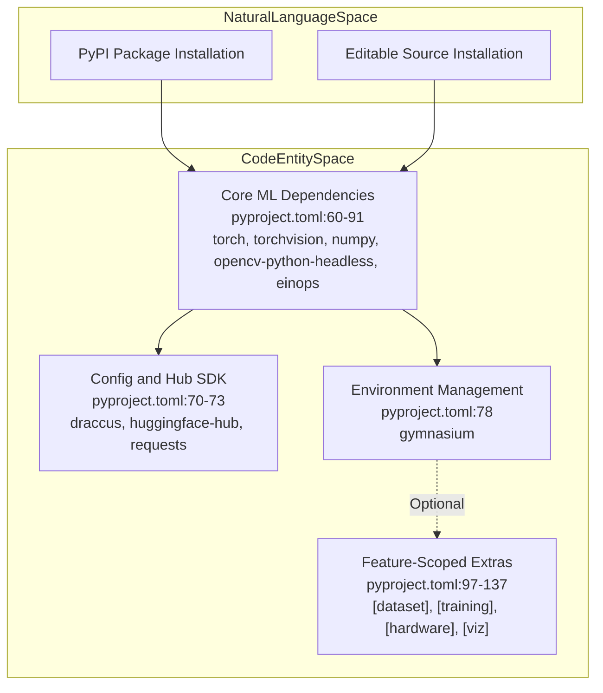
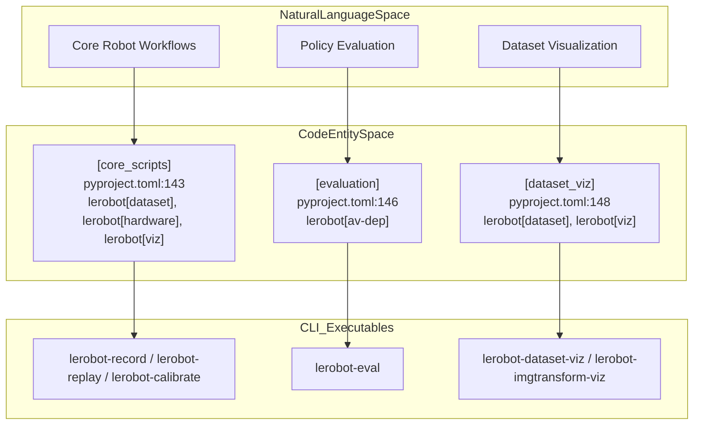

<!-- source: DeepWiki mcp.deepwiki.com · repo huggingface/lerobot · page 1.1 Installation and Setup · fetched 2026-10-26 -->

# Installation and Setup

<details>
<summary>Relevant source files</summary>

The following files were used as context for generating this wiki page:

- [README.md](README.md)
- [docker/Dockerfile.internal](docker/Dockerfile.internal)
- [docker/Dockerfile.jetson](docker/Dockerfile.jetson)
- [docker/Dockerfile.user](docker/Dockerfile.user)
- [docker/README.md](docker/README.md)
- [docs/source/_toctree.yml](docs/source/_toctree.yml)
- [docs/source/installation.mdx](docs/source/installation.mdx)
- [pyproject.toml](pyproject.toml)
- [setup.py](setup.py)
- [src/lerobot/policies/__init__.py](src/lerobot/policies/__init__.py)
- [src/lerobot/policies/groot/processor_groot.py](src/lerobot/policies/groot/processor_groot.py)
- [src/lerobot/templates/lerobot_modelcard_template.md](src/lerobot/templates/lerobot_modelcard_template.md)
- [src/lerobot/utils/import_utils.py](src/lerobot/utils/import_utils.py)
- [uv.lock](uv.lock)

</details>


This page provides comprehensive technical instructions for installing and setting up the LeRobot framework. The scope covers environment managers (`conda` vs `uv`), Python requirements, dependency management via `pyproject.toml`, video decoding requirements (`TorchCodec` and `FFmpeg`), installation from source or PyPI with optional and composite extras, and containerized deployments using Docker.

**Sources:** `pyproject.toml:26-157` [pyproject.toml:26-157](), `docs/source/installation.mdx:1-188` [docs/source/installation.mdx:1-188]()

---

## Installation Architecture and Core Dependencies

LeRobot is structured to maintain a lightweight core while providing modular optional extensions for hardware, datasets, training, and visualization. The installation configuration is centrally managed via `pyproject.toml` [pyproject.toml:26-157]().

### Installation Components and Code Entity Space

The following diagram bridges natural language installation concepts to their concrete code entities defined in `pyproject.toml`.

**Installation Architecture and Code Entity Mapping**


**Sources:** `pyproject.toml:26-157` [pyproject.toml:26-157]()

---

## Prerequisites and Environment Setup

LeRobot requires **Python ≥3.12** as declared in `pyproject.toml` [pyproject.toml:32](). Environment setup can be managed using either `conda` (via `miniforge`) or `uv`.

### Virtual Environment Configuration

Depending on the environment manager chosen, use the corresponding initialization workflow:

<!-- prettier-ignore-start -->
<hfoptions id="create_venv">
<hfoption id="conda">
```bash
conda create -y -n lerobot python=3.12
conda activate lerobot
```
</hfoption>
<hfoption id="uv">
```bash
uv python install 3.12
uv venv --python 3.12
source .venv/bin/activate
```
</hfoption>
</hfoptions>
<!-- prettier-ignore-end -->

> [!NOTE]
> When executing LeRobot inside Windows Subsystem for Linux (WSL), system packages and `evdev` must be installed for hardware controllers:
> ```bash
> # Conda
> conda install evdev -c conda-forge
> 
> # uv / system
> sudo apt install libevdev-dev
> uv pip install evdev
> ```

**Sources:** `docs/source/installation.mdx:1-68` [docs/source/installation.mdx:1-68]()

---

## Video Decoding: TorchCodec and FFmpeg

LeRobot utilizes `TorchCodec` for high-performance video decoding in dataset workflows [docs/source/installation.mdx:72-73](). TorchCodec platform constraints and fallback mechanisms are defined across `pyproject.toml` and documentation.

### Platform Support Matrix
- **Supported (TorchCodec):** Linux (`x86_64`), macOS (`arm64`), Windows (PyTorch ≥ 2.8) [pyproject.toml:122-124]().
- **Automatic Fallback (`pyav`):** macOS Intel (`x86_64`), Linux ARM (`aarch64`, `arm64`, `armv7l`) [docs/source/installation.mdx:75](). On these architectures, LeRobot falls back to `pyav` [pyproject.toml:151]().

### FFmpeg Installation Methods
Depending on the PyTorch version and environment manager, `ffmpeg` can be installed via Conda or system package managers:

<!-- prettier-ignore-start -->
<hfoptions id="install_ffmpeg">
<hfoption id="conda">
```bash
conda install ffmpeg -c conda-forge
```
*(Recommended for all PyTorch versions; installs `ffmpeg` with `libsvtav1` support)*
</hfoption>
<hfoption id="uv (PyTorch >= 2.10)">
```bash
# Ubuntu / Debian
sudo apt install ffmpeg

# macOS (Apple Silicon)
brew install ffmpeg
```
*(Dynamic linking supported for PyTorch ≥ 2.10)*
</hfoption>
</hfoptions>
<!-- prettier-ignore-end -->

**Sources:** `pyproject.toml:122-124` [pyproject.toml:122-124](), `docs/source/installation.mdx:70-116` [docs/source/installation.mdx:70-116]()

---

## Installing LeRobot: Source and PyPI

The core package installs minimal dependencies [pyproject.toml:60-91](). Feature-specific capabilities are organized into optional extras [pyproject.toml:94-146]().

### Source Installation (Editable Mode)

```bash
git clone https://github.com/huggingface/lerobot.git
cd lerobot
pip install -e .
```

### PyPI Installation with Optional Extras

LeRobot defines feature-scoped and composite extras in `pyproject.toml` [pyproject.toml:94-146]() that map directly to functional workflows and CLI commands.

**Composite Extras to CLI Scripts Mapping**


**Sources:** `pyproject.toml:94-146` [pyproject.toml:94-146](), `docs/source/installation.mdx:119-188` [docs/source/installation.mdx:119-188]()

---

## Containerized Deployment with Docker

LeRobot provides container definitions for CPU experimentation and GPU-accelerated training [docker/README.md:1-86]().

### Dockerfile Variants

- **`Dockerfile.user`**: Based on `python:3.12-slim`, configured for general experimentation, running scripts, and interacting with physical hardware via USB device mapping [docker/Dockerfile.user:1-73]().
- **`Dockerfile.internal`**: Based on `nvidia/cuda:12.8.1-base-ubuntu24.04`, pre-configured with CUDA environments (`MUJOCO_GL=egl`, `DEVICE=cuda`) for multi-GPU training and CI workloads [docker/Dockerfile.internal:1-83]().
- **`Dockerfile.jetson`**: Community-maintained build for NVIDIA Jetson Orin (JetPack 6.2, CUDA 12.6) compiling `torch`, `torchcodec`, and `torchvision` from source [docker/Dockerfile.jetson:1-118]().

**Sources:** `docker/Dockerfile.user:1-74` [docker/Dockerfile.user:1-73](), `docker/Dockerfile.internal:1-84` [docker/Dockerfile.internal:1-83](), `docker/Dockerfile.jetson:1-118` [docker/Dockerfile.jetson:1-118](), `docker/README.md:1-87` [docker/README.md:1-86]()

---

