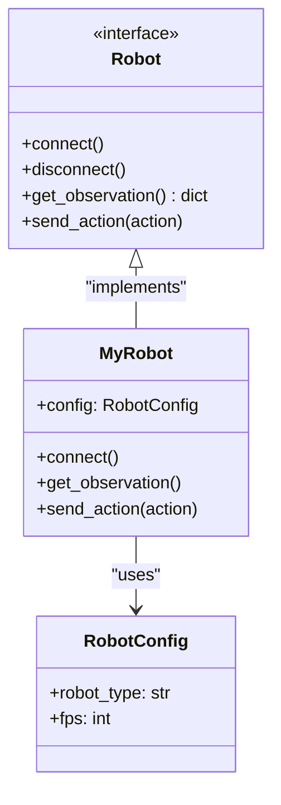
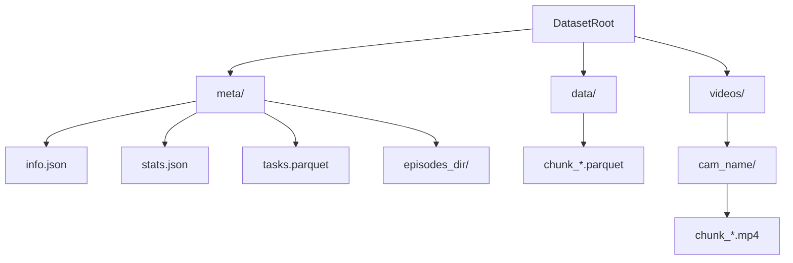
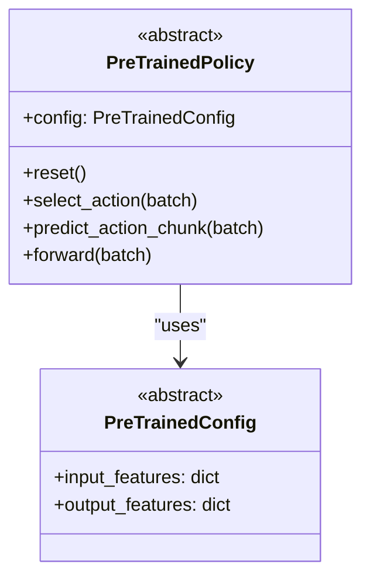
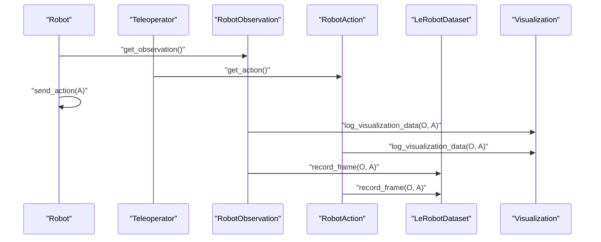

<!-- source: DeepWiki mcp.deepwiki.com · repo huggingface/lerobot · page 1.2 Core Concepts · fetched 2026-10-26 -->

# Core Concepts

Relevant source files

The following files were used as context for generating this wiki page:

- [docs/source/act.mdx](docs/source/act.mdx)
- [docs/source/earthrover_mini_plus.mdx](docs/source/earthrover_mini_plus.mdx)
- [docs/source/groot.mdx](docs/source/groot.mdx)
- [docs/source/hope_jr.mdx](docs/source/hope_jr.mdx)
- [docs/source/il_robots.mdx](docs/source/il_robots.mdx)
- [docs/source/reachy2.mdx](docs/source/reachy2.mdx)
- [docs/source/smolvla.mdx](docs/source/smolvla.mdx)
- [docs/source/streaming_video_encoding.mdx](docs/source/streaming_video_encoding.mdx)
- [src/lerobot/robots/earthrover_mini_plus/robot_earthrover_mini_plus.py](src/lerobot/robots/earthrover_mini_plus/robot_earthrover_mini_plus.py)
- [src/lerobot/teleoperators/keyboard/teleop_keyboard.py](src/lerobot/teleoperators/keyboard/teleop_keyboard.py)
- [src/lerobot/utils/constants.py](src/lerobot/utils/constants.py)

## Purpose and Scope
This page explains the fundamental architectural pillars of LeRobot: the **Robot abstraction**, the **LeRobotDataset format**, the **Policy framework**, and the **Processor system**. It details how these entities interact to support end-to-end real-world robotics workflows, from hardware control and teleoperation to large-scale data recording, policy training, and inference.

Sources: [docs/source/il_robots.mdx:3-9]()

## The Four Pillars of LeRobot

| Pillar | Purpose | Key Benefit |
|--------|---------|-------------|
| **Robot Abstraction** | Hardware-agnostic interface for robot control | Write code once, run on any supported robot [docs/source/il_robots.mdx:28]() |
| **LeRobotDataset** | Standardized format for robotics data | Efficient storage, streaming, and sharing [docs/source/il_robots.mdx:173-176]() |
| **Policy Framework** | Unified interface for IL, RL, and VLA models | Easy experimentation with diverse algorithms [docs/source/smolvla.mdx:48-49]() |
| **Processor System** | Universal data translation and normalization | Seamless data flow between sensors, models, and actuators [src/lerobot/utils/constants.py:21-58]() |

Sources: [docs/source/il_robots.mdx:3-9](), [docs/source/il_robots.mdx:28](), [docs/source/il_robots.mdx:173-176](), [docs/source/smolvla.mdx:48-49](), [src/lerobot/utils/constants.py:21-58]()

## 1. Robot Abstraction

### Purpose
The Robot abstraction provides a unified Python interface for controlling diverse robotic hardware. This abstraction decouples control logic from hardware-specific details, enabling the same code to work across different platforms [docs/source/il_robots.mdx:28]().

### Key Classes and Interfaces
The system is built around abstract base classes that define a strict contract for physical interaction. Subclasses implement methods like `get_observation` and `send_action` to be usable within the ecosystem [src/lerobot/robots/earthrover_mini_plus/robot_earthrover_mini_plus.py:171-188](), [src/lerobot/teleoperators/keyboard/teleop_keyboard.py:131-138]().

**Core Hardware Entities Diagram (Natural Language to Code Space)**

Sources: [src/lerobot/robots/earthrover_mini_plus/robot_earthrover_mini_plus.py:73-108](), [src/lerobot/teleoperators/keyboard/teleop_keyboard.py:48-55]()

### Supported Hardware
LeRobot natively supports a wide range of platforms, from low-cost arms like the SO100/SO101 to humanoids like the Unitree G1. Teleoperation is supported via leader arms, gamepads, and mobile devices [docs/source/il_robots.mdx:45-46](), [docs/source/earthrover_mini_plus.mdx:120-131](), [docs/source/hope_jr.mdx:175-207](), [docs/source/reachy2.mdx:9-12]().

Sources: [docs/source/il_robots.mdx:45-46](), [docs/source/earthrover_mini_plus.mdx:120-131](), [docs/source/hope_jr.mdx:175-207](), [docs/source/reachy2.mdx:9-12]()

---

## 2. LeRobotDataset (v3.0)

### Purpose
`LeRobotDataset v3.0` is the standardized format for storing and sharing robot learning data. It uses **Apache Parquet** for tabular data (states, actions, rewards) and **MP4 videos** (or images) for visual observations to ensure scalability and Hub integration [docs/source/il_robots.mdx:173-176]().

### File Structure
The dataset is organized to decouple storage from the user API. Data is sharded into chunks containing multiple episodes to improve storage efficiency and loading performance [docs/source/il_robots.mdx:173-176]().

**Dataset Layout Diagram (Natural Language to Code Space)**

Sources: [docs/source/il_robots.mdx:173-176]()

### Data Access and Metadata
The `LeRobotDataset` class handles video decoding and Parquet reading automatically.
*   **Metadata Management**: Manages loading and synchronization of `info.json`, `stats.json`, and episode indices.
*   **Delta Timestamps**: Enables querying temporal windows (past observations or future actions) relative to a specific frame.
*   **Codebase Version**: Identified as `v3.0` to ensure format compatibility.

Sources: [src/lerobot/utils/constants.py:98-104]()

---

## 3. Policy Framework

### Purpose
The Policy framework provides a unified interface for different robot learning algorithms, enabling seamless switching between Imitation Learning (IL), Reinforcement Learning (RL), and Vision-Language-Action (VLA) models [docs/source/smolvla.mdx:48-49]().

### Policy Categories

| Category | Examples | Purpose |
|----------|----------|---------|
| **Imitation Learning** | ACT, Diffusion, VQ-BeT | Learning from expert demonstrations [docs/source/act.mdx:20-21]() |
| **Reinforcement Learning** | HIL-SERL, TDMPC | Learning through environment interaction |
| **VLA Models** | π₀ (Pi0), SmolVLA, GR00T | Large-scale multimodal reasoning [docs/source/groot.mdx:3-4](), [docs/source/smolvla.mdx:3-4]() |

Sources: [docs/source/act.mdx:20-21](), [docs/source/groot.mdx:3-4](), [docs/source/smolvla.mdx:3-4]()

### Policy Factory and Plugins
Policies are instantiated via a factory pattern that resolves registered names to specific classes using `PreTrainedConfig` and `PreTrainedPolicy`.

**Policy Class Relationship Diagram**

Sources: [docs/source/groot.mdx:76-88](), [docs/source/smolvla.mdx:58-66]()

---

## 4. Data Processing Pipeline

### Purpose
Processors act as the bridge between raw hardware signals, dataset features, and policy-ready tensors. Utility functions like `to_tensor` and `create_transition` ensure data is correctly transformed and shaped [src/lerobot/utils/constants.py:21-58]().

### Implementation Logic
Pipelines map environment transitions and robot observations into standardized tensors using single-dispatch handlers and extraction utilities. Key components include:
1.  **Tensor Converters**: `to_tensor` handles numpy arrays, scalars, sequences, and nested dictionaries.
2.  **Transition Management**: `create_transition` and `_extract_complementary_data` manage observation-action pairs and padding/metadata flags.

Sources: [src/lerobot/utils/constants.py:21-58]()

---

## System Interaction Diagram

This diagram maps high-level concepts to the specific code entities and data flow used during a recording session or transition pipeline execution.

**Data Flow: Hardware to Storage**

Sources: [docs/source/il_robots.mdx:158-161](), [src/lerobot/robots/earthrover_mini_plus/robot_earthrover_mini_plus.py:171-188](), [src/lerobot/teleoperators/keyboard/teleop_keyboard.py:131-138](), [src/lerobot/utils/constants.py:21-58]()

---

