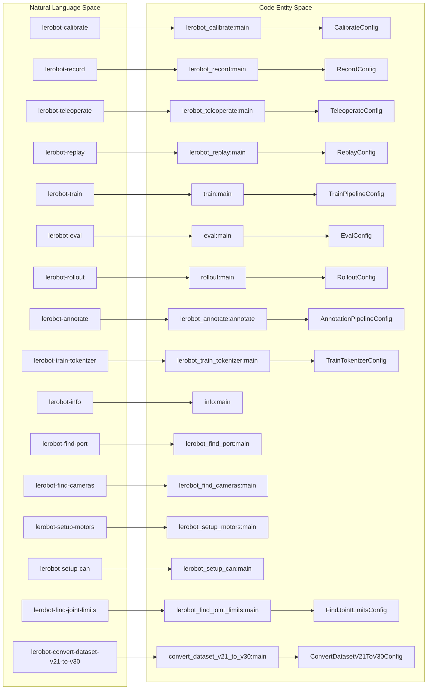
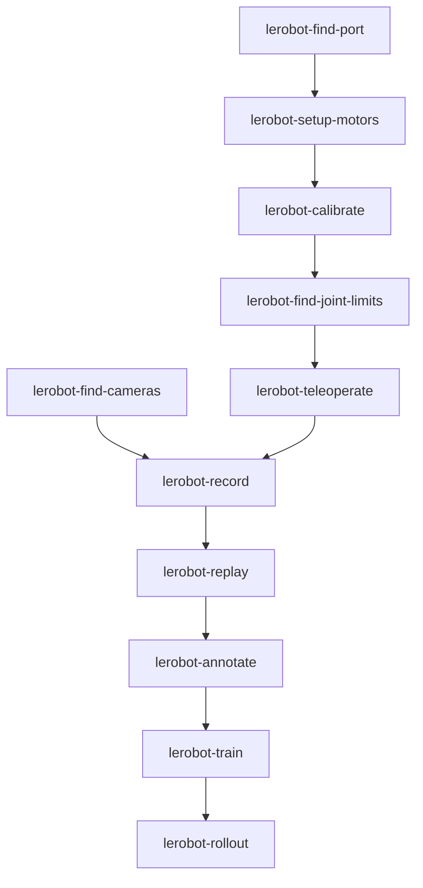

<!-- source: DeepWiki mcp.deepwiki.com · repo huggingface/lerobot · page 1.3 Command Line Interface · fetched 2026-10-26 -->

# Command Line Interface

<details>
<summary>Relevant source files</summary>

The following files were used as context for generating this wiki page:

- [AGENTS.md](AGENTS.md)
- [AGENT_GUIDE.md](AGENT_GUIDE.md)
- [CLAUDE.md](CLAUDE.md)
- [README.md](README.md)
- [docs/source/_toctree.yml](docs/source/_toctree.yml)
- [docs/source/cheat-sheet.mdx](docs/source/cheat-sheet.mdx)
- [docs/source/hardware_guide.mdx](docs/source/hardware_guide.mdx)
- [pyproject.toml](pyproject.toml)
- [src/lerobot/jobs/dataset.py](src/lerobot/jobs/dataset.py)
- [src/lerobot/policies/__init__.py](src/lerobot/policies/__init__.py)
- [src/lerobot/policies/groot/processor_groot.py](src/lerobot/policies/groot/processor_groot.py)
- [src/lerobot/scripts/convert_dataset_v21_to_v30.py](src/lerobot/scripts/convert_dataset_v21_to_v30.py)
- [src/lerobot/scripts/lerobot_annotate.py](src/lerobot/scripts/lerobot_annotate.py)
- [src/lerobot/scripts/lerobot_find_cameras.py](src/lerobot/scripts/lerobot_find_cameras.py)
- [src/lerobot/scripts/lerobot_find_port.py](src/lerobot/scripts/lerobot_find_port.py)
- [src/lerobot/scripts/lerobot_train_tokenizer.py](src/lerobot/scripts/lerobot_train_tokenizer.py)
- [src/lerobot/templates/lerobot_modelcard_template.md](src/lerobot/templates/lerobot_modelcard_template.md)
- [src/lerobot/utils/import_utils.py](src/lerobot/utils/import_utils.py)
- [tests/scripts/test_lerobot_annotate.py](tests/scripts/test_lerobot_annotate.py)
- [uv.lock](uv.lock)

</details>


## Purpose and Scope

This page documents the Command Line Interface (CLI) tools provided by LeRobot. These tools serve as entry points for hardware setup, sensor discovery, teleoperation, data recording and playback, policy training, evaluation, rollouts, dataset annotation, and diagnostics. Every CLI tool binds command-line arguments to typed configuration dataclasses using `draccus` [pyproject.toml:70](), enabling dot-notation overrides (`--robot.type=...`, `--dataset.repo_id=...`).

Sources: [pyproject.toml:70](), [src/lerobot/scripts/lerobot_record.py:166-182]()

---

## Overview and Script Registration

CLI entry points are registered in `pyproject.toml` under `[project.scripts]` [pyproject.toml:198-214](). Each command maps to a `main()` function in a module under `src/lerobot/scripts/`. Upon startup, these scripts invoke third-party plugin registration utilities to support custom extensions [src/lerobot/scripts/lerobot_record.py:157](), [src/lerobot/scripts/lerobot_teleoperate.py:125]().

### Command-to-Code Entity Map

This diagram bridges natural language tool names to their underlying Python modules, entry point functions, and configuration dataclasses.


Sources: [pyproject.toml:198-214](), [src/lerobot/scripts/lerobot_record.py:171-186](), [src/lerobot/scripts/lerobot_teleoperate.py:134-152](), [src/lerobot/scripts/lerobot_replay.py:81-98](), [src/lerobot/scripts/lerobot_calibrate.py:74-85](), [src/lerobot/scripts/lerobot_annotate.py:75-76](), [src/lerobot/scripts/lerobot_train_tokenizer.py:100-103](), [src/lerobot/scripts/lerobot_find_joint_limits.py:75-92](), [src/lerobot/scripts/convert_dataset_v21_to_v30.py:54-57]()

---

## Hardware Setup Tools

### `lerobot-find-port`
Lists available serial ports on the host system to identify correct pathways for robotic arms and controllers before motor bus configuration.
Sources: [src/lerobot/scripts/lerobot_find_port.py]()

### `lerobot-find-cameras`
Enumerates connected video capture devices. It supports discovery for `OpenCVCamera` [src/lerobot/scripts/lerobot_find_cameras.py:47-64]() and `RealSenseCamera` [src/lerobot/scripts/lerobot_find_cameras.py:67-86](), and can save test frames to disk [src/lerobot/scripts/lerobot_find_cameras.py:130-153]().
Sources: [src/lerobot/scripts/lerobot_find_cameras.py:47-153]()

### `lerobot-setup-motors`
Configures motor IDs, baud rates, and control tables across Feetech and Dynamixel motor buses.

### `lerobot-setup-can`
Configures and tests Controller Area Network (CAN) interfaces for high-performance motors like Damiao or Robstride actuators.

### `lerobot-calibrate`

**Script:** `lerobot.scripts.lerobot_calibrate:main`  
**Config:** `CalibrateConfig` [src/lerobot/scripts/lerobot_calibrate.py:74-77]()

Executes calibration routines for either a robot follower or a teleoperator device. Exactly one of `--robot.*` or `--teleop.*` must be provided [src/lerobot/scripts/lerobot_calibrate.py:79-80]().

Example:
```bash
lerobot-calibrate \
    --teleop.type=so101_leader \
    --teleop.port=/dev/tty.usbmodem58760431551 \
    --teleop.id=blue
```
Sources: [src/lerobot/scripts/lerobot_calibrate.py:74-98]()

### `lerobot-find-joint-limits`

**Script:** `lerobot.scripts.lerobot_find_joint_limits:main`  
**Config:** `FindJointLimitsConfig` [src/lerobot/scripts/lerobot_find_joint_limits.py:75-92]()

Records joint positions and end-effector coordinates while a user manually articulates the arm. Uses `RobotKinematics` to compute Cartesian boundaries and outputs `min_pos`, `max_pos`, `min_ee`, and `max_ee` [src/lerobot/scripts/lerobot_find_joint_limits.py:105-106]().
Sources: [src/lerobot/scripts/lerobot_find_joint_limits.py:75-216]()

---

## Robot Operations Tools

### `lerobot-teleoperate`

**Script:** `lerobot.scripts.lerobot_teleoperate:main`  
**Config:** `TeleoperateConfig` [src/lerobot/scripts/lerobot_teleoperate.py:134-152]()

Runs real-time teleoperation loops, reading commands from a `Teleoperator`, processing them through action/observation pipelines, and dispatching actions to a `Robot` [src/lerobot/scripts/lerobot_teleoperate.py:155-183]().

Example:
```bash
lerobot-teleoperate \
    --robot.type=so101_follower \
    --robot.port=/dev/tty.usbmodem58760431541 \
    --robot.id=black \
    --teleop.type=so101_leader \
    --teleop.port=/dev/tty.usbmodem58760431551 \
    --teleop.id=blue \
    --display_data=true
```
Sources: [src/lerobot/scripts/lerobot_teleoperate.py:134-183]()

### `lerobot-record`

**Script:** `lerobot.scripts.lerobot_record`  
**Config:** `RecordConfig` [src/lerobot/scripts/lerobot_record.py:170-186]()

Captures teleoperated episodes into a standardized `LeRobotDataset` structure [src/lerobot/scripts/lerobot_record.py:15-18]().

Example:
```bash
lerobot-record \
    --robot.type=so100_follower \
    --robot.port=/dev/tty.usbmodem58760431541 \
    --robot.cameras="{laptop: {type: opencv, index_or_path: 0, width: 640, height: 480, fps: 30}}" \
    --robot.id=black \
    --teleop.type=so100_leader \
    --teleop.port=/dev/tty.usbmodem58760431551 \
    --teleop.id=blue \
    --dataset.repo_id=myuser/my_dataset \
    --dataset.num_episodes=50
```
Sources: [src/lerobot/scripts/lerobot_record.py:166-186]()

### `lerobot-replay`

**Script:** `lerobot.scripts.lerobot_replay:main`  
**Config:** `ReplayConfig` [src/lerobot/scripts/lerobot_replay.py:94-98]()

Loads recorded episodes from a `LeRobotDataset` and streams recorded actions directly to physical hardware using a `CycleTimer` to verify execution fidelity [src/lerobot/scripts/lerobot_replay.py:15-16](), [src/lerobot/scripts/lerobot_replay.py:118-138]().
Sources: [src/lerobot/scripts/lerobot_replay.py:82-142]()

### `lerobot-rollout`
Deploys trained imitation learning or RL policies onto physical hardware or simulation environments, supporting multiple strategies (e.g., base, episodic, DAgger) and inference backends.

---

## Dataset Management and Utilities

### `lerobot-annotate`

**Script:** `lerobot.scripts.lerobot_annotate:annotate`
**Config:** `AnnotationPipelineConfig` [src/lerobot/annotations/steerable_pipeline/config.py]()

Populates `language_persistent` and `language_events` columns within dataset parquet shards using a Vision-Language Model (VLM) steerable pipeline [src/lerobot/scripts/lerobot_annotate.py:16-17](). It can run locally or submit jobs to Hugging Face Jobs [src/lerobot/scripts/lerobot_annotate.py:28-35]().

Example:
```bash
lerobot-annotate \
    --root=/path/to/dataset \
    --vlm.model_id=Qwen/Qwen2.5-VL-7B-Instruct
```
Sources: [src/lerobot/scripts/lerobot_annotate.py:16-35](), [src/lerobot/annotations/steerable_pipeline/config.py]()

### `lerobot-train-tokenizer`

**Script:** `lerobot.scripts.lerobot_train_tokenizer:main`
**Config:** `TrainTokenizerConfig` [src/lerobot/scripts/lerobot_train_tokenizer.py:100-103]()

Trains Frequency-space Action Sequence Tokenization (FAST) tokenizers by sampling action chunks, applying normalization modes, and fitting BPE vocabularies on DCT coefficients.
Sources: [src/lerobot/scripts/lerobot_train_tokenizer.py:100-103]()

### `lerobot-info`
Diagnostics utility that inspects environment properties (Python version, PyTorch bindings, GPU acceleration availability, FFmpeg runtime status).

### `lerobot-convert-dataset-v21-to-v30`

**Script:** `src/lerobot/scripts/convert_dataset_v21_to_v30.py:main`
**Config:** `ConvertDatasetV21ToV30Config` [src/lerobot/scripts/convert_dataset_v21_to_v30.py:54-57]()

Converts datasets from codebase version 2.1 to 3.0. This involves generating per-episode stats, checking consistency, removing deprecated `stats.json`, updating `codebase_version` in `info.json`, and optionally pushing the new version to the Hugging Face Hub [src/lerobot/scripts/convert_dataset_v21_to_v30.py:18-27]().

Example:
```bash
python src/lerobot/scripts/convert_dataset_v21_to_v30.py \
    --repo-id=lerobot/pusht
```
Sources: [src/lerobot/scripts/convert_dataset_v21_to_v30.py:18-27](), [src/lerobot/scripts/convert_dataset_v21_to_v30.py:54-57]()

---

## Training and Evaluation Tools

### `lerobot-train`
Orchestrates training loops for imitation learning and reinforcement learning policies, handling dataset streaming, policy instantiation, optimizer setup, checkpointing, and periodic evaluation.

### `lerobot-eval`
Executes evaluation rollouts for trained policies across episodes, computing success rates and rendering evaluation videos.

---

## Argument Parsing Architecture

CLI options are parsed into nested configuration dataclasses via `draccus` [pyproject.toml:70]().

```mermaid
flowchart TD
    subgraph Config Classes
        rc["RecordConfig"]
        tc["TeleoperateConfig"]
        rpc["ReplayConfig"]
        drpc["DatasetReplayConfig"]
        cc["CalibrateConfig"]
        annc["AnnotationPipelineConfig"]
        ttc["TrainTokenizerConfig"]
        fjl_c["FindJointLimitsConfig"]
        cdv_c["ConvertDatasetV21ToV30Config"]
    end

    rc --> r_rob["robot: RobotConfig"]
    rc --> r_dat["dataset: DatasetRecordConfig"]
    rc --> r_tel["teleop: TeleoperatorConfig"]

    tc --> t_rob["robot: RobotConfig"]
    tc --> t_tel["teleop: TeleoperatorConfig"]

    rpc --> rp_rob["robot: RobotConfig"]
    rpc --> rp_dat["dataset: DatasetReplayConfig"]

    cc --> c_tel["teleop: TeleoperatorConfig"]
    cc --> c_rob["robot: RobotConfig"]

    annc --> ann_vlm["vlm: VLMClientConfig"]
    annc --> ann_plan["plan: PlanSubtasksMemoryModuleConfig"]
    annc --> ann_inter["interjections: InterjectionsAndSpeechModuleConfig"]
    annc --> ann_vqa["vqa: GeneralVqaModuleConfig"]

    ttc --> tt_dat["dataset: DatasetConfig"]
    ttc --> tt_tok["tokenizer: TokenizerConfig"]

    fjl_c --> fjl_rob["robot: RobotConfig"]

    cdv_c --> cdv_dat["dataset: DatasetConfig"]
```


Sources: [src/lerobot/scripts/lerobot_record.py:171-186](), [src/lerobot/scripts/lerobot_teleoperate.py:134-152](), [src/lerobot/scripts/lerobot_replay.py:81-98](), [src/lerobot/scripts/lerobot_calibrate.py:74-78](), [src/lerobot/annotations/steerable_pipeline/config.py](), [src/lerobot/scripts/lerobot_train_tokenizer.py:100-103](), [src/lerobot/scripts/lerobot_find_joint_limits.py:75-92](), [src/lerobot/scripts/convert_dataset_v21_to_v30.py:54-57]()

---

## Typical Workflow

The following workflow diagram maps operational steps from hardware setup to policy training.


Sources: [pyproject.toml:198-214](), [src/lerobot/scripts/lerobot_record.py:25-65](), [src/lerobot/scripts/lerobot_teleoperate.py:23-52](), [src/lerobot/scripts/lerobot_replay.py:23-40](), [src/lerobot/scripts/lerobot_calibrate.py:23-28]()

---

