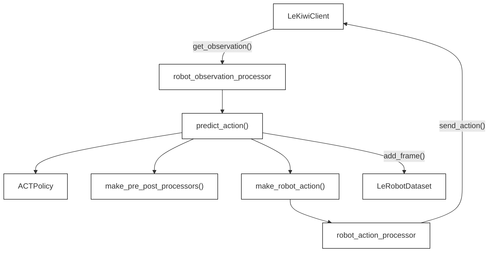
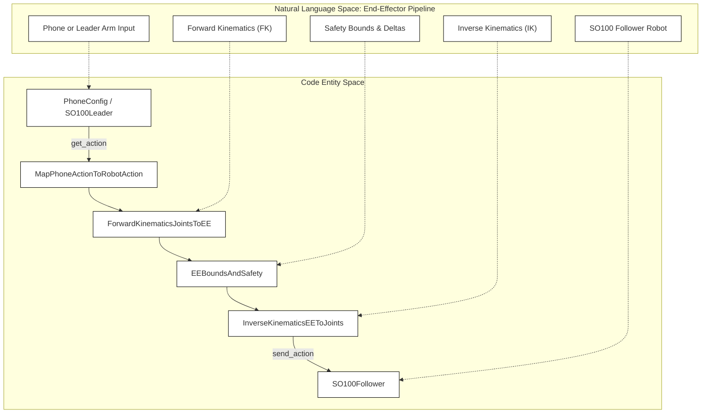
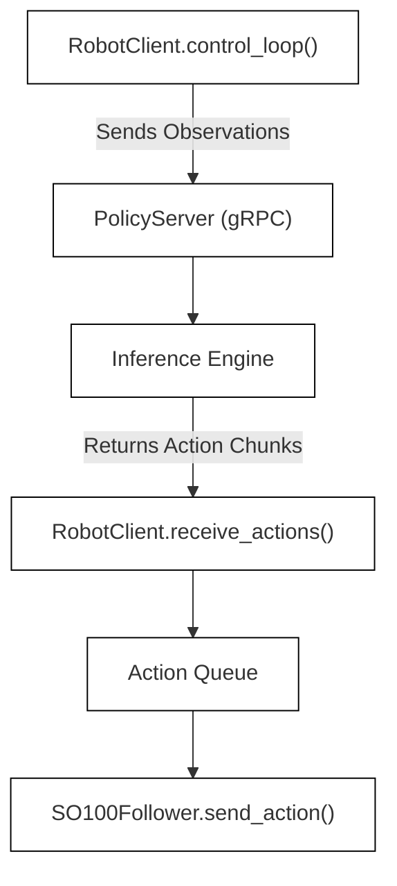

<!-- source: DeepWiki mcp.deepwiki.com · repo huggingface/lerobot · page 1.4 Examples and Tutorials · fetched 2026-10-26 -->

# Examples and Tutorials

<details>
<summary>Relevant source files</summary>

The following files were used as context for generating this wiki page:

- [docs/source/porting_datasets_v3.mdx](docs/source/porting_datasets_v3.mdx)
- [examples/lekiwi/evaluate.py](examples/lekiwi/evaluate.py)
- [examples/lekiwi/record.py](examples/lekiwi/record.py)
- [examples/lekiwi/teleoperate.py](examples/lekiwi/teleoperate.py)
- [examples/phone_to_so100/evaluate.py](examples/phone_to_so100/evaluate.py)
- [examples/phone_to_so100/record.py](examples/phone_to_so100/record.py)
- [examples/phone_to_so100/teleoperate.py](examples/phone_to_so100/teleoperate.py)
- [examples/port_datasets/display_error_files.py](examples/port_datasets/display_error_files.py)
- [examples/port_datasets/port_droid.py](examples/port_datasets/port_droid.py)
- [examples/port_datasets/slurm_aggregate_shards.py](examples/port_datasets/slurm_aggregate_shards.py)
- [examples/port_datasets/slurm_port_shards.py](examples/port_datasets/slurm_port_shards.py)
- [examples/port_datasets/slurm_upload.py](examples/port_datasets/slurm_upload.py)
- [examples/so100_to_so100_EE/evaluate.py](examples/so100_to_so100_EE/evaluate.py)
- [examples/so100_to_so100_EE/record.py](examples/so100_to_so100_EE/record.py)
- [examples/so100_to_so100_EE/teleoperate.py](examples/so100_to_so100_EE/teleoperate.py)
- [examples/tutorial/act/act_training_example.py](examples/tutorial/act/act_training_example.py)
- [examples/tutorial/act/act_using_example.py](examples/tutorial/act/act_using_example.py)
- [examples/tutorial/async-inf/policy_server.py](examples/tutorial/async-inf/policy_server.py)
- [examples/tutorial/async-inf/robot_client.py](examples/tutorial/async-inf/robot_client.py)
- [examples/tutorial/diffusion/diffusion_training_example.py](examples/tutorial/diffusion/diffusion_training_example.py)
- [examples/tutorial/diffusion/diffusion_using_example.py](examples/tutorial/diffusion/diffusion_using_example.py)
- [examples/tutorial/pi0/using_pi0_example.py](examples/tutorial/pi0/using_pi0_example.py)
- [examples/tutorial/rl/hilserl_example.py](examples/tutorial/rl/hilserl_example.py)
- [examples/tutorial/rl/reward_classifier_example.py](examples/tutorial/rl/reward_classifier_example.py)
- [examples/tutorial/smolvla/using_smolvla_example.py](examples/tutorial/smolvla/using_smolvla_example.py)
- [src/lerobot/utils/robot_utils.py](src/lerobot/utils/robot_utils.py)
- [tests/datasets/test_delta_timestamps.py](tests/datasets/test_delta_timestamps.py)

</details>


## Purpose and Scope

This wiki page provides a technical guide to the `examples/` directory within the LeRobot codebase. It covers standalone reference implementations, per-robot orchestration scripts (`lekiwi`, `phone_to_so100`, `so100_to_so100_EE`), learning tutorials for imitation learning and reinforcement learning policies (ACT, Diffusion, pi0, SmolVLA, HIL-SERL), dataset exploration examples, and distributed dataset porting scripts using SLURM.

---

## 1. Per-Robot Example Integration Scripts

The `examples/` directory provides self-contained reference scripts demonstrating how to wire hardware drivers, kinematics processors, teleoperators, policies, and dataset recorders together. 

### LeKiwi Mobile Robot Examples
The `examples/lekiwi/` directory implements network-split host/client execution for the mobile LeKiwi platform. `record.py` [examples/lekiwi/record.py:37-142]() establishes a client connection to `LeKiwiClient` [examples/lekiwi/record.py:44](), integrates a `SO100Leader` arm and a `KeyboardTeleop` device [examples/lekiwi/record.py:40-46](), and drives the recording loop via `record_loop` [examples/lekiwi/record.py:87]().

Similarly, `evaluate.py` [examples/lekiwi/evaluate.py:42-166]() demonstrates inline policy deployment. It loads an `ACTPolicy` from the Hugging Face Hub [examples/lekiwi/evaluate.py:52](), initializes policy pre/postprocessors with `make_pre_post_processors` [examples/lekiwi/evaluate.py:70-76](), queries the robot observation `robot.get_observation()` [examples/lekiwi/evaluate.py:110](), predicts actions using `predict_action` [examples/lekiwi/evaluate.py:115](), and converts actions via `make_robot_action` [examples/lekiwi/evaluate.py:127]().


*Figure 1: LeKiwi Evaluation and Action Flow*

Sources: `examples/lekiwi/record.py`, `examples/lekiwi/evaluate.py`, `examples/lekiwi/teleoperate.py`

### End-Effector Kinematic Control Scripts
The `examples/so100_to_so100_EE/` and `examples/phone_to_so100/` directories demonstrate cartesian end-effector (EE) control pipelines using Robot Description (URDF) kinematics solvers (`RobotKinematics`) [examples/so100_to_so100_EE/record.py:67-76](). 

These scripts construct `RobotProcessorPipeline` instances that map joint observations to EE poses via `ForwardKinematicsJointsToEE` [examples/so100_to_so100_EE/record.py:81](), enforce safety limits with `EEBoundsAndSafety` [examples/so100_to_so100_EE/record.py:103](), and map target EE trajectories back to joint actions using `InverseKinematicsEEToJoints` [examples/so100_to_so100_EE/record.py:107]().


*Figure 2: Natural Language to Code Entity Mapping for EE Kinematic Teleoperation*

Sources: `examples/so100_to_so100_EE/record.py`, `examples/so100_to_so100_EE/evaluate.py`, `examples/phone_to_so100/record.py`, `examples/phone_to_so100/evaluate.py`

---

## 2. Policy, RL, and Async Inference Tutorials

The `examples/tutorial/` directory offers modular scripts covering training and inference workflows for various policy backends.

### Imitation Learning and VLA Tutorials
- **ACT (`examples/tutorial/act/`)**: Demonstrates how to instantiate, train (`act_training_example.py` [examples/tutorial/act/act_training_example.py]()), and run inference (`act_using_example.py` [examples/tutorial/act/act_using_example.py]()) with Action Chunking with Transformers (ACT).
- **Diffusion (`examples/tutorial/diffusion/`)**: Illustrates score-based diffusion policy training and execution pipelines (`diffusion_training_example.py` [examples/tutorial/diffusion/diffusion_training_example.py](), `diffusion_using_example.py` [examples/tutorial/diffusion/diffusion_using_example.py]()).
- **Vision-Language-Action Models (`examples/tutorial/pi0/`, `examples/tutorial/smolvla/`)**: Provides integration guides for streaming multimodal models like $\pi_0$ (`using_pi0_example.py` [examples/tutorial/pi0/using_pi0_example.py]()) and SmolVLA (`using_smolvla_example.py` [examples/tutorial/smolvla/using_smolvla_example.py]()).

### Reinforcement Learning and Reward Modeling
- **HIL-SERL (`examples/tutorial/rl/hilserl_example.py`)**: Implements High-In-the-Loop Soft Actor-Critic (HIL-SERL) pipelines combining offline demonstration datasets with online reinforcement learning updates [examples/tutorial/rl/hilserl_example.py]().
- **Reward Classifiers (`examples/tutorial/rl/reward_classifier_example.py`)**: Demonstrates training binary or continuous success/reward classifiers to score task completion during rollouts [examples/tutorial/rl/reward_classifier_example.py]().

### Asynchronous Inference Architecture
The asynchronous inference tutorial (`examples/tutorial/async-inf/`) demonstrates decoupled client-server robot control. `robot_client.py` [examples/tutorial/async-inf/robot_client.py:1-62]() sets up a `RobotClientConfig` [examples/tutorial/async-inf/robot_client.py:29-38]() specifying camera configuration, serial ports, and chunking thresholds. It starts a background action receiver thread to consume action chunks over gRPC while executing the main control loop [examples/tutorial/async-inf/robot_client.py:48-49]().


*Figure 3: Asynchronous Inference Execution Flow*

Sources: `examples/tutorial/async-inf/robot_client.py`, `examples/tutorial/act/act_using_example.py`, `examples/tutorial/rl/hilserl_example.py`

---

## 3. Dataset Loading and Manipulation Examples

The `examples/dataset/` directory includes reference implementations for inspecting and consuming datasets stored in the LeRobot format.

Dataset loading scripts demonstrate querying the Hugging Face Hub for robotics datasets using `HfApi`, fetching lightweight metadata via `LeRobotDatasetMetadata`, and instantiating `LeRobotDataset` for episodic slicing.

### Delta Timestamps and Batching
The dataset example illustrates configuring `delta_timestamps` to retrieve temporal context windows for multimodal inputs:
- **Cameras**: Loaded with relative offsets across timestamps.
- **States**: Sampled across past history buffers.
- **Actions**: Extracted as future chunk trajectories.

These datasets integrate directly with standard PyTorch `DataLoader` constructs for batched training.

Sources: `examples/dataset/load_lerobot_dataset.py`, `examples/dataset/use_dataset_image_transforms.py`

---

## 4. Dataset Porting and SLURM Pipeline

The `examples/port_datasets/` directory provides distributed cluster scripts designed to convert large-scale external robotics datasets (such as DROID or Bridge) into the standardized LeRobot v3.0 format.

```mermaid
graph TD
    subgraph "Natural Language Space: Dataset Porting"
    N1["External Raw Dataset Shards"]
    N2["SLURM Array Job Execution"]
    N3["Consolidated LeRobot Parquet/Video Files"]
    N4["Hugging Face Hub Push"]
    end

    subgraph "Code Entity Space"
    C1["slurm_port_shards.py"] -->|Processes Shards| C2["port_droid.py"]
    C2 --> C3["slurm_aggregate_shards.py"]
    C3 --> C4["slurm_upload.py"]
    C4 -->|push_to_hub()| C5["LeRobotDatasetHub"]
    end

    N1 -.-> C1
    N2 -.-> C2
    N3 -.-> C3
    N4 -.-> C5

    classDef default fill:#fff,stroke:#000,stroke-width:1px;
```
*Figure 4: Dataset Porting and SLURM Execution Pipeline*

### Script Breakdown
- `slurm_port_shards.py` [examples/port_datasets/slurm_port_shards.py](): Dispatches parallel array jobs across a SLURM cluster to convert raw trajectory files into intermediate LeRobot shards.
- `port_droid.py` [examples/port_datasets/port_droid.py](): Implements specific data parsing and schema mapping logic for transforming DROID dataset structures into `LeRobotDataset` features. For example, `DROID_SHARDS` [examples/port_datasets/port_droid.py:28]() defines the structure of DROID dataset shards.
- `slurm_aggregate_shards.py` [examples/port_datasets/slurm_aggregate_shards.py](): Combines distributed shards into a single unified dataset repository, remapping episode indices and computing normalization statistics.
- `slurm_upload.py` [examples/port_datasets/slurm_upload.py:1-286](): Handles authenticated multi-part uploading of consolidated parquet chunks, video mp4 files, and metadata JSON records to the Hugging Face Hub. The `UploadDataset` class [examples/port_datasets/slurm_upload.py:33-101]() manages repository creation, dataset card generation using `create_lerobot_dataset_card` [examples/port_datasets/slurm_upload.py:87](), and file listing. The `create_commits` method [examples/port_datasets/slurm_upload.py:108-150]() handles committing files in chunks to avoid race conditions during large uploads.

Sources: `examples/port_datasets/slurm_port_shards.py`, `examples/port_datasets/slurm_aggregate_shards.py`, `examples/port_datasets/slurm_upload.py`, `examples/port_datasets/port_droid.py`

---

