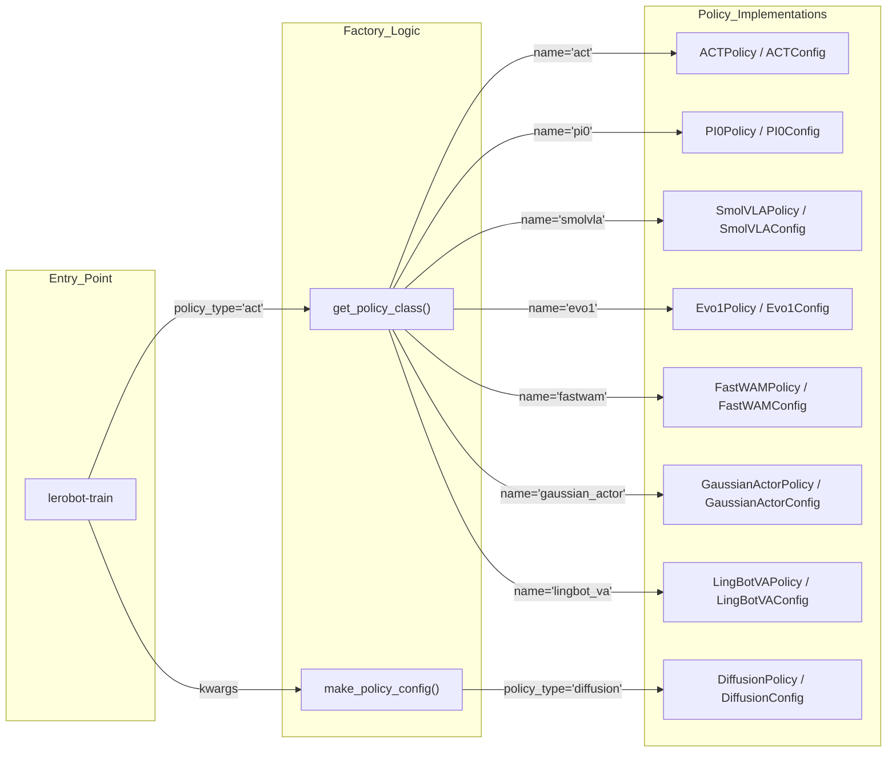
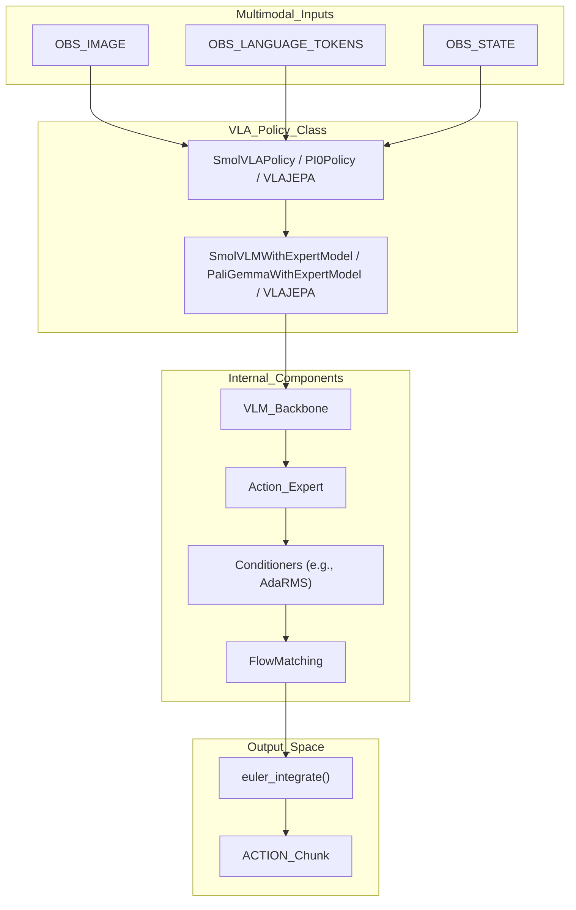

<!-- source: DeepWiki mcp.deepwiki.com · repo huggingface/lerobot · page 10 Glossary · fetched 2026-10-26 -->

# Glossary

Relevant source files

The following files were used as context for generating this wiki page:

- [README.md](README.md)
- [docs/source/_toctree.yml](docs/source/_toctree.yml)
- [pyproject.toml](pyproject.toml)
- [src/lerobot/policies/__init__.py](src/lerobot/policies/__init__.py)
- [src/lerobot/policies/groot/processor_groot.py](src/lerobot/policies/groot/processor_groot.py)
- [src/lerobot/policies/pi0/modeling_pi0.py](src/lerobot/policies/pi0/modeling_pi0.py)
- [src/lerobot/policies/pi05/modeling_pi05.py](src/lerobot/policies/pi05/modeling_pi05.py)
- [src/lerobot/policies/pretrained.py](src/lerobot/policies/pretrained.py)
- [src/lerobot/policies/smolvla/modeling_smolvla.py](src/lerobot/policies/smolvla/modeling_smolvla.py)
- [src/lerobot/policies/smolvla/smolvlm_with_expert.py](src/lerobot/policies/smolvla/smolvlm_with_expert.py)
- [src/lerobot/policies/vqbet/vqbet_utils.py](src/lerobot/policies/vqbet/vqbet_utils.py)
- [src/lerobot/templates/lerobot_modelcard_template.md](src/lerobot/templates/lerobot_modelcard_template.md)
- [src/lerobot/utils/constants.py](src/lerobot/utils/constants.py)
- [src/lerobot/utils/import_utils.py](src/lerobot/utils/import_utils.py)
- [tests/policies/pi0_pi05/test_pi05_vision_inference.py](tests/policies/pi0_pi05/test_pi05_vision_inference.py)
- [tests/policies/pi0_pi05/test_pi0_vision_inference.py](tests/policies/pi0_pi05/test_pi0_vision_inference.py)
- [uv.lock](uv.lock)

This glossary defines codebase-specific terms, abbreviations, and domain concepts used throughout the LeRobot ecosystem. It serves as a technical reference for onboarding engineers to understand the implementation details, data flow, and architecture of the framework.

Sources: [README.md:18-27](), [pyproject.toml:29]()

## Core Concepts

### Robot Abstraction
The `Robot` class is the hardware-agnostic interface that standardizes control across diverse platforms. It decouples the control logic (policies) from the physical motor protocols and camera drivers [README.md:46-49]().

*   **Follower**: The robot being controlled by a policy or a teleoperator [README.md:46-49](). Supported followers include the **reBot B601** [README.md:61-61]() and various arms like **SO100** or **OpenArm** [README.md:46-61]().
*   **Leader**: The teleoperation device (e.g., a second arm, gamepad, or keyboard) used to provide control signals to the follower [README.md:61-64]().
*   **Bi-manual Variants**: Hardware configurations using two arms simultaneously for coordinated manipulation tasks [README.md:61-64]().
*   **Calibration**: The process of mapping raw motor values to a standardized range and setting zero positions. This is managed via the calibration utilities [README.md:64-66]().

Sources: [README.md:46-65]()

### LeRobotDataset
A standardized data format designed for efficient storage and streaming of robotic data. It combines Parquet files for state/action data and MP4 videos for visual observations [README.md:69-74]().

*   **Chunk**: A subset of episodes stored together to improve storage efficiency and loading performance. Multiple episodes are consolidated into chunked files [README.md:69-74]().
*   **Delta Timestamps**: A mechanism to query observations and actions at relative time offsets (e.g., "get the image from 0.1s ago"), which is crucial for policies that require temporal context [docs/source/_toctree.yml:54-56]().
*   **Stats**: Dataset-wide statistics (mean, std, min, max) stored in metadata used for normalizing inputs and unnormalizing outputs [src/lerobot/utils/constants.py:107-110]().
*   **Language Columns**: Columns like `language_persistent` (global task description) and `language_events` (time-specific events) used to store textual instructions [src/lerobot/utils/constants.py:54-55]().

Sources: [README.md:67-87](), [src/lerobot/utils/constants.py:54-55](), [src/lerobot/utils/constants.py:107-110](), [docs/source/_toctree.yml:54-56]()

## System Architecture Diagrams

### Policy Discovery and Configuration
This diagram maps how the framework dynamically loads policy classes and their associated configurations using the factory pattern.

**Natural Language to Code Entity Space: Policy Factory**

Sources: [README.md:98-108](), [src/lerobot/policies/__init__.py:21-29](), [src/lerobot/policies/factory.py:22-24]()

### VLA Model Architecture
The following diagram illustrates the common structure of Vision-Language-Action (VLA) models in LeRobot, specifically focusing on the integration of a VLM backbone with an action expert.

**Natural Language to Code Entity Space: VLA Architecture**

Sources: [src/lerobot/policies/smolvla/modeling_smolvla.py:167-168](), [src/lerobot/policies/pi0/modeling_pi0.py:185-187](), [src/lerobot/policies/pi0/modeling_pi0.py:78-86](), [src/lerobot/policies/smolvla/modeling_smolvla.py:66-72](), [src/lerobot/utils/constants.py:25-28](), [src/lerobot/utils/constants.py:55]()

## Key Abbreviations & Jargon

| Term | Full Name | Definition | Code Pointer |
| :--- | :--- | :--- | :--- |
| **ACT** | Action Chunking Transformer | A policy that predicts a sequence (chunk) of actions instead of a single step. | [README.md:106-106]() |
| **RTC** | Real-Time Chunking | A system for continuous, smooth action execution during inference, managing an action queue. | [src/lerobot/policies/smolvla/modeling_smolvla.py:183-184]() |
| **VLA** | Vision-Language-Action | Models that take visual and text prompts to generate actions (e.g., π₀, SmolVLA). | [README.md:90-94]() |
| **PEFT** | Parameter-Efficient Fine-Tuning | Techniques like LoRA used to adapt large models with minimal parameter updates. | [src/lerobot/policies/pretrained.py:40-43]() |
| **SARM** | Stage-Aware Reward Model | A reward model type for stage-aware progress in robot tasks. | [docs/source/_toctree.yml:98-99]() |
| **VLM** | Vision Language Model | The backbone for VLA models, processing multimodal inputs. | [src/lerobot/policies/smolvla/smolvlm_with_expert.py:10-12]() |
| **FAST** | Frequency-space Action Sequence Tokenization | A system for DCT compression and BPE tokenization of action sequences. | [docs/source/_toctree.yml:65-65]() |
| **JEPA** | Joint-Embedding Predictive Architecture | A world model approach used in VLA-JEPA for learning representations. | [docs/source/_toctree.yml:72-72]() |
| **AdaRMS** | Adaptive Root Mean Square | A normalization technique used for conditioning layers in models like π₀. | [src/lerobot/policies/pi0/modeling_pi0.py:78-86]() |
| **DAgger** | Dataset Aggregation | An iterative training algorithm where a trained policy collects new rollouts, which are then annotated and added to the training set. | [docs/source/_toctree.yml:106-112]() |

Sources: [README.md:104-108](), [src/lerobot/policies/pretrained.py:40-43](), [src/lerobot/policies/smolvla/modeling_smolvla.py:183-184](), [src/lerobot/policies/smolvla/smolvlm_with_expert.py:10-12](), [src/lerobot/policies/pi0/modeling_pi0.py:78-86](), [docs/source/_toctree.yml:65-65](), [docs/source/_toctree.yml:72-72](), [docs/source/_toctree.yml:98-99](), [docs/source/_toctree.yml:106-112]()

## Domain Concepts

### Action Chunking
Instead of predicting one action $a_t$ for observation $o_t$, policies like ACT or Diffusion predict a sequence of actions $[a_t, a_{t+1}, ..., a_{t+k}]$. This helps with temporal consistency and overcomes the "compounding error" problem in imitation learning.

Sources: [README.md:106-106]()

### Flow Matching
A generative modeling paradigm used in policies like π₀ and SmolVLA. It learns a vector field to transform noise into action trajectories, typically resolved using numerical integration steps.
The `euler_integrate` function is used for this purpose [src/lerobot/policies/smolvla/modeling_smolvla.py:68]().

Sources: [src/lerobot/policies/smolvla/modeling_smolvla.py:68](), [src/lerobot/policies/pi0/modeling_pi0.py:60]()

### Steerable Annotation Pipeline
A VLM-based pipeline for annotating datasets. It includes execution phases such as planning, interjections, validation, and writing, producing structured outputs for downstream task conditioning.

Sources: [docs/source/_toctree.yml:51-51]()

### Normalization and Statistics
LeRobot computes dataset-wide statistics to scale data before feeding it to a neural network:
*   **MEAN_STD**: Centers data around 0 with unit variance.
*   **MIN_MAX**: Scales data to a fixed range, typically `[-1, 1]`.
*   **QUANTILES**: Robust scaling using percentiles to handle outliers.

Sources: [src/lerobot/utils/constants.py:107-110]()

### Video Processing
*   **Streaming Video Encoding**: A mechanism to encode video frames on-the-fly during recording to maintain high throughput and minimize memory usage.
*   **Video Backends**: The framework supports hardware-accelerated and software decoding backends for high-performance frame access during dataset iteration. The `get_safe_default_video_backend` function determines the available backend, prioritizing `torchcodec` if available, otherwise falling back to `pyav` [src/lerobot/utils/import_utils.py:91-108]().

Sources: [README.md:67-74](), [docs/source/_toctree.yml:54-56](), [src/lerobot/utils/import_utils.py:91-108]()

### Policy and Model Terms
*   **EVO1**: A Vision-Language-Action policy built around an InternVL3 backbone and a continuous flow-matching action head [src/lerobot/templates/lerobot_modelcard_template.md:40-42]().
*   **FastWAM**: A World Action Model policy that keeps video world-modeling during training but predicts actions directly at inference time, initializing its visual world-model components from the Wan2.2 video-diffusion stack [src/lerobot/templates/lerobot_modelcard_template.md:43-45]().
*   **LingBot-VA**: An autoregressive video-action world-model policy built on the Wan2.2 video-diffusion stack. It interleaves the prediction of future video latents and robot actions in a single autoregressive sequence [src/lerobot/templates/lerobot_modelcard_template.md:47-49]().
*   **GaussianActor**: A Gaussian policy with a tanh squash, used as the policy-side component by Soft Actor-Critic (SAC) and related maximum-entropy continuous-control algorithms [src/lerobot/templates/lerobot_modelcard_template.md:26-28]().
*   **VLA-JEPA**: A Vision-Language-Action model that combines a Qwen3-VL language backbone with a self-supervised video world model (V-JEPA2) and a flow-matching DiT action head [src/lerobot/templates/lerobot_modelcard_template.md:24-25]().
*   **WALL-OSS**: An open-source foundation model for embodied intelligence from XSquare Robot. Built on Qwen2.5-VL, it uses a tightly-coupled multimodal architecture with flow matching [src/lerobot/templates/lerobot_modelcard_template.md:36-38]().
*   **EO-1**: A Vision-Language-Action model for general robot control. It pairs a Qwen2.5-VL backbone for vision-language understanding with a continuous flow-matching action head [src/lerobot/templates/lerobot_modelcard_template.md:31-33]().
*   **ROBOMETER**: A general-purpose video-language reward model [docs/source/_toctree.yml:100-100]()
*   **TOPReward**: A zero-shot reward model based on token probability metrics [docs/source/_toctree.yml:101-101]()

Sources: [src/lerobot/templates/lerobot_modelcard_template.md:24-49](), [docs/source/_toctree.yml:100-101]()

## Implementation Reference Table

| Component | Responsibility | Base Class / Factory |
| :--- | :--- | :--- |
| **Policy** | Neural network logic and action prediction | `PreTrainedPolicy` [src/lerobot/policies/pretrained.py:70]() |
| **Dataset** | Data persistence, I/O, and Hub integration | `LeRobotDataset` [README.md:76]() |
| **Processor** | Transforming observations and actions | `PolicyProcessorPipeline` [src/lerobot/utils/constants.py:73-75]() |
| **RTC** | Real-time action queue management | `RTCProcessor` [src/lerobot/policies/smolvla/modeling_smolvla.py:183-184]() |

Sources: [README.md:46-87](), [src/lerobot/utils/constants.py:73-75](), [src/lerobot/policies/pretrained.py:70](), [src/lerobot/policies/smolvla/modeling_smolvla.py:183-184]()