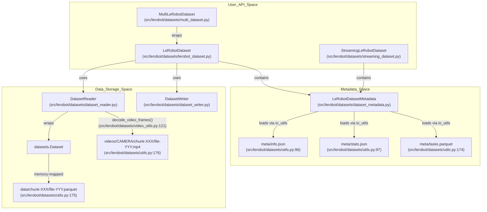
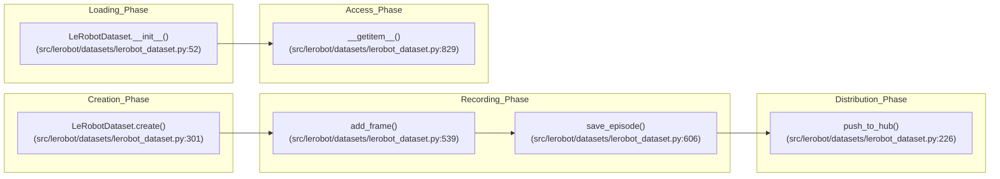

<!-- source: DeepWiki mcp.deepwiki.com · repo huggingface/lerobot · page 2 LeRobotDataset · fetched 2026-10-26 -->

# LeRobotDataset

Relevant source files

The following files were used as context for generating this wiki page:

- [src/lerobot/configs/default.py](src/lerobot/configs/default.py)
- [src/lerobot/datasets/dataset_metadata.py](src/lerobot/datasets/dataset_metadata.py)
- [src/lerobot/datasets/dataset_reader.py](src/lerobot/datasets/dataset_reader.py)
- [src/lerobot/datasets/factory.py](src/lerobot/datasets/factory.py)
- [src/lerobot/datasets/lerobot_dataset.py](src/lerobot/datasets/lerobot_dataset.py)
- [src/lerobot/datasets/streaming_dataset.py](src/lerobot/datasets/streaming_dataset.py)
- [src/lerobot/datasets/utils.py](src/lerobot/datasets/utils.py)
- [src/lerobot/datasets/video_utils.py](src/lerobot/datasets/video_utils.py)
- [tests/configs/test_default.py](tests/configs/test_default.py)
- [tests/datasets/test_dataset_utils.py](tests/datasets/test_dataset_utils.py)
- [tests/datasets/test_datasets.py](tests/datasets/test_datasets.py)
- [tests/datasets/test_streaming.py](tests/datasets/test_streaming.py)

`LeRobotDataset` is the standardized data format and access framework for robotic datasets in LeRobot [src/lerobot/datasets/lerobot_dataset.py:52-77](). It solves the data fragmentation problem in robotics by providing a unified, memory-efficient format that enables seamless sharing, streaming, and reuse of robot demonstration data across the community.

## Design Goals

The LeRobotDataset format was designed with these key principles:

| Goal | Implementation |
|------|---------------|
| **Standardization** | Single format works across all robot types and tasks |
| **Efficiency** | Memory-mapped Parquet + compressed MP4 for minimal RAM usage |
| **Scalability** | Chunked file structure handles datasets with millions of frames |
| **Shareability** | Native Hugging Face Hub integration for one-line download/upload |
| **Simplicity** | Pure Parquet/JSON/MP4 - no complex database tools required [src/lerobot/datasets/lerobot_dataset.py:156-157]() |
| **Versioning** | Semantic versioning with strict compatibility checks [src/lerobot/datasets/utils.py:66-83]() |

Sources: [src/lerobot/datasets/lerobot_dataset.py:152-157](), [src/lerobot/datasets/utils.py:66-83]()

## Overview and Child Pages

This page introduces the LeRobotDataset system architecture and core concepts at a high level. For detailed technical implementations and specialized workflows, refer to the following child pages:

- **[Dataset Format and Structure](#2.1)**: Detail the file structure (`meta/`, `data/`, `videos/`), metadata files, chunking, versioning, storage backends (`parquet`, `lance`), and language columns.
- **[Creating and Recording Datasets](#2.2)**: Explain how to create datasets, the recording workflow with `lerobot-record`, `DatasetWriter`, episode management, frame buffering, and pushing to the Hub.
- **[Dataset Manipulation Tools](#2.3)**: Document `lerobot-edit-dataset` and `dataset_tools`: `delete_episodes`, split, merge, `modify_features/tasks`, plus the language and recipe system.
- **[Video Processing](#2.4)**: Explain video encoding/decoding: streaming vs batch encoding, `VideoEncoderCache`, codecs, `VideoEncoderConfig`, and benchmarks.
- **[Temporal Queries and Delta Timestamps](#2.5)**: Describe how `delta_timestamps` enable querying observations/actions at relative offsets, the tolerance mechanism, samplers, and use in training.
- **[Dataset Aggregation](#2.6)**: Explain `aggregate_datasets`: metadata validation, file consolidation, index remapping, stats computation.
- **[Steerable Annotation Pipeline](#2.7)**: Document `lerobot-annotate` and the steerable VLM-based annotation pipeline: phases, configs, staging JSONL format, distributed HF Jobs execution, and SARM subtask annotation.
- **[Streaming Datasets](#2.8)**: Document `StreamingLeRobotDataset` and the `src/lerobot/streaming` package: episode caching, parquet readers, worker sharding, and training on streamed data from the Hub.

Sources: [src/lerobot/datasets/lerobot_dataset.py:46-108]()

## Core Architecture

The LeRobotDataset ecosystem connects user-facing dataset classes (`LeRobotDataset`, `StreamingLeRobotDataset`, `MultiLeRobotDataset`) with underlying storage mechanisms via metadata and readers [src/lerobot/datasets/lerobot_dataset.py:52-77](), [src/lerobot/datasets/streaming_dataset.py:169-172]().

Diagram: LeRobotDataset Component Architecture (Natural Language to Code Entity Space)

Sources: [src/lerobot/datasets/lerobot_dataset.py:46-101](), [src/lerobot/datasets/dataset_metadata.py:63-149](), [src/lerobot/datasets/streaming_dataset.py:169-172](), [src/lerobot/datasets/dataset_reader.py:109-126](), [src/lerobot/datasets/utils.py:96-97](), [src/lerobot/datasets/utils.py:174-176](), [src/lerobot/datasets/video_utils.py:121]()

### LeRobotDataset Lifecycle and Methods

The `LeRobotDataset` class handles data loading, recording, and indexing across distinct operational phases [src/lerobot/datasets/lerobot_dataset.py:52-77]().

Diagram: LeRobotDataset Lifecycle Methods (Natural Language to Code Entity Space)

| Method / Class | Location | Purpose |
|----------------|----------|---------|
| `LeRobotDataset.create()` | [src/lerobot/datasets/lerobot_dataset.py:301]() | Create new empty dataset for recording or porting |
| `LeRobotDataset.add_frame()` | [src/lerobot/datasets/lerobot_dataset.py:539]() | Buffer a single timestep observation/action |
| `LeRobotDataset.save_episode()` | [src/lerobot/datasets/lerobot_dataset.py:606]() | Finalize episode, encode videos, and write to disk |
| `LeRobotDataset.__init__()` | [src/lerobot/datasets/lerobot_dataset.py:52]() | Load existing dataset from local root or Hub |
| `LeRobotDataset.__getitem__()` | [src/lerobot/datasets/lerobot_dataset.py:829]() | Access frames with video decoding and transforms |
| `LeRobotDataset.push_to_hub()` | [src/lerobot/datasets/lerobot_dataset.py:226]() | Upload dataset and metadata to Hugging Face Hub |

Sources: [src/lerobot/datasets/lerobot_dataset.py:46-913]()

## File Structure and Storage Format

LeRobotDataset v3.0 employs a decoupled, file-based architecture separating relational metadata, tabular sensorimotor data (Apache Parquet), and visual recordings (MP4) [src/lerobot/datasets/lerobot_dataset.py:102-150]().

For full details on file organization, chunking strategies, and storage backends like Lance, see [Dataset Format and Structure](#2.1).

Sources: [src/lerobot/datasets/lerobot_dataset.py:102-150]()

## Version Compatibility

LeRobotDataset enforces strict codebase versioning via `meta/info.json` [src/lerobot/datasets/dataset_metadata.py:166]() and compatibility checks [src/lerobot/datasets/utils.py:66-83](). Loading v2.1 datasets triggers backward compatibility errors prompting automated migration to v3.0 [src/lerobot/datasets/utils.py:33-47]().

For migration scripts and compatibility rules, see [Dataset Format and Structure](#2.1).

Sources: [src/lerobot/datasets/dataset_metadata.py:166](), [src/lerobot/datasets/utils.py:33-83]()

## Hugging Face Hub Integration

LeRobotDataset integrates natively with the Hugging Face Hub for remote storage, version control, and streaming:
- **Downloads**: Handled transparently through `snapshot_download` during initialization [src/lerobot/datasets/lerobot_dataset.py:24-25]() when `repo_id` is specified.
- **Uploads**: `push_to_hub()` publishes datasets, generated README dataset cards, and tags [src/lerobot/datasets/lerobot_dataset.py:226-271]().
- **Streaming**: `StreamingLeRobotDataset` enables memory-efficient iteration directly from the Hub or HF Storage Buckets (`hf://buckets/`) without local downloads [src/lerobot/datasets/streaming_dataset.py:169-172]().

For advanced hub operations, see [Hugging Face Hub Integration](#9.1).

Sources: [src/lerobot/datasets/lerobot_dataset.py:24-25](), [src/lerobot/datasets/lerobot_dataset.py:226-271](), [src/lerobot/datasets/streaming_dataset.py:169-172]()

---

