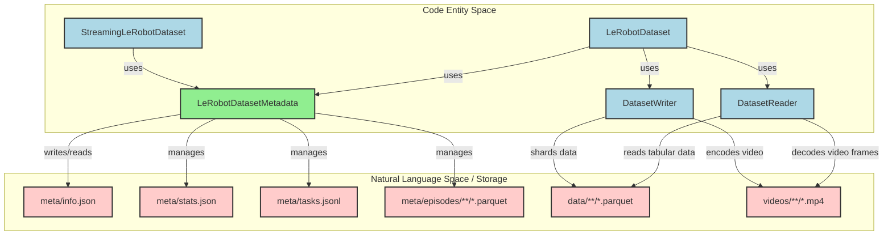
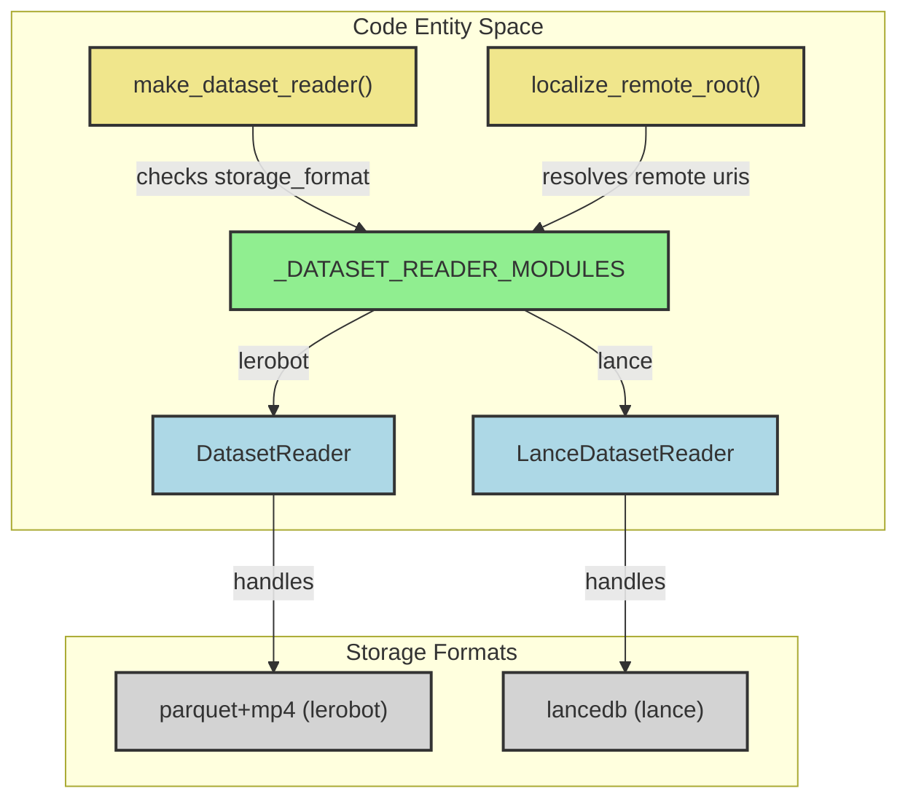
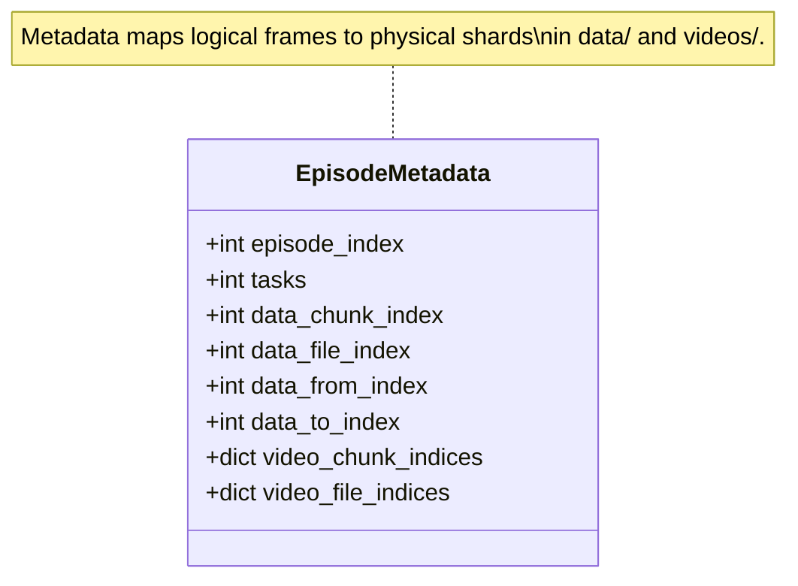

<!-- source: DeepWiki mcp.deepwiki.com · repo huggingface/lerobot · page 2.1 Dataset Format and Structure · fetched 2026-10-26 -->

# Dataset Format and Structure

<details>
<summary>Relevant source files</summary>

The following files were used as context for generating this wiki page:

- [docs/source/lerobot-dataset-v3.mdx](docs/source/lerobot-dataset-v3.mdx)
- [src/lerobot/datasets/__init__.py](src/lerobot/datasets/__init__.py)
- [src/lerobot/datasets/lance_backend.py](src/lerobot/datasets/lance_backend.py)
- [src/lerobot/datasets/lance_utils.py](src/lerobot/datasets/lance_utils.py)
- [src/lerobot/datasets/multi_dataset.py](src/lerobot/datasets/multi_dataset.py)
- [src/lerobot/datasets/storage.py](src/lerobot/datasets/storage.py)
- [src/lerobot/processor/__init__.py](src/lerobot/processor/__init__.py)
- [src/lerobot/processor/image_augmentation_processor.py](src/lerobot/processor/image_augmentation_processor.py)
- [src/lerobot/scripts/lerobot_imgtransform_viz.py](src/lerobot/scripts/lerobot_imgtransform_viz.py)
- [src/lerobot/transforms/__init__.py](src/lerobot/transforms/__init__.py)
- [src/lerobot/transforms/deprecated.py](src/lerobot/transforms/deprecated.py)
- [src/lerobot/transforms/transforms.py](src/lerobot/transforms/transforms.py)
- [tests/artifacts/image_transforms/default_transforms.safetensors](tests/artifacts/image_transforms/default_transforms.safetensors)
- [tests/artifacts/image_transforms/save_image_transforms_to_safetensors.py](tests/artifacts/image_transforms/save_image_transforms_to_safetensors.py)
- [tests/datasets/test_dataset_metadata.py](tests/datasets/test_dataset_metadata.py)
- [tests/datasets/test_dataset_reader.py](tests/datasets/test_dataset_reader.py)
- [tests/datasets/test_image_transforms.py](tests/datasets/test_image_transforms.py)
- [tests/datasets/test_lance_backend.py](tests/datasets/test_lance_backend.py)
- [tests/datasets/test_language.py](tests/datasets/test_language.py)
- [tests/datasets/test_lerobot_dataset.py](tests/datasets/test_lerobot_dataset.py)

</details>


`LeRobotDataset` (v3.0) is a standardized, high-performance format for robot learning data. It provides unified access to multi-modal time-series data, sensorimotor signals, and multi-camera video, while maintaining a clean directory layout optimized for both local training and cloud-native streaming from the Hugging Face Hub.

**Scope**: This page details the physical storage layout, metadata schema, storage backends (Parquet and Lance), language columns, chunking, and versioning implementation details. For recording workflows, see [Creating and Recording Datasets](#2.2). For temporal window queries, see [Temporal Queries and Delta Timestamps](#2.5).

Sources: [docs/source/lerobot-dataset-v3.mdx:1-3](), [src/lerobot/datasets/dataset_metadata.py:64-70](), [src/lerobot/datasets/storage.py:27-50]()

## Directory Structure Overview

A `LeRobotDataset` decouples logical episode boundaries from physical storage. Many episodes are concatenated into large files to minimize file-system pressure and overhead during initialization.

### Directory Tree

```text
dataset_root/
├── meta/
│   ├── info.json                      # Canonical schema and path templates
│   ├── stats.json                     # Global normalization statistics
│   ├── tasks.jsonl                    # Natural language task mappings
│   └── episodes/                      # Episode-level segmentation metadata
│       ├── chunk-000/
│       │   ├── file-000.parquet       
│       │   └── ...
├── data/                              # Sensorimotor signals (states, actions, etc.)
│   ├── chunk-000/
│   │   ├── file-000.parquet           # Multi-episode Parquet shards
│   │   └── ...
└── videos/                            # Camera streams (encoded MP4)
    ├── observation.images.top/
    │   ├── chunk-000/
    │   │   ├── file-000.mp4           # Multi-episode video shards
    │   │   └── ...
```

Sources: [docs/source/lerobot-dataset-v3.mdx:81-88]()

## Implementation: Metadata and I/O Flow

The `LeRobotDatasetMetadata` class acts as the central orchestrator for reading and writing the dataset structure, managing `info.json`, `stats.json`, `tasks.jsonl`, and `episodes/` parquet files.

### Data Flow and Code Entity Mapping


Sources: [docs/source/lerobot-dataset-v3.mdx:60-65](), [src/lerobot/datasets/dataset_metadata.py:64-149](), [src/lerobot/datasets/streaming_dataset.py:96-107]()

## Storage Backends

LeRobot supports extensible storage backends via the `storage.py` abstraction layer [src/lerobot/datasets/storage.py:27-46](). The default backend uses Parquet for tabular data and MP4 for videos, but alternative backends such as Lance are fully integrated [src/lerobot/datasets/storage.py:48]() [tests/datasets/test_lance_backend.py:41-97]().

### Storage Backend Architecture


*   **Default (`lerobot`)**: Utilizes Apache Arrow / Parquet for tabular sensorimotor frames and PyAV for MP4 video container streaming [src/lerobot/datasets/storage.py:27-72]().
*   **Lance (`lance`)**: Registered via `register_dataset_reader("lance", "lerobot.datasets.lance_backend")` [src/lerobot/datasets/storage.py:56](), providing zero-copy columnar vector search and high-throughput streaming through `LanceDatasetReader` [src/lerobot/datasets/lance_backend.py:97-103]() [tests/datasets/test_lance_backend.py:41-97]().

Sources: [docs/source/lerobot-dataset-v3.mdx:23-24](), [src/lerobot/datasets/storage.py:27-73](), [src/lerobot/datasets/lance_backend.py:97-103](), [tests/datasets/test_lance_backend.py:41-97]()

## Metadata Specification

### info.json
This file defines the canonical schema, captured in the `DatasetInfo` dataclass. It contains information about shapes, keys, capture frequency, and path templates [docs/source/lerobot-dataset-v3.mdx:83]().

| Field | Code Symbol | Description |
|-------|-------------|-------------|
| `codebase_version` | `CODEBASE_VERSION` | Versioning for compatibility checks (v3.0) [src/lerobot/datasets/dataset_metadata.py:61]() |
| `features` | `DatasetInfo.features` | Dict of feature names to dtypes and shapes [src/lerobot/datasets/dataset_metadata.py:64-70]() |
| `fps` | `DatasetInfo.fps` | Control/Capture frequency [src/lerobot/datasets/dataset_metadata.py:64-70]() |
| `data_path` | `DatasetInfo.data_path` | Template for data shard locations [src/lerobot/datasets/dataset_metadata.py:64-70]()

Sources: [docs/source/lerobot-dataset-v3.mdx:83](), [src/lerobot/datasets/dataset_metadata.py:61-70]()

### stats.json
Stores global statistics (min, max, mean, std) for every feature [docs/source/lerobot-dataset-v3.mdx:84](). These are used for normalization during policy training. Statistics can be computed and updated incrementally using `aggregate_stats` [src/lerobot/datasets/compute_stats.py:24-36]().

Sources: [docs/source/lerobot-dataset-v3.mdx:84](), [src/lerobot/datasets/compute_stats.py:24-36]()

## Data and Video Storage Implementation

### Relational Metadata (`episodes/` shards)
Episode boundaries and lookups are resolved through metadata, not filenames. The `_flush_metadata_buffer` method in `LeRobotDatasetMetadata` persists these records to chunked Parquet files under `meta/episodes/` [src/lerobot/datasets/dataset_metadata.py:151-175]().

### Episode Segmentation Logic


Sources: [docs/source/lerobot-dataset-v3.mdx:66-67](), [src/lerobot/datasets/dataset_metadata.py:151-175]()

## Language Support

LeRobot supports multimodal annotations through standardized language columns defined in `LANGUAGE_COLUMNS` [src/lerobot/datasets/language.py:20]():

1.  **`language_persistent`**: Global instructions that remain constant throughout an episode (e.g., "Pick up the black cube").
2.  **`language_events`**: Time-varying instructions or subtask labels that change frame-by-frame (e.g., "Move toward the cube", "Grasp the cube").

These columns are validated during dataset loading to ensure consistency with metadata [tests/datasets/test_dataset_reader.py:89-92]().

Sources: [src/lerobot/datasets/language.py:20](), [tests/datasets/test_dataset_reader.py:31](), [tests/datasets/test_dataset_reader.py:89-92]()

## Chunking and Versioning

### Chunking Strategy
To maintain performance at scale, `LeRobotDataset` groups files into chunks and shards based on target sizes:
*   **`DEFAULT_CHUNK_SIZE`**: Max number of files per chunk directory (1000) [src/lerobot/datasets/utils.py:89]().
*   **`DEFAULT_DATA_FILE_SIZE_IN_MB`**: Max size per Parquet data file (100 MB) [src/lerobot/datasets/utils.py:90]().
*   **`DEFAULT_VIDEO_FILE_SIZE_IN_MB`**: Max size per MP4 video file (200 MB) [src/lerobot/datasets/utils.py:91]().

Sources: [src/lerobot/datasets/utils.py:89-91]()

### Versioning and Compatibility
The codebase version is tracked via `CODEBASE_VERSION = "v3.0"` [src/lerobot/datasets/dataset_metadata.py:61]().
*   **Compatibility Checks**: `check_version_compatibility` ensures the dataset format matches the codebase expectations [src/lerobot/datasets/utils.py:53]().

Sources: [src/lerobot/datasets/dataset_metadata.py:61](), [src/lerobot/datasets/utils.py:53-58]()

## Streaming Support
The `StreamingLeRobotDataset` class allows consuming datasets directly from the Hub or HF Storage Buckets (`repo_type="bucket"`) without full local downloads [docs/source/lerobot-dataset-v3.mdx:137-142]().

### Backtrackable Iterator
It uses a `Backtrackable` wrapper to allow stepping back (`peek_back`) or looking ahead (`peek_ahead`) in the stream, which is critical for temporal queries in streaming mode [src/lerobot/datasets/streaming_dataset.py:66-96]().

Sources: [docs/source/lerobot-dataset-v3.mdx:137-142](), [src/lerobot/datasets/streaming_dataset.py:27-107]()

---

