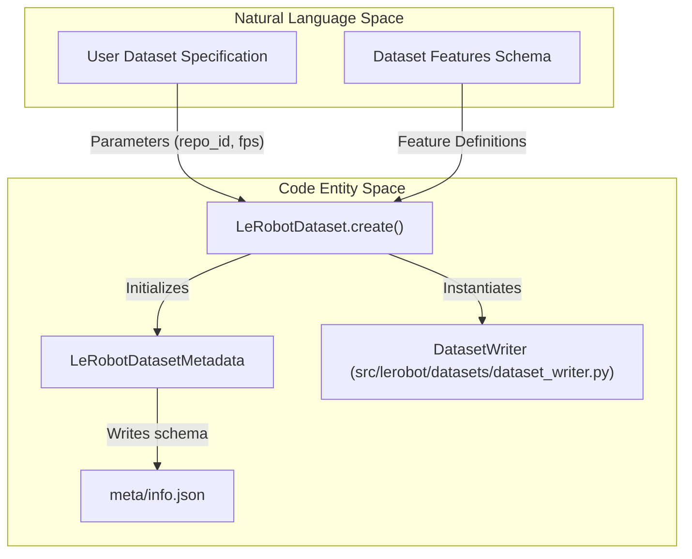
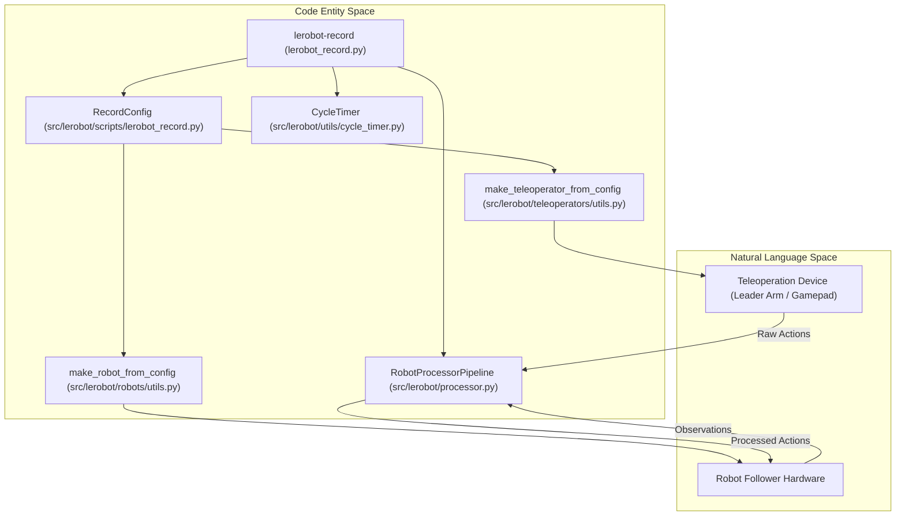
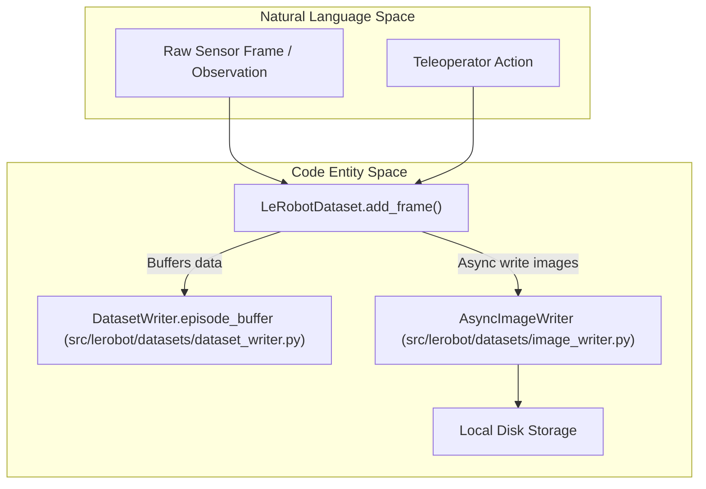

<!-- source: DeepWiki mcp.deepwiki.com · repo huggingface/lerobot · page 2.2 Creating and Recording Datasets · fetched 2026-10-26 -->

# Creating and Recording Datasets

Relevant source files

The following files were used as context for generating this wiki page:

- [docs/source/using_dataset_tools.mdx](docs/source/using_dataset_tools.mdx)
- [examples/dataset/use_dataset_tools.py](examples/dataset/use_dataset_tools.py)
- [src/lerobot/datasets/dataset_tools.py](src/lerobot/datasets/dataset_tools.py)
- [src/lerobot/datasets/dataset_writer.py](src/lerobot/datasets/dataset_writer.py)
- [src/lerobot/datasets/io_utils.py](src/lerobot/datasets/io_utils.py)
- [src/lerobot/robots/utils.py](src/lerobot/robots/utils.py)
- [src/lerobot/scripts/lerobot_calibrate.py](src/lerobot/scripts/lerobot_calibrate.py)
- [src/lerobot/scripts/lerobot_edit_dataset.py](src/lerobot/scripts/lerobot_edit_dataset.py)
- [src/lerobot/scripts/lerobot_find_joint_limits.py](src/lerobot/scripts/lerobot_find_joint_limits.py)
- [src/lerobot/scripts/lerobot_record.py](src/lerobot/scripts/lerobot_record.py)
- [src/lerobot/scripts/lerobot_replay.py](src/lerobot/scripts/lerobot_replay.py)
- [src/lerobot/scripts/lerobot_setup_motors.py](src/lerobot/scripts/lerobot_setup_motors.py)
- [src/lerobot/scripts/lerobot_teleoperate.py](src/lerobot/scripts/lerobot_teleoperate.py)
- [src/lerobot/teleoperators/utils.py](src/lerobot/teleoperators/utils.py)
- [tests/datasets/test_dataset_tools.py](tests/datasets/test_dataset_tools.py)
- [tests/datasets/test_dataset_writer.py](tests/datasets/test_dataset_writer.py)
- [tests/scripts/test_edit_dataset_parsing.py](tests/scripts/test_edit_dataset_parsing.py)
- [tests/scripts/test_setup_motors.py](tests/scripts/test_setup_motors.py)

This page explains how to create new `LeRobotDataset` instances, record robot demonstration data using the `lerobot-record` CLI, manage episode buffers via `DatasetWriter`, handle asynchronous frame and video processing, and publish completed datasets to the Hugging Face Hub [src/lerobot/scripts/lerobot_record.py:16-42](), [src/lerobot/datasets/dataset_writer.py:16-106]().

---

## Dataset Initialization and Creation

To start a new dataset for recording, use `LeRobotDataset.create()` [tests/datasets/test_dataset_writer.py:112-114](). This method initializes the local directory layout, including metadata files (`meta/info.json`, `meta/episodes.jsonl`, `meta/tasks.jsonl`), data directories (`data/`), and video or image folders (`videos/`) [src/lerobot/datasets/dataset_writer.py:118-154]().

**Dataset Creation Architecture**

**Sources:** [src/lerobot/datasets/dataset_writer.py:108-154](), [tests/datasets/test_dataset_writer.py:112-114]()

---

## Recording Workflow with `lerobot-record`

The `lerobot-record` script is the primary tool for capturing robot demonstrations via teleoperation [src/lerobot/scripts/lerobot_record.py:16-18](). It parses command-line arguments using `RecordConfig` [src/lerobot/scripts/lerobot_record.py:171-192](), connects to hardware devices through `make_robot_from_config` [src/lerobot/robots/utils.py:27-90]() and `make_teleoperator_from_config` [src/lerobot/teleoperators/utils.py:36-118](), and runs a timed control loop.

The `lerobot-record` script supports various configurations for robots, teleoperators, and dataset parameters. For example, it can be used with bimanual robots and custom video encoding settings [src/lerobot/scripts/lerobot_record.py:45-68](), [src/lerobot/scripts/lerobot_record.py:71-89]().

**Recording System Architecture**

**Sources:** [src/lerobot/scripts/lerobot_record.py:171-192](), [src/lerobot/robots/utils.py:27-90](), [src/lerobot/teleoperators/utils.py:36-118](), [src/lerobot/scripts/lerobot_record.py:45-68](), [src/lerobot/scripts/lerobot_record.py:71-89]()

---

## DatasetWriter and Frame Buffering

The `DatasetWriter` class manages write-side state, accumulating recorded frames into an in-memory `episode_buffer` before flushing them to disk [src/lerobot/datasets/dataset_writer.py:101-155]().

When `add_frame()` is invoked, the frame is validated against the defined dataset schema [tests/datasets/test_dataset_writer.py:110-123](). Image observations are offloaded to an `AsyncImageWriter` to prevent blocking the main control loop during disk I/O operations [src/lerobot/datasets/dataset_writer.py:147]().

**Frame Buffering Data Flow**

**Sources:** [src/lerobot/datasets/dataset_writer.py:101-155](), [tests/datasets/test_dataset_writer.py:110-123]()

---

## Episode Management and Video Encoding

Once an episode concludes, `save_episode()` finalizes the buffer [tests/datasets/test_dataset_writer.py:137-148]().

1.  **Statistics Computation**: `compute_episode_stats()` calculates min, max, mean, and standard deviation for normalization [src/lerobot/datasets/dataset_writer.py:43]().
2.  **Video Encoding**: `_encode_video_worker()` or `StreamingVideoEncoder` compresses image sequences into MP4 files using encoders configured via `VideoEncoderConfig` [src/lerobot/datasets/dataset_writer.py:73-99](), [tests/datasets/test_dataset_writer.py:56-83]().
3.  **Parquet Serialization**: Non-image features are serialized into Apache Parquet files using PyArrow `ParquetWriter` [src/lerobot/datasets/dataset_writer.py:31](), [src/lerobot/datasets/dataset_writer.py:149]().

**Sources:** [src/lerobot/datasets/dataset_writer.py:31-99](), [tests/datasets/test_dataset_writer.py:56-148]()

---

## Hub Integration and Publishing

After recording and validating local episodes, datasets can be uploaded directly to the Hugging Face Hub using `push_to_hub()` [src/lerobot/datasets/lerobot_dataset.py:796-849](). This step creates remote repositories, generates descriptive model/dataset cards, uploads metadata and chunked data artifacts, and applies codebase version tags.

**Sources:** [src/lerobot/datasets/lerobot_dataset.py:796-849]()

---

