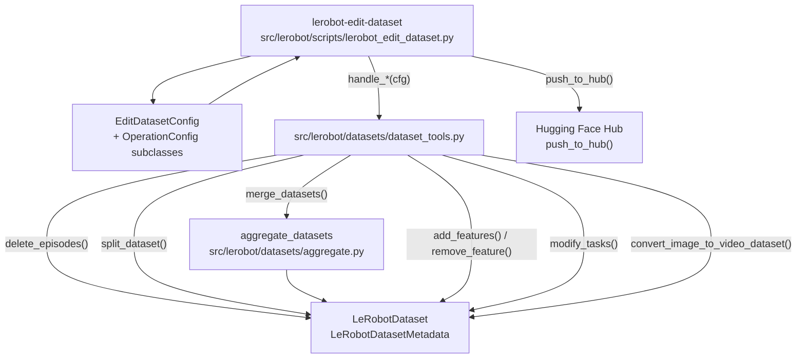
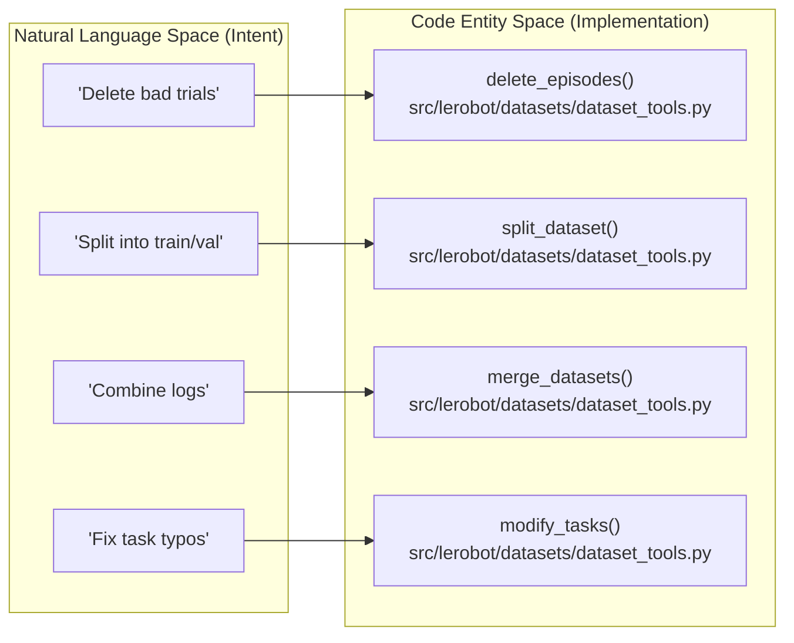
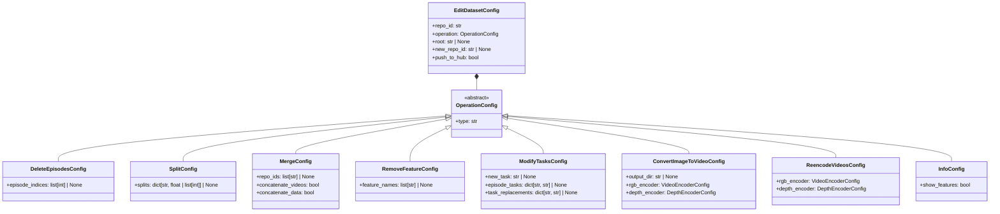
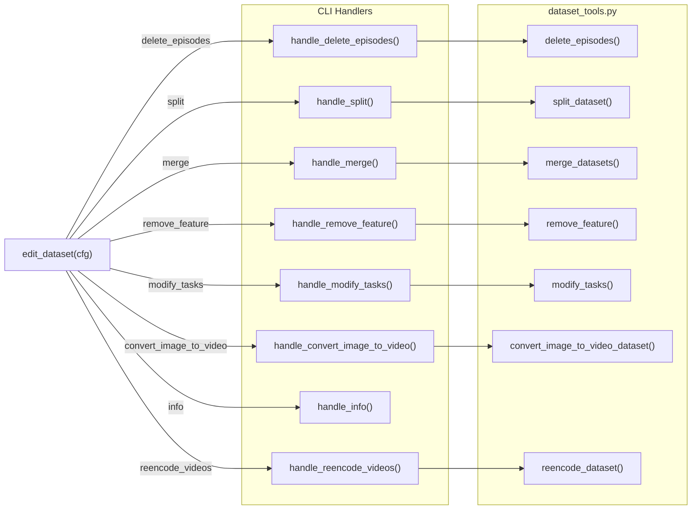
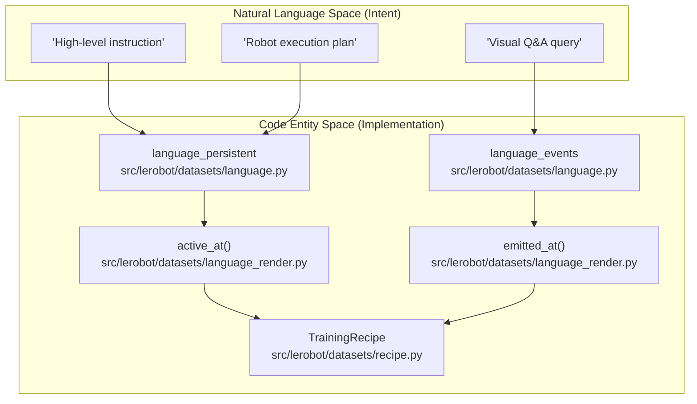

<!-- source: DeepWiki mcp.deepwiki.com · repo huggingface/lerobot · page 2.3 Dataset Manipulation Tools · fetched 2026-10-26 -->

# Dataset Manipulation Tools

<details>
<summary>Relevant source files</summary>

The following files were used as context for generating this wiki page:

- [docs/source/fineart_vla.mdx](docs/source/fineart_vla.mdx)
- [docs/source/language_and_recipes.mdx](docs/source/language_and_recipes.mdx)
- [docs/source/policy_fineart_vla_README.md](docs/source/policy_fineart_vla_README.md)
- [docs/source/using_dataset_tools.mdx](docs/source/using_dataset_tools.mdx)
- [examples/dataset/use_dataset_tools.py](examples/dataset/use_dataset_tools.py)
- [src/lerobot/configs/recipes/subtask_joint.yaml](src/lerobot/configs/recipes/subtask_joint.yaml)
- [src/lerobot/datasets/dataset_tools.py](src/lerobot/datasets/dataset_tools.py)
- [src/lerobot/datasets/dataset_writer.py](src/lerobot/datasets/dataset_writer.py)
- [src/lerobot/datasets/io_utils.py](src/lerobot/datasets/io_utils.py)
- [src/lerobot/datasets/language_render.py](src/lerobot/datasets/language_render.py)
- [src/lerobot/policies/fineart_vla/README.md](src/lerobot/policies/fineart_vla/README.md)
- [src/lerobot/policies/fineart_vla/__init__.py](src/lerobot/policies/fineart_vla/__init__.py)
- [src/lerobot/scripts/lerobot_edit_dataset.py](src/lerobot/scripts/lerobot_edit_dataset.py)
- [tests/datasets/test_dataset_tools.py](tests/datasets/test_dataset_tools.py)
- [tests/datasets/test_dataset_writer.py](tests/datasets/test_dataset_writer.py)
- [tests/datasets/test_language_render.py](tests/datasets/test_language_render.py)
- [tests/datasets/test_recipe.py](tests/datasets/test_recipe.py)
- [tests/processor/test_render_messages_processor.py](tests/processor/test_render_messages_processor.py)
- [tests/scripts/test_edit_dataset_parsing.py](tests/scripts/test_edit_dataset_parsing.py)
- [tests/utils/test_collate.py](tests/utils/test_collate.py)

</details>


This page documents the tools available for modifying existing `LeRobotDataset` instances after they have been recorded or downloaded. The operations covered include deleting episodes, splitting and merging datasets, adding and removing data features, modifying tasks, reassigning task labels, converting image-based datasets to video format, and managing the language and recipe system.

---

## Architecture Overview

The manipulation system consists of two primary layers: a public Python API implemented in `[src/lerobot/datasets/dataset_tools.py:17-24]()` and a command-line interface front-end in `[src/lerobot/scripts/lerobot_edit_dataset.py:17-25]()`. The CLI parses parameters using `draccus` and delegates directly to the API functions.

**System layers and code entities:**



Sources: [src/lerobot/scripts/lerobot_edit_dataset.py:18-24](), [src/lerobot/datasets/dataset_tools.py:17-24]()

**Natural Language Intent to Code Entity Space Bridge (Editing Operations):**



Sources: [src/lerobot/datasets/dataset_tools.py:107-115](), [src/lerobot/datasets/dataset_tools.py:175-190](), [src/lerobot/datasets/dataset_tools.py:246-260]()

---

## CLI: `lerobot-edit-dataset`

The command-line tool `[src/lerobot/scripts/lerobot_edit_dataset.py:17-25]()` is configured via a two-level dataclass hierarchy. `EditDatasetConfig` holds top-level parameters and an `operation` field that is a polymorphic `OperationConfig` subclass `[tests/scripts/test_edit_dataset_parsing.py:22-34]()`.

**Config class hierarchy:**



Sources: [src/lerobot/scripts/lerobot_edit_dataset.py:198-333](), [tests/scripts/test_edit_dataset_parsing.py:22-33]()

### Top-level parameters

| Parameter | Type | Description |
|-----------|------|-------------|
| `--repo_id` | `str` | Source dataset repository ID (e.g., `lerobot/pusht`) `[src/lerobot/scripts/lerobot_edit_dataset.py:33-33]()` |
| `--new_repo_id` | `str` | Output repository ID. If omitted, modifies in-place or defaults depending on operation `[src/lerobot/scripts/lerobot_edit_dataset.py:24-27]()` |
| `--root` | `str` | Local root path override for dataset storage `[src/lerobot/scripts/lerobot_edit_dataset.py:26-27]()` |
| `--push_to_hub` | `bool` | Upload the result to the Hugging Face Hub after the operation `[src/lerobot/scripts/lerobot_edit_dataset.py:162-162]()` |
| `--operation.type` | `str` | Selects which `OperationConfig` subclass to instantiate `[tests/scripts/test_edit_dataset_parsing.py:45-56]()` |

Sources: [src/lerobot/scripts/lerobot_edit_dataset.py:198-352](), [tests/scripts/test_edit_dataset_parsing.py:45-56]()

### Operation dispatch

The CLI script reads `cfg.operation.type` and delegates execution to the corresponding handler function `[src/lerobot/scripts/lerobot_edit_dataset.py:502-528]()`.



Sources: [src/lerobot/scripts/lerobot_edit_dataset.py:502-528](), [src/lerobot/datasets/dataset_tools.py:17-24]()

---

## API Reference: `dataset_tools.py`

Public functions in `[src/lerobot/datasets/dataset_tools.py:17-24]()` return a new `LeRobotDataset` instance (or a dictionary of datasets in the case of `split_dataset`), preserving immutability except where explicitly noted for `modify_tasks()`.

### `delete_episodes()`

Removes specified episodes and constructs a new dataset with re-indexed episode identifiers starting from 0 `[src/lerobot/datasets/dataset_tools.py:107-172]()`.

```python
def delete_episodes(
    dataset: LeRobotDataset,
    episode_indices: list[int],
    output_dir: str | Path | None = None,
    repo_id: str | None = None,
) -> LeRobotDataset
```

- Raises `ValueError` if `episode_indices` is empty or invalid `[src/lerobot/datasets/dataset_tools.py:126-132]()`.
- Handles video re-indexing and parquet data reconstruction `[src/lerobot/datasets/dataset_tools.py:155-161]()`.

Sources: [src/lerobot/datasets/dataset_tools.py:107-172]()

### `split_dataset()`

Divides a dataset into multiple subsets based on fractions or explicit index lists `[src/lerobot/datasets/dataset_tools.py:175-243]()`.

```python
def split_dataset(
    dataset: LeRobotDataset,
    splits: dict[str, float | list[int]],
    output_dir: str | Path | None = None,
) -> dict[str, LeRobotDataset]
```

Sources: [src/lerobot/datasets/dataset_tools.py:175-243]()

### `merge_datasets()`

Combines multiple `LeRobotDataset` instances into a single dataset, wrapping underlying aggregation logic `[src/lerobot/datasets/dataset_tools.py:246-283]()`.

```python
def merge_datasets(
    datasets: list[LeRobotDataset],
    output_repo_id: str,
    output_dir: str | Path | None = None,
) -> LeRobotDataset
```

Sources: [src/lerobot/datasets/dataset_tools.py:246-283]()

### `modify_features()` / `add_features()` / `remove_feature()`

Manipulates schema attributes and columns across dataset frames `[docs/source/using_dataset_tools.mdx:12-13]()`. `remove_feature` drops specified columns, while `add_features` or `modify_features` injects new feature arrays or computed callables `[examples/dataset/use_dataset_tools.py:69-103]()`.

Sources: [examples/dataset/use_dataset_tools.py:69-103](), [docs/source/using_dataset_tools.mdx:12-13]()

### `modify_tasks()`

Modifies natural-language task descriptions associated with episodes **in-place** `[docs/source/using_dataset_tools.mdx:97-99]()`.

- Supports `new_task`, `episode_tasks`, and `task_replacements` `[docs/source/using_dataset_tools.mdx:128-132]()`.
- Precedence order: `episode_tasks` > `task_replacements` > `new_task` > original task `[docs/source/using_dataset_tools.mdx:134-136]()`.

Sources: [docs/source/using_dataset_tools.mdx:97-139]()

### `convert_image_to_video_dataset()` and `reencode_dataset()`

Converts raw image frames into MP4 compressed video chunks or re-encodes existing video streams using distinct RGB and depth encoders (`RGBEncoderConfig`, `DepthEncoderConfig`) `[src/lerobot/datasets/dataset_tools.py:1189-1436]`, `[tests/scripts/test_edit_dataset_parsing.py:126-167]()`.

Sources: [src/lerobot/datasets/dataset_tools.py:1189-1436](), [tests/scripts/test_edit_dataset_parsing.py:126-167]()

---

## Language and Recipe System

LeRobot supports multi-modal annotations and language-conditioned policies through dedicated optional language columns (`language_persistent`, `language_events`) and a YAML recipe rendering layer `[docs/source/language_and_recipes.mdx:1-10]()`.

### Data Storage and Resolvers
- `language_persistent`: Broadcasts state across frames (e.g., `subtask`, `plan`, `memory`) `[docs/source/language_and_recipes.mdx:33]()`.
- `language_events`: Stores sparse, timestamped events (e.g., `interjection`, `vqa`) `[docs/source/language_and_recipes.mdx:34]()`.
- Resolvers in `[src/lerobot/datasets/language_render.py:36-152]()`: `active_at()`, `emitted_at()`, `nth_prev()`, `nth_next()`.

**Natural Language Intent to Code Entity Space Bridge (Language & Recipes):**



Sources: [docs/source/language_and_recipes.mdx:28-65](), [src/lerobot/datasets/language_render.py:36-113]()

---

## Statistics Handling

Dataset editing operations manage dataset-level statistics stored in `meta/stats.json`:
- `delete_episodes`: Re-aggregates statistics over remaining episodes `[src/lerobot/datasets/dataset_tools.py:898-902]()`.
- `merge_datasets`: Combines statistics from constituent datasets `[src/lerobot/datasets/aggregate.py:29-30]()`.

Sources: [src/lerobot/datasets/dataset_tools.py:898-902](), [src/lerobot/datasets/aggregate.py:29-30]()

---

