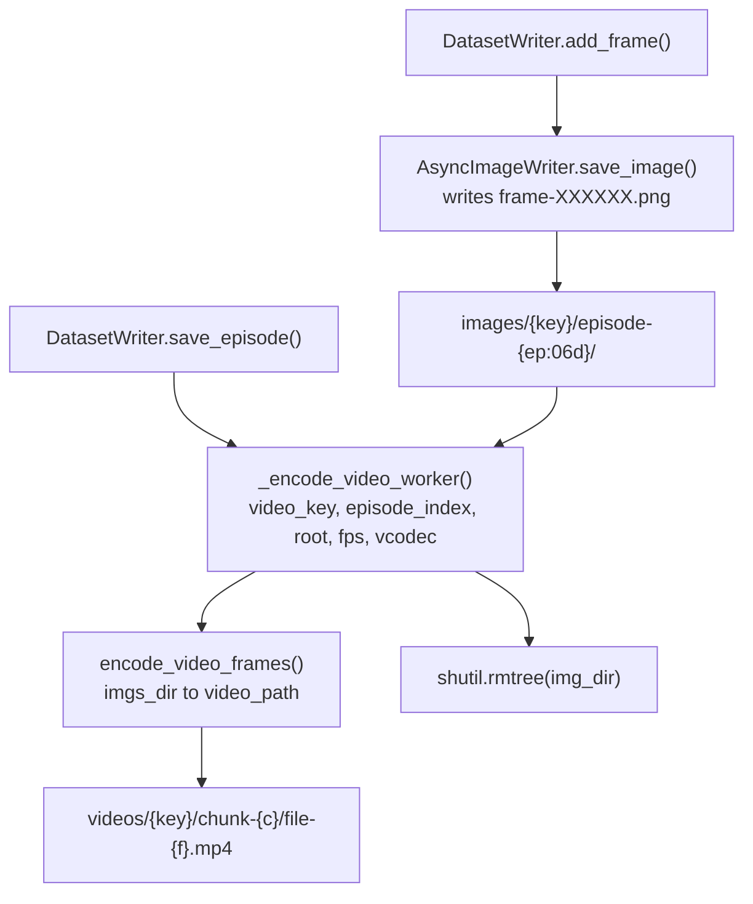
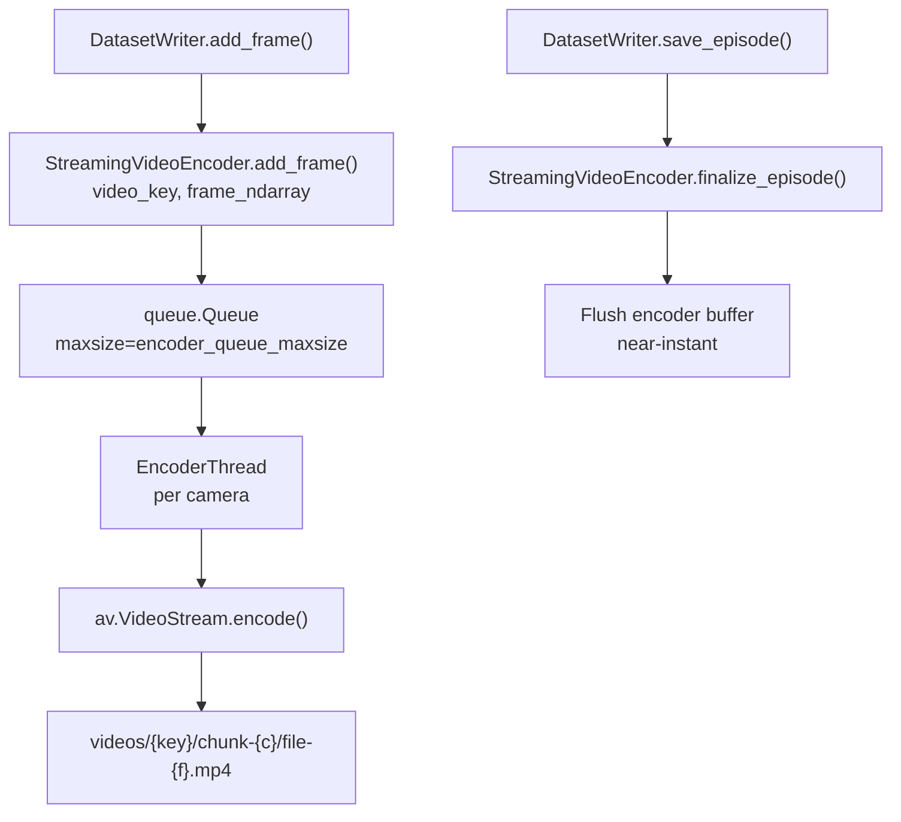
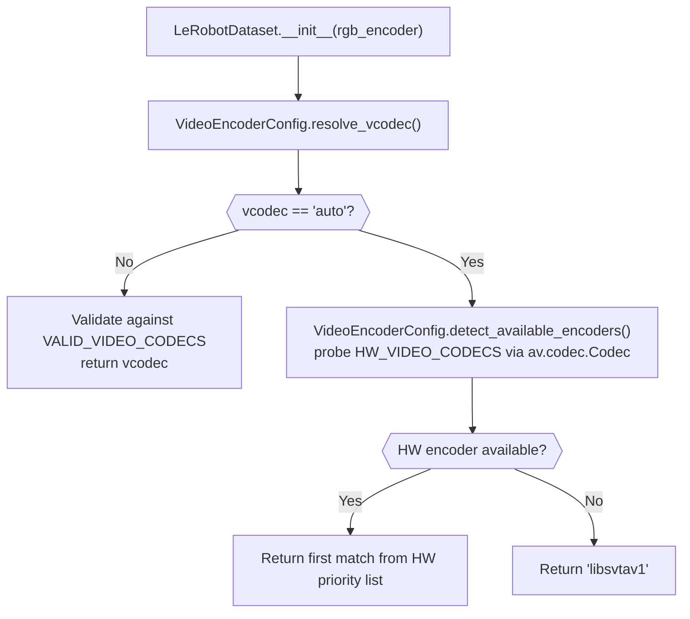
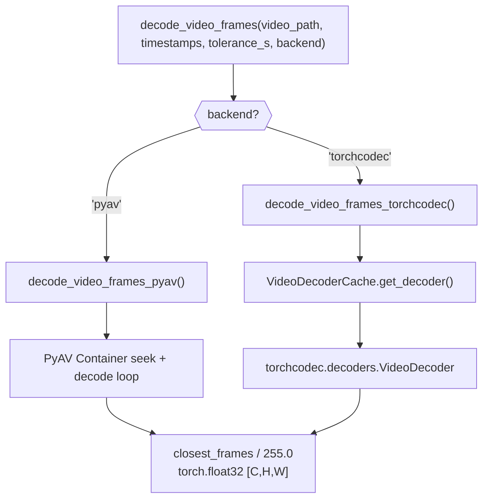
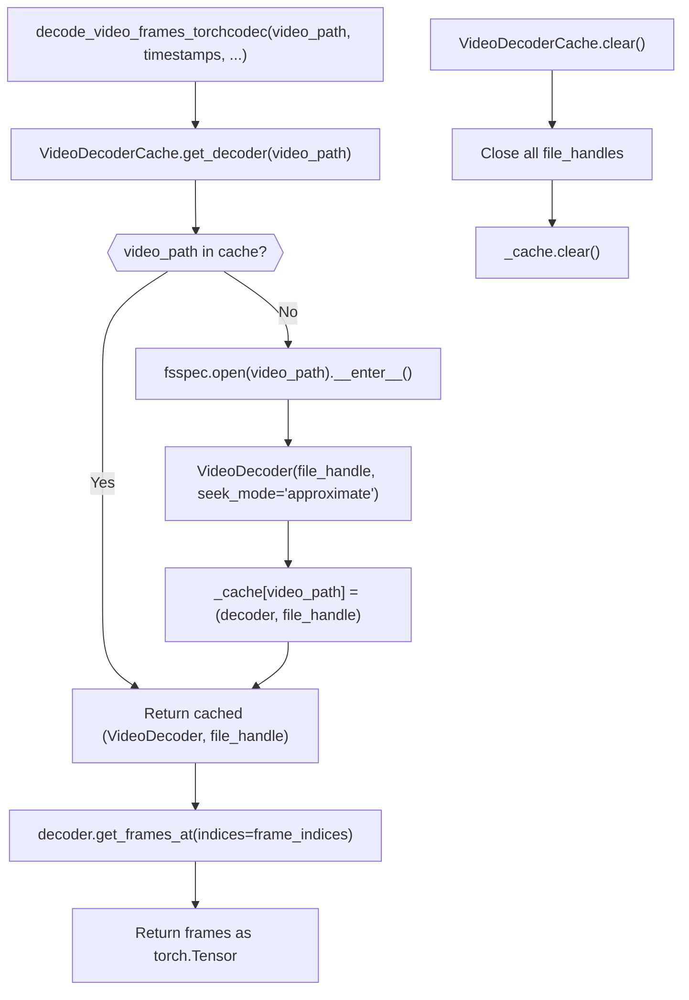
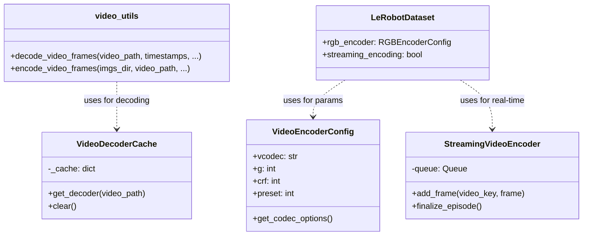

<!-- source: DeepWiki mcp.deepwiki.com · repo huggingface/lerobot · page 2.4 Video Processing · fetched 2026-10-26 -->

# Video Processing

<details>
<summary>Relevant source files</summary>

The following files were used as context for generating this wiki page:

- [src/lerobot/configs/__init__.py](src/lerobot/configs/__init__.py)
- [src/lerobot/configs/default.py](src/lerobot/configs/default.py)
- [src/lerobot/configs/video.py](src/lerobot/configs/video.py)
- [src/lerobot/datasets/aggregate.py](src/lerobot/datasets/aggregate.py)
- [src/lerobot/datasets/compute_stats.py](src/lerobot/datasets/compute_stats.py)
- [src/lerobot/datasets/dataset_metadata.py](src/lerobot/datasets/dataset_metadata.py)
- [src/lerobot/datasets/dataset_reader.py](src/lerobot/datasets/dataset_reader.py)
- [src/lerobot/datasets/depth_utils.py](src/lerobot/datasets/depth_utils.py)
- [src/lerobot/datasets/factory.py](src/lerobot/datasets/factory.py)
- [src/lerobot/datasets/feature_utils.py](src/lerobot/datasets/feature_utils.py)
- [src/lerobot/datasets/image_writer.py](src/lerobot/datasets/image_writer.py)
- [src/lerobot/datasets/lerobot_dataset.py](src/lerobot/datasets/lerobot_dataset.py)
- [src/lerobot/datasets/pipeline_features.py](src/lerobot/datasets/pipeline_features.py)
- [src/lerobot/datasets/streaming_dataset.py](src/lerobot/datasets/streaming_dataset.py)
- [src/lerobot/datasets/utils.py](src/lerobot/datasets/utils.py)
- [src/lerobot/datasets/video_utils.py](src/lerobot/datasets/video_utils.py)
- [tests/configs/test_default.py](tests/configs/test_default.py)
- [tests/datasets/test_aggregate.py](tests/datasets/test_aggregate.py)
- [tests/datasets/test_dataset_utils.py](tests/datasets/test_dataset_utils.py)
- [tests/datasets/test_datasets.py](tests/datasets/test_datasets.py)
- [tests/datasets/test_streaming.py](tests/datasets/test_streaming.py)
- [tests/datasets/test_video_encoding.py](tests/datasets/test_video_encoding.py)
- [tests/fixtures/dataset_factories.py](tests/fixtures/dataset_factories.py)
- [tests/fixtures/hub.py](tests/fixtures/hub.py)

</details>


This page explains video encoding, decoding, storage models, and configuration within `LeRobotDataset`. It covers the distinction between batch and streaming encoding, backend selection (`torchcodec` vs. PyAV), codec management via `VideoEncoderConfig`, and depth map video processing.

---

## Video Storage Model

Camera features with `dtype == "video"` are stored as MP4 files on disk under the `videos/` directory [src/lerobot/datasets/lerobot_dataset.py:134-151](). The Parquet data files store row references mapping individual frame indices to timestamp ranges within the corresponding MP4 files. The custom `VideoFrame` feature type is registered with Hugging Face `datasets` to resolve these references at access time [src/lerobot/datasets/video_utils.py:39-39]().

```
videos/
└── {video_key}/
    └── chunk-{chunk_index:03d}/
        └── file-{file_index:03d}.mp4
```

The canonical path template is defined by `DEFAULT_VIDEO_PATH` [src/lerobot/datasets/utils.py:177-177](). Episode boundaries within multi-episode MP4 files are tracked via timestamp offsets stored in metadata parquet files [src/lerobot/datasets/dataset_metadata.py:161-161]().

Sources: [src/lerobot/datasets/lerobot_dataset.py:134-151](), [src/lerobot/datasets/video_utils.py:39-39](), [src/lerobot/datasets/utils.py:177-177](), [src/lerobot/datasets/dataset_metadata.py:161-161]()

---

## Encoding Architecture

`LeRobotDataset` supports two distinct encoding workflows configured via `streaming_encoding` [src/lerobot/datasets/lerobot_dataset.py:72-72]().

### Mode 1: Batch Encoding (Default)

In batch encoding, frames are saved as raw image files (PNG for RGB, TIFF for depth) into a temporary directory during data collection [src/lerobot/datasets/image_writer.py:100-125](). When `save_episode()` is called, `_encode_video_worker` invokes `encode_video_frames` to compile the image sequence into an MP4 file, subsequently removing the temporary directory [src/lerobot/datasets/dataset_writer.py:185-224]().

Diagram: Batch Encoding Data Flow


Sources: [src/lerobot/datasets/image_writer.py:100-125](), [src/lerobot/datasets/dataset_writer.py:185-224](), [src/lerobot/datasets/video_utils.py:512-613]()

### Mode 2: Streaming Encoding

When `streaming_encoding=True`, a `StreamingVideoEncoder` instance manages a background encoding thread per camera [src/lerobot/datasets/lerobot_dataset.py:72-72](). Frames are pushed into a bounded thread-safe queue (`queue.Queue`) and encoded asynchronously. Episode finalization simply flushes the queue.

Diagram: Streaming Encoding Pipeline


Sources: [src/lerobot/datasets/lerobot_dataset.py:72-72](), [src/lerobot/datasets/video_utils.py:873-1002]()

**Backpressure Handling:** If the encoder thread is slower than frame production, `encoder_queue_maxsize` limits queue growth by dropping oldest frames when full [src/lerobot/datasets/video_utils.py:917-919]().

Sources: [src/lerobot/datasets/video_utils.py:873-1002]()

---

## Codec Selection and Configuration

### VideoEncoderConfig

Parameters such as codec, rate factor (`crf`), GOP size (`g`), and preset are wrapped in `VideoEncoderConfig`, `RGBEncoderConfig`, and `DepthEncoderConfig` [src/lerobot/configs/video.py:86-224]().

| Codec | Category | Description |
|---|---|---|
| `libsvtav1` | Software (Default) | AV1 encoder via SVT-AV1; high compression efficiency [src/lerobot/configs/video.py:47-47](). |
| `h264` | Software | Standard H.264 fallback. |
| `h264_nvenc` | Hardware | NVIDIA hardware-accelerated H.264 [src/lerobot/datasets/video_utils.py:1298](). |
| `hevc_videotoolbox` | Hardware | macOS hardware HEVC encoder [src/lerobot/datasets/video_utils.py:1298](). |

Sources: [src/lerobot/configs/video.py:86-224](), [src/lerobot/datasets/video_utils.py:1298]()

### Codec Resolution Flow

When `vcodec="auto"`, `VideoEncoderConfig.detect_available_encoders()` probes hardware capabilities before defaulting to `libsvtav1` [src/lerobot/configs/video.py:170-184]().

Diagram: Codec Resolution Logic


Sources: [src/lerobot/configs/video.py:33-43](), [src/lerobot/configs/video.py:170-184](), [src/lerobot/datasets/video_utils.py:1268-1279]()

Sources: [src/lerobot/configs/video.py](), [src/lerobot/datasets/video_utils.py:1281-1298]()

---

## Decoding Architecture

### decode_video_frames

Frame decoding is dispatched via `decode_video_frames` depending on runtime backend availability [src/lerobot/datasets/video_utils.py:147-170]().

Diagram: Decoding Dispatch


Sources: [src/lerobot/datasets/video_utils.py:147-170](), [src/lerobot/datasets/video_utils.py:172-181]()

### VideoDecoderCache

To eliminate overhead from repeatedly opening container objects, `decode_video_frames_torchcodec` utilizes `VideoDecoderCache` [src/lerobot/datasets/video_utils.py:423-457]().

Diagram: VideoDecoderCache Lifecycle


Sources: [src/lerobot/datasets/video_utils.py:423-457](), [src/lerobot/datasets/video_utils.py:301-420]()

---

## Depth Video Processing

Depth maps require precision preservation and are quantized to 12-bit (`uint12`) before being encoded with HEVC using the `gray12le` pixel format [src/lerobot/configs/video.py:59-66]().
- **Quantization:** Distance values in meters are mapped via logarithmic scaling in `DepthEncoderConfig` [src/lerobot/datasets/depth_utils.py:39-66]().
- **Decoding:** Depth decoding forces PyAV usage to correctly interpret `gray12le` buffers, with dequantization executed by `DatasetReader` [src/lerobot/datasets/video_utils.py:149-151](), [src/lerobot/datasets/dataset_reader.py:44-44]().

Sources: [src/lerobot/configs/video.py:204-224](), [src/lerobot/datasets/depth_utils.py](), [src/lerobot/datasets/video_utils.py:149-151](), [src/lerobot/datasets/dataset_reader.py:44-44]()

---

## Key Code Entities Summary

Diagram: Code Entity Architecture Bridge


Sources: [src/lerobot/datasets/video_utils.py](), [src/lerobot/datasets/lerobot_dataset.py](), [src/lerobot/configs/video.py]()

---

