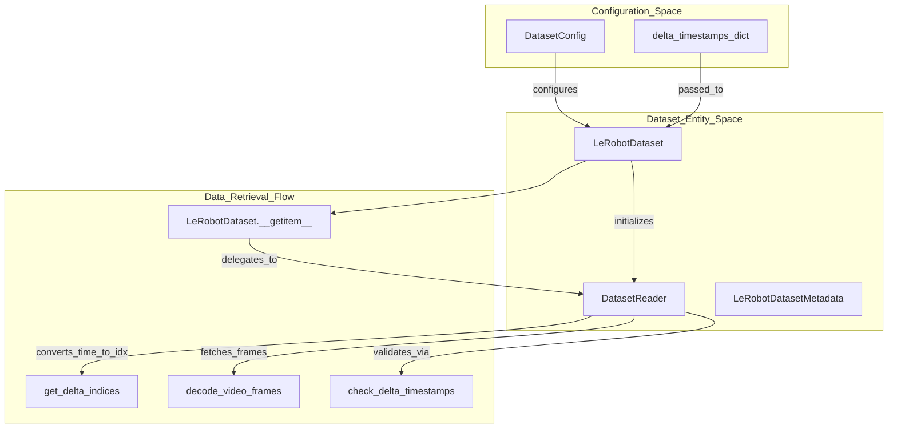
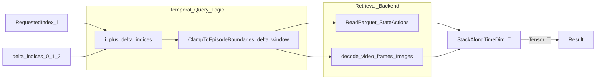

<!-- source: DeepWiki mcp.deepwiki.com · repo huggingface/lerobot · page 2.5 Temporal Queries and Delta Timestamps · fetched 2026-10-26 -->

# Temporal Queries and Delta Timestamps

<details>
<summary>Relevant source files</summary>

The following files were used as context for generating this wiki page:

- [src/lerobot/configs/default.py](src/lerobot/configs/default.py)
- [src/lerobot/datasets/dataset_metadata.py](src/lerobot/datasets/dataset_metadata.py)
- [src/lerobot/datasets/dataset_reader.py](src/lerobot/datasets/dataset_reader.py)
- [src/lerobot/datasets/factory.py](src/lerobot/datasets/factory.py)
- [src/lerobot/datasets/lerobot_dataset.py](src/lerobot/datasets/lerobot_dataset.py)
- [src/lerobot/datasets/sampler.py](src/lerobot/datasets/sampler.py)
- [src/lerobot/datasets/streaming_dataset.py](src/lerobot/datasets/streaming_dataset.py)
- [src/lerobot/datasets/utils.py](src/lerobot/datasets/utils.py)
- [src/lerobot/datasets/video_utils.py](src/lerobot/datasets/video_utils.py)
- [tests/configs/test_default.py](tests/configs/test_default.py)
- [tests/datasets/test_dataset_utils.py](tests/datasets/test_dataset_utils.py)
- [tests/datasets/test_datasets.py](tests/datasets/test_datasets.py)
- [tests/datasets/test_sampler.py](tests/datasets/test_sampler.py)
- [tests/datasets/test_streaming.py](tests/datasets/test_streaming.py)

</details>


## Purpose and Scope

This page documents the `delta_timestamps` feature in `LeRobotDataset`, which enables efficient querying of observations and actions at relative time offsets. This mechanism is fundamental for training policies that require temporal context, such as observation history for transformers or future action sequences for chunked predictions.

The implementation is primarily handled within the `LeRobotDataset` facade [src/lerobot/datasets/lerobot_dataset.py:52-77](), its internal `DatasetReader` component [src/lerobot/datasets/dataset_reader.py:110-147](), and the factory resolution utilities [src/lerobot/datasets/factory.py:36-102](), which manage the translation of time-based queries into frame-based indexing and video decoding.

Sources: [src/lerobot/datasets/lerobot_dataset.py:52-77](), [src/lerobot/datasets/dataset_reader.py:110-147](), [src/lerobot/datasets/factory.py:36-102]()

## Overview

Delta timestamps allow you to specify a set of time offsets (in seconds) for any feature in the dataset. When accessing an index, the dataset automatically retrieves data at those temporal offsets relative to the current frame's timestamp. This is commonly used for:

- **Observation history**: Providing temporal context (negative deltas) to the policy.
- **Action chunking**: Retrieving future action sequences for multi-step prediction (positive deltas).
- **Temporal Alignment**: Ensuring multi-modal data (e.g., cameras and state) are synchronized across a sequence.

The delta timestamps are validated and resolved during dataset instantiation within the `DatasetReader` [src/lerobot/datasets/dataset_reader.py:163-168]() and resolved via `resolve_delta_timestamps` [src/lerobot/datasets/factory.py:39-105]().

Sources: [src/lerobot/datasets/factory.py:39-105](), [src/lerobot/datasets/dataset_reader.py:163-168]()

## Core Concepts

### Temporal Indexing

A standard dataset access returns data for a single frame at index `i`. With delta timestamps, accessing index `i` returns a temporal sequence centered at frame `i`.

### Time Deltas vs Frame Indices

Delta timestamps are specified in **seconds** but are converted to **frame indices** internally via `get_delta_indices` [src/lerobot/datasets/dataset_reader.py:169](). The conversion uses rounding based on the dataset's recorded FPS [src/lerobot/datasets/dataset_reader.py:169]().

| Time Delta (s) | FPS | Frame Index Offset |
|:---|:---|:---|
| -0.1 | 10 | -1 |
| 0.0 | 10 | 0 |
| 0.1 | 10 | +1 |

### Tolerance Mechanism

To ensure data integrity, delta timestamps must be multiples of `1/fps` within a specified `tolerance_s` (default: `1e-4`) [src/lerobot/datasets/lerobot_dataset.py:61](). This prevents queries for non-existent intermediate frames. Validation is performed using `check_delta_timestamps`, which raises a `ValueError` if the provided deltas deviate too far from the expected step size [src/lerobot/datasets/dataset_reader.py:168]().

Sources: [src/lerobot/datasets/lerobot_dataset.py:61](), [src/lerobot/datasets/dataset_reader.py:168](), [src/lerobot/datasets/feature_utils.py:30-32]()

## Configuration and Implementation

### Specifying Delta Timestamps

Delta timestamps are provided as a dictionary mapping feature keys to lists of time offsets [src/lerobot/datasets/lerobot_dataset.py:60]().

```python
# Example: 2-frame observation history + 4-frame action chunk
delta_timestamps = {
    "observation.images.laptop": [-0.1, 0.0],
    "action": [0.0, 0.05, 0.1, 0.15],
}
```

### System Architecture: Code Entity Space

The following diagram bridges the high-level temporal query concept to the specific classes and functions in the codebase.

Title: "Temporal Query Code Entities"

Sources: [src/lerobot/datasets/lerobot_dataset.py:52-77](), [src/lerobot/datasets/dataset_reader.py:110-175](), [src/lerobot/datasets/feature_utils.py:30-32](), [src/lerobot/datasets/video_utils.py:121-128]()

### Data Flow: Query Execution

When `__getitem__` is called, the dataset performs the following steps for each feature with delta timestamps:

1. **Resolve Delta Indices**: The system maps time offsets to integer frame offsets based on FPS using `get_delta_indices` [src/lerobot/datasets/dataset_reader.py:169]().
2. **Calculate Target Indices**: Target indices are calculated by adding delta offsets to the requested index.
3. **Episode Boundary Clamping**: The system ensures queried indices stay within the current episode's range. If a query asks for `t-1` at the start of an episode, it is clamped to the first available frame using `delta_window` [src/lerobot/datasets/utils.py:147-161]().
4. **Load and Stack**: Data for all calculated indices is retrieved. For video features, this involves calling `decode_video_frames` with the calculated timestamps and the defined `tolerance_s` [src/lerobot/datasets/video_utils.py:121-128]().

Title: "Temporal Query Execution Flow"

Sources: [src/lerobot/datasets/lerobot_dataset.py:52-77](), [src/lerobot/datasets/dataset_reader.py:110-175](), [src/lerobot/datasets/utils.py:147-161](), [src/lerobot/datasets/video_utils.py:121-128]()

## Streaming and Backtracking

For large-scale training where random access is inefficient, LeRobot provides `StreamingLeRobotDataset` [src/lerobot/datasets/streaming_dataset.py:170](). This class uses a `Backtrackable` wrapper to handle temporal lookups without reloading shards.

- **Backtrackable**: Wraps an iterator to allow stepping back up to `history` items and looking ahead up to `lookahead` items. This is implicitly handled by the `EpisodeByteCache` and `EpisodeParquetReader` within the streaming dataset, which manage the buffering of episode data and video frames to allow for efficient temporal access.
- **Peek Functions**: `peek_back(n)` and `peek_ahead(n)` allow inspecting temporal context without moving the primary iterator cursor. These are internal mechanisms within the streaming dataset's episode management.

Sources: [src/lerobot/datasets/streaming_dataset.py:170]()

## Usage in Policy Training

### Automatic Resolution

The training pipeline uses `DatasetConfig` [src/lerobot/configs/default.py:29-58]() and `resolve_delta_timestamps` [src/lerobot/datasets/factory.py:39-105]() to manage these parameters. When instantiating `LeRobotDataset`, the `delta_timestamps` dictionary is used to prepare the reader for multi-frame retrieval.

### Impact on Data Shapes

When delta timestamps are used, the tensors returned by the dataset gain a temporal dimension. For example, an image feature with shape `(C, H, W)` queried with 3 delta timestamps will result in a tensor of shape `(3, C, H, W)`.

### Multi-Dataset Support

When using `MultiLeRobotDataset`, the `delta_timestamps` are propagated to all underlying dataset instances. This ensures that even if datasets have different lengths or IDs, they are queried with the same relative temporal logic.

Sources: [src/lerobot/configs/default.py:29-58](), [src/lerobot/datasets/factory.py:39-105]()

## Summary of Key Implementation Details

| Component | Code Entity | Role |
| :--- | :--- | :--- |
| **Storage** | `LeRobotDataset.delta_timestamps` | Stores the relative time offsets in seconds [src/lerobot/datasets/lerobot_dataset.py:60](). |
| **Validation** | `check_delta_timestamps` | Ensures requested deltas align with the dataset's FPS [src/lerobot/datasets/feature_utils.py:30-32](). |
| **Resolution** | `get_delta_indices` | Converts seconds to frame offsets based on FPS [src/lerobot/datasets/feature_utils.py:30-32](). |
| **Video Decoding** | `decode_video_frames` | Retrieves frames at specific timestamps within `tolerance_s` [src/lerobot/datasets/video_utils.py:121-128](). |
| **Episode Boundary Clamping** | `delta_window` | Clamps temporal window to episode boundaries [src/lerobot/datasets/utils.py:147-161](). |
| **Streaming Context** | `StreamingLeRobotDataset` | Manages buffers for temporal lookups in streaming mode [src/lerobot/datasets/streaming_dataset.py:170](). |

Sources: [src/lerobot/datasets/lerobot_dataset.py:60](), [src/lerobot/datasets/feature_utils.py:30-32](), [src/lerobot/datasets/video_utils.py:121-128](), [src/lerobot/datasets/utils.py:147-161](), [src/lerobot/datasets/streaming_dataset.py:170]()

---

