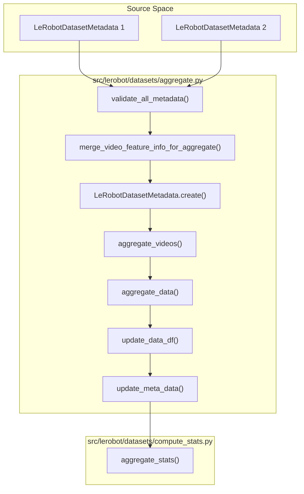
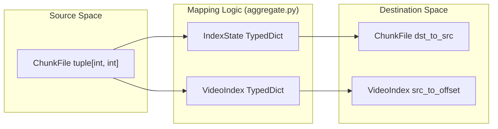

<!-- source: DeepWiki mcp.deepwiki.com · repo huggingface/lerobot · page 2.6 Dataset Aggregation · fetched 2026-10-26 -->

# Dataset Aggregation

<details>
<summary>Relevant source files</summary>

The following files were used as context for generating this wiki page:

- [src/lerobot/configs/__init__.py](src/lerobot/configs/__init__.py)
- [src/lerobot/configs/video.py](src/lerobot/configs/video.py)
- [src/lerobot/datasets/aggregate.py](src/lerobot/datasets/aggregate.py)
- [src/lerobot/datasets/compute_stats.py](src/lerobot/datasets/compute_stats.py)
- [src/lerobot/datasets/depth_utils.py](src/lerobot/datasets/depth_utils.py)
- [src/lerobot/datasets/feature_utils.py](src/lerobot/datasets/feature_utils.py)
- [src/lerobot/datasets/image_writer.py](src/lerobot/datasets/image_writer.py)
- [src/lerobot/datasets/pipeline_features.py](src/lerobot/datasets/pipeline_features.py)
- [tests/datasets/test_aggregate.py](tests/datasets/test_aggregate.py)
- [tests/datasets/test_video_encoding.py](tests/datasets/test_video_encoding.py)
- [tests/fixtures/dataset_factories.py](tests/fixtures/dataset_factories.py)
- [tests/fixtures/hub.py](tests/fixtures/hub.py)

</details>


## Purpose and Scope

Dataset Aggregation enables merging multiple `LeRobotDataset` instances into a single unified dataset (`aggregate_datasets` in `src/lerobot/datasets/aggregate.py` [src/lerobot/datasets/aggregate.py:315]()). This is critical for combining data from multiple recording sessions, pooling demonstrations from different robots with the same embodiment, or creating larger training datasets from smaller collections.

This page covers the aggregation workflow, file organization, index mapping, metadata validation, file consolidation, and stats computation. For information about the core dataset format, see page 2.1 (Dataset Format and Structure). For dataset manipulation operations like splitting or deleting episodes, see page 2.3 (Dataset Manipulation Tools).

Sources: [src/lerobot/datasets/aggregate.py:1-16](), [src/lerobot/datasets/lerobot_dataset.py:35-64]()

## Overview

Dataset aggregation combines multiple source datasets into a destination dataset through a structured sequence of operations defined in `src/lerobot/datasets/aggregate.py`:

1.  **Validation**: `validate_all_metadata()` ensures all source datasets have compatible `fps`, `robot_type`, and `features` [src/lerobot/datasets/aggregate.py:123-157]().
2.  **Vocabulary Unification**: Consolidates task descriptions into a unified task vocabulary [src/lerobot/datasets/aggregate.py:372-374]().
3.  **Video Consolidation**: Concatenates video files via `aggregate_videos()` while respecting file size limits [src/lerobot/datasets/aggregate.py:401-507]().
4.  **Data Merging**: Merges parquet data files via `aggregate_data()` with file size-based chunk rotation [src/lerobot/datasets/aggregate.py:510-608]().
5.  **Index Remapping**: Updates episode metadata via `update_meta_data()` and `update_data_df()` to maintain valid chunk and frame indices [src/lerobot/datasets/aggregate.py:160-302]().

Sources: [src/lerobot/datasets/aggregate.py:315-399]()

## High-Level Workflow

### Code Entity Data Flow
The following diagram maps high-level aggregation concepts to concrete code entities in `src/lerobot/datasets/aggregate.py` and `src/lerobot/datasets/compute_stats.py`.



**Diagram: Data flow from source metadata through aggregate.py functions to compute_stats.py**

Sources: [src/lerobot/datasets/aggregate.py:79-608](), [src/lerobot/datasets/compute_stats.py:31-31]()

## Aggregation Function Entry Point

The main entry point is `aggregate_datasets()` defined in `src/lerobot/datasets/aggregate.py` [src/lerobot/datasets/aggregate.py:315]().

```python
def aggregate_datasets(
    repo_ids: list[str],
    aggr_repo_id: str,
    roots: list[Path] | None = None,
    aggr_root: Path | None = None,
    data_files_size_in_mb: float | None = None,
    video_files_size_in_mb: float | None = None,
    chunk_size: int | None = None,
)
```

| Parameter | Type | Default | Description |
| :--- | :--- | :--- | :--- |
| `repo_ids` | `list[str]` | Required | Repository IDs of datasets to aggregate |
| `aggr_repo_id` | `str` | Required | Repository ID for the aggregated dataset |
| `roots` | `list[Path] \| None` | None | Local paths for source datasets |
| `aggr_root` | `Path \| None` | None | Local path for aggregated dataset |
| `data_files_size_in_mb` | `float \| None` | 100 | Max size for data parquet files (`DEFAULT_DATA_FILE_SIZE_IN_MB` [src/lerobot/datasets/utils.py:45]()) |
| `video_files_size_in_mb` | `float \| None` | 200 | Max size for video files (`DEFAULT_VIDEO_FILE_SIZE_IN_MB` [src/lerobot/datasets/utils.py:47]()) |
| `chunk_size` | `int \| None` | 1000 | Max files per chunk directory (`DEFAULT_CHUNK_SIZE` [src/lerobot/datasets/utils.py:44]()) |

Sources: [src/lerobot/datasets/aggregate.py:315-340](), [src/lerobot/datasets/utils.py:44-49]()

## Metadata Validation and Feature Merging

Before aggregation begins, `validate_all_metadata()` checks that all source `LeRobotDatasetMetadata` objects are compatible [src/lerobot/datasets/aggregate.py:123-157]().

**Compatibility Requirements:**

| Field | Requirement | Effect if violated |
| :--- | :--- | :--- |
| `fps` | Must be identical across all datasets | `ValueError` [src/lerobot/datasets/aggregate.py:146-147]() |
| `robot_type` | Must be identical (same embodiment) | `ValueError` [src/lerobot/datasets/aggregate.py:148-151]() |
| `features` | Compatible via `features_equal_for_merge()` [src/lerobot/datasets/feature_utils.py:143]() | `ValueError` [src/lerobot/datasets/aggregate.py:152-155]() |

Sources: [src/lerobot/datasets/aggregate.py:123-157](), [src/lerobot/datasets/feature_utils.py:141-170]()

### Video Encoder Metadata Merging
When merging datasets, video encoder information defined in `VIDEO_ENCODER_INFO_KEYS` [src/lerobot/configs/__init__.py:39]() is reconciled by `merge_video_feature_info_for_aggregate()` [src/lerobot/datasets/aggregate.py:79-121](). If source datasets have heterogeneous encoder settings, conflicting keys are set to `null` (or `{}` for extra options) in the destination metadata [src/lerobot/datasets/aggregate.py:97-113](). The canonical depth marker is also persisted even if a source used a legacy key [src/lerobot/datasets/aggregate.py:118-119]().

Sources: [src/lerobot/datasets/aggregate.py:79-121](), [src/lerobot/configs/__init__.py:39](), [src/lerobot/datasets/feature_utils.py:123-140]()

## Video Aggregation

`aggregate_videos()` concatenates video files from source datasets while respecting file size limits [src/lerobot/datasets/aggregate.py:401-507](). It uses `concatenate_video_files()` from `src/lerobot/datasets/video_utils.py` [src/lerobot/datasets/video_utils.py:52]() to append streams without re-encoding when possible.

### Index Mapping Space
The following diagram illustrates how file indices and time offsets are tracked and mapped during video and data aggregation in `src/lerobot/datasets/aggregate.py`.



**Diagram: Mapping source ChunkFile identifiers to destination index states and video offsets**

Sources: [src/lerobot/datasets/aggregate.py:60-76](), [src/lerobot/datasets/aggregate.py:401-507]()

## Data Aggregation and Index Remapping

`aggregate_data()` merges parquet files containing per-frame observations and actions [src/lerobot/datasets/aggregate.py:510-608](). Each source parquet file is updated using `update_data_df()` before being appended to the destination [src/lerobot/datasets/aggregate.py:160-183]().

**Index updates in `update_data_df()`:**

| Column | Transformation | Code Reference |
| :--- | :--- | :--- |
| `episode_index` | `+= dst_meta.info.total_episodes` | [src/lerobot/datasets/aggregate.py:177-177]() |
| `index` | `+= dst_meta.info.total_frames` | [src/lerobot/datasets/aggregate.py:178-178]() |
| `task_index` | Remapped to unified task vocabulary | [src/lerobot/datasets/aggregate.py:180-181]() |

Sources: [src/lerobot/datasets/aggregate.py:160-183](), [src/lerobot/datasets/aggregate.py:510-608]()

## Metadata Aggregation and `src_to_dst` Remapping

The `update_meta_data()` function performs index updates on episode-level metadata [src/lerobot/datasets/aggregate.py:186-302](). It uses `data_idx["src_to_dst"]` and video index mappings to resolve where each episode's files reside in the destination dataset [src/lerobot/datasets/aggregate.py:213-239]().

**Critical Mappings in `update_meta_data()`:**

| Field | Update Method | Code Reference |
| :--- | :--- | :--- |
| `meta/episodes/chunk_index` | Offset by `meta_idx["chunk"]` | [src/lerobot/datasets/aggregate.py:207-210]() |
| `data/chunk_index` | Map via `data_idx["src_to_dst"]` | [src/lerobot/datasets/aggregate.py:228-232]() |
| `videos/{key}/chunk_index` | Map via `videos_idx[key]["src_to_dst"]` | [src/lerobot/datasets/aggregate.py:255-260]() |
| `videos/{key}/from_timestamp` | Add `videos_idx[key]["src_to_offset"]` | [src/lerobot/datasets/aggregate.py:262-268]() |

Sources: [src/lerobot/datasets/aggregate.py:186-302]()

## Task Aggregation

Tasks are merged by creating a unified vocabulary before the aggregation loop begins. `aggregate_datasets()` concatenates the `tasks` DataFrames from all source metadata, extracts unique task names, and assigns new sequential `task_index` values in the destination [src/lerobot/datasets/aggregate.py:372-374](). `update_data_df()` uses this mapping to ensure frame-level `task_index` references remain correct [src/lerobot/datasets/aggregate.py:180-181]().

Sources: [src/lerobot/datasets/aggregate.py:372-374](), [src/lerobot/datasets/aggregate.py:180-181]()

## Finalization

After the aggregation loop, finalization completes the destination dataset:

1.  Loads final episode metadata from the destination directory [src/lerobot/datasets/aggregate.py:616-618]().
2.  Collects statistics from every source dataset and passes them to `aggregate_stats()` to produce combined normalization statistics (`min`, `max`, `mean`, `std`) [src/lerobot/datasets/compute_stats.py:31-31]().
3.  Persists metadata files via `write_info()`, `write_stats()`, and `write_tasks()` [src/lerobot/datasets/aggregate.py:631-638]().

Sources: [src/lerobot/datasets/aggregate.py:611-638](), [src/lerobot/datasets/compute_stats.py:31-31]()

## File Size Management

Aggregation respects `data_files_size_in_mb` and `video_files_size_in_mb` limits by tracking cumulative sizes and using `update_chunk_file_indices()` to rotate files [src/lerobot/datasets/utils.py:50]().

**Size Calculation Methods:**

| Function | Purpose | Code Reference |
| :--- | :--- | :--- |
| `get_file_size_in_mb()` | Get actual file size on disk | [src/lerobot/datasets/io_utils.py:35]() |
| `get_parquet_file_size_in_mb()` | Get uncompressed parquet size | [src/lerobot/datasets/io_utils.py:36]() |
| `get_video_duration_in_s()` | Get video duration for offset tracking | [src/lerobot/datasets/video_utils.py:52]() |

Sources: [src/lerobot/datasets/aggregate.py:474-502](), [src/lerobot/datasets/aggregate.py:575-593](), [src/lerobot/datasets/io_utils.py:35-36]()

---

