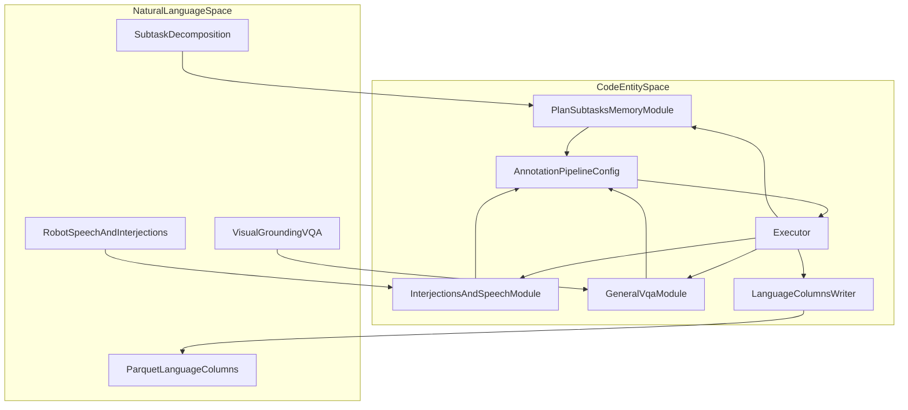
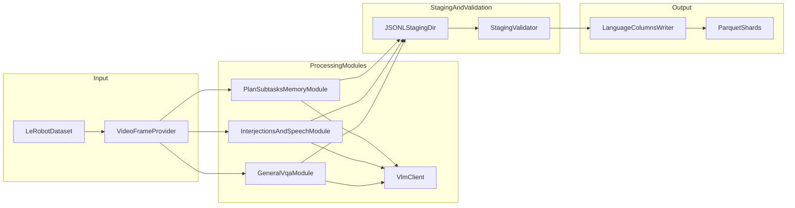

<!-- source: DeepWiki mcp.deepwiki.com · repo huggingface/lerobot · page 2.7 Steerable Annotation Pipeline · fetched 2026-10-26 -->

# Steerable Annotation Pipeline

Relevant source files

The following files were used as context for generating this wiki page:

- [docs/source/annotation_pipeline.mdx](docs/source/annotation_pipeline.mdx)
- [src/lerobot/annotations/steerable_pipeline/config.py](src/lerobot/annotations/steerable_pipeline/config.py)
- [src/lerobot/annotations/steerable_pipeline/executor.py](src/lerobot/annotations/steerable_pipeline/executor.py)
- [src/lerobot/annotations/steerable_pipeline/frames.py](src/lerobot/annotations/steerable_pipeline/frames.py)
- [src/lerobot/annotations/steerable_pipeline/modules/general_vqa.py](src/lerobot/annotations/steerable_pipeline/modules/general_vqa.py)
- [src/lerobot/annotations/steerable_pipeline/modules/plan_subtasks_memory.py](src/lerobot/annotations/steerable_pipeline/modules/plan_subtasks_memory.py)
- [src/lerobot/annotations/steerable_pipeline/prompts/__init__.py](src/lerobot/annotations/steerable_pipeline/prompts/__init__.py)
- [src/lerobot/annotations/steerable_pipeline/prompts/plan_subtask_relabel.txt](src/lerobot/annotations/steerable_pipeline/prompts/plan_subtask_relabel.txt)
- [src/lerobot/annotations/steerable_pipeline/prompts/plan_subtasks.txt](src/lerobot/annotations/steerable_pipeline/prompts/plan_subtasks.txt)
- [src/lerobot/annotations/steerable_pipeline/prompts/vqa.txt](src/lerobot/annotations/steerable_pipeline/prompts/vqa.txt)
- [src/lerobot/annotations/steerable_pipeline/reader.py](src/lerobot/annotations/steerable_pipeline/reader.py)
- [src/lerobot/annotations/steerable_pipeline/vlm_client.py](src/lerobot/annotations/steerable_pipeline/vlm_client.py)
- [src/lerobot/jobs/__init__.py](src/lerobot/jobs/__init__.py)
- [src/lerobot/jobs/annotate.py](src/lerobot/jobs/annotate.py)
- [src/lerobot/jobs/hf.py](src/lerobot/jobs/hf.py)
- [tests/annotations/test_frames.py](tests/annotations/test_frames.py)
- [tests/annotations/test_modules.py](tests/annotations/test_modules.py)
- [tests/jobs/test_annotate.py](tests/jobs/test_annotate.py)
- [tests/jobs/test_hf.py](tests/jobs/test_hf.py)

The purpose and scope of this section is to document `lerobot-annotate` and the steerable Vision-Language Model (VLM)-based annotation pipeline [src/lerobot/jobs/annotate.py:16-35](). The pipeline generates high-level language descriptions, subtask segmentations, interjections, speech tool calls, and visual question-answering (VQA) pairs, populating the `language_persistent` and `language_events` columns in LeRobot v3 datasets [docs/source/annotation_pipeline.mdx:3-12]().

Sources: [src/lerobot/jobs/annotate.py:16-35](), [docs/source/annotation_pipeline.mdx:3-12]()

## Execution Model and Pipeline Phases

The pipeline is orchestrated by the `Executor` class [src/lerobot/annotations/steerable_pipeline/executor.py:76-83]() through a structured six-phase execution model. Each phase reads dataset frames, interacts with a shared VLM backend via `VlmClient` [src/lerobot/annotations/steerable_pipeline/vlm_client.py:54-65](), and stages its output before validation and writing.

### The Six Phases

1.  **Plan**: Implemented via `PlanSubtasksMemoryModule` [src/lerobot/annotations/steerable_pipeline/executor.py:86](), this phase generates high-level plans, subtask segmentations, and memory summaries using a two-step describe-and-segment flow on timestamped contact sheets [docs/source/annotation_pipeline.mdx:64-82]().
2.  **Interjections**: Implemented via `InterjectionsAndSpeechModule` [src/lerobot/annotations/steerable_pipeline/executor.py:87](), this phase detects points where user corrections or speech occur, utilizing temporal frame windows to capture motion [src/lerobot/annotations/steerable_pipeline/config.py:129-141]().
3.  **Plan-Update**: Managed directly by the `Executor` [src/lerobot/annotations/steerable_pipeline/executor.py:111-112](), this phase refreshes high-level plans at interjection points or cross-checks multi-view consistency to ensure `language_persistent` remains aligned [src/lerobot/annotations/steerable_pipeline/executor.py:29-31]().
4.  **VQA**: Implemented via `GeneralVqaModule` [src/lerobot/annotations/steerable_pipeline/executor.py:88](), this phase executes dense temporal queries (bounding boxes, keypoints, counts, attributes, and spatial relations) [src/lerobot/annotations/steerable_pipeline/config.py:144-152]().
5.  **Validator**: Implemented via `StagingValidator` [src/lerobot/annotations/steerable_pipeline/executor.py:90](), this phase checks staged JSONL outputs for timestamp alignment, camera key validity, and schema correctness before parquet rewriting [src/lerobot/annotations/steerable_pipeline/validator.py:16-31]().
6.  **Writer**: Implemented via `LanguageColumnsWriter` [src/lerobot/annotations/steerable_pipeline/executor.py:89](), this phase writes validated records into dataset parquet files (`data/chunk-*/file-*.parquet`) and updates the tool registry in `meta/info.json` [src/lerobot/annotations/steerable_pipeline/writer.py:16-28](), [docs/source/annotation_pipeline.mdx:98-101]().

### Pipeline Entity Mapping

Title: Natural Language Space to Code Entity Space

Sources: [src/lerobot/annotations/steerable_pipeline/executor.py:76-90](), [src/lerobot/annotations/steerable_pipeline/config.py:48-157](), [docs/source/annotation_pipeline.mdx:16-43]()

## Data Flow and Intermediate Staging

To prevent data corruption and support distributed recovery, modules output their results into an intermediate staging directory (`.annotate_staging/`) in JSONL format via `EpisodeStaging` prior to validation and final parquet writing [docs/source/annotation_pipeline.mdx:31-43](), [src/lerobot/annotations/steerable_pipeline/staging.py:1-50]().

Title: Annotation Data Flow

Sources: [src/lerobot/annotations/steerable_pipeline/frames.py:118-135](), [docs/source/annotation_pipeline.mdx:16-43](), [src/lerobot/annotations/steerable_pipeline/vlm_client.py:54-65]()

## Language Column Outputs

The pipeline populates two primary struct-based columns inside `data/chunk-*/file-*.parquet`:

| Column | Description | Supported Styles / Atoms | Generating Module |
| :--- | :--- | :--- | :--- |
| `language_persistent` | Long-term context and subtask goals broadcasted across frames. | `subtask`, `plan`, `memory`, `task_aug` | `PlanSubtasksMemoryModule` [src/lerobot/annotations/steerable_pipeline/executor.py:86]() |
| `language_events` | Discrete, timestamped events or speech matching frame timestamps. | `interjection`, `say` (tool-call), `vqa` | `InterjectionsAndSpeechModule`, `GeneralVqaModule` [src/lerobot/annotations/steerable_pipeline/executor.py:87-88]() |

Sources: [docs/source/annotation_pipeline.mdx:54-63](), [src/lerobot/jobs/annotate.py:16-17](), [src/lerobot/datasets/language_render.py:36-66]()

## Configuration System

The pipeline is parameterized via dataclasses defined in `src/lerobot/annotations/steerable_pipeline/config.py` [src/lerobot/annotations/steerable_pipeline/config.py:31-173]().

*   `AnnotationPipelineConfig`: The top-level configuration containing paths (`root`, `repo_id`, `new_repo_id`), backend settings (`vlm_backend`, `video_backend`), module sub-configs (`plan`, `interjections`, `vqa`), and execution control parameters [src/lerobot/jobs/annotate.py:45]().
*   `PlanConfig`: Controls subtask granularity (`frames_per_second`, `max_frames_per_prompt`), contact sheet rendering dimensions, and task augmentation [src/lerobot/annotations/steerable_pipeline/config.py:48-111]().
*   `InterjectionsConfig`: Governs interjection frequency and sliding window sizes (`interjection_window_seconds`) [src/lerobot/annotations/steerable_pipeline/config.py:129-141]().
*   `VqaConfig`: Configures emission frequencies (`vqa_emission_hz`), temporal window grouping `K`, and question types (`bbox`, `keypoint`, `count`, `attribute`, `spatial`) [src/lerobot/annotations/steerable_pipeline/config.py:144-152]().
*   `VlmConfig`: Sets the VLM `model_id`, API base URL, server timeout, and generation parameters [src/lerobot/annotations/steerable_pipeline/config.py:159-173]().

Sources: [src/lerobot/annotations/steerable_pipeline/config.py:31-173](), [src/lerobot/jobs/annotate.py:45]()

## Distributed Execution via HF Jobs

When operating on large datasets, `lerobot-annotate` supports remote offloading to Hugging Face Jobs via `--job.target=<flavor>` [src/lerobot/jobs/annotate.py:27-35]().

1.  **Job Submission**: The CLI invokes `submit_annotate_to_hf` when `cfg.job.is_remote` is true, packaging arguments into an HF Jobs request [src/lerobot/jobs/annotate.py:80-85]().
2.  **Runtime Image**: Jobs start from the `vllm/vllm-openai` runtime container (`DEFAULT_ANNOTATE_JOB_IMAGE`) and pip-install `lerobot` from git based on `AnnotationJobConfig.lerobot_ref` [src/lerobot/annotations/steerable_pipeline/config.py:25-44]().
3.  **Hub Uploads**: If `push_to_hub=true`, the result is pushed to `new_repo_id` (or `repo_id` in place), regenerating the dataset card (`README.md`) with valid visualization badges [src/lerobot/jobs/annotate.py:139-172](), [tests/jobs/test_annotate.py:30-99]().

Sources: [src/lerobot/jobs/annotate.py:80-172](), [src/lerobot/annotations/steerable_pipeline/config.py:25-44](), [tests/jobs/test_annotate.py:30-99]()

## SARM Subtask Annotation

The pipeline directly supports **SARM (Stage-Aware Reward Modeling)** and dense subtask labeling [docs/source/annotation_pipeline.mdx:64-95](). By leveraging dense temporal sampling (default `frames_per_second=2.0` [src/lerobot/annotations/steerable_pipeline/config.py:69-70]()) and windowed chunking (`max_frames_per_prompt=60` [src/lerobot/annotations/steerable_pipeline/config.py:78]()), long video episodes are segmented into atomic subtask intervals.

Furthermore, `PlanConfig` supports EgoMimic-style 5-axis task augmentation (`TaskAugAxesConfig`), generating variations across synonyms, omitted arms, omitted orientations, and grasp methods [src/lerobot/annotations/steerable_pipeline/config.py:113-126]() to improve robustness during policy training.

Sources: [src/lerobot/annotations/steerable_pipeline/config.py:48-126](), [docs/source/annotation_pipeline.mdx:64-95]()

---

